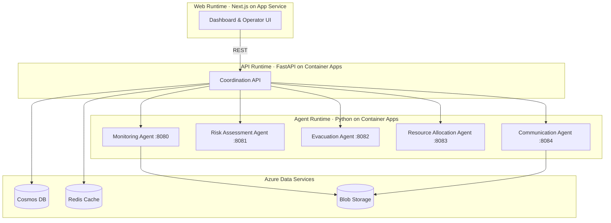

# Autonomous Disaster Response Agent Coordination Hub

A multi-agent AI platform that coordinates autonomous disaster response across Australian emergency services, enabling faster evacuations, smarter resource deployment, and real-time cross-agency communication.


## Table of Contents

- [Overview](#overview)
- [Architecture](#architecture)
- [Quickstart](#quickstart)
- [AIIMS Personas \& Human Authority](#aiims-personas--human-authority)
- [Agents](#agents)
- [Repository Structure](#repository-structure)
- [Technology Stack](#technology-stack)
- [Success Metrics](#success-metrics)
- [Documentation](#documentation)
- [Contributing](#contributing)

## Overview

This platform helps Australian emergency teams respond to disasters faster and more effectively. Five AI agents work together to monitor threats, assess risks, plan evacuations, allocate resources, and coordinate communications across agencies.

The system follows the Australasian Inter-Service Incident Management System (AIIMS). All agents operate under human oversight. No agent can override a human decision on safety-critical actions. The Incident Commander retains final authority over all life-safety decisions.

Built as a cloud-native monorepo, the platform runs three runtimes on Azure — a Next.js web dashboard, a FastAPI coordination API, and Python-based autonomous agents. It targets deployment to Australian Azure regions to meet data residency requirements.

For the full set of guiding principles, see the [Project Constitution](.specify/memory/constitution.md).

## Architecture



The diagram above shows the simplified system architecture. The Web runtime serves the operator dashboard. The API runtime handles coordination logic and routes requests to agents. Each agent runs as an independent process within the Agent runtime. All runtimes share Azure-managed data stores.

For the complete architecture including security boundaries, network topology, and deployment pipelines, see [Architecture Documentation](docs/disaster-response-hub/architecture.md).

## Quickstart

Get the platform running locally in under 15 minutes. No Azure credentials are needed for local development.

<details>
<summary><strong>Prerequisites for Local Development</strong></summary>

- [Python](https://python.org) ≥ 3.12
- [Node.js](https://nodejs.org) ≥ 22
- [pnpm](https://pnpm.io) 10.6.3 — enable with `corepack enable && corepack prepare pnpm@10.6.3`
- [uv](https://docs.astral.sh/uv/) — fast Python package manager
- [Docker](https://docker.com) — for local data services
- [Git](https://git-scm.com)

</details>

<details>
<summary><strong>Prerequisites for Azure Deployment</strong></summary>

- [Azure CLI](https://learn.microsoft.com/cli/azure/) ≥ 2.60
- [Azure Developer CLI (azd)](https://learn.microsoft.com/azure/developer/azure-developer-cli/)
- An active Azure subscription

</details>

### Clone and Install

```bash
git clone https://github.com/johnbilliris/ama.git
cd ama
```

Install dependencies for all runtimes:

```bash
# Python dependencies (API + Agents)
uv sync

# Web dependencies
pnpm install
```

### Run Locally

Start each runtime in a separate terminal:

```bash
# API runtime (FastAPI)
cd apps/api
uv run uvicorn main:app --reload --port 8000

# Agent runtime
cd apps/agents
uv run python -m agents

# Web runtime (Next.js)
cd apps/web
pnpm dev
```

### Deploy to Azure

The deployment targets **Australia East** as the primary region. Follow the infrastructure setup in [`infra/`](infra/) to deploy all runtimes to Azure Container Apps and App Service:

```bash
azd up
```

## AIIMS Personas & Human Authority

This platform aligns with the Australasian Inter-Service Incident Management System (AIIMS). Each agent maps to a functional role in the AIIMS structure. Human operators fill these roles and use the platform as a decision-support tool — not a replacement for incident management governance.

| AIIMS Role | System Capability | Agent |
| --- | --- | --- |
| Incident Commander | Strategic oversight and final authority on all decisions | — (Human only) |
| Operations Officer | Real-time threat detection and field coordination | Monitoring, Evacuation |
| Planning Officer | Risk modelling, scenario analysis, evacuation planning | Risk Assessment |
| Logistics Officer | Resource tracking, allocation, supply chain optimisation | Resource Allocation |
| Public Information Officer | Multi-channel alerts, multilingual communications | Communication |

> **⚠️ Incident Commander Authority**: The Incident Commander retains final authority over all safety-critical decisions. No agent may autonomously execute evacuation orders, override human decisions, or exceed its configured decision rights. All agent recommendations require human approval before action. See the [Project Constitution](.specify/memory/constitution.md) for the complete set of life-safety principles.

## Agents

<details>
<summary><strong>View all 5 agents and their responsibilities</strong></summary>

### Monitoring Agent (`:8080`)

Ingests real-time data from weather services, seismic sensors, satellite imagery, and IoT devices. Detects emerging threats and triggers alerts when thresholds are breached.

### Risk Assessment Agent (`:8081`)

Analyses threat data from the Monitoring Agent to model risk scenarios. Generates probability assessments, impact projections, and recommended response priorities.

### Evacuation Agent (`:8082`)

Plans evacuation routes based on risk assessments, population density, road networks, and shelter capacity. Produces time-phased evacuation orders for human approval.

### Resource Allocation Agent (`:8083`)

Tracks available resources across agencies — personnel, vehicles, medical supplies, shelters. Optimises deployment plans to maximise coverage and minimise response time.

### Communication Agent (`:8084`)

Manages multi-channel alert distribution — SMS, email, radio, social media. Supports multilingual messaging for diverse communities and coordinates cross-agency communications.

### Dependency Notifier Agent

Cross-agency dependency-graph notifier. Watches for upstream changes (e.g. weather, hydrology, road-closure) that would invalidate or escalate active recommendations, and pushes targeted notifications to the affected operators and partner agencies. Promoted to first-class agent per spec 032 (FR-AG04). See `apps/agents/dependency_notifier/`.

</details>

## Repository Structure

<details>
<summary><strong>View monorepo layout</strong></summary>

```text
ama/
├── apps/
│   ├── api/                     # FastAPI coordination API (API runtime)
│   ├── agents/                  # Python autonomous agents (Agent runtime)
│   │   ├── monitoring/          # Threat detection and alerting
│   │   ├── risk_assessment/     # Risk modelling and scenarios
│   │   ├── evacuation/          # Evacuation route planning
│   │   ├── resource_allocation/ # Resource tracking and deployment
│   │   ├── communication/       # Multi-channel alert distribution
│   │   └── common/              # Shared agent utilities
│   ├── ingestion/               # Data ingestion pipeline
│   └── web/                     # Next.js dashboard (Web runtime)
├── packages/
│   ├── domain/                  # Shared domain models
│   ├── schemas/                 # OpenAPI and JSON Schema definitions
│   └── ui/                      # Shared UI component library
├── infra/                       # Azure Bicep IaC templates
│   ├── main.bicep               # Root deployment template
│   ├── bicep/                   # Shared Bicep modules
│   ├── modules/                 # Resource-specific modules
│   └── policies/                # Azure Policy definitions
├── specs/                       # Feature specifications
├── tests/                       # Test suites
│   ├── unit/                    # Unit tests
│   ├── integration/             # Integration tests
│   ├── contract/                # Contract tests
│   ├── e2e/                     # End-to-end tests
│   ├── load/                    # Load and performance tests
│   ├── simulation/              # Agent simulation tests
│   └── benchmark/               # Performance benchmarks
├── docs/                        # Project documentation
├── scripts/                     # Utility and seed scripts
├── package.json                 # pnpm workspace root
├── pyproject.toml               # Python project configuration
└── azure.yaml                   # Azure Developer CLI configuration
```

</details>

## Technology Stack

### Core Technologies

| Layer | Technology | Purpose |
| --- | --- | --- |
| Web Runtime | Next.js 15, React, TypeScript | Operator dashboard and UI |
| API Runtime | FastAPI, Python ≥ 3.12 | Coordination API and routing |
| Agent Runtime | Python ≥ 3.12 | Autonomous agent processes |
| Package Manager (JS) | pnpm 10.6.3 | Monorepo workspace management |
| Package Manager (Python) | uv | Fast Python dependency management |

### Azure Deployment Target

| Service | Purpose |
| --- | --- |
| Azure Container Apps | API and Agent runtimes |
| Azure App Service | Web runtime (Next.js) |
| Azure Cosmos DB | Event store and domain data |
| Azure Cache for Redis | Session and real-time cache |
| Azure Blob Storage | Documents, imagery, audit logs |
| Azure Entra ID | Authentication and RBAC |
| Azure Monitor + Application Insights | Observability and diagnostics |

**Deployment Region**: Australia East (primary). All data remains within Australian Azure regions to meet data residency requirements.

## Success Metrics

These targets are drawn from the [Capstone Brief](capstone.md) and represent the platform's measurable impact goals:

| Metric | Target |
| --- | --- |
| Lives saved annually | 1,000+ |
| Disaster response time reduction | 50% |
| Earlier evacuation of at-risk populations | 24 hours |
| Emergency resource deployment efficiency | 30% improvement |
| Disaster-related economic loss reduction | 30% |

## Documentation

### For Evaluators

- [AMA Rubric (Asia)](AMA_Rubric_Asia.md) — assessment criteria and scoring
- [Capstone Brief](capstone.md) — project scope, goals, and success metrics
- [Executive Deck](docs/disaster-response-hub/demo/executive-deck.md) — high-level overview for stakeholders

### For Developers

- [Architecture](docs/disaster-response-hub/architecture.md) — system design, data flows, and deployment topology
- [Feature Specifications](specs/) — detailed specs for each feature
- [Project Constitution](.specify/memory/constitution.md) — guiding principles and decision rights
- [Demo Walkthrough](docs/disaster-response-hub/demo/walkthrough.md) — step-by-step demo scenario
- [Web coverage suite](specs/034-webapp-capstone-coverage/quickstart.md) — Playwright tribunal that proves every capstone outcome × persona combination

### Web coverage suite (spec 034)

The Playwright capstone-coverage suite proves every capstone outcome × persona combination is exercised end-to-end and emits a deterministic trace + gap register that gates merges to `main`. Run the `@p1` smoke locally:

```pwsh
pnpm install
pwsh scripts/seed-database.ps1
$env:AMA_TEST_SUPPORT_ENABLED = "true"
pnpm --filter @ama/web exec playwright test --project=web-coverage-chromium --grep "@p1"
```

See `specs/034-webapp-capstone-coverage/quickstart.md` for the full developer onboarding (≤ 30 min cold start) and `tests/e2e/web-coverage/README.md` for the persona-id-to-spec map and tag taxonomy.

### For Operators

- [Operator Runbooks](docs/disaster-response-hub/operator-runbooks.md) — incident activation, alert publishing, degraded mode
- [Quickstart Guide](specs/001-disaster-response-hub/quickstart.md) — getting started with the platform

See the [Project Constitution](.specify/memory/constitution.md) for complete life-safety principles, including the Incident Commander's final authority over all safety-critical decisions.

## Contributing

### Branch Conventions

- `main` — stable, production-ready code
- `feature/<spec-id>-<name>` — feature branches (e.g., `feature/013-root-readme`)
- `fix/<issue>` — bug fixes
- `docs/<topic>` — documentation updates

### Local Quality Checks

Run these checks before submitting a pull request:

```bash
# Python linting and tests
uv run ruff check .
uv run pytest

# Web linting and build
pnpm lint:web
pnpm -C apps/web build
```

### CI/CD

All pull requests targeting `main` are validated by the CI pipeline ([`.github/workflows/ci.yml`](.github/workflows/ci.yml)), which runs:

- Python linting with Ruff
- Python tests with pytest
- TypeScript type checking
- Next.js build validation
- Performance benchmarks

Deployments follow a **branch-equals-environment** model (spec [031](specs/031-simplify-cicd-pipeline/spec.md)):

| Branch | Triggers | Deploys to |
|---|---|---|
| `main` | `ci` | _(no deploy — integration only)_ |
| `dev` | `ci` → `cd` | `rg-drh-dev` (Australia East) |
| `staging` | `ci` → `cd` | `rg-drh-staging` (Australia East, with rollback) |
| `production` | `ci` → `cd` | `rg-drh-production` (Australia East, with rollback) |

Authentication uses a single `AZURE_CREDENTIALS` JSON secret per GitHub Environment — see [ADR-031](docs/aidr/decisions/adr-031-azure-credentials-mvp.md) for the rationale and the planned migration back to OIDC.

Operator runbook for first-time setup, secret rotation, smoke testing, and troubleshooting: [`specs/031-simplify-cicd-pipeline/quickstart.md`](specs/031-simplify-cicd-pipeline/quickstart.md).

### Pull Request Process

1. Create a feature branch from `main`
2. Make your changes and ensure local quality checks pass
3. Open a pull request with a clear description
4. Address review feedback
5. Merge after CI passes and approval is received

---

<sub>Built for the Azure Master Architect program · Status: In Development</sub>
