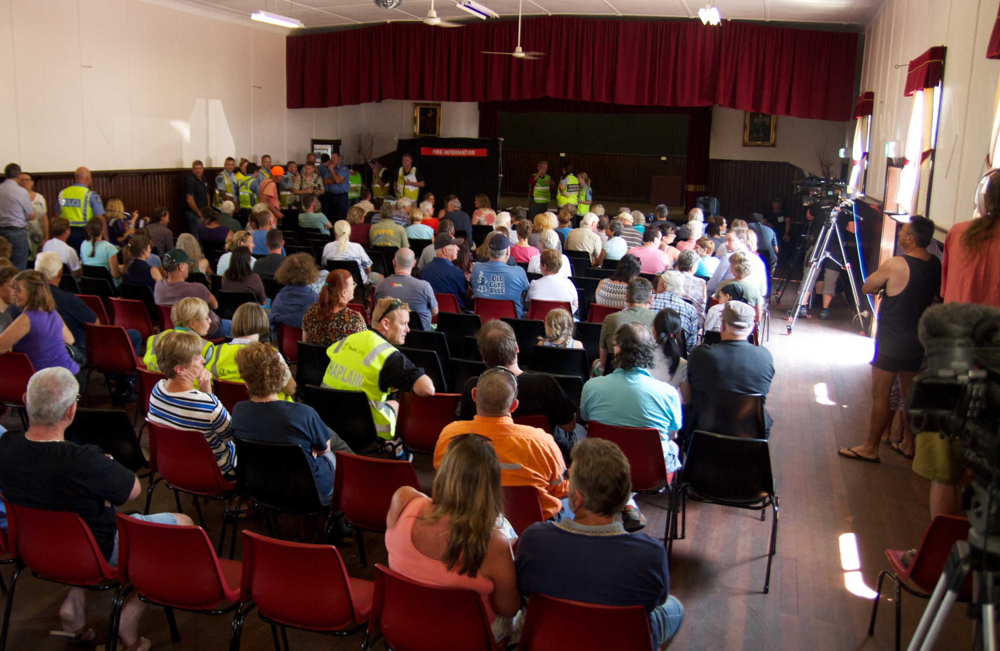
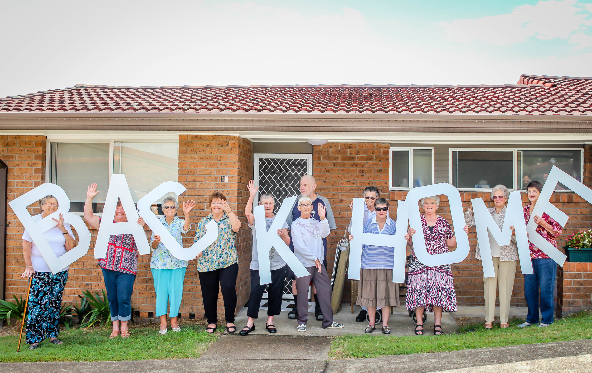
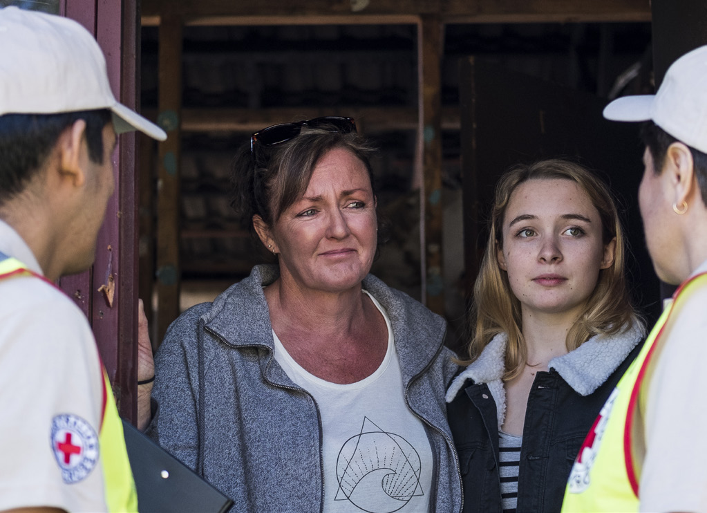

# AIDR Community Recovery Handbook (2018)

> **Source**: Australian Institute for Disaster Resilience (AIDR)
> **URL**: https://knowledge.aidr.org.au/media/5634/community-recovery-handbook.pdf
> *Converted from PDF to Markdown format.*

---
## Page 1

AUSTRALIAN INSTITUTE FOR DISASTER RESILIENCE
Community 
Recovery
HANDBOOK 2
Australian Disaster Resilience Handbook Collection

---
## Page 2

Cover images, clockwise from top: Residents from Dungog's Alison Court return home after floods in April 2015 
destroyed apartments (photo: Kristine O'Sullivan); Homeowners take stock of damage after a house fire. Red Cross 
Emergency Services officers help count the cost. (photo: Conor Ashleigh, Australian Red Cross); Department of Fire 
and Emergency Services (WA) meets with residents in Northcliffe in 2015 (photo: Kyle Nowak, DFES).

---
## Page 3

i
Handbook 2   Community Recovery
AUSTRALIAN DISASTER RESILIENCE 
HANDBOOK COLLECTION
Community Recovery
Handbook 2

---
## Page 4

ii
Handbook 2   Community Recovery
© Commonwealth of Australia 2018 third edition
Edited and published by the Australian Institute 
for Disaster Resilience, on behalf of the Australian 
Government Department of Home Affairs.
Copyright
The Australian Institute for Disaster Resilience 
encourages the dissemination and exchange of 
information provided in this publication.
The Commonwealth of Australia owns the copyright for 
all material contained in this publication unless otherwise 
noted.
Where this publication includes material whose copyright 
is owned by third parties, the Australian Institute for 
Disaster Resilience has made all reasonable efforts to:
•	
clearly label material where the copyright is owned by 
a third party
•	
ensure that the copyright owner has consented to 
this material being presented in this publication.
Wherever a third party holds copyright in material 
presented in this publication, the copyright remains with 
that party. Their permission is required to reproduce the 
material.
All material presented in this publication is provided 
under a Creative Commons Attribution 4.0 International 
Public License, with the exception of:
•	
the Commonwealth Coat of Arms
•	
	registered trademarks, including
−
−
the Australian Government Department of Home 
Affairs logo
−
−
the Australian Institute for Disaster Resilience 
logo
•	
materials specifically mentioned as not being 
provided under a Creative Commons Attribution 4.0 
International Public Licence
•	
content supplied by third parties.
Details of the relevant licence conditions are available on 
the Creative Commons Attribution 4.0 website, as well as 
the full legal code for the CC BY 4.0 license.
Attribution
Where material from this publication is used for any 
purpose, it is to be attributed to the developer as follows:
Source: Australian Disaster Resilience Community 
Recovery Handbook (AIDR 2018)
Using the Commonwealth Coat of Arms
The terms of use for the Coat of Arms are available 
from the It’s an Honour website www.dpmc.gov.au/
government/its-honour 
Contact
Enquiries regarding the content, licence and uses of this 
document may be directed to:
The Australian Institute for Disaster Resilience
370 Albert St
East Melbourne Vic 3002
Telephone +61 (0) 3 9419 2388
Disclaimer
The Australian Government Department of Home Affairs 
and the Australian Institute for Disaster Resilience, in 
consultation with emergency management professionals 
and subject matter experts, exercise care in the 
compilation and drafting of this publication; however, the 
document and related graphics could include technical 
inaccuracies or typographical errors and the information 
may not be appropriate to all situations.
In no event shall the Commonwealth of Australia 
(acting through the Department of Home Affairs or the 
Australian Institute for Disaster Resilience) be liable 
for any damages whatsoever, whether in an action of 
contract, negligence or other tortious action, arising out 
of or in connection with the use of or reliance on any of 
the information in this publication.

---
## Page 5

iii
Handbook 2   Community Recovery
Australian Disaster 
Resilience Handbook 
Collection
The Australian Disaster Resilience Handbook Collection provides guidance on national principles and practices for 
disaster resilience. 
The Handbook Collection: 
•	
provides an authoritative and trusted source of knowledge about disaster resilience principles in Australia 
•	
aligns national disaster resilience strategy and policy with practice, by guiding and supporting jurisdictions, 
agencies and other organisations and individuals in their implementation and adoption 
•	
highlights and promotes the adoption of good practice in building disaster resilience in Australia 
•	
builds interoperability between jurisdictions, agencies, businesses and communities by promoting use of a common 
language and coordinated, nationally agreed principles. 
The Handbook Collection is developed and reviewed by national consultative committees representing a range of state 
and territory agencies, governments, organisations and individuals involved in disaster resilience. The collection is 
sponsored by the Australian Government Department of Home Affairs.
Access to the collection and further details are available at the Australian Disaster Resilience Knowledge Hub (the 
'Knowledge Hub') www.knowledge.aidr.org.au.  
Handbook 1   Disaster Health
Handbook 2 
Community Recovery
Toolkit 2-1  Community recovery checklists
Toolkit 2-2  Community recovery further resources
Toolkit 2-3  Community recovery case studies
 
Handbook 3  Managing Exercises
Handbook 4 
Evacuation Planning
Handbook 5  Communicating with People with a Disability: National Guidelines for Emergency Managers
Handbook 6  National Strategy for Disaster Resilience: Community Engagement Framework
Handbook 7  Managing the Floodplain: A Guide to Best Practice in Flood Risk Management in Australia
Guideline 7-1  Using the National Generic Brief for Flood Investigations to Develop Project Specific Specifications
Guideline 7-2  Flood Emergency Response Classification of the Floodplain
Guideline 7-3  Flood Hazard
Template 7-4  Technical Project Brief Template

---
## Page 6

iv
Handbook 2   Community Recovery
Guideline 7-5  Flood Information to Support Land-use Planning
Guideline 7-6  Assessing Options and Service Levels for Treating Existing Risk
Practice Note 7-7  Considering Flooding in Land-use Planning Activities
Handbook 8  Lessons Management
Handbook 9  Australian Emergency Management Arrangements
Handbook 10  National Emergency Risk Assessment Guidelines
Guideline 10-1 National Emergency Risk Assessment Guidelines: Practice Guide
Training resource 10-2 NERAG Online Training Program 
Handbook 12  Communities Responding to Disasters: Planning for Spontaneous Volunteers
Handbook 14  Incident Management in Australia
Handbook 15  Safe and Healthy Crowded Places
Handbook 16  Public Information and Warnings
Australian Emergency Management Manual Series
The current Australian Emergency Management Manual Series contains 46 publications. The manuals have not been 
reviewed since 2011 or earlier. The Manual Series is undergoing a review which will see relevant manuals move into the 
Handbook Collection or other collections or be archived. Current and past manual editions will remain available on the 
Knowledge Hub.

---
## Page 7

v
Handbook 2   Community Recovery
Acknowledgements
This handbook was made possible through the support of a broad cross-section of the disaster resilience sector in 
Australia and overseas. AIDR thanks representatives from community, government, emergency services, not-for-
profit organisations and other associations for their contributions. 
In particular, AIDR thanks Anne Leadbeater, Director of the Leadbeater Group Pty Ltd, for authoring the handbook.
AIDR also acknowledges the efforts of the steering committee and working group established to support the 
development of this handbook. 

Steering Committee membership:
Australian Red Cross – Kate Brady, National Recovery Adviser, Emergency Services 
Department of Home Affairs – Aaron Verlin, Assistant Secretary, Disaster Recovery Branch, Emergency Management 
Australia
Queensland Reconstruction Authority – Mark Drew, Director, Mitigation Resilience and Recovery Branch
Social Recovery Reference Group – Ronnie Faggotter, Director, State Recovery Office, Department for Communities 
and Social Inclusion (SA)

Working group membership:
Australian Red Cross, South Australia – Anne Ellis, Community Development Officer
Department of Communities, Disability Services and Seniors, Queensland – Phil Carney, Director Operations, 
Community Recovery
Department of the Chief Minister, Northern Territory – Paul Terawsky, Director, Security and Emergency Recovery
Department of Home Affairs – Simon Aitchison, Director, Disaster Recovery Branch Emergency Management Australia 
and Sunila Srivastava, Assistant Director, Disaster Recovery Branch Emergency Management Australia
Department of Environment, Water and Natural Resources, South Australia – Anthony Fox, District Manager Northern 
Hills, Coast & Plains
Department of Health & Human Services, Tasmania – Sulfi Newbold, Senior Analyst, Emergency Preparedness and 
Response
Dungog Shire Community Centre, New South Wales – Sarah U'Brien, Manager
Foundation for Rural and Regional Renewal – Natalie Egleton, Chief Executive Officer
Leva Consulting – Dr Margaret Moreton, Principal Consultant
Logan City Council, Queensland – Marion Lawie, Local Recovery Coordinator
Monash University Disaster Resilience Initiative – Emeritus Professor Frank Archer, Dr Caroline Spencer, Dudley 
McArdle
Mountains Community Resource Network – Kris Newton, Manager
Office of Emergency Management, New South Wales – Allison Rowlands, Director, Disaster Welfare Services
Office of Emergency Management, Western Australia – Steve Joske, State Recovery Coordinator
Office of Security and Emergency Management, Tasmania – Sophie Buchhorn, Project Officer

---
## Page 8

vi
Handbook 2   Community Recovery
Pyrenees Shire, Victoria – David Draffin, Emergency Management Coordinator
Regional Australia Institute – Jack Archer, CEO, Dr Kim Houghton, General Manager, Policy & Research, Dr Emily 
Longstaff, Senior Reseacher
SA Water – Rynier Brandt, Senior Manager Business Planning, Continuity & Resilience, State Manager Engineering 
Functional Support Group
Social Recovery Reference Group – Mark Stratton, Principal Project Manager, State Recovery Office, Department of 
Communities and Social Inclusion (SA)
Torrens Resilience Institute – Professor Paul Arbon, Director
Volunteering Queensland – Sally McKay, Senior Project Advisor

AIDR acknowledges the valuable input of the following individuals and groups:
Australian Business Round Table for Disaster Resilience & Safer Communities, The Insurance Australia Group – Kate 
King, Senior Manager
Australian Red Cross – Shona Whitton, National Recovery Coordinator, Emergency Services
Department of Environment, Water and Natural Resources, South Australia – Mike Wouters, Manager, Fire Knowledge 
& Mapping
Euan Ferguson – Euan Ferguson Pty Ltd, Director
Gender & Disaster Pod – Dr Debra Parkinson, Manager
Macclesfield Disaster Recovery Group – Fiona Sewell, Brigade Liaison
Ourwatch – Emma Partridge, A/Director, Policy and Evaluation
Department of Prime Minister & Cabinet – Immigration, Multiculturalism and Disaster Recovery Section
RMIT – Dr Briony Towers, Research Fellow, Design and Social Context, Global, Urban and Social Studies
Social Recovery Reference Group – Louise Mitchell, Program Manager, Department of Health and Human Resources 
(Vic)
University of Melbourne, Centre for Disaster Management & Public Safety – Dr Lisa Gibbs, Academic Lead, Community 
Resilience & Public Health
Victoria State Emergency Service – Susan Davie, Manager, Community Connections
Victorian Council of Social Services – Bridget Tehan, Senior Policy Analyst, Emergency Management
Yarra Ranges Council, Victoria – Luigi Zarro, Senior Economic Development Specialist

---
## Page 9

vii
Handbook 2   Community Recovery
Contents
Copyright  ...........................................................................................................................................................................................................   ii
Australian Disaster Resilience Handbook Collection  .........................................................................................................................   iii
Acknowledgements  ........................................................................................................................................................................................  v
Jurisdictional arrangements for community recovery  .......................................................................................................................  x
About this handbook  .....................................................................................................................................................................................  xi
Community Recovery Handbook companion documents ................................................................................................................  xiii
Part 1 Introduction to community recovery  ...........................................................................................................................................   1
1.1 What is a disaster?  ...........................................................................................................................................................................................................................   2
	
1.1.1 Emergency management  ..........................................................................................................................................................................................   2
	
1.1.2 The changing nature of disasters  ......................................................................................................................................................................   2
1.2 What is recovery?  ............................................................................................................................................................................................................................  4
	
1.2.1 The affected community  .........................................................................................................................................................................................   5
	
1.2.2 Key agencies  ...................................................................................................................................................................................................................  6
	
1.2.3 Recovery roles  ...............................................................................................................................................................................................................  6
Part 2 Policies and principles that support community recovery  ...................................................................................................  8
2.1 Disaster recovery and emergency management  .......................................................................................................................................................  9
2.2 National Strategy for Disaster Resilience  ....................................................................................................................................................................  10
2.3 National Principles for Disaster Recovery  ...................................................................................................................................................................  10
2.4 Applying the National Principles  ..........................................................................................................................................................................................  12
	
2.4.1 Understanding the context  ..................................................................................................................................................................................  12
	
2.4.2 Recognising complexity  ........................................................................................................................................................................................  21
	
2.4.3 Community-led recovery  ....................................................................................................................................................................................  30
	
2.4.4 Coordination and collaboration  .......................................................................................................................................................................  39
	
2.4.5 Effective communication  ....................................................................................................................................................................................  45
	
2.4.6 Acknowledging and building capacity  ........................................................................................................................................................  48
	
2.4.7 Continuous improvement through monitoring and evaluation  ..................................................................................................  50
Part 3 Planning for recovery  ....................................................................................................................................................................  53
3.1 Effects of disasters on communities  ...............................................................................................................................................................................  54
	
3.1.1 Effects on the social environment  ..................................................................................................................................................................  54
	
3.1.2 Effects on the built environment  ....................................................................................................................................................................  55
	
3.1.3 Effects on the economic environment  .......................................................................................................................................................  55
	
3.1.4 Effects on the natural environment  .............................................................................................................................................................  55
3.2 Recovery plans and processes  ...........................................................................................................................................................................................  56
	
3.2.1 Preparedness and planning  ................................................................................................................................................................................  56

---
## Page 10

viii
Handbook 2   Community Recovery
	
3.2.2 Preparing pre-event and recovery plans  ..................................................................................................................................................  57
	
3.2.3 Other planning activities  ......................................................................................................................................................................................  59
3.3 Operationalising community recovery  ...........................................................................................................................................................................  59
	
3.3.1 Recovery providers  ..................................................................................................................................................................................................  59
	
3.3.2 Recovery over time  .................................................................................................................................................................................................  59
	
3.3.3 Recovery transition  ................................................................................................................................................................................................  60
	
3.3.4 Recovery project cycle  .........................................................................................................................................................................................  62
	
3.3.5 End stage evaluation—using indicators to measure outcomes  ...............................................................................................  65
3.4 Planning and programming  .....................................................................................................................................................................................................  65
	
3.4.1 Reducing risk through the recovery process  .........................................................................................................................................  66
	
3.4.2 Implementation of services and activities  ..............................................................................................................................................  66
3.5 Coordination and management of recovery  ..............................................................................................................................................................  69
	
3.5.1 Key recovery management tasks  ..................................................................................................................................................................  69
	
3.5.2 Resource management  ........................................................................................................................................................................................  69
	
3.5.3 Joint service delivery  ..............................................................................................................................................................................................  72
	
3.5.4 Physical resources  ...................................................................................................................................................................................................  72
	
3.5.5 Funding  ..............................................................................................................................................................................................................................  73
3.6 Management systems and processes  ...........................................................................................................................................................................  73
	
3.6.1 Information and communications management  ...................................................................................................................................  74
	
3.6.2 Convergence issues  ................................................................................................................................................................................................  74
	
3.6.3 Other issues  ..................................................................................................................................................................................................................  75
	
3.6.4 Post-event legal inquiries  ....................................................................................................................................................................................  75
	
3.6.5 Memorials and commemorations  ..................................................................................................................................................................   76
Part 4 Recovery environments  ...............................................................................................................................................................  78
4.1 Recovery of the social environment  .................................................................................................................................................................................   79
	
4.1.1 Social environment—definition  ..........................................................................................................................................................................   79
	
4.1.2 Social impacts—understandings gained from experience  ............................................................................................................   79
	
4.1.3 Social impacts—categories  ..................................................................................................................................................................................  81
	
4.1.4 The social environment—supporting recovery  ......................................................................................................................................  83
	
4.1.5 Social environment recovery activities—overview  ............................................................................................................................  84
	
4.1.6 Social environment recovery—categories  ...............................................................................................................................................  85
4.2 Recovery of the built environment  ...................................................................................................................................................................................  92
	
4.2.1 Impacts on the built environment  ..................................................................................................................................................................  92
	
4.2.2 The built environment—supporting recovery  .......................................................................................................................................  93
	
4.2.3 Practical strategies  .................................................................................................................................................................................................   97
	
4.2.4 Aspects of recovery of the built environment  .....................................................................................................................................  98
	
4.2.5 Reconstruction  .......................................................................................................................................................................................................   100
	
4.2.6 Monitor and review  ................................................................................................................................................................................................  102
4.3 Recovery of the economic environment  ....................................................................................................................................................................  102
	
4.3.1 The impacts  .................................................................................................................................................................................................................  103
	
4.3.2 Measuring economic consequences  ........................................................................................................................................................  103
	
4.3.3 The affected sector  .............................................................................................................................................................................................   104
	
4.3.4 Direct economic impacts  .................................................................................................................................................................................   104
	
4.3.5 Indirect economic impacts  ..............................................................................................................................................................................   104
	
4.3.6 Intangible economic impacts  .........................................................................................................................................................................   106
	
4.3.7 Economic impact assessment  .......................................................................................................................................................................  107
	
4.3.8 Opportunities in economic recovery—adaptive change  ............................................................................................................   108
	
4.3.9 The importance of livelihoods  .......................................................................................................................................................................   109
	
4.3.10 Guidelines for economic recovery...............................................................................................................................................................   110
	
4.3.11 Financial services  ...................................................................................................................................................................................................  111
	
4.3.12 Public-private partnerships  ...........................................................................................................................................................................   114
4.4 Recovery of the natural environment  ..........................................................................................................................................................................   114
	
4.4.1 Environmental impacts of disaster  .............................................................................................................................................................   114
	
4.4.2 Assessing the impacts  ........................................................................................................................................................................................  115

---
## Page 11

ix
Handbook 2   Community Recovery
List of figures
Figure 1	
Programs and activities supporting disaster prevention, preparedness, response and recovery (some 
terminology may differ across states/territories and nationally) ...........................................................................................  9
Figure 2	
Extract from the National Principles for Disaster Recovery ......................................................................................................  11
Figure 3	
The National Principles for Disaster Recovery ....................................................................................................................................  11
Figure 4	
Different phases that individuals and communities might experience post disaster  ...........................................  22
Figure 5	
Effect of disaster on ongoing community development and interface with relief and recovery  .................  32
Figure 6	
Recovery communication management—communicating with the various stakeholders through various 
means  ............................................................................................................................................................................................................................  46
Figure 7	
The four environments—integral aspects of community recovery  ...................................................................................  54
Figure 8	
The project cycle as it applies to emergency recovery management  .............................................................................  62
Figure 9	
Community-driven needs assessment process  .............................................................................................................................  63
Figure 10	
The multi-layered aspects of community  ............................................................................................................................................  80
Figure 11	
Stresses and wellbeing impact  ....................................................................................................................................................................  82
Figure 12	
Psychosocial recovery—balancing individuals, households, neighbourhoods  ...........................................................  88
Figure 13	
Adapted from the Inter-Agency Standing Committee intervention pyramid for mental health and 
psychosocial support in emergencies  ....................................................................................................................................................  90
Figure 14	
Key questions to assist with determination of recovery actions for the natural environment ....................  122
List of tables
Table 1	
Overview of common myths and assumptions of what disaster-affected people need compared to social 
recovery activities and services typically provided  ......................................................................................................................  23
Table 2	
Summary of WHO predictions of the prevalence of psychosocial problems after an emergency  ..............  27
Table 3	
Typical reactions that people exposed to a traumatic event may experience  ...........................................................  28
Table 4	
Key recovery stakeholders  ............................................................................................................................................................................  39
Table 5	
Outline of some of the impacts that may be experienced by households and businesses following an 
emergency event  .................................................................................................................................................................................................  103
Table 6	
Examples of direct economic effects of disaster by sector/area of impact  .............................................................  105
Table 7	
Examples of indirect economic effects of disaster by sector/area of impact   ......................................................   106
Table 8	
Examples of intangible economic effects of disaster by sector/area of impact  ...................................................  107
Table 9	
Examples of impacts of disasters on the natural environment by component  ......................................................   116
Table 10	
Examples of recovery activities (risk treatment options) in the natural environment listed by 
component  ...............................................................................................................................................................................................................  124
	
4.4.3 Key considerations for recovery of the natural environment  .................................................................................................   119
	
4.4.4 Risk management  ...................................................................................................................................................................................................  120
	
4.4.5 Principles of ecologically sustainable development  ......................................................................................................................  120
	
4.4.6 Guiding questions and principles of natural environment recovery  ....................................................................................  121
	
4.4.7 Actions to support recovery  ...........................................................................................................................................................................  123
References  ...................................................................................................................................................................................................   127

---
## Page 12

x
Handbook 2   Community Recovery
Jurisdictional 
arrangements for 
community recovery
Australian Capital 
Territory
New South Wales
Commonwealth
Northern Territory
Queensland
South Australia
Tasmania
Victoria
Western Australia
https://www.homeaffairs.gov.au/
http://www.dpac.tas.gov.au/divisions/
osem
http://esa.act.gov.au/emergency-
management/emergency-
arrangements/
https://www.emv.vic.gov.au/
https://www.qld.gov.au/community/
disasters-emergencies/recovery-
after-disaster
https://www.emergency.nsw.gov.au/
Pages/for-the-community/for-the-
community.aspx
http://www.dpc.sa.gov.au/what-we-do/
services-for-government/security-
and-emergency-management/state-
emergency-management-plan
www.securent.nt.gov.au
https://www.oem.wa.gov.au/

---
## Page 13

xi
Handbook 2   Community Recovery
About this handbook
Purpose
This handbook aims to provide a comprehensive guide to 
community recovery in Australia. It is intended for use by 
planners, managers and those involved in working with 
communities to design and deliver recovery processes, 
services, programs and activities.
The first edition of this handbook, the Australian 
Emergency Manual Recovery, was developed in 1996.  
Over the past two decades, many structural changes 
have occurred in the governance systems and policy 
development arenas of emergency management and 
recovery management. This handbook has been updated 
to reflect those changes. 
The term ‘recovery worker’ is a generic description. 
Recovery workers may be practitioners from 
organisations and disciplines in any and every field who 
are involved in delivering services to the community 
in non-disaster times, and who may become recovery 
workers following a disaster. The issues confronted by 
individuals and communities, and the knowledge and 
skills needed to navigate the post-disaster community 
environment, are considerable. There is a need for 
shared understanding that can aid discourse among 
practitioners, policy makers and administrators. 
The goals of this handbook are:
•	
to explore key concepts, theories and practice 
frameworks in evidence in Australia
•	
to contribute towards a common language to enable 
sector-wide discourse
•	
to provide concepts, knowledge and resources for 
practitioners
•	
to increase confidence, autonomy, innovation, 
critique and reflective practice for those assisting 
communities in recovery.
Many of the essential components of the original 
publications have been incorporated into this handbook. 
It has been updated in terms of policy, procedures and 
professional practice developments, and also considers 
community resilience and sustainability considerations. 
Who is this handbook for?
This handbook is intended to guide and assist all 
organisations that help communities before, during and 
after a disaster. These include Commonwealth and state 
government departments, emergency management 
agencies, local governments, non-government 
organisations, community groups and the emergent 
groups that form in response to a disaster. 
Within these organisations, the handbook is most likely 
to be used by those individuals who develop policies, 
capabilities, emergency management plans and other 
documents that incorporate disaster recovery within 
their own jurisdictions, agencies, organisations, and 
communities. 
The handbook may also be of value to educators, 
planners, businesses and the private sector that provide 
support to communities impacted by disaster. 
It is expected that international organisations involved 
in disaster recovery and resilience will also use the 
handbook.
Using the handbook
This 2018 revision of the Community Recovery 
Handbook, coordinated by AIDR, has again drawn 
upon expertise across jurisdictions, the emergency 
management sector, community, government and non-
government organisations. This revision recognises the 
complexity of disaster recovery and human behaviour, 
influences of technology and social media, and 
consideration of recovery planning for all hazards.
This handbook has four parts: 
•	
Part One: Introduction—introduces the handbook and 
the broad context of recovery including definitions of 
‘disaster’ and ‘recovery’ and the identification of key 
stakeholders. 
•	
Part Two: Policies and principles—outlines the 
National Strategy for Disaster Resilience and National 

---
## Page 14

xii
Principles for Disaster Recovery and describes 
foundational concepts for recovery in relation to each 
of the recovery principles.
•	
Part Three: Planning for recovery—explores the 
implications and effects of disasters and provides 
general guidance on recovery structures and phases, 
services, resource management and related issues. 
•	
Part Four: Recovery environments—examines in 
more detail, the impact of disaster and strategies to 
support recovery in the social, built, economic and 
natural environments.
•	
Toolkits: These companion documents are not 
a part of the handbook but form supplementary 
material available online to support people’s use and 
application of this handbook.
This handbook can be read as a whole, or sections can 
be read, according to the reader’s need, on a stand-alone 
basis or in conjunction with other sections. It has been 
produced to complement existing arrangements and to 
provide overarching theory and models of good practice 
for all recovery partners in Australia.
The handbook recognises that there are variations 
in legislative powers, arrangements and terminology 
across jurisdictions. It should therefore be used in 
conjunction with applicable state or territory legislation, 
plans, guidelines and local arrangements, as well as 
other handbooks in the Australian Disaster Resilience 
Handbook Collection.
Disasters and emergencies: Several terms to 
describe the event that requires recovery are used 
interchangeably in the text, depending on context. These 
include 'disaster', 'emergency', 'hazard', 'hazard impact' 
(the impact of, for example, a flood or a bushfire), 'event' 
and 'incident'.
This handbook is available on the Australian Disaster 
Resilience Knowledge Hub at www.knowledge.aidr.org.au.

---
## Page 15

xiii
Handbook 2   Community Recovery
Community Recovery 
Handbook companion 
documents
These companion documents are not a part of the handbook but form supplementary material available online to 
support people’s use and application of the Community Recovery Handbook. These companion documents will be 
updated to ensure currency as arrangements and experiences change over time.
Community recovery 
checklists
Community recovery further 
resources
Community recovery case 
studies
Toolkit 2-2
Toolkit 2-1
Toolkit 2-3

---
## Page 16

1
Handbook 2   Community Recovery
1
Part 1 Introduction 
to community 
recovery

---
## Page 17

2
Handbook 2   Community Recovery
1.1 What is a disaster?
The National Strategy for Disaster Resilience (2011) 
defines a disaster as:
A serious disruption to community life which 
threatens or causes death or injury in that 
community and/or damage to property which is 
beyond the day-to-day capacity of the prescribed 
statutory authorities and which requires special 
mobilisation and organisation of resources other 
than those normally available to those authorities.
National Strategy for Disaster Resilience 2011.	

Disasters and emergencies are the result of an 
interaction between a hazard and a vulnerable population 
that disrupts lives and communities. For those working 
in recovery, an understanding of the cause of an 
emergency will be important in terms of understanding 
the context but is likely to be less important than dealing 
with the consequences, with the primary concern for 
the recovery manager to provide for the needs of the 
community. 
Even with sophisticated predictive tools and warnings, 
emergencies are still largely unpredictable and chaotic in 
their nature and impacts. Added to this, human nature is 
such that people commonly do not expect to be affected 
by an emergency and, as a result, tend not plan for this 
eventuality. 
Therefore, small or large emergencies usually have 
two elements in common: they are unexpected and 
they disrupt individuals, households, livelihoods and 
communities. 
1.1.1 EMERGENCY MANAGEMENT 
Emergency management is defined as:
A range of measures to manage risks to communities 
and the environment; and involves the organisation 
and management of resources for dealing with all 
aspects of emergencies. Emergency management 
involves the plans, structures and arrangements 
which are established to bring together the normal 
endeavours of government, voluntary and private 
agencies in a comprehensive and coordinated way to 
deal with the whole spectrum of emergency needs 
including prevention, response and recovery.
National Strategy for Disaster Resilience 2011.
The primary goal of the Australian emergency 
management systems is to mitigate the effects of 
emergencies and disasters before, during and after the 
emergency or disaster. 
Emergency management is applied across all phases 
of emergencies including prevention, preparedness, 
response and recovery (PPRR). These four phases are 
neither sequential nor mutually exclusive: in practice 
each element has components of the other three and 
may, at least in part, be operational simultaneously. 
Work in one stage of the process is likely to have flow-on 
effects for another stage, so that better preparedness 
and response is likely to lead to better recovery. Each 
PPRR element should be integrated through planning 
programs and management processes. 
Planning for prevention, preparedness, response and 
recovery activities should support individuals and 
communities to be resilient to disasters, and to foster an 
environment that encourages innovation and adaptation, 
and the self-reliance to withstand and recover from 
disasters (COAG 2011). 
Emergency management and, indeed, recovery have 
been extended from their historical sphere of natural 
events to include events relating to technological 
and essential services failures, pandemic, influenza, 
exotic animal diseases, insect infestations, acts of 
violence and terrorism. This extension of responsibilities 
reinforces the need for flexibility of disaster planning and 
emergency management systems. 
1.1.2 THE CHANGING NATURE OF 
DISASTERS
In 2002 the Council of Australian Governments (COAG) 
recommended that a natural disaster be defined as 
follows:
A natural disaster is a serious disruption to a 
community or region caused by the impact of a 
naturally occurring, rapid onset event that threatens 
or causes death, injury or damage to property or 
the environment and which requires significant and 
coordinated multi-agency and community response. 
Such serious disruption can be caused by any one, 
or a combination of the following natural hazards: 
bushfire; earthquake; flood; storm; cyclone; storm 
surge; landslide; tsunami; meteorite strike; or 
tornado. 
COAG 2002.

Most of the work undertaken by recovery agencies 
will focus on communities who have suffered a natural 
disaster. These may be ‘communities of place’ or 
‘communities of interest’. It is, however, important to note 
that there are other types of emergencies, which are not 
natural disasters, but which provide emerging challenges 
within the Australian context. 

---
## Page 18

3
Handbook 2   Community Recovery

These include:
•	
climate change 
•	
terrorism
•	
crimes of extreme violence
•	
exotic plant and/or animal diseases
•	
human pandemics
•	
infrastructure failure.
Climate change
Variations in climatic conditions and changing 
demographics within Australia will create new challenges 
regarding disaster recovery. Some communities may 
become more vulnerable, with potential impacts on 
health and wellbeing, infrastructure and economy.
It is predicted that the impacts of a changing climate will 
include:
•	
an increase in the scale and number of extreme 
weather events, including drought and heatwaves
•	
an increased potential for property damage and more 
disruptions of critical infrastructure.
Changes to winds may have potential consequences for 
the agricultural and energy sectors and building codes 
(Commonwealth Scientific and Industrial Research 
Organisation [CSIRO] 2015). These changes may 
challenge the prevailing theories about how we manage 
recovery. Practices that worked in the past may not 
work in the future. 
Changing climate conditions, combined with changing 
demographics, could result in more intense and more 
frequent disaster impacts on communities (World 
Meteorological Organisation [WMO] 2016). For example, in 
Victoria in January 2009, it is estimated that 374 people 
died as a result of extreme heat—more than double the 
number that died in the ‘Black Saturday’ bushfires in the 
following week (Australian Bureau of Statistics [ABS] 
2010). 
Terrorism
A terrorist act is defined under the Australian Criminal 
Code Act 1995 as an act or threat intended to advance 
a political, ideological or religious cause by coercing or 
intimidating an Australian or foreign government or the 
public, by:
•	
causing serious harm to people or property
•	
creating a serious risk to the health and safety to the 
public
•	
seriously disrupting trade, critical infrastructure or 
electronic systems.
The September 11 attacks in the United States in 2001 
resulted in an increased sense of vulnerability to the 
likelihood of terrorist attacks in Australia. Governments 
have invested heavily in national security measures, 
developed anti-terrorism laws and encouraged protective 
security awareness in both public and private sectors. 
The 2002 Bali bombings brought the reality of terrorism 
to Australia with significant loss of life and far-reaching 
psychosocial impacts on survivors, their families and the 
bereaved. Events such as the 2002 bombings in Bali and 
the 2005 London bombings highlighted the phenomenon 
of ‘home-grown’ terrorism. Notions of multiculturalism 
and the accepted tradition of racial and religious 
tolerance in Australia were challenged. 
The impacts of terrorist incidents may be different to 
other disasters, and may result in greater psychosocial 
impacts upon a geographically dispersed population. 
The ideological nature of terrorist acts may also 
have additional consequences such as a reduction 
in social cohesion. Additionally, discussion continues 
about whether the consequences of terrorism and its 
implications for recovery vary significantly from other 
disasters. Notwithstanding this, a terrorist attack will 
result in a criminal investigation element, which may 
have consequences for recovery and will need to be 
considered by recovery managers and practitioners. 
Crimes of extreme violence
In addition to natural disasters, there is a need to 
consider and plan for recovery from crimes of extreme 
violence. Recent Australian examples include the Lindt 
Café siege in Sydney in December 2014 which resulted 
in the death of two hostages, and the Bourke Street car 
attack in Melbourne in January 2017, resulting in the loss 
of six lives and 25 people hospitalised for their injuries.
Recovery considerations in events such as these are 
particularly complex, given the large numbers of people 
directly and indirectly affected, and the fact that they 
geographically dispersed, even though they have been 
impacted by the same event. The unpredictable and 
heinous nature of crimes of extreme violence are likely 
to lead to significant psychosocial implications for those 
affected, and the broader community.
Biosecurity
Biosecurity emergencies relating to pest insects, animal 
or plant diseases can have devastating economic, 
environmental and psychosocial consequences for the 
individuals and communities affected.
The outbreak of foot and mouth disease in the United 
Kingdom in 2000 had significant economic and 
psychological impacts upon primary producers, as well 
as on the community networks and livelihoods of those 
dependent upon them. The outbreak of equine influenza 
in Queensland and New South Wales in 2007 severely 
disrupted the Spring Racing Carnival in both states, with 
the Australian Horse Industry Council estimating the 
financial impact at $550 million. More recently, 2017 
has seen occurrences of the Hendra virus in horses in 
Queensland, where the disease was first identified in 
1994, and incidences of anthrax in sheep and cattle in 
Queensland and Victoria.
Some animal diseases have the potential to infect 
humans. The emergence of zoonotic diseases can have a 

---
## Page 19

4
Handbook 2   Community Recovery
major impact by creating fear and uncertainty within the 
general population and undermining business confidence, 
to an extent that may be disproportional to the impact of 
the actual illness.
Human pandemics 
The world has experienced many pandemics throughout 
history, such as cholera, typhus, smallpox, measles, 
tuberculosis, leprosy, malaria, yellow fever and human 
immunodeficiency virus (HIV/AIDS). There have also 
been many influenza-related pandemics, including the 
Pandemic H1N1 influenza in 2009 also referred to as 
Human Swine Influenza.The emergence of the highly 
contagious H1N1 was a significant public health concern 
for Australia and the rest of the world. In response to 
this outbreak, Australia activated, tested and refined 
its national and state/territory influenza pandemic 
preparedness plans. 
There is no certainty when the next influenza pandemic 
will occur or how severe it will be. Currently there are 
influenza viruses with pandemic potential circulating 
widely in animals. These viruses occasionally infect 
humans and the potential for a pandemic arises when 
the virus adapts, enabling rapid transmission between 
humans. 
Like H1N1, a new pandemic could be relatively mild. 
Alternatively, a highly pathogenic virus could emerge, 
resulting in serious and widespread illness and leading 
to a large number of deaths and to the disruption of the 
normal functioning of society for a prolonged period 
(Commonwealth of Australia 2009).
Infrastructure failures
Our way of life is heavily dependent upon infrastructure 
and the supply of essential services such as electricity, 
water, fuel, gas and telecommunications. Many of these 
services are interlinked and are vulnerable to natural 
disasters, extreme weather and to human impacts such 
as cyberattacks and widespread technology failure. Loss 
or damage to one or more infrastructure systems can 
have wide-ranging consequences. 
While Australia has experienced loss of electricity and 
gas for extended periods as well as fuel shortages, a 
widespread and extended loss of telecommunications 
and access to the internet has not been experienced. 
Such an event would have significant impact on 
business, on the ability to undertake transactions and 
manage information, and on safety and security.
In summary, it is not possible to protect 
communities from all hazards, particularly 
in light of climate change predictieons, and 
there will continue to be a need for recovery 
activities for physical, social, emotional, 
psychological, econeomic, financial, and built 
and natural environment restoration. The 
dynamic nature of emergencies and their 
wide-ranging consequences to communities 
illustrate the complexity of community recovery 
and importance of well-planned and effective 
programs and initiatives.
1.2 What is recovery?
According to the United Nations Office for Disaster Risk 
Reduction (UNISDR), recovery is: 
The restoring or improving of livelihoods and health, 
as well as economic, physical, social, cultural and 
environmental assets, systems and activities, of a 
disaster-affected community or society, aligning 
with the principles of sustainable development and 
‘build back better’, to avoid or reduce future disaster 
risk. 
UNISDR 2017.

Recovery is the process of coming to terms with the 
impacts of a disaster and managing the disruptions and 
changes caused, which can result, for some people, in a 
new way of living. Being ‘recovered’ is being able to lead 
a life that individuals and communities value living, even 
if it is different to the life they were leading before the 
disaster event.
The impacts of disasters on affected individuals and 
communities can be profound, long lasting and life 
changing. Therefore, recovery is a long-term, multi-
layered social and developmental process that is more 
than simply the replacement of what has been destroyed 
and the rehabilitation of those affected. At its centre, 
recovery is the complex process of individuals and 
communities who have been impacted by a disaster 
event working to resolve the impacts that the event has 
had on the trajectory of their lives. Recovery provides 
an opportunity to improve aspects beyond previous 
conditions by enhancing social infrastructure, natural 
and built environments, and economies. 
Planning for recovery is integral to preparing for 
emergencies, and is not simply a post-emergency 
consideration. Recovery planning should occur well 
in advance of any emergency and concurrently with 
planning for response. Some elements of recovery will 
continue until well after the affected community is able 
to manage on its own. 

---
## Page 20

5
Handbook 2   Community Recovery
The manner in which recovery processes are undertaken 
is critical to their success. Recovery is best achieved 
when the affected community can exercise a high 
degree of self-determination and to contribute actively 
to the planning and implementation of recovery 
activities. Well-designed communication plans are also 
critical to the success of an affected community’s 
recovery outcomes.
1.2.1 THE AFFECTED COMMUNITY
Disasters affect communities in many ways, including 
disruption to normal routines, physical harm and social 
disruption. In planning for recovery, it can be useful to 
look at communities as distinct types (Ministry for Civil 
Defence and Emergency Management [CDEM] 2010):
•	
communities of place—a reference to a particular 
geographical area or areas
•	
communities of interest—a reference to a group or 
groups of people sharing similar interests, affiliations, 
religious or cultural backgrounds,
•	
communities of impact (in the case of recovery)—as 
a way of describing a group of people who have 
been affected by a disaster but who have no other 
affiliations or connections
When identifying disaster-affected communities or parts 
of a community, it is also important not to be restrictive 
in how affected communities are defined. Caution needs 
to be exercised so that the process does not alienate 
people who, although not appearing to be obviously 
affected, may be experiencing consequences from the 
disaster. These people may include those who have 
witnessed an event, helped others affected, become 
distressed by hearing information about the emergency 
or felt they were at potential risk of the emergency (even 
if that risk did not eventuate). 
Following a disaster, an understanding of who is affected 
enables planning of recovery activities. The affected 
community may consist of:
•	
groups/people directly affected by the disaster 
in terms of injury, death, and loss of people they 
know, possessions or accommodation—this includes 
those evacuated and/or displaced, emotionally 
affected, or those financially affected through loss 
of employment or livelihood (people may also be 
affected by a combination of these consequences, 
or by the cumulative experiences and effects of 
previous disasters) 
•	
people forced to leave their homes to take up 
residence, temporarily or permanently, in another 
area—these people may still experience distress and 
trauma relating to the disaster, sometimes long after 
the event, despite no longer living in the area
•	
groups with additional or complex needs—this may 
include Indigenous people
•	
populations, people with particular cultural, language 
or spiritual needs, people with physical or intellectual 
disabilities, the aged and infirm, and people with little 
personal or family support
•	
particular suburbs or areas, particular communities 
such as retirement villages or employees of a 
particular business closed by the disaster—the 
affected community, however, may comprise 
geographically dispersed populations linked only by 
a tourist destination or by a particular sub-group of 
a community with a shared interest (such as horse 
owners and workers during the equine influenza 
pandemic)
•	
repatriated persons or groups from overseas
•	
socially isolated, neglected or marginalised members 
of the community
•	
‘virtual communities’ comprising people who are 
solely or primarily connected via social media or the 
internet 
•	
individuals, groups and organisations that suffer 
the secondary effects of disaster—these include 
neighbours, friends, relatives of those directly 
affected (whether local or elsewhere), or those linked 
through businesses or community and social services 
organisations. This group may also include the 
transition workforce provided by response, rescue, 
relief and recovery workers.
It is also important for recovery managers to 
acknowledge that a geographic location may not be the 
most appropriate way to define an affected community. 
For example:
•	
The geographic site of the event may not be the 
location where affected people are from, for example 
the Bourke St Mall incident (Melbourne), Lindt Café 
Siege (Sydney), or the 2004 Indian Ocean tsunami 
where many of the people present at the site of the 
emergency lived elsewhere.
•	
While the geographic location of the event may be 
where one part of the affected community lives, 
there may be many other people who are impacted 
who do not live in the location (e.g. bereaved family 
members or friends, business owners, absentee 
property owners).
•	
In some disaster events, housing stock will be 
destroyed, meaning that people who have been 
affected may need to relocate temporarily or 
permanently. 
Recovery managers need to think about how they will 
communicate with and include all affected community 
members in recovery plans and activities. Care should 
be taken with attempts to differentiate between the 
‘affected’ and ‘unaffected’. There is very little to be 
gained by creating further divisions in communities 
following disaster events, and strong evidence that deep 
rifts and conflict can occur when divisions are created 
or exacerbated by well-meaning but poorly planned 
recovery systems. (Australian Red Cross, Communicating 
in Recovery 2010).

---
## Page 21

6
Handbook 2   Community Recovery
The effects of a disaster on an impacted 
community are compounded by the nature of 
the disaster and of the community itself, as 
well as complex considerations such as human 
behaviour and relationships and the evolving 
needs of recovery. In working with the affected 
community, suggestions for recovery managers 
include: 
•	
Be as inclusive as possible in identifying 
and assessing the ‘affected’ community.
•	
Recognise that significant impacts can 
be experienced by those not considered 
‘directly affected’.
•	
Remember that not everyone who is 
affected 
will live in the same area.
•	
Understand that people will not all 
respond or react in the same way. 
•	
Plan collaboratively with the community.
•	
Tailor and adapt plans to meet changing 
community needs.
•	
Identify and work through community 
leaders.
•	
Reinforce shared responsibility between 
all sectors of the community. 
See also Section 2.4.1 Understanding the 
context and Section 2.4.3 Community-led 
recovery.
1.2.2 KEY AGENCIES
All levels of government, along with non-government, 
community, corporate and philanthropic agencies, and 
community groups involved in the recovery effort have 
a responsibility to work closely and collaboratively with 
the impacted community to provide a range of recovery 
activities, programs and services. The aim of emergency 
recovery is to achieve outcomes that are owned by the 
affected individuals and community and supported by all 
involved agencies. 
In many areas across Australia local governments are 
recognised and supported as the key lead agencies in 
recovery. State and territory departments and agencies 
are responsible for providing broader community safety 
and emergency-related services such as policing, social 
welfare and psychosocial recovery services, social 
housing, education, health and ambulance provision, 
agriculture planning and policy, land use planning, 
land use planning policy, building control policy and 
emergency management policy. 
States and territories and the Australian Government 
have shared interests and specific responsibilities in the 
provision of timely and coordinated services to people 
affected by disasters. The Australian Government 
facilitates the development of nationally consistent 
approaches to recovery policy, planning and practice. 
The Australian Government supports the states 
and territories through cost sharing arrangements 
to alleviate the financial burden associated with the 
provision of emergency relief and recovery services and 
activities. The Australian Government may also provide 
direct assistance through the payment of financial 
assistance to affected individuals and through alleviating 
measures, such as freezing income tax liabilities and the 
provision of counselling and other support services.
The Australian Government is also responsible for the 
deployment of Australian Defence Force resources and 
personnel to assist in disaster recovery.
The corporate sector can also play an integral role in 
recovery planning and management. It is embedded 
in the affected community in the form of electricity 
providers, insurance companies, the banking sector, 
telecommunications, local media, retail outlets, private 
health providers, private education providers, major 
employers and so on. Ideally, these providers are 
engaged in recovery plans and processes to support 
whole-of-community recovery.
A range of non-government organisations, including 
community and social service organisations as well 
as not-for-profit and local community groups, faith 
organisations and service clubs are also integral to 
effective recovery. They contribute to initial and longer-
term recovery activities, development of policy and 
practice, and particularly in the provision of a range 
of services for affected communities (e.g. Victorian 
Council of Social Service, Rotary, Lions, community/
neighbourhood houses). 
See also Section 2.4.4 Coodination and 
Collaboration (Key stakeholders—who is involved 
in recovery?).
1.2.3 RECOVERY ROLES
Providing support for the disaster-impacted community 
and coordination of recovery activities is likely to be 
undertaken by recovery workers. The term ‘recovery 
worker’ is a generic description and practitioners from 
any and every field involved in working with and for the 
community in non-disaster times may become recovery 
workers after a disaster. Recovery workers can include 
members of local community groups, service providers 
and community organisations, as well as those involved 
in self-initiated or spontaneous recovery activities.
Similarly, the term ‘recovery manager’ refers to any 
number of roles in the recovery environment. Some 
of these include taskforce leaders (if a taskforce 

---
## Page 22

7
Handbook 2   Community Recovery
or authority has been implemented), and managers 
and policy advisors from different agencies involved 
in the coordination of the recovery effort (including 
managers tasked with implementing recovery services 
and activities). Recovery managers manage the 
recovery process on behalf of the nominated Recovery 
Coordinator, the lead recovery agency, taskforce or 
authority.
The nature of recovery work 
Disaster recovery work is carried out in an environment 
that is characterised by: 
•	
its unpredictable, emergency nature
•	
the need to provide services in an uncertain and 
rapidly changing environment 
•	
application of skills to unanticipated or 
unprecedented challenges
•	
high levels of both acute and ongoing stress
•	
exposure to direct, indirect or vicarious trauma
•	
a highly charged personal work environment and 
potentially challenging inter-agency relationships
•	
exposure to intense emotions, and
•	
strong scrutiny of work performance (often by 
politicians, community members and the media).

For more information on recovery roles, see 
Section 3.5.2 Resource management (Human 
Resources). Sample position descriptions for 
recovery workers and team leaders are available 
in Toolkit 2-1 Community recovery checklists – 
Checklists 1 and 2.

---
## Page 23

8
Handbook 2   Community Recovery
8
Part 2 Policies 
and principles that 
support community 
recovery

---
## Page 24

9
Handbook 2   Community Recovery
2.1 Disaster recovery and 
emergency management
Disaster recovery is part of emergency management, 
which also includes the broader components of 
prevention, preparedness and response. Figure 1 
illustrates the non-linear nature of the prevention 
(mitigation), preparedness, response and recovery (PPRR) 
comprehensive approach to emergency management. 
It highlights the importance of recovery in all four 
phases of emergency management—i.e. the need to 
consider and plan for recovery during preparedness and 
mitigation as well as response. (For more information, 
see Part 3: Planning for recovery). It also identifies the 
importance of recovery as a critical interface with the 
impacted community in the response phase through 
activities such as evacuations, establishment of relief 
centres, provision of temporary accommodation and 
psychological first aid.
Figure 1	
Programs and activities supporting disaster 
prevention, preparedness, response and recovery 
(some terminology may differ across states/
territories and nationally) 
Planning
Preparedness
Community awareness
Training
Exercising
Finance 
Risk management
Legislation
Regulation
Land use controls
Enforcement
Community development 
Rebuilding
Restoration
Community actions
Advocacy 
Individual and community 
resilience 
Warnings
Fuel reduction burns
Community action 
Firefighting 
Rescue
Sandbagging
Searches
Decontamination
Community safety
Community action
Evacuation
Relief centres
Temporary 
accommodation 
Psychological first aid 
Registration
Whole-of-community short, medium 
and long-term for four environments:
•	
Social: individual & community
•	
Built
•	
Economic & financial
•	
Natural 
PREPAREDNESS, 
MITIGATION, RESPONSE & 
RECOVERY
PREPARATION & 
MITIGATION ACTIVITIES
RECOVERY & 
MITIGATION
PREPAREDNESS, 
MITIGATION & RESPONSE 
RESPONSE ACTIVITIES
RESPONSE & 
RECOVERY
RECOVERY ACTIVITIES

---
## Page 25

10
Handbook 2   Community Recovery
2.2 National Strategy for 
Disaster Resilience
The National Strategy for Disaster Resilience, which 
was adopted by the Council of Australian Governments 
(COAG) in February 2011, recognises that a national, 
coordinated and cooperative effort is needed to enhance 
Australia’s capacity to prepare for, withstand and 
recover from disasters. It identifies disaster resilience 
as a shared responsibility for individuals, households, 
businesses, communities and governments, and its 
purpose is to provide high-level guidance on disaster 
management for federal, state, territory and local 
governments, business and community leaders and the 
not-for-profit sector.
In relation to disaster recovery, the strategy observes 
that:
To build a resilient nation, a renewed focus on 
recovery arrangements is needed. All organisations 
need to better understand their roles, and must be 
prepared to ensure delivery of recovery services. 
The large investment in response capabilities over 
the years has not been matched by the investment 
in planning for recovery. Lessons learned have 
tended to focus on how the response to an 
event may have been better managed; a resilient 
community must also evaluate recovery efforts and 
capabilities.
National Strategy for Disaster Resilience 2011.
Priority outcomes (COAG 2011) identified within the 
strategy include:
•	
Prevention, preparedness, response and recovery 
activities are delivered through partnerships between 
all agencies, organisations and communities. These 
activities are public and occur before, during and after 
a disaster.
•	
Emergency management arrangements are sound, 
well understood and rehearsed and involve diverse 
stakeholders, including members of the community.
•	
Decisionmakers adopt policies and practices that 
support and recognise emergency services and the 
importance of volunteering in our communities.
•	
Local planning for the response to and recovery 
from disasters will take account of community 
vulnerabilities and incorporate disaster risk reduction 
measures.
•	
Recovery strategies are developed in partnership 
with communities and account for long-term local 
needs and provide support and tools to manage their 
exposure to future disasters.
•	
Recovery strategies recognise the assistance the 
community is likely to provide in the immediate 
recovery phase, and allow for the identification, 
facilitation and coordination of the community 
resources.
•	
Local resilience-based planning arrangements 
encourage and foster self-reliance tailored to 
community conditions.
•	
Post-disaster assessments involving all 
stakeholders are routinely undertaken to consider 
the effectiveness of prevention and preparedness 
activities and response and recovery operations. 
Findings from significant events are broadly shared 
and incorporated into improved disaster resilience 
planning.
2.3 National Principles for 
Disaster Recovery 
Disaster recovery is part of a spectrum of emergency 
management, which includes the broader components 
of prevention, preparedness and response. Planning 
for recovery is integral to emergency preparation, 
and mitigation actions may often be initiated as part 
of recovery. Disaster recovery includes physical, 
environmental and economic elements, as well as 
psychosocial wellbeing. 
Disaster recovery can provide an opportunity to 
improve local conditions by enhancing social and natural 
environments, infrastructure and economies. The 
outcomes of a coordinated and well managed recovery 
can contribute to a more resilient community. 
To facilitate a comprehensive and consistent approach 
to recovery, the Community Services Ministers’ Advisory 
Council endorsed national principles for disaster 
recovery in 2009 (replacing those endorsed in 1986). The 
National Principles for Disaster Recovery (COAG 2011), 
were further refined in 2018 by the new custodian, the 
Social Recovery Reference Group (Australia and New 
Zealand) (SRRG 2018). The principles (Figure 2) identify 
that successful recovery relies on: 
•	
Understanding the community context. 
•	
Recognising the complex and dynamic nature of 
emergencies and communities.
•	
Using community-led approaches that are 
responsive, flexible, engaging communities and 
empowering them to move forward.
•	
A planned, coordinated and adaptive approach based 
on continuing assessment of impacts and needs. 
•	
Effective communication with affected communities 
and other stakeholders.
•	
Recognising, supporting and building on community, 
individual and organisational capacity.

---
## Page 26

11
Handbook 2   Community Recovery
Figure 2	
Extract from the National Principles for Disaster Recovery 
Source: Social Recovery Reference Group 2018
Figure 3	
The national principles for disaster recovery
Source: Social Recovery Reference Group 2018
SUCCESSFUL RECOVERY
•	
 understand the context:
Successful recovery is based on an understanding of the community context, with each community 
having its own history, values and dynamics.
•	
 recognise complexity:
Successful recovery is responsive to the complex and dynamic nature of both emergencies and the 
community.
•	
 use community-led approaches:
Successful recovery is community-centred, responsive and flexible, engaging with community and 
supporting them to move forward.
•	
 coordinate all activities:
Successful recovery requires a planned, coordinated and adaptive approach, between community and 
partner agencies, based on continuing assessment of impacts and needs.
•	
 communicate effectively:
Successful recovery is built on effective communication between the affected community and other 
partners.
•	
 acknowledge and build capacity:
Successful recovery recognises, supports and builds on individual, community and organisational 
capacity and resilience.
 
 
C
O
N
T
E
X
T
 
 
 
 
 
 
 
 
 
 
 
 
 
 
 
 
 
 
 
 
 
 
 
 
 
 
 
 
 
 
 
 
 
 
 
 
 
 
 
 
 
 
 
 
 
 
 
 
 
 
 
 
 
 
 
 
 
 
 
 
 
 
 
 
 
 
 
 
 
 
 
 
 
 
•
 
 
C
O
M
M
U
N
I
C
A
T
E
 
•
 
C
O
O
R
D
I
N
A
T
E
RECOVERY  
 
 
 
 
 
 
 
 
 
 
 
 
 
 
 
 
 
 
 
 
 
 
 
 
 
 
 
 
 
 
 
 
 
 
 
 
 
 
 
 
 
 
 
 
 
 
 
 
 
 
 
 
 
 
 
 
 
 
 
C
O
M
P
L
E
X
I
T
Y
C
O
M
M
U
N
I
T
Y
-
L
E
D
 
•
 
C
A
P
A
C
I
T
Y
 
•

---
## Page 27

12
Handbook 2   Community Recovery
The relationship between the six principles is shown 
in Figure 3. Although all are equal in ensuring effective 
recovery, an understanding of complexity and context 
are considered foundational.
2.4 Applying the National 
Principles
Disaster recovery involves a variety of organisations 
and individuals across government, non-government 
organisations and the community. The principles 
are intended to be adopted and used at national, 
jurisdictional, regional and local levels. They are 
guidelines of good practice and should underpin planning 
and operations within local emergency management 
frameworks. 
In this section, the National Principles for Disaster 
Recovery are expanded to incorporate the related 
elements of recovery.
2.4.1 UNDERSTANDING THE CONTEXT 
Successful recovery is based on an understanding of the 
community context, with each community having its own 
history, values and dynamics. Recovery should:
•	
acknowledge existing strengths and capacity, 
including past experiences
•	
appreciate the risks and stressors faced by the 
community
•	
be respectful of and sensitive to the culture and 
diversity of the community
•	
support those who may be facing vulnerability 
•	
recognise the importance of the environment to 
people and to their recovery
•	
be acknowledged as requiring a long-term, sustained 
effort as needed by the community, and
•	
acknowledge the impact upon the community may 
extend beyond the geographical boundaries where 
the disaster occurred.
Considerations in relation to context
Disaster type
Disasters can be broadly categorised into three groups—
natural, technological and malevolent—although caution 
should be exercised in applying these three groupings 
too rigidly as there may be considerable overlap between 
the three. The type of disaster can range from a single 
household event to a much larger event. 
Scale
The term ‘disaster’ tends to be applied to a large-scale, 
overwhelming event. However, an emergency (which may 
be an unfolding disaster or a single incident) may be small 
but can have profound compounding and/or long-term 
effects.
Rapid versus slow onset
Disasters generally tend to be rapid onset. However, 
some hazards may be slow onset; for example, riverine 
flooding that commences in one jurisdiction and moves 
through another. In other instances, such as drought, or 
human and animal diseases, the onset of the event may 
be less defined, requiring declarations of disaster to be 
based on clinical or scientific evidence and/or criteria.
Geographic focus 
Emergencies are likely to have a geographic context; 
that is, they may be confined to or defined by a 
certain geographic area. Even though flooding 
can be widespread, or bushfires (such as the ‘Ash 
Wednesday’ fires in 1983) can spread over more 
than one state, natural disaster impacts tend to be 
described geographically. Drought, exotic animal 
diseases and human diseases often represent a risk 
of a comparatively wide area of impact but remain 
geographically focused if quickly and effectively 
contained. 
Depending on the specific circumstances, technological 
disasters and malevolent disasters may have a wide 
area of impact. Key infrastructure, which is dependent 
on technology, may serve large and dispersed sections 
of the population, while examples such as the 2002 
Bali bombings and the shootings in Port Arthur (1996) 
occurred in places that were tourist destinations with the 
people affected coming from many different places. This 
can present different challenges for the management 
of recovery, particularly in defining who is affected and 
how they can be assisted, with a number of jurisdictions 
involved in providing support.
Within the agriculture, aquaculture and horticulture 
sectors, emergencies (such as equine influenza, a sudden 
change in water quality or temperature, or citrus canker) 
can have significant flow-on effects for local and regional 
communities and the national economy. 
In a disaster in which there is significant bereavement 
or dislocation of populations, the impacts are less likely 
to be geographically defined. For example, families who 
are bereaved may reside in other localities and may 
not feel connected to the place where the disaster 
occurred. This is a particularly important consideration 
when keeping people informed about services, as well 
as developing remembrance activities. In communities 
where displaced people are resettled there is also a 
sense of disconnection—from losing touch with people 
they know and the disruption of normal routines, as well 
as the feeling of imposing on (or not feeling welcome in) 
their new, temporary home.
The Australian community and societal 
context
An understanding of the Australian community context 
in which disasters occur and disaster recovery operates 
can be derived from data on demographic trends 
and other sources of information for social planning. 

---
## Page 28

13
Handbook 2   Community Recovery
Important considerations for recovery managers 
are the composition of the population in a given area 
impacted by a disaster and broader demographic trends. 
Community and individual resilience to unexpected 
dangers may vary according to these characteristics. 
In some areas of Australia, increasing threats such as 
those associated with climate change may compound 
existing vulnerabilities. 
Some demographic trends that may impact on the 
vulnerability of communities in disasters include:
•	
an ageing population
•	
population movement
•	
Aboriginal and Torres Strait Islander communities
•	
culturally and linguistically diverse communities
•	
changing patterns of employment, workforce 
participation and volunteerism
•	
household composition.
Ageing population 
Australia’s ageing population presents a number of 
challenges. As people live longer there are increasing 
numbers of single-person households. Increasing age 
also generally brings with it deteriorating health and 
mobility, which can lead to an increase in isolation. In 
addition, a more mobile population sees families moving 
further afield for employment or lifestyle reasons, as 
well as younger people moving away from their rural and 
regional communities, which may result in weaker family 
and community supports. Further, as people live longer, 
their social networks may contract as family members, 
life partners and friends die. 
A trend towards having children later in life, reduced 
housing affordability and participation in higher 
education may contribute to children continuing to live 
in the family home into adulthood. The term ‘sandwich 
generation’ describes the pressures experienced by 
the generation of Australians who, facing their own 
retirement, may be caring for an ageing parent as well as 
continuing to have parenting and financial responsibilities 
for adult children. A shift towards working longer and 
retiring later reduces accessibility to skilled and available 
volunteers.
Population movement
Population shifts can increase the pressures on local 
communities, governments and environments. Lifestyle 
changes, including shifting employment patterns 
associated with growth in certain sectors (such as 
mining and resources) and reduced opportunities in 
other areas, together with the rise of casual and part-
time employment, can lead to a population that is more 
dispersed and less well connected to its local community 
and formal and informal support structures. 
There has also been an increasing trend of ‘tree/sea 
changers’—people moving from an urban environment 
to the peri-urban fringe, e.g. the Adelaide Hills, or Blue 
Mountains, or to rural and regional communities. This can 
result in higher numbers of people with less experience 
or knowledge of the location and the local community 
and therefore the disaster risks they may be exposed to, 
such as bushfire, storms, storm surge or flood. They will 
also potentially have fewer or less developed social links 
to others in the community.  
Homeless people, overseas tourists and other travellers, 
such as the growing group of ‘grey nomads’, may lack 
social networks and their needs in recovery should not 
be overlooked.
Aboriginal and Torres Strait Islander communities
Aboriginal and Torres Strait Islander (Indigenous) 
communities have their own beliefs and values around 
disaster events, how to respond to them and how to 
manage the reactions of others in their communities. 
How community members who have perished are dealt 
with has particular potency. Recovery and coronial 
processes and media reporting, including the approach 
to naming and identifying victims, requires consultation 
and diplomacy to protect the community from further 
trauma. It is important that the needs and wishes of 
Indigenous communities are thoroughly canvassed and 
understood and a concerted effort is made to work with 
the community to support these needs. 
Recovery managers should be aware of and respect 
the cultural and spiritual world views that shape many 
communities’ views of the disaster (for example, 
Indigenous communities across the Top End have 
powerful Dreaming stories about cyclones and floods 
(Berendt & Berendt 1988). It will be important to ensure 
that all traditional elders, community leaders and family/
skin groups are represented in the recovery consultation 
and engagement process, rather than relying only 
on elected or appointed officials (even if they are 
Indigenous). It will be critical to identify people with a 
comprehensive knowledge of the community and to seek 
their advice early in the recovery, recognising that these 
people are not always readily identifiable, particularly to 
government.
Indigenous people living in rural and remote areas may 
regularly move between different communities and 
family groups. While some may not see themselves as 
belonging to a geographically defined location, others 
may identify very strongly with their land and country, so 
that any time spent off their land, event in the case of an 
emergency, can cause deep community distress. 
Culturally and linguistically diverse (CALD) 
communities 
Non-English-speaking people may be especially 
vulnerable to prolonged impacts following a disaster 
because of their inability to communicate well with 
emergency and relief workers, and their difficulty 
accessing information that helps them to make sense 
of the event and its aftermath. Different cultures 
approach and react to disasters in different ways. This 
can potentially cause tensions in the broader community 
if these reactions are not understood by others. It may 
mean that minority groups in the community can feel 

---
## Page 29

14
Handbook 2   Community Recovery
left out, marginalised and misunderstood if they do not 
understand or cannot relate to the recovery processes 
put in place by the government and other organisations. 
They may also feel unable to express and manage 
their grief or distress in their usual ways. Refugees and 
asylum seekers can be particularly vulnerable, especially 
if they have suffered extreme hardship and trauma in 
their countries of origin. 
Recovery managers should be aware of the different 
cultural groups in their communities and should ensure 
that appropriate recovery services are made available 
to meet their needs. However, it is also important for 
emergency management agencies to be cognisant that 
many of these communities demonstrate great resilience 
because they often possess a range of experiences and 
skills in dealing with emergencies—so recovery managers 
should draw on the community’s competencies during 
community recovery.
Changing patterns of employment, workforce 
participation and volunteerism
Australia faces the ongoing challenge of ensuring a 
recovery workforce, both paid and volunteer, that has the 
right skills and capacity to develop and deliver relevant 
and accessible services. This task is made more complex 
because there is no discrete recovery workforce. Indeed, 
successful recovery relies on a community-led approach 
that builds on existing community strengths and local 
service capacity. 
Australia depends on volunteers. Changing 
demographics present special challenges in terms 
of growing, maintaining and supporting an adequate 
volunteer workforce to fill recovery roles. The nature 
of volunteering is also changing—people are less likely 
to commit to one organisation for a lifetime and are 
more likely to be ‘cause-driven’ (once they have fulfilled 
their need to help, they move to another cause). This 
shift drives the emerging phenomenon of spontaneous 
volunteers; that is, people who are motivated to assist 
when a high-profile disaster event occurs. Refer to  
Communities responding to disasters: Planning for 
spontaneous volunteers (AIDR 2017).
Household composition
Other groups and sections of the community that are not 
usually considered vulnerable need to be considered in 
planning and delivering recovery services; e.g. carers of 
young children and older people, single parents, people 
living alone and people with disabilities (whether living 
alone, in supported accommodation arrangements or 
with their families). 
Although household composition may contribute to 
vulnerability, it can also be a source of strength and 
resilience to aid recovery. Larger families or Indigenous 
families (in which it is common for the extended family to 
be members of the same household) can support each 
other, pool resources and assist with the very old and 
young. 
The changing nature of society
Within Western society a number of shifts have 
influenced our resilience and shaped expectations in 
relation to disaster management. These shifts, which 
have delivered high standards of living, community 
safety and increased life expectancy for most 
Australians (relative to many overseas countries), 
include:
•	
advances in technology and public health
•	
a relatively stable political environment
•	
law and order 
•	
economic prosperity. 
As a result, most middle-class individuals expect to 
grow old and die of natural causes despite the increased 
incidence and severity of disasters in the developed 
world, including Australia. 
These advances and subsequent reductions of risks 
have led, in part, to a common expectation that the 
government will protect individuals from death and injury 
from disasters or other unexpected causes. Although 
this is an important job for government, an over-reliance 
on governments and a tendency to attribute blame 
to external factors is not sustainable, and may inhibit 
peoples’ self-reliance and resilience to disasters. 
The advent of the digital age and electronic media also 
shapes public perceptions of disasters and expectations 
of assistance. This may help or hinder community-
led recovery as real-time images and continuous 
commentary are available across the internet, and 
particularly via social media. While raising awareness may 
generate much-needed resources, the level of media 
attention may not accurately reflect the effects of a 
disaster or the recovery needs of the people who have 
been affected.   
People living on low incomes 
In 2013-14 just over four million people in Australia 
lived in low income households (Australian Council of 
Social Service [ACOSS] 2016) and in 2015 around two 
million people experienced high financial stress (National 
Australia Bank [NAB] 2015). The capacity of people 
living on low incomes to recover from an emergency is 
severely inhibited by their lack of financial resilience, 
and risks such as natural disasters are one of the main 
events that can tip people into poverty (Collins 2013). 
Recovery planning needs to ensure that the particular 
challenges and needs of these groups are understood 
and addressed.  
It needs to be acknowledged that people who are 
experiencing socio-economic disadvantages prior to a 
disaster may experience an exacerbation of their levels 
of disadvantage following a disaster. 
Groups and people with specific needs
Following an emergency or disaster, the affected 
community comprises individuals, groups and 
organisations with differing strengths and needs. Some 

---
## Page 30

15
Handbook 2   Community Recovery
may be directly affected by the event in terms of injury, 
death, loss of possessions and accommodation, some 
may be evacuated, some may be emotionally affected, 
and some may be financially affected through loss of 
employment or livelihood. There may be groups with 
special needs such as the aged, people with physical or 
intellectual disabilities, people from different language 
groups, or people who lack personal or family support. 
Directly affected groups may include:
•	
people living, visiting or working in particular suburbs 
or geographical areas
•	
particular communities such as caravan parks or 
retirement villages
•	
employees of a particular business closed by the 
event
•	
organisations that may be directly affected, including 
community, service, sporting and recreation groups, 
associations and clubs
•	
ethnic, cultural and religious organisations. 
There may be a range of specific target populations and 
special needs groups within communities. While many of 
these groups and individuals will be resilient and self-
reliant in ordinary circumstances, they may become 
vulnerable as a result of any failure to consider and plan 
for their recovery needs. This section highlights some 
of these groups, but every community is different, and 
these groups and individuals must be identified through 
knowledge of the community and a needs assessment 
process. 
Gender-specific approaches
Some initiatives are categorised by gender in recognition 
of the different needs of women, men, and people of 
diverse gender and sexual identities. 
The Sendai Framework for Disaster Risk Reduction 
2015-2030 ... states that a gender perspective 
should be integrated into all disaster policies and 
practices, and that women’s leadership should be 
promoted and facilitated. Emergency management 
positions are overwhelmingly held by men, which 
creates a limited awareness of the impact of 
gender discrimination within communities. It is well 
recognised that specific vulnerabilities exist for 
women, men and everyone of diverse gender and 
sexual identities, including LGBTI people. 
National GEM Guidelines 2016. 
Specific gender-based vulnerabilities emerge from 
expectations of men to ‘protect and provide’ and 
of women to sacrifice their own needs, safety and 
economic security for the good of the family (Parkinson 
2015). Examples of how this plays out include different 
risk perceptions in decisions about staying or evacuating 
in a disaster. This directly influences how men and 
women behave in a disaster, how they are at risk, and 
ultimately, affected by it. For many people of diverse 
gender and sexual identities, the loss of community and 
infrastructure holds greater risks for discrimination and 
threat (see the work of Dominey-Howes, et al., National 
GEM Guidelines, 2016, p. 7). In emergency management 
planning, relief and recovery, inclusion of women and 
people of diverse gender and sexual identities will result 
in awareness of specific needs and attention to how 
information is conveyed to all groups.
Men
Men are often expected to cope and remain stoic in 
times of disaster and in the aftermath. As a result, many 
men fear the repercussions of asking for assistance 
(Zara, et al., 2015). 
	
	
Men spoke of the pressure 	
	
	
for men to recover quickly,	
	
	
 and keep working without 
speaking of their trauma. The image 
of not coping was censured with 
the media’s focus on ‘heroes’ and 
communities that supported each 
other ‘in the true Australian spirit’. 
This led to men being reluctant to 
seek help. It was also common for men 
to self-medicate in ways that were 
harmful to themselves and others, 
including the use of drugs or alcohol. 
Such coping mechanism isolated 
them from support services and social 
networks. 
Gender and Emergency Management Guidelines 
Literature Review 2016.
Efforts to normalise men’s help-seeking for 
psychological or emotional problems can sit alongside 
encouragement to make use of naturally occurring 
support networks. Examples of these types of social 
recovery activities for men include: 
•	
men’s sheds, which encourage men to work on 
projects that will have real and practical benefits for 
themselves and their community and at the same 
time provide opportunities to talk over their issues 
with others, seek advice and get help
•	
tool libraries, which are a practical and tangible way 
for men to receive assistance with tools that have 
been lost or damaged during an emergency
•	
locally organised events relevant to the men in an 
area affected by an emergency, such as sporting and 
leisure activities and other outdoor pursuits.
It is equally important to note that many men will not feel 
comfortable in traditional ‘male’ contexts, preferring for 

---
## Page 31

16
Handbook 2   Community Recovery
example, artistic groups, walking groups, or book/film 
groups. 
Research indicates that men who take an active role in 
recovery and reconstruction group activities will recover 
more effectively after disasters (Zara, et al. 2015). 
Survivors of the Victorian ‘Black Saturday’ bushfires 
(Zara, et al. 2015) found the post-disaster period to be 
overwhelming in relation to the practical work involved 
in re-establishing lives (in addition to emotional and 
psychological stressors). Return to work should ideally 
be gradual and part-time. This not only allows women 
and men time for other essential tasks, but shared 
parenting can be encouraged. Women’s careers and 
economic security are disproportionately threatened 
after disasters, so consideration of what women need to 
continue in their previous roles should be prioritised. 
Women
Women are disproportionately affected by disaster 
through poverty and inequality rather than biology 
(Enarson 2012). Women are vulnerable, such as through 
the mistaken idea that women and children will be 
protected and out of harm’s way; through the caring 
role assigned to women; through lack of autonomy in 
decision-making; and exclusion from bushfire survival 
education (Parkinson 2015).
For many women, sharing their experiences is one of the 
most important aspects of personal recovery. Programs 
that focus on ways in which women can interact, learn 
and share experiences are vital and may include: 
•	
rural womens' networks
•	
locally organised events relevant to the women in an 
area affected by an emergency, such as pampering 
weekends, gardening groups, women’s health 
information sessions
•	
support groups that facilitate the sharing of stories 
and experiences.
Non-traditional women’s activities will engage other 
women and can have the important benefit of skilling 
women in emergency survival. For example, chainsaw 
sculpture, welding and blacksmithing to make furniture 
or candlesticks will teach women about generators, 
chainsaw use, etc. 
In the aftermath of disasters, it is critical to offer 
childcare close to where parents are engaged in events 
such as those above, as well as considering the timing 
and location of events to maximise accessibility. 
Research in Australia and internationally indicates that 
men benefit disproportionately from post-disaster 
reconstruction work. Where possible, local women should 
be employed as well as local men.
People of diverse gender and sexual identities
Leading Australian researchers in the disaster 
experience of people of diverse gender and sexual 
identities (see Dominey-Howes, Gorman-Murray and 
McKinnon) find that participating in planning for disasters 
or being caught up in a disaster often exposes people of 
diverse gender and sexual identities to the judgement 
of others, and definitions of ‘family’ may exclude them.  
Consequently, LGBTI people (Lesbian, Gay, Bisexual, 
Transgender, Intersex) may miss out on provision of 
disaster-related services. As noted in the Gender and 
Emergency Management Literature Review (GAD Pod 
2016): 
	
	
Disaster impacts are 	
	
	
heightened for LGBTI 	
	
	
people, as the destruction 
of home is the destruction of the safe 
place away from judgement (McKinnon 
et al., 2016b). The usual procedures to 
secure residences and rehouse those 
affected by disaster are accompanied 
by additional privacy concerns and 
risk or experience of discrimination 
… Dominey-Howes et al. (2016) 
recommend that representatives 
of LGBTI organisations be included 
in emergency management 
consultations, noting that this fits with 
the ethos of the National Strategy for 
Disaster Resilience.
Children and young people
Children and young people have very different needs to 
adults in emergency planning and require targeted and 
specialised interventions to ensure they have the best 
opportunity to achieve a successful recovery (Victorian 
Council of Social Services [VCOSS] 2013). Because of 
children’s varying stages of physical, emotional and 
cognitive development, their capacity and needs will also 
be variable and will likely evolve and change over time. 
National research undertaken in 2013 (Save the Children 
Australia 2013) found that: 
There is currently no standard practice in emergency 
management planning for the unique needs of 
children in Australia. This lack of standard planning 
leaves children even more vulnerable in the 
aftermath of emergencies.
Save the Children Australia 2013.
The specific needs of children and youth to be 
considered in recovery planning and management 
include:
•	
recognition of children and young people as distinct 
groups in emergency management plans, to ensure 

---
## Page 32

17
Handbook 2   Community Recovery
that actions and activities can be developed to 
address their specific needs 
•	
understanding that children of all ages, including very 
young babies can be impacted. Research has also 
found that even children born after a disaster event 
can be impacted by growing up in disaster affected 
families and communities
•	
engaging with experts in paediatric and youth 
disciplines, such as youth workers, psychologists, 
maternal and child health nurses, teachers and 
childcare workers, to ensure that plans include 
activities that are appropriate for children and young 
people at different stages of their development, with 
a key focus on re-establishing and maintaining safety 
and stability
•	
working with schools and education providers to 
communicate with, mobilise and engage children, 
young people and their families
•	
formally engaging directly with young people to 
create an avenue for them to advocate for their 
needs in emergency management plans and activities
•	
ensuring that evacuation centres can meet the needs 
of babies, pre-schoolers and primary aged children, 
families with young children and adolescents, 
including medical or psychological needs and the 
provision of child-friendly spaces (Stuart et al. 2014)
•	
plans to support and protect unaccompanied children 
and the reunification of families
•	
meeting the needs of children and young people with 
disabilities
•	
early recovery and longer-term recovery, including 
the importance of children and young people being 
involved in decisions that will affect them (Victorian 
Department of Human Services [DHS] 2013).
It should be noted that ensuring children feel ‘safe’ does 
not mean treating them as passive victims or avoiding 
talking about disaster risk or recovery processes with 
them. Educating children about local hazards and the 
measures that can be taken to reduce their impacts 
can be an empowering experience for children who 
are at risk of, or have experienced a disaster event. 
Children who receive disaster resilience education 
that supports them to understand and participate in 
disaster risk management in their households, schools 
and communities have been shown to feel calmer and 
less anxious about disaster risk. This education can 
be provided both formally and informally, and in age-
appropriate ways.
In a post-disaster context, it is critical that disaster 
resilience education is tailored to the local context and 
the needs and concerns of local children and youth. 
Decisions about educational objectives and teaching 
and learning activities should be made by educators, 
parents and emergency managers at the local level. A 
student-centred, rights-based approach also requires 
that children and youth are included in decision-making 
about the educational objectives and activities of their 
own disaster resilience education.
The importance of family and community support in 
helping children and young people overcome the impact 
of their experiences cannot be overstated. However, 
parenting after a disaster can be particularly challenging, 
as identified in the University of Melbourne research 
project, Beyond Bushfires (Gibbs et al. 2016):
Parents spoke of parenting situations they never 
expected to face. Finding ways to manage the 
trauma reactions experienced by their children 
often required new understandings, skills or 
strategies. Valued aspects of parenting, like 
patience and tolerance or having the answers in 
difficult times, were compromised by demands of 
rebuilding and recovery that were competing for 
their time and energy as well as parents’ own trauma 
responses. While changes to parenting were often 
accompanied by feelings of loss, sadness, and at 
times helplessness, there were also positives in the 
opportunities to model recovery and resilience for 
their children.
Beyond Bushfires Final Report 2016.
A key focus is to ensure that children and young people 
of all ages feel safe, stable and secure, and that they 
are involved in recovery decisions and activities in age 
appropriate ways (Gibbs et al. 2016). Parent information 
sessions that provide advice and information to parents 
on ways meet their own emotional and mental health 
needs, to support their children, and to manage changed 
family dynamics can be beneficial.
Education departments are generally responsible for 
the management and coordination of school activities 
that specifically address recovery of children and youth. 
Local schools are key community organisations that 
can provide support to the younger members of the 
community and following a disaster there will need to 
be an increased emphasis on wellbeing over educational 
outcomes, necessitating the need for kindness and 
flexibility over an extended period of time. 
The long-term and sometimes delayed impacts of 
trauma on children are not always recognised by those 
responsible for their care and learning. Engaging with 
schools and education facilities to gauge the level of 
impact on the young people in a community and involving 
these key stakeholders in development of plans and 
activities ensures that young people are cared for after 
a disaster. 
It may be useful to: 
•	
establish an information exchange with schools, 
kindergartens and childcare centres to engage with 
the knowledge and experience of teachers and 
parents and to best support the needs of children
•	
provide information via newsletters and social 
media to explain the activities and supports that are 
available and the possible effects on younger children

---
## Page 33

18
Handbook 2   Community Recovery
•	
provide resources that are age appropriate for use in 
school classroom activities, kindergarten/childcare 
and playgroups and, if required, projects targeted to 
specific age groups. 
Support for children and youth is needed both during 
and after school. Involving school holiday programs 
and mobile playgrounds in recovery activities has been 
beneficial in previous events.
Recovery managers and practitioners must be aware 
of and comply with the legislation and regulations for 
working with children that apply within their jurisdiction. 
This should include induction for all staff and volunteers 
on their responsibilities and ensuring that the required 
checks and verifications are undertaken.
See also Section 2.4.2 Recognising complexity 
(Children and adolescents).
 
Other references/resources
Australian Red Cross (2010), Helping children and young 
people cope with Crisis: information for parents and 
caregivers provides comprehensive information about 
the ways that children and young people are likely to 
experience and respond to emergencies and advice and 
strategies to support them.
Save the Children Australia (2013), Don’t leave me 
alone. Protecting Children in Australian Disasters and 
Emergencies: Government Report Card on Emergency 
Management Planning examines the levels of planning 
and preparedness in relation to children and young 
people nationally, including research findings and 
recommendations. 
Australian Child and Adolescent Trauma, Loss and Grief 
Network - Australian National University College of 
Health and Medicine provides resources targeted to 
children and young people.
Department of Health and Human Services Victoria 
(2013), Emergency management planning for children 
and young people: Planning guide for local government 
provides advice on developing and reviewing local area 
emergency management plans to include the unique 
needs of children and young people. 
Disaster Resilient Australia-New Zealand School 
Education Network (DRANZSEN) is a national disaster 
resilience education initiative of the Australian Institute 
for Disaster Resilience (AIDR). 
Disaster Resilience Education: A Practice Framework 
for Australian Emergency Agencies is a contemporary 
guide to child-centred disaster risk reduction based on 
research developed by the Bushfire and Natural Hazards 
CRC.
Phoenix Australia, the Centre for Posttraumatic Mental 
Health have a range of booklets and fact sheets including 
resources specifically targeted to support children and 
young people in recovery.
People with disabilities
People with disabilities may have particular needs 
in recovery, especially where they are reliant on 
supports and services that are likely to be disrupted 
by the disaster. Access to personal care, assisted 
transport, regular medical services and therapies may 
be unavailable, at least in the early relief and recovery 
phase. Evacuation and/or relocation from the disaster 
area may also pose specific challenges for people with a 
disability. 
It is recommended as a key aspect of preparedness 
planning that those who rely on services to support 
them with their disability develop a plan for the likely 
effects of a disaster, and/or disruption to service 
provision. This could be driven by the individual 
and their family or support network, or by disability 
services. Recovery managers should consider how 
individuals with a disability, their families or support 
networks, and disability service providers can be 
engaged in the emergency planning processes. They 
should also consider how disability support services 
can be reinstated as quickly as possible, either from a 
centralised point within the affected area, or through 
collaboration with service providers in other areas.
Business owners and operators, primary producers
Local business owners and operators, farmers and 
people whose livelihoods are connected to or rely 
upon the area impacted by disaster will have specific 
needs and challenges. In the early stages, restricted 
access to the affected area for themselves, their 
staff and customers can result in significant financial 
implications, even where the business itself may 
be largely unaffected. Lack of access to electricity, 
water, telecommunications, transport and supplies can 
compound the disruption caused by the emergency, 
as can the unavailability of staff who may have been 
personally affected. Donated goods and grants, and the 
provision of external labour (whether paid or unpaid) can 
also have a negative impact on the economic recovery of 
the community.
Very often, business people will also be local residents 
and thus, they can experience a ‘double’ impact if 
both their home and business have been damaged or 
destroyed. Farmers and primary producers may also be 
faced with the distressing task of dealing with dead and 
injured livestock.
An important consideration for recovery planning is 
to develop a clear understanding about the key local 
industries and businesses and their potential capacities 
and needs in relation to disaster recovery. Engagement 
with local peak bodies, industry associations, chambers 
of commerce and local government economic 
development teams will be beneficial in ensuring the 
needs of local businesses are understood and addressed.

---
## Page 34

19
Handbook 2   Community Recovery

See also Section 4.3 Recovery of the economic 
environment.
People who are temporarily separated from, or have 
lost, their companion animals or pets, or who have 
animal welfare responsibilities
Companion animals can help people to maintain their 
social, emotional and physical wellbeing and can be 
significant partners in many people’s lives. Contemporary 
research shows that companion animals (including pets) 
can also contribute to the recovery and maintenance of 
both physical and mental health. People with assistance 
animals need special consideration, as separating 
them from their animal unnecessarily will not only 
disadvantage them but stands contrary to the Disability 
Discrimination Act 1992. 
Similarly, those who have responsibilities for livestock 
and domestic or native animals will have particular needs 
and considerations, both in the early stages following an 
emergency or disaster and in longer-term recovery.
Recovery managers should:
•	
recognise that restoring animal–owner links in the 
aftermath of evacuation is an important aspect of 
social recovery and return to normalcy
•	
recognise that the grief from loss of companion 
animals, domestic animals and livestock can be as 
equally powerful for some people as other losses, and 
this should be recognised in access to services and 
remembrance activities
•	
work with local authorities (local councils) and animal 
welfare agencies (for example, the RSPCA)
•	
take the opportunity to use volunteer support to 
coordinate animal welfare-related activities.
Relief and recovery plans should recognise that people 
who have pets and animals in the hazard impact area 
are likely to want to evacuate these animals, in some 
cases to evacuation centres. Some people may choose 
to remain in place to care for these animals rather than 
leaving without them.
While the focus of recovery is on the protection and 
support of people, animals are important to people and 
need to be considered in planning. While individuals are 
likely to make their own decisions about their pets and 
animals, they may be constrained by their capacity to 
move their pets or animals, and an appropriate location 
to move their pets or animals to. It will be important to 
consider these issues in the emergency planning stage.
For further information about the management 
of pets, companion animals, assistance animals 
and livestock see the Bushfire Natural Hazards 
Cooperative Research Centre Project, Managing 
Animals in Disasters.
Family violence
Family violence includes violent or threatening behaviour, 
or any other form of behaviour that coerces or controls 
a family member or causes that family member to be 
fearful. (Australian Government Department of Human 
Services 2018).
‘Family violence’ is a broader term than domestic 
violence, as it refers not only to violence between 
intimate partners but also to violence between family 
members, for example, elder abuse and adolescent 
violence against parents. In Indigenous communities, 
family violence is often the preferred term as it 
encapsulates the broader issue of violence within 
extended families, kinship networks and community 
relationships, as well as intergenerational issues (Our 
Watch 2015). 
However, it should be noted that family violence is a 
highly gendered crime, with the majority of perpetrators 
being male and the majority of affected family members 
being female (Our Watch 2018). 
Family and domestic violence is behaviour that is violent, 
threatening, coercive, controlling or intended to cause 
the family or household member to be fearful. It can 
include:
•	
physical, verbal, emotional, sexual or psychological 
abuse
•	
neglect
•	
financial abuse
•	
stalking
•	
harm to an animal or property
•	
restricting spiritual or cultural participation
•	
exposing children to the effects of these behaviours.
Family and domestic violence can affect anyone. It can 
impact all types of relationships, such as:
•	
past or current intimate relationships, including 
people who are dating or living together, regardless of 
their gender or sexuality
•	
relationships involving carers, where care is provided 
to older people, people with a disability or a medical 
condition
•	
relatives and guardians
•	
Aboriginal and Torres Strait Islander concepts of 
family, including extended family, and other culturally 
recognised family groups.
People (mostly women and children) affected by family 
and domestic violence may live in fear for themselves 

---
## Page 35

20
Handbook 2   Community Recovery
and their family, even when they have left a violent 
relationship.
Family violence increases after disasters
Family violence is an issue which has been largely 
unrecognised by emergency management arrangements 
and guidelines. Family violence is always unacceptable 
and is a crime in all states and territories in Australia. The 
Gender and Disaster Literature Review notes (GAD Pod 
2016):
 	
	
Australian research 
	
	
has indicated that
	
	
domestic violence 
increased following the 2009 
bushfires, and further, that women’s 
voices were effectively silenced. This 
was evidenced by the failure to collect 
statistics about violent incidents, or 
to properly characterise incidents 
as domestic violence, the tendency 
to neglect the issue in recovery 
and reconstruction operations, and 
inadequate responses to women 
seeking help by legal, community and 
health professionals. After a disaster, 
women’s right to live free from violence 
is compromised … Sympathies tend to 
lie with the ‘heroic’ men who fought in 
the fire, leading to an expectation that 
women will sacrifice their health for 
their partners and the community.
This expectation meant that response 
and support professionals, when 
stretched thinly, tended to overlook 
indicators of domestic violence, 
or were reluctant to classify the 
community heroes as perpetrators. 
Women gave accounts of being told 
to ‘give it some time’, that ‘he’s not 
himself’, and that ‘things will settle 
down’ by those meant to be supporting 
them in the emergency services, 
including trauma counsellors. This 
research found that domestic violence 
workers are not included in recovery, 
yet case workers are rarely trained 
in identifying domestic violence or, 
historically, not reported this as a need 
of survivors. As a result, women and 
children do not have or know of the 
support services available to them.
Research indicates that family violence increases after 
disasters in four main ways (Parkinson 2017):
•	
There is an increase in new violence—that is, partners 
who haven’t been violent before the emergency 
become violent.
•	
There is an intensification of pre-existing violence—
that is, partners who have been violent before 
becoming more violent.
•	
The common reluctance of women to report violence 
against them is intensified after a disaster, as 
empathy sits with men who were ‘heroes’ or who may 
be suffering as a result of their disaster experience.
•	
There is a reduction in normal supports—for example, 
people subject to family violence who may have been 
able to seek assistance from neighbours, family and 
friends may no longer be able to do so, because of 
displacement or changes to housing.
In addition, existing family violence services may have 
their facilities or capacity impacted by the disaster 
event, often resulting in less formal support being 
available (Sety 2012). Disaster risk is heightened for 
many women who lived with a violent partner before 
a disaster through their lack of autonomy in decision-
making and/or lack of access to resources such as 
money or a car. Where women have previously separated 
from a violent partner, they could be exposed to renewed 
violence. Intervention orders may be unenforceable in 
evacuation and relief centres (GAD Pod 2016b). 
Understanding why family violence increases after 
disasters
Pinpointing exactly why family violence increases after 
a disaster is difficult. Rather than focusing on the cause, 
it is more important to act on the knowledge that family 
violence increases after disaster (Bain 2014). (For a 
discussion on ‘cause’, see Parkinson 2017)
Some emergency management practices can 
inadvertently exacerbate some of the issues faced by 
women experiencing family violence. Rigid arrangements 
regarding grant payments, temporary housing options 
and evacuation services often do not take family 
violence into consideration. Additionally, the way 
emergencies are managed in Australia are inherently 
gendered, which may exacerbate the issues surrounding 
family violence (Parkinson & Zara 2011). 
Family violence should be considered in every stage 
from planning to reconstruction, so that women are 
encouraged to report, men are accountable even in a 
difficult post-disaster context, and that data is collected, 

---
## Page 36

21
Handbook 2   Community Recovery
referrals are made and the expertise of  family violence 
specialists is included.1 
Considerations for recovery managers
•	
It is beneficial to speak about and engage with the 
potential for family violence in recovery. Outcomes 
for the community will be stronger where family 
violence is recognised, where community partners 
and service providers work to prevent violence and 
to educate the community and provide appropriate 
supports.
•	
Include family violence experts and service providers 
in recovery planning committees—they will be able 
to help design services that don’t exacerbate the 
risk of family violence and can assist with integrating 
family violence support services into other recovery 
services.
•	
Ensure that local family violence services are part of 
emergency planning committees—they will be able to 
advise and guide emergency responders so that they 
don’t exacerbate the risk of family violence
•	
Some groups in the community may find it more 
difficult than others to access services (e.g. LGBTI 
community), so this needs to be considered in both 
emergency and recovery planning.
•	
This is an area where many people in emergency 
management feel ‘unqualified’. Consider providing or 
supporting education and information services for 
the recovery workforce.
Other references/resources
The National Gender and Emergency Management 
Guidelines (and accompanying Literature Review and 
Action Checklist) provide information, guidelines and 
resources to support the recovery of individuals of all 
gender identities.
2.4.2 RECOGNISING COMPLEXITY
Successful recovery is responsive to the complex and 
dynamic nature of both emergencies and the community. 
Recovery should recognise that:
•	
disasters lead to a range of effects and impacts that 
require a variety of approaches; they can also leave 
long-term legacies
•	
information on impacts is limited at first and changes 
over time
1	 Domestic violence is essentially one of men’s violence against women. 
It is both gendered and asymmetrical (UN, 1993; VicHealth, 2011) For 
example, women’s violence is often in self-defence or retaliation, and 
‘does not equate to men’s in terms of frequency, severity, consequences 
and the victim’s sense of safety and well-being’(Dobash & Dobash, 2004, 
p. 324).  From Parkinson, D. (2015) Women’s experience of violence in 
the aftermath of the Black Saturday bushfires. A Thesis Submitted in 
Fulfilment of the Requirements for the Degree of Doctor of Philosophy. 
Clayton: School of Social Sciences, Faculty of Arts, Monash University. 
http://arrow.monash.edu.au/hdl/1959.1/1162205.
•	
affected individuals and the community have diverse 
needs, wants and expectations, which can evolve 
rapidly
•	
responsive and flexible action is crucial to address 
immediate needs
•	
existing community knowledge and values may 
challenge the assumptions of those outside of the 
community
•	
conflicting knowledge, values and priorities among 
individuals, the community and organisations may 
create tensions
•	
emergencies create stressful environments where 
grief or blame may also affect those involved
•	
over time, appropriate support for individuals and 
communities, from within and outside, can cultivate 
hope and individual and collective growth.
Pre-existing or prior experience of disaster
Disaster recovery is an inherently complex environment 
comprising an evolving emergency situation together 
with significant uncertainty and critical outcomes, and 
sometimes including injury or loss of life. This complexity 
may be further compounded where a community has a 
pre-existing or prior experience of disaster, for example, 
a community that experiences bushfires, followed soon 
after by floods, or an area impacted by consecutive 
cyclones. In these circumstances, the impact of the 
previous event and the way it was managed can have an 
important bearing on the community’s expectations and 
the way they respond to the current emergency.
In some circumstances, prior experience of disaster 
may increase the resilience of the community, through 
the existence of relationships and networks that carry 
through from one event to the next. In other instances, 
where, for example, recovery has been poorly managed, 
the legacy of the community’s prior experience may be 
a sense of being overwhelmed and exhausted, reduced 
levels of trust and community cohesion, or negative 
relationships with, and perceptions of, recovery agencies, 
programs and services. Previous experience of disaster 
that is less severe than anticipated can even result in 
a false sense of security about how manageable the 
current event may prove to be.
Predictable human behaviour 
All emergencies cause a range of stressors on the 
individual resulting in a broad range of responses. 
Typically, these are ‘normal’ responses to an abnormal 
event that has touched the lives of an individual, a 
family or a community. These usually resolve over time 
and without the need for additional support. Stress 
responses are normal: survival and preservation 
strategies such as fight, flight, rescue and attachment 
have evolved to enable our species to continue. 
Immediately following an emergency, people primarily 
seek practical assistance and reassurance in an 
emotionally supportive manner. Emotional and 

---
## Page 37

22
Handbook 2   Community Recovery
psychological responses to trauma may be displayed 
across a number of domains including: 
•	
biological; for example, fatigue, exhaustion, 
headaches or general aches and pains 
•	
psychological; for example, inability to make 
decisions, emotional distress, states of high arousal, 
reliving the events, irritability 
•	
behavioural; for example, avoidance of reminders, 
increased time spent at work, use of alcohol and 
other substances 
•	
social; for example, being intolerant of others, social 
withdrawal and breakdown of relationships. 
These reactions may radiate through all elements 
in a person’s life. Effects may also be experienced 
by workers (including volunteers who work with the 
affected people), and these effects may be immediately 
observable or may not become apparent until sometime 
after the emergency. 
People affected by events, and who have been subjected 
to severe stress, are usually capable of functioning 
effectively. Some of their reactions to stress may show 
as emotional strain. This is usually transitory—it is to be 
expected and does not imply mental illness. 
Figure 4 shows some of the common reactions, 
experiences and emotions that may be experienced 
by individuals and communities following disasters and 
before they feel they are able to get ‘back on their feet’. 
The timeframes in the figure are notional and may vary 
depending on a range of factors as outlined in Section 
2.4.1 Understanding the context.
It is important to note that individual responses will 
vary and that the cycle is not necessarily a single or 
linear one, but may alter, extend, diminish or re-occur 
at different times throughout the recovery process. 
Friends, family and local recovery support services can 
all assist in reducing the frustrations and amount of time 
people spend in the ‘trough of disillusionment’ or limit the 
depth of that trough. 
If disaster-affected people understand the types 
of experiences and emotions they may experience 
throughout their recovery process, they can establish a 
stronger understanding that what they are experiencing 
is not unusual but is a typical response to a post-disaster 
situation. Understanding this may also help people to 
more strongly understand the transient nature of these 
experiences, and that they will get through and recover 
from a disaster. 
Recovery myths 
There are a range of common myths that exist in 
relation to what is important and helpful to communities 
following a disaster. These myths are often compounded 
and reinforced by the highly stressful, complex and 
emotionally charged environment of disaster recovery. 
Based on experience and evidence from previous 
emergencies, Table 1 provides examples of common 
recovery myths and a more balanced approach to what is 
useful to recovering communities. 
Duration of the disaster and the recovery
Disasters vary in their scale and intensity, as well as 
their level of impact. While a single house fire may not 
qualify as a disaster in the broader sense, its impacts 
will likely be perceived as disastrous by the people who 
live there. Similarly, the duration of a disaster will have a 
particular effect on those impacted, including the length 
of time spent ‘anticipating’ the event—as in the case 
of a slow-moving flood or fire—as well as the length of 
time people’s lives are disrupted by the emergency’s 
Figure 4	
Different phases that individuals and communities might experience post disaster
Adapted from Cohen and Ahearn 1980 and DeWolfe 2000
Feelings of 
altruism
Family, friends, 
neighbours 
HEROIC
Sense of shared 
survival
Anticipation of help/
return to normal 
Community and 
outside agencies  
HONEYMOON
1 - 3 DAYS
1 - 3 YEARS
DISAPPOINTMENT
RECONSTRUCTION
OBSTACLES
DELAYS
GROUPS WEAKEN / 
FRAGMENT
ANGER
FRUSTRATION
DISPUTES
RED TAPE
EXHAUSTION
DISILLUSIONMENT
LOSS OF 
SUPPORT

---
## Page 38

23
Handbook 2   Community Recovery
Table 1	
Overview of common myths and assumptions of what disaster-affected people need compared to social recovery 		
	
activities and services typically provided
	
Source: Sally McKay
Myths and 
assumptions 
about needs

(unsubstantiated) 
Actual needs

Based on experience and evidence from previous emergencies, recovery services should address a range of 
needs of affected individuals and communities to:
People need 
protecting from 
reality
Too much 
information is 
unhelpful
Provide 
timely, 
accurate, 
honest and 
authentic 
information 
(including 
what can 
and cannot 
be known or 
controlled)
•	
through a variety of community communication channels, which can include social 
media, broad media, newsletters, community and spiritual leaders, places where 
communities ordinarily congregate, sporting and community groups. 
Information can be provided about:
•	
the extent of impact of the emergency
•	
what is happening and being done by agencies
•	
future disaster risk mitigation, such as cleaning up hazards, planning for mould and rot 
after floods, self-care techniques
•	
potential health and sanitation issues
•	
potential longer-term emerging issues and likely future effects and how to mitigate 
•	
the relief and recovery activities and services that exist and how to access them, such 
as evacuation centres, recovery one stop shops and outreach services
Reconnect 
people 
with their 
families, 
friends and 
community 
networks
•	
through registering through Register. Find. Reunite.  call centre numbers, evacuation or 
relief centres
•	
by assisting with repatriation for interstate and international emergencies, and 
registration through outreach visits
•	
by minimising the duration of isolation experienced as a result of the emergency (timely 
reconnection of affected people to existing community networks)
•	
by minimising dislocation of community members by assisting people to stay as close to 
their affected properties as possible
•	
by providing access to relevant local community services, as well as the new relief and 
recovery activities and services
•	
by providing choices through a coordinated service system and referral to appropriate 
services as required
Disaster-affected 
people need 
someone to ‘make 
it better’
Disaster-affected 
people cannot look 
after themselves
Empower 
people to 
manage 
their own 
recovery 
and to 
access 
practical 
assistance
•	
by providing ongoing access to basic needs through local distribution of material aid 
or cash grants, water, food, clothing, personal requirements, requirements for pets, 
livestock needs 
•	
by maintaining safety and ongoing access to emergency and transitional shelter
•	
through assistance in interim and longer-term accommodation requirements 
•	
through ready access to recovery activities and services 
•	
through access to grants and financial assistance through cash programming, personal 
hardship grants, income support, emergency appeals 
•	
through employment programs, such as clean-up programs 
•	
through legal services, insurance, financial counselling, building advice, primary industry 
or business assistance
•	
by engaging with local community leaders and groups and supporting them to lead and 
drive the recovery process

---
## Page 39

24
Handbook 2   Community Recovery
Counselling is 
required for 
disaster-affected 
people 
Everyone will have 
post-traumatic 
stress disorder 
(PTSD)
Provide 
engagement 
and 
emotional 
support at 
individual, 
family and 
community 
levels
•	
through empathetic listening and establishing what individuals want and need
•	
through calm engagement (to lower states of anxiety)
•	
through openness, honesty, sensitivity 
•	
through non-judgmental assistance
•	
by developing greater understanding about human responses to emergencies and 
techniques for self and family care
•	
by recognising and acknowledging the impact on individuals and communities
•	
through psychosocial support—group and community activities can include ceremonies, 
neighbourhood barbeques, school activities, community recovery planning forums, 
spiritual events, social sporting events, planning for remembrance activities, virtual 
forums: all these types of social engagement provide opportunities for people to tell 
their experiences, address the issues arising from the disaster, build a greater sense of 
future safety; they suit community needs and stages of healing
•	
through special programs for children and young people
Our town is 
different because 
we will all pull 
together
Recognise 
the 
expected 
phases of 
recovery 
and 
support the 
community 
to move 
through 
them
•	
understand that most communities will experience a ‘honeymoon’ phase in the earliest 
stages of recovery where community connection and sense of cohesion will be high.
•	
this will likely change as the scale of loss and the complexity of recovery begins to 
impact
•	
it is normal for all communities, even those with strong social capital to experience 
periods of conflict and fatigue
•	
recognise that individuals and communities will recover at different times – people 
are different and there will be many variations of experience as well as pre-existing 
conditions and challenges that will impact on the pace of recovery
Donating goods is 
the most effective 
way of helping the 
community
Recommend 
that people 
wishing to 
assist make 
monetary 
donations 
rather than 
providing 
other forms 
of aid
•	
cash grants empower people affected by a disaster to choose how they support their 
own recovery
•	
they are easily targeted to meet immediate needs
•	
they are likely to stimulate the local economy
•	
monetary donations may also be eligible for tax deductions
All disaster 
affected persons 
should be grateful 
for any/all help 
they are offered
Support 
people to 
access the 
help that is 
useful for 
them at their 
particular 
stage of 
recovery
•	
trust people to know what they need and when
•	
understand that some offers of assistance, however well-intentioned, may not be 
helpful or appropriately timed
•	
advocate for impacted people to be able to say ‘no’ or ‘not now’ in relation to offers of 
assistance
Affected people 
and communities 
need to go back to 
‘normal’ quickly
Disaster-affected 
communities 
never recover
Assist 
people to 
maintain 
a balance, 
come to 
terms with 
their reality 
and move 
forward 
into a new, 
changed 
reality
Recovery services can encompass raising community awareness and promote tolerance, 
community education and community development initiatives that address a range of issues 
such as:
•	
preparedness and disaster risk reduction activities that assist in building community 
resiliency towards future disasters and develop future protection actions
•	
recognition that recovery is a long-term (years), complex and exhausting process for 
affected individuals, and that their world views may change in small or large ways
•	
education and advice during the reconstruction phase regarding ways to improve 
resilience of buildings and infrastructure to withstand future disasters
•	
health promotion activities
•	
livelihoods programs that assist in re-establishing household income and/or developing 
new, more sustainable financial opportunities
•	
adaptive change processes that support future socioeconomic opportunities.

---
## Page 40

25
Handbook 2   Community Recovery
aftermath. In some cases, people are unable to return to 
their homes and businesses for days, and even weeks. 
The longer-term nature of this dislocation and disruption 
can have a compounding effect on the people who 
experience it.
Generally, the phases and overall duration of recovery 
take much longer than many people anticipate, often by 
months and even years (Bryant et al, 2017; McFarlane & 
Van Hooff 2009). Expectations in relation to timeframes 
can be further reinforced by the media’s reporting of the 
recovery process as well as ambitious promises made by 
politicians about how fast the recovery will progress. In 
reality, recovery is a complex, multi-faceted experience 
requiring detailed engagement and negotiation with a 
wide range of stakeholders. It takes time and should 
progress at a pace that is right for impacted individuals 
and communities.
Relocation
The complexity of a disaster can also be influenced by 
whether people are able to return permanently to their 
homes once the initial impacts have been managed. 
In some experiences, such as the 2010 Canterbury 
earthquakes in New Zealand, large areas of Christchurch 
were deemed uninhabitable, resulting in households from 
those areas needing to permanently relocate to other 
locations. This can result in a loss of friendships and 
relationships, routines and community networks at the 
very time when these things would be of most benefit. 
While the choice to relocate can be agonising, for 
some people it is helpful to step away from the post 
disaster context and to move to somewhere that feels 
safer. Research shows that those who stay feel more 
connected to community which supports their wellbeing, 
while those who move away benefit from the reduced 
stressors of post disaster disruptions (Gibbs et al. 2016). 
The politics of disasters
The environment of disaster recovery is inherently 
political and the elements of the disaster experience and 
its longer-term aftermath impact on the understanding, 
interpretation and ultimately the experience of disaster 
of all those involved. Recovery planners must consider 
this social and political context of disaster when planning 
and implementing any response (Eyre 2006 p. 12).
Relational aspects including the formal political 
environment, organisational politics and the way the 
media and communities talk about and frame the 
experience (social discourse) can all influence recovery 
management structures. Echterling and Wylie (1999) 
discuss the implications of this for the management of 
disasters and this has particular relevance for recovery. 
The framing of issues takes place through the media, 
social media, politics, local community conversations 
(wherever they may be) and other communications, and 
this influences how issues arising after a disaster are 
dealt with.
Elected representatives, whether federal or state 
politicians, or local government councillors, can play 
an important part in assisting the recovery of the 
community. In fact it is their duty as community 
representatives to do so. However, their success is 
directly related to the quality of information and advice 
with which they are provided, to enable good decision 
making and credible dissemination. The information 
needs of elected representatives cover all aspects of 
recovery. Well-informed elected representatives can 
enhance the likely success of public meetings and 
media briefings. They can also engender confidence in 
the recovery processes and that the community can 
overcome the effects of the disaster.
Elected representatives will need and expect as much 
information as possible and as soon as possible. This 
creates demands on organisations working in a multi-
agency environment, particularly regarding the sharing of 
information with other organisations. Concerns include 
which communications are authorised for internal or 
external distribution, as well as timely processing and 
approvals through internal organisational hierarchies. 
Awareness of information privacy and security 
provisions is also critical. In addition, decisions from 
elected representatives may be announced and then 
need to be implemented within short timeframes (which 
may have strategic and community recovery process 
implications that need to be managed).
It is important to note that elected representatives, at 
every level, will likely feel considerable pressure to act 
quickly to alleviate the effects of the disaster on those 
impacted. However, the need for timely resolution of 
urgent recovery issues needs to be balanced against 
the strategic importance of decisions made in the 
recovery phase that will have long-ranging implications 
for the community. Commitments and decisions made 
in haste, with a lack of genuine community consultation 
and input can result in recovery outcomes that are 
unsustainable or at odds with community priorities, 
thereby undermining community-led recovery. 
Donations and appeals
The Australian community has, historically, come to the 
aid of people affected by disasters through monetary 
donations to public appeal funds and the donation of 
goods and services. Although this generosity cannot 
be assured in the future, and should not be relied upon 
in contingency planning, experience has shown that 
there is a need for procedural guidance in relation to the 
collection, governance and distribution of public appeal 
funds and donations. 
Local authorities, non-government organisations or 
the media may initiate public appeals in a coordinated, 
or uncoordinated manner. State and territories often 
have in place arrangements for the collection and 
distribution of appeal funds, which may be undertaken 
with philanthropic/charitable partners. Informal financial 
assistance may also emanate from such groups. 
Similarly, community appeal funds can evolve (such as 
a mayoral fund appeal or funds coordinated by religious, 
regional, philanthropic, community foundations or 
humanitarian agencies for large-scale emergencies). 

---
## Page 41

26
Handbook 2   Community Recovery
There is a critical need for consistency and transparency 
in relation to the distribution of appeal proceeds or 
donated goods. 
For more information, see Section 2.4.4 
Coordination and collaboration (Financial 
assistance—public appeal funds).
 
Health and wellbeing
Health is a state of complete physical, mental and social 
wellbeing and not merely the absence of disease and 
infirmity (World Health Organisation [WHO] 1948 in 
IFRC & International Federation Reference Centre for 
Psychosocial Support 2009). It is an inalienable right 
of all people without any regard to race, religion, colour, 
nationality, sex or origin.
While the number of deaths and immediate serious 
injuries following a disaster are often reported, the 
longer-term health impacts of disasters are often 
undocumented in relation to the disaster event.
People affected by the disaster may require a wide 
range of health services, and people with pre-existing 
health needs may require additional support from service 
providers. This level of servicing can be difficult if medical 
staff and infrastructure have also been impacted by the 
disaster. 
Physical health impacts
The specific ways that physical health can be impacted 
after a disaster are countless, but can be broadly 
grouped into four main categories of physical health 
impacts:
•	
Injuries and illness as a result of the hazard
−
−
e.g. burns, smoke inhalation, chemical exposure
−
−
in the case of pandemics or outbreaks, an illness 
may be the hazard itself
•	
Changes to the environment as a result of the 
disaster
−
−
e.g. mould in buildings, asbestos, injury or illness 
caused by debris, dust
−
−
people doing physical tasks to which they may not 
be well suited, such as clearing blocks and debris
•	
Physical symptoms of psychological stress
−
−
e.g. headaches, issues with digestive, 
cardiovascular, endocrine systems
−
−
exacerbation of pre-existing injuries due to stress
•	
Disruptions to and reductions in health care supports 
or services as a result of the disaster
−
−
e.g. health facilities being damaged or destroyed
−
−
local health practitioners being killed, injured or 
relocating as a result of disaster
−
−
supply chains being interrupted because of the 
disaster
−
−
social supports that assist with health access 
being impacted – e.g. the neighbour that used to 
drive you to your medical appointments was killed, 
injured or relocated
−
−
increased demand on health services. 
The physical health impacts following a disaster may be 
long-term. In addition to the health burden, there is also 
often a social and economic cost of this issue, including:
•	
degraded quality of life
•	
decreased workforce participation
•	
increased reliance on health services.

Psychosocial impacts
Psychosocial impacts can be broad and may be a result 
of how a disaster affects people’s emotional, spiritual, 
financial, cultural, psychological and social needs as part 
of a community. 
A dynamic relationship exists between psychological 
and social relationship/infrastructure effects, each 
continually interacting with and influencing the other. The 
psychological and the social interactions are described 
in detail below in terms of individual and community 
reactions and interactions. 
Psychosocial impacts on individuals 
Most people show great resilience in the aftermath of 
a disaster and the majority of the disaster-affected 
population will continue to conduct their lives without 
significant health problems. Van Ommeren (2006) 
estimated that, after an emergency, more than 80 
per cent of the broader population conduct their lives 
without experiencing prolonged distress or developing 
significant mental health problems. However, a significant 
minority will experience mental health impacts that 
extend for years after the events (Bryant et al. 2017) 
and most will experience a range of mild to moderate 
signs and symptoms, particularly in the early days (Table 
2). Recovery workers need to be attuned to the mental 
health needs of individuals in the disaster affected 
community, as mental health pressures vary at different 
stages of the recovery journey.
In the more severe cases of trauma, such as the death 
of a family member or loss of home and/or pre-existing 
conditions, people may require higher levels of support 
for a longer period of time and may benefit from clinical 
services. These situations in a minority of cases may 
lead to serious mental health issues, including post-
traumatic stress disorder and anxiety (Hawe 2009). 
Common reactions to an emergency or disaster 
The emotional impact of traumatic events is very real. 
Strong feelings may arise when the experience is talked 
about. Increased worry may interfere with day-to-day 
living and the experience may leave people shaken and 

---
## Page 42

27
Handbook 2   Community Recovery
worried about the future. However, most people return to 
their ‘usual functioning level’ given time and the support 
of family and friends. 
Everyone’s reactions will differ. However, Table 3 shows 
some of the typical reactions that people exposed to a 
traumatic event may experience. It is worth noting that 
men may respond differently to women. Men may find 
it harder to acknowledge psychological issues and to 
ask for support. They may be more likely to experience 
problems such as anger and substance abuse (Zara & 
Parkinson 2013).  Women may be more vulnerable to 
anxiety and depression but are also more likely to be 
able to use support networks and health services more 
effectively. 

See Section 2.4.1 Understanding the context 
(Gender-specific approaches) for more 
information about the different ways men and 
women experience disasters.
 
Children and adolescents 
Children and adolescents, although not necessarily 
more vulnerable than any other group, may, relative to 
their developmental age, have distinctly different and/or 
unique experiences of disasters. 
The very young are overwhelmingly dependent on 
carers for their safety, security, stability and wellbeing. 
Therefore, the needs of parents/carers of young children 
and infants cannot usually be considered separately to 
that of the child. Children are less able to communicate 
through use of language and the most reliable means 
of assessing their recovery needs is usually through 
listening carefully to parents and caregivers, observing 
behaviour and seeking expert guidance wherever 
possible. 
Children may react to trauma by reverting to an earlier 
stage of development, may become excessively 
‘clingy’ or may ‘act out’ strong emotional responses in 
uncharacteristic behaviours such as crying, fighting, 
sleep disturbance and withdrawal. Adolescents, although 
physically mature, may have difficulty dealing with 
the strong feelings that may occur after witnessing 
or experiencing death, injury and destruction and 
the disruption to everyday life that a disaster may 
bring. They may be more likely to withdraw or become 
silent, isolated and moody (which might be seen as an 
exacerbation of pre-disaster behaviour). Depending on 
the assessment of recovery needs following disasters, 
recovery workers and managers may need to factor in 
the provision of specialist child and adolescent services 
as part of a suite of recovery measures. 
In the case of orphans or children separated from their 
carers (that is, unaccompanied children or children 
without next of kin), considerations for child safety are 
of paramount concern and need to be planned for and 
immediately actioned.
For more information on children and young 
people in recovery, see Phoenix Australia: Centre 
for Posttraumatic Mental Health.
Table 2	
Summary of WHO predictions of the prevalence of 	
	
psychosocial problems after an emergency
	
Source: DHS 2009 p. 5 (adapted from van 	
	
	
Ommeren 2006)

Psychosocial 
problem
Before 
emergency— 
12-month 
prevalence
After 
emergency—
12-month 
prevalence
Severe mental 
disorder (e.g. 
psychosis, 
severe 
depression, 
severe disabling 
anxiety disorder)
2–3%
3–4%
Mild or moderate 
mental disorder 
(e.g. mild and 
moderate 
depression or 
anxiety)
10%
20% (reduces to 
15% with natural 
recovery)
Moderate 
or severe 
psychological/
social distress 
(no formal 
disorder but 
severe distress)
No estimate
Large 
percentage 
(reduces due to 
natural recovery)
Mild 
psychological/
social distress
No estimate
Small 
percentage
(increases over 
time)

---
## Page 43

28
Handbook 2   Community Recovery
Table 3	
Typical reactions that people exposed to a traumatic event may experience

Emotional 
responses
Shock (disbelief at what has happened; numbness—the event may seem unreal or like a dream; no 
understanding of what has happened).
Fear (of harm/injury or death to self and close others; of a similar event happening again; awareness 
of personal vulnerability; panicky feelings; other apparently unrelated fears).
Anger (at ‘who caused it’ or ‘allowed it to happen’; outrage at what has happened; at the injustice and 
senselessness of it all; generalised anger and irritability; ‘why me?’).
Helplessness (crises show us how powerless we are at times, as well as how strong).
Irritability (frequent swings in mood).
Depression (about the event, past events or loss of personal effects; guilt about how you behaved).
Sadness (about human destruction and losses of every kind; for loss of the belief that our world is 
safe and predictable).
Shame (for having been exposed as helpless, emotional and needing others; for not having reacted 
as one would have wished).
Guilt (that some have not lost as much as others; about behaviour required for survival).
People may also have difficulty feeling happy, lose pleasure derived from familiar activities and have 
difficulty experiencing loving feelings.
Other possible responses include frustration, playing it down, terror, grief/sense of loss, confusion, 
bewilderment, insecurity, crying, anxiety, disempowerment, feeling inadequate, dependence, 
withdrawal, apathy, lethargy, compassion, uncertainty, humility, euphoria, detachment, empathy, 
avoidance, panic, odd humour, uncertainty, hypersensitivity, disbelief/denial, self-blame, blaming 
others, embarrassment, highly charged, feeling isolated/abandoned, hope.
Cognitive 
responses
Tension (more easily startled; general nervousness—physical or mental).
Sleep disturbances (unable to sleep; thoughts that keep the person awake; reliving the event).
Dreams and nightmares (of the event or other frightening events).
Memories and feelings (interfere with concentration, daily life; flashbacks; attempts to shut them 
out which lead to deadening of feelings and thoughts).
Other possible responses include difficulty concentrating, memory impairment, disorientation, 
confusion, preoccupation/worry, indecisiveness, intrusive or irrational thoughts, absentmindedness, 
unwanted memories, poor problem-solving ability, reality distortion, revert to ‘native’ language, slow 
reactions, impaired decision-making ability, poor attention span.
Physical 
responses
Tiredness, palpitations (racing heartbeat), tremors, breathing difficulties, headaches, tense muscles, 
aches and pains, loss of sexual interest, nausea, diarrhoea or constipation, changes in sleep patterns 
(insomnia, nightmares), impaired immune response (colds, flu), fatigue/exhaustion, shortness of 
breath/hyperventilation, gastrointestinal problems, chest pain, numbness, tingling, changes in 
appetite, anxiety attack, startle response (jumpy), agitation, dizziness, sudden onset of the female 
cycle, lethargy, vulnerability to illness.
Behavioural 
responses
Social withdrawal (a need/wish to be alone).
Other possible responses include avoidance, loss of interest in usual activities, increased smoking, 
alcohol and other drug use.
Delayed 
effects
Any of these may occur after months or years of adjustment.

---
## Page 44

29
Handbook 2   Community Recovery
Psychosocial impacts on social relationships/
infrastructure 
Following a disaster people may become disconnected 
from their usual support systems, and survivors 
with shared experiences may form new groups and 
friendships. These relationships may only be for survival 
purposes and may not be maintained in the medium to 
longer-term. Strains in previous relationships may also 
become apparent. 
In an emergency event, those affected tend to 
identify themselves as part of a group and are often 
portrayed as such by the media. In emergencies 
with a social dimension, there is a tendency at first 
to detach from the existing social framework, as 
personal survival is the dominant concern. When 
the danger is past, there is a tendency to form an 
emotionally charged, cohesive social unit devoted to 
immediate needs. 

This cohesive social unit may only last a few 
weeks at most and is followed by a tendency for 
conflict and antagonism to develop between the 
stakeholders, because of emerging differences 
between them. This fragments the community’s 
recovery and may leave some people isolated 
(Gordon, 2004[b]). Therefore, a major principle of the 
recovery strategy must be to support and enhance 
local services and community networks.
Department of Human Services (DHS) 2005.

As well as good feelings of giving and receiving, there 
may be conflict, anger and jealousy. Individuals may 
feel that too little or the wrong things are offered. They 
may perceive inequities in the support provided or may 
feel that they are unable to give as much of themselves 
as expected by others. Changes may occur in the way 
families, friends and the community relate to and need 
each other.
A key response to social issues is the provision of 
accurate, up-to-date information, not only about the 
events of the disaster, but about what people can expect 
to experience in the immediate aftermath and during the 
recovery period.
In addition to information, it is important to work with 
social attitudes to ensure maintenance of a constructive 
environment. Although there is a tendency to rank the 
severity of the impact, the reality is that emergencies 
have complex and varied consequences for people’s 
lives. Recovery can only be based on recognition of 
the actual consequences. Therefore, it is important 
to encourage community members to address their 
recovery needs, look forward to and plan for the future, 
and recognise that acceptance of tragedy is a basis for 
healing (and blame can circumvent this). 
Psychosocial—secondary impacts
There are potentially two sources of psychosocial 
impacts: 
•	
the emergency event itself, with its trauma and loss
•	
the response and recovery process, with its potential 
disruption, depersonalisation and disorientation. 
The response and recovery processes can be made 
worse or better depending on how they are managed. 
For the most part, people manage well, but frustration 
may accumulate when challenges are faced, such as 
encountering misinformation, red tape and bureaucratic 
tangles while seeking recovery support. Feelings of 
anger and helplessness may result.
Dealing with relief agencies (particularly government 
agencies), loss of job, loss of community status, or 
a changed socio-cultural mix in the community are 
all experiences that may occur following a disaster 
and may actually be more significant, over time, than 
exposure to the disaster agent itself.
Flynn 1999.
Psychosocial impacts on emergency response, 
relief and recovery workers
In some cases, response, relief and recovery workers 
live in the affected community and may be dealing 
simultaneously with their own personal losses and 
uncertainty about the safety of their families, homes 
and livelihoods. Whether workers live in the affected 
community or arrive in the community to provide support 
after the crisis, they are affected by the aftermath 
of the event and the impact of that event on the local 
community. 
Demands on workers responding to an emergency event 
are often driven by the needs of the community after the 
event. Some impacts on workers include:
•	
very long working hours—often seven days a week 
for many weeks
•	
work pressure—stressful situations and 
responsibilities
•	
relationship changes with the community—loss of 
esteem/respect of communities
•	
tension between the role ‘on the ground’ and the 
expectations and requirements of the organisation
•	
shared trauma and the emotional pain of 
implementing policy
•	
going beyond the bounds of normal work to offer 
emotional support to the community
•	
added financial stress for volunteer organisations 
(Productivity Commission 2002).

---
## Page 45

30
Handbook 2   Community Recovery
For more information on human resource issues 
specific to the disaster context see Section 3.4 
Planning and programming.
 
Implications for mental health 
The focus of this section has been on the impacts on 
individuals, families and the community in the spectrum 
of normal, adaptive responses to the stresses of disaster 
recovery.
As noted above, a small proportion of the population 
may experience more serious adjustment problems with 
potential for the development of mental health disorders. 
Some of these are described below. In the context 
of disasters, the provision of community recovery 
interventions is designed to aid the prevention of a 
greater prevalence of mental health disorders. 
More detailed information for mental health practitioners 
may be found in state and territory support documents.
Mental health problems and disorders
Mental health problems and mental disorders 
refer to the spectrum of cognitive, emotional 
and behavioural disorders that interfere with the 
lives and productivity of people at school, at work 
and at home, and impact upon their interpersonal 
relationships. 
DHAC & AIHW 1999.

A mental health disorder implies ‘the existence of a 
clinically recognisable set of symptoms or behaviour 
associated in most cases with distress and with 
interference with personal functions’ (WHO 1992, cited 
in DHAC & AIHW 1999 p. 7). 
Common mental health problems include: 
•	
depression–characterised by a sad or depressed 
mood, a loss of interest in normal activities, 
poor motivation and lack of energy: it is usually 
accompanied by disturbed sleep and poor appetite; in 
more severe cases, suicidal thoughts may be present
•	
anxiety–characterised by fear that something bad 
will happen, and often by worry about areas such as 
safety, health and money: these disorders are usually 
accompanied by physical symptoms (being tense, on 
edge, heart racing etc.) and the person will often avoid 
activities that they find upsetting
•	
substance use disorders–characterised by excessive 
use of alcohol or other drugs, which interferes with 
the person’s social relationships and ability to carry 
out normal roles 
•	
post-traumatic stress disorder–one of the anxiety 
disorders, it is often mentioned in the context of 
trauma and disaster, but is probably no more common 
than depression: it is characterised by memories 
(often in the form of images, smells or other 
sensations) that haunt the person (and are associated 
with high arousal, being jumpy, on edge, disturbed 
sleep, being irritable) and efforts to avoid reminders, 
and a general numbing of emotional responsiveness. 

For more information on mental health and 
psychological first aid see Section 4.1.6 
Social environment recovery—categories 
(Psychological First Aid).
 
Other references/resources
NSW Health, Disaster Mental Health Manual 2012, NSW 
Health and University of Western Sydney
Post-traumatic growth
Post-traumatic growth refers to people’s positive 
experiences after traumatic events—appreciation of life, 
new possibilities, personal strength, relating to others 
and spiritual change (Gibbs, et al. 2016). While much of 
the focus on recovery after disaster is on minimising 
or mitigating the negative outcomes, research has also 
demonstrated that: 
… the psychological and social impacts on those 
affected by major emergencies are many and 
varied. As well as including grief, trauma, stress and 
other forms of loss-related reactions, the evidence 
suggests that people are generally resilient and 
demonstrate the ability to adapt, adjust and recover 
after such events. The ability to cope is related to 
a range of pre-disaster, within-disaster, and post-
disaster risk factors.	
	

Eyre 2006.

At a community level, bonds between people can be 
strengthened by sharing an intense experience together. 
The experience of this event may help in the future with 
coping with the everyday stresses of life. It can also be 
a turning point where people re-evaluate the value of life 
and appreciate the little things often overlooked. People 
who have been through disasters should be encouraged 
to identify the positive aspects of their experience for 
themselves and for those who are close to them. 
2.4.3 COMMUNITY-LED RECOVERY
Successful recovery is community-centred, responsive 
and flexible, engages with community and supports them 
to move forward.  Recovery should:

---
## Page 46

31
Handbook 2   Community Recovery
•	
assist and enable individuals, families and the 
community to actively participate in their own 
recovery
•	
recognise that individuals and the community may 
need different levels of support at various times
•	
be guided by the communities’ priorities
•	
channel effort through pre-identified and existing 
community assets, including local knowledge, existing 
community strengths and resilience
•	
build collaborative partnerships between the 
community and those involved in the recovery 
process
•	
recognise that new community leaders often emerge 
during and after a disaster, who may not hold formal 
positions of authority 
•	
recognise that different communities may choose 
different paths to recovery.
The affected community, following an emergency or 
disaster, comprises various individuals, groups and 
organisations with differing needs. Some are directly 
affected by the event in terms of injury, death, or loss of 
possessions and accommodation, some are evacuated, 
some are emotionally affected, and some are financially 
affected through loss of employment or livelihood. There 
will be groups with other special needs, such as people 
with physical or intellectual disabilities, people with 
language needs, the elderly, or people who lack personal 
or family support. Groups that may be directly affected 
may comprise particular suburbs or areas, particular 
communities such as caravan parks or retirement 
villages, and owners and employees of particular 
businesses closed by the event. Organisations that may 
be directly affected include community, social service, 
sporting and recreation, ethnic, cultural and religious 
organisations.
There are also individuals, groups and organisations who 
suffer the secondary effects of the event and whose 
information needs may be as great as those directly 
affected. In particular, there are friends, relatives and 
neighbours of people directly affected, whether they 
are affected as individuals or as part of a group or 
organisation. 
Outside the immediately affected community, there 
may also be a need to communicate with the broader 
community, on issues such as access to affected areas, 
information on support and donations, and perhaps 
information about how to manage similar emergencies.
Information that is gathered and disseminated without 
taking account of these many factors is likely to miss 
the needs (or be interpreted as uncaring or overlooking 
the needs) of those affected and is unlikely to be seen as 
helpful or credible.
Communities managing their own recovery
Community members are the first responders during 
an emergency, and take actions to save and protect 
themselves, their families and their communities. As 
part of this response, disaster-affected communities 
spontaneously begin their own recovery processes. 
It is the role of formal recovery agencies to provide 
structured support, communication and coordination to 
assist these efforts.
Disaster-affected people, households and communities 
understand their needs better than any of the 
professional, government, non-government or corporate 
supporters. They have the right to make their own 
choices about their own recovery. It is well recognised 
that the processes used by government and other 
key recovery agencies to interact with and support 
communities are critical and can impact either positively 
or negatively on the capacity of individuals and groups to 
manage their own recovery process.
Individuals and communities have inherent strengths, 
assets and resources, which should be actively 
engaged within the emergency and recovery phase.

Because trauma emanates from profound 
powerlessness, interventions should emphasize 
empowerment, meaning they need to emphasize 
strengths, mobilize the community’s capabilities, and 
help the community to become self-sufficient.
Harvey 1996, cited in Norris et al. 2008. 
Supporting self-help and strengthening the resources, 
capacity and resiliency already present within individuals 
and communities are the keys to successful recovery. 
Empowering communities to create their own solutions 
can improve overall social cohesion and this is critical to 
sustainable recovery outcomes. 
The term ‘community-led’ emphasises a community-
driven approach that strives to achieve strong 
community participation and leadership in all levels of 
planning, implementation and evaluation of recovery 
processes. Community-led social recovery processes 
fundamentally aim to support self-help and strengthen 
the resources, capacity and resilience already present 
within individuals and communities.
Achieving community-led recovery may be challenging 
when:
•	
local, trusted community leaders have died or left the 
area because of the disaster
•	
communities of interest with diverse competing 
needs are involved
•	
affected individuals are widely dispersed
•	
marginalised or minority groups are excluded from 
community decision-making processes
•	
some people are more vulnerable than others to the 
impacts of a disaster.
Effective community engagement and strong facilitation 
processes are required to ensure communities can 
determine their own needs and shape the recovery 
programs and activities. 

---
## Page 47

32
Handbook 2   Community Recovery
Sustainable communities: resilience and 
vulnerability 
Communities are combinations of open-ended groupings 
which can be defined by organising cultural beliefs and 
practices and are constantly open to change (Masolo in 
Gordon 2004b p. 10).
Even relatively straightforward communities, such as 
those in a town or geographic area, contain multiple 
social groups, and these groups may differ in significant 
ways (Pooley, Cohen & O’Connor 2006). Groups may 
differ in terms of their socioeconomic status, their 
degree of geographic isolation or their vulnerability to 
psychological trauma. These group differences may 
mean that different groups within the one society can be 
more or less resilient to a disaster (Buckle, Mars & Smale 
2000; Maguire & Hagan 2007). 
Community sustainability provides a framework 
for whole-of-community recovery, with a focus on 
sustainable development. Sustainable communities are 
participatory, empowering, collaborative and, although 
vulnerable in particular contexts or aspects, they may 
also be resilient (Pooley, Cohen & O’Connor 2006).
Sustainable community recovery 
Smith and Wenger (2006) suggest conditions to consider 
in designing, implementing and reflecting on sustainable 
community recovery in the United States. Adapting 
their thoughts to the Australian context, the design of 
recovery programs, and the success or otherwise of 
implementation of strategies, depends on:
•	
pre-disaster community-level variables, such as 
local capacity, previous disaster experience, nature 
and extent of relationships within and beyond the 
community, the condition of critical infrastructure 
and housing, and the level of local participation in 
collective action
•	
characteristics of the disaster, such as intensity, 
scope, speed of onset and duration of impact
•	
facilitators of sustainable disaster recovery, such 
as ability to leverage resources, self-reliance and 
self-determination, pre- and post-disaster recovery 
planning, identification of local needs, program 
flexibility, state and Commonwealth capability and 
commitment
•	
impediments to sustainable disaster recovery, 
such as viewing disaster recovery programs as an 
entitlement, over-reliance on recovery programs, 
narrowly defined recovery programs, and low 
capability and commitment.
Integrating disaster recovery and long-term 
development 
After an emergency, an affected community needs 
to face a new reality, and decide about its needs and 
priorities. It will be important to consider the community 
values, aspirations, development plans and patterns 
of local leadership that existed before the emergency 
Figure 5	
Effect of disaster on ongoing community development and interface with relief and recovery
Source: Sally McKay
TIME
LEVEL OF ACTIVITY
Ongoing 
community 
development 
work
Ongoing 
community 
development 
work
Relief
Early 
recovery
Long-term 
recovery
Disaster event
RESPONSE

---
## Page 48

33
Handbook 2   Community Recovery
and to support the community to integrate these into 
recovery processes. This integration ensures that the 
longer-term recovery process leads to ongoing and 
sustainable development.
The consequences of a rapid onset disaster on 
development within a community is shown in Figure 5, 
which illustrates how a disaster can entirely disrupt a 
community’s developmental process. It also shows the 
relationships between pre-existing development work, 
relief, early recovery, long-term recovery and ongoing 
developmental work. 
Community development in recovery
The National Principles for Disaster Recovery advocate 
a community-led approach to empower individuals and 
communities to manage their own recovery. Community 
development is a method of working with people. It 
starts from the needs and aspirations of individuals 
and groups and moves to articulate and organise action 
around those needs and aspirations—placing them at the 
forefront. 
Community development is a long-term value based 
process which aims to address imbalances in power 
and bring about change founded on social justice, 
equality and inclusion. 
The process enables people to organise and work 
together to:
•	 identify their own needs and aspirations
•	 take action to exert influence on the decisions 
which affect their lives
•	 improve the quality of their own lives, the 
communities in which they live and societies of 
which they are a part.
LLUK & Alliance SSC 2011.
In the immediate phases of relief and early recovery, 
recovery agencies can make proactive decisions 
about supporting anticipated community needs. These 
decisions are based on knowledge and experiences 
from previous disasters and engagement with 
existing community-based emergency management 
plans, coupled with a sound understanding about the 
consequences of the disaster upon the community and 
its capacity to meet its own needs. 
As individuals, groups and the community reconnect, 
communicate and become more aware of the emerging 
consequences of the disaster, they are able to 
collectively plan for their recovery needs. Recovery 
agencies should facilitate and support individuals, groups 
and communities to identify, prioritise and implement 
their own recovery process. This involves identifying and 
implementing existing community-based emergency 
management plans and structures, working with and 
engaging communities on issues of local concern, and 
developing localised community recovery plans and 
projects.
Recovery planning built upon community development 
fundamentally aims to support self-help and strengthen 
the resources, capacity and resilience already present 
within individuals and communities. 
Community development recovery processes apply 
to the four integrated recovery environments (social, 
built, economic and natural environments). Depending 
on the type of event and the impacted community, the 
four environments will be affected to different degrees. 
Recovery processes should strive, wherever possible, 
to increase social capital, stimulate livelihoods and 
economies, rebuild resilient infrastructure, strengthen 
institutions, and invest in the health and wellbeing of 
communities.
Community development processes within disaster 
recovery can be different from the ongoing work 
in ‘ordinary’ times. In particular, disaster recovery 
processes may require a more proactive approach than 
in other developmental settings. 
As the recovery process progresses, the community 
will become increasingly able to lead its own recovery. 
Processes that are ‘government-supported and 
community-led’, provide a foundation or framework 
within which communities can work with government 
and non-government agencies and other recovery 
stakeholders. A community development approach 
should be integrated into structural recovery 
arrangements and pre-event planning. Effective ways 
to ensure a community development approach is 
integrated (and thereby facilitate sustainable recovery 
outcomes) may include explicitly recognising it in pre-
event planning and the terms of reference for post-
event recovery committees; planning for how and when 
community participation will be built into decision-making 
and governance processes; and, employing skilled 
community development workers as key elements of the 
recovery team.
Key opportunities for community development workers 
in recovery include:
•	
providing opportunities for disaster-affected people 
to ‘have their say’ and enable people to have power 
to influence (when they may feel powerless following 
the impact of an emergency)
•	
working ‘with’ people rather than ‘doing things to’ or 
‘for’ them 
•	
supporting people to come to terms with their 
different life circumstances and move forward into 
a new, changed reality, which may provide new 
adaptive socioeconomic and disaster preparedness 
opportunities.
To maximise the potential of community development 
in recovery, it is vital to appoint relevant personnel 
as early as possible in the recovery process. When 
appointed early, community development workers are 
more readily able to form effective partnerships and 
working relationships with the affected community. The 
closer their appointment to the time of the disaster, the 
more readily they are accepted within the community. 
Conversely, for those appointed a number of weeks after 

---
## Page 49

34
Handbook 2   Community Recovery
a disaster, it has proven far more difficult to establish 
the necessary rapport. However, this can be addressed 
if community development officers are integrated with 
the community recovery committee prior to commencing 
community development duties.
Based on generic community development principles 
and the National Principles for Disaster Recovery, it is 
most effective for community development workers to 
be employed by the agency as close as possible to the 
affected community. Generally, this will be either the 
local government responsible for the affected area or 
a non-government organisation with a relevant service 
delivery role in the affected community. Their existing 
networks and relationships, knowledge of and insight 
into the local community, as well as high levels of trust, 
provide them with a strong starting point for recovery 
work.
Funding and employment of community development 
workers through non-government organisations or social 
service organisations has proven particularly successful 
in situations where a worker has been employed to 
manage or facilitate a specific project, or to work with a 
particular sector or the disaster-affected community (for 
example, employment of a project worker by an industry 
group to address the needs of workers in that particular 
industry).
In general terms, the employment of community 
development workers should follow established best 
practice in human resource management. However, the 
rapidly changing and politically sensitive environment 
often generated by a disaster can put pressure on 
human resource and recovery management personnel to 
quickly appoint suitable people to the role.
Importantly, it is not only community development 
workers that do community development work. 
In recovery, environment officers do community 
development work and operational staff also feed in to 
the community development process when working with 
affected residents. 
A template of a role description for a community 
development worker is provided in Toolkit 2-1 
Community recovery checklists – Checklist 3 
Community development worker role statement.
Community engagement 
Community development approaches are facilitated 
by community engagement. Community engagement 
is a generic term for any process or interaction with 
stakeholders, community groups or individuals. It can 
include one-way communication or information delivery, 
consultation, involvement in decision making, and 
empowered action in informal groups and/or formal 
partnerships. 
The public participation spectrum developed by the 
International Association of Public Participation (IAP2) 
shows the increasing level of impact of different forms of 
public participation. 
Based on the public participation spectrum, best practice 
community engagement is underpinned by a set of 
principles, including: 
•	
inclusiveness—the involvement of people potentially 
affected by, or interested in, projects or activities, 
including individuals and groups from culturally 
diverse backgrounds: engagement should be 
undertaken in ways that encourage people to 
participate and that seek to connect with those who 
are hardest to reach
•	
commitment–engagement should be genuine and 
aimed at identifying, understanding and engaging 
relevant communities, and should be undertaken as 
early as possible
•	
building relationships and mutual respect–
development of trust through personal contact and 
keeping promises is a priority: effective relationships 
between government and non-government sectors, 
industry and community should be maintained by 
using a variety of communication channels, by 
acknowledging and respecting community capacity, 
values and interests, and by exploring these areas to 
find common ground
•	
integrity–genuine community engagement is a means 
through which the integrity of government and the 
democratic processes of government are maintained
•	
transparency and accountability–engagement should 
be undertaken in a transparent and flexible manner 
so that communities understand what they can 
influence and to what degree
•	
feedback and evaluation–engagement processes 
should inform participants of how their input 
contributed to decision making.
Recovery managers need to be clear when engaging with 
communities about the degree to which the community 
will have input (for example, whether community 
input will be considered and policy programs adjusted 
accordingly, or whether the community engagement 
process is only about informing the community of the 
practice to be adopted). Trust can be eroded if the 
community engagement methods used are inappropriate, 
or promise a level of involvement, resourcing, funding 
or decision making that is not delivered. It is important 
that engagement and consultation with communities 
continue over the longer term, as needs and 
circumstances change over time.
Other references/resources
Effective engagement: Building relationships with 
community and other stakeholders (Department of 
Environment, Land, Water and Planning 2015) offers 
practical planning advice that describes tools that are 
widely used in engagement activities.

---
## Page 50

35
Handbook 2   Community Recovery
Asset-based community development 
Asset-based community development, or ABCD, 
(Kretzmann & McKnight 1993) refers to the practice 
of using and building on existing local networks and 
strengths in the community. In many instances effective 
outcomes will be achieved through engaging with 
and complementing the resources, local knowledge 
and experience already available within an affected 
community. Communities have a range of trusted 
community leaders, groups and networks, which can be 
used to implement a range of community development 
recovery activities. These groups understand the local 
community dynamics and are best placed to provide 
ongoing sustainable community recovery support. 
Although an assets-based approach is the optimum 
way to implement a disaster recovery community 
development process, the local capacities to meet 
the immediate and ongoing recovery needs should 
be assessed, monitored and supported, as required. 
For example, local community-based emergency 
management planning groups may have pre-existing 
plans to help direct and support recovery activities, even 
though the capacity of individual members to facilitate 
their implementation may vary, depending on the impacts 
of the disaster.
Early assessment should be made of any need for, and 
likely benefit of, additional community development 
resources, which may be required when:
•	
the emergency has a demonstrated impact upon 
social infrastructure and networks and economic 
systems
•	
an affected area is experiencing or is likely to 
experience socioeconomic disadvantage as a result 
of the emergency
•	
the emergency has created a high degree of stress/
distress within the community that will impact upon 
its health, wellbeing and socioeconomic recovery. 
The decision to fund and employ community 
development workers is undertaken following a 
disaster when a community is usually experiencing 
significant consequences and the personnel within local 
community-based agencies and groups may have been 
affected. 
The workload of local councils and other agencies, 
including community and social service organisations, 
will exponentially rise, and additional resources may 
be required for these agencies to maintain their usual 
levels of services, as well as to provide community 
development recovery support. 
Additional resources such as community development 
workers can reinforce existing resources within 
communities and assist in preventing further breakdown 
in those services, thereby alleviating future long-term 
costs. Equally, the use of community development 
workers can alleviate the expected escalation of health 
and socioeconomic issues, including the continued loss 
of productivity and economic hardships. 
Challenges for community development 
Challenges involved in working with the community in 
disaster recovery include: 
•	
engaging with communities when they are struggling 
with other serious issues relating to the disaster and 
recovery
•	
maintaining continuity throughout the long-term 
recovery process
•	
balancing government and community agendas, 
which may include politically-based recovery planning 
and prioritising of needs (occurring simultaneously 
and potentially not in line with local community 
planning and prioritising)
•	
ensuring productive communication and relationships 
between recovery stakeholders and disaster-
affected communities 
•	
engaging with CALD communities
•	
engaging and including marginalised individuals and 
community groups in decision-making processes
•	
keeping the balance (for example, weighing up 
individual versus collective community good) and 
balancing local interests with those of the wider 
region (e.g. in relation to funding allocations) 
•	
managing conflict—unlike the response phase, where 
unilateral command generally applies, recovery is 
multilateral and leads naturally to disagreement 
and conflict because communities are not cohesive 
groups: there may be competing groups with 
exclusive practices
•	
dealing with inequity—communities can have pre-
existing social and economic inequities that can be 
exacerbated and compounded by the effects of 
disaster
•	
including emergent groups in recovery processes—
emergent groups can evolve to support and assist 
with recovery processes or, conversely, can be 
obstructive and detract from recovery efforts
•	
dealing with community culture—cultural shifts may 
be required (for example, a rural community’s strong 
sense of independence can hinder the move to a 
position of interdependence)
•	
dealing with community expectations (for example, 
minimising delays, providing access to impacted 
areas, and meeting community expectations for 
timeliness) 
•	
setting priorities (e.g. setting priorities for restoration 
of the local and regional economy, such as critical 
infrastructure assets) 
•	
managing the imperative need of governments to 
potentially commence recovery work before being 
fully aware of the needs of communities or of local 
capacities, or without full knowledge of current 
recovery activities being undertaken by local 
government, non-government organisations and 
community groups
•	
managing unrealistic expectations of recovery 
timelines and processes

---
## Page 51

36
Handbook 2   Community Recovery
•	
ensuring effective practices and approaches for 
community engagement are implemented by all 
recovery stakeholders 
•	
managing communication and keeping everyone 
informed 
•	
supporting adaptive change. 
Community development processes in 
managing conflict
In the aftermath of disasters, survivors with shared 
experiences may form new groups and friendships. 
However, these relationships may only be for survival 
purposes and may not be sustainable in the medium to 
long-term. Following this community fusing and bonding 
process, subsequent fragmentation can occur and can 
damage the community recovery process. Strains in 
previous relationships may also become apparent. 
As well as good feelings of giving and receiving, there 
may be conflict, anger and jealousy. Examples of issues 
that can cause conflict include differing rates of repair, 
inadequate or no insurance, community expectations 
and opposing community values. Opposing values can 
include rebuilding versus environmental issues, country 
versus city, safety versus accessibility, and prioritising 
of needs (such as a focus on employment and the 
economy versus accommodation and shelter needs). 
Cash programming and allocation of funds can cause 
perceived inequity issues, and fundraising appeals that 
appear to duplicate purposes can create confusion 
within communities.
Despite these challenges, the principal finding from 
the Beyond Bushfires (Gibbs et al. 2016) study was 
that social ties matter and the sharing of information 
and resources and the provision of emotional support 
can result in more positive mental health recovery and 
resilience. It is important to work with social attitudes to 
ensure the maintenance of a constructive environment. 
Without sound community development and 
management practice, conflict can significantly damage 
or destroy the social infrastructure of a community. 
Other references/resources
In his article, ‘The social system as site of disaster impact 
and resource for recovery’, disaster psychologist Dr Rob 
Gordon (2004a) discusses these issue in terms of ‘social 
cleavage planes’ or ‘differentiation’. 
Community development strategies to recover the social 
fabric include:
•	
rebonding
•	
community formation
•	
facilitation of social bonds through communication
•	
communication that normalises the disaster and its 
effects
•	
forming disaster-related social representations
•	
forming a common reality
•	
preserving differences and complexity
•	
preserving boundaries and identities
•	
facilitating reference groups
•	
facilitating social representations of post-disaster life
•	
integrating services. 
See also the Beyond Bushfires: Community Resilience 
and Recovery Final Report November 2016, University of 
Melbourne, Victoria, Australia. 
Adaptive change opportunities within 
community development 
Recovery processes can support people to make 
adaptive changes—that is, to come to terms with their 
different life circumstances and to move forward into 
a new, changed reality, which may in time provide new 
opportunities. 
Disaster recovery processes are often a time of strong 
reflection for individuals, families and communities when 
new choices and learning can occur. The sensations of 
disorientation and disequilibrium following a disaster 
can enhance individual and community abilities to 
address change and adopt new learning. Community 
development recovery programs that aim to support 
long-term sustainability can facilitate processes where 
individuals and communities can review their decisions 
and lifestyles and assess future directions.
People from outside the affected community may be the 
most suitable facilitators of adaptive change processes 
(because changes may be non-sustainable, may diminish 
access to certain socioeconomic opportunities, or 
may raise social, economic and disaster vulnerability 
issues). An external, neutral and suitably experienced/
qualified and respected facilitator is unlikely to have 
vested interest in particular outcomes, and should 
therefore be able to support individuals, families, 
groups and the community to embrace the potentially 
difficult changes required to address issues of disaster 
resiliency, including social and economic vulnerability and 
sustainability.
Community resilience
Resilience encompasses all three of the following 
components in an ongoing process (Aguirre in Maguire 
and Hagan 2007 p. 17). 
A resilient community:
•	
predicts and anticipates disasters
•	
absorbs, responds and recovers from the shock 
•	
improvises and innovates in response to disasters. 
Similarly, the National Research Council (Rose 2004 pp. 
151–2) describes resilience factors based upon:
•	
resources and options for action that are typically 
available during non-disaster times (inherent) 
•	
the ability to mobilise resources and create new 
options following disasters (adaptive).2

2	 This was adapted from Rose (2004), who was referring specifically to 
economic resilience, but the concepts of inherent and adaptive resilience 
can be applied much more broadly.

---
## Page 52

37
Handbook 2   Community Recovery
The importance of disaster resilience in Australia is 
evident in the National Strategy for Disaster Resilience, 
which observes: 
Australians are renowned for their resilience to 
hardship, including the ability to innovate and adapt, 
the presence of a strong community spirit that 
supports those in need, and the self-reliance to 
withstand and recover from disasters.
 National Strategy for Disaster Resilience 2011.

As previously noted, the strategy emphasises that 
achieving a higher level of disaster resilience is a shared 
responsibility for individuals, households, businesses 
and communities, as well as for governments and the 
non-government sector. Indeed, if all these sectors 
work together, they will be far more effective than the 
individual efforts of any one sector. 
Characteristics of resilience
This section describes characteristics associated with 
individual, community and organisational resilience so 
that recovery workers can recognise and potentially use 
individual, community and organisational capacity in the 
recovery process.
Individual and community resilience 
The resilience of individuals has an impact on their ability 
to recovery from disaster. However, the concept of 
resilience has developed over time, beyond the notion 
of a trait that resides within the individual or the result 
of individual coping skills, to recognition that it arises 
from a dynamic interaction between the individual, their 
experiences and the socioenvironmental context of their 
everyday lives. As Unger et al. observe in their article on 
resilience among Canadian young people: 
In the context of exposure to significant adversity, 
whether psychological, environmental, or both, 
resilience is both the capacity of individuals to 
navigate their way to health sustaining resources, 
including opportunities to experience feelings of 
wellbeing, and a condition of the individual’s family, 
community and culture to provide these health 
resources and experience in culturally meaningful 
ways. 
Ungar et al. 2008

Individuals who are resilient generally have the following 
characteristics (all of which can be developed in people) 
(APA 2018):
•	
‘caring and supportive relationships within and 
outside the family. Relationships that create love and 
trust, provide role models, and offer encouragement 
and reassurance …’
•	
the ‘capacity to make realistic plans and take steps to 
carry them out’
•	
‘a positive view of themselves and confidence in their 
strengths and abilities
•	
skills in communication and problem solving 
•	
the capacity to manage strong feelings and impulses'.
It is important to note that people do not all react in 
the same way to traumatic and stressful life events. In 
addition:
… a person’s culture might have an impact on how 
he or she communicates feelings and deals with 
adversity—for example, whether and how a person 
connects with significant others, including extended 
family members and community resources.
APA 2018.

Parallels can be drawn between the factors that 
influence personal resilience and those that influence a 
community’s resilience.
Communities that are resilient typically have the 
following characteristics: 
•	
trust
•	
social cohesion
•	
inclusivity
•	
supporting attitudes and values
•	
leadership
•	
a sense of community
•	
good communication and information
•	
collective efficacy
•	
community involvement
•	
social capital
•	
existing norms 
•	
engagement with government. 
Other elements that support a community’s resilience 
include the sustainability of social and economic life, 
including the ability to withstand disruption.
The following assets need to be considered when 
assessing community resilience to disasters:
•	
human capital: labour power, health, social wellbeing, 
nutritional status, education, skills and knowledge
•	
social capital: those stocks of social trust, 
interconnectedness, norms, and social and 
economic networks that people can draw upon to 
solve common problems and support community 
functioning—social capital is mediated through 
networks and group membership (formal and informal)
•	
physical capital: houses, vehicles, equipment, 
infrastructure, information technology, 
communications, livestock, assets

---
## Page 53

38
Handbook 2   Community Recovery
•	
natural capital: access to land, water, wildlife, flora, 
forest
•	
financial capital: savings, tradeable commodities, 
access to regular income, insurance, net access to 
credit
•	
political capital: individual/group/community ability to 
influence policy and the processes of government—
political capital is underpinned by the mutual 
communication between government and citizens, 
which allows citizens to participate in the formulation 
of policy and the provision of government services 
(ILO & FAO 2009). 
Organisational resilience
Organisations are integral parts of communities. The 
availability of essential services (or supply chains, social 
services and other businesses) during and following 
an emergency or disaster depends on the ability of 
organisations to survive through a disruptive event. 
Enhancing organisational resilience is a critical step 
towards creating more resilient communities. 
Building resilience through recovery
Building community resilience through the recovery 
process is a desirable outcome. Measuring this is a 
challenge, particularly given that resilience is not an end 
point, but an ongoing and incremental process. Achieving 
disaster resilience requires a long-term commitment 
to deliver sustained behavioural change and enduring 
partnerships.
A high level of community resilience towards disasters is 
determined largely by social factors which are based on 
strong interdependencies. At a practical level, community 
resilience is developed and maintained by partnerships—
with all levels of government, non-government and 
corporate sectors—through support programs, services 
and resources provided both pre- and post-disaster.
A community’s social capital and its leadership have been 
found to be the most effective elements in enhancing 
collective actions and disaster recovery in communities, 
notwithstanding socioeconomic and cultural contexts 
(Nakagawa & Shaw 2004). Social capital is defined as a 
function of trust, social norms, participation and social 
networks of individuals and groups. 
Emergency management plans must recognise and build 
on a community’s capacity for social resilience while at 
the same time identifying and addressing vulnerabilities.
Recovery planning begins with an understanding of 
the pre-existing state of the community, and the 
consequences of a disaster upon that community. 
Community and social service organisations and groups 
have unique knowledge of and insights into the strengths 
and vulnerabilities of their communities and can provide 
advice and information on recovery needs. To build 
greater community resilience, recovery processes need 
to:
•	
conscientiously address issues of resource inequities 
•	
conscientiously address issues of socioeconomic 
vulnerabilities 
•	
incorporate community resilience-building activities, 
including disaster risk reduction measures (for 
example, programs and activities that reduce 
individual and community risk and promote 
emergency preparedness).
They also need to:
•	
empower communities
•	
develop and support leadership
•	
resource community-led strategies.
Vulnerability
Understanding the vulnerabilities of communities is 
integral to managing emergency risks and implementing 
effective emergency planning, preparedness and 
recovery programs. 
It is important to be aware of the assumptions we often 
make about ‘vulnerable’ individuals and groups and to 
challenge those assumptions if necessary (Buckle, 
Mars & Smale 2000). Potentially vulnerable groups, e.g. 
identified through assessment processes or community 
profiles, also have strengths, assets and capacities. 
Not only can they potentially support themselves 
during critical stages within disasters, but can provide 
assistance to others. Understanding the demographics 
of the local community prior to any event will assist 
in identifying those potentially most vulnerable in a 
disaster. 
In the disaster context, the vulnerability of individuals, 
groups and communities is variable. A society’s 
vulnerability to disasters should not be thought of 
as static or fixed. Just as resilience is not a discrete 
capability and can change (according to circumstance, 
location, past experience etc.), vulnerability factors are 
also fluid. 
Vulnerability is defined as:
‘the characteristics of a person or group and their 
situation that influence their capacity to anticipate, 
cope with, resist, and recover from the impact of a … 
hazard'
Wisner et al. 2004.

Vulnerability is not necessarily a condition or 
attribute of age, disability, poverty, lack of education, 
health, geographic location or an inability to speak 
the predominant language such as English. It is a 
consequence or attribute of a life or lifestyle, and 
reflects whether the people affected can prevent and 
resist the potential damage of the disaster and whether, 
if damage does occur, they can recover successfully. 
There are two main aspects to the notion of vulnerability 
in the disaster context (National Research Council of 

---
## Page 54

39
Handbook 2   Community Recovery
the National Academies 2006) and these apply to the 
likelihood of people experiencing:
•	
negative impacts from a disaster (loss of life, 
property, livelihood) 
•	
recovery-related difficulties; for example, problems 
with accessing services and inequity issues, as well 
as inappropriate or ineffective support.
Some individuals and groups are likely to be more 
susceptible to loss, or to have less resilience than other 
individuals and groups; however, lists of vulnerable people 
and groups are rarely helpful in that they do not explicitly 
indicate how or why these groups are vulnerable. Actual 
groups at risk will depend on the specific circumstances, 
such as location, community demographics, time of year, 
type of emergency, duration, etc., and how effectively 
pre and post-event emergency plans have considered 
their needs and circumstances.
2.4.4 COORDINATION AND 
COLLABORATION
Successful recovery requires a planned, coordinated 
and adaptive approach, between community and partner 
agencies, based on continuing assessment of impacts 
and need.  
Recovery should:
•	
have clearly articulated and shared goals based on 
desired outcomes
•	
be flexible, taking into account changes in community 
needs or stakeholder expectations
•	
be guided by those with experience and expertise, 
using skilled, authentic and capable community 
leadership
•	
be at the pace desired by the community, and seek to 
collaborate and reconcile different interests and time 
frames
•	
reflect well-developed community planning and 
information gathering before, during and after a 
disaster
•	
have clear decision-making and reporting structures 
and sound governance, which are transparent and 
accessible to the community
•	
demonstrate an understanding of the roles, 
responsibilities and authority of organisations 
involved and coordinate across agencies to ensure 
minimal service provision disruption
•	
be part of an emergency management approach that 
integrates with response operations and contributes 
to future prevention and preparedness
Impacted 
community / 
communities
•	
Will not be a homogenous group - communities are made up of different groups and voices
•	
Will have skills, experience and local knowledge that will benefit recovery
•	
Recovery arrangements should have the community at the centre and be aimed at facilitating 
the community’s ability to drive its own recovery processes and outcomes
Impacted 
individuals and 
families
•	
part of the recovering community
•	
may live within the disaster-impacted area, or be geographically dispersed (as in the case of 
bereaved family members)
•	
will have different experiences of the event and different recovery needs
•	
recovery may be compounded by pre-existing issues such as illness, disability, financial 
insecurity, substance abuse, etc
Local 
government
•	
recovery role will vary, depending on legislation and emergency arrangements but generally 
responsible for municipal emergency management planning
•	
the closest level of government to the community
•	
local government provides a broad range of services to communities within and outside of 
disaster recovery
•	
strong local knowledge and networks
State/Territory 
government
•	
will have a range of recovery responsibilities across the portfolios of government, e.g. health, 
education, infrastructure, economic development, etc
•	
structure may include regional-level arrangements as well as state-level 
•	
a key coordinating role in disaster recovery
Commonwealth 
government
•	
provides leadership and collaborates with other levels of government in disaster research, 
policy making and support for disaster relief and community recovery
•	
provides resources through the National Disaster Relief and Recovery Arrangements (NDRRA) 
when state and territory resources are insufficient 
Table 4	
Key recovery stakeholders

---
## Page 55

40
Handbook 2   Community Recovery
Schools, 
universities 
and other 
education 
providers
•	
an important community hub and point of contact with children, young people and their 
families
•	
locally relevant knowledge, experience and community contacts
•	
a resource about theoretical and evidence-informed approaches
Non-
government 
organisations
•	
a key role in recovery through the provision of personal support, management of appeal funds, 
coordination of donated goods and volunteer efforts
Local 
community and 
social service 
organisations
•	
integral to community recovery and likely to be ‘first on scene’ in terms of establishing initial 
recovery activities
•	
trusted, local providers of services such as community health, education, housing, drug/
alcohol/family violence programs, youth and family services, etc.
•	
local knowledge, skills and experience
•	
remain in the community over a longer term
•	
may be directly impacted, which can affect service provision, at least temporarily
Local 
community 
groups
•	
integral to community recovery and likely to be ‘first on scene’ in terms of establishing initial 
recovery activities
•	
local knowledge, skills and experience
•	
able to connect with and mobilise community capacity
•	
may have pre-existing, community-designed plans for recovery
•	
members may be directly impacted, which can affect the group’s functioning, at least 
temporarily
Emergent 
groups
•	
may be from within or outside of the impacted community
•	
generally emergent groups form to provide assistance with one or more aspects of recovery
•	
may include groups who expand their ordinary operations to include recovery activities, e.g. 
service clubs such as Rotary or Lions
•	
can be a vital source of ‘surge capacity’ to help manage relief and recovery
Emergency 
services
•	
have legislated responsibilities for response and transition to relief and recovery
•	
likely to be locally based within (and include members from) the impacted community
•	
likely to continue to assist with recovery efforts, where possible, in a formal or informal 
capacity
Local 
businesses
•	
critical stakeholders in economic recovery
•	
may also comprise impacted individuals and families
•	
may be particularly vulnerable to the effects of recovery activities, e.g. restricted access to 
the community, donated goods.
Industry 
networks and 
associations
•	
valuable knowledge of local industry and businesses
•	
able to offer support and advocacy for members
•	
can advise on industry-specific recovery measures and initiatives, e.g. agriculture, 
horticulture, viticulture, manufacturing, tourism, freight, etc
Insurance 
companies and 
banks
•	
critical stakeholders in social and economic recovery
•	
provision of information, assessments and processing claims of policyholders
•	
provision of advice on recovery and re-establishment in relation to future insurability
Media
•	
critical stakeholder in dissemination of recovery information
•	
key contributor to the way disaster and recovery is framed and understood 
Utilities and 
statutory 
authorities
•	
critical stakeholders in the repair and reconnection of services such as water, power, 
telecommunications
•	
may have a role in determining how reconstruction and recovery occurs in terms of land use 
and availability/connection to infrastructure services and utilities

---
## Page 56

41
Handbook 2   Community Recovery
•	
be inclusive, availing of and building upon relationships 
created before, during and after the emergency.
Key stakeholders - who is involved in recovery?
Recovery is a complex social process. Formal recovery 
guidelines vary from state to state, but almost always 
include the groups listed on page 39.
Each of these groups is vital to recovery and has a 
unique and important role to play. One of the most 
complex aspects of recovery is coordinating all the work 
that these groups will undertake, and supporting their 
different needs, priorities and outcomes. Often groups 
will see their specific needs as paramount, and opinions 
are likely to differ when establishing what the recovery 
priorities are.
Recovery plans and arrangements
Management of the impact of an event and the recovery 
process is concurrently conducted at the individual, 
household, community, local, regional, state, national 
and international level as appropriate to the event. 
Disasters that have a relatively small impact may result 
in the establishment of a local community recovery 
committee supported by recovery task groups made 
up of agencies and community representatives working 
in all or a few of the social, built, economic and natural 
environments. Disasters that are large have typically 
involved the establishment of taskforces or authorities 
at state/territory government level; with recovery task 
groups at that higher level (for management of social, 
built, economic and natural environment recovery) and 
community recovery committees (at local or regional 
level) with some form of community reference group or 
local community consultation groups.
Central to this is the recognition that local community 
participation is pivotal in the development and 
implementation of all recovery activities before and after 
an event.
Implementing effective recovery arrangements requires 
a well-coordinated approach across various levels of 
government in conjunction with the not-for-profit sector 
and the private sector. This section describes some of 
the structures that may be put into place in order to 
facilitate this coordination. The terms and descriptions 
used here are purposely broad and each disaster-
affected community and coordinating body will need to 
work through the names, purpose, role and responsibility 
of any structure that emerges or is put in place.
Pre-event recovery structural arrangements
Recovery is an integrated part of the broad emergency 
management structures. Emergency management 
structures exist in every jurisdiction at local, regional, 
state, national and international levels. 
Some communities have developed locally-based 
emergency planning committees or groups to proactively 
plan for emergencies within their area. Community based 
emergency management is a collaborative planning 
and engagement approach that supports communities 
and organisations to develop safer, more resilient and 
sustainable communities. An ongoing process, it draws 
on collective local knowledge, expertise and resources 
to support people to work together and build on 
combined strengths. Collaborating to develop collective 
emergency management goals and solutions can help 
to build capacity and strengthen the relationships that 
will be drawn upon during good times and critical times 
of need, whether before, during and after an emergency 
(Emergency Management Victoria [EMV] 2016).
Emergency management structures need to 
accommodate and value the important and evolving work 
of existing community organisations and groups and 
programs that may emerge, and need to spontaneously 
undertake recovery work. They also need to include 
these groups in the pre-event emergency management 
structure. This is part of a comprehensive emergency 
risk management process.
Post-event recovery operational structures
Management of recovery services, information and 
resources should, whenever possible, occur at the local 
level—supported by specialist advice—and be based on 
a capacity building model. If the recovery needs exceed 
the capacity of the local level, regional, state, national 
and international support may be required.
Recovery is most effective when managed by either 
a recovery committee or an identified recovery 
coordinator (supported by a recovery committee). 
Recovery committees and coordinators assess the 
consequences of an event and coordinate the renewal, 
restoration and rehabilitation of the social, built, 
economic and natural environments of the affected 
community.
The first action is to develop a community recovery 
action plan to detail priorities, resources allocation and 
management. The recovery action plan provides the 
strategic direction and operational actions required to 
facilitate a successful recovery at all levels.
All events are dynamic and recovery structures should 
be based on needs reflected by the community.
Common management structures 
Management structures that are commonly used in 
recovery are:
•	
recovery committees and sub committees
•	
recovery task groups or taskforce
•	
local community consultation groups.
Government, non-government and private industry 
involvement includes:
•	
national-level committees
•	
state/territory and local government committees
•	
interjurisdictional arrangements (for example, the 
Guidelines for Interstate Assistance (Community 

---
## Page 57

42
Handbook 2   Community Recovery
Recovery) 2017, which was developed by the Social 
Recovery Reference Group)
•	
international arrangements
•	
public-private partnerships.
A range of not-for-profit organisations, community 
service providers and local organisations and groups are 
also integral to effective recovery, through contributing 
to the development of policy and practice, contributing 
local knowledge and experience, and particularly in the 
provision of a range of services throughout affected 
communities.
Recovery committees
A recovery committee is the strategic decision-making 
body for recovery. Recovery committees provide visible 
and strong leadership and have a key role in restoring 
confidence to the community through assessing the 
consequences of the emergency and coordinating 
activities to rebuild, restore and rehabilitate the social, 
built, economic and natural environments of the affected 
community. Importantly, recovery committees provide 
a mechanism for local leadership and community self-
determination. As observed by Recovery Committee 
Chairs after the 2009 Victorian Bushfires (Victorian 
Bushfire Reconstruction and Recovery Authority 
[VBRRA] 2011):
Empowered local communities and local decision-
making by local people should be a fundamental 
principle for any disaster recovery. There is ample 
research to support the view that locally led 
recovery is essential to a community’s long-term 
recovery.
Lessons Learned by Community Recovery 
Committees of the Victorian Bushfires: Advice for 
Government 2011.

A recovery committee might comprise:
•	
members of the community 
•	
personnel from agencies that are not specifically 
designated as members of emergency management 
committees
•	
local representatives of participating agencies 
(government, non-government and private sector) 
who have the ability to provide local knowledge and 
specific services or advice.
Tasks of the recovery committee may be to:
•	
help identify priorities, and guide decisions about 
resource allocation and management 
•	
develop and maintain a recovery action plan/
community recovery plan with an agreed exit/
transition strategy for any participating agencies that 
are not located in the community or where their role 
is determined to be time limited
•	
monitor and coordinate the activities of agencies 
with responsibility for the delivery of services during 
recovery
•	
ensure that relevant stakeholders, especially 
the communities affected, are involved in the 
development and implementation of recovery 
objectives and strategies and are informed of 
progress made
•	
help to ensure equitable distribution of resources and 
manage competing priorities and agendas 
•	
provide appropriate end-of-recovery reports to 
governments and other agencies
•	
ensure the recovery is in line with the national 
principles of disaster recovery and the relevant state/
territory guidelines.
Many agencies that have committed resources to 
supporting community recovery after disaster will 
maintain a regular presence at recovery committee 
meetings. Out of necessity the membership of these 
committees can be large, the agenda high-level and 
the issues discussed, broad. The value of this type 
of meeting is to ensure that strategies are aligned, 
communication between organisations is effective, and 
as a mechanism to capture and address major issues 
facing the community. 
However, given the breadth of issues, there can be 
some limitations of the recovery committee model in 
terms of coordinating the specific operational aspects 
of each of the recovery environments. In addition, there 
are also a range of community-based and not-for-profit 
organisations that have the ability to meaningfully 
contribute to recovery efforts but who may not be 
represented at the local recovery committee level. 
To support their activities, recovery committees may 
form recovery task groups and community consultation/
recovery groups.
Recovery task groups or taskforce
Recovery sub-committees or task groups are groups of 
agencies with specific expertise in a particular recovery 
environment that are formed to provide specialised 
support and advice on particular operational or policy 
issues that require expertise and detailed consideration.
If the nature, size or complexity of the recovery 
operation is significant, recovery task groups may also 
be used to coordinate the activities of their member 
agencies, on behalf of the recovery committee.
Recovery task group membership is generally 
determined by the recovery committee or appropriate 
state/territory authority. Membership is flexible and can 
comprise representatives from:
•	
government 
•	
non-government organisations
•	
businesses and community groups/individuals from 
the affected area. 
Terms of reference are based on need at the time of 
the event, what emerges after the immediate crisis, the 

---
## Page 58

43
Handbook 2   Community Recovery
context of the community and its needs, and anything 
else that the recovery committee determines is relevant.
Local community consultation groups
Local community consultation/recovery groups are 
usually established to enable members of the local 
community to meet and provide input and guidance to 
the recovery process.
Local community consultation groups might comprise:
•	
people affected by the event 
•	
representatives from local organisations, and
•	
elected representatives of the community. 
Local community consultation groups are usually 
facilitated and supported by the recovery coordinator or 
a member of the recovery committee.
The community consultation group:
•	
represents the community in the recovery process
•	
facilitates dialogue between the recovery committee/
coordinator and the community so as to regularly 
advise on issues of concern
•	
works with the recovery committee/coordinator and 
task groups to tackle specific issues
•	
assists coordination of recovery initiatives 
undertaken in the community
•	
identifies people who may be vulnerable or 
marginalised. While they may be reluctant to 
be involved, it is important that their needs 
are considered. Community or social service 
organisations that work with vulnerable or 
marginalised people should be part of local 
community consultation/recovery groups. 
Local and state/territory government committees
Local government plays a key role in recovery at the 
community level, based upon state/territory emergency 
management arrangements. The Australian Local 
Government Association also contributes at the national 
level to emergency management policy and planning, 
including recovery, as the national voice of local 
government.
The greater the impact of a disaster, the more support 
may be required, and so local recovery arrangements 
may be supported by regional, state or national agencies. 
Committees at the state and territory level guide and 
support recovery policy and planning, and also ensure 
resourcing of recovery activities. These committees 
generally comprise representatives of all levels of 
government and key agencies from the non-government 
sector, including those representing small business and 
social service organisations and community groups.

High-level management structures

One response to the breadth of the recovery 
process has been the emergence of new recovery 
management structures in the aftermath of 
specific events. In most instances these are high-
level government structures … While not a new 
phenomenon, these structures appear to be more 
prevalent as various jurisdictions promote a whole-
of-government approach to recovery, particularly for 
large-scale events. These high-level structures are 
often able to focus the attention of government and 
the wider community on the issues of those affected 
by an emergency. They may also be able to influence 
decisions on a wide variety of issues, ranging from 
redevelopment of infrastructure to the development 
of tourism strategies in the areas affected.

The fact that these high-level management 
structures are generally not recognised in existing 
recovery arrangements can lead to a period 
of uncertainty, with a lack of clarity regarding 
responsibilities or relationships between these 
high-level structures and the normal recovery 
management system. It is critical that the affected 
community balances this approach with high-level 
involvement and ownership of the management of 
the recovery process. This may best be achieved 
through local leadership of any recovery process.

A further consideration in the use of taskforces and 
high-profile leadership of recovery is the impact of 
their withdrawal at the point perceived to be the end 
of the recovery process. This is a critical point in any 
recovery process and has proven to be smoothest 
when services have been provided through a 
framework of local involvement and utilisation of 
existing structures from the outset.
	
	

Coghlan 2004.
National-level committees
At the national level, committees exist to guide and 
support strategic recovery policy and planning. The 
Australia New Zealand Emergency Management 
Committee (ANZEMC) is the highest national level 
committee responsible for emergency management. 
ANZEMC oversees the national agenda in emergency 
management, including the development of national 
priorities, planning, policies and practice. The Community 
Outcomes and Recovery Subcommittee (CORS) is 
a subcommittee under ANZEMC that oversights 
recovery and community engagement planning, policy 
and projects, and planning at a national level. CORS 
comprises representatives from each of the state and 
territory governments, together with representation 
from the Australian Government and the Australian Red 
Cross (in an auxiliary role). This subcommittee plays 
a significant role in shaping the recovery agenda in 
Australia.

---
## Page 59

44
Handbook 2   Community Recovery
The Mitigation and Risk Subcommittee of ANZEMC 
(MaRS) informs national disaster risk reduction, risk 
management and risk measurement policies and 
capability. Both CORS and MaRS influence ANZEMC’s 
national emergency management priorities.
Other committees that support recovery in Australia 
include the:
•	
Australian Government Disaster Recovery 
Committee
•	
Australian Government Disaster and Climate 
Resilience Reference Group—consisting of Australian 
Government agencies who are involved in emergency 
management
•	
Australian Health Protection Principal Committee—
oversees national health emergencies and risks. 
This encompasses mass casualty incidents, acts of 
terrorism, and the health impacts of natural disasters
•	
Social Recovery Reference Group
•	
National Counter Terrorism Committee Recovery 
Policy Working Group
•	
National Biosecurity Committee—oversees 
Australia’s biosecurity emergency preparedness, 
response and initial recovery arrangements. 
Agreements for Commonwealth support during an 
emergency are currently provided in the Australian 
Government Disaster Response Plan (COMDISPLAN) 
and Defence Assistance to the Civil Community (DACC) 
arrangements. The Australian Defence Force has been 
used where disasters are large in scale and impact. 
Coordinated through the Department of Home Affairs 
Emergency Management Australia, deployment of the 
Australian Defence Force has occurred for disaster 
relief, humanitarian assistance and logistical support. 
Assistance provided under DACC provisions are 
managed using COMDISPLAN arrangements. 
The provision of DACC assistance is underpinned 
by a set of principles that are considered each time 
a request is made to the Commonwealth, and is 
based on the Commonwealth being satisfied that 
the jurisdiction’s resources and capability are likely 
to be inadequate and/or exhausted in response/
community recovery operations (that is, assistance 
under DACC is the exception, not the rule). Assistance 
under DACC is classified in six categories and is either 
for emergency (Categories 1–3) or non-emergency 
situations (Categories 4–6). Generally, any requests for 
Commonwealth assistance should focus on the outcome 
for which the jurisdiction is seeking assistance. The 
relevant Australian Government agency will identify the 
appropriate arrangement(s) that apply.
There are also plans in place for offshore events that 
impact Australian residents and that may require 
repatriation. The Australian Government (on the 
approval of Department of Foreign Affairs and Trade) will 
coordinate the repatriation of affected residents into a 
jurisdiction, using existing jurisdictional infrastructure, 
personnel and arrangements.
The plans outlining the arrangements for repatriation 
are the Australian Government Plan for the Reception 
of Australian Citizens and Approved Foreign Nationals 
Evacuation from Overseas (AUSRECEPLAN) and the 
National Response Plan for Mass Casualty Incidents 
involving Australians Overseas (OSMASSCASPLAN). 
International arrangements
There are also plans in place for offshore events that 
affect Australian residents and require their repatriation. 
Existing structures are used at a state/territory level, 
with coordination and assistance from the Australian 
Government (involving different departments, depending 
on the event; for example, Department of Foreign 
Affairs and Trade). These events often involve dispersed 
communities and require methods of maintaining 
communication among affected people. Examples of 
events include the Bali bombings in 2002 and the 2004 
Indian Ocean tsunami. 
One arrangement is the Australian Government Plan for 
the Reception of Australian Citizens and Approved Foreign 
Nationals Evacuated from Overseas (AUSRECEPLAN 
2016). The AUSRECEPLAN outlines the arrangements 
for the reception into Australia of Australian citizens and 
permanent residents, and their immediate dependents, 
and approved foreign nationals evacuated from 
overseas.
The Bali bombings in 2002, in which 88 Australians 
were killed and many injured, were the catalyst for the 
development of arrangements such as the:
•	
National Response Plan for Mass Casualty Incidents 
Involving Australians Overseas (OSMASSCASPLAN), 
which provides an agreed national framework for 
government-managed operations in response to 
mass casualty events involving Australians overseas
•	
Australian Mass Casualty Burn Disaster Plan 
(AUSBURNPLAN), which details the response and 
recovery arrangements for an incident resulting in 
mass casualties with burns.
These national plans interface with state and territory 
emergency management plans and local recovery 
operational plans.
The Australian Humanitarian Partnership (AHP) is 
a five-year (2017-2021) partnership between the 
Australian Government and Australian NGOs. The AHP 
will deliver more effective, innovative and collaborative 
humanitarian assistance by allowing Australia to use the 
networks and access of Australian NGOs to respond to 
natural disasters and protracted crises in our region and 
beyond. 
Public-private partnerships
Government is not the only provider of recovery 
services. Public-private partnerships are integral to 
recovery planning and management. The private sector 
plays a critical role in building and sustaining community 
resilience. It is embedded in the affected community in 
the form of electricity providers, insurance companies, 

---
## Page 60

45
Handbook 2   Community Recovery
the banking sector, telecommunications, local media, 
retail outlets, private physical and mental health 
providers, private education providers, major employers 
and so on. It is important to engage these providers to 
support whole-of-community recovery, and to ensure 
that communities can have realistic expectations of 
the work to be undertaken and timelines for restoring 
essential services and/or the provision of access to 
temporary service, such as telecommunications.
Financial assistance—public appeal funds 
Thought should be given to the scale and impact of 
a disaster and other forms of available assistance 
prior to initiating public appeals. In recent years, some 
communities have become fatigued by numerous post-
disaster appeals. Any appeal should support nationally 
agreed principles of disaster resilience and community 
recovery—including the empowerment of disaster-
affected communities and the promotion of their long-
term sustainable and holistic recovery from disasters, 
whilst operating within a charitable context.
It is recommended that communities wishing to assist 
people affected by a disaster make monetary donations 
rather than providing other forms of aid. Cash grants 
empower people affected by a disaster event to choose 
how they support their own recovery; they are easily 
targeted to meet immediate needs; and they are likely to 
stimulate the local economy. Monetary donations may 
also be eligible for tax deductions (refer to the Australian 
Tax Office’s website for further information). 
Other references/resources
Running Australian Disaster Relief Funds – Australian 
Taxation Office guidance www.ato.gov.au/non-profit/
gifts-and-fundraising/in-detail/running-australian-
disaster-relief-funds/
Australian Charities and Not-for-profits Commission 
(background on how charities work to support disaster 
relief) www.acnc.gov.au
National guidelines for managing donated goods www.
dcsi.sa.gov.au/__data/assets/pdf_file/0004/1894/
national-guidelines-for-managing-donated-goods.pdf
2.4.5 EFFECTIVE COMMUNICATION 
Successful recovery is built on effective communication 
between the affected community and other partners.  
Recovery should:
•	
recognise that communication should be two-way, 
and that input and feedback should be encouraged
•	
ensure that information is accessible to audiences 
in diverse situations, addresses a variety of 
communication needs, and is provided through a 
range of communication channels and networks
•	
establish mechanisms for coordinated and consistent 
communications between all service providers, 
organisations and individuals and the community
•	
ensure that all communication is relevant, timely, 
clear, accurate, targeted, credible and consistent
•	
identify trusted sources of information and repeat 
key recovery messages to enable greater community 
confidence and receptivity.
Communicating in recovery
Good communication is a crucial foundation of 
recovery. There is much evidence to demonstrate that 
where communication is strong, recovery goes well. 
Conversely, there are also many examples of where poor 
communications have hampered recovery.
Recovery communications refers to the practice of 
sending, gathering, managing and evaluating information 
in the recovery stage following an emergency. 
Well-planned and well-executed public information 
campaigns are vital to community recovery. Recovery 
communication must be delivered in a compassionate 
and caring way given the rawness of emotions, post 
trauma (van Kessel, MacDougall & Gibbs 2015). 
Communications in recovery should go beyond merely 
sending information, to forming a two-way dialogue with 
the community (see Figure 6). Effective communications 
provide a basis for important social processes such as 
bonding between individuals, groups and communities 
(Australian Red Cross 2010). 
The social connectedness of communities is based 
on communication processes. During emergencies 
these communication channels can be limited, broken 
or disrupted. This may result in disaster-affected 
people receiving inaccurate or incomplete information, 
and feeling disconnected and isolated for extensive 
periods of time from their families and friends, existing 
community networks, and health and social services. 
Employing effective communication is a key principle of 
disaster recovery, and is critical to facilitating community 
involvement and sustainable, evidence-based 
practice. Underpinning the delivery of all community-
based recovery services is the need for an effective 
communications strategy and community engagement 
activities to facilitate two-way information flow. 
‘Communication’ is the process and ‘information’ is the 
message being sent or received. 
People will not tolerate being without the information 
they need. In the absence of accurate, trustworthy 
information they will actively seek it out through 
their own sources, and if they cannot obtain official 
information they will fill the gap with rumour and 
speculation. The informal community information 
systems should be recognised and catered for so that 
they do not confuse the situation and distort what is 
made available. These channels are a vital means of 
communicating with the community, and often people 
who do not trust or have access to official channels 
will rely on them for what they need. Rumours and 
speculation should be actively managed and understood 
as an important indicator of the community’s need for 
information.

---
## Page 61

46
Handbook 2   Community Recovery
The instant nature of social media tools, ‘citizen 
journalists’ and digital mediums is now well accepted. 
Platforms such as Facebook and Twitter can be used to 
effectively communicate with a wide and mobile sector 
of the community, especially when it comes to correcting 
rumours and speculation.
Communications should: 
•	
begin as early as possible in an emergency 
•	
include an event-specific website and/or other 
medium that show all available information and is 
updated regularly
•	
specifically address the needs and concerns of local 
communities 
•	
be expressed in clear, consistent, plain English 
•	
be tailored to local communities and delivered to the 
various groups within communities 
•	
be provided in easy to understand formats with the 
aid of visual comparisons 
•	
include practical information and advice. 
Local community and social service organisations should 
be provided with relevant advice and information on an 
ongoing basis to enable them to inform clients who may 
be vulnerable, marginalised or hard to reach. 
Communications management
Communications management in the recovery 
environment aims to provide timely, effective 
communication channels to gather, process and 
disseminate information relevant to the recovery of the 
affected community. 
The management task is to identify what needs 
to be communicated, to whom and when, and to 
develop information gathering, processing and 
dissemination channels. The information that needs 
to be communicated in the recovery process depends 
upon the characteristics of the event, such as type, 
location, severity and effects on the community. For 
example, in a terrorist incident, and for some time after, 
communication may be affected/limited due to security 
concerns. 
Communicating information in recovery provides 
the affected community with information about the 
availability of recovery services and plans, but it is also 
the basis for important social processes such as bonding 
between individuals, groups and communities. Effective 
communication engenders a sense of belonging and 
caring, and helps to provide a sense of control and 
predictability of events. It also provides validation that 
community concerns have been heard and are being 
acted upon. 
Figure 6	
Recovery communication management—
communicating with the various stakeholders 
through various means
Providing coordinated, accurate, 
factual and timely information 
about:
•	
the disaster response, and
•	
community recovery 
RECOVERY COMMUNICATION 
MANAGEMENT
Briefings, 
debriefings, agency 
and interagency 
meetings
Briefings, media 
conferences, 
interviews
Community forums, media 
releases, call centre, events, 
newsletters, websites, informal 
chats with community members 
and representatives 
Feedback to agencies and 
providers of recovery servcies, 
social enets, BBQs, meetings, 
via community representatives, 
media, social media
Official briefings, 
meetings
RECOVERY 
WORKERS
INFORMED 
EMPOWERED 
COMMUNITY
ELECTED 
REPRESENTATIVES
THE MEDIA

---
## Page 62

47
Handbook 2   Community Recovery
Following the 2009 Victorian fires, Australian Red 
Cross developed an evidence-based Communicating 
in Recovery guide (Australian Red Cross 2010). The 
following provides a brief overview of the foundation 
principles for communicating in recovery. More 
information about the ‘how’ can be found in the guide. 
Three rules for recovery communications 
(Australian Red Cross 2010)
Before communicating, ask yourself these three 
questions:
1.	 Is it relevant to the affected people?
People affected by disaster are often overwhelmed by 
huge amounts of information. Following an emergency, 
people want to know:
•	
what is happening with the recovery process
•	
what support is available
•	
what they need to do to qualify for support
•	
what they can do if they have questions, concerns or 
complaints.
If material does not address one of these four broad 
categories, ask yourself: does it actually need to be 
provided? As communication is a two-way process, 
asking affected people what they need will help ensure 
your communications are relevant. 
2.	 Is it clear?
After an emergency, people often have trouble 
remembering or understanding information.
It is not appropriate to use jargon, overly complicated or 
technical language. 
•	
Short, sharp amounts of relevant and practical 
information is best. 
•	
Ensure there is a clear call to action in the 
communication (what does the person actually have 
to do?). 
•	
Ensure that there are formats available for people 
with a sensory impairment, and/ or people from 
CALD backgrounds. When using text-based 
communications, ensure the font and size of the text 
is readable. 
3.	 Is it targeted?
The method of communication you use should fit the 
audience. Know your audience and the best way to reach 
them. 
Just because you can send information or use a certain 
communication channel doesn’t necessarily mean you 
should. For example, if you want to alert women in a 
small community about a maternal health clinic opening, 
placing posters in the local chemist, doctor’s surgery and 
shops may be more effective than simply updating your 
website. 
Principles for communicating in recovery
•	
Public information, not public relations
−
−
Broadly speaking, the aim of public relations 
(PR) is to promote an organisation; the aim of 
public information is to channel information to 
the relevant audiences. The aim of all recovery 
communications should be to assist the 
community, not to promote an organisation.
•	
Respect people
−
−
When people are displaced or affected by 
an emergency, it is easy to only see their 
vulnerability. Communications should be 
respectful at all times. It is imperative that all 
communications recognise that affected people 
are rational beings able to make decisions for 
themselves. Communications materials that 
forget this principle can be viewed by the 
community as paternalistic and patronising. 
•	
The right to know
−
−
Put the community at the same status as your 
manager or funding source. They have a right to 
know about the recovery process, your services 
and other organisations’ programs. 
•	
Acknowledge the impact
−
−
People affected by an emergency have potentially 
experienced a life-shaping event. They have a 
need to have their story told, to acknowledge and 
validate their experience. 
•	
Build on local assets–Asset-Based Community 
Development (ABCD) (Kretzmann & McKnight, 1993) 
−
−
ABCD refers to the practice of using and building 
upon existing local networks and strengths 
in the community. ABCD can also influence 
communications practices. Simply put, don’t 
reinvent the wheel. For example, if a community 
already has a functioning and respected 
community radio network, use it to inform the 
community rather than developing new, and 
potentially ineffective, communication channels. 
−
−
Following ABCD principles means you are working 
with the community rather than merely working 
alongside them. ABCD empowers the community 
to participate in their own recovery. 
•	
Ask the community how they want to receive 
information
−
−
Consulting with the community and actually 
asking them how they want to receive 
information will increase the effectiveness of 
your communications and increase community 
participation in the recovery. 
•	
Remember the ‘unaffected’
−
−
Be careful not to focus solely on those directly 
affected in an emergency (for example, people 
whose properties were burned or those relocated 
due to a flood). Those not directly affected can 
often experience significant stress following an 
emergency. Care should be taken not to alienate 
or differentiate between the ‘affected’ and 
‘unaffected’ in an emergency. 

---
## Page 63

48
Handbook 2   Community Recovery
•	
Repeat information
−
−
After an emergency people often have trouble 
remembering information. People will be looking 
for information to assist their specific needs at 
that specific time, and ignoring everything else. 
What may be irrelevant to someone at week three 
may be the exact information they require at week 
five. Therefore, information must be repeated and 
re-communicated periodically throughout the 
recovery process. 
−
−
An effective system of receiving and recording 
feedback from the community will help you know 
when to repeat your information. 
•	
No ‘spin’
−
−
People recovering from an emergency have 
specific requirements and want information 
solely to address their needs. Communications 
containing rhetoric or brand leveraging information 
is counterproductive, as it will damage your 
reputation and just add to the communications 
‘noise’ in the community. 

2.4.6 ACKNOWLEDGING AND BUILDING 
CAPACITY
Successful recovery recognises, supports and builds on 
individual, community and organisational capacity and 
resilience. Recovery should:
•	
assess capability and capacity requirements before, 
during and after a disaster
•	
support the development of self-reliance, preparation 
and disaster mitigation
•	
quickly identify and mobilise community skills, 
strengths and resources
•	
develop networks and partnerships to strengthen 
capacity, capability and resilience
•	
provide opportunities to share, transfer and develop 
knowledge, skills and training
•	
recognise that resources can be provided by a range 
of partners and from community networks
•	
acknowledge that existing resources may be 
stretched, and that additional resources may be 
sought
•	
understand that additional resources may only be 
available for a limited period, and that sustainability 
may need to be addressed
•	
understand when and how to step back, while 
continuing to support individuals and the community 
as a whole to be more self-sufficient when they are 
ready
•	
be evaluated to provide learning for future disaster 
and improved resilience.
Community members are, almost invariably, the first 
responders during an emergency. They will take 
actions to protect themselves, their families and their 
communities before, during and after the disaster. 
Contemporary recovery policies recognise the resilience 
of communities and the importance of restoring control 
and self-determination through approaches that support 
‘community-led’ recovery and ‘asset-based community 
development’. 
Such approaches acknowledge that disaster-affected 
people and communities will understand their own 
needs and capabilities better that those coming in from 
outside the community, and that they have a right to 
make choices and decisions about their own recovery. 
Rather than imposing recovery ‘solutions’, the goal of 
those working with recovering communities is to restore 
control and self-determination to those impacted, and 
to support and strengthen the resources, capacity 
and resilience already present within individuals and 
communities. 
Predictors of capacity and capability 
Community capacity and capability will be different 
from one community to another and may vary over time. 
It also subject to the impacts and consequences of 
different types of disasters. It is important to consider 
these impacts and consequences when working to 
assess local capacity and capability. For example, 
where there has been loss of life or serious injury, the 
consequences may mean that pre-existing levels of 
capacity and capability are reduced, at least temporarily, 
whether through the loss of key people or the experience 
of trauma and grief.
However, it is critical to note that even the most 
profoundly impacted communities will still be able 
to actively contribute to their recovery on some 
level, whether this is through helping to mobilise and 
coordinate local activities or through the provision of 
important local knowledge, skills and experience.
Similar to community resilience, predictors of capacity 
and capability can include how well supported people 
feel within their community; the presence of strong 
community connections such as through community 
groups, local schools, faith-based organisations, etc., 
and whether people have access to the services and 
resources they need, including financial, health, housing, 
and social support. It stands to reason that where these 
predictors are absent, people’s capability to actively 
participate may be reduced in comparison with another 
community, as their capacity is more taken up with 
managing everyday challenges.
Mobilising capacity and capability
One of the key issues for any community that has 
been affected by disaster can be the arrival of large 
numbers of response, relief and recovery workers, many 
of whom may be arriving in the community for the first 
time. Basing their assessment of community capacity, 
capability and resilience on the community as they find it 
‘post-disaster’ is likely to be inaccurate and distorted due 
to the combined impact of physical damage, disruption, 
shock and grief. 
In this setting, it can be easy to assume the non-
existence of community capacity and self-determination. 

---
## Page 64

49
Handbook 2   Community Recovery
However, recovery priorities and plans that are based 
on such a limited understanding of the community 
are likely to be a source of contention and frustration 
once the capacity of the community re-establishes. 
A ‘ground zero’ assessment of the community that 
conflates the post-disaster situation with pre-disaster 
levels of capacity will serve to define the community 
by its disaster, rather than by values, aspirations and 
priorities that shaped the day-to-day functioning of the 
community before.
The emergence of community-based emergency 
planning represents a valuable source of information 
about community capacity and capability. This process 
is a collaboration between the community and the 
emergency management sector to proactively plan to 
assess local risk and manage disaster consequences. 
These plans often incorporate a community profile 
that provides current, accurate information about 
community assets, strengths, risks and vulnerabilities. 
In the absence of this resource, recovery managers 
are well advised to take the time necessary to develop 
a basic community profile as an invaluable tool to 
support sustainable recovery outcomes and community 
resilience. 
Another important strategy to engage with local 
capacity and capabilities is through the establishment 
of a community recovery committee (CRC). In 
contemporary disaster recovery settings, community 
recovery committees are commonly formed to provide 
community input to recovery planning, implementation 
and evaluation. CRCs are generally comprised of 
representatives from government agencies, local 
councils, welfare and charitable organisations, business 
associations or chambers of commerce, environmental 
and animal welfare groups, and direct representation 
from local residents and community groups.  
A key responsibility for a CRC is to establish mechanisms 
through which consultation can be undertaken with the 
broader community about how recovery activities should 
be prioritised and undertaken. Ideas and input from the 
community will often be used to inform a recovery plan, 
particularly for medium to longer-term recovery actions 
and initiatives. In the interests of an inclusive, sustainable 
approach to recovery, having the ‘right people at the 
table’ who are well networked and have the capacity 
to honestly and accurately represent their community 
is vital. Effective terms of reference for the CRC that 
establish the scope, projected duration and areas of 
responsibility are also integral to success. 
Recovery workers and volunteers
The capacity of the local community to withstand the 
effects of a disaster is significantly enhanced through 
effective collaboration with skilled recovery workers 
and volunteers. People working in recovery who can 
characterise and advocate for the interests of the 
community and the value of a community-led approach 
can significantly improve recovery outcomes.
It is important to note that recovery management 
requires intensive human resources over an extended 
period and workers are engaged in stressful duties 
in disrupted circumstances. Workers may also be 
personally affected by the emergency event. It is 
necessary that staff, agency personnel and volunteers 
are provided with high levels of training, care and 
support. Consideration of issues relating to emergent 
organisations, sub-contracting work and spontaneous 
volunteers is necessary. The level of support must be 
extended to agency personnel and volunteers, not only 
to directly employed staff. Care should be taken to 
recognise that personnel continuing to deliver ‘business-
as-usual’ agency services during the absence of their 
colleagues (who are delivering recovery services) may be 
under added stress.
The regular human resource management tasks continue 
to be needed; however, there will be a significant increase 
in selection, vetting, recruitment, rostering, travel 
arrangements, cost reimbursement, accommodation, 
and care and support. Although these functions are 
common to human resource managers, albeit lesser in 
intensity and in less disruptive circumstances, the care 
and support services for recovery workers need special 
consideration.
Section 3.4 Planning and programming examines 
human resource management in more detail. 
See also, Toolkit 2-1 Community recovery 
checklists – Checklist 4 Managing people for 
a list of the issues likely to affect workers, as 
well as the support aimed at their wellbeing and 
effectiveness.
 
Training
Many professional staff are not involved in disaster 
management in their day-to-day work. For such people 
to be able to contribute effectively in an emergency, it 
is important to include disaster management in routine 
training programs and/or organisational professional 
development.
Specialised courses for disaster management 
professionals are provided in Australia by government 
bodies, universities, regional organisations, non-
government organisations and international 
organisations. Courses specific to community recovery 
are provided through the National Centre for Emergency 
Management Studies (NCEMS) and by some state/
territory governments, non-government organisations 
and universities.
Exercising
Exercising offers multiple agencies the opportunity to 
work together to fine-tune their disaster management 
response and/or recovery systems. There are numerous 
ways to conduct exercises. When developing an exercise 
there are a number of considerations (such as the 

---
## Page 65

50
Handbook 2   Community Recovery
exercise objectives) that will determine the exercise 
design (for example, discussion or role-playing), the 
exercise development process (involving agencies 
in the design), the agencies that will take part, and 
the review and evaluation (to capture and learn from 
the experience). One benefit of an exercise is the 
development of relationships between people who will 
work closely together in a time-compressed environment 
requiring trust and flexibility in the event of a disaster.
Succession planning
During an emergency key recovery staff may be 
unavailable for deployment, and succession plans should 
be in place for this. Colleagues might also be affected by 
the emergency as part of the affected communities—
hence, staff with designated roles may be unavailable to 
fulfil their roles. Designated staff might also be on leave. 
Agencies can assist their staff to manage during 
disasters by:
•	
including community recovery work in their broad 
strategic or work plans
•	
ensuring that involvement in community recovery 
activities is included in job descriptions for relevant 
positions
•	
providing basic awareness in orientation and training 
plans for all staff
•	
training a pool of staff in detailed designated 
community recovery roles
•	
ensuring that several staff members are able to 
implement the agencies’ designated roles to allow for 
staff who are absent or affected during disasters
•	
supporting staff who may wish to develop their 
disaster management skills through formal training
•	
establishing effective debriefing processes during 
and following involvement in disasters.
2.4.7 CONTINUOUS IMPROVEMENT 
THROUGH MONITORING AND EVALUATION
Continuous monitoring, review and evaluation should 
examine the processes, timelines and outcomes of 
recovery operations. Continuous monitoring and review 
should be ongoing processes throughout recovery, and 
evaluation might be viewed as an ‘end report’.
The National Monitoring and Evaluation Framework 2016 
observes:
To date, evaluations of disaster recovery efforts 
have been haphazard. When they have been 
conducted, they have tended to focus on the 
process of disaster recovery, rather than outcomes, 
and are not consistent in their broad approaches.

A Monitoring and Evaluation (M&E) Framework will 
ensure that disaster recovery programs can be 
evaluated for their effectiveness, and that these 
evaluations are undertaken in a consistent way. 
By improving the quality of disaster recovery 
evaluations, governments will be able to improve 
subsequent disaster recovery programs, to the 
extent that the learnings from these evaluations are 
incorporated into program design and delivery.
ANZSOG 2016.

The National Monitoring and Evaluation Framework 
(NM&E Framework) is a national tool for recording 
the effectiveness of disaster recovery programs, 
enabling lessons learnt to be shared in a systematic and 
consistent way. 
The NM&E Framework:
•	
	provides a common understanding of the meaning of 
‘disaster recovery’
•	
supports the development of monitoring and 
evaluation plans for recovery interventions 
•	
articulates nationally developed, common, high-level 
recovery outcomes for recovery
•	
provides a suite of indicators which could be used to 
monitor and measure the effectiveness of recovery 
interventions.
The NM&E Framework will assist in strengthening 
a national understanding of the types of recovery 
interventions which support the development of resilient 
and sustainable communities.
Things to consider when planning, monitoring, 
review or evaluation 
 In planning monitoring, review or evaluation of recovery 
management, the following areas should be considered:
•	
contextual issues—timing, local and other politics, 
resource availability, nature and scope of the disaster, 
sensitivity
•	
desired outcomes—what are/were the aims of 
particular strategies?
•	
strategies—use and balance of formal/informal 
approaches
•	
performance indicators—what are they and how 
might they be measured?
•	
data sources—diaries/information records/activity 
sheets can be used for multiple purposes (handovers, 
mapping the impact of interventions, reflective 
practice)
•	
findings and gaps/outcomes achieved (what worked 
and what didn’t)
•	
recommendations—whom are they for? what is their 
purpose?
The characteristics of a disaster or emergency mean 
that any review and evaluation undertaken is different 
from a normal, routine evaluation. Handmer & Dovers 

---
## Page 66

51
Handbook 2   Community Recovery
(2013) advise that monitoring and evaluation will not be 
optimally effective without the following characteristics:
•	
explicit recognition of uncertainty
•	
measurable policy goals (process or desired outcome 
or both)
•	
basic routine data capture
•	
coordination of roles and activities across agencies, 
private industry and non-government organisations
•	
a clear mandate for monitoring and evaluation 
activities
•	
information made widely available to all stakeholders.
The outcomes of monitoring, review and evaluation 
should be transparent and communicated to the 
community and to all agencies involved in the recovery 
process. There is a growing emphasis around the world 
on social justice/equity issues and the importance 
of proper governance, and this can be demonstrated 
through sound evaluation and reporting processes 
(Labadie 2008).
A wealth of information exists regarding 
review and evaluation models and processes. 
In addition to the Monitoring and Evaluation 
Framework for Disaster Recovery Programs 
(2016) mentioned previously, the National 
Principles for Disaster Recovery offer process 
goals that could potentially be considered for a 
recovery evaluation process. Other examples of 
frameworks and tools are included in the toolkits 
that accompany this handbook.
Continuous monitoring
Monitoring involves the continuous observation of 
the recovery program’s progress. Community needs 
and recovery service processes should be continuous 
and dynamic. They should recognise and respond to 
the changing service needs of the community and the 
changing capacity of the community to meet its needs.
Review 
Review is an essential part of recovery management 
to improve the process and outcomes of recovery 
practices. It also informs communities and displays 
transparency and accountability.
A review is a comprehensive examination of progress and 
is carried out by a member of operational management 
or the recovery management agency. The potentially 
long duration of recovery programs can result in a 
number of reviews. The process also enables facilitation 
of the adaptive change process with communities (see 
Community-led recovery).
Evaluation 
Evaluation is an independent, objective and thorough 
examination of a policy, program, support service 
or emergency operation, including its design, 
implementation and impact (IFRC 2008). 
Evaluation in emergency management is an emerging 
capability in Australia: ‘… in the emergencies area and 
elsewhere in public policy, careful harvesting of insights 
from past and current experience and purposeful 
application of the knowledge thus gained to adapt and 
improve capacities are too often not evident’ (Handmer & 
Dovers 2013).
The purpose of evaluation is important to define at 
the outset. Evaluation may centre around process, 
efficiency, effort or (more specific to the disaster 
context) performance and effectiveness (Handmer & 
Dovers 2013). Judgment about the appropriateness of 
the services delivered is also important. 
In recovery management the process is often considered 
as important as the outcomes. In this context, evaluation 
is useful:
•	
as a management process to monitor performance, 
assess the value of existing strategies, determine 
the need for new strategies and, if necessary, to 
reposition aspects in a changing environment
•	
as a learning tool for those who have performed the 
task, as well as those new to a position
•	
as a validation of what has been undertaken
•	
to understand and assess the timing and duration of 
activities and programs, and of recovery overall
•	
to give credibility to disaster recovery processes and 
methodologies
•	
for obtaining continued funding
•	
for gaining new funding.
The sources of feedback and documentation used to 
evaluate the delivery of community recovery services 
include:
•	
operational records 
•	
demographic data and community profiles
•	
financial records
•	
health records
•	
historical records
•	
incident reports and damage assessments
•	
media reports
•	
personal accounts, daily/weekly logs and file notes
•	
service requests
•	
debriefs, briefings.
Given the nature of recovery management activity 
there is a need for qualitative, as well as quantitative, 
measures. One difficulty is in developing comparative 
data on what might have happened if a particular 
strategy/process had not been put in place. However, 
in the long-term the NM&E Framework will assist in 
developing a sense of the types of outcomes that can be 

---
## Page 67

52
Handbook 2   Community Recovery
achieved from particular strategies and the result if an 
alternative strategy or no strategy is chosen.
Revisiting the outcomes is important in measuring the 
process. Consequently, the process has to be monitored 
regularly and the desired outcomes may change over 
time.
For more information about evaluation 
processes used in recovery management, see 
Toolkit 2-1 Community recovery checklists – 
Checklist 5 Community recovery evaluation.
 
52

---
## Page 68

53
Handbook 2   Community Recovery
53
Part 3 Planning for 
recovery 

---
## Page 69

54
Handbook 2   Community Recovery
A critical aspect of emergency 
management is planning for recovery—
in particular, planning for a whole of 
community approach to mitigate the 
effects and manage the consequences of 
an emergency or disaster.
The National Strategy for Disaster Resilience observes:
In the past, standard emergency management 
planning emphasised the documentation of roles, 
responsibilities and procedures. Increasingly, 
these plans consider arrangements for prevention, 
mitigation, preparedness and recovery, as well as 
response. Building upon our existing emergency 
planning arrangements, we need to focus more on 
action-based resilience planning to strengthen local 
capacity and capability, with greater emphasis on 
community engagement and a better understanding 
of the diversity, needs, strengths and vulnerabilities 
within communities. Disasters do not impact 
everyone in the same way, and it is often our 
vulnerable community members who are the hardest 
hit.
Figure 7	
The four environments—integral aspects of 
community recovery
COMMUNITY

To increase disaster resilience, emergency 
management planning should be based on risk and 
be integrated with strategic planning of government 
and communities. It should consider risks and risk 
treatments across the social, built, economic and 
natural environments.
National Strategy for Disaster Resilience 2011.
3.1 Effects of disasters on 
communities
As noted, the range of community impacts of disasters 
can be described across the social, built, economic 
and natural environments. Figure 7 shows how all 
four environments constitute community. The four 
environments are separated for the purpose of 
functional responsibilities within recovery, however, 
in terms of how communities operate the four 
environments are intrinsically linked. When working with 
communities in recovery, each environment should be 
considered and coordinated with all others in a systems 
approach that recognises their interconnection. The 
importance of supporting the social functioning of a 
community is fundamental to the implementation of 
NATURAL
ENVIRONMENT
BUILT 
ENVIRONMENT
SOCIAL
ENVIRONMENT
ECONOMIC
ENVIRONMENT

---
## Page 70

55
Handbook 2   Community Recovery
recovery activities in all other environments, and to 
supporting the foundations of community sustainability.
This focus on the impact of disasters upon communities 
recognises that human beings do not function separately 
but in interdependent social groups. Individuals are 
fundamentally connected to their community in 
conscious and subconscious ways through collective 
economic, emotional, physical, spiritual, environmental 
and cultural patterns and traditions.
While the impact upon individuals and households needs 
to be understood and addressed, it is equally important 
to understand the impact and disruption to the social 
capital and connectedness of communities and the 
need to support the restoration of communities to a 
functioning state. 
3.1.1 EFFECTS ON THE SOCIAL 
ENVIRONMENT
Social wellbeing results when the essential needs of the 
population are met. Generally speaking, social wellbeing 
occurs when income levels are sufficient to cover basic 
needs, where there is easy access to social, medical and 
educational services, and where people are treated with 
dignity and consideration. 
Many attempts have been made to quantify social 
wellbeing. Seven indicators that may be used include: 
•	
wealth 
•	
employment
•	
amenity
•	
health
•	
social issues
•	
social belonging
•	
recreation and leisure.
Disasters can impact upon all these aspects of social 
wellbeing and can degrade quality of life and undermine 
the social cohesion of the community.
Impacts on the social environment include the 
disappearance of much of what was once considered 
routine—from simple, everyday activities to the loss of 
the familiar communication networks and connections, 
such as walking down the street and talking to people. 
These impacts are often intangible.
Social structures such as faith groups, educational 
facilities, networks and relationships, childcare, service 
clubs, non-government organisations, neighbourhood 
centres and health facilities can all be disrupted. 
People may become dispersed, either temporarily or 
permanently, by the impacts of the disaster.
3.1.2 EFFECTS ON THE BUILT 
ENVIRONMENT
The effects of a disaster on the built environment 
depend on the disaster type, scale, magnitude, duration 
and location of impact.
Within the built environment, impacts may include:
•	
loss of essential services, power, water, food, fuel, 
sewerage, gas, communications, internet
•	
loss of community infrastructure; for example, public 
buildings, schools, hospitals, iconic buildings
•	
loss/damage/disruption of transport services 
(for example, roads, air, marine and rail transport 
infrastructure, facilities and assets), which has a flow-
on effect on the movement of people and goods, and 
on transport and traffic management on transport 
networks (for example, road and rail closures, detours, 
vehicle permits and regulatory services, passenger 
transport, road traffic management systems)
•	
loss of property (residential, rural, industrial, public)
•	
subsequent changes to planning and building 
regulations or planning scheme overlays as a 
consequence of the disaster.
3.1.3 EFFECTS ON THE ECONOMIC 
ENVIRONMENT
The effects of disaster on the economic environment 
can be classified in terms of direct and indirect impacts—
that is, those that are tangible and can normally have a 
dollar value easily assigned, and those that are intangible.
Impacts on the economic environment may include:
•	
loss of personal income
•	
damage to business premises
•	
loss of tourism activities
•	
loss of workforce
•	
loss of productive land (Emergency Management 
Victoria 2013).
3.1.4 EFFECTS ON THE NATURAL 
ENVIRONMENT
The effects of disaster on the natural environment that 
impact on the community may be a result of the disaster 
or they may be a secondary impact or flow on from 
the disaster response or recovery process. Examples 
include air quality, water quality, land degradation and 
contamination and impacts on national parks and cultural 
and heritage sites (Emergency Management Victoria 
2013).
Impacts on the natural environment that have flow-on 
effects to the community may occur in relation to:
•	
air
•	
water
•	
land and soil
•	
plants and animals.
The effects of disasters are inter-related and may 
impact on all aspects of a community. For example, the 
Beyond Bushfires study found that people who reported 
feeling connected to the natural environment had better 
outcomes on a wide range of psychosocial measures 
(Gibbs et al. 2016). The degree to which sustainable 

---
## Page 71

56
Handbook 2   Community Recovery
community recovery can be achieved depends on 
the disaster and on existing community and individual 
resilience and vulnerability. In creating a heightened 
awareness of the risks communities face, disasters 
afford communities the opportunity to adapt and reduce 
their exposure to potential future risks.
More detailed information about the impacts of 
emergencies and disasters on the social, built, 
economic and natural environments is included in 
Part 4: Recovery environments.
3.2 Recovery plans and 
processes
The objective of recovery management is to provide 
effective and efficient coordination and delivery of 
programs, services and activities to support and expedite 
the recovery of affected individuals and communities. 
Recovery management encompasses the measures 
taken before, during and after any event.
Sustainable disaster recovery is the … process of 
restoring, rebuilding, and reshaping the physical, 
social, economic and natural environment through 
pre-event planning and post-event actions.

This orientation focuses on processes. It sees 
sustainable disaster recovery as a holistic, non-linear 
series of actions taken by community-level social 
units and systems that result in alterations to the 
built, social, economic, and natural environments

Both pre-event and post-event actions are part of 
the process, including the role that state and federal 
organisations, non-profits, emergency groups, 
corporations, and others play in local recovery.
Smith & Wenger 2006.

This section provides an overview of the essential 
elements of the supporting processes and systems, 
including preparedness and planning, the operationalising 
of community recovery, management structures 
and human resources in the Australian recovery 
environment.
The information on recovery management in this section 
is intended for all personnel involved in emergency 
management, not only recovery workers and managers. 
It is necessary for all involved in emergency management 
to have knowledge of recovery management functions to 
achieve the necessary coordination between agencies, 
services, workers and managers. 
3.2.1 PREPAREDNESS AND PLANNING
Community recovery incorporates both preparedness 
and planning activities, including the two dimensions of 
recovery planning (pre-event and post-event community 
recovery plans), the planning process and business 
continuity.
Before embarking on preparedness activities and 
the development of recovery plans, it is important to 
consider the purpose of recovery and the involvement of 
community at all stages.
Preparedness
Tasks for recovery preparedness include planning 
activities such as the development of pre-event 
recovery plans and those tasks necessary to activate 
those plans when required. 
The tasks required to maintain preparedness for 
activation involve:
•	
participation in education campaigns and community 
conversations
•	
development of community profiles to determine the 
community demography, capacity, and potential risk 
areas if an emergency event was to occur
•	
liaison with local, regional and/or state emergency 
management authorities
•	
liaison with recovery committees and agencies
•	
maintenance of preparedness for activation of 
recovery agency personnel (both government and 
non-government) and systems, sometimes called 
‘operational readiness’; for example, preparation 
of a ‘dark’ (offline) website including all relevant 
information generally needed by a recovering 
community (telephone numbers for helpline, 
call centre, medical services, Lifeline, insurance, 
Department of Human Services payments and 
services, veterinary services etc.) that can go live in 
an emergency, with the addition of relevant specific 
content
•	
updating and maintaining recovery plans
•	
education and training of paid staff within the 
organisation and engaging with multiple agencies 
•	
exercising recovery plans 
•	
updating contact lists
•	
identification and training of voluntary workers
•	
provision of assets to be deployed in an emergency 
event, such as mobile phones, satellite phones, laptop 
computers, printers, telecommunication connections
•	
development and maintenance of potential 
contractual arrangements for service provision
•	
regular maintenance and testing of emergency 
assets
•	
facilitating community preparedness—encouraging 
communities, individuals and households to plan.

---
## Page 72

57
Handbook 2   Community Recovery
Recovery planning
Planning for the recovery of affected communities 
requires participation by the various agencies, 
organisations and the community in the development of 
recovery plans. Pre-event planning is necessary for each 
operational level—local, regional and state/territory—and 
post-event planning also includes both strategic and 
operational plans. 
The planning process
Planning for recovery is integral to preparing for all 
emergencies and is not simply a post-emergency 
consideration. The planning process demonstrates 
engagement with the community and requires forward 
thinking, communication and consultation. 
The planning process:
•	
communicates intent
•	
clarifies roles and responsibilities 
•	
provides consistency and a shared language
•	
engenders confidence 
•	
allows an appreciation of the potential magnitude 
of recovery needs and the resources required to 
address/meet those needs
•	
meets statutory obligations
•	
fosters recovery practices that are community-
focused and consequence driven-across the four 
recovery environments (social, built, economic and 
natural)
•	
anticipates issues likely to arise, such as media 
interest and the need for website maintenance and 
monitoring.
Dimensions to recovery planning
There are two distinct but interdependent dimensions to 
recovery planning: 
•	
pre-event plans—completed as part of ‘all hazards’ 
emergency planning, these plans detail what can be 
known and/or predicted in advance about community 
and organisational capacity, risks and hazards, and 
likely impacts of an emergency or disaster. They are a 
vital precursor to:
−
−
community recovery plans—completed post-
event, these plans should build on the actions 
identified in the pre-event plan as well as tailoring 
specifically for actions and activities relevant 
to location, type and scale of the event that has 
occurred, whether flood, fire, storm, terrorist 
event, etc.
Pre-event plans are part of the emergency risk 
management process and interface with other 
emergency plans. They can be prepared at various 
levels (for example, state, regional, local council, local 
community) and provide a broad framework and 
governance for recovery. They establish and strengthen 
relationships between individuals, communities and 
organisations that will play a role in the event of an 
emergency. Planning must involve the community from 
the outset.
Planning arrangements need to be conscious of 
the responsibility to support recovery activities for 
emergencies that occur outside their boundaries 
(for example, in another municipal district or region, 
interstate or overseas). Plans should include provisions 
to ensure equity of emergency recovery services in such 
circumstances. 
A checklist for undertaking pre-event recovery 
planning is provided in Toolkit 2-1 Community 
recovery checklists – Checklist 6 Undertake 
pre-event recovery planning.
 
Community recovery plans are tailored specifically 
for activities following an event. These plans are 
generally operational plans developed for each event 
and define strategies and interventions specific to 
the affected communities. The plans aim to establish 
and communicate the immediate, medium and long-
term goals for recovery. The plans need to connect 
with the pre-event plans and consider the impact of 
the event, the location, community demography and 
the vulnerabilities and capacities of the community. 
In addition, the existing social networks prior to the 
event, the culture and the four recovery environments 
identified through pre-event planning need to be 
considered. 
Community participation in the post-event planning 
process is critical to identify the specific activities 
that are required by the community to re-establish 
community systems and ensure the outcomes of the 
recovery process are community driven. The community 
can contribute to planning in a variety of ways, including 
formal and informal feedback, representation on 
planning/recovery committees and attendance at 
meetings. The spontaneous public forums that emerge 
after an event are usually indicative of community 
concerns and can also be an important source of 
community knowledge and input. 
3.2.2 PREPARING PRE-EVENT AND 
RECOVERY PLANS
There are many ways to prepare recovery plans. Pre-
event and post-event (community recovery) plans 
require different approaches and timeframes. Plans are 
living documents and are subject to periodic review and 
update. Plans are written by the designated agencies/
committees with input from all agencies responsible 
for providing specific recovery services and from the 
community. Each plan will have clear lines that link the 
plan to the relevant authorising process. Recovery plans 
are based on normal management strategies so that 
agency recovery roles require only minor deviation from 
their normal functions.

---
## Page 73

58
Handbook 2   Community Recovery
Pre-event plans should include:
•	
formalised arrangements for effectively managing 
recovery, including accountability and responsibility
•	
identification of all strategic partnerships in the 
recovery process
•	
agreed arrangements, roles (responsibilities and 
tasks) and an understanding of capacity of the 
partner agencies in coordination, logistics, post-event 
planning, communications and service operations
•	
clear scope—describe what’s in and what’s out of 
scope of the role and what the plan is trying to cover 
(negotiation with other stakeholders is a necessary 
step in understanding how the recovery role fits with 
the response and mitigation roles)
•	
details of organisational networks and structures 
appropriate to recovery, including contacts and 
resources, thereby involving all agencies with a role to 
play in the recovery process 
•	
clear and agreed goals and objectives for each stage 
of the recovery process; that is, the short, medium 
and long-term goals and objectives
•	
escalation protocols to ensure that there is capability 
to scale up if warranted (this may include the 
inclusion of experts in the planning process)
•	
consultation, enabling community participation
•	
resourcing, which considers arrangements that may 
be appropriate in various circumstances 
•	
regularly testing and exercising the arrangements—
this offers an excellent opportunity for agencies and 
community organisations to consolidate their own 
roles and responsibilities, to improve familiarity with 
the roles and responsibilities of other agencies and 
organisations, and to develop constructive networks 
in a particular community, district/region or at 
state/territory level; it also enables assessment of 
community recovery capability
•	
regular review and amendment of the plan where 
required—this is often an annual process and 
considerations could include changes to population/
demography, community capacity and vulnerabilities, 
service delivery capacity, scope and likelihood of 
potential disaster events, recovery committee 
membership, and any changes to roles and 
responsibilities: aligning reviews with planned training 
exercises can help identify potential amendments 
(amendments that impact on operational integrity 
need to be approved and aligned with other relevant 
local/district/regional/ state/territory plans)
•	
post-event evaluation data that will potentially inform 
a review of the plan 
•	
the authority and plan endorsement, which may 
include multi-level approval and signing by Chairs of 
appropriate committees, including those representing 
the community. 
Post-event plans are sometimes referred to as 
operational or tactical community recovery plans. These 
plans should link with and build on the pre-event plans 
and should consider:
•	
short, medium and long-term recovery issues
•	
nature and scale of the event
•	
demographics and characteristics of the affected 
community pre- and post-event
•	
existing community values, goals and expectations
•	
issues identified in the impact and needs 
assessments 
•	
emerging issues
•	
internal resources available
•	
external support 
•	
mitigation for future events
•	
reduction of future risk and loss
•	
opportunities to improve community functioning.
A good plan provides a balance between fostering 
community resilience and maintaining the provision 
of community-based services that support recovery 
and meet community needs. Various recovery planning 
formats and examples are available on emergency 
management websites in states and territories and on 
local government sites.
Although there are often plans in place at local/regional/
district and state/territory levels, recovery from a 
disaster should be guided by the recovery manager and 
local community. The establishment of sound processes 
ensures the integrity of recovery actions and outcomes 
and supports trust and social cohesion.
Community recovery plans should also document 
processes and measures to ensure: 
•	
accountability towards disaster-affected people 
(beneficiaries), as well as donors, taxpayers and 
corporate supporters 
•	
recovery activities are equitable (including a 
formalised and understood complaints procedure)
•	
transparency, accessibility and delivery through a 
community-based methodology.
It is important to be accountable for many reasons, 
including to:
•	
help build trust with the community 
•	
ensure that the most vulnerable people are reached 
with the right assistance in a manner that is 
respectful and dignified 
•	
contribute to peoples’ understanding about how they 
can influence recovery actions that involve their 
individual situations
•	
ensure people are satisfied with the quality of the 
assistance they receive
•	
contribute to empowering communities and 
strengthening partnerships 
•	
prevent fraud, exploitation and misuse of assistance
•	
minimise any risks introduced by recovery 
programming. 
Community recovery plans are informed by community 
needs assessments and lead to the development of 
specific recovery activities that have responsibilities 

---
## Page 74

59
Handbook 2   Community Recovery
negotiated with the key partners, and measurable 
outcomes and timelines associated with them.
Business continuity planning
Some organisations deliver community-based services 
that support recovery as part of core business, (e.g. local 
governments, hospitals and community health services, 
not-for-profit welfare organisations or neighbourhood 
houses). These services are simply carried out in 
a different environment when an emergency or 
disaster occurs. Where they exist, business continuity 
arrangements of organisations and communities can 
support recovery efforts and should, wherever possible, 
seamlessly interface with recovery arrangements. 
Conversely, community-based services and activities 
can support business continuity by supplementing 
normal business levels during a recovery event. However, 
care must be taken that this does not impact on 
existing service delivery capability and capacity. Use of 
technology such as cloud-based data storage services 
has become highly advanced and offers enhanced 
business continuity in relation to essential data.
3.2.3 OTHER PLANNING ACTIVITIES
A number of specific plans may exist as sub-plans to the 
community recovery plan. The purpose of sub-plans is to 
supplement and support a comprehensive recovery, and 
these could include:
•	
communications—to ensure collective responses 
remain coordinated, and communication and linkages 
between all stakeholders are clearly defined and 
describe the means and modes for communication 
with those affected (see Australian Red Cross 
Communicating in Recovery 2010)
•	
community development plans
•	
activation of recovery functions including formal 
handover from response to recovery
•	
exit/closure/transition to renewal—planned 
withdrawal of recovery services linking back 
to mainstream service and the restoration of 
community functioning 
•	
other specific functional arrangements
•	
standard operating procedures
•	
household plans such as the Australian Red Cross 
(2016) REDiPlan, which can assist with pre-event 
planning.
A strong recovery process encourages individuals, 
households and communities to consider the 
consequences of events and requires a level of 
capacity building. Households and communities are the 
cornerstone, and those that plan for disaster reduce the 
need for extraordinary recovery services (see also Part 2 
Community development and Community resilience.
3.3 Operationalising community 
recovery
Recovery activities assist the affected community 
towards management of its own recovery. They should 
be provided in a coordinated way to support disaster-
affected communities in the restoration of their social, 
economic, and physical and environmental wellbeing. 
The services provided depend on an assessment of the 
needs of the disaster-affected community. Depending 
on the dynamics and resilience within the community, 
recovery timeframes will differ (for example, urban 
versus rural or remote communities, the recovery 
may be protracted). The nature of the disaster (for 
example, a six-week inundation event causing isolation 
of communities or a half-hour hailstorm event) may also 
affect recovery timeframes.
This section provides an overview of recovery service 
providers, facilitators, and activities (including the 
transition of coordination from response to recovery, 
and from recovery services into mainstream service 
provision), and the project cycle (including the 
needs assessment process, post-disaster planning, 
implementing activities/services, continuous monitoring, 
and review and evaluation of services). The types of 
services that might be provided to the community across 
the four recovery environments are described in greater 
detail in Part 4: Recovery environments.
3.3.1 RECOVERY PROVIDERS
In many events, communities conduct their own 
spontaneous recovery, and this needs to be supported 
by a range of partnerships between government 
agencies, non-government organisations and the 
private sector. Government is not the only provider 
of services and given that corporate organisations 
are becoming increasingly more involved in recovery, 
public-private partnerships are integral to recovery 
planning and management. The private sector is often 
embedded in the affected community; e.g. electricity 
providers, insurance companies, banking sector, 
telecommunications, local media, retail outlets, private 
health providers, private education providers and major 
employers. Similarly, the community sector is embedded 
in the affected community.
It is important to engage these providers to support 
whole-of-community recovery. 
3.3.2 RECOVERY OVER TIME
The path to recovery is rarely ‘smooth sailing’ and 
does not proceed in an orderly, stage-like manner. 
Researchers have attempted to categorise recovery 
phases (National Research Council of the National 
Academies 2006, pp. 149–50). It can be helpful to think 
very broadly about the recovery of communities and 
the activities that need resourcing over the duration; 
however, these categories should be used with caution 

---
## Page 75

60
Handbook 2   Community Recovery
because they might mask both how phases overlap 
and how recovery proceeds differently for different 
communities, social groups and individuals. Needs can 
emerge over time—often years after an event. Keeping 
this in mind, as well as the recognition that every 
emergency has different impacts, community recovery 
activities can generally be categorised into five broad 
phases: 
•	
activation
•	
relief—typically immediate
•	
early recovery
•	
medium to longer-term recovery
•	
transition from recovery to mainstream services/
ongoing community development, renewal and 
regeneration.
In addition to these stages, planning/preparedness 
prior to an event is also a critical aspect of community 
recovery.
Community and individual needs vary prior to and 
post-disaster, and a community’s recovery is a dynamic 
process—so adaptive management/governance, 
monitoring, review and adaptation of programs is 
essential.
Activation
Activation occurs in many ways depending on the nature 
of the event and statutory obligations or responsibilities 
and may be formal or informal. Commonly, activation 
occurs if a community has been impacted significantly; 
for example, if people have died or been injured, or if the 
community is disrupted (whether economic, social, built 
or natural environments or a combination of these).
Relief
Communities affected by disaster may require 
immediate relief such as food, water, shelter/
accommodation, medical assistance and cash. Relief is 
provided by different agencies in different jurisdictions. 
Refer to your state/territory or local government 
emergency management arrangements for details. The 
length of time a community spends is the relief phase 
will vary based on the type and scale of the disaster, and 
the pre-existing plans, capacity and resources of the 
community.
When requested through the Australian Government, 
the Australian Defence Force may provide assistance 
in the relief and recovery phases through the Defence 
Assistance to the Civil Community (DACC) agreement, 
which is part of the Australian Government Disaster 
Response Plan (COMDISPLAN). As an example of this 
assistance, in the Queensland floods in 2011, about 
1600 defence personnel helped with search and 
rescue and recovery in the Lockyer Valley and with the 
initial clean-up and recovery in Brisbane and Ipswich. 
Helicopters assisted in search and rescue activities and 
in transporting essential items and supplies. 
Early recovery 
In the early recovery phase, the affected community 
will have access to temporary or transitional shelter, 
services and supplies. Community routines will begin 
to re-emerge with children returning to school (albeit 
in temporary facilities) and people returning to work. 
Businesses will re-open, and again, may operate 
from temporary locations or be co-located with 
businesses that are less impacted. The restoration 
of critical infrastructure such as electricity, gas and 
telecommunications will be underway.
Medium to long-term recovery
The medium to long-term phase of recovery is 
characterised by the repair of the built environment 
—houses, community facilities, road, bridges, etc., 
and by the restoration of community connections 
and relationships, networks and social structures. 
Temporary arrangements established in the relief and 
early recovery stages will be replaced by, or evolve into 
more permanent, ongoing arrangements that reflect and 
support community priorities. 
Transition
There is considerable overlap between the phases 
of recovery, given the complexity and the range of 
impacts and pre-existing situations that will exist in any 
community. The transition from one phase to another 
may occur quite quickly, for example, where a minor 
emergency situation has resolved, having had only a 
slight impact on the community. In other circumstances, 
the duration of each phase can last for weeks or months, 
and in the case of medium to long-term recovery, may 
continue for years. In these instances, the movement of 
the community through the various recovery stages is 
likely to be less clearly defined. However, the transition 
from response to recovery and finally, the return to a 
post-disaster state of community functioning are critical 
milestones that require understanding and effective 
planning. 
For more information about how the phases of 
recovery intersect and the types of activities 
relating to each phase, see Figure 1 in Part 2.1 
Disaster recovery and emergency management.
 
3.3.3 RECOVERY TRANSITION
Significant ‘handovers’ or transitions occur during:
•	
response to recovery
•	
recovery to mainstream/ongoing activities and 
services.

---
## Page 76

61
Handbook 2   Community Recovery
The response/recovery interface
Recovery begins at the same time as response. 
Response actions are usually conducted by an incident 
management team, working to an incident action plan. 
For an immediate or perhaps prolonged period, depending 
on the nature of the disaster and its impacts, response 
agencies will coordinate the response, and in some 
states and territories some relief, through the use of 
a central point for coordination, known variously as 
incident control centres (ICCs), emergency coordination 
centres (ECCs) or local disaster coordination centres 
(LDCCs). An ICC/ECC/LDCC is set up either prior to (for 
proactive monitoring) or immediately after a disaster 
has occurred. The designated (appropriate) emergency 
services agencies provide the coordinated provision of 
resources to minimise damage to life and property. A 
recovery liaison is usually present in the ICC/ECC/LDCC 
from the outset to communicate the ‘state of play’ to the 
recovery team/committee and its agency, and to enable 
effective decision-making and strategic planning.  
The transition of overall coordination from response to 
recovery can vary between the different states and 
territories and is usually influenced by a number of 
considerations, including: 
•	
the nature of the hazard/threat and whether there is 
a risk of a recurring threat 
•	
secondary impacts, which may require the continuing 
role of response agencies and may result in a 
prolonged transition period 
•	
the level of information and analysis about the known 
impacts, loss and damage 
•	
considerations for the resources required to be 
activated for effective recovery arrangements 
(for example, in some situations the army has been 
activated to support start-up relief and recovery 
activities) 
•	
the number of fatalities and injuries, and retrieval and 
identification of bodies (which may result in restricted 
access to some locations and communities). 
Relief and recovery activities are undertaken 
concurrently, with the distinction between them 
primarily relating to the different functions, roles and 
responsibilities of key agencies. 
These distinctions may not be apparent to the disaster-
affected community. Therefore, there needs to be close 
operating procedures, communication and coordination 
for activities to appear seamless. Communication and 
coordination between agencies, service providers and 
the community is vital to achieve the best outcomes. 
The transition from response to recovery requires:
•	
engaging the local community, as well as regional and 
national communities
•	
understanding the capacity of the impacted 
community, and identification of physical and social 
assets that may contribute to the recovery efforts 
•	
establishing the recovery committee or other 
governance structures 
•	
a clearly stated mission and purpose of recovery 
services that is communicated to the community and 
significant stakeholders
•	
consideration of the service methods that are best 
for the particular event 
•	
consideration of how those services should be 
provided
•	
consideration of which people/agencies are best 
equipped to provide the necessary services 
•	
consideration of how and when recovery services 
should be downscaled, transitioned to normal 
business or withdrawn.
When disasters occur the first requirement is immediate 
emergency relief to save lives, alleviate suffering, provide 
information, prevent outbreaks of disease and meet the 
basic emergency needs of the affected population, such 
as shelter, food, clean water and medical services. 
Although recovery activities may be required to maintain 
the provision of relief services for some time, recovery 
goes beyond relief to restore local livelihoods, stimulate 
economies, rebuild physical infrastructure, strengthen 
institutions and invest in the health, wellbeing and social 
capital of disaster-affected communities. 
Various functions cease to be coordinated by 
response agencies at various times (for example, 
the re-instatement of electricity or water supply), 
so the handover from response to recovery agency 
coordination will occur throughout the time that an ECC 
operates. This gradual shift can be an effective strategy 
to enable a smooth and productive transition. When the 
ECC closes, it conducts a handover to the committee 
that is coordinating recovery.
Recovery to mainstream services 
If existing community services, organisations and 
agencies have been used within the relief and recovery 
phase, the transition and exit strategies will be more 
straightforward and direct. If additional recovery service 
systems have been constructed, then more careful 
planning for the transition is required. 
Relief and recovery activities should be undertaken 
within the context of the pre-existing: 
•	
socioeconomic disadvantages experienced within the 
community 
•	
local community organisations, services and 
representative structures that are used for the 
provision of relief and recovery activities 
•	
developmental aims and aspirations of affected 
communities 
•	
community development work (including emergency 
planning and preparedness) already being undertaken. 
Transitioning from recovery to ongoing community 
activities and services requires a comprehensive 
strategy that integrates recovery services into 
mainstream service provision while maintaining the 
sense of community health and wellbeing. Ideally, many 
of the activities and services that are facilitated will be 

---
## Page 77

62
Handbook 2   Community Recovery
integrated into structures that may have existed prior to 
the emergency or may have emerged since, and thus will 
require minimal transition.
Other terms used for recovery transition to mainstream 
services include ‘exit strategy’, ‘closure’ and ‘legacy 
issues’. There may or may not be a difference between 
the terms used within an agency and the language 
chosen to communicate the process to the community, 
however, communities may be more comfortable with 
‘transition’ rather than ‘exit’.
The transition strategy should be considered in the 
establishment phase of recovery and generally includes:
•	
use, wherever possible, of existing services and 
community networks to support and deliver recovery 
activities
•	
ensuring agencies and organisations involved in 
the management, coordination and service delivery 
undertake long-term recovery operations in a 
planned, integrated and adaptive framework
•	
provision of a strategic platform for recovery/service 
providers to embed sustainable community-based 
recovery services within communities
•	
implementation of strategies to support the 
integration of specific recovery-related services into 
mainstream service provision through integration and 
coordination
•	
maintaining the partnerships and communication that 
was established during recovery. 
Over time, all remaining community recovery programs 
should transition into regular mainstream services and 
activities. This should result in a shift of focus from 
emergency recovery to ongoing community development 
while ensuring the community services can continue 
to provide services for any ongoing needs of affected 
people. 
Within these major transitions there are changes to the 
resourcing of recovery services (provision of resources 
transitions back to the mainstream as community 
recovery progresses). Smooth transitioning depends on 
how the activities and services were initially set up in 
regard to the National Principles for Disaster Recovery 
2018. 
3.3.4 RECOVERY PROJECT CYCLE
The project cycle consists of a number of phases (Figure 
8), including needs assessment, planning/programming, 
implementation of services/activities, and continuous 
monitoring, review and evaluation. This is described in 
more detail below. 
Figure 8	
The project cycle as it applies to emergency 
recovery management
Adapted from IFRC 2008
CONTINUOUS 
MONITORING
NEEDS 
ASSESSMENT
REVIEW / 
EVALUATION 
PLANNING / 
PROGRAMMING 
IMPLEMENTATION 
OF SERVICES/
ACTIVITIES 
THE PROJECT 
CYCLE

---
## Page 78

63
Handbook 2   Community Recovery
Community structures 
driving community-
based recovery 

For more information on managing community 
recovery see Toolkit 2-1 Community recovery 
checklists – Checklist 7 Undertake community 
recovery management/coordination and 
Checklist 8 Recovery management/operational.
 
Needs assessment
A critical component in the management of an effective 
recovery program within any community is needs 
assessment. The nature of the disaster event (its type, 
size and effects) will indicate different needs. The 
demographics of the community also have an important 
bearing on needs, as does the availability of local 
resources and the health, wellbeing and psychological 
state within the community. Consequently, the initial 
needs assessment looks at effects, community 
demography, available resources within the community 
and the pre-existing health, wellbeing and psychological 
state of the community. Needs assessment should be 
conducted to inform the initial community recovery 
planning and be repeated over time as the needs of 
recovery evolve and change.
Figure 9 shows this community-driven needs 
assessment process.
A critical tool in needs assessment and recovery 
planning is a local community profile, which includes 
demographics, community-based services, structures 
and networks, and knowledge of existing social capital. 
This resource may exist before an emergency, but where 
a current profile is not available, it is worth the time to 
develop one to ensure all aspects of the community and 
its particular characteristics are considered. Effective 
recovery programs are led by sound knowledge of the 
local communities and their capacities and strengths.
Following an emergency, emergency management 
services (response and recovery agencies) collect initial 
information regarding community needs. This knowledge 
is obtained when emergency response and recovery 
agencies ask affected populations what services 
Figure 9	
Community-driven needs assessment process
Source: Sally McKay
DISASTER 
EVENT
Response and relief 
services, geospatial 
information services, 
local information, 
local volunteers and 
workforce etc.
Community in 
a non-disaster 
context
Community 
profile mapping 
of demographics, 
social, economic, 
built, natural and 
political capital and 
risks 
Assembly, registration, 
evacuation centres, 1800 
call centres, emergency 
services debriefs 
One stop shops 
outreach, 
recovery services 
debriefs 
Outreach, community 
debriefs, gatherings, 
community meetings, 
debriefs
Social functioning 
now repairing
Community groups 
and organisations 
now having 
increased input
Community planning, 
forums, debriefs, service 
surveys
Emergency services 
planning to meet 
emergency needs
Community structures 
more active given 
capacity and support
Fully functional and 
modified community 
structures

---
## Page 79

64
Handbook 2   Community Recovery
they need. The involvement of response and recovery 
agencies and provision of services and facilitation 
of programs and activities (represented by the red/
grey circles in Figure 8) evolves over time in response 
to community needs. As the response and recovery 
progresses, the amount of input from these agencies 
decreases. The ability of community groups and 
organisations to function repairs, and their level of input 
and ownership over the recovery process increases to 
the point where the community becomes fully functional 
(represented by the blue/green circles). 
Initial stages
If it is determined that recovery services are required, 
an initial needs assessment will help establish basic 
recovery services. This initial assessment can be based 
on rapid impact assessments (RIA) completed during 
response and on relevant data from the impacted 
community and those working with the community. 
The context in which recovery is undertaken is a rapidly 
and ever-changing environment, which requires the 
frequent and continuing assessment of community need 
(continuous monitoring).
Rapid Impact Assessment 
A Rapid Impact Assessment (RIA) framework/tool has 
been designed and is used by some states and territories 
to assist with the provision of recovery services to 
affected communities during the initial stages of an 
emergency.
The RIA life cycle: data about the impact of an 
emergency is gathered and verified during the first 48 
hours. This data includes information on people, property, 
environment and community infrastructure affected by 
the emergency event.
RIA provides a standard process for collecting, collating, 
analysing and distributing information for all agencies 
involved with emergency response and recovery.
Arrangements for activation: arrangements for 
activation vary; usually, control agencies can initiate 
RIA when the size and scale of the emergency requires 
additional resources for assessment of the impact of an 
emergency.
Care needs to be taken to avoid over-serving some 
groups to the detriment of others. Identified services 
should be provided in a planned, coordinated and 
adaptive framework to mitigate people becoming 
overloaded and thereby rejecting assistance and support 
in the recovery phase.
Some key questions that will assist with determining the 
level of recovery services that may need to be provided, 
in the initial stages and ongoing, include:
•	
what did the community look like prior to the 
emergency/disaster?
•	
what has been the impact on the community?
•	
what does the community need now?
•	
what can the community provide for itself?
Fundamental to any needs assessment of a community 
is change to the existing state of the community. The 
challenge is to determine how much of the community’s 
need is due to the impact of the event and to estimate 
what level of resource is required to support an effective 
community development approach to the recovery 
process. 
National Impact Assessment Framework
Another method for assessing needs is through the 
use of the National Impact Assessment Framework or 
NIAF. The NIAF provides high-level guidance to states 
and territories undertaking an assessment of the 
impact a disaster has had on a local government area.  
A key component of the NIAF is the National Impact 
Assessment Model (NIAM), which is the methodological 
tool used in assessing the severity of a disaster.
Specifically, the NIAF provides: 
•	
an overview of when the National Impact Assessment 
Model (NIAM) should be used
•	
the list of possible characteristics of a disaster event 
which could warrant a determination of a ‘severe’ 
event
•	
a high-level overview of how the NIAM uses impact 
data to generate an event severity output
•	
high level guidance regarding the type of qualitative 
contextual information which could be included, and 
•	
an overview of elements for states to consider when 
embedding NIAM into jurisdictional arrangements.
The NIAM feeds directly into the NIAF and provides the 
methodological tool used in assessing the severity of 
a disaster. The NIAM uses both quantitative data and 
qualitative data to produce an impact assessment of a 
disaster. States enter impact data by local government 
area against 50 impact indicators, aggregated into 
the four established recovery domains (social, built, 
economic and environmental). Disasters are then 
categorised as insignificant, minor, moderate, severe or 
catastrophic.
In the longer term, data from NIAF will assist in 
developing an understanding of the impact of disasters, 
provide baseline information on pre-recovery damage, 
and provide insight into how communities can be 
supported to recover. 
Ongoing surveillance and monitoring
The sources of data to determine the needs within a 
community are many and varied and, again, will change 
over time. The most likely sources for gathering needs 
data include (in no order of priority) RIA, emergency 
services personnel, police, local government, essential 
services workers, ambulance service, hospitals, doctors, 
social workers, mental health workers, psychologists, 
psychiatrists, recovery workers, welfare workers, 
recovery agencies, community agencies, talkback radio, 
social media, and, most importantly, affected persons 
and local communities. A more detailed recovery needs 
assessment across all environments (social, built, natural 

---
## Page 80

65
Handbook 2   Community Recovery
and economic) should be undertaken following the initial 
RIA, based on the relevant state/territory emergency 
incident management system. It is important that 
information and data is recorded and shared to inform 
a common operating picture or COP. This will improve 
decision-making and ensure that data does not become 
‘siloed’.
For more information on rapid impact 
assessment see Inter-Agency Standing 
Committee Multi Cluster/Sector Initial Rapid 
Impact Assessment (MIRA) Manual (2015).
3.3.5 END STAGE EVALUATION—USING 
INDICATORS TO MEASURE OUTCOMES
Indicators of need
Some of the factors to consider in a needs assessment 
(to assist in answering ‘what has been the impact on the 
community?’ and ‘what does the community need now?’) 
and to plan recovery activity include: 
•	
the scale of the disaster
•	
the percentage of the community displaced
•	
the percentage of people who remain within the 
impacted area
•	
the length of time people are displaced from the 
community
•	
loss of infrastructure (physical/social)
•	
the increase in requests for material aid and financial 
assistance
•	
the length of time to restore services.
Service capacity
In order to answer the question ‘what can the community 
provide for itself?’, another measure of the impact of a 
disaster and the subsequent need for community-based 
services is the capacity of existing services to meet 
the additional demands generated by the event. Some 
signals that might indicate the need for additional service 
support include:
•	
a sudden/unexpected/unusual event for the area
•	
the usual communication lines are broken or 
disrupted
•	
community requests—for information/meetings
•	
an increased requirement for information on health 
and safety issues
•	
services disrupted or redirected
Priorities of need
Part of pre-event recovery planning at the local level 
involves identification of vulnerable individuals and 
groups within local communities and implementing 
strategies to reduce their susceptibility to disasters. 
Once an event has occurred, planning for community 
recovery involves identifying those who will be 
vulnerable and targeting the provision of services to 
ensure they are catered for.
Identification of the most vulnerable people and groups 
is especially important during high-impact and significant 
disaster events when prioritising and rationing of 
services may be required to meet the urgent needs of 
large numbers of affected people. Community and social 
service organisations are well placed to assist with 
identifying vulnerable people and groups. Effective relief 
and recovery intake systems are particularly required 
for assessments in these types of events to ensure 
the most vulnerable can be prioritised. The majority of 
people will have the ability to manage their own recovery, 
providing they have support to meet their identified 
needs.
The following needs should be considered in the 
immediate to longer-term community recovery 
environment:
•	
sustaining life (including people on life support 
machines)—essential medical facilities, medical 
equipment and ‘hospital in the home’, medicines
•	
sustaining workforces 
•	
sustaining livelihoods
•	
sustaining physical wellbeing—accommodation, food, 
water, clothing etc
•	
sustaining community and individual wellbeing—
personal and psychological support and information
•	
reducing social isolation—access to support 
networks, as well as information and resources
•	
reducing physical isolation—access to support 
networks, as well as information and resources
•	
supporting emergency staff—supporting staff whose 
job is to provide urgent, critical support to others
•	
supporting people who have few resources—
access to financial supplementation and resources 
supplementation
•	
assisting people who have resources adequate to 
manage their own recovery—access to assistance/
support measures, and
•	
shelter and food.
3.4 Planning and programming
Systematic identification of community needs and 
the development of a comprehensive strategy for 
long-term recovery and reconstruction provides 
opportunity to improve the overall quality of life for 
its residents, enhance local economies and improve 
environmental conditions.
Smith & Wenger 2006.

---
## Page 81

66
Handbook 2   Community Recovery
A needs assessment feeds into planning and 
programming, or the organisation of recovery 
activities. In practice, both the needs assessment 
and planning/programming occur at the same time 
because communicating and coordinating with multiple 
stakeholders identifies needs and informs the recovery 
plan during the planning process.
The planning process consists of developing key 
strategies that are agreed across all four recovery 
environments and between multiple stakeholders; for 
example, community members, local council, district 
recovery committees and industry leaders. Conducting 
planning to include a wide representation from the 
community is critical to the success of the program. 
Expect the unexpected in discussions with such a 
variety of stakeholders. Taking a flexible, practical and 
adaptive approach ensures the robustness of the 
planning process and consequent recovery outcomes.
The key strategies contain activities that address 
specific needs identified by the community. This may be, 
for example, a small non-government childcare centre, 
which, due to flooding, has lost all of its outside play 
equipment. Assisting this childcare centre to re-establish 
its service provision enables community members to 
place their children in care while they perform the clean-
up task.
An example of a framework to support recovery will 
include an overarching strategy; for example, to assist 
local groups and communities to rebuild their routines 
and activities. The activity supporting this strategy might 
be, for example, to coordinate and deliver assistance 
to non-government organisations to re-establish their 
service provision. 

See also Section 3.2 Recovery plans and 
processes.
3.4.1 REDUCING RISK THROUGH THE 
RECOVERY PROCESS
In planning and programming for recovery, the 
sustainability of communities needs to be supported 
and, as in any project, risk management needs to be 
incorporated into the planning. Risks can emerge in 
the period after impact as well as before, and in some 
cases, these emerging risks will be as a consequence of 
recovery activities.
Successful risk reduction prior to an emergency reduces 
the impacts of events and the cost and time of recovery. 
Prevention and mitigation activities (such as controlled 
burning or building regulations to reduce flood impacts) 
can reduce or avoid impact and minimise longer-term 
consequences. Similarly, incorporating these types of 
strategies, including building back better, can mitigate 
future risk. 
Risk reduction can occur across all four environments 
during recovery. Although traditionally the focus has 
been on physical risks or hazards, equal weight should 
be given to strengthening the community, economic 
resilience and ecological enhancement as risk reduction 
opportunities.
Opportunities to reduce the risks of future emergencies 
should also be considered during recovery where 
possible. 
3.4.2 IMPLEMENTATION OF SERVICES AND 
ACTIVITIES 
The implementation of services and activities involves 
the actions taken to facilitate community recovery. 
Services should be integrated, thus coordination in the 
multi-agency environment is paramount.
In the recovery environment, services/activities might 
be provided to the community in a number of ways, 
including an evacuation centre, relief centre, recovery 
centre, information centre or family assistance centre, or 
through outreach, case management, telephone services 
and web-based services. The precise terminology for 
the various states and territories may differ, so refer to 
the relevant state/territory emergency management 
arrangements. Relevant plans will also refer to 
operational considerations such as locations, access, 
responsible agencies.
Some of the activities and services provided include 
registration, information, advocacy (for example, legal 
or insurance), financial, direct referral services, advisory 
services, essential services and building services. 
Registration is central to the delivery of effective 
recovery services after an emergency. This is described 
below, followed by descriptions of the different methods 
of service provision that may be used individually or in 
combination. Importantly, duplication of existing services 
should be avoided, and, integration into community 
programs and services which existed prior to the 
emergency, enables better outcomes. Working with 
communities where they have the capacity to provide for 
their own needs, at any stage of the recovery process, 
will lead to more sustainable results.
Registration
Registration through contact with local, state and 
Commonwealth governments (at points of congregation, 
relief centres, call centres etc.) or via the national 
Register.Find.Reunite program. Register.Find.Reunite. is 
a voluntary registration and enquiry service for people 
impacted by an emergency. It:
•	
ensures the identification, safety and welfare of 
people
•	
reconnects people with family, friends and 
community networks
•	
facilitates identification replacement and access to 
welfare and support services.

---
## Page 82

67
Handbook 2   Community Recovery
It registers, finds and reunites family, friends and loved 
ones through a computer-based filing and retrieval 
system. It provides basic details on the whereabouts of 
people affected by an emergency to their family, friends 
and loved ones and to approved authorities supporting 
the emergency response and recovery.
The service is managed by the Australian Red Cross and 
delivered in partnership with the Commonwealth, state 
and territory governments.
Evacuation centres/emergency relief centres
An evacuation centre is a facility that may be used to 
shelter people from the threat of a hazard. Some basic 
services relating to relief or recovery may be provided. 
An emergency relief centre is a building or place 
established to address the essential needs of people 
affected by an emergency. Emergency relief centres 
are established on a temporary basis to cope with the 
immediate needs of those affected during the initial 
response to the emergency. They do not imply any long-
term use of facilities as a location for recovery services. 
A range of services can be provided from an emergency 
relief centre and in some state and territories they also 
provide emergency accommodation.
Some states and territories use the term evacuation 
centre whilst others use the term relief centre. 
Consideration will need to be given to location, facility 
equipment requirements, administration equipment 
requirements and management for evacuation and 
emergency relief centres. 
For more information, Toolkit 2-1 Community 
recovery checklists – Checklist 10 Evacuation 
emergency relief centre.

Recovery centres
Different states and territories use interchangeable 
names for the centres that provide a range of relief and 
recovery services. In some cases, a relief centre may be 
called a recovery centre, ‘hub’ or a ‘one stop shop’.
A recovery centre provides a single point of entry 
for disaster-affected people for an ‘all agencies, all 
stakeholders’ integrated recovery process—or ‘one 
stop shop’. A recovery centre may also be called a 
humanitarian/family assistance centre if there has been 
a mass casualty event and a significant disaster victim 
identification process is required, as well as access to a 
range of support services. 
A recovery centre provides support to affected 
communities in the restoration of their emotional, 
social, economic and physical wellbeing and facilitates 
the provision of services. A range of services can be 
collaboratively based in the same facility and may vary 
according to the impact of the disaster but usually 
consists of direct access or conduits to: 
•	
psychological wellbeing services (psychological first 
aid, personal support services and, in some cases, 
mental health services) 
•	
temporary and medium-term accommodation
•	
environmental health (for example, public health)
•	
financial assistance
•	
legal and insurance advice
•	
case coordination/management service 
•	
primary industry advice
•	
rebuilding advice, and
•	
disaster victim identification (for mass casualty 
events).
Management considerations for recovery centres include 
coordination of volunteers, management of donations, 
establishment of databases to manage registrations and 
administration of grants.
The site selection for a recovery centre is important—it 
needs to be accessible, have the potential for long hours 
of operation and scope to provide for the longer-term 
nature of services that may be required. The recovery 
manager needs to be mindful of the symbolism of the 
location of the recovery centre (it may need to be 
near the impact site), and the timing of its opening and 
its closure. Closing a recovery centre should not be 
promoted as ‘the recovery is over’, but as entering the 
next phase or period of recovery.

For information on location considerations, 
facility equipment requirements, administration 
equipment requirements and management 
considerations for recovery centres, Toolkit 2-1 
Community recovery checklists – Checklist 11 
Recovery centres. 
Information centres
Information centres provide an easily accessible one 
stop shop for affected people to gather information 
about the whole range of services established to assist 
recovery.
Information centres are often operated by local 
authorities, citizens’ advice bureaus or community 
agencies. The information provided may cover many 
services available to the community, but it is impossible 
for an information centre to have information on hand to 
satisfy every possible enquiry. Therefore, it is important 
for centres to have the capacity to obtain information. It 
is also essential for information centres to be accessible 
by telephone and email. 
Information centres are often established at or near 
evacuation centres, relief centres, or in council chambers 
or other convenient location.

---
## Page 83

68
Handbook 2   Community Recovery
The integrity of information centres depends on the 
accuracy and usefulness of the information they provide. 
Centre management must, therefore, be vigilant to 
ensure the breadth and currency of the information 
provided.
Family assistance centres
Family assistance centres were initially set up in 
response to the London bombings in 2005, and although 
they have not been used in Australia, a description of 
their purpose is provided for clarity. These are facilities 
where bereaved families and survivors can receive 
information and appropriate support from all relevant 
agencies without the need for referral elsewhere. Their 
essential purpose is to enable timely two-way flow of 
accurate information between families, survivors and 
service providers, enabling comprehensive longer-term 
assistance for the duration of the response and any 
subsequent investigations (McClenahan 2006).
Outreach
Outreach support involves visiting people in their homes 
or temporary accommodation to provide access to core 
recovery information and services. Outreach teams 
are able to assess the impact of the event, thereby 
contributing to the needs assessment process. 
Outreach should generally commence as soon as access 
to the affected area is available.
Objectives of outreach might include:
•	
undertaking a community needs assessment in 
conjunction with an appraisal of service gaps
•	
providing essential information to the affected 
community regarding community recovery services 
and financial assistance packages
•	
assisting affected individuals and communities who 
have little or no access to transport, who may think 
they are not entitled to, or don’t need, recovery 
services, or who for some other reason can’t 
readily access recovery centres/one stop shops or 
community meetings 
•	
ensuring key services are delivered in a personalised, 
face-to-face manner
•	
ensuring ongoing recovery services meet community 
requirements and expectations
•	
consolidating service delivery from numerous 
agencies to people affected by emergencies
•	
providing data and information to assist with service 
monitoring and evaluation.
Activities can include initial proactive telephone contact 
with identified affected residents/property owners. 
Information gathered can assist with briefing and 
prioritising activities of outreach teams.
An outreach team preferably will be multi-agency and be 
coordinated by a lead agency. 
Prior to commencing an outreach service, a distinction 
needs to be made regarding the type of model to be 
delivered. It should be tailored to meet the needs of 
emergency-affected people and should not just set in 
motion a standard response. 
It is important to be clear about the levels of personal 
support and the needs assessment to be undertaken. 
Given the significant time and resources required to 
develop and manage an outreach service, the maximum 
benefit from those resources needs to be achieved. 
Management of an outreach or visitation program 
requires: 
•	
a clear understanding of the objectives of the 
program
•	
adequate briefing
•	
notice of proposed/scheduled outreach visits to 
communities
•	
liaison with police to determine residences that 
should not be visited.
In conducting an outreach or visitation program:
•	
home visits should be undertaken by workers in 
teams of at least two
•	
visits should be carefully coordinated to avoid 
multiple calls to the same residence
•	
interpreters should be provided where necessary
•	
visits should only be undertaken during daylight hours
•	
workers should be debriefed at the end of each shift
•	
training and supervision should be provided by 
workers experienced in recovery activities.
Visits generally occur immediately after the event 
and may be repeated as part of the ongoing recovery 
process as required. They may also be conducted 
towards the end of the recovery process as a means 
of advising the community that externally provided 
services are transitioning and to provide information 
regarding the availability of ongoing services within the 
community.

For more information about planning and 
implementing an outreach activity, see Toolkit 
2-1 Community recovery checklists – Checklist 
9 Outreach.
Case management
Case management is a term used to describe the linking 
of individuals who have been impacted by disaster with 
a person designated as a case manager who will support 
the individual/household through the recovery process. 
Personal responsibility and self-determination in the 
process is often emphasised, as is the importance of 
linking to community activities and programs to support 
overall wellbeing. It is important to note that case 
management is a term that has different meanings and 
diverse adaptations within the health and social services 
professions (Moore 2009, p. xvi). Case management has 

---
## Page 84

69
Handbook 2   Community Recovery
been used in disaster recovery in Australia (for example, 
for the Black Saturday bushfires in Victoria in 2009, and 
flooding of the Hunter Region in New South Wales in 
2015). 
Telephone and web-based services 
Information phone lines (call centres) and web services 
may already exist or be established during and/or after 
an emergency. Recovery agencies should plan for access 
to telephone advice and referral services (e.g. help lines), 
and consider the need to have people able to provide 
information in a range of languages. Recovery managers 
should try to coordinate information lines through a 
single point of contact to reduce confusion (and the 
appearance of confusion) in the affected community, 
and to promote ease of access to information. 
Telephone and web-based services might include:
•	
a disaster information line—the primary contact point 
at the initial stage of an emergency
•	
registration and reconnection services, such as the 
national Register.Find.Reunite service, for people 
unsure of the whereabouts of, or needing to connect 
with, family and friends 
•	
disaster-specific web portals or recovery agencies 
with separate sections for the disaster within their 
websites
•	
mental health advice lines
•	
telephone counselling
•	
rebuilding, insurance and tax advice.
3.5 Coordination and 
management of recovery 
This section examines some of the more detailed 
management considerations that may arise within the 
broad management framework that was discussed in the 
previous section. These considerations relate to internal 
organisational functions in a multi-agency environment, 
as well as to broad and additional cross-cutting issues 
that will impact on community recovery.
3.5.1 KEY RECOVERY MANAGEMENT 
TASKS
Each emergency or disaster has specific recovery 
management requirements depending on the social, 
built, natural and economic impacts on the community 
affected. Generally, the recovery management tasks 
include: 
•	
resources management
−
−
human resource management
−
−
joint service delivery 
−
−
physical resources
−
−
funding—operational and assistance measures
•	
management systems and processes
−
−
the Australasian Inter-Service Incident 
Management System (AIIMS)
−
−
Incident Command System
−
−
records
−
−
finance
−
−
human resources systems
−
−
child protection and security
•	
information and communications management
−
−
common operating picture
•	
convergence issues
−
−
vice-regal, ministerial and VIP visits
−
−
goodwill management (volunteers and donated 
goods)
−
−
media
−
−
other issues
•	
managing competing priorities and expectations
−
−
political
−
−
community priorities and expectations
−
−
agency/departmental
•	
post-event legal inquiries.
3.5.2 RESOURCE MANAGEMENT
The community needs assessment identifies the 
type and scale of services and the resources required 
to deliver effective recovery services. Management 
of human resources, joint service delivery, physical 
resources and funding is needed.
Human resources
Managing recovery is dependent upon competent 
people who are willing to work in disrupted and non-
ideal circumstances, often engaged in stressful duties. 
These people—the human resources—whether paid 
or voluntary, need to be supported and managed 
appropriately to ensure consistent and effective 
services are provided to the affected communities, often 
over an extended period of time. 
Many services, agencies and people are required 
to contribute to the recovery process. Some have 
specific jobs that only last a short time; others are 
involved for long periods, but in different ways. Some of 
these workers will be community members who were 
employed to provide services in their community prior 
to the disaster; others may be from outside agencies, 
or volunteers sourced from any location. Indeed, 
managers may find themselves having to respond to 
disasters when it might not be ‘what they signed up for’. 
Organisational training, role clarity and capacity building 
are essential.
Regardless of the way they are recruited to the recovery 
process, workers who are well trained, well supported, 
flexible, secure in their professional identity and secure in 
their environment provide the best possible opportunity 
to minimise the trauma of the post-disaster experiences 
of people.
Plans for the management of human resources during 
recovery must be in place prior to a disaster event to 

---
## Page 85

70
Handbook 2   Community Recovery
ensure smooth deployment of services in an often-
pressurised environment. A critical aspect of recovery 
planning is the establishment of standards for ethical 
behaviour and conduct that recognise the accountability 
that those working in recovery have to the people who 
have been impacted. In addition to the National Principles 
for Disaster Recovery, resources such as the Sphere 
Project’s Humanitarian Charter and Minimum Standards 
for Humanitarian Response (Sphere Project 2018) 
can help guide recovery practitioners in effective and 
ethical ways of working that will avoid compounding the 
negative effects of disaster.
The recovery system itself develops in response to 
the specific disaster on the basis of existing plans and 
community need. As recovery moves past immediate 
survival and physical needs towards the medium and 
longer-term, consideration of a community development 
approach to recovery work that focuses on sustainability 
of the community may emerge.
Consideration should be given to issues including 
managing paid and voluntary staff in the disaster 
context, and the ongoing human resource considerations 
pre- and post-disaster, including:
•	
the work environment (being part of the recovery 
system, recovery worker characteristics and 
stressors)
•	
employer responsibilities and strategies (occupational 
health and safety, employee assistance programs)
•	
management role (staff selection, recruitment 
and deployment, the transition from response to 
recovery)
•	
management strategies (supervision/staff support, 
rostering, briefing, debriefing, other personnel 
policies, mechanisms such as memorandums 
of understanding (MOUs), funding sources and 
strategies, and medium to long-term recovery—
community development workers)
•	
development strategies (training, exercising, 
succession planning)
•	
volunteers.
Other references/resources
International Federation of Red Cross and Red 
Crescent Societies (2017) Community Engagement and 
Accountability Toolkit. 
The work environment
The complexity, intensity and dynamics of the disaster 
context may erode, challenge or obscure a number of 
professional issues for service providers. Consequently, 
it is important that managers and service providers be 
particularly conscious of the physical and emotional 
requirements of staff.
After disaster, communities have to coordinate three 
separate systems:
•	
pre-disaster organisations (with their own tasks and 
traditions)
•	
the recovery system coming from outside 
•	
the new organisations emerging from the disaster.
Each of these systems has an essential part to play. 
Competition and conflict may occur unless these 
systems communicate, share ideas and work together 
with mutual respect.
Being part of the recovery system
The impacts of a disaster can, for a time, have a unifying 
effect on communities. Relationships can become closer 
and feelings and attitudes become magnified as people 
reflect on their individual and shared experiences of the 
disaster. While this can be a source of support, it can also 
trigger cycles of enthusiasm followed by disillusionment 
and despair. Grief, anger and depression can affect a 
whole community, which can make decision-making 
more difficult and create further challenges for recovery 
workers.
For affected people, the recovery system not only 
represents a source of help, but also the difficulties and 
frustrations of the disaster. They are likely to view the 
system as a whole and may hold one part responsible for 
the deficiencies of another. Coordination and efficiency 
of the recovery system are not only necessary for its 
own functioning but provide a powerful symbol of the 
recovery process itself.
Recovery worker characteristics and stressors
The issues confronted by individuals and communities, 
and the knowledge and skills needed to navigate the 
post-disaster community environment, are considerable. 
The irregular and stressful nature of disaster recovery 
work requires additional skills to those required to 
provide specific services under normal conditions. 
Most recovery workers are affected in some way and 
at some stage by involvement in a disaster. They may 
show few or many of the possible responses to disaster 
outlined under Section 2.4.2 Psychosocial impacts 
on individuals. Workers involved in service provision 
following an event need to be capable of dealing with 
these stressors. 
Recovery managers also need to take care of 
themselves. There is a high level of expectation put on 
managers from front line staff, and sustainable practices 
are critical.
In choosing appropriate staff for recovery work, it may 
be useful to consider that recovery workers:
•	
who are understanding, caring, patient, informative, 
encouraging and supportive to disaster-affected 
people are the single most important influence in 
helping people resume their lives and minimising 
adverse consequences
•	
need an ability to stand apart from emotional 
encounters with the community and not take 
personally, issues affecting the community 
•	
need a high level of team skills to work with and 
support their colleagues

---
## Page 86

71
Handbook 2   Community Recovery
•	
should have consolidated their core professional 
skills, and have a clear understanding of their place 
in the recovery system, of their own job and of their 
organisations’ tasks and responsibilities—a disaster is 
not a training ground for inexperienced workers
•	
should be secure in their professional identity, 
otherwise the uncertainty of the disaster situation 
and its consequent stresses may seriously 
undermine their confidence and capacity to deliver 
the relevant service
•	
should be secure in their roles in their agencies 
or organisations. The nature of recovery work 
necessitates time spent out in the field, away from 
the normal working environment and workers cannot 
function effectively or provide the time required if 
they are anxious about their positions or feel that 
their agencies are ambivalent towards them being 
away—work roles should permit a degree of flexibility
•	
need to adopt flexible working styles that allow for 
the unexpected, be prepared to improvise strategies 
for the delivery of services, and be empowered to 
make the best decisions at the time
•	
are likely to be required to travel and work out of 
hours in less than optimal conditions
•	
must be prepared to accept the limitations of what 
can be achieved during recovery and be willing to 
work within agreed hours and rosters—taking time 
away from emergency sites is a vital element of 
sustainability and in managing vicarious trauma and 
fatigue.
Employer responsibilities and strategies
In a disaster, staff are employed for construction, 
logistics, housing, financial assistance, essential services 
repair, health and psychological wellbeing activities, and 
natural environment protection and restoration, and 
may be recruited on short-term contracts or seconded 
from the private or public sector for the duration of the 
emergency.
As a consequence of a disaster additional staff may be 
required to enable agencies to meet their responsibilities. 
In determining additional staffing requirements, the 
demands of recovery operations, as well as the ongoing 
operational needs of the organisation, should be 
considered. 
The most common mistake in determining staffing 
requirements is to underestimate the duration of 
recovery operations. The recovery process may be 
lengthy, and some services may be required for a period 
of months, while others may be required for years after 
the event. Overloading of staff will occur if adequate 
arrangements have not been made to perform their 
normal duties. This will exert enormous pressure on 
recovery workers to finish their tasks prematurely and 
return to day-to-day agency tasks.
Occupational health and safety
Employers have an obligation to provide a healthy 
and safe work environment for their staff, including 
contractors and volunteers. A safe and risk-free 
environment is fundamental to this requirement, and 
includes:
•	
the handling, storage or transport of plant (machinery) 
or substances (any material—liquid, powder, gas)
•	
the physical work spaces
•	
training or supervision and information on safe work 
practices
•	
facilities or mechanisms for the welfare of workers.
Prolonged disasters will deplete existing staff teams 
and create significant occupational health and safety 
challenges.
Given the potential for a high-stress environment and 
the possibility of fatigue, it is important that appropriate 
rostering and breaks, briefing and debriefing occur to 
ensure staff wellbeing is maintained and that workers are 
kept informed about the overall recovery process.
Employee assistance programs 
Workers should also be alerted to any employee 
assistance programs available. These are work-based 
intervention programs designed to enhance the 
emotional, mental and general psychological wellbeing 
of all employees and include services for immediate 
family members. Recovery workers may find that this 
service provides preventive and proactive interventions 
for the early detection, identification and/or resolution 
of both work and personal problems that may adversely 
affect performance and wellbeing. Existing employee 
assistance program providers, however, may not have 
the experience or training to deal with disaster impacts. 
It is important that assistance is appropriate, particularly 
where support for trauma or vicarious trauma is required. 
In addition, some organisations offer peer support and 
mentoring programs for workers who deal with trauma or 
vicarious trauma.
Supervision/staff support
In addition to the usual requirements of occupational 
health and safety and industrial legislation, the following 
specific issues require consideration in managing 
workers in a disaster recovery context:
•	
awareness of stress indicators
•	
well-developed structures regarding roles and 
responsibilities/accountability, with the capacity 
for flexibility (including regular team meetings and 
management of expectations between manager/
workers)
•	
flexibility of conditions to allow staff time off/time out
•	
clearly delineated boundaries on worker 
responsibilities
•	
professional supervision (task and process, regular 
and planned)

---
## Page 87

72
Handbook 2   Community Recovery
•	
access to ongoing training
•	
personal and team debriefing, utilising appropriate 
processes and models
•	
regular briefing and debriefing of key operational and 
community issues.
Rostering, briefing and debriefing
Recovery staff should be briefed and debriefed prior 
to, and at the end of, each shift in order to proactively 
address issues relating to the high-stress environment. 
Briefing includes time for staff to talk about their 
experiences during the shift and advise on any issues 
managers need to convey to the next shift.
Managers should note any stress responses and, if 
necessary, arrange or recommend further debriefing 
or assistance. Assistance might be provided within 
existing organisational structures or as an additional 
resource for staff in the recovery structure. All staff 
with a supervisory role during disasters should be 
trained in briefing and debriefing processes. Provision for 
debriefing all senior managers should also be undertaken.
To minimise the effect of stressors, recovery staff 
should be rostered for shifts of reasonable duration. 
They should not work beyond their shift time and must 
leave the service area for rest and recreation. This 
includes managers.
At the close of recovery services, an operational 
debriefing of all staff (and individual debriefing where 
required) enables recognition of positive outcomes and 
identification of challenges. Relevant information or 
outcomes can be used to inform future planning.
Other personnel policies 
Other policies and procedures that need to be considered 
include overtime and/or time in lieu arrangements, leave 
arrangements, personal expenses, standby policies 
and debriefing arrangements. Consideration of these 
issues should occur in advance of an event and changes 
implemented if necessary.
Volunteers
Volunteers are likely to play a significant part in any 
recovery operation, particularly after large-scale, highly 
publicised disasters. There are likely to be two types 
of volunteer—people who are affiliated with a specific 
organisation (such as service clubs, community agencies 
and other NGOs) and members of the public who offer 
their services after the event has occurred.
Volunteers who are affiliated with an organisation will 
be directed by that organisation and are likely to have 
specific skills to undertake previously assigned roles. 
Examples of this are the volunteers with agencies such 
as the Red Cross, who are involved in activities such as 
catering, registration and personal support and who are 
trained for their allocated tasks.
Volunteers from the general public who offer assistance 
on an ad hoc basis can also benefit the recovery process, 
but some action and coordination may be required to 
best utilise their skills.
Issues to be considered include individual skills, 
community and individual needs, supervision, 
identification, and provision of support in the form of 
accommodation, transport, catering, debriefing and 
insurance. The most effective method of supporting 
volunteers is often through the appointment of a 
volunteer coordinator.
The types of activities that may be undertaken 
by volunteers include everything from catering 
and personal support through to the clearing of 
properties and rebuilding activities.

3.5.3 JOINT SERVICE DELIVERY
Disaster recovery is not a single agency issue. It requires 
cooperation and teamwork to coordinate agencies 
that do not normally work closely together. A number 
of agencies across the various levels of government 
and/or from the non-government sector need to be 
coordinated in a way that effectively contributes 
towards the recovery effort. With high-profile events 
there is often a convergence of services, some of which 
are articulated within existing local, regional or state/
territory arrangements, others that are not within plans 
(but are local service providers), and others again that 
are not local and self-activate to assist. In addition, 
some services or organisations emerge in response to 
perceived and real gaps in services (for example, Blaze 
Aid formed to coordinate fencing volunteers after the 
Victorian bushfires in 2009).
A part of the management task is to identify whether 
there may be a need for additional surge capacity to 
respond in a timely and effective manner to the event. 
Working with all partners/stakeholders in delivering 
a coordinated approach to service delivery ensures 
any identified gaps within the service system can be 
addressed.
Joint service delivery may be enhanced if memoranda of 
understanding (MOUs) or other formalised arrangements 
are in place and understood by the relevant agencies 
well before an emergency occurs. For example, MOUs 
between adjoining local government areas can allow for 
staff assistance between neighbouring areas. These 
can also be useful for community and social services, 
private industry, public-private partnerships, state/
territory governments and the Australian Government, 
and international cooperation.
3.5.4 PHYSICAL RESOURCES
Adequate physical resources are essential for recovery 
workers to be able to perform the tasks required of them. 
Physical resources may include facilities, equipment, 

---
## Page 88

73
Handbook 2   Community Recovery
vehicles, office supplies, records, finance, agency 
personnel and volunteers.
Management of these resources involves planning for 
their continued availability and accountability, purchase 
(or hire and return) and maintenance. Managers should 
confirm the condition of loaned or donated resources 
prior to their acceptance, and the conditions of the loan 
or donation. For example, a car may be donated, but 
running costs will require funding from the organisation 
managing the recovery effort.
Two of the most important tasks in resources 
management are record-keeping and avoidance of 
wastage to ensure efficient cost recovery.
Managers should be familiar with plans and have 
arrangements in place to escalate requests for resource 
assistance if local capacity has been exceeded.
3.5.5 FUNDING
Depending on the nature and scale of the event, 
particular funding arrangements may be available. 
Financial assistance—state and territory 
government assistance 
States and territories have primary responsibility 
for disaster recovery and provide a range of funding 
measures to individuals and communities affected by 
disasters. In more significant disaster events, states and 
territories often provide a range of personal hardship and 
distress assistance. This is immediate financial or in-kind 
assistance for people who do not have, or cannot access, 
their own financial resources to meet immediate needs 
for food, clothing and shelter. Additional grants may be 
available for essential contents and structural repairs to 
homes for low-income people who meet certain eligibility 
criteria. 
Other bodies that are responsible for administering 
various types of financial assistance include the 
Department of Human Services and Rural Finance. 
Australian Government assistance 
The Australian Government recognises it has a role 
in supporting the states and territories to respond 
to disasters and in some circumstances may provide 
financial assistance to aid recovery efforts. The primary 
mechanism for providing this support is through the 
Natural Disaster Relief and Recovery Arrangements 
(NDRRA), a cost-sharing mechanism between states/
territories and the Australian Government.
Some Australian Government agencies, (such as the 
Australian Taxation Office), may also allow greater 
time periods for payment of fees and may also provide 
other types of advice and assistance (such as financial 
counselling).
Other references/resources 
State, territory and Commonwealth government 
websites provide further information about financial 
assistance. See also Jurisdictional arrangement for 
community recovery in this handbook.
In addition, the Australian Government’s Emergency 
and Disaster Assistance website provides information 
on assistance for current and previous disasters, and 
includes web links to other organisations that can 
provide assistance. 
Australian government agency websites provide further 
information about funding and relief measures. 
Refer to the list of Australian agency funding 
assistance websites in Toolkit 2-2 Further 
resources.
Other types of payments 
Recovery managers should be familiar with their state/
territory natural disaster relief schemes (and approval 
processes for activation), as well as other local, state/
territory, Commonwealth, corporate, philanthropic and 
charitable funding sources. 
Section 4.3 Recovery of the economic 
environment further describes financial 
resources such as insurance and appeals.
Managers should also be familiar with funding 
arrangements relating to non-natural disaster hazard 
types/events. Depending on the impact of the event, and 
the event profile—the corresponding political and media 
interest in the event—additional resources may be made 
available.
3.6 Management systems and 
processes
Effective and efficient recovery programs and services 
require sound management systems and processes. 
Commitment to this is vital, given that the establishment 
of these systems and processes may place an 
administrative burden on organisations at critical times. 
The current emergency management environment 
reflects an increased focus on accountability and 
transparency, which gives added impetus to this 
management task.
Some of the key types of information that will need a 
supporting system and sound process include: 

---
## Page 89

74
Handbook 2   Community Recovery
•	
reporting—a daily report may be required in the 
initial period after a disaster to inform others of 
the situation and the preparations and planning 
that are being undertaken, the capacity to respond, 
and any strategic or resourcing issues identified 
(systems such as Australasian Inter-Service 
Incident Management System (AIIMS) or the Incident 
Command System might be used)
•	
operational logs—these tasks and are generally a 
record of actions, telephone messages and decisions 
made, including time and date
•	
record keeping—of the minutes of meetings, copies 
of adapted plans, activation advices, media requests 
and responses
•	
resource requests—tracking and management; 
knowing where and how to obtain resources, where 
resources are and what they are being used for 
(including an audit trail of who used the resources 
each day); and returning resources at the end of the 
recovery phase
•	
financial structures—ensuring cost codes are 
established correctly and that the team is advised 
of the correct accounting codes; monthly financial 
reports that are verified as correct (there may be 
differences between reporting grants distributed and 
operational expenses) 
•	
human resources—travel arrangements (car bookings, 
flights etc.), rosters and deployment history; roles and 
responsibilities and management structure, including 
daily meeting with team leaders and other key 
partners (these meetings may later move to weekly 
and/or monthly); insurance for staff and volunteers
•	
child protection and security. 
Considerable investment has occurred within some 
organisations on information systems that track impacts 
and services and lead to evaluation of effort. Because 
recovery is associated with multiple agencies and 
corporate entities, there may be conflict under privacy 
legislation if individual and group management data is 
shared between entities. As a priority, management 
systems and processes should be considered as 
part of the planning effort and not left to post-event 
development.
3.6.1 INFORMATION AND 
COMMUNICATIONS MANAGEMENT
Communication management is the method through 
which information is communicated to the community, 
other recovery workers and stakeholders. The 
management task is to identify what needs to be 
communicated, to whom and when, and to develop 
information gathering, processing and dissemination 
channels. The information that needs to be 
communicated in the recovery process depends on the 
characteristics of the event in terms of type, location, 
severity and effects on the community. 
See Section 2.4.5 for more information.

3.6.2 CONVERGENCE ISSUES
During a disaster a range of issues might simultaneously 
emerge and must be addressed. These may include 
political and organisational demands, Vice-Regal, 
ministerial or VIP visits, the media, the management 
of goodwill (such as donations of money, goods and 
services) and other emerging convergence issues.
Vice-Regal, ministerial and VIP visits 
It is likely that VIPs from government and a range of 
other agencies will visit the affected area and have a high 
level of interest in the recovery process. 
The recovery manager should provide effective 
briefings which should include accurate and up-to-
date information about estimated losses, assistance 
programs and financial assistance packages. This 
ensures that any information relayed to the affected 
community or the media is accurate, reducing the risk of 
falsely raising expectations (such as about assistance 
measures) and reducing the risk of embarrassment. 
Some pre-visit briefing is also desirable to ensure that 
the visitor is informed of the necessary information prior 
to arrival.
Visitor briefings should detail the current state of 
the community, including the various emotions they 
may be experiencing and identification of any existing 
sensitivities.
Visitors should have a clear understanding of emergency 
management arrangements and protocols.
Clearly brief visitors on the potential impact of their visit 
and their subsequent role in the recovery process. In 
particular, it should be emphasised that any information 
provided must be accurate—the effects of inaccurate or 
ill-founded information on an affected community may 
reinforce the impact of the event.
In the case of a disaster affecting more than one 
geographic area, take care to ensure that communities 
are treated equitably and visits are arranged accordingly.
Goodwill management
Many individuals are moved to do something for those 
in need following an emergency. The convergence of 
goodwill includes the giving of money through public 
appeals, donations of goods and services, and the 
emergence of spontaneous volunteers. 

---
## Page 90

75
Handbook 2   Community Recovery
Considerations in managing appeals and 
donations of goods and services are described 
further in Part 4.1 Recovery of the economic 
environment. See also National guidelines for 
managing donated goods 2011.
The large number of spontaneous volunteers who offer 
time and skills in an emergency can be overwhelming 
for an organisation and may affect its ability to deliver 
its core business during and immediately after an 
emergency. The core principle for effective management 
of spontaneous volunteers is that the people affected by 
the emergency are the first priority.
More information on working with spontaneous 
volunteers can be found in Communities 
responding to disasters: Planning for 
spontaneous volunteers (AIDR 2017).
Media
Convergence also occurs with media outlets. Managing 
the recovery process involves proactively engaging the 
media and managing this relationship. The media is a vital 
link to the community.
When multiple media crews arrive at a recovery scene, 
they may not be aware of the needs of community. 
Strategies that can be employed to form effective 
relationships with the media include:
•	
planning regular media briefings
•	
setting boundaries to enable healthy community 
recovery and to protect the privacy of individuals
•	
briefing media on what their presence means—
privacy and sensitivity
•	
briefing recovery staff on media management
•	
preparation for media interviews. 
Recent studies have discussed some of the drivers 
for the media, including the purpose and goals of their 
coverage of disaster and the ethical questions they 
faced (Centre for Advanced Journalism, 2009, p. 6). 
Although there are widely accepted journalism ethics and 
codes of conduct, emergencies can cause highly aroused 
and emotionally motivated behaviour (Gordon, 2006, p. 
18), which changes the routine way of operating.
The affected community can be impacted by the media—
or empowered—depending on their experiences with 
journalists, photographers and camera crews.
Research
Communities impacted by disasters and emergencies 
can be the focus of research for many years. This can 
cause people and communities to relive the trauma of 
the event or become fatigued by ongoing attention. 
Recovery workers can assist communities by discussing 
whether they wish to be involved in research and/or the 
nature and level of their involvement.
3.6.3 OTHER ISSUES
There may be other emerging issues that will need to be 
managed. For example, immediately after a disaster when 
the media attention is high, people may visit the affected 
area to see and experience what has happened. ‘Disaster 
tourism’ is a phenomenon that the recovery manager 
may need to manage. The recovery manager may need 
to assist if the community feels that it is being intruded 
upon or if people in the affected community do not have 
adequate privacy or respect from disaster tourists. 
Police and other emergency services may assist with 
this, if requested. 

3.6.4 POST-EVENT LEGAL INQUIRIES
Some time, perhaps several years, after the event, legal 
processes may review the causes of, and response to, 
the disaster or emergency. Legal proceedings can impact 
upon the recovery process immediately and in the long-
term. 
Immediately after the event investigators, police, social 
scientists and agency investigators may collect evidence 
for various reviews, inquiries (including coronial inquiries) 
and legal proceedings. This may involve moving about the 
area of immediate impact to take photographs, interview 
affected people, cordon off areas and conduct scientific 
tests. Police will take the lead role and may restrict 
access to a disaster-affected area, particularly if people 
have died or if there is suspicion that the event has been 
caused by criminal activity, such as a deliberately lit fire. 
In the long-term, people affected by the event, as well 
as relief and response workers, may be required to give 
evidence before tribunals, enquiries or courts.
A coroner’s inquest may be held to investigate the cause 
of a fire or disaster and to formally establish the identity 
and cause of death of any person who has died as a 
result of the disaster.
A Royal Commission or other special inquiry may be 
established to review the management of, and response 
to, an event. The terms of reference are set by the 
government and may be very broad to allow a wide-
ranging review of all aspects of the preparation for, 
response to and recovery from a particular event.
Legal proceedings may be brought by the police if a 
person or organisation is alleged to have committed a 
criminal offence that has contributed to the disaster. 
Criminal proceedings will usually be heard before a judge 
and jury and will lead to a fine or imprisonment if the 
defendant is found guilty.
Civil proceedings or a claim for compensation may be 
brought by people who have suffered financial losses 

---
## Page 91

76
Handbook 2   Community Recovery
due to the disaster, or, more commonly, by insurers 
who have paid out claims. Civil proceedings are usually 
heard without a jury, and the defendant or the insurer 
may be required to pay damages. Civil proceedings can 
take many years to finalise and may impact upon a 
community’s ability to move forward from the disaster 
event. 
Insurance claims and other legal issues can also impact 
on the recovery of individuals or households.
3.6.5 MEMORIALS AND 
COMMEMORATIONS
Cultural and spiritual symbols and rituals can provide 
an essential dimension to the community recovery 
process. Post-death rituals provide a safe space for 
the expression of individual and communal grief and 
can be an important therapeutic step in the grieving 
process. This expression can be a healthy opportunity 
for expressing shock, anger, disbelief, grief, and other 
emotions associated with the disaster. A lack of, or 
barriers to, collective expression can hinder recovery and 
successful grieving following death (Whitton 2016). 
Post-disaster rituals such as temporary memorials, 
commemorative and anniversary activities can assist 
in re-establishing feelings of control, social solidarity 
and belonging after collective crisis (Eyre 1999). These 
activities also assist in the long-term integration of the 
emergency or disaster into the history of the community. 
Often these activities can be conducted on anniversaries 
or other significant community occasions.
Commemorative services can be a powerful form of 
a community’s expression of tolerance and support, 
particularly in the aftermath of a malevolent disaster, 
such as mass shootings or terrorism. Commemorative 
and remembrance activities must recognise that all 
people are affected and have equal rights to participate 
in planning commemorative events or permanent 
memorials. Memorialisation has traditionally honoured 
a society’s dead, so there is a tendency to focus upon 
the bereaved. Recovery managers should facilitate 
processes that are sensitive to the wishes of the 
bereaved, but that are inclusive of all people affected 
by the disaster (Nicholls 2006; Eyre 2006; Richardson 
2010). 
Temporary memorials
Spontaneous expression of loss, sorrow, grief and 
disbelief in the form of informal, temporary memorials 
often begin within hours of the public having knowledge 
of the disaster (Eyre 1999). People feel the need to 
share their sorrow and acknowledge loss, even if they 
are not directly impacted by the event—for example, 
the spontaneous floral tributes that occurred after the 
Martin Place siege in 2014 and the Bourke St incident 
in 2017 (Australian Red Cross 2015). Ritual expression 
can be a healthy opportunity for expressing a sense 
of shock, anger, disbelief, grief, and other emotions 
associated with disaster (Whitton 2016).
Spontaneous, informal popular rituals often start within 
hours of a disaster. These may include people visiting 
the scene of the event or other significant associated 
places, and the placing of flowers, candles and/or cards 
at the site (or toys when children are involved) (Australian 
Red Cross, 2015). Tributes left at temporary memorials 
express emotion such as:
•	
shock
•	
grief
•	
personal loss
•	
anger
•	
disbelief
•	
hope
•	
unity/solidarity (Australian Red Cross 2015).
According to Whitton (2016), temporary memorials 
occur most often after human-caused events such 
as accidents, terrorist acts or mass criminal incidents. 
However, this form of memorialising also commonly 
occurs following the deaths of high profile people, 
particularly if the death is sudden. 
Some practical considerations for the management of 
temporary memorial include:
•	
Allow memorial to ‘grow’, do not try to encourage or 
interfere with development of temporary memorials.
•	
If visitors are exhibiting signs of extreme distress, 
consider locating psychosocial support personnel/
volunteers at the site to provide support and 
assistance.
•	
Start thinking about potential preservation of 
the memorial. Who or what organisation will be 
responsible for this.
•	
Consider whether survivors, families of the deceased 
or people injured may want to visit the memorial. 
•	
Consider the upcoming weather forecast when 
determining how long the memorial should remain in 
place.
•	
Consult with affected community before moving/
removing memorial.
•	
Consult with the affected community about 
archiving/preservation of memorial items. There 
may be particular items, e.g. photographs or personal 
belongings that they may wish to retrieve from the 
memorial site (Whitton 2016).
Permanent memorials
Permanent memorials are those ‘permanent reminders of 
tragic events’ that are erected post disaster. Examples 
include memorial plaques, statues and remembrance 
gardens. Permanent memorials are often at, or near, the 
site of the disaster (Eyre 2007).
Memorials often focus upon those that have lost 
their lives, for example war memorials. Yet as our 
understanding of the impacts of disasters has 
broadened, the scope of memorials has shifted to give 
ecognition of these impacts.  

---
## Page 92

77
Handbook 2   Community Recovery

Disaster memorials can recognise:
•	
loss of life
•	
injury
•	
threat to safety
•	
loss of homes and property
•	
loss of companion animals
•	
disruption to community networks
•	
education for the future
•	
changed community and personal circumstances
•	
first responders and those that helped, both early on, 
and in the longer term (Australian Red Cross 2015).
Whitton (2016) notes the end goal of planning and 
developing a permanent memorial is the physical 
memorial itself. This can take a long time, years in fact. 
Transparent, extensive and inclusive consultation 
with the widespread affected community is important 
throughout memorial planning. The affected community 
needs to be active participants throughout memorial 
planning.
The practical considerations for planning a permanent 
memorial include:
•	
The development of permanent memorials takes a 
long time.
•	
Agencies responsible for leading disaster response 
and recovery efforts should be careful about 
promising to develop memorials in the early days 
after the disaster. 
•	
Consult with the bereaved, survivors and the 
affected community about when and how they may 
want to be involved in the planning process.
•	
Consultation should be as broad and open as possible.
•	
Consideration should be given to different groups 
involved in the event. This should be done from the 
beginning.
•	
The bereaved and survivors are key groups to consult 
with.
•	
How will the memorial be funded? Will this funding 
also cover ongoing maintenance of the memorial? 
Who will manage and oversee this money? (Whitton 
2016) 
Anniversary events
Anniversaries are often a time of both personal and 
collective remembrance that can be marked by formal 
and informal memorial events or services (Eyre 2007). 
Anniversaries fulfil both social and psychological 
functions (Eyre 2007) and mark the passage of time, 
serve as a reminder of the progress from the emergency, 
as well as the long journey towards community recovery.
Anniversary events can be:
•	
opportunities for relatives and survivors to reunite
•	
updates for people outside communities
•	
times when bereavement and grief resurface
•	
times when media coverage of events can trigger 
grief and onset of post-traumatic stress
•	
a function to locate and reinforce a disaster in a 
community’s narrative
•	
social history and identity (Australian Red Cross 
2015).
Suggestions for recovery managers:
•	
Temporary memorials tend to happen spontaneously 
and at great speed, while permanent memorials often 
take longer than expected. Both need planning.
•	
Ask for assistance—for most people tasked with 
managing a temporary or permanent memorial, it’s a 
new area for them. Australian Red Cross will be able 
to provide advisory support regarding planning.
•	
Ensure that the impacted community is the key focus 
for anniversary and commemoration events, rather 
than politics and the media. 

---
## Page 93

78
Handbook 2   Community Recovery
78
Part 4 Recovery 
environments

---
## Page 94

79
Handbook 2   Community Recovery
The concept of the social, built, economic 
and natural environments in relation 
to disaster recovery was introduced in 
Part 3 of the handbook. This section 
provides further detail on the impacts 
of emergencies and disasters on 
these four environments together 
with considerations and guidance 
for establishing recovery initiatives. 
However, it is important to note that 
recovery arrangements will vary between 
jurisdictions and not all states and 
territories utilise the ‘four environments’ 
approach. Practitioners should consider 
their locally relevant recovery legislation, 
policies and procedures.
4.1 Recovery of the social 
environment
This section describes the impact of disaster upon 
people’s personal and collective social wellbeing. It is 
important to understand the social infrastructure that 
existed prior to the disaster and the consequences of 
a disaster upon it, because effective social recovery 
is the foundation for enabling the progression of 
recovery in all aspects of the community (including the 
economic, natural and built environments). Recognising 
a community’s strengths and vulnerabilities can help 
inform the recovery process. 
In addition to the impacts of the disaster event, the 
response and the recovery effort (planning, management 
and service delivery) itself has potential to create 
negative social consequences for affected individuals 
and communities. These are discussed as secondary 
effects. Positive consequences can be enhanced, 
and negative ones avoided, or at least alleviated by an 
effective recovery effort and the thorough coordination 
of response and recovery.
Other secondary impacts to consider include the 
consequences of responding to emergency events 
on those within the community who help (such as the 
disaster workforce and volunteers). 
4.1.1 SOCIAL ENVIRONMENT—DEFINITION
The social environment is defined by relationships and 
connected by networks of communication. In simplified 
terms the social environment consists of individuals, 
families and common interest groups that form whole 
communities (Figure 10). It is important to remember 
that, depending on the type of emergency, the impact 
distribution may extend beyond geographic boundaries 
(e.g. equine influenza, which affects the equine industry 
and people with horses, is an example of a specific 
community of interest).
4.1.2 SOCIAL IMPACTS—
UNDERSTANDINGS GAINED FROM 
EXPERIENCE 
Understanding the impact of disasters upon the 
collective social environment recognises that human 
beings do not function separately but within an array 
of interdependent social relationships. Equally, each 
individual’s unique strengths and weaknesses (or risks 
and protective factors) will influence their recovery. 
Therefore, this section connects the personal and 
collective social impacts to ensure the focus is on 
communities as a whole.
Within the social environment the impacts of a 
disaster usually result in losses and/or disruptions to 
peoples’ lives—both individually and in terms of the 
social infrastructure. Each emergency or disaster is 
unique, varying along dimensions such as predictability, 
speed of onset, duration, degree of damage and so on. 
As a general rule, unpredictability, rapid onset, long 
duration and severe damage are likely to be associated 
with greater recovery challenges for individuals and 
communities. Regardless of the disaster dimensions, 
loss of life, loss of shelter, injury, trauma and threats to 
safety (many of which may continue while the recovery 
operation is underway) all impact on community 
recovery. 
The following impacts are commonly found following an 
emergency or disaster and the consequences of these 
impacts on individuals and communities vary. As the 
number, severity and duration of the following impacts 
increase, so does the likelihood of longer-term social 
consequences for individuals and the community.
Examples of impacts that may influence people’s 
recovery include:
•	
bereavement, injury, or direct threat to life, personal 
health, and safety of self and loved ones (sometimes 
including ongoing threat in the aftermath)
•	
family separation (the lack of information and 
knowledge about the safety, wellbeing and 
whereabouts of other people can be a significant 
cause of ongoing anxiety)
•	
witnessing the death, injury or suffering of others
•	
extended isolation from information, failure of 
information/communication channels and networks, 
outage of telecommunication networks and 
electricity (preventing internet access) and loss of 
informal communication networks through lack of 
social contact

---
## Page 95

80
Handbook 2   Community Recovery
•	
extensive threat to, or loss and damage of, home, 
property, capital assets, livestock, businesses or 
sources of income
•	
loss of essential services, including electricity, that 
may result in loss of foodstuffs, inadequate heating 
and cooling, lack of access to money and purchasing 
ability, and restricted access to information and 
communication pathways
•	
loss of pets/companion animals 
•	
evacuation or dislocation from home, school, family 
and support networks
•	
physical isolation and lack of transport due to road 
closures, bridge collapses and public transport 
closures
•	
destruction, damage and/or failure of a range of 
physical and social infrastructure including historic 
and spiritual places
•	
loss of future plans, hopes or aspirations
•	
loss and disruption of usual routines and community 
activities 
•	
social problems induced by response and recovery 
support (for example, inequities of response 
and recovery, cultural inappropriateness, or the 
undermining of community structures or support 
mechanisms)
•	
the language and stories (public discourse) framing 
the disaster (through media, VIPs, politicians, 
community)—along with relentless scrutiny 
•	
escalation of pre-existing issues such as social 
dislocation, poverty, belonging to a group that is 
discriminated against or marginalised, neighbourhood 
violence, family violence, mental health disorders, 
alcohol abuse
•	
continued economic hardship due to an inability to 
resume income-generating activities
•	
control measures, cordons and quarantine
•	
coronial inquiries, royal commissions and legal class 
actions
•	
eradication of pest animals/plants.
The disruption to social infrastructure, normal routines 
and community activities in the aftermath of disaster 
creates a particular challenge for recovery. Examples 
include: 
•	
inability to maintain income-generating activities
•	
reduced quality, access and timeliness in the 
provision of education, health, childcare and other 
government and non-government services
•	
inability to continue to live in the same home, street, 
neighbourhood, community 
•	
changes to recreational activities (cancelled, 
postponed, relocated)
•	
increase in travel times and frustration
•	
delays in the provision of care and other services 
provided in-home
Figure 10	
The multi-layered aspects of community
  
  
  
  
  
  
  
  
  
  
  
  
  
  
  
  
  
  
  
C
o
m
m
u
ni
ty
  
  
   
  
  
  
  
  
   
  
  
  
  
  
  
L
o
c
al
it
y 
/ 
n
ei
g
h
b
o
u
rh
o
o
d
  
  
  
  
  
  
  
  
  
 a
n
d 
/ 
o
r 
c
o
m
m
o
n 
in
t
e
r
e
s
t 
g
r
o
u
p
 
I
n
d
i
v
i
d
u
a
l
  
  
  
 
  
 
F
a
m
il
y
 
/ 
h
o
u
s
e
h
o
l
d

---
## Page 96

81
Handbook 2   Community Recovery
•	
reductions in normal communication and social 
interactions, such as through service groups, Rotary, 
Lions or parent groups, kindergarten. 
(adapted from Productivity Commission 2002).
Other references/resources
Disruptions may exacerbate old tensions or create 
new divisions or alliances within communities. This is 
discussed by Dr Rob Gordon in ‘Community impact of 
disaster and community recovery.’ (Gordon, 2009)
4.1.3 SOCIAL IMPACTS—CATEGORIES 
Social impacts of disasters upon individuals, families, 
communities and workers are further described under 
the following categories:
•	
safety and security impacts
•	
shelter impacts
•	
health impacts
•	
	psychosocial wellbeing impacts.
Safety and security impacts
The loss of life, injury and threats to safety as a result 
of a disaster impact upon individuals and communities. 
Danger to life, and threats to safety, may continue while 
the recovery operation is underway. 
The threat of loss of safety due to an imminent, 
expected or ongoing disaster may also have an impact 
on psychosocial wellbeing. The nature of the emergency 
impacts on this; for example, ‘the malicious intent 
and unpredictable nature of terrorism may carry a 
particularly devastating impact for those directly and 
indirectly affected’ (Butler, Panzer & Goldfrank 2003, 
p. 4). Equally, a traumatic bushfire, which continues 
for long periods of time and is highly unpredictable, or 
an earthquake, after which long-term and continuing 
aftershocks threaten homes, buildings and the safety of 
the community, all escalate community safety concerns. 
Securing a surety of access to basic living needs (such 
as social order, food, water, clothing and access to 
money) is similarly of enormous concern.
Shelter impacts
For displaced people, safe, alternative accommodation 
when their homes have been damaged or destroyed is a 
critical consideration, both in the immediate aftermath 
of the emergency and often for many weeks or months 
beyond. Issues such as finance, insurance, and rebuilding 
or relocating compound the complexity of shelter 
impacts.
Health impacts 
Health is a state of complete physical, mental and social 
wellbeing and not merely the absence of disease and 
infirmity (WHO 1948 in IFRC & International Federation 
Reference Centre for Psychosocial Support). It is 
an inalienable right of all people without any regard 
to race, religion, colour, nationality, sex or origin. The 
impact of disaster from a health perspective includes 
deaths and injuries, as well as exposure to diseases and 
environmental hazards (for example, contaminated water, 
diarrhoea, viruses, influenza, chemicals and dust). 
People affected by a disaster may require a wide range 
of health services, and people with pre-existing health 
needs may require additional support from service 
providers. This level of servicing can be difficult if medical 
staff and infrastructure have also been impacted.
The number of affected individuals may be significant 
and this can have an impact on the local health services’ 
capacity to meet demand. The level and quality of care 
can also be severely impacted. For example, people may 
be evacuated and become isolated from their usual 
health care providers, medication and personal support 
systems; medical infrastructure may be damaged and 
fail; case notes may not be accessible; and regular staff 
may be diverted to assist with the disaster. 
Health-specific threats or disasters may also 
significantly threaten the functioning of the social 
system. Pandemic influenza, for example, is an emerging 
threat in the globalised world we now live in, and, as with 
any contagious disease (human, animal or plant), one of 
the biggest psychosocial effects is that of uncertainty.
It is important to consider the physical and psychological 
health needs of recovery staff and volunteers, and to 
establish and encourage a strong focus on self-care 
throughout the recovery period. People will likely be 
working for long hours in highly stressful environments 
and may be experiencing their own grief and trauma as 
well as that of other people. If negative health impacts 
are to be avoided or mitigated, appropriate workplace 
health and safety procedures, inductions, briefings and 
debriefings and psychological support should form key 
components of plans for managing staff and volunteers. 
For further information about care of staff 
and volunteers see Section 3.5.2 Resource 
management (Human resources).
Other references/resources
For more information about the provision of health 
services, see Disaster Health (AIDR 2011). 
Psychosocial wellbeing impacts 
Psychosocial impacts can be very broad and may be 
a result of how a disaster affects people’s emotional, 
spiritual, financial, cultural, psychological and social 
needs as part of a community. 

---
## Page 97

82
Handbook 2   Community Recovery
	
	
Everyone who has 	
	
	
	
experienced or 	
	
	
	
witnessed crises is likely 
to be affected in one way or another. 
Reactions may be shock from the 
actual event; grief reactions to having 
lost loved ones; feeling a ‘loss of 
place’ and feeling distress due to other 
consequences of the crisis. The extent 
of reactions varies between individuals 
and whole communities, as does the 
need for responding interventions …
Following a crisis, people commonly 
experience a loss of confidence in the 
norms, networks, and mutual trust in 
the society that is supposed to protect 
them and provide for interaction 
between themselves and institutions. 
This feeling has been defined as a ‘loss 
of place'.
Perkins & Long in IFRC & International Federation 
Reference Centre for Psychosocial Support 2009. 
Medium to longer term and 
more severe impacts 
Event characteristics – duration, intensity, impact, threat, terror and horror, 
unexpectedness, cumulative effects, and cultural and symbolic. 
Economic and financial, natural and built environment impacts of the event – 
losses in income, value of property, amenity.
STRESSORS
APPRAISAL
MALADAPTIVE 
RESPONSES – 
TRAUMA
STRESSORS
NORMAL, 
ADAPTIVE 
RESPONSES  
PRE-EXISTING RISK & 
PROTECTIVE FACTORS
Specialised support services 
& community-based support 
programs 
Community development activities & individual programs & supports 
Emotional, cognitive, physical and 
behavioral symptoms. Sufficient 
symptoms for diagnosis of a 
range of anxiety, affective and 
substance-use disorders. 
Impact on emotional states – 
pain and suffering 
Impact on cognitive and 
physical states 
Impact on behavioral 
functioning
Impacts on family relationships
impacts on employment and 
productivity
Community disruptions 
MENTAL HEALTH 
DISORDERS
INDIVIDUAL & SOCIAL WELLBEING IMPACT
Marginal changes 
to prevalence 
rates and levels 
of disability 
Responses can 
be short term 
depending on 
level of impact 
Figure 11	
Stresses and wellbeing impact
Adapted from the Productivity Commission 2002

---
## Page 98

83
Handbook 2   Community Recovery
An outline of the psychological processes involved in 
response to an emergency event is illustrated in Figure 
11. Pressure from a range of factors (stressors) impact 
on the individual as stresses. The majority of people 
experience normal adaptive responses, which are short-
term and have low severity. 
A dynamic relationship exists between psychological 
and social relationship/infrastructure effects, each 
continually interacting with and influencing the other. 
More detailed information on psychosocial 
impacts can be found in Section 2.4.2 
Recognising complexity (Health and wellbeing). 
The information focuses primarily on the normal, 
adaptive responses, which impact to varying 
degrees on individual and social wellbeing. 
Maladaptive responses are briefly outlined at the 
end of the section. (see Implications for mental 
health). Advice and guidance for psychosocial 
support and programs is included within Section 
2.4.2 under Psychosocial impacts.
4.1.4 THE SOCIAL ENVIRONMENT – 
SUPPORTING RECOVERY
Effective social recovery is critical to recovery in all 
other environments and is essential to future community 
sustainability.
Recovery activities begin spontaneously within a 
community and it is the role of recovery agencies to 
provide structure and resources to support, integrate 
and coordinate these spontaneous efforts.
This section outlines the range of social recovery 
activities and services that address aspects of safety, 
health and psychosocial wellbeing. These activities may 
focus on a particular geographic location or community 
of interest and be implemented through various means 
of service provision, including virtual activities. They may 
need to take special account of geographically dispersed 
communities following a disaster, as well as people 
within a community whose need for support may not be 
immediately apparent.

For a checklist for recovery managers working 
in the social environment see Toolkit 2-1 
Community recovery checklists – Checklist 12 
Social environment. 
Guidance for developing social recovery 
activities and services
The National Principles for Disaster Recovery in Part 2 
offer guidance for the provision of all recovery activities 
and services, including those designed primarily for the 
social environment.
A collaborative international literature review into 
the early to mid-term stages of disaster recovery, 
undertaken in 2007 (Hobfoll et al., 2007), identified five 
empirically supported principles to guide intervention 
efforts in recovery. The five principles are concerned 
with: 
1.	promoting a sense of safety 
2.	calming (providing reassurance, strategies to reduce 
worry, fear, distress)
3.	enhancing self-efficacy and community-efficacy, 
giving people a sense of control over positive 
outcomes
4.	promoting connectedness, encouraging support 
networks, helping people to feel part of their 
community
5.	instilling a sense of hope and optimism for the future.
Ensuring that these five principles underpin recovery 
planning increases the chances of effective individual 
and community recovery.
Recovery plans also need to have agreed timelines and 
outcomes to enable monitoring and evaluation. (See Part 
3: Planning for recovery)
Effective recovery is strongly influenced by very 
practical issues such as food, housing, jobs and financial 
security. As a general rule, the more the community 
can be supported to rebuild the social and physical 
infrastructure, to return to their jobs and schools, and to 
regain financial stability, the greater the benefit for their 
wellbeing and overall recovery. 
In the immediate phases of relief and early recovery, 
agencies can make proactive decisions about supporting 
the community’s anticipated social needs. These 
decisions will be based on knowledge and experiences 
from previous disasters, coupled with a sound 
understanding about the community, the consequences 
of the disaster and the community’s capacity to meet its 
own needs. 
Recovery needs evolve and change, so recovery practice 
needs to be directed by ongoing needs assessment, 
monitoring and action research evaluation processes. 
Recovery activities and services should be developed 
though a community-led process that engages with the 
local communities’ needs and future aspirations, their 
capacity to address those needs and aspirations, and 
additional support required.
In some cases, there may have been pre-existing issues 
and unmet community needs that precede the disaster 
and are amplified by it. In these cases, there may be a 
host of community advocates and elected officials who 
emerge through the recovery dialogue. Therefore, when 
planning social recovery activities and services, recovery 
agencies should understand the pre-existing conditions 
of a disaster-affected community, including the:
•	
socioeconomic strengths or disadvantages within the 
community

---
## Page 99

84
Handbook 2   Community Recovery
•	
location and access to existing services
•	
minority and/or excluded groups 
•	
local community organisations, services, formal and 
informal networks, and representative structures 
to be used for the provision of relief and recovery 
activities
•	
developmental aims and aspirations of the 
community into the longer-term recovery activities 
and the plans for transition into developmental work 
•	
community development work (including emergency 
preparedness) already being undertaken 
•	
history of emergencies and incidents in the area that 
may reduce people’s ability to cope.
Recovery agencies should also consider:
•	
the nature of the emergency (for example, whether 
there is likely to be a criminal investigation 
(terrorism, mass murder, arson or malevolent intent, 
technological failure) or civil legal proceedings)
•	
the scale, impact and public perception of the 
emergency
•	
communities of interest.
Government assistance—supporting social 
recovery
A number of Australian Government agencies support 
social recovery by providing free advice and assistance 
to individuals and communities impacted by a disaster.
The Department of Social Services (DSS) provides a 
range of counselling and intervention support services 
for individuals and families experiencing mental health 
issues. Specialist services, such as the Family Mental 
Health Support Service provide early intervention 
support to vulnerable families with children and young 
people up to age 18 years who are at risk of, or affected 
by, mental illness, including families experiencing trauma 
as a result of a disaster.
DSS also funds Commonwealth Financial Counselling 
services which are delivered by community and local 
government organisations nationally. Services are 
free and may include direct casework, advocacy and/
or negotiation, referrals and community education. 
Individuals can call the Telephone Financial Counselling 
Helpline on 1800 007 007 for assistance.
DSS provides accommodation and case management 
services to newly arrived humanitarian and refugee 
entrants in their first six to twelve months in Australia 
through the Humanitarian Settlement Services (HSS). 
HSS service providers assist in an emergency by linking 
people to appropriate support organisations. Emergency 
contact details are provided to clients by their service 
provider on the client’s arrival in Australia. Further 
information on the assistance that may be provided by 
DSS to people impacted by a disaster can be found at: 
www.dss.gov.au.
The Department of Health has an online mental health 
portal providing people with lived experience, carers 
and health professionals (www.mindhealthconnect.org.
au). The Department of Health can also issue incident-
specific clinical advice or expedite approval to practice 
at an alternate location for general practitioners in areas 
affected by the disaster. Further information on the 
assistance that may be provided by the Department of 
Health to people impacted by a disaster can be found at: 
www.health.gov.au. 
The Department of Agriculture and Water funds a Rural 
Financial Counselling Service, which provides free 
financial counselling to primary producers, fishers and 
agriculture-dependent small rural businesses, who are 
suffering financial hardship and have no alternative 
sources of impartial assistance. Counsellors can assist 
clients experiencing financial difficulties created by 
natural disasters, or who have longer term financial 
difficulties. Counsellors can provide clients information 
about government and other assistance schemes, and 
where appropriate can refer clients to the Department 
of Human Services and/or to professionals for personal, 
emotional and social counselling. Assistance is provided 
on an ongoing basis and could be highlighted to clients as 
needed. Further information on the assistance that may 
be provided by the Department of Agriculture and Water 
to people impacted by a disaster can be found at: www.
agriculture.gov.au/. 
For further information on government 
assistance in supporting social recovery in local 
and state jurisdictions, refer to the information 
on Jurisdictional arrangements for community 
recovery on Page x and the relevant sections 
on local and state government support in this 
handbook. 
4.1.5 SOCIAL ENVIRONMENT RECOVERY 
ACTIVITIES—OVERVIEW 
Individuals and communities have inherent strengths, 
assets and resources, which should be recognised, 
valued and used in all aspect of emergency management 
practice. Social recovery processes seek to support 
communities by building upon those strengths, and by 
viewing people as survivors in charge of their own lives, 
not as victims.
Following a disaster, affected individuals and 
communities may require the provision of specific 
recovery activities and services. When developing 
activities, it is important to identify people who are, or 
may become, the most vulnerable to the impacts of 
disaster to ensure their needs are recognised, prioritised 
and addressed. All recovery activities should be 
integrated and coordinated to ensure that appropriate 
referral mechanisms are established.
Effective recovery relies on people being able to access 
accurate and timely information through effective 
recovery communication processes and plans. 

---
## Page 100

85
Handbook 2   Community Recovery
4.1.6 SOCIAL ENVIRONMENT RECOVERY—
CATEGORIES 
Activities and service delivery depend on the nature 
and scale of the event and the pre-existing and new 
(resultant) community needs and aspirations. 
As with disaster impacts, recovery activities and 
services in the social environment are developed in the 
categories of: 
•	
safety and security 
•	
shelter, including accommodation in the short, 
medium and long-term
•	
health, including medical, allied health and clinical 
services, public health (water, sanitation, hazardous 
materials, food security, mental health support and 
health promotion activities)
•	
psychosocial support, including individual and 
community activities and services.
Safety and security 
Social order and strong governance provide the sense of 
safety that people require to reduce their anxiety about 
the future. Aspects of civil order are primarily addressed 
by state/territory or federal (in the case of terrorism and 
offshore disaster) police forces and are not covered in 
detail here.
Social recovery activities to address safety and security 
may include:
•	
provision of timely information about safety, 
protection issues and mitigation actions to address 
emerging safety and wellbeing issues 
•	
demolition and/or securing of damaged buildings (see 
Section 4.2 Built environment)
•	
support during restoration of essential services and 
transport
•	
emergency and/or temporary shelter, accommodation 
and housing 
•	
security services, which may be required in and 
around evacuation and relief centres and for 
overseeing the distribution of cash grants 
•	
protection issues for children who as a result of the 
disaster are orphans or separated from their families 
and require care and protection
•	
maintenance of safe working environments, as well as 
safe environments for vulnerable people (for example, 
ensuring ‘working with children check’ for all workers).
Shelter 
A paramount concern for displaced people is to have 
safe, alternative accommodation when their homes have 
been damaged, destroyed or are inaccessible due to 
contamination or ongoing hazard threats, or if they are 
visitors from other towns/states or overseas countries. 
Access to basic living needs such as food, water, clothing 
and money are also required for people to feel secure. 
Ensuring displaced households and individuals have 
appropriate shelter (accommodation) is a key to ensuring 
their safety and supporting the commencement of their 
recovery. Accommodation arrangements may range 
from short-term to long-term. 
The type of accommodation provided depends on the 
remaining undamaged, accessible and appropriate 
infrastructure, as well as on the level of demand and 
the availability of alternative accommodation options. It 
may also depend on people’s circumstances. If they are 
travelling they may need assistance to get home, or they 
may need assistance to get to other family members 
elsewhere. 
Section 4.2.2 The built environment—supporting 
recovery discusses planning and specific issues 
regarding buildings.

It may be that short-term, medium-term or transitional 
accommodation is not able to be sourced within the 
local area. This can be the cause of further disruption if, 
for example, children are not able to attend their school 
or workers are required to travel long distances from 
temporary accommodation to their workplace.
The majority of displaced people choose to stay with 
family and friends wherever possible. These types of 
immediate and ongoing living arrangements can place 
pressures on displaced and host families through 
co-existing in shared and/or cramped environments 
for extended periods. What is lost in these make-do 
situations is the space and opportunity for privacy, 
quiet reflection and processing of experiences, and the 
resumption of usual roles within family structures.
Spontaneous offers of accommodation in caravans, 
granny flats and spare rooms of homes often occur in 
high-profile disaster events. Planning needs to determine 
the agency that will take responsibility for managing and 
coordinating these offers equitably and ensuring that all 
accommodation meets consistent standards of safety 
and suitability for the duration of the displaced person’s 
stay.
Most people whose homes have been destroyed or 
significantly damaged prefer to return to their house 
blocks or farms to be as close as possible to their home 
sites, livelihoods and communities. Returning home after 
an evacuation period can be stressful and traumatic 
because lives may have been lost, homes destroyed 
or damaged, landscapes changed or familiar points of 
reference gone, and physical evidence of the disaster 
may still exist.
If people’s homes are cordoned off for a long period 
of time as a result of a criminal investigation or 
contamination, recovery managers must consider how 
to support people to return home. For example, when 
residents in Manhattan near the World Trade Centre were 
allowed to go home after the 9/11 attacks, the American 

---
## Page 101

86
Handbook 2   Community Recovery
Red Cross deployed personal support teams into 
apartment blocks to assist with the transition.
Recovery managers should:
•	
keep accurate and up-to-date records of where 
people relocate and their contact details
•	
organise emergency accommodation in conjunction 
with local agencies, and preferably arrange for 
transitional or longer-term accommodation on home 
sites of those people whose own homes are not 
habitable
•	
consider how transportation may occur
•	
ensure privacy is respected and maintained at all 
times
•	
establish a referral mechanism for psychosocial 
support (if appropriate).
Additional support and assistance may need to be 
provided to a proportion of the population who may 
find it difficult to make decisions and adapt to new 
circumstances.
Emergency and short-term accommodation 
Emergency shelter provides security and personal 
safety, protection from the climate, and enhanced 
resistance to ill health and disease. It is important to 
human dignity and in sustaining family and community 
life as far as possible in difficult circumstances (Sphere 
Project 2011).
Where events cause dislocation from or destruction of 
the primary place of residence, it is important to provide 
access to safety and shelter as soon as practicable. 
Therefore, according to local arrangements, the primary 
task is either to establish evacuation/relief centres or to 
identify and source alternative accommodation options. 
Emergency accommodation is usually planned for within 
local recovery plans and organised and provided locally. It 
is often provided by friends, family, community, business 
or government and non-government organisations. 
Additional resources need to be provided to support the 
conditions of emergency accommodation through the 
provision of short-term supplies of water, food, hygiene 
facilities and goods, medications, personal needs such as 
glasses and walking frames, clothing, bedding and other 
necessities.
Accommodation may be provided in evacuation/
relief centres, hotels, motels, caravan parks, houses, 
transportable accommodation units, flats. 
Catastrophic events may require the provision of tents 
or camps established by the army, or the provision of 
shelter modules via international humanitarian agencies, 
such as the Red Cross. 
Following the cessation of the provision of emergency 
accommodation services in the immediate relief 
phase, affected people may continue to have urgent 
accommodation needs, due to limited housing options 
and resources.
The timeframe for providing emergency accommodation 
can range from days to weeks. It is usually planned 
for the relief stage, but in some cases emergency 
accommodation has transitioned into medium-term or 
interim accommodation. This has occurred due to limited 
alternative options, when housing and accommodation 
services are unable to meet demand.
Interim/medium-term accommodation 
Depending on local and/or state/territory arrangements, 
disaster-affected people may receive assistance to 
access interim accommodation if their primary place of 
residence is destroyed or damaged by an emergency 
event and is not habitable. Interim accommodation can 
be in a house, flat, caravan or similar and can continue 
for extended periods of weeks, months or longer prior to 
permanent housing becoming available. In some cases, 
interim accommodation may transition into permanent 
housing.
Interim accommodation can also be provided by friends, 
family, community, business or government and non-
government organisations. 
Permanent housing 
Permanent housing includes the range of normal housing 
options (for example, owner-occupied homes, rental 
properties, public housing or equivalent). Options for 
specific households and individuals may differ to the pre-
emergency state. 
People may need assistance to make decisions about 
rebuilding, or selling and relocating. 
Health 
Health response and activities (including the details of 
medical and health services and arrangements) are fully 
covered within each state/territory health plan, which 
is usually a subset of the emergency plan, so they are 
only briefly described here to inform recovery agencies. 
Although the recovery manager is not responsible for 
provision of health activities/services, close liaison and 
coordination is important.
In keeping with local health plans, where additional 
primary health care is identified as a need, field clinics 
may be established and staffed by registered general 
practitioners, nurses and paramedics. Additionally, 
clinical health services may be provided in the home or 
through outreach services.
Clinical health services, including general practitioners 
and other allied health providers, hospitals and 
rehabilitation services, may need to provide a range of 
services including:
•	
immediate and ongoing care for those injured or 
affected by the event 
•	
management of individuals or groups that may have 
been exposed to hazards (such as chemicals, dust or 
smoke), suffered traumatic injuries (such as burns or 
blast injuries) or are traumatised by their experiences

---
## Page 102

87
Handbook 2   Community Recovery
•	
continuity of health services for those who are 
reliant on ongoing medical care within hospitals and 
community settings (for example, ongoing disease 
treatments, prescriptions, wound dressings, dialysis)
•	
monitoring and medical support for the response and 
recovery workforce.
Public health services, which have a preventative focus 
and provide community information on health and 
safety assistance, are usually provided by the relevant 
local, state or territory agencies, and cover a range of 
activities including:
•	
communicable disease issues—surveillance and 
review of morbidity that may be occurring in the 
community and subsequent implementation of 
interventions such as vaccine programs, if, for 
example, there is an increase in diagnosis of influenza 
or hepatitis A
•	
health protection/environmental health—air quality, 
food and water inspections and advice (for example, 
to boil water, water tank quality, disposal of spoilt 
food stores, review of food preparation procedures in 
welfare centres)
•	
inspections and review of sewerage and other 
contamination issues that may impact on the health 
of the community 
•	
health promotion activities, such as information and 
advice about heat stress, clean up, health hazards 
(such as mould and asbestos), and other activities 
that aim to enhance self-care and address emerging 
and/or ongoing hazards in recovery.
Psychosocial support 
The impacts of a disaster on the physical, economic and 
emotional state of people are variable. Psychosocial 
support commences spontaneously within communities 
following a disaster. Disaster-affected people receive 
assistance from their families, friends, colleagues and 
community organisations.
Government and non-government organisations can 
provide individualised and community development 
programs to build community wellbeing. This is termed 
the ‘psychosocial recovery response’. 
Whatever type of psychosocial service model is 
implemented, individualised support programs need to 
be closely tied to community development programs 
so that support services can move smoothly between 
individuals, groups and the community as required.
Psychosocial activities throughout the phased 
continuum of recovery range from providing early relief 
via personal support services to addressing the emerging 
medium and longer-term recovery needs (such as 
supporting families to function, helping people to return 
to work and school, bereavement support, livelihood-
orientated activities, recreation, social, spiritual, 
cultural and sense-making activities). Some of these 
are described in this section; others are covered in the 
sections which consider the built, economic and natural 
environments.
	
	
Psychosocial support
	
	
activities should be
	
	
planned for whole 
communities, focusing both on 
individual and community needs, and 
on their resources to cope and recover. 
Such activities can help individuals, 
families and communities to 
overcome stress reactions and adopt 
positive coping mechanisms through 
community-based activities. 
IFRC & International Federation Reference Centre for 
Psychosocial Support 2009.
Psychosocial support can also be used as an entry point 
to recovery services for the affected population and as a 
platform for all other recovery environments. 
Figure 12 illustrates individual support activities (such 
as single points of contact (with people), service 
coordination and case management) and community 
support activities (such as relief and recovery centres, 
community recovery committees and community 
development activities). All these types of activities 
encompass the psychosocial recovery response.
The model shown in Figure 12 follows the ‘umbrella of 
care’ (Raphael 1986) and uses processes for developing 
the social infrastructure to deliver the ‘whole person’ 
care required to effect recovery from a disaster (Gordon 
2004b).
Psychosocial services following a disaster 
Psychosocial activities and services for recovery are 
provided for:
•	
individuals and households
−
−
psychosocial support (for example, psychological 
first aid, personal support services, childcare 
services, registration, information, bereavement, 
spiritual care) 
−
−
practical support (transport, access, 
communication, accommodation, personal needs, 
water, food, clothing)
−
−
information
−
−
health 
•	
community development activities/projects—a 
range of very simple, low-cost community 
development options provide the foundation for the 
establishment of a meaningful disaster recovery 
program (for example, assisting in re-establishing 
social connections and functionality through group 
and community activities, including neighbourhood 
barbeques, street meetings, school activities, 
community recovery planning forums, spiritual, 
social and sporting events, ceremonies, planning for 
remembrance activities, virtual forums, impromptu 
displays). 

---
## Page 103

88
Handbook 2   Community Recovery
Figure 12	
Psychosocial recovery—balancing individuals, households, neighbourhoods
Individuals and households
A number of terms are commonly used in Australia as 
part of the spectrum of psychosocial activities, including 
‘psychological first aid’, ‘personal support services’ and 
‘mental health intervention' or ‘referral’. (Although it 
is important for recovery workers to be aware of the 
providers and referral processes for accessing mental 
health services for community members as needed, 
this field is a specialist field and is only described briefly 
within this handbook.) 
The 2009 Black Saturday bushfires in Victoria provided 
an opportunity to implement a three-tiered training 
and intervention program to mirror and enhance the 
implementation of the Victorian Psychosocial Recovery 
Framework (DHS 2009). These tiers reflect differing 
levels of support required for increasingly more 
problematic reactions to trauma:
•	
Level 1 activities/services are aimed at the broad 
community in the immediate aftermath of a disaster 
and include things like personal support services 
and psychological first aid delivered by a range 
of appropriately trained emergency relief and 
community members
•	
Level 2 services are delivered by primary care 
workers to individuals in need
•	
Level 3 interventions are delivered by specialist 
mental health workers to people who require mental 
health support. 
This handbook focuses on Level 1 activities and outlines 
a range of programs that might be implemented for 
individuals and households. 
Personal support services
In Australia, the term personal support services refers 
to the specific role within the social recovery workforce, 
which provides a diverse range of practical assistance 
coupled with psychological first aid for the immediate 
and early recovery needs of individuals, families or 
groups of disaster-affected people. 
Personal support services can be provided by a 
wide range of personnel from government and non-
government agencies and local communities. These 
personnel can be employees, trained volunteers or 
trained local community members who have the 
capability and interpersonal skills to support people in 
distress. These personnel do not provide counselling or 
psychological services but should be able to recognise 
people with these needs and refer them to the 
appropriate service providers.
Specifically trained personal support personnel provide 
support at a range of sites, including: 
Community support
Individualised coordinated 
support
Individual
Vulnerable 
groups
Household
Neighbourhood 
and/or common 
interest group
Community
Community development programs
Single point of contact
Service coordination
Relief & recovery servcies
Targeted 
recovery 
program
Centre based work & outreach

---
## Page 104

89
Handbook 2   Community Recovery
•	
evacuation/relief and recovery centres/one stop 
shops
•	
call centres
•	
disaster sites (if it is safe to do so), such as mass 
casualty events, train or aeroplane crashes, bridge or 
tunnel collapse etc.
•	
reception or assembly points (airports, evacuation 
holding locations, hospitals etc.)
•	
community information forums (neighbourhood or 
community meetings)
•	
social events (barbeques, memorials, anniversary 
events etc.)
•	
centres for overseas repatriation (airports etc.).
Support is also provided through outreach programs. 
Some of the service provision considerations for 
the different sites are detailed in Operationalising 
Community Recovery.
Other references/resources
The Psychosocial Support in Disasters website 
details further information on psychosocial support in 
preparedness, response and recovery for both health 
professionals and the general public. 
Psychological first aid
Psychological first aid is a key component of 
psychosocial support and provides a set of skills to 
underpin the effective provision of psychosocial support 
services. It is an evidence-informed approach based 
on common sense principles of support to promote 
normal recovery, and includes helping people to feel safe, 
connected to others, and calm and hopeful; facilitating 
access to physical, emotional and social support; and 
enabling people to be able to help themselves (Hobfoll 
et al. 2007; IFRC & International Federation Reference 
Centre for Psychosocial Support 2009; Brymer et al. 
2006).
Psychological first aid is a ‘humane, supportive 
response to a fellow human being who is suffering 
and who may need support’.

The Sphere Project and the Inter-Agency Standing 
Committee 2007.

The goals of psychological first aid are to:
•	
reduce distress
•	
assist with current needs
•	
promote adaptive functioning
•	
get people through periods of high arousal and 
uncertainty
•	
set people up to be able to naturally recover from an 
event
•	
assist early screening for people needing further or 
specialised help
•	
reduce subsequent post-traumatic stress disorder.
Community leaders and other key members of the 
community can be trained in the principles and delivery 
of psychological first aid to ensure that an appropriate 
response is immediately available within the community 
and to allow community members to work alongside 
emergency support workers to manage community 
needs.
Other references/resources
For further information on Psychological First Aid 
see Psychological First Aid – An Australian Guide to 
Supporting People Affected by Disaster (APS and ARC 
2013).
Practical assistance as a component of personal 
support services 
Key recovery agencies and personnel delivering personal 
support can provide, or ensure access to, a wide range 
of practical assistance. Practical assistance is usually 
available through evacuation, welfare, relief and recovery 
centres and through outreach programs and can include:
•	
comfort and reception
•	
information about what has happened, services 
available and plans that are in place
•	
access to available communication, such as 
telephones, satellite services, free internet access 
•	
referral to other agencies
•	
reassurance and security
•	
material aid (food, water, toiletries, hygiene kits, 
bedding, clothing) 
•	
time away for families
•	
child minding
•	
child/aged care services
•	
transport
•	
advocacy, legal aid, insurance
•	
pet care
•	
clean up
•	
meetings/forums
•	
interpreters and translated information
•	
organising funerals
•	
medication and medical care
•	
tracing relatives and loved ones.
Designing individual and household psychosocial 
support programs 
Several issues need to be considered when designing 
and delivering personal support services:
•	
The majority of disaster-affected people are not used 
to accessing welfare or social services and may find 

---
## Page 105

90
Handbook 2   Community Recovery
Figure 13	
Adapted from the Inter-Agency Standing 
Committee intervention pyramid for mental health 
and psychosocial support in emergencies (IASC 
Guidelines on Mental Health and Psychosocial 
Support in Emergency Settings).
it difficult to approach or fully utilise emergency relief 
and recovery services.
•	
Some people may need specialist support that is 
not readily available or may require a complex mix of 
services to meet their needs.
•	
In identifying the need for individualised support 
services, recovery planning needs to consider the 
impact the event has had on local service providers 
and any disruption to their usual service delivery, 
and their capacity to meet the disaster need—there 
may be the need to develop. strategies to counter 
the disruption and augment the availability of local 
community services to meet the surge demand.
•	
Individualised support programs can graduate 
in intensity from self-accessed information and 
personal support services to coordinated service 
delivery and case management approaches.
Key components in the delivery of individual and 
household psychosocial support programs include:
•	
availability
•	
consistency of delivery
•	
accessibility 
•	
seamless service
•	
single point of contact.
Community development activities/projects 
Many recovery-specific services are provided through 
relief and recovery sites (as detailed in Implementation of 
services/activities in Part 3). The activities below build on 
these operational recovery structures at the community 
level, primarily through utilising and complementing 
the community development activities, networks and 
services that exist within an affected community. 
Depending on the community’s capacity to recover, in 
some circumstances it may be necessary to provide 
additional resources to support the community 
development component of the recovery process. 
Community development programs can alleviate the 
expected escalation of health and socioeconomic issues, 
including continued loss of productivity and economic 
hardships. 
Community development processes can assist all 
levels of government and other key recovery agencies 
to interact productively with local disaster-affected 
community groups throughout the recovery process and 
build closer relationships.
Throughout the medium to long-term community 
recovery processes, disaster preparedness and risk 
reduction activities must be included to assist in 
building community resilience towards future disasters. 
Undertaking these activities during a recovery process 
is highly applicable because disaster-affected people are 
often motivated to learn new protective actions. These 
activities also help to build feelings of control in the 
event of another disaster.
Funding for community development
Community development programs are generally funded 
by the relevant state/territory community services 
department. 
Funding can support local agencies to facilitate 
community development programs and/or to employ 
community development officers to facilitate a range of 
PSYCHOLOGICAL 
FIRST AID SITS 
HERE
   Basic services and security  
           Community and
             family supports
                Focused, non-
                   Specialised
            specialised supports 
                        services  

---
## Page 106

91
Handbook 2   Community Recovery
activities that will enhance the recovery of individuals 
and the broader community.
Managing community development projects 
Community development programs can be managed 
by local government or lands councils, local community 
organisations or state/territory community services 
departments. The decision about the management 
of these programs is often related to local presence, 
community trust and capacity to manage.
Although local governments in some areas across 
Australia can ably support or lead recovery processes 
and activities, not all local governments are similarly 
resourced, skilled or knowledgeable about community 
disaster recovery processes. For some local 
governments, the focus on recovery may be primarily on 
restoring the built infrastructure at the possible expense 
of psychosocial community needs. 
In addressing community needs, the following tasks 
need to be undertaken as part of the management of a 
community development process:
•	
Identify community needs by working with the 
communities to develop their local community 
recovery plans—this includes continuing to assess 
the evolving recovery needs of the local community 
and future aspirations, their capacity to address 
these needs and aspirations, and additional support 
required
•	
Identify the most vulnerable groups within the 
communities and address strategies to meet their 
needs
•	
Assist community organisations to identify the 
effects of the disaster on the organisation and their 
community 
•	
Understand the capacity and capability of each 
organisation post-event and supplement the 
organisation with support, assistance with rebuilding 
and, if required, measures for variation to funding 
agreements
•	
Identify key community leaders
•	
Initiate and support key committees and working 
groups
•	
Scope, develop, implement and evaluate opportunities 
for adaptive change processes that support future 
socioeconomic opportunities
•	
Assist in accessing information and resources
•	
Assess, monitor and evaluate the overall recovery 
process.
Using existing services and networks 
Following a disaster event when social networks and 
communications systems may have been destroyed, 
significantly damaged or impaired, disaster-affected 
people may be disconnected from their usual systems 
and networks. These networks may require support 
to regain their functionality to be able to reinstate an 
effective or stronger level of community connectedness.
Equally, new networks may emerge (for example, a 
bereaved community or a locally affected residents 
group). Community development activities need to 
engage emergent groups to enable their activities to 
become integrated within recovery processes. 
Many local networks/agencies have a small resource 
base and may be significantly overwhelmed following a 
disaster, including staff who may have been personally 
impacted. This can result in local networks/agencies 
struggling to meet their ordinary business, let alone the 
escalation of needs arising from the disaster.
Local social and economic networks need to be actively 
engaged and supported throughout the recovery 
process. If existing community services and networks 
have been used in the relief and recovery phase to 
provide psychosocial projects or activities, the transition 
and exit strategies for recovery agencies is simpler and 
more direct. However, if additional recovery service 
systems have been constructed, more careful planning 
for the transition back to the existing services is 
required. 
Examples of community networks that may take an 
active role in supporting community development 
recovery activities include: 
•	
volunteer emergency services (for example, the 
Country Fire Authority, State and Territory volunteer 
fire services, State Emergency Service, Australian 
Red Cross, Salvation Army, Lifeline)
•	
community development or progress associations
•	
community and social service organisations 
•	
religious and spiritual organisations
•	
economic and tourist bodies (farmers’ and growers’ 
organisations, chambers of commerce) 
•	
child care, school, parent and educational 
organisations
•	
environmental groups (for example, Landcare, Green 
Cross Australia, employment initiatives) 
•	
service clubs (for example, Rotary, Lions Clubs, 
Apex, Probus, Returned & Services League, Country 
Women’s Association) 
•	
arts and historical groups
•	
cultural groups
•	
sporting clubs and community recreation groups
•	
emergent networks based on the disaster itself 
(for example, the bereaved community, people 
hospitalised and/or displaced).
In addition, it is important to recognise the power of 
informal networks, such as those at pick-up and drop-
off points at schools (or the school bus stop), shops/
supermarkets/malls, in parks where people walk their 
dogs, livestock sale yards, football fields and sporting 
venues, cafes and workplaces.

---
## Page 107

92
Handbook 2   Community Recovery
Examples of community development 
psychosocial activities 
Well-facilitated group meetings can support community 
groups and members of the community to become more 
engaged in strategically thinking about their longer-term 
recovery needs and how they would like to address their 
own needs with support.
To address the important recovery issues of family 
and community interaction, the organisation of social 
activities has proven very effective. Neighbourhood 
barbeques and local social events that make use of the 
arts, music, theatre or sporting activities all provide 
opportunities for people to mix, share their experiences 
and work cooperatively to plan for the future. Practical 
activities such as building fences or clearing weeds can 
also include a social component, and may be attractive to 
people who may not attend a ‘social’ event.
Other references/resources
For a description of a range of activities, see the State 
emergency relief and recovery plan: Part 4, Emergency 
Management Manual, Victoria (Emergency Management 
Victoria 2015). 
4.2 Recovery of the built 
environment
The complex character of the built environment is 
highly regulated and legislated, has a mix of public and 
private service providers, and has evolved over a long 
period of time so that it incorporates facilities built to 
different standards. Ownership of elements in the built 
environment brings another layer of complexity. Parts 
of the environment may be owned by multinational 
companies, individuals, government, community groups 
and all manner of other entities.
Recovery of the built environment provides opportunities 
to build to meet the needs of the future environment. 
Recovery is likely to be staged to recognise the 
changing needs of an evolving and emerging community 
landscape. Reinstatement must be done in a way that 
benefits the community, and with a degree of flexibility 
that recognises that it happens within a dynamic 
environment. 
Recovery of the built infrastructure is always a 
support function for community recovery. It supports 
the recovery of the social, economic and natural 
environments of the community.
An important distinction in the built environment is 
the term ‘restoration’. The restoration of an essential 
service does not necessarily mean the recovery of the 
infrastructure supporting the service. Restoration of 
an essential service may mean ‘patching’ infrastructure 
or using temporary solutions. Restoration allows 
community life, individual life or services to resume, 
thereby assisting the recovery process.
Through partnership and cooperation, the aim of 
recovery of the built environment is usually to provide 
facilities and services to support and benefit the 
community’s requirements. All recovery activities need 
to be undertaken in an orderly fashion and in a safe 
manner.
The environment in which recovery takes place is 
characterised by:
•	
relationships between the huge range of stakeholders
•	
necessary engagement with the right people at the 
right time 
•	
all parties working towards the same objectives, 
which requires careful and constant communication
•	
the priorities of each party to the process, which can 
often be competing and opposing—particularly where 
a profit requirement exists for private entities that 
are operating alongside a government imperative
•	
cooperation and compromise, which are required 
because of differing drivers and priorities
•	
facilitation (rather than direction) of individual 
agencies and companies undertaking their roles in 
recovery—this is required for the overall recovery of 
the built environment.
Recovery also has impacts into the future:
•	
relationships built during recovery can lead to 
resilience of the community and its facilities 
•	
experience of an event should guide future planning 
of land use, emergency management or community 
development. It is important to evaluate whether 
community facilities have performed well in the event 
and to ensure that lessons learned are taken into the 
future.
4.2.1 IMPACTS ON THE BUILT 
ENVIRONMENT
The built environment is broadly defined as those 
human-made assets that underpin the functioning of 
a community. With the relatively high dependence of 
modern-day communities on the built environment, 
large-scale disruption to these assets causes broad-
ranging hardships for the community. This chapter 
identifies the effects of disaster on the elements of the 
built infrastructure and the services that rely on the 
infrastructure and how the community is impacted by 
the absence of any of these.
Damage to essential services—whether significant 
or small, and whether to commercial and industrial 
facilities, public buildings and assets, or housing—
may disrupt both the commercial (economic and 
financial) and social life of the community. The direct 
and indirect costs of this disruption are discussed in 
Chapter 9. Rapid impact assessments are increasingly 
being used and coordinated among the multi-agency 
response and recovery interests after disaster. In 
addition to the economic and social systems that rely 
on the built environment, the networked nature of the 

---
## Page 108

93
Handbook 2   Community Recovery
built environment means that few aspects of it are 
independent.
Elements of the built environment may be privately run 
or owned and operated by public agencies, and this has 
implications for the management of the recovery.
The community impact
Effects on the built environment impact on the activities 
of all who are involved in recovery, including: 
•	
the community that is significantly affected 
by the physical effects of an event—it will be 
inconvenienced by damage to infrastructure and 
other services, which will frustrate efforts to affect 
speedy recovery: this may be reflected in decreasing 
community morale 
•	
recovery and reconstruction workers, who, whether 
normally part of the community or not, may have 
to cope with compromises in operating conditions 
due to lack of power and other facilities—response 
workers will most likely come into contact with 
affected people 
Community interactions with recovery workers
An understanding of community reactions assists 
recovery managers to plan for compromised operational 
conditions and prepares them for some of the impacts 
on the community that will become the focus of the 
recovery efforts.
Electricity transmission workers involved in reconnection 
of power after Cyclone Larry in Far North Queensland in 
2006 experienced a high level of community interaction 
characterised by ‘highly aroused, emotionally motivated 
behaviour’ (personal communication, Rob Gordon, 
consultant psychologist October 2010). This was a 
result of people’s need to make sense and meaning 
through talking about their experiences—and to reduce 
uncertainty through information. This can be a very 
difficult situation for workers who have not been briefed 
on how people may react to a disaster experience. 
People may complain about services that the worker is 
not responsible for, and some simple skills and tips on 
reducing emotional behaviour are beneficial.
4.2.2 THE BUILT ENVIRONMENT—
SUPPORTING RECOVERY
The built environment supports a range of services on 
which the community relies. Damage and disruption 
to the built environment inhibits the capacity of these 
services. These include:
•	
essential services, including water supply, 
wastewater removal, power, gas and communications
•	
food and merchandise distribution systems, which 
include markets, wholesalers and retailers—food and 
produce distribution may come to a standstill, at least 
temporarily
•	
supply chains that allow goods and supplies to be 
managed in and out of locations—this includes food, 
as well as material aid, reconstruction materials, fuels 
and freight-forwarding capacity
•	
the building sector, including insurers, builders, sub-
contractors and suppliers
•	
the health care sector, including health insurance, 
medical practitioners, pharmacists, pharmaceutical 
suppliers and hospitals—as well as injuries from the 
event, there are additional problems for people whose 
regular life-support systems or drugs may not be 
available due to the loss of infrastructure
•	
education and training functions
•	
recreation
•	
housing, accommodation and catering systems
•	
financial systems, including banking functions.
These are very important networks for recovery 
operations and for broader community recovery. 
Restoration of any one of these can rely on functions in 
many of the others.
Damage to the built environment can also create 
consequential hazards that also need to be addressed. 
For example, leaking gas and exposed power lines 
can cause fires and contaminated water or asbestos 
exposure can lead to public health issues. In addition, 
damage to industrial and commercial facilities can cause 
loss of livelihoods and production, and damage to housing 
and infrastructure can cause personnel shortages as 
workers attend to their own losses.
Accommodation is a critical aspect of the recovery 
process. Cyclone Tracy in Darwin provides a well-known 
example of this. The repair of the city required a large 
workforce, but the loss of around 90 per cent of the 
accommodation meant many people who performed vital 
infrastructure tasks had to be evacuated to ease the 
accommodation shortage.
Specific physical effects
The following section describes the impact on the built 
environment under the categories:
•	
essential services infrastructure
•	
rural infrastructure
•	
residential infrastructure
•	
commercial/industrial infrastructure
•	
public buildings and asset infrastructure (adapted 
from Ministry of Civil Defence Emergency 
Management 2010 and Australian state plans).
The impacts described can be considered as twofold—
those that are a direct result of the disaster, and 
recovery-related difficulties and impacts (particularly 
due to the interdependencies in the systems). 
Essential services infrastructure 
Essential services are also referred to (in different 
contexts) as ‘physical lifelines’ or ‘critical infrastructure’. 

---
## Page 109

94
Handbook 2   Community Recovery
The Australian, state and territory governments have a 
shared definition for ‘critical infrastructure’, namely: 
	
	
Those physical 
	
	
facilities, supply chains, 
	
	
information technologies 
and communication networks which, 
if destroyed, degraded or rendered 
unavailable for an extended period, 
would significantly impact the social 
or economic wellbeing of the nation 
or affect Australia’s ability to conduct 
national defence and ensure national 
security. 
AGD 2015.
Basic infrastructure is likely to be affected and may 
include damage to the supporting infrastructure for 
essential services, such as:
•	
communications and data network/systems—
information, telecommunications, public media 
networks
•	
energy supplies—liquid fuel, electricity, gas
•	
water supply, treatment and sewage
•	
transport networks—road, rail, aviation, maritime
•	
food production and food/merchandise distribution
•	
health and community service sector—aged care, 
hospitals, health care facilities (general practitioners, 
chemists)
•	
sanitation—liquid and solid waste disposal
•	
drainage systems
•	
security—fire alarms, security lighting and cameras.
Damage to one of the essential services is likely to 
impact on others due to their interdependencies. Failure 
to coordinate the re-establishment of these essential 
services will cause difficulties and hinder recovery. For 
instance, without water or communications, electricity 
cannot be restored, and, conversely, without electricity, 
water and communications may not be able to be 
restored. Interim solutions may be undertaken before the 
longer-term repairs are made.
A ‘criticality assessment’ is the process of evaluating 
the criticality level of an infrastructure system and/or its 
parts. By applying the process, the aim is to gather and 
use information that can assist to identify and protect 
infrastructure and assets that are most important to 
continued service delivery. The assessment will consider 
the societal impacts as well as the organisational 
impacts on the service provider.
The Australian Government’s (2015) Critical Infrastructure 
Resilience Strategy sets out two core policy objectives. 
The first is for critical infrastructure owners and 
operators to be effective in managing reasonably 
foreseeable risks to the continuity of their operations, 
through a mature, risk-based approach. The second 
objective is for critical infrastructure owners and 
operators to be effective in managing unforeseen 
risks to the continuity of their operations through an 
organisational resilience approach. Implementation of the 
strategy is through a broadly, non-regulatory business-
government partnership. 
For more information, see Attorney-General’s 
Department – Critical Infrastructure Resilience 
Strategy: Plan and Critical Infrastructure 
Resilience Strategy: Policy Statement. 
 
Communication and data network/systems 
Data transfer is essential for many aspects of 
commercial activity, community support and 
administrative functions. Communications systems 
failure creates a significant sense of dislocation and 
isolation in a community and an inability to deliver key 
messages and information to the public. The length 
of isolation can magnify the adverse impact and the 
capacity to recover. Recovery workers need to take this 
into account and may need to revert to hard copy and 
face to face communication until communication and 
data networks are restored.
Although many communications systems have back-up 
power, they are vulnerable when:
•	
towers for repeaters, mobile network base stations 
and transmitters are damaged (back-up battery 
systems only have a limited life of 20–30 hours)
•	
telephone systems (for example, hands-free 
telephones), internet and email services require power 
supplies—mobile telephones rely on batteries, which 
have a limited life.
Energy supplies
The consequences of loss of energy supplies may 
include:
•	
perishable food spoilage
•	
an impact on supply of essential services, such as 
water, sewerage and gas
•	
failure of communication and information technology-
based systems (for example, public media and 
banking services)
•	
disruption to fuel distribution
•	
a high demand for portable generators 
•	
security and safety concerns due to lack of lighting 
and loss of traffic lights and rail signals, which will 
compromise transportation 
•	
an impact on commercial and industrial activities 
•	
implications for the location of a recovery centre

---
## Page 110

95
Handbook 2   Community Recovery
•	
difficulties in maintaining accommodation
•	
problems for medically dependant residents who 
require electricity.
Implications for business and industry can be very costly 
following power outages, especially prolonged outages. 
Restaurants, other food outlets, food suppliers and 
food storage facilities can quickly suffer downturns in 
business. Businesses that typically rely on the tourist 
trade are particularly at risk of business failure. 
Many farmers are impacted by prolonged outages; for 
example, if dairy farmers have no back-up generators 
they are unable to work their milking machines. 
Consequently, cows that go un-milked are open to a 
number of debilitating diseases. 
Many agricultural businesses rely on tourist and 
backpacker trade for their seasonal workforce. If a 
community is impacted, many tourists move on to 
find casual labour elsewhere. During the south-west 
Queensland floods early in 2010, many tourists who were 
staying in accommodation not equipped with back-up 
generators simply left town and headed for other regions 
not impacted by the weather event. The mass exodus 
of tourists can have prolonged economic impacts on a 
region. 
Water supply, treatment and sewage
Damage to the water supply system impacts on the 
quantity and possibly the quality of water available for 
community and commercial use.
Impacts of the loss of water include:
•	
sanitation systems will not work, which creates 
health problems
•	
firefighting is compromised
•	
businesses that are water-dependent cannot operate
•	
post-event clean-up operations are hampered. 
Overflows caused by blockages and local flooding may 
lead to flooding of homes and businesses.
Transport networks 
Transport networks, including road, rail, aviation and 
maritime, and the infrastructure that supports them, can 
be affected during an event. Consequences include:
•	
difficulty in accessing communities
•	
problems with delivery of supplies
•	
difficulty in accessing medical and other essential 
services.
Restoration of these networks is a priority in support of 
recovery. 
After a disaster there may be road weight limitations, 
which may cause difficulties moving livestock from 
pasture and farms or moving fodder on to farms.
Food production and food/merchandise 
distribution 
Following an event some households will have sufficient 
food and groceries to sustain them for a period of time, 
but the majority will not. For example:
•	
the food and groceries industry suggests that on 
average 95 per cent of households have between two 
and four days of pantry supplies (Bartos & Balmford 
2010, p. 14) 
•	
40 per cent of meals are purchased and consumed 
outside the home (Bartos & Balmford 2010, p. 22)
•	
people in rural areas may have significant pantry 
supplies due to their experiences and locations 
(personal communication, Alan Edwards, Trusted 
Information Sharing Network, Food and Groceries 
Sector Group, October 2010).
The impact on the food supply chain depends upon 
the extent of the event. The food supply chain is very 
flexible and can respond very quickly where the event 
is regionally contained. However, in the affected area 
supplies may be limited due to the direct impact of the 
event and panic buying by the community. The food 
supply chain is also the primary channel to market for a 
range of essential household health, sanitary, cleaning 
and disinfecting supplies. Restoration of the food supply 
chain is a priority.
Health and community services
Health and community services are primarily delivered 
from premises within the built environment. Damage and 
disruption to these premises reduces the capacity of 
the service system to meet the existing and emerging 
health and psychosocial needs of the community. At the 
same time, a disaster event almost always carries with 
it the likelihood that people will be killed or injured and/
or experience emotional trauma. The demand for medical 
and personal support is likely to increase, which will place 
extra burden on a community with an already diminished 
capacity. 
Impacts within health and community services include:
•	
damage to hospitals, clinics and aged care facilities 
and/or their equipment—disruption to water, gas and 
power will also severely restrict the services these 
facilities can provide
•	
inadequacy of services of existing health care 
facilities for the number of patients and types of 
injuries; for example, specialist burns units are usually 
located in larger regional and metropolitan hospitals
•	
damage to supported accommodation facilities for 
housing vulnerable people (frail aged and people with 
disabilities), which may put them at higher risk of 
harm
•	
the need to evacuate people from health 
care facilities and other forms of supported 
accommodation—this becomes more complex if 
people are frail or ill or have special needs

---
## Page 111

96
Handbook 2   Community Recovery
•	
public health concerns that arise with the 
displacement of large numbers of people (including 
into temporary accommodation such as ‘tent 
cities’)—the interruption and disruption of utilities and 
sanitation creates a high risk of infectious disease 
outbreak. 
Sanitation—liquid and solid waste disposal
The level of sanitation may well be severely 
compromised and result in the inability to manage 
wastes as normal. This can increase the likelihood of 
public health issues. In addition to contaminated water, 
hazards can result from:
•	
rotting food
•	
other contaminated materials, such as soft 
furnishings, papers and even building materials
•	
dead animals, including pets and farm animals
•	
human bodies
Security
Security infrastructure such as fire alarms and security 
lighting and cameras may all be impacted. Security 
issues following an emergency may also relate to a crime 
scene or coronial inquiries. The forensic requirements 
of these issues can hamper recovery of the built 
environment. 
Looting may also be an issue: 
Looting of any kind is rare in certain kinds of 
disasters in certain types of societies … 

There are occasional atypical instances of mass 
lootings that only emerge if a complex set of prior 
social conditions exist.
Quarantelli 2007.
Damage to buildings presents genuine concerns for the 
security of premises and possessions.
Rural infrastructure
Damage to rural areas can impact on livelihoods and on 
living conditions. For rural people, the loss of their homes 
may result in dislocation from their livelihoods. It may be 
very difficult for them to remain living onsite to maintain 
their enterprises. 
The following aspects of rural infrastructure may be 
damaged:
•	
fences
•	
pasture
•	
machinery
•	
sheds
•	
irrigation infrastructure.
Other specific rural issues include:
•	
the length of time needed to restore livelihoods in 
rural areas may be extended
•	
there may be a difference between commercial and 
hobby farmers
•	
the impact on livestock by loss of fodder and pasture 
and the consideration to sell, agist or cull livestock 
may be foremost in farmers’ minds
•	
biosecurity can be compromised by damage to 
fences or movement of soil or water,
•	
timber and forestry assets may be damaged or lost.
Residential infrastructure
Residential losses can occur in the following categories:
•	
houses, home units, apartments, flats, sheds, mining 
camps
•	
nursing homes, hostels, aged-care facilities
•	
boarding houses, hotels, motels, caravan parks
•	
residences in commercial buildings and businesses. 
Damage to accommodation contributes significantly to 
community disruption. Residential damage affects:
•	
accommodation for community members and the 
recovery workforce 
•	
coordination of recovery and reconstruction 
operations when owners cannot be contacted—
displaced people may not be able to access 
community recovery services.
In general, Australia’s building regulations have reduced 
risk associated with predictable events. However, there 
will certainly be substantial damage if a major centre with 
substandard infrastructure is impacted upon by tropical 
cyclones or earthquakes. 
Commercial/industrial infrastructure
Much of the economic activity in a community is 
driven by the commercial and social networks that 
depend on the built environment. The quick return of 
small businesses is often a crucial indicator of broader 
commercial recovery. Demand on most commercial and 
industrial facilities increases during the recovery period 
but the capacity to meet the increased demand is often 
hampered by the damage to the built environment. 
Damage or disruption to commercial facilities and 
infrastructure may inhibit the community’s access to the 
services and support provided by:
•	
transport 
•	
banking and finance; for example, cash accessed by 
ATMs
•	
employment
•	
hospitals and emergency facilities
•	
waste management
•	
tourism
•	
supply chains, such as for food (supermarkets, 
warehousing and transportation offices), fuel, 

---
## Page 112

97
Handbook 2   Community Recovery
hardware and building supplies, chemists and 
suppliers of other controlled substances.
Adverse effects of damage to commercial facilities can 
include:
•	
contaminated debris; for example, hazardous waste 
(asbestos)
•	
health hazards; for example, biochemical, animals, 
food.
Public buildings and asset infrastructure
For a community to function or to be viable, it requires 
operational public buildings and assets, including:
•	
community/neighbourhood centres 
•	
schools
•	
kindergartens
•	
places of spiritual worship
•	
sporting clubs
•	
cultural centres
•	
entertainment venues
•	
restaurants and cafes
•	
heritage-listed properties and cultural icons.
Each facility has the potential to help considerably 
during the recovery but may be unable to perform its 
community functions if damaged. The community is 
reliant on the restoration or replacement of the above 
infrastructure to establish a sense of normality, recover 
and function based on community needs.
4.2.3 PRACTICAL STRATEGIES
In planning recovery, recovery managers must: 
•	
be aware that essential services and infrastructure 
may be significantly damaged
•	
have contingency plans to allow work to be done, 
despite the immediate difficulties (including reduced 
transportation and communication services)
•	
recognise the strong links between infrastructure 
recovery and human/social recovery 
•	
prioritise infrastructure restoration and its eventual 
recovery according to the importance of the service 
that the infrastructure supports 
•	
recognise that people may be traumatised if they feel 
that their buildings have not protected them or if they 
have suffered loss as a result of the event
•	
recognise that these feelings of loss and deprivation 
will be heightened if the normal community 
structures for support are not in place, and if the 
damage to infrastructure places further threats on 
their continued wellbeing
•	
understand that reconstruction of the infrastructure 
by external parties can alienate the community 
unless the community is involved in the formulation 
of recovery strategies.
Build back better 
The build back better principle underpins recovery in 
the built environment. Build back better encourages 
consideration of sustainable practices, which means 
investing in planning, designs, materials and community-
led processes that enable reconstructed assets, 
buildings and homes to be more resilient in the event of 
future disasters. See Queensland Betterment Fund and 
Framework, QRA (2017). 
Areas for community recovery in the built 
environment
Communities articulate many needs through recovery 
committees, and many of these may need to be 
supported. 
Consideration of recovery of the built environment may 
involve: 
•	
energy (production and supply)—electricity, gas, fuel 
•	
transport—roads, airports, rail, ports, public transport
•	
communication systems—telephony (landline, 
public and mobile), radio networks, media networks 
(emergency broadcasters, community, commercial), 
data/SCADA (supervisory control and data 
acquisition), information technology, internet access, 
communication infrastructure, messaging about 
recovery
•	
utilities—water, sewerage, drainage, waste disposal 
and recycling (controlled and uncontrolled)
•	
commercial—retail (supermarkets, stores), banks/
automatic teller machines, restaurants/food outlets, 
fuel outlets, building supplies, chemist shops/
pharmacies, food producers (bakeries etc.), pubs, 
mechanical and vehicle repairers
•	
public facilities (public and private)—hospitals and 
medical facilities, aged care facilities, childcare, 
morgues, prisons, schools, police stations, fire 
stations, ambulance stations, State Emergency 
Services stations, places of worship (churches, 
mosques etc.), public toilets
•	
recovery operations—warehousing (building materials, 
food, donated goods, equipment), security 
•	
accommodation—motels, hotels, housing, caravan 
parks
•	
animal welfare—wildlife, veterinary facilities, shelters/
kennels, yards, feed, carcass disposal/disposal of 
animal products (milk, eggs etc.), burial pits
•	
rural—fencing, crops, farm dams, water 
decontamination, pasture conditioning, irrigation, 
machinery, sheds and buildings
•	
government administration—council offices, recovery 
centres, state government 
•	
recreation—sporting clubs, community group halls 
(scouts etc.), public spaces (parks etc.).
Key steps to begin the work that needs to be undertaken 
include:
•	
understand what needs to be done to recover

---
## Page 113

98
Handbook 2   Community Recovery
•	
identify external constraints and internal 
organisational restraints
•	
prioritise tasks
•	
put in place short-term/interim fixes
•	
identify the resource and material requirements
•	
strategic planning (including longer-term recovery 
outcomes).
See Toolkit 2-1 Community recovery checklists 
– Checklist 14 Stages/key process elements in 
recovering the built environment.
 
The implications and interactions are illustrated through 
the identification of some of the challenges or obstacles, 
key tasks for service providers or recovery committees, 
and the critical issue of communication. The iterative 
process of establishing and re-evaluating priorities 
through monitoring and review means that these key 
elements do not flow as a linear sequence. In addition, 
all issues have a time implication and prior planning and 
identification of critical path disruptions can make a 
significant difference (Brunsdon et al. 2004).
Teamwork
The diversity of elements, ownership and 
interconnectedness within the built environment 
requires close and deliberative teamwork. Relationships 
must be built and nurtured to enable sound decision- 
making where there is overlap between activities or 
conflict between priorities. This is the case even in the 
recovery of small communities.
Key aspects to keep in mind to enable this include:
•	
the common goal—the benefit of the community
•	
articulated and understood needs of all parties
•	
articulated and understood expectations of all parties
•	
articulated and understood strengths and capacities 
of all parties.
Synergies
In developing strategies for the recovery of the built 
environment, some activities are closely connected 
and rely on completion of tasks by other agencies or 
companies. For example:
•	
the provision of power, water, telecommunications 
and access are often interconnected
•	
where deaths have occurred, recovery operations 
must be tailored to the requirements of recovery 
workers dealing with, for instance, identification of 
victims, crime scene investigations, coronial enquiries 
and collection of evidence
•	
builders, insurers, regulators (including local 
governments and the Environment Protection 
Authority) and recovery workers dealing with 
environmental hazards and debris clearance must 
work together to achieve their outcomes. 
A declaration of a disaster or emergency can cut through 
many bureaucratic requirements to accelerate the 
responses of government agencies. It is important to 
consider whether or not a declaration has been made. 
Arrangements for a declaration are in place at state/
territory level. For specific requirements, see individual 
state emergency management plans.
4.2.4 ASPECTS OF RECOVERY OF THE 
BUILT ENVIRONMENT
Make safe
Each step in recovery is complex. Unless carefully 
managed, this complexity can compromise safety and 
security. Throughout recovery, therefore, it is important 
to maintain normal safety measures and procedures (for 
example, electrical isolation procedures, ensuring that 
only appropriately qualified people perform work).
The term ‘make safe’ implies many different activities 
and can include:
•	
	classifying structural soundness
•	
establishing safe areas by removing hazards
•	
maintaining health, public health and safety 
standards
•	
obtaining emergency services clearances to enable 
access
•	
isolating electricity and gas etc to ensure that 
hazards don’t arise 
•	
managing access and egress routes 
•	
receiving suitable sign-off 
•	
requesting domestic and industrial consumers of gas, 
water and electricity to shut off their equipment to 
preserve limited supply. This may be difficult where 
consumers’ facilities have been extensively damaged, 
or where the consumers have been evacuated.
Provide essential services for those who are 
working on site
Recovery operations make extra demands on the already 
impaired infrastructure. Some aspects that must be 
considered as support for recovery workers include:
•	
utilities and staging areas for receiving deliveries and 
assembling components
•	
accommodation 
•	
power for tools, computers etc.
•	
essential services (water, food, shelter, latrines, 
sanitation)
•	
psychological first aid (support) where the 
environment may lead to exposure to stressful 
situations
•	
medical first aid
•	
fuel for vehicles and fixed plant

---
## Page 114

99
Handbook 2   Community Recovery
•	
communications.
Energy supplies, such as electricity, gas and liquid 
fuels, will be restored to the distribution systems in a 
systematic manner, taking into account pre-determined 
priorities and agreements. Some households may be 
self-sufficient and have a reduced reliance on external 
supplies. 
Clean up
A significant volume of damaged material must be 
removed prior to the construction of new facilities. In 
many cases this operation must be performed to restore 
amenity to the community. 
Clean-up operations include:
•	
removal of debris and other matter:
−
−
debris removal—green waste, building waste
−
−
removal of rotting food from shelves and 
refrigerators in commercial establishments and 
houses (both attended and unattended)
−
−
removal and disposal of hazardous substances 
(for example, asbestos-containing material, dust 
from fluorescent tubes)
−
−
removal of enviro-hazards (for example, oil or 
chemical spills, copper and arsenic, treated timber, 
lead, silt, flood debris which may become a future 
fire risk)
−
−
disposal of carcasses from pets or agricultural 
animals—this may require special disposal and 
environmental health officers should be consulted 
for appropriate areas and requirements 
−
−
processing waste—grinding, compacting, recycling
−
−
disposal of medical waste, including 
pharmaceutical waste—this may require special 
supervision and disposal at secure sites (consult 
environmental health officers)
−
−
managing and removing debris that presents a 
safety hazard to the community and may require 
special steps to remove (for example, glass in 
school playgrounds)
•	
handling, safety and regulation
−
−
a need to take care with removal, handling and 
disposal of hazardous substances (for example, 
lead or asbestos-containing products)
−
−
calculating the logistics of moving the waste 
and debris—transport and heavy equipment 
within built-up areas and high traffic levels at the 
disposal site may impact communities
−
−
consulting the Environment Protection Authority 
(obtain sign-off) for some disposal processes
−
−
assigning landfill and burial sites—these may 
have to be new sites and would be subject to 
permissions and approvals
−
−
obtaining specialist services/contractors/
expertise
−
−
obtaining suitable sign-off at the commencement 
of the work or on completion of debris removal—
the requirements for these may vary for different 
services, and in different jurisdictions
−
−
disinfecting water-damaged facilities and other 
areas where there is concern about continuing 
health and amenity of the facility
−
−
maintaining normal safety measures through all 
operations
•	
site-specific issues
−
−
work performed on and around heritage-listed 
facilities may require special permissions
−
−
working in an environment affected by coronial 
matters—where there are deaths associated with 
the event, or crime has been associated with 
the event, the access to the site may require 
clearance from police or coronial staff.
Collecting information for damage/needs 
assessment 
Collection of information from the community is required 
at a number of times during recovery and by many 
agencies and companies participating in the recovery 
(see Section 3.3.4 Recovery project cycle (Needs 
assessment)). This information is used to monitor 
the demands on the services needed in the recovery. 
However, the community can be inundated by requests 
for information and become resentful of it.
When managing data, recovery managers should 
consider that:
•	
a central point for information dissemination and 
collection can be helpful—this permits everyone 
involved in the recovery to access and supplement 
the information
•	
a centrally held register of people who have been part 
of the recovery effort and who offer professional 
advice can facilitate information sharing
•	
partnerships are required so that data collection is 
sensitive to the affected community.
Issues that may arise include:
•	
Subject matter experts are required for some 
assessments—some of these come from the private 
sector through volunteer registries or professional 
associations: the nature, location, extent and timing 
of the event determines the range of experts 
required.
•	
Structural checks may be required for buildings—in 
residential buildings to determine whether people can 
live there, or in commercial buildings to determine 
whether people can work there.
•	
Earthquake engineering is a particularly specialised 
area of structural engineering and care should be 
taken to ensure that assessors have the required 
expertise.
•	
It is sometimes not clear whether empty buildings 
have been assessed, but a national system for 
marking properties that have been assessed is in 
place—it indicates whether assistance is required, 
whether there are deaths associated with a property, 
or whether temporary shelter is needed.

---
## Page 115

100
Handbook 2   Community Recovery
•	
Data on damage sourced from the media may be 
distorted—media outlets, however, often have 
resources such as helicopters that may be used 
for some qualitative data collection (this requires a 
suitably qualified person to accompany the media 
representative).
•	
Any and all agencies can be involved in data 
collection, so partnerships and coordination are 
critical.
Assessments may be categorised into three separate 
activities:
•	
initial assessment (within the first few hours)—
assessment activity could be airborne, such as 
via the use of a helicopter, and provides a general 
overview of the extent of the damage
•	
rapid impact assessment (within the first 24 hours)—
assessment activity could be ground-based (for 
example, divide the affected area into sectors when 
driving the street and use multidisciplinary teams 
to ensure efficiency and best resource allocation in 
mapping needs), followed by
•	
detailed assessment (within the first 72+ hours)—this 
is needed to develop detailed recovery strategies. 
Depending on the type of disaster, further impacts or 
changing circumstances, further assessment may be 
necessary.
Complexities of collecting and processing data
Information collected may be required by a range of 
agencies, and may include data on: 
•	
power
•	
water
•	
gas
•	
fences
•	
roads
•	
rail
•	
communication networks (exchanges etc.)
•	
hazard footprints, locations
•	
displaced people
•	
food supplies and food and merchandise supply 
chains
•	
alternative access points
•	
damaged residential and commercial buildings
•	
damaged hospitals
•	
dam walls.
Analysis of the data may also be complicated by the 
following issues:
•	
properties that are empty at the time of assessment 
present problems—is an empty house normally 
occupied but the occupier is temporarily out? Has 
the occupant been evacuated or injured so that the 
building will remain unoccupied for some time? (Has it 
been assessed? Will it require power?)
•	
professional advice will be given and this has risks 
associated with it—arrangements must be made 
about professional indemnity for these professionals
•	
organisations and individuals often have competing 
priorities and differing agendas, which may impact on 
speed and depth of analysis
•	
interpretation of data may be affected by the 
detail collected—some collectors may provide more 
rigorous data than others
•	
accessibility—flooding, fallen trees or fire damage 
may make it difficult to access some facilities: in 
some cases, permission must be obtained to enter 
private land to access a facility; in addition, privacy 
issues and inability to exchange information between 
agencies can cause delays to planning and permit 
provision, or even ownership claim 
•	
resources required for processing data may be 
considerable—resource-sharing between recovery 
agencies or organisations may help
•	
data are collected in a range of forms and formats—
media (paper, electronic), database set-ups and even 
interpretation of key phrases may vary from one 
dataset to another.
4.2.5 RECONSTRUCTION
Reconstruction activities carry complications beyond 
regular building and development activities. Impacted 
communities, regulations and systems in flux, and 
relationships between organisations all have a bearing 
on how the reconstruction takes place. Planning for and 
implementation and monitoring of reconstruction are 
affected by the environment in which they take place. 
Some of the key issues that may arise in each phase are 
considered below.
Planning for reconstruction
In spite of the urgency of reconstruction, it is vital that 
proper planning takes place.
In relation to the community, planning involves: 
•	
community consultation, which is crucial in ensuring 
that a ‘place’ is built back that people will want to be in 
and live in—the area needs to be capable of nurturing 
a community after the event and subsequent 
reconstruction
•	
prioritised and staged reconstruction, which may 
mean that temporary fixes are provided first, and 
more detailed solutions prepared and developed over 
a longer period—this may apply to accommodation, 
medical, schools, pump stations, sanitation and other 
facilities
•	
the range of private and public agencies that are 
involved in the ownership and operation of many 
community facilities—partnerships are required for 
effective recovery
•	
consideration of location—in some cases, the 
place where the community is situated may have 

---
## Page 116

101
Handbook 2   Community Recovery
contributed to the scale of the event—an important 
planning issue is whether to rebuild in the same place.
In relation to assessment: 
•	
Knee-jerk reactions to the damage (and therefore 
approaches to the assessment) can be more severe 
in the first instance than at a later time—this can 
mean that early planning for rebuilding is difficult or 
awkward
•	
Insurance assessors from different companies can 
make completely different assessments, which may 
lead to community unrest—this can be mitigated 
if assessors meet with recovery staff before 
assessments are done, and regularly during the 
assessment phase, to ensure that uniform standards 
are applied
•	
Damage to facilities is often hidden, and sometimes 
inexperienced assessors can miss it.
In relation to the environment, planning involves:
•	
the need for carefully discussed plans for 
redevelopment to address exposure to future 
environmental risks (especially after storm surge 
events, floods and bushfires)
•	
consideration of the environmental impacts of new 
infrastructure, which might create new risks and 
vulnerabilities—planning may also need to provide 
for underground power supplies, erosion control, or 
environmental, heritage and Aboriginal and Torres 
Strait Islander site assessment.
In relation to regulations and frameworks:
•	
Temporarily lax planning regimes may allow buildings 
and structures to be built that reinstate pre-disaster 
vulnerabilities/threats—in addition, house repairs 
might not have to meet new building codes, whereas 
rebuilding is usually to the new standard
•	
Decisions need to be made regarding the tenet of 
‘build back; build back better; and build back better 
plus’—this will inevitably involve input from insurance 
providers
•	
Underinsurance and low damage write-offs may 
place a significant burden on building owners—post-
disaster inflation means that insurance companies 
can write-off a building with little damage: under 
these circumstances the onus is on the owner to 
arrange and supervise any repairs.
Specific issues regarding reconstruction of 
buildings
Appropriate standards for reconstruction may not 
always be clear. Buildings must conform to the current 
building regulations at the time of their construction. 
Over time, these regulations may change. This can 
cause difficulties for owners, insurers and financiers. In 
addition, supervising the reconstruction may bring other 
problems.
In relation to approvals and planning: 
•	
Many people may not be aware of the need to apply 
for building approval for major repairs and may try to 
start major repairs without approval—in the confusion 
of clean up and general construction activity, their 
work may go unnoticed.
•	
Although temporary repairs to give some amenity 
are accepted in the early stages of recovery, some 
temporary repairs may become incorporated into the 
final structure without approval.
In relation to staffing: 
•	
The staff required to approve and inspect building and 
construction will be swamped with work—there will 
certainly be a need to boost staff levels during the 
recovery phase.
•	
Volunteers may be required to show that they are 
appropriately qualified.
•	
Volunteers in the building industry, who, for instance, 
have travelled to another state or geographic area 
to be part of the reconstruction, may assist with 
reconstruction while not being familiar with the 
requirements for the particular area—some training 
or explanation may be required to ensure that all 
building industry personnel have the appropriate 
understanding of the requirements of reconstruction 
relating to the specific location.
Other considerations include: 
•	
Insurance companies may insist that the 
reconstruction only replaces what was damaged 
with similar construction—in many cases this 
construction is known not to work and, clearly, better 
reconstruction is called for to avoid future claims: 
discussions with all the companies involved can help 
achieve an understanding that some improvement in 
structural performance is called for in all damage, and 
local building regulations/codes may override what 
insurance companies require.
•	
In some places, salvaged material presents issues 
because it can be readily obtained and used for 
makeshift shelters that may become inappropriately 
permanent.
•	
Partially damaged buildings that have been written-
off, are privately owned and are uninhabited can 
cause problems at a later stage—these buildings 
will deteriorate in time and can present a significant 
problem to community safety in future events.
•	
Consequential water damage to a partially damaged 
structure (after assessors have made their final 
assessment) may increase the extent of the work 
to be accomplished and lead to a mismatch between 
needs and budgeted work.
Reconstruction of heritage buildings
Where buildings are heritage listed there are constraints 
on demolition or reconstruction works. Matters can be 
complicated where heritage lists are changed in the 
aftermath of events. 

---
## Page 117

102
Handbook 2   Community Recovery
In some cases, the community will recognise that 
particular buildings have heritage value only after they 
are threatened. There may be community pressure to 
update the heritage list. Recovery operations may also 
have to engage the community in addressing heritage 
listing. The definition of a heritage building needs to be 
carefully considered and any additions to the list made in 
a systematic manner. 
A strategy is required to fund the repair and 
redevelopment of heritage buildings. If the community 
restrains a building owner’s options for recovery, then 
the community should be prepared to contribute to the 
extra costs incurred in the redevelopment to keep the 
original character of the building intact.
Implementation of reconstruction
Undertaking the reconstruction can prove complicated 
in the post-emergency environment. An array of issues 
may arise after careful and detailed planning has been 
done—many of them unforeseen at the time of planning 
and related to the evolving environment in which a 
disaster-affected community finds itself. For example, 
new building codes and/or regulations may be introduced 
in response to the disaster which may increase the 
cost and complexity of the rebuild, homeowners may 
have been uninsured or underinsured, or new planning 
restrictions may be introduced that prohibit or limit 
reconstruction in the previous location. Recovery 
managers need to be flexible and responsive to the 
evolving needs of the community.
Community members
The demography of the community may complicate 
normal processes of construction work. Considerations 
for recovery managers may include age groups in the 
affected populations, languages, and cultural issues 
including value systems and priorities attached to 
recovery activities.
Ideally, the use of local contractors should be considered 
where at all possible. This injects work opportunities 
back into the community and makes use of the local 
experience and knowledge. 
Educating community members about what they 
should expect to see in resilient construction can build 
confidence in the completed works.
Where possible, the community should be involved in 
setting recovery priorities.
Delays in construction
Commencement of reconstruction can be delayed by:
•	
the nature of the event and the damage (for example, 
earthquake repairs should not be commenced until all 
aftershock activity has ceased—often more than six 
months after the original earthquake)
•	
the availability of building resources (for example, 
shortages in materials (such as scaffolding) and 
labour (trades with appropriate qualifications and 
experience in the work), and/or
•	
budgetary constraints can further delay 
reconstruction. There is often post-disaster inflation 
due to pressures of work, cost of deployment or 
other factors and this may limit the affordability of 
reconstruction.
Processes
In reconstruction, normal processes of tendering, 
awarding work and contracting should be followed. 
Appropriate and accountable processes should be used.
It is important that the skills required in recovery are 
identified and continually reassessed so that capabilities 
within the existing (and imported) workforce match 
requirements. Education and training must be used to 
address any mismatch between the skills required and 
those available.
4.2.6 MONITOR AND REVIEW
The needs of a recovering community change all 
the time. Monitoring is necessary to ensure that the 
recovery effort is still addressing their needs. 
The changing nature of recovery means that:
•	
staged reinstatement may be needed to deliver some 
quick but temporary outcomes that address the 
immediate needs (with later work required to address 
longer-term needs)
•	
plans may need to change to meet the changing 
needs
•	
at all stages, time should be set aside to reflect on 
the decisions that have been made and to make sure 
that they provide the best solutions—in some cases, 
rushed decisions are not necessarily the best ones
•	
communication (both by listening and talking) is 
important with all stakeholders—this includes the 
recovery committee, one’s own organisation and 
organisations with which partnerships have been 
forged to accomplish recovery activities.
For information and a checklist for recovery 
managers working in the built environment see 
Toolkit 2-1 Community recovery checklists – 
Checklist 13 Built environment.

4.3 Recovery of the economic 
environment
A vibrant local economy is a vital part of a sustainable 
community in the normal/routine environment, so in an 
emergency, economic recovery is critical to the whole-
of-community recovery process. This section describes 
some of the broad economic and financial impacts on 

---
## Page 118

103
Handbook 2   Community Recovery
communities after disaster, together with strategies that 
support economic recovery.
Economically, the physical damage (to lives, property, 
infrastructure, crops, livestock etc.) following a disaster 
is often the most evident impact, but, increasingly, 
indirect and intangible economic impacts are being 
recognised and measured. For example, according to the 
Australian Business Roundtable for Disaster Resilience 
and Safer Communities, the total annual cost of natural 
disasters in Australia is expected to double to $39 billion 
by 2050. Its 2017 report, Building Resilience to Natural 
Disasters in our States and Territories, examines the 
costs of natural disasters including social impacts such 
as mental health issues, family violence, chronic disease 
and alcohol misuse.
Broadly, the range of economic effects and 
consequences on an affected community varies greatly 
and depends on the nature and duration of the event and 
the resilience of the community. It is also important to 
recognise that communities are diverse. In some cases, 
affected communities recover and prosper; in others, 
the adverse economic impact compounds other social 
and economic challenges with an effect that spreads 
throughout the community. 
Detailing and understanding the economic and financial 
impacts of a disaster is a critical component of the 
recovery process for a number of reasons:
•	
to enable implementation of strategies to minimise 
negative impacts and embrace opportunities, such as 
supporting people’s livelihoods (which supports social, 
emotional and community wellbeing)
•	
to enable the economic recovery task group/
practitioner, the householder or the business 
enterprise to quantify what has been lost (to replace 
it, make an insurance claim, and/or build back better)
•	
to enable the community to attract funding support 
(government, appeal, philanthropic etc.) through 
provision of evidence
•	
to quantify impacts to improve mitigation and 
evaluate prevention and preparedness strategies and 
to direct future policy and strategy development
•	
to contribute to monitoring, reviewing and evaluating 
the recovery process as it proceeds.
4.3.1 THE IMPACTS
The economic effects of emergencies and disasters can 
be devastating and widespread. When disasters strike, 
houses, businesses and community infrastructure may 
be damaged or destroyed and people’s livelihoods may 
be temporarily and sometimes permanently disrupted. 
Physical damage is the most visible economic impact. 
However, the less visible impacts such as lost income, 
through disruption of trade, are just as significant and 
the consequences often last longer than the physical 
damage (for example, bankruptcy and business closures). 
The flow-on effects through a community can be 
pervasive and long-term.
Local business and industry economic impacts can be 
far reaching, especially in small communities where a 
large proportion of the workforce is employed in a small 
number of businesses or where people depend on rural 
properties for their livelihoods. Loss of income through 
loss of trading activity and the time taken to re-establish 
such activity is often difficult to quantify.
The consequences of extended periods of downtime in 
trading or production can result in bankruptcy, forced 
sale of the business, forced sale of stock or livestock, 
business closure, loss of experienced workers, loss of 
supply chain linkages and a depleted customer base 
due to temporary or permanent reduction in population. 
These consequences are exacerbated by community 
losses, which result in a reduction in disposable income. 
The flow-on through the affected community has been 
likened to a ‘domino’ effect.

4.3.2 MEASURING ECONOMIC 
CONSEQUENCES 
In order to understand the economic and financial 
impacts of a disaster on a community, we need to be 
able to measure the consequences quantitatively and/or 
qualitatively. 
The economic consequences of disasters can be 
classified in a variety of ways. No single framework 
covers and prescribes every possible impact a disaster 
might have. Each event has unique characteristics and, 
consequently, in any attempt to classify these impacts 
there will be impacts that do not fit neatly within the 
classification. Nevertheless, a classification framework 
is a useful guide or tool to tackle these issues. One 
common classification relates to tangible (loss of 
things that have a monetary or replacement value) and 
intangible impacts (loss of things that cannot be bought 
or sold). This is further discussed below (see ‘Economic 
impact assessment’).
Table 5	
Outline of some of the impacts that may be 	
	
	
experienced by households and businesses following 	
	
an emergency event

Household
Business/industry
Loss of employment and 
income (loss of livelihood)
Loss of supply chain 
networks
Loss of household assets
Loss or damage to 
business assets
Instability or loss of social 
networks
Loss of employees due 
to business closure and 
migration of skilled staff
Increased costs due to 
short supplies of goods 
and services
Infrastructure damaged or 
devastated
Lack of childcare and 
school facilities
Damage to or loss of 
natural resources

---
## Page 119

104
Handbook 2   Community Recovery
Direct and indirect impacts
For recovery management purposes it is useful to 
evaluate the direct and indirect impacts. 
Direct impacts result from the physical destruction (or 
damage to buildings, infrastructure, vehicles and crops 
etc.) of direct contact with the emergency event. 
Indirect impacts are due to the consequences of the 
damage or destruction. 
For example, the impacts of a storm might be: 
•	
direct impacts—flood and wind damage to buildings, 
infrastructure and crops 
•	
indirect impacts—transport disruption, business 
losses due to lack of trade/loss of income (OESC 
2008).
4.3.3 THE AFFECTED SECTOR 
Another approach is to examine the impacts of disasters 
in terms of who or what is affected. Four interconnected 
groupings that may be helpful to consider are:
•	
residents and households
•	
public infrastructure, community facilities and 
the natural environment (essential services such 
as water and sanitation systems, electricity, gas, 
telecommunications and transport)
•	
business enterprises and supply networks (retailers, 
distributors, transporters, storage facilities and 
suppliers that participate in the production and 
delivery of a particular product), and other networks 
including peak bodies, not-for-profit sector
•	
government.
These groupings are described below, and are then 
considered in terms of direct, indirect and intangible 
economic impacts.
Residents and households
The residential sector includes houses, flats, units, 
townhouses and so on and the people who live in them.
Public infrastructure, community facilities and 
the natural environment
Essential services are vulnerable to all types of disasters. 
Direct damage to essential services infrastructure 
includes the immediate physical damage (for example, 
roads cracked or washed away, destroyed electricity 
transformers) and the damage that may take some 
time to become visible (for example, accelerated road 
deterioration due to the effect of water intrusion under 
road pavements).
Public buildings include schools, childcare centres, 
kindergartens, hospitals, nursing homes, neighbourhood 
centres, churches, entertainment/art/cultural centres, 
museums and clubs. Direct damage to public buildings 
can be classified as structural damage (for example, 
roofs, windows and walls), damage to contents (furniture, 
floor coverings and specialist items like sound systems 
and equipment, etc.) and external damage (playground 
equipment, swimming pools etc.).
Business enterprises and supply networks
Business enterprises include commercial, industrial, 
retail, financial, service, agricultural and not-for-profit 
business types. Essentially, the impact on businesses 
falls into three main areas: 
•	
infrastructure damage or loss
•	
asset damage or loss
•	
virtual business interruption or reduction. 
For example, in the rural sector, built environment/
infrastructure damage or loss might apply to fences, 
machinery, sheds and irrigation infrastructure. Asset 
damage or loss might include propagation of crops, stock 
feed, aquaculture, livestock and horticulture. Virtual 
business interruption or reduction may include loss of 
internet access or telecommunications resulting in lost 
orders or sales.
Government
Government includes local governments, the state 
and territory governments and the Australian 
Government. In any disaster government resources 
will be impacted in various ways depending on the type 
of disaster (for example, government infrastructure 
damage, workforce continuity). However, cost-sharing 
arrangements between states/territories and the 
Australian Government occur following an event, 
and often local government can recoup some costs 
through arrangements with their state or territory (see 
Section 4.3.11 Financial services [Financial assistance—
Government assistance]). Predictions from climate 
change science indicate that the frequency, duration 
and scale of events in Australia may rise, and both 
government and other affected industries (such as the 
insurance industry) are considering the implications of 
this.
4.3.4 DIRECT ECONOMIC IMPACTS
Direct impacts result from the physical destruction or 
damage to buildings, infrastructure, vehicles and crops 
etc from direct contact with the emergency event. Table 
6 lists some examples of direct effects of disaster by 
sector/area of impact.
4.3.5 INDIRECT ECONOMIC IMPACTS
Indirect impacts are incurred as a consequence of an 
event but are not due to the direct impact. Many indirect 
impacts are common to the household, business and 
public/community sectors (for example, disruption and 
clean-up). Importantly, indirect economic impacts are not 
always losses: they may be opportunities for businesses 
to provide services to affected areas, or to renew their 
businesses/start again with a better business plan. 
Furthermore, a loss to one business can mean a gain 

---
## Page 120

105
Handbook 2   Community Recovery
to another business (thus maintaining the regional 
economic balance). An influx of recovery grants may also 
increase the cash flow in an emergency-affected area 
and provide business opportunities.
The provision of material donations can impact 
negatively on local economies. For example, the donation 
of new whitegoods in an affected area can mean that 
the local electrical retailer may have much less business 
immediately and in subsequent years. 
The disruption to households, businesses and the 
community caused by disasters is pervasive. The 
economic impact of disruption and its consequences for 
community recovery may be overlooked, as economic 
recovery can tend to focus on the highly visible direct 
physical damage. Table 6 lists the common forms of 
disruption or indirect economic effects relevant to each 
sector.
Loss of services like child care, aged care and other 
support services can mean people are unable to get 
to work. This can have a flow-on effect to the local 
economy.
Natural disasters can cause serious disruption to 
affected businesses. Businesses may not be able to 
operate during the event, and for some time afterwards, 
while premises are cleaned and equipment repaired. 
Business lost during this period can have devastating 
financial consequences and, in some cases, businesses 
may not recover at all. Similarly, the concurrent 
replacement of things such as fences, sheds, furniture 
and floorcoverings throughout the entire disaster-
affected area can mean a spike in activity for related 
businesses, followed by an extended slump that may last 
for some years, as all future potential work has already 
been fulfilled. These issues are compounded when a 
business is a major employer in a small community.
Loss of farm income due to a natural disaster can 
affect the economies of country towns. For example, 
the Australian Bureau of Agriculture and Resource 
Economics estimates that farm expenditure represents 
at least a third of the economies of towns with less than 
Table 6	
Examples of direct economic effects of disaster by sector/area of impact

Sector/area 
of impact
Examples of direct economic effects
Residents and 
households
Structural (roofs, walls).
Contents (furniture, floor coverings). 
External (swimming pools, gardens).
Death and injury.
Public 
infrastructure, 
community 
facilities 
and natural 
environment
Damage to or loss of roads, bridges, dams, sports grounds and facilities, schools, halls, parks, 
waterways, bushland.
Business 
enterprises 
and supply 
networks
Infrastructure damage or loss: structural damage to buildings such as shops, factories, plants, 
sheds, barns, warehouses, hotels etc. This includes damage to foundations, walls, floors, roofs, 
doors, in-built furniture, windows etc.
Asset damage or loss: farm equipment, food, records, product stock (finished manufactured 
products, works in progress and input materials), crops, pastures, livestock, forestry/timber, motor 
vehicles, fences, irrigation infrastructure, contents damage to fixtures and fittings (carpets etc.), 
furniture, office equipment.
Virtual business interruption.
Government
Local governments impacted by disaster may experience loss of ratepayer base. This may occur, 
for example, if a council waives rates as a goodwill gesture or if properties have lost their homes 
and/or businesses resulting in a reduced capital improved value or CIV.
In high-profile disasters state and federal governments may outlay greater funding. Where this 
is for building substantial infrastructure, the impacts for local/state/federal governments include 
project management and ongoing maintenance costs.

---
## Page 121

106
Handbook 2   Community Recovery
Table 7	
Examples of indirect economic effects of disaster by sector/area of impact

Sector/area 
of impact
Examples of indirect economic effects
Residents and 
households
Additional costs (alternative accommodation and transport, heating, drying-out costs, storage, 
medical costs wetc.) 
Cost of clean-up and removal of debris, insurance excesses, planning and building fees
Public 
infrastructure, 
community 
facilities 
and natural 
environment
Transport (traffic delays, extra operating costs etc.) 
Loss of computer-controlled systems 
Loss of other lifelines (electricity etc.)
Business 
enterprises 
and supply 
networks
Impact on production (manufacturing, agriculture, services etc.) 
Impact on income/trade/sales/value added (tourism operators, retail traders etc.) 
Increased costs (freight, inputs, agistment etc.)
Loss of supply chain networks
Increased work (construction industry)
Opportunity to renew struggling business
Government
Increased demand on government services (education, health etc.)
Loss of business continuity (state government may provide case management involving significant 
resources to be redeployed immediately for long periods)
Loss of tax revenue
Cost of engaging extra resources and/or backfilling positions
Costs of implementation of inquiry or royal commission recommendations
1000 people (ABARE 2000). Disasters that reduce farm 
expenditure can therefore have a major effect on the 
economies of small towns.
Clean-up
Cleaning up after a disaster is an obvious area of indirect 
impact. The impact for businesses, households and for 
public and community infrastructure is essentially the 
time it takes and the costs of cleaning materials.
Clean-up activities typically include the removal of debris 
(e.g. mud, building rubble), disassembly and cleaning 
of machinery and equipment, removal of destroyed 
household and business contents items, and so on. 
Response costs
The time and effort of emergency services and 
volunteers in responding to disasters are other forms of 
indirect impact. Costs typically include those associated 
with dealing with the disaster and rescue, evacuation and 
other immediate relief measures. 
Response costs can also include the cost of aerial 
surveillance, which is sometimes the only means of 
assessing the impact of flood waters on agricultural 
land and for conducting fodder drops to stranded 
livestock. Other examples include the cost of 
engineering assessment of impacted infrastructure, and 
environmental assessment of damaged waterways/
water storage facilities.
The considerable volunteer input into recovery is 
increasingly recognised. The impact of this includes 
potential loss of income to volunteers and disruption of 
business for their employers.
4.3.6 INTANGIBLE ECONOMIC IMPACTS
Intangible impacts are often described as a ‘catch all’ 
that includes all those costs that are very difficult 
to estimate, for which there is no agreed method of 
estimation and for which there is no market to provide a 
benchmark. Examples of intangible impacts are listed in 
Table 8 for each of the four sectors. 
The social cost of disasters far outweighs the financial 
cost. The Australian Business Roundtable (2016) found 

---
## Page 122

107
Handbook 2   Community Recovery
that increased mental health issues, alcohol misuse, 
domestic violence, chronic disease and short-term 
unemployment result from disasters. It states that the 
true cost of natural disasters is at least 50 per cent 
greater than previous estimates when the cost of these 
social impacts is incorporated. It is estimated that the 
total economic cost of natural disasters in Australia by 
2050 will be $39 billion (Australian Business Roundtable 
for Disaster Resilience and Safer Communities 2017).
4.3.7 ECONOMIC IMPACT ASSESSMENT
Assessing the impacts of emergencies and disasters is 
integral to the recovery process. Impact assessments 
provide communities and policymakers with invaluable 
information about how a disaster manifested and 
with the results of previous prevention, mitigation and 
preparedness initiatives. These assessments can inform 
future disaster risk management, as well as broader 
sustainability goals.
Measuring the economic impacts of a disaster needs to 
be strategic and therefore requires thorough planning. 
There are a number of guides to conducting disaster loss 
assessment (OESC 2008). The process is complex and 
requires some specialist expertise, so at the minimum 
some members of the assessing team should have 
formal experience or training in disaster loss assessment 
or economics.
Economic impact assessment attempts to quantify, 
in a common unit (dollars), all impacts (both costs and 
benefits) possible. This allows for a usable comparison 
between impacts and between different disaster 
events. Importantly, the ‘economic’ in economic impact 
assessment applies not only to goods and services that 
are traditionally traded in the market place, but also to 
the value attributed to social and environmental assets.
Economic impact assessment is distinct from financial 
impact assessment. Economic impact assessment 
includes all impacts—financial impact assessment 
concerns a single economic unit such as an industry, 
business or household.
As well as direct and indirect impacts, economic impacts 
are typically divided into tangible and intangible impacts:
•	
tangible impacts—the loss of things that have a 
monetary (replacement) value (for example, buildings, 
livestock, infrastructure)
•	
intangible impacts—the loss of things that cannot 
be bought and sold (for example, loss of life, injuries, 
environment, memorabilia).
Table 8	
Examples of intangible economic effects of disaster by sector/area of impact

Sector/area 
of impact
Examples of indirect economic effects
Residents and 
households
Loss of personal memorabilia 
Inconvenience and disruption, especially to schooling, community connections and social life
Stress-induced ill health and mortality 
Pets—loss, injury, stress 
Quality of life 
Dislocation / disruption
Public 
infrastructure, 
community 
facilities 
and natural 
environment
Health impacts (deferral of procedures, reduced quality of care etc.) 
Death and injury, spread of diseases 
Loss of items of cultural significance 
Environmental impacts 
Heritage losses 
Lack of access to education, health, defence, culture (art galleries and museums, etc.)
Business 
enterprises 
and supply 
networks
Loss of confidence (investment and individual decision making) 
Loss of future contracts 
Loss of, and inability to attract, experienced and skilled staff
Loss of access to transient (backpacker) casual labour
Government
Managing perceptions and expectations, including public confidence in the recovery

---
## Page 123

108
Handbook 2   Community Recovery
Tangible impacts are typically easier than intangible 
impacts to assign a dollar value to because they are 
traded in the market place. With tangible impacts the 
practitioner must choose and justify whether to record 
the replacement or depreciated value. 
Despite the fact that intangible impacts are not 
traditionally tradable, there exists a wide literature 
and practice devoted to assigning them dollar values. 
For example, the loss of life and morbidity has a long 
tradition of valuation through statistical value of life 
estimates. Cost-benefit analysis and environmental 
valuation literature and practice have a breadth of 
techniques available for valuing environmental services 
and amenity (such as travel cost method, hedonic pricing, 
contingent valuation and benefit transfer). Valuing 
intangible impacts is challenging; however, when carried 
out correctly credible estimates are possible. Intangible 
impacts, such as loss of ecosystem services, may often 
hugely outweigh tangible impacts in an economic loss 
assessment and this can lend a new perspective to the 
evaluation of a disaster or emergency.
Direct and indirect impacts of disasters and emergencies 
are discussed above. From the perspective of economic 
impact assessment, it is essential that the practitioner 
ensures a theoretically sound and consistent approach. 
A key issue with some assessments is the problem of 
double counting. Double counting can occur when both 
stock and flow measures are taken to measure loss. For 
example, a practitioner may count the loss of stock as 
a direct impact, and then also count loss of sales as an 
indirect impact of business interruption; in this case the 
stock loss has been counted twice.
Assessing how much disasters cost the nation and 
its communities is a major challenge, in part because 
different agencies and entities calculate costs and 
losses differently. This complexity is compounded by 
the absence of pre-determined values. For example, 
not having a predefined average expenditure rate 
for overnight or daytrip visitors makes calculating 
the disaster impacts on tourism challenging. In these 
instances, values will be determined using local 
intelligence and qualitative research. Where the recovery 
manager is aware that the information collected in the 
short to medium-term following a disaster will most likely 
be used in an economic impact assessment, this may 
contribute to better information and hence improved 
disaster risk management (National Research Council of 
the National Academies 2006).
An economic impact assessment practitioner must 
set the geographical and temporal boundaries for the 
assessment. These boundaries often depend on the 
scale of the disaster and emergency, as well as the 
sort of information being sought. An economic impact 
assessment that looks at the impact of a disaster in 
one local government area over one year will be very 
different to an assessment that looks at the impact of 
the same disaster on the nation over five years. The 
spatial and temporal scales of the analysis determine 
which costs and benefits to include.
Economic impact assessment looks at not only the 
negative impacts (costs) of an event, but also any 
benefits that may occur, for example, increased value 
attributable to an increase in volunteering. All impacts 
are used to determine the net impact of the disaster. 
Practical strategies
In measuring the economic impact of disasters and 
mapping the economic strategies for recovery over time, 
recovery managers should seek answers to question 
such as:
•	
what strategies will assist in the economic recovery 
of the community?
•	
what makes some communities recover and prosper 
and others decline in the aftermath of a disaster? 
•	
how can local business and trades be supported to 
benefit from recovery/rebuilding activities?
•	
what are key characteristics of disaster resilient 
communities?
These are important questions and are critical to 
understanding the economic recovery process. 
Periods of disaster recovery are often times of strong 
reflection when new choices and learning can occur. The 
sensations of disorientation and disequilibrium following 
a disaster can enhance individual and community abilities 
to address change and adopt new learnings.
Recovery processes can support disaster-affected 
people to come to terms with their different life 
circumstances and move forward into a new, changed 
reality, which may in time provide new socioeconomic 
opportunities (in keeping with the build back better 
model).
For a checklist for the development of an 
economic and financial recovery plan for an 
affected community, see Toolkit 2-1 Community 
recovery checklists – Checklist 15 Economic 
environment. 
4.3.8 OPPORTUNITIES IN ECONOMIC 
RECOVERY—ADAPTIVE CHANGE 
Economic recovery programs that assist affected 
communities to explore alternative and more viable 
economic opportunities can greatly assist in building 
future sustainability. The recovery process is an evolving 
one in which community circumstances and economic 
needs change over time. Planning around economic 
recovery should respond to these needs. 
Understanding the economic wellbeing of the affected 
community before the disaster will support the planning 
of appropriate economic recovery interventions. 
For example, in strong economically sustainable 

---
## Page 124

109
Handbook 2   Community Recovery
communities, recovery support may be minimal; for 
declining communities, recovery support may mean 
examining various options to establish alternative 
economic models.
Economic recovery should commence immediately. 
Recovery managers need to advocate for a greater 
understanding by all stakeholders that events that have 
resulted in significant impact upon the local economy 
present new challenges and opportunities that require 
longer-term recovery support.
Decisions regarding the economic environment made in 
the short and medium-term impact on the longer-term 
economic recovery. Giving priority to local resources 
wherever possible should begin early. Early messaging 
around strategies to counter the impact of donated 
goods may prevent waste and a secondary impact on 
local businesses (cash and vouchers for local business 
support should be given preference over donated goods). 
Short-term payments of grants and cash programming 
enable localised economic stimulation, while longer-
term economic recovery needs to be driven through 
community planning to develop strategic and sustainable 
solutions.
4.3.9 THE IMPORTANCE OF LIVELIHOODS
Residents and households, along with business 
enterprises (supported by public infrastructure, 
community facilities, the natural environment and 
government), are all dependent on their livelihoods.
In Australia, as well as internationally, it is usual for 
all possible steps to be taken to alleviate the human 
suffering that arises from an emergency event. 
Fundamental to the dignity of individuals is the right to 
earn an income through employment or operation of a 
business to assist them to recover from crises; that is, 
support for their livelihoods (SEEP Network 2009, p. 7).5 
Working in paid employment or running a business 
profitably empowers affected individuals and motivates 
communities to regain control of their lives by meeting 
their own needs as they best see fit. Increasingly, 
recovery managers are recognising the need for rapid, 
tailored support for the livelihoods, enterprises and 
economies affected in the wake of a crisis. This is often 
done in parallel with emergency efforts to meet basic 
human needs for shelter, water, food and health services. 
In the past, economic recovery assistance has been 
viewed as a later-stage activity. However, disasters 
such as the 2004 Indian Ocean tsunami have illustrated 
that an economy continues to function during a crisis, 
albeit at a reduced or shrinking rate of growth. Affected 
populations require sources of income—at a minimum to 
survive, and at best to thrive once again.
A livelihood comprises the capabilities, assets (material 
and social resources) and activities required for a means 
of living. A livelihood is sustainable when it can cope with 
and recover from stress and shocks and maintain or 
enhance its capabilities and assets both now and in the 
future, while not undermining the natural resource base 
(Chambers & Conway 1991, p. 6). 
Disaster affected populations have overwhelmingly 
identified livelihoods as their greatest recovery 
priority. An evaluation of the Disasters Emergency 
Committee involvement in the 2001 Gujarat recovery 
effort [in India] noted that, ‘People constantly 
emphasised the need to restore livelihoods rather 
than receive relief and expressed some frustration 
that outsiders did not listen to them on this point’ … 
Similar findings in Indonesia … Nicaragua … Iran … and 
Haiti … affirm at a global scale the importance people 
give to restoring their capacity to earn a living.
UNDP, ISDR & IRP 2010.
The effects of disasters often mean that people cannot 
readily return to earning an income through self-
employment, casual or permanent employment, small 
business, agriculture production and so on. In some case 
the loss of livelihoods may continue for a long time. The 
prevailing economic conditions at the time, people’s skills 
transferability and their stage in their careers may also 
be barriers to easily finding other ways of earning a living.
The usual safety nets (such as income support through 
Department of Human Services) can assist eligible 
people, and in response to some disasters, governments 
have provided income support for small businesses, self-
employed people and primary producers. Other forms of 
financial support (such as allocations from appeal funds) 
can also assist.
Depending on the level of government support available, 
grants may be available (for example, through Rural 
Finance and small business departments). Financial 
counselling, business planning, whole farm planning, and 
incentives for adaptive farming and business practices 
are increasingly available within recovery processes.
Livelihoods programs that support long-term 
sustainability can provide facilitated processes for 
people to review their livelihoods and assess their 
future directions. For example, following the foot and 
mouth disease outbreak in the United Kingdom in 2000, 
many dairy farmers were paid compensation for dairy 
herds that were destroyed, and they were unable to 
recommence farming for more than a year. After they 
had restocked and commenced dairying again, several 
farmers said that if they had been provided with financial 
planning, market advice and support to review their 
choices, it would have been a good time for them to leave 
farming and make new life choices.
Livelihoods programs that assist affected people and 
groups to explore alternative opportunities through 
learning new skills, developing new markets and/or value 
adding to their products can greatly assist in building the 
sustainability of livelihoods. 
5	 This right is articulated in many international conventions and 
documents, including the Universal Declaration of Human Rights (1948), 
the Declaration of Philadelphia by the International Labour Organization 
(1944), the United Nations Charter (1945), the International Covenant 
on Economic, Social and Cultural Rights (1966) and, most recently, in the 
preamble to the United Nations Millennium Development Goals (2005).

---
## Page 125

110
Handbook 2   Community Recovery
4.3.10 GUIDELINES FOR ECONOMIC 
RECOVERY
The following guidelines for economic recovery and the 
supporting strategies provide a framework for planners, 
managers and workers to assist the recovery of affected 
communities.
Economic recovery from emergencies and disaster is 
most effective when the National Principles for Disaster 
Recovery (2018) are considered in conjunction with the 
following guidelines:
•	
Economic recovery strategies are an integral part of 
the overall recovery management process
•	
Coordination of all recovery programs is needed to 
support and enhance the economic structure
•	
It is important to recognise that affected people 
need to re-establish their means of making a living to 
enable them to manage their own recovery
•	
Response and recovery actions actively support the 
recovery of business and industry
•	
The best outcomes are achieved when business and 
industry is returned to activity as early as possible
•	
Adaptive change is adopted in light of previous 
knowledge of the sustainability of businesses and 
communities 
•	
Business and/or industry representatives must 
participate in economic recovery decision making
•	
It is important to retain skilled workers in the affected 
area through paid employment
•	
It is important that measures are taken to mitigate 
the impacts of future disaster on business continuity.
An example of a post-disaster economic strategy that 
a community might adopt is: To support the affected 
community to come to terms with its different life 
circumstances and move forward into a new, changed 
economic reality, which may in time provide new 
socioeconomic opportunities (in keeping with the build 
back better model).
Suggestions for economic recovery following a 
disaster. 
Management strategies
Examples of specific management initiatives are to: 
•	
formulate short-term business survival strategies
•	
identify all aspects of the economic impact of 
a disaster and continue to assess, analyse and 
monitor to inform the level of support required by the 
community
•	
plan (from the beginning) for the transition back to 
mainstream service provision
•	
establish and maintain communication channels 
between community, business, industry and 
government representatives in the community
•	
proactively seek and involve investment and 
technical assistance from within and outside 
affected communities
•	
facilitate a reference group (or subcommittee of 
the recovery committee, or working group), where 
appropriate, that is representative of business, 
industry and employee groups—these may be 
specific to the recovery process, but ideally they 
would tap into previously existing business/industry 
structures in the community/region
•	
ensure communication strategies incorporate 
information about economic recovery support to the 
broader community
•	
support and facilitate the development and 
maintenance of partnership arrangements to 
enhance economic activities
•	
establish positive images to attract visitors when 
appropriate
•	
report information on the effectiveness of the 
economic recovery program to all stakeholders 
•	
develop risk management assessments for the 
economic recovery program
•	
avoid duplication of services and identify gaps
•	
maintain confidentiality and privacy principles
•	
ensure monitoring, evaluation and reporting 
processes are embedded in all economic recovery 
activities.
Service delivery strategies
Examples of specific service delivery are to: 
•	
Develop a comprehensive list, including contact 
details, for all available and accessible financial and 
economic services for disaster-affected people (for 
example, government agencies, banks, insurance 
companies).
•	
Ensure recovery workers know the range of services 
available and appropriate referral processes.
•	
Facilitate the provision of financial assistance 
measures in a timely, fair, equitable and flexible 
manner.
•	
Provide material aid where it is appropriate (for 
example, to isolated properties or remote Indigenous 
communities).
•	
Facilitate the provision of financial counselling and 
management services.
•	
Ensure economic and financial services and/
or information are coordinated and provided by a 
variety of means and use the existing communication 
networks within communities.
•	
Provide community awareness on how to source 
information regarding the validity of goods and 
services being offered by businesses seeking 
opportunities within the disaster-affected localities.
 

---
## Page 126

111
Handbook 2   Community Recovery
Enabling initiatives 
Examples of other initiatives are to: 
•	
Encourage response agencies to implement 
procedures to support economic recovery (for 
example, a local employment program for clean-up).
•	
Support and promote opportunities for sustainable 
economic recovery.
•	
Actively work/negotiate with financial institutions on 
behalf of affected people and businesses.
•	
Advocate for the safe return of evacuees into the 
affected area as soon as possible.
•	
Facilitate access to lease arrangements or loan 
schemes to support the timely replacement of plant 
and equipment. 
•	
Procure goods and services via local businesses 
and tradespeople wherever practical (e.g. use local 
electricians for power safety checks and repairs, 
encourage agencies to employ local residents and to 
purchase resources and services locally).
•	
Value and build on the local capacities of services 
that support economic activities (e.g. childcare 
services and non-profit groups)
•	
Build on local/regional/state/territory industry and 
business organisations and their networks (e.g. home 
business network, tourism boards, chambers of 
commerce). 
•	
Explore the potential of co-working spaces to support 
a return to work for small businesses.
•	
Encourage the community to buy locally through 
known and trusted businesses.
•	
Facilitate the creation of work placement projects 
(e.g. clean-up activities) to provide short-term paid 
employment to retain skilled workers in their current 
location while they await their former place of 
employment to recover and re-open.
•	
Consider mandating minimum ‘local content’ 
standards for contractors entrusted with large scale 
recovery clean-up.
•	
Facilitate the provision of government grants, appeal 
distribution and charitable payments as financial, 
rather than material, assistance in support of 
economic and local business recovery.
4.3.11 FINANCIAL SERVICES
Financial assistance measures support those in need, 
while encouraging appropriate personal responsibility. 
Resilience and preparedness (such as appropriate and 
adequate levels of insurance) are encouraged.
The recovery of communities from the effects of 
emergencies and disasters is assisted by a range of 
financial measures, which provide a source of funds 
to businesses, local and state/territory governments, 
householders and the community to assist with and 
promote recovery. These sources include insurance and 
may also include government-provided natural disaster 
relief and public appeals (depending on the scale and 
impact of the event). Assistance may also be provided 
by banks (for example, the suspension of mortgage/loan 
repayments and provision of financial counselling and 
advice), and the Australian Taxation Office has developed 
a Disaster Response Framework.
Communities should be encouraged to explore their 
own resources, and to plan and be prepared for an 
emergency. Changing community expectations and the 
political landscape have historically impacted on the 
provision of financial services.
Overseas studies have found that:
The higher the socioeconomic level, the more 
likely households and businesses are to recover to 
pre-disaster levels. Similarly, those who are better 
integrated into economic and social networks 
will recover faster. Conversely, those with fewer 
resources get less attention from aid organisations 
and get it later in time.
Olshansky 2005.

The need for financial assistance measures such 
as insurance, Commonwealth and state/territory 
government assistance and appeals are critical after 
disaster because of the effect on people’s employment 
and income stream—more commonly referred to in 
the international humanitarian assistance literature as 
livelihoods.
Financial assistance—Insurance
Insurance is the primary means of gaining financial 
compensation for the cost of restoration. The major 
types of insurance cover are for home and contents, 
income protection, and property and business 
interruption. However, many households may be under-
insured or uninsured. 
For example, research undertaken in 2016 identified that 
one in two Victorian households were uninsured or had 
insufficient insurance (Department of Health and Human 
Services [DHHS] 2016). 
Home and contents policies usually provide replacement 
and reinstatement insurance, which covers the cost 
of repair and replacement of damaged property and 
contents. The less common indemnity policies take 
account of the age and condition of the items insured. 
If buildings and/or contents are underinsured, the 
settlement amount from the insurer is less than the cost 
of replacement. There is also a need to be aware of the 
policy exclusions (i.e. the risks not covered).
Commercial insurance is designed to cover many of the 
risks which are faced by business in relation to loss or 
damage caused by disasters, including coverage for 
buildings, vehicles, equipment, stock, plant, and fixtures 
and fittings, as well as business interruption. Adequacy 
of insurance cover should be reviewed regularly. 

---
## Page 127

112
Handbook 2   Community Recovery
Insurance Council of Australia 
The Insurance Council of Australia (ICA) assists affected 
people to navigate and negotiate the insurance process. 
In large disaster events the ICA may deploy specialist 
staff to assist affected communities through the 
insurance process where necessary. The ICA also 
coordinates insurance activity with the recovery 
activities of government and manages an insurance 
taskforce comprising senior representatives from all 
insurers who are involved in the event. Community 
members who have questions about their claim will 
typically work with their insurer to resolve matters, 
however individuals can also contact an insurance 
specialist at the ICA by calling a 24hr hotline (1800 734 
621) or visiting www.disasters.org.au.  
The insurance industry specialises in measuring risk 
and as such has complied data showing where disasters 
are most likely to impact communities across the 
nation. When not responding to disaster events that 
have already occurred, the ICA can provide briefings to 
communities with acute disaster risks, as one way of 
assisting communities to recognise risk and undertake 
appropriate pre-disaster preparations.
Other references/resources
Refer to www.disasters.org.au for further information on 
the insurance aspects of a declared disaster event.  
Financial assistance—Government 
State and territory government assistance 
The states and territories have primary responsibility 
for emergency management and provide financial 
assistance measures to assist individuals, businesses 
and communities. In more significant disaster events, 
states and territories provide a range of personal 
hardship and distress assistance. This is immediate 
financial or in-kind assistance for people who do not 
have, or cannot access, their own financial resources 
to meet immediate needs for food, clothing and shelter. 
Additional grants may be available for essential contents 
and structural repairs to homes for low-income people 
who meet certain eligibility criteria.  
Grants 
In more significant disaster events, states and territories 
often provide a range of personal hardship and distress 
assistance. This is immediate financial or in-kind 
assistance for people who do not have, or cannot access, 
their own financial resources to meet immediate needs 
for food, clothing and shelter. Additional grants may be 
available for essential contents and structural repairs to 
homes for low-income people who meet certain eligibility 
criteria. 
Other references/resources
State and territory websites provide further information 
about financial assistance. Refer list of state 
arrangements in this handbook.
Australian government assistance—funding and 
relief measures
Immediate financial assistance
The Australian Government may also provide additional 
types of payments for disasters, where the impact 
on individuals and families is such that Australian 
Government assistance is required.
The Australian Government may provide the Australian 
Government Disaster Recovery Payment (AGDRP), a 
one-off payment for eligible individuals as a direct result 
of a major disaster. Financial assistance may also be in 
the form of Disaster Recovery Allowance (DRA), and the 
ex gratia equivalent, which is intended to provide short 
term (13 weeks) income support to eligible employees, 
primary producers and sole traders who experience a 
loss of income as a direct result of a disaster. 
The Australian Victim of Terrorism Overseas Payment 
(AVTOP) scheme provides financial assistance for 
Australian residents who are harmed or whose close 
family member is killed as a direct result of a declared 
overseas terrorist act. AGDRP, DRA and AVTOP are all 
administered by the Australian Department of Human 
Services.  
Assistance to those receiving social welfare
Individuals receiving benefits and welfare payments 
who have been impacted by a disaster may also be 
eligible for advanced payments. The Department of 
Human Services may also provide a crisis payment 
for individuals receiving income support payments 
from Department of Human Services, who have had 
to leave their home and establish a new home due to 
extreme circumstances such as a natural disaster. The 
Department of Human Services may also provide an 
advance payment of future income support. Income 
support and family assistance payments may also be 
paid to previously ineligible individuals, if an individual’s 
income has been reduced or personal circumstances 
have changed as a result of a disaster, so that the person 
now qualifies for these payments (for example – changed 
employment status, income, health status, impairment 
etc.). 
Assistance for farmers
The Department of Human Services may pay income 
support to eligible farmers and their partners who have 
been impacted by a disaster via the Farm Household 
Allowance. 
Rural Finance will provide grants to eligible primary 
producers to assist with clean up and restoration 
costs after a disaster. Rural Finance will also provide 
concessional loans to assist farmers experiencing a 

---
## Page 128

113
Handbook 2   Community Recovery
significant financial impact as a result of the effects of 
drought.
Advance payment of Child Care Benefit 
The Department of Education and Training provides 
business continuity payments for child care approved 
services if the disaster affected services is unable to 
submit data to the Child Care Management System for a 
period of two weeks. Payments are calculated based on 
the service’s average utilisation and recovered once the 
service can resume operating. 
Delayed tax liability
The Australian Taxation Office (ATO) supports taxpayers, 
businesses and tax agents through its disaster response 
framework. Mechanisms include appropriate and timely 
arrangements to relax tax obligations and expedition 
of tax refunds to people impacted by a disaster. During 
the 2009 Victorian bushfires, for example, some key 
responses included:
•	
allowing lodgement deferrals of activity statements 
or income tax returns without penalty
•	
allowing additional time to pay tax debts without 
incurring general interest charges
•	
initially stopping correspondence to affected areas
•	
fast-tracking refunds.
Financial assistance—public appeal funds 
It is recommended that communities wishing to assist 
people affected by a disaster make monetary donations 
rather than providing other forms of aid. Cash grants 
empower people affected by a disaster event to choose 
how they support their own recovery; they are easily 
targeted to meet immediate needs; and they are likely to 
stimulate the local economy. Monetary donations may 
also be eligible for tax deductions (refer to the ATO’s 
website for further information). The key message is that 
cash donations are preferred because it can be targeted 
to meet immediate needs. 
Other references/resources
The Australian Government’s Disaster Assist website 
provides information on assistance for current and 
previous disasters. The website also includes web links to 
other organisations that can provide assistance. 
The Department of Human Services’ website provides 
information on financial and non-financial assistance 
for people impacted by a disaster at https://www.
humanservices.gov.au/individuals/help-emergency 
Information on the Department of Education and 
Training’s Business Continuity Payments for childcare 
services can be found at https://www.education.gov.au/
child-care-management-system-2 
Information on taxation relief provided by the ATO is 
at https://www.ato.gov.au/individuals/dealing-with-
disasters/ 
Information on grants provided by Rural Finance is 
available at https://www.ruralfinance.com.au/ 
Australian Taxation Office guidance on tax relief 
measures available to people impacted by a disaster 
may be found at www.ato.gov.au/non-profit/gifts-and-
fundraising/in-detail/running-australian-disaster-relief-
funds/   
Australian Charities and Not-for-profits Commission 
(background on how charities work to support disaster 
relief) at www.acnc.gov.au
Donated goods and services and material aid
Material aid is the provision of essential goods that have 
been destroyed or made inaccessible by an emergency 
event. Material aid typically includes sanitary items and 
toiletries, bedding, clothing, furniture, personal items and 
other necessary items. They may be requested or they 
may be unsolicited donations or supplies.
It is essential to ensure that agencies and organisations 
involved in the management, coordination and 
service delivery of material assistance undertake this 
community-based service in a planned, coordinated and 
adaptive framework.
One concern about the donation of goods and services 
is their quality and usefulness—together with the cost 
attached to receiving, sorting, storing and distributing 
them and, in the case of loaned goods, the cost of 
making good or returning them to the owners. Recovery 
managers should be mindful that donations of money 
are more useful than goods as they provide choice 
and independence to affected communities (State 
Government of NSW 2016, p. 31).
Material aid may have a direct impact on the local 
economy (through the loss of income for local 
businesses). A key lesson learned in disaster is the 
imperative to have pre-positioned messaging and a 
philosophy about donations. Governments and recovery 
managers must have a clear philosophical understanding 
of the need to limit and target particular goods (AGD and 
SRO 2011).
The National guidelines for managing donated goods 
recommend the following principles: 
•	
The needs of disaster affected people and 
communities must always be the first consideration
•	
Where the need for public assistance is identified, 
donation of money should always be the preferred 
option 
•	
A clear and transparent communication process 
should be used to inform workers (government and 
non-government), the community and the media 
about how best to assist the people and communities 
affected by disaster 
•	
Donation of material goods must be managed through 
an equitable, efficient and coordinated system
•	
A review which is inclusive of recipients’ views of the 
donated goods program, should occur after every 
disaster

---
## Page 129

114
Handbook 2   Community Recovery
•	
Policy about donated goods should be encapsulated 
in national, state/territory and regional/local policy 
and planning. 
4.3.12 PUBLIC-PRIVATE 
PARTNERSHIPS	
Public-private partnerships can capture the goodwill that 
exists in the private sector and its willingness to be part 
of the recovery process. They do not include the normal 
procurement that enables services to be provided and 
they do not necessarily involve exchange of money. An 
example is the provision of goods or services following a 
disaster by a private enterprise to a relief agency that is 
covered by a memorandum of understanding. 
These partnerships can increase capability to respond in 
a timely manner and can provide a mechanism to assist 
the smooth provision of services. 
Partnerships in the recovery environment can provide:
•	
corporate in-kind support 
•	
information to the community
•	
information to the disaster recovery committee on 
damage assessments, community needs and the 
effectiveness of recovery actions
•	
human resources
•	
construction contracts (e.g. supply of heavy lift or 
specialist equipment, loan of equipment and staff 
to assist in the immediate response, deployment 
of engineers to undertake damage assessments, 
deployment of reconstruction and building trades 
professionals)
•	
supply (for example, the provision of catering)
•	
maintenance
•	
accommodation
•	
grants/appeals management
•	
supply of credit (to other businesses to allow them to 
resume operating, or to customers)
•	
health and community service professionals
•	
fuel supply and distribution.
In preparing and planning, it is useful to consider the 
public-private partnerships that can be established 
prior to an event to assist with contingency planning. 
Traditionally, corporate support has been a spontaneous 
response to an emergency event, and needs to be 
negotiated after an event, taking into account the needs 
of a community. 
For partnerships that can be established as part of 
preparedness and planning, consideration should be 
given to:
•	
identifying goods and services that can be procured 
through this means
•	
establishing and identifying accredited/licensed/
certified suppliers, and seeking indicative costs to 
avoid cost inflation/profiteering post impact (for 
example, to provide food and supplies to individuals at 
recovery centres)
•	
including local suppliers in recovery efforts where 
possible—issues to consider include the potentially 
impeded capacity of local suppliers to deliver due to 
the disaster
•	
establishing links between non-regional and local 
suppliers to retain local employment
•	
establishing links between non-regional and local 
suppliers that are able to continue or re-commence 
trading, to keep money in the community
•	
documenting partnerships between suppliers—use of 
non-regional suppliers needs to be handled with some 
sensitivity for local suppliers.
4.4 Recovery of the natural 
environment 
The impact of a disaster on the natural environment 
can have a profound impact on community recovery, 
including economic functioning. Recovery management 
is increasingly expected to take account of sustainability 
concerns in policy and activities. These involve more 
emphasis on issues such as biodiversity protection, 
sustainable use of land and water resources, greenhouse 
gas emissions (including land use aspects) and pollution. 
Response and recovery actions have the potential 
to assist in the recovery of the natural environment. 
However, successful outcomes require a clear 
assessment of the impacts and effects, both immediate 
and longer term, of the disaster.
The Australian Government’s Environment Protection and 
Biodiversity Conservation Act 1999 defines environment 
to include ecosystems and their constituent parts, 
including:
•	
people and communities
•	
natural and physical resources
•	
the qualities and characteristics of locations, places 
and area 
•	
the social, economic and cultural aspects. 
4.4.1 ENVIRONMENTAL IMPACTS OF 
DISASTER
For the purposes of this section, effects of disaster on 
the natural environment are considered in terms of the 
ecosystem components:
•	
air
•	
water
•	
land and soil (and organic matter)
•	
plants and animals.
A healthy and functioning natural environment is critical 
because it underpins the economy and society. Indeed, 
environmental functions often have a value put on them 
and this is termed ecosystem services. 

---
## Page 130

115
Handbook 2   Community Recovery

Ecosystem services are the services that nature 
provides which benefit human health and wellbeing, 
support our economy as well as supporting nature 
itself. They include regulation of the atmosphere 
and climate, protection from the effects of extreme 
weather, provision and storage of water, production 
and protection of soils and associated nutrients, 
treatment of wastes, provision of systems that 
support biodiversity, food and fibre production, 
provision of natural medicines, opportunities for 
outdoor recreation and a range of cultural values 
[including spiritual, religious and aesthetic values.
Tovey 2008.

The natural environment is necessary to sustain our 
health, agriculture, industry, amenity and cultural 
values. The natural environment also has intrinsic 
value. Building resilience into the natural environment 
builds socioeconomic resilience. Prioritising natural 
environment considerations after an emergency is 
critical to sustainable community recovery.
Pre-event recovery planning needs to factor in 
the potential impacts on the natural environment 
and consider the impacts of climate change risk. 
Environmental risk management and ongoing community 
development planning are integral to this, including 
natural resource management and land use planning.
Whether for a threat or actual disaster, community 
recovery planning for the natural environment should 
use a whole-of-community approach. Cross-sectoral 
taskforces and local recovery committees should work 
together within a community-led recovery process. 
Impacts from emergencies or disasters can be 
immediate and/or have long-term effects; for example, 
the interruption of breeding cycles during a disaster 
can have long-term effects on population numbers. 
Responses therefore also need to consider the 
immediate and longer-term actions required to recover 
the natural environment.
Some examples of potential risks that may need to 
be considered are listed in Table 9 in terms of the 
components of air, water, land and soil, and the plant 
and animal life that depends on them. The impacts of 
a disaster will be specific to the impacted community 
and so the natural environment needs to be carefully 
considered in the given context.
4.4.2 ASSESSING THE IMPACTS
In normal activity, environmental impact assessments 
are typically designed to assess and protect 
environmental values (those qualities of the natural 
environment that make it suitable to support particular 
ecosystems and human uses) where development is 
proposed. But the procedures can easily be adapted 
to the post-disaster situation to identify significant 
ecosystem attributes and the likely impacts from the 
disaster. This type of report includes a broad survey 
of the impacted area (usually both through desktop 
analysis of existing data resources and, if required, 
the use of survey methods). In some cases, ecological 
survey techniques need to be employed to assess 
specific concerns, or to gain a broad audit of natural 
environmental impacts and likely consequences of the 
disaster. A rapid response research capacity following a 
large-scale natural disturbance assists in understanding 
the ecosystems dynamics and long-term consequences 
of natural disasters (Lindenmayer, Likens & Franklin 
2010).
The aspects of each component of the natural 
environment and some potential impacts of disasters are 
described below.
Air
The release of particulates (dust, ash, smoke, heavy 
metals), gases, chemicals or biological aerosols during or 
after a hazardous or natural event can cause degradation 
to air quality. This can have effects on visibility and air 
quality and can cause health problems and reduce the 
amenity of the environment. 
Air contaminants can deposit in the environment and 
can contaminate rain water tanks, water reservoirs, food 
crops, livestock, recreational water bodies, buildings and 
flora. 
Air quality can be impacted by the management of 
waste, such as the release of biological aerosols (such 
as during incineration of carcasses after infectious 
disease), discharge of ozone depleting gases (from air 
conditioners, including those in cars bodies or from 
refrigerators), and creation of dust and odours from food 
and organic material disposal.
Water
Aspects of water quality and quantity can be affected by 
disasters. Groundwater, surface water (including rivers, 
lakes, canals, reservoirs and tanks) and marine water 
are all types of water systems that may be susceptible 
to impact from disaster. Without appropriate quality 
and quantity, the sustainability of production systems, 
human health, ecosystems and recreational water use 
may be jeopardised.
Water quality can be affected by dust, sediment, 
rotting organisms (decaying organic matter), disease 
or pollutants. Where the water is used for drinking (by 
people or animals, including stock and aquaculture), the 
degradation directly impacts the community. In other 
cases, changes in water quality may affect suspended 
gas and lead to changes in the biota and flora in the 
water. This may lead to fish kills, development of algal 
blooms, weed kills or the choking of waterways with 
weed or algae. If the water quality is reduced, public 
health may be compromised and there may be fears 
of disease outbreak. The degradation of water quality 
can pose health risks to communities or decrease 

---
## Page 131

116
Handbook 2   Community Recovery
Table 9	
Examples of impacts of disasters on the natural environment by component

Component 
of the natural 
environment
Aspects of this component 
relevant to disaster 
management
Some examples of effects
Air
Particulates
Chemicals
Biological aerosols
Radiation 
Immediate: asthma cases
Longer term: deposition of particulates residues on assets and 
resulting psychological impacts
Dust from wind erosion—denuded landscape (fire, drought)
Heatwave deaths
Deaths from bushfire smoke affecting air quality
Water:
•	
surface water
•	
ground water
•	
marine
•	
artificial 
storages
Quality: 
•	
biological contamination
•	
particulate contamination
•	
chemical contamination
•	
dissolved oxygen levels/quality
•	
radiation
Quantity:
•	
changed river flows 
•	
changed groundwater storage
•	
flow regimes
•	
storage polluted with ash and        
sediment contaminants
Marine:
•	
storm surge
•	
biological contamination/ 
introduced pests
Loss of capacity (drinking water, stock supply, etc.)
Behaviour change as it moves through the environment
Quality and quantity supporting:
•	
production systems
•	
recreational water
•	
ecosystems
Land and soil:
•	
landscapes
•	
rocks
•	
soil
•	
geo-heritage
Loss and movement:
•	
erosion
•	
deposition
Quality and condition:
•	
contamination
•	
changes to soil—acidification/
structure change/compaction
Damage to landforms and 
landscapes
Significant erosion after a fire or flood, earthquake or cyclone 
can change the course of waterways, reduce the productivity of 
farmland and create erosion risks for infrastructure both up and 
down stream.
All of this will have impacts on flora and fauna. Potential impacts 
also include natural, cultural and geo-heritage sites.
Plants and animals
Loss of species and populations 
(biodiversity), especially threatened 
species
Change in abundance of species
Predators
Competitors
Changes in recruitment (whether 
seedlings can survive)
Loss of habitat
Disease 
Pollination
Increased interaction between wildlife and humans due to animals 
being disorientated, displaced (vehicle collisions, kangaroos/rabbits 
grazing in gardens, noisy birds (such as corellas) concentrated in 
civic areas, foxes coming into yards and killing domestic animals/
stirring up pets (spreading mange to pets) etc.).
Introduced predators concentrate on the native species and 
livestock remaining in the landscape (advantaged by no harbour 
for wildlife), can wipe out threatened species, impact on farm 
production/survival.
Rabbits compete with native wildlife for scarce food resources, 
impact on regeneration of plants, impact on pasture/crop 
production.
Weeds are first to establish on bare ground and can outcompete 
native plants and agriculture/pasture plants.
Birds may move out of the area, reducing pollination activity and/or 
allowing insect activity to get out of balance.
Sea-grass disturbance or removal from sediment deposition/
chemical outfall can change fish population dynamics (fishing 
industries affected), increase beach erosion and deposit seaweed 
on beaches.

---
## Page 132

117
Handbook 2   Community Recovery
opportunities for commercial activities such as tourism, 
agriculture and aquaculture. 
Land and soil
Soil forms from rock so slowly that it is effectively a non-
renewable resource. Healthy soil is essential to provide 
us with food, fibre and clean water. Land and soil can be 
affected by disaster through:
•	
changes to location through loss and movement; 
for example, erosion, landslip or earth movements 
due to earthquakes, which might cause damage to 
landforms
•	
changes to the quality, such as soil chemistry, 
through contamination and structure, including the 
effects of compaction.
Erosion
Erosion is a natural process that gradually wears away 
land by wind and water but can be accelerated by 
human activities and particularly during emergencies 
(e.g. fire and flood). Following severe weather or fires, the 
vegetation that protects the soil from erosion is often 
damaged or removed, leaving the soils exposed and in 
danger of erosion. Soils can then be transported during 
a flood (by water) or following a fire (by wind or water), 
leaving rural farm properties damaged, and potentially 
depositing soil on roads or floodplains. Although there 
may be some positive impacts for environments 
downstream (from the addition of silt and soil on the 
quality of that soil), there can also be negative impacts 
due to compaction (from the weight of floodwater), which 
hinders growth of crops and native vegetation, or due to 
the toxic nature of some floodwaters.
Climate change may further increase erosion risk. When 
natural events occur in combination (for example, heavy 
rain soon after fire), these events create great potential 
for severe erosion. If severe storms affect landscapes 
already impacted by fire or floods, or if marine storm 
surge (very high tide at the same time as a low pressure 
weather event) occurs, there can be impacts on the 
marine environment when sediments from the land are 
deposited in and beyond river mouths. This can reduce 
marine visibility, impede growth of marine plants and 
have flow-on impacts to fisheries. The sediments may 
be toxic, leading to fish kills, impacts on sea birds and 
potential public health issues from raised E. coli levels. 
There is also potential for large items of rubbish to be 
transported. 
Bare soils are also susceptible to land slip, which can 
block roads or threaten the integrity of buildings, putting 
people in danger and impacting businesses. Landslides 
may result in fences being displaced, so that stock are no 
longer contained. 
Earthquakes have the potential to cause dramatic 
changes to the landscape, potentially altering the 
surface of the land in urban and rural areas, disrupting 
economic and social activity, and leading to changes in 
water courses.
Soil contamination 
Contaminated or polluted soil directly affects human 
health through direct contact with soil or via inhalation 
of soil contaminants that have vaporised. Potentially 
greater threats are posed by the infiltration of soil 
contamination into groundwater aquifers used for 
human consumption, sometimes in areas apparently 
far removed from any apparent source of aboveground 
contamination.
Plants and animals 
Plants and animals are the biological components of the 
earth and operate as ecosystems. An ecosystem is a 
dynamic composite of plant, animal and micro-organism 
communities and the non-living environment interacting 
as a functional unit. People are an integral part of many 
ecosystems. Ecosystems are relatively stable and 
balanced, but that balanced state is dynamic, responding 
to changes in energy and nutrient inputs, predator–
prey relationships (including diseases) or irregular 
disturbances. 
Ecosystems have always experienced (and will continue 
to experience) periodic natural disturbances such 
as floods, fires, volcanic activity and even release 
of hydrocarbons from the sea floor, which offer 
both opportunities (for example, floodplain nutrient 
replenishment) and threats (death of populations of 
organisms, ecosystem damage). However, people 
have developed a system of industry and agriculture 
(production), a way of life (society) and forms of 
recreation that rely on the ecosystem functioning in a 
relatively predictable manner. 
Significant disturbance to ecosystems can drive them 
out of their balanced state. If a disturbance pushes an 
ecosystem beyond its capacity or resilience, the balance 
can be lost forever, and a new ecosystem will eventually 
result. Due to the complexities of ecosystems and our 
relative ignorance of how they work, it is impossible 
to predict the characteristics of the ‘new balance’ and 
whether it will support the industrial, agricultural, societal 
and recreational activities of before. In these cases, 
particularly, recovering ecosystems (to a previous state 
or an ‘in-balance’ new state) will enable society, built 
environments and the economy to also recover. For 
example, the natural environment was a critical area of 
recovery in Marysville after the Black Saturday bushfires 
because the community relied heavily on visits from 
weekenders and nature-based tourism. While things 
have improved in the period since the fires, tourism 
visitation has not returned to previous levels.
The ability of ecosystems to recover through their own 
energy and resilience depends on a number of factors 
including the level of disturbance or degradation of the 
ecosystem prior to the event, and how the ecosystem 
is managed after the event. An already-impacted or 
degraded ecosystem is more vulnerable to a disaster 
event and may be irreversibly changed by a major 
disaster or event. A resilient system is more likely to 

---
## Page 133

118
Handbook 2   Community Recovery
be able to sustain and respond to impacts and recover 
balance more quickly. 
Plants and animals/flora and fauna (and ecosystems) 
across a landscape have variable resilience, depending on 
the level of disturbance pre-event. Disturbances include 
degradation of vegetation (for example, grazing of feral 
animals and livestock) and soil resources (e.g. erosion), 
vegetation clearance and fragmentation of habitat (e.g. 
small, unconnected patches of vegetation), length of 
time since last disturbance (e.g. time since last bushfire) 
and level of removal of species (e.g. fishing).
Plants and animals don’t just exist in parks and reserves 
or on land owned by government. They are distributed 
widely across the landscape and across a range of 
tenures (public and private land, freehold and leasehold 
land). After a disaster, plants and animals may ‘appear’ 
in unusual or different places, in environments they 
would not usually occupy. Although this may sometimes 
be transitory behaviour (travelling to a safe refuge 
elsewhere), for less mobile species the new location 
may become their safe refuge. In either case, recovery 
actions across the landscape, across tenures and land 
uses will be important. 
Man-made disasters (e.g. oil spills, radioactive leaks or 
the release of toxic chemicals), which can include the 
secondary impacts of response and recovery actions, 
can severely impact animals and plants and might push 
sensitive species to local or wider extinction. They 
may also give exotic species advantages (e.g. marine 
pests and weeds). The impact of natural or human-
induced disasters on ecosystems and species needs 
to be assessed and monitored to determine if active 
intervention is required. 
Enabling biodiversity is a wise strategy for managing 
risks associated with medium-term and long-term 
climate change and other environmental changes and for 
keeping future management options open.
Prioritisation of efforts to recover natural 
environment
Although rapid assessments provide a benchmark of 
current environmental system status and indicate 
a method of prioritisation, this does not necessarily 
align with community needs. It is important to not only 
contextualise the way natural resources are used 
and valued in any particular landscape, but also to 
understand how local communities prioritise recovery. 
For example, the 2015 Sampson Flat and Pinery Fires 
in South Australia provide excellent examples of how 
different community profiles and the resulting different 
priorities should be considered and incorporated 
in recovery efforts by agencies involved in natural 
environment recovery efforts. 
The Sampson Flat community, nearby to a capital city, 
consists largely of lifestyle property owners, many 
of whom commute daily to jobs in the city and outer 
suburbs. Although many properties run some stock, grow 
the occasional crop of hay or have an orchard or vineyard 
that may be used to supplement their incomes, there 
are few properties that could be considered primary 
producers. Another level of complexity is represented, in 
that many of these are relatively new property owners 
who may lack land management skills (with turnover of 
properties occurring in the Adelaide Hills, on average, 
every seven years). Essentially, the majority of these 
residents have moved to an area of natural beauty 
where the open spaces, hills, trees, native vegetation, 
watercourses, and animals contribute to a sense of 
place. 
The Pinery Fire burnt a large area where the community 
are predominantly primary producers, mostly broadacre 
cropping with some sheep and cattle production. Many 
landholders come from generational farming families, 
are practical and skilled land managers who live in a 
well-connected, structured and supportive community. 
The values and needs that are placed on the natural 
environment largely relate to economic use and 
productivity which provides a different set of priorities in 
comparison to the Sampson Flat community. This is not 
to say that there is little value placed on the visual and 
amenity aspects of the natural environment in the Pinery 
area—indeed there will always be differing value sets and 
opinions within any community, but broader community 
requirements will influence the prioritisation of recovery 
activities. 
Strategies to help identify community priorities 
for natural environment recovery
During the early recovery phase, it is important to 
capture, record and collate community sentiment 
about priority natural environment recovery issues 
by listening and talking to community members. This 
cannot occur by simply attending recovery committee 
and working group meetings but requires a commitment 
from recovery organisations to provide a person that 
can get out amongst the community, attend all post-fire 
community events, organise targeted local events, and 
be available to talk to community members and capture 
their thoughts. 
One way to help facilitate this is through asking residents 
to fill out an ‘Issues Survey’ form, a useful way to 
capture information about impacts and priorities of 
individuals and properties. It is important that is carried 
out with empathy and awareness which may require that 
the activity be deferred, or that the recovery practitioner 
completes the form on behalf of the individual. 
Once a broad section of a community has been provided 
with the opportunity to contribute to the process, 
the collated information provides an invaluable set of 
community recovery priorities. This allows programs 
to be developed and actions incorporated that align 
with community needs and connect with community 
sentiment. It is then possible to overlay the natural 
environment recovery priorities on that which have been 
identified through technical assessment reports so that 
these can be woven through the recovery programs. 
This provides an effective means of addressing broader 
environmental recovery needs while continuing to meet 
community needs.  

---
## Page 134

119
Handbook 2   Community Recovery
The values placed by community members on the 
different components of the natural environment and 
subsequent recovery priorities should be considered 
and incorporated into a strategy that encompasses 
community sentiment and also addresses broader 
environmental needs. There are times when community 
prioritisation is at odds with the most effective way 
forward for the recovery of components of the natural 
environment. This can provide recovery practitioners 
with real dilemmas that can only be addressed through a 
flexible, considered and adaptive approach.
Management of animal welfare 
In any disaster event there is likely to be wildlife that 
has been seriously injured.  The act of assisting injured 
wildlife may be therapeutic and can provide the broader 
community with a social and emotional connection to 
recovery efforts. This work can be a symbol of recovery 
and helps general wellbeing, particularly if supported by 
experience wildlife carers and agencies.
Even if animals are uninjured, they can face a perilous 
existence if they remain in the disaster impacted, 
often denuded landscape. However, it is generally not 
necessary to feed wildlife after a disaster. They are 
highly mobile and if food is unavailable, will generally 
move off into undamaged parts of the landscape. 
Encouraging them to remain in the disaster area has 
potential to impact vegetation recovery in the long-term. 
There are excellent systems in place whereby Primary 
Industries Departments in each jurisdiction assist 
landholders to manage dead stock and destroy seriously 
injured animals. Because livestock require access to 
food, are opportunistic browsers and will seek out new 
shoots, this has the potential to have long-term impacts 
on pastures and native vegetation recovery, if they are 
allowed to return too early or maintained on a property 
without appropriate management, e.g. containment 
areas/hand feeding.
Fencing of properties
This is a complex matter that is often driven by 
recovery support agencies as a priority issue. This is not 
necessarily in the best interests of the property owner 
or the natural resources of the property. Maintenance 
of stock on properties is problematic as it can impact on 
the ability of pastures and native vegetation to recover. 
A key message may be that re-fencing is not an urgent 
issue, unless the fencing is for a stock containment area 
to facilitate hand feeding. Impacted properties should 
be provided with time to recover, and this can provide an 
opportunity to better consider opportunities to change 
(for the better) in the way the property is fenced and/
or managed. This has to balanced by the fact that there 
are volunteer agencies available to assist directly after a 
disaster which can significantly reduce the overall cost 
of replacement fencing.  
Hazardous trees
Depending on the nature of the disaster, large trees may 
become damaged or destabilised, thereby posing a risk 
to people and infrastructure. In an effort to make the 
area safe after disaster many significant and important 
trees may be removed, sometimes unnecessarily, from 
roadsides and private property. In other instances, 
genuinely hazardous trees should be removed, but 
landholders may not have the ability or financial capacity 
to undertake the work, and there may not be provisions 
within the recovery structure to support this urgent and 
important work.
In addition, there is potential for the visual aspect of 
damaged trees in the landscape to have impacts on 
community wellbeing over the long-term—even years 
after the event. 
Consideration should be given in the planning stage 
about how dangerous trees will be managed and 
surviving vegetation protected during recovery. Through 
pre-established relationships with arborist associations, 
it may, for example, be possible to obtain qualified 
assistance and pro bono work or advice to support 
recovery efforts.
Other references/resources
The linkages between people’s wellbeing and the natural 
environment is detailed in Ecosystems and Human Well-
being – A framework for assessment (Island Press 2007).
Environmental risk management—principles and process 
(Standards Australia 2006) details identification of 
impacts and potential impacts through sources of risk 
(hazard/aspect, event), pathways, barriers and receptors. 
4.4.3 KEY CONSIDERATIONS FOR 
RECOVERY OF THE NATURAL 
ENVIRONMENT 
This section presents some key questions for 
determining the activities and interventions that 
may be necessary to enable recovery of the natural 
environment, along with examples of recovery activities.
Impact assessment
Post-incident environmental assessment procedures 
exist. They are well developed for bushfire/wildfire 
incidents in the United States, where they are known 
as BAER—Burned Area Emergency Rehabilitation. This 
approach has been used following bushfires in Victoria 
in 2003, 2006/07 and 2009 and is being piloted in the 
Australian Capital Territory and New South Wales. Some 
of the principles and procedures could apply in recovery 
of the natural environment for a range of disasters or 
emergencies. 
The BAER approach uses pre-planned teams of 
appropriate staff to make assessments and to 
develop and implement recovery plans post-incident. 
In some cases, team members are part of the incident 

---
## Page 135

120
Handbook 2   Community Recovery
management team or emergency coordination centre 
as environmental advisors/planners. These teams 
commence their work before the incident has finished, 
which is an important point to consider when taking 
action—recovery planning for the natural environment 
starts before the disaster event has finished (that is, 
during the response phase). 
When recovering the environment, the focus and 
principles need to be on ecosystem resilience and 
maintenance of ecosystem processes. If the incident is 
particularly damaging (for example, acid sulphate soils or 
flooding), species-level recovery is likely to be costly and 
often impractical, and a triage approach may be needed. 
Landscapes that are fragmented and disturbed (prior to 
the incident) may need special attention and approaches 
post-disaster because the potential losses (and gains) 
are great.
A disaster may or may not necessarily have negative 
consequences for an ecosystem and the likely threats 
to the system need to be evaluated. Impacts that are 
part of the environment (in that they fulfil an ecological 
role) may be beneficial to certain ecosystems. Further, 
as environments have many species that have varying 
niche requirements, impacts may be beneficial for some 
plants and animals, while only negatively impacting on 
a few. Not only are species affected differently, but 
the severity of the impact on a species population may 
depend on the lifestage (e.g. whether the population is 
reproductively mature or not) or age of the population. It 
is important to work with ecologists, biologists, scientists 
and other professionals in the field of the natural 
environment in the recovery phase. They can provide the 
specific detail of impacts on the natural environment and 
provide advice. Agencies representing these disciplines 
need to be part of the local recovery committee 
structure.
Some attention is needed for competing outcomes of 
other recovery (social, built and economic) activities. 
Often there is a high level of activity post-disaster 
to restore infrastructure services, and ‘normal’ 
environmental considerations may be bypassed (for 
example, seeking vegetation clearance approvals). 
Although quick action is essential, good environmental 
practices, if built into the process beforehand, can still be 
applied.
As noted, community-led priority setting, based on 
pre-incident priorities, assists in decision making, 
along with risk management frameworks (Standards 
Australia 2006). It is also critical to compare pre-disaster 
conditions with environmental aspirations (objectives). 
Where possible, safeguards and strategies to avoid the 
same issues from occurring again should be built into 
the recovery phase, and post-disaster preventative/
sustainability planning commenced.
The natural environment has historical and spiritual 
meaning for Indigenous people and communities, 
and, as such, the protection and preservation of the 
natural environment is of paramount importance. In the 
management of recovery from emergency or disaster, 
it is important for agencies and communities to respect 
and recognise the unique meaning that place has for 
many Indigenous communities and to seek their advice 
about the most respectful way to treat the impacts of 
disasters.
4.4.4 RISK MANAGEMENT 
Risk management provides a structured, systematic 
approach to decision making. The Australian Standard 
for risk management is Risk management—principles 
and guidelines (Standards Australia 2009). The 
handbooks Emergency risk management applications 
guide (EMA 2000) and Environmental risk management—
principles and process (Standards Australia 2006) have 
been published in support of these processes. Both 
handbooks are written for planners working to manage 
the risk prior to a disaster. The processes, principles and 
considerations in these handbooks can equally be used 
in managing the risk of the impacts of disaster. See also 
National Emergency Risk Assessment Guidelines (NERAG) 
(AIDR 2015).
Special features of environmental risk 
management
Environmental risk management is complex because of 
the complexity of the natural environment. 

	
	
The large number of 
	
	
ecosystems and 		
	
	
organisms, the way they 
interact with one another and their 
surroundings, create a high degree of 
complexity and introduce significant 
uncertainty … Decisions often involve 
long time spans and assumptions 
about projected impacts, such 
as effects on future generations. 
Because of the difficulty in making 
accurate projections in these 
circumstances, decisions must often 
be made when there is still significant 
scientific uncertainty about potential 
outcomes. 
Standards Australia 2006.
4.4.5 PRINCIPLES OF ECOLOGICALLY 
SUSTAINABLE DEVELOPMENT 
Ecologically sustainable development (ESD) is 
‘development which aims to meet the needs of … 
today, while conserving our ecosystems for the 
benefit of future generations’ (Ecologically Sustainable 
Development Steering Committee 1992).

---
## Page 136

121
Handbook 2   Community Recovery
The National Strategy for Ecologically Sustainable 
Development includes three core objectives and seven 
guiding principles. 
The goal is:
Development that improves the total quality of life, 
both now and in the future, in a way that maintains the 
ecological processes on which life depends.
The core objectives are:
•	
to enhance individual and community well-being and 
welfare by following a path of economic development 
that safeguards the welfare of future generations
•	
to provide for equity within and between generations
•	
to protect biological diversity and maintain essential 
ecological processes and life-support systems.
The guiding principles are:
•	
decision making processes should effectively 
integrate both long and short-term economic, 
environmental, social and equity considerations
•	
where there are threats of serious or irreversible 
environmental damage, lack of full scientific certainty 
should not be used as a reason for postponing 
measures to prevent environmental degradation
•	
the global dimension of environmental impacts 
of actions and policies should be recognised and 
considered
•	
the need to develop a strong, growing and diversified 
economy which can enhance the capacity for 
environmental protection should be recognised
•	
the need to maintain and enhance international 
competitiveness in an environmentally sound manner 
should be recognised
•	
cost effective and flexible policy instruments should 
be adopted, such as improved valuation, pricing and 
incentive mechanisms
•	
decisions and actions should provide for broad 
community involvement on issues which affect them.
These guiding principles and core objectives need to be 
considered as a package. No objective or principle should 
predominate over the others. A balanced approach is 
required that takes into account all these objectives 
and principles to pursue the goal of ESD (Ecologically 
Sustainable Development Steering Committee 1992).
4.4.6 GUIDING QUESTIONS AND 
PRINCIPLES OF NATURAL ENVIRONMENT 
RECOVERY
The natural environment is a complex area where ill-
considered treatments may cause further damage. 
The consequences of acting or not acting need to be 
considered. After a disaster there may be action that is 
unavoidable in order to make repairs to infrastructure 
(e.g. releasing sewage into the sea at Christchurch after 
the earthquake in 2011). Prior to implementation of any 
recovery treatments, a recovery plan that considers 
environmental risk management (Standards Australia 
2006) needs to be prepared. 
When working to provide programs and activities to 
recover the natural environment, some key questions 
can inform a course of action. Figure 14 illustrates these 
questions and is followed by a detailed explanation of the 
processes. 
Establish the context—key questions
The key questions in Figure 14 can be considered 
in the context of environmental risk management. 
Any recovery activity needs to be preceded by a risk 
assessment (to identify, analyse and evaluate risks), 
which considers its impact on each of the natural 
environment’s intrinsically interconnected components. 
Question: what has happened to the natural environment 
as a result of the disaster/emergency/incident?
•	
Action: initially the action is to investigate, monitor 
and evaluate the impacts.
The natural environment is a highly complex system. 
Some aspects of the environment might continue 
to function well, but others may be devastated. 
Consideration should also be given to how the 
environment reacts over time. For example, air quality 
immediately after a bushfire may be bad, but soon 
recovers, but river water quality and biodiversity may be 
severely impacted for many weeks or longer.
Question: can the natural environment adequately 
recover on its own in an acceptable timeframe?
•	
If the answer to this question is ‘yes’, the natural 
environment will adequately recover on its own in 
an acceptable timeframe, and no specific recovery 
activity needs to be undertaken (a valid treatment 
option).
Action: continue to investigate, monitor the impacts 
(immediate and future) and evaluate the ability of the 
natural environment to cope.
•	
If the answer is ‘no’, the natural environment cannot 
adequately recover on its own. 
Action: identify, analyse and evaluate the risks to the 
natural environment. (See ‘Identify risks’, ‘Analyse 
risks’ and ‘Evaluate risks’ below.) To do this, criteria for 
evaluating the risk need to be established.
Other questions that might assist in answering the 
question include: 
•	
What was the state of the natural environment and 
how was the natural environment progressing (refer 
to the relevant State of the Environment report)?
•	
How is it now functioning?
•	
Can it be fully functional again?
•	
Do we need a different plan to achieve effectively 
functioning ecosystems?

---
## Page 137

122
Handbook 2   Community Recovery
Figure 14	
Key questions to assist with determination of 
recovery actions for the natural environment
RISK 
ASSESSMENT
NO
YES
IDENTIFY
RISKS
EVALUATE
RISKS
ANALYSE
RISKS
TREAT
RISKS
Implement 
treatment plan
ESTABLISH THE 
CONTEXT
COMMUNICATE AS 
CONTENT
CONTINUE TO 
INVESTIGATE, 
MONITOR AND 
REVIEW AND 
EVALUATE 
DISASTER 
IMPACTS
There may be:
•	
An impediment to recovery that 
needs to be removed
•	
A priority environmental function/
ecosystem service now absent
•	
An opportunity to improve the 
environment where previous state 
was degraded
What has happened to the 
natural environment as 
a result of the disaster/
emergency/incident? 
•	
Investigate, monitor 
and evaluate impacts
•	
Scope of study, 
analysis 
Can the natural environment adequately recover on 
its own in an acceptable time frame? 
Objectives:
•	
Avoid or prevent environmental harm
•	
Reduce or minimise environmental harm
•	
Mitigate the effects of environmental harm
•	
Offset any environmental harm
Steps of the generic risk management process are 
purple and grey
See also Principles of ecologically sustainable 
development

---
## Page 138

123
Handbook 2   Community Recovery
Some guiding objectives that might be appropriate to the 
process of answering these questions and establishing 
the context after disaster include:
•	
avoid or prevent environmental harm
•	
reduce or minimise environmental harm
•	
mitigate the effects of environmental harm
•	
offset any environmental harm.
Question: what are the criteria against which the risk to 
the natural environment is to be evaluated?
Decisions may be based on operational, technical, 
financial, legal, social or natural environment or other 
criteria. 
For example, from a legal perspective, the criteria 
against which the risk is to be evaluated may be based 
on Australia’s key national environmental law—the  
Environment Protection and Biodiversity Conservation Act 
1999—which is designed to protect nationally significant 
matters. 
Under the legislation, any action likely to have a 
significant impact on these matters needs to be 
referred to the federal environment department for 
assessment.
Examples of activities that might need to be 
assessed 
•	
Building a new road through a listed threatened 
ecological community, to replace a road that 
was washed away during the flooding.
•	
Bulldozing debris in a World Heritage Area or 
known critical habitat of a threatened species. 
•	
Dredging a heavily-silted port following floods 
Australian Government 2011.

Other references/resources 
Various state/territory and national State of the 
Environment reports are available via the ‘State of the 
Environment (SoE) reporting’ page of the Department 
of Sustainability, Environment, Water, Population and 
Communities.
4.4.7 ACTIONS TO SUPPORT RECOVERY
Identify risks
Identify the risks (threats and opportunities) that result 
from the disaster and impact on the natural environment 
and ecosystem services. 
Questions that might need to be considered include:
•	
Is there an impediment to the environment recovering 
on its own (for example, contaminated soils or 
bare soils at risk of weed invasion might prevent 
regeneration of native species, which can result in 
reduced agricultural productivity)? 
•	
Is a priority environmental function (or an ecosystem 
service) now absent and unable to recover quickly, 
that needs steering or hastening through the 
recovery process (for example, contaminated and 
reduced water supplies after a fire because the 
damage to the catchment has reduced the capacity 
of the landscape to filter the drinking water)?
•	
	Is there an opportunity to improve the natural 
environment where the previous status was 
degraded? 
Analyse risks
Analyse the extent of the risks to the natural 
environment (the likelihood and the consequence of 
risks) so that a level of risk can be estimated:
•	
How big are the risks?
•	
Are the risks tolerable?
Evaluate risks
Making decisions about the ability of the natural 
environment to cope depends on pre-established 
assessment or evaluation criteria and objectives. 
Evaluate the risks in order to prioritise treatment options:
•	
What risk treatments are required?
•	
Should the management of these risks be prioritised?
Treat risks
Treatment options include actions to:
•	
monitor and observe
•	
prevent or avoid environmental harm
•	
reduce or minimise environmental harm
•	
mitigate the effects on the environment and 
community
•	
offset the damage.
Table 10 gives examples of options or strategies for 
treating risk in the natural environment (under the 
components of air, water, land and soil, and plants and 
animals).
Options and strategies for treating risk can be 
assessed in terms of: 
•	
Their potential benefits
•	
Their effectiveness in reducing losses
•	
The cost to implement the option(s); and
•	
The impact of the control measures on 
other stakeholder objectives, including the 
introduction of new risks or issues.
Standards Australia 2006.
Often decisions are made considering comparison of the 
cost (dollar and environmental) and economic impacts.

---
## Page 139

124
Handbook 2   Community Recovery
Table 10	 Examples of recovery activities (risk treatment options) in the natural environment listed by component
	

Air
Water
Land and soil
Plants and animals
Monitor/
observe
Emissions (source) air 
monitoring program
Ambient (community) air 
monitoring program 
Personal (recovery worker) 
air monitoring program
Deposition (fall out) 
monitoring program
Flora/fauna surveys
Drinking water sampling 
program
Recreational water body 
sampling 
Natural water body 
sampling program
Soil stability and erosion 
potential surveys
Soil contamination 
assessments and 
environmental and health 
risk assessments
Topsoil capability for 
regeneration of flora
Establish survival of 
and current threats to 
important species (for 
example, threatened or 
iconic tourism/cultural 
species)
Prevent/
avoid
Aerial incendiary practices
Whether or not to put a 
hazardous materials fire 
out—let it burn out and get 
the oxygen out or stop 
it burning so it doesn’t 
contaminate the air?
Extinguish fires
Let certain fires burn to 
minimise ground-level 
impacts on environment
Prevent dust lift off by 
stabilising land/use of 
fencing, mulching etc
Manage wastes to prevent 
emissions 
Manage pesticide 
applications to prevent 
spray drift
Keep people out of a 
contaminated waterway so 
people don’t end up eating 
fish from that particular 
waterway
Remove oils, fuels etc from 
wrecked vehicles etc
Recycling of wastes to 
minimise discharges 
or impacts on water 
resources
Implement hygiene 
protocols to prevent 
spread of disease to/within 
the natural environment 
(for example, boats 
might be prevented from 
dropping anchor in an area 
infested with marine pests)
Keep livestock out of 
sensitive areas by fencing 
(to avoid grazing impact, 
improve recovery of plants)
Hygiene protocols 
Controlling where 
machinery goes so it 
doesn’t impact on certain/
threatened species
Temporary relocation of 
native fish species (e.g. 
Barred Galaxias, Macquarie 
Perch) to safe refuge
Replacement of nesting 
boxes where they are a 
part of a monitoring or 
research program (e.g. for 
Leadbeater’s Possum at 
Lake Mountain, Brush-
tailed Phascogale at 
Kinglake)
Supporting the welfare of 
fire-affected wildlife
Reduce/
minimise
Treat air emissions (e.g. 
apply water sprays, filters, 
containment) to reduce the 
volume and/or render the 
emission less harmful
Minimise impact on the 
environment through 
response techniques/
practices
Minimise exposure to 
humans and animals by 
keeping them away from 
the area where the air is 
contaminated
For oil spills—use booms, 
filters (e.g. all actions after 
the Gulf of Mexico oil spill 
in 2010 aimed to minimise 
damage)
Rehabilitating control lines 
minimises the potential for 
erosion
Control of introduced 
predators at key sites 
to protect threatened 
species and livestock 
Conduct works to minimise 
the potential for invasion 
of weed species to ground 
made bare from wildfire 
and along waterways

---
## Page 140

125
Handbook 2   Community Recovery
Air
Water
Land and soil
Plants and animals
Render 
harmless
Filter contaminated water 
to remove suspended 
solids, chemicals, biological 
hazards
Interventions between 
hillsides and creeks (such 
as straw/wire) to stop hill 
creep and sedimentation 
in creeks
Mitigate 
the effects
Limit the exposure of 
people and animals to 
areas of air contamination
Decontamination of 
plants, animals, buildings, 
equipment 
Provision of suitable 
protection and safety for 
recovery volunteers
Composting practices for 
disposal of carcasses—
less impact on the water 
table
Wildlife rescue
Temporary habitat 
construction and feeding 
Cleaning of rain water 
tanks, replacement water 
supplies and filtration
Translocate key (e.g. highly 
threatened) species to 
safer refuge (including into 
captive breeding facilities 
if necessary) to ensure 
survival of the species 
(e.g. Murray Hardyhead, 
Yarra Pygmy Perch, plus 
the previous examples of 
Barred Galaxias, Macquarie 
Perch) 
Replacement of protective 
fencing around threatened 
plants to exclude browsing 
and grazing animals 
such as rabbits, deer and 
kangaroos
Offset the 
damage
Where an event causes 
irreversible damage to 
high-priority vegetation, 
selecting a separate patch 
of land for restoration 
(or deferring activity in a 
logging coupe) may be an 
acceptable offset
Provision of artificial 
nesting boxes can 
provide temporary habitat 
for displaced animals 
(shelter from weather and 
predators, provide safe 
breeding etc.)
High-priority vegetation 
that has been devastated 
by a bushfire—select a 
separate patch of land for 
reforestation (or perhaps 
a logging coupe) over a 
period until the initial area 
has recovered

---
## Page 141

126
Handbook 2   Community Recovery
Some activities will have benefits for many natural 
environment components. For example, fencing to 
exclude livestock from key areas can improve native 
vegetation recovery (by reducing grazing impacts), 
improve water catchment qualities (through less faecal 
material in waterways), reduce risk of soil erosion (more 
vegetation cover equals less sediment run-off) and, in 
the longer term, impact on maintenance of water quality. 
Monitor and review
Rapidly changing circumstances post-disaster require 
ongoing investigation, monitoring and evaluation. In light 
of this, the risk management process should be reviewed 
regularly to ensure the risk treatment plans/recovery 
plans remain the best option.
Communicate and consult
To attain maximum effect, it is important to ensure 
engagement by all aspects of community and all levels 
of government, and a broad range of subject matter 
expertise as the risk management process or the 
recovery planning proceeds.
The natural environment is a highly complex area to 
assess and engaging the appropriate expertise is 
essential. In Australia management and governance of 
the natural environment is conducted by a mix of public 
and private and non-government organisational entities, 
with varying standards and regulations. Engagement 
with these is critical to any natural environment recovery 
activity. 
For a checklist for recovery managers working in 
recovery of the natural environment, see Toolkit 
2-1 Community recovery checklists – Checklist 
16 Natural environment
Other references/resources 
Regional natural resource management strategies 
provide benchmarks and insight into perceived current 
conditions. Some have methodologies for decision-
making and tools for prioritising treatment options. 
Standards Australia publications cover the processes, 
principles and considerations for planners working 
to manage risk prior to a disaster and the risk of the 
impacts of disaster. See Risk management—principles 
and guidelines (Standards Australia 2009) and 
Environmental risk management—principles and process 
(Standards Australia 2006).
To evaluate environmental losses and benefits from 
flooding, see ‘Rapid appraisal method for assessing 
the environmental effects of flooding’ in Disaster loss 
assessment guidelines (EMA 2002b).
Annotated guiding principles for post-tsunami 
rehabilitation and reconstruction (UNEP & GPA 2005) 
offers a conceptual comparison for an approach to 
protect and preserve ‘place’ following the impacts of a 
disaster.

---
## Page 142

127
Handbook 2   Community Recovery
References
Aguirre B E 2006, On the Concept of Resilience, Newark, Delaware: Disaster Research Centre, University of Delaware. http://
udspace.udel.edu/handle/19716/2517 
American Psychological Association (APA) 2018, The road to resilience, www.apa.org/helpcenter/road-resilience.aspx 
Attorney-General’s Department 2015, Critical Infrastructure Resilience Strategy: Policy Statement. http://www.tisn.gov.au/
Documents/CriticalInfrastructureResilienceStrategyPolicyStatement.PDF 
Attorney-General’s Department and State Recovery Office, South Australia 2011, National guidelines for managing donated goods. 
http://www.dcsi.sa.gov.au/__data/assets/pdf_file/0004/1894/national-guidelines-for-managing-donated-goods.pdf 
Australia and New Zealand School of Government (ANZSOG) 2016, A Monitoring and Evaluation Framework for Disaster Recovery 
Programs, March 2016. Carlton, South Victoria: The Australia and New Zealand School of Government Ltd. https://knowledge.aidr.
org.au/resources/national-recovery-monitoring-evaluation/ 
Australian Bureau of Agriculture and Resource Economics (ABARE) 2000, Current Issues, 2000.4. http://adl.brs.gov.au/data/
warehouse/pe_abarebrs99000679/PC11974.pdf 
Australian Bureau of Statistics, Year Book Australia 2009–10. http://www.abs.gov.au/AUSSTATS/abs@.nsf/
Lookup/1301.0Chapter1042009%E2%80%9310
Australian Business Roundtable for Disaster Resilience & Safer Communities 2016, The economic cost of the social impact of 
natural disasters. http://australianbusinessroundtable.com.au/our-research/social-costs-report 
Australian Business Roundtable for Disaster Resilience and Safer Communities 2017, Building Resilience to Natural Disasters in our 
States and Territories. http://australianbusinessroundtable.com.au/assets/documents/ABR_building-resilience-in-our-states-and-
territories.pdf 
Australian Council of Social Services (ACOSS) and the Social Policy Research Centre (SPRC) 2016, Poverty in Australia. https://
www.acoss.org.au/wp-content/uploads/2016/10/Poverty-in-Australia-2016.pdf 
Australian Institute for Disaster Resilience (AIDR) 2011, Disaster Health, Melbourne. https://knowledge.aidr.org.au/resources/
handbook-1-disaster-health/ 
Australian Institute for Disaster Resilience (AIDR) 2017, Communities Responding to Disasters: Planning for Spontaneous 
Volunteers, Melbourne. https://knowledge.aidr.org.au/resources/handbook-12-communities-responding-to-disasters-planning-for-
spontaneous-volunteers/ 
Australian Red Cross 2010, Communicating in recovery (1st ed.). Carlton, Victoria. https://www.redcross.org.au/get-help/
emergencies/resources-about-disasters/help-for-agencies/communicating-in-recovery 
Australian Red Cross 2015, Emergency Services training toolkit: Recovery
Australian Red Cross 2016, Emergencies happen: Protect what matters most (Your Emergency RediPlan). https://www.redcross.
org.au/getmedia/b896b60f-5b6c-49b2-a114-57be2073a1c2/red-cross-rediplan-disaster-preparedness-guide.pdf.aspx
Australian Red Cross & Australian Psychological Society 2013, Psychological First Aid: An Australian guide to supporting 
people affected by disaster (2nd ed.). Melbourne. https://www.psychology.org.au/for-the-public/Psychology-topics/Disasters/
Recovering-from-disasters/Psychological-first-aid-supporting-people-disaster 
Bartos S & Balmford M 2010, Food chain resilience study. Report for the Department of Agriculture, Fisheries and Forestry, 
Canberra.
Brunsdon D, Brounts H, Crimp R, Lauder M, Palmer R, Scott I, Shephard B 2004, ‘Key considerations for Lifeline utility recovery 
planning’, Australian Journal of Emergency Management, vol. 19, no. 4, pp. 37-43.
Bryant R A, Gibbs L, Gallagher H C, Pattison P, Lusher D, MacDougall C, Harms L, Block K, Snowdon E, Sinnott V, Ireton G, Richardson 
J, Forbes D. 2017, Longitudinal Study of Changing Psychological Outcomes Following the Victorian Black Saturday Bushfires. 
Australian and New Zealand Journal of Psychiatry vol. 48, issue 7, pp. 634-643.

---
## Page 143

128
Handbook 2   Community Recovery
Brymer M, Jacobs A, Layne C, Pynoos R, Ruzek J, Steinberg A, Vernberg E, Watson P 2006, Psychological First Aid: Field 
Operations Guide (2nd ed.). National Child Traumatic Stress Network & National Centre for PTSD. https://www.nctsn.org/resources/
psychological-first-aid-pfa-field-operations-guide-2nd-edition 
Buckle P, Mars G & Smale S 2000, ‘New approaches to assessing vulnerability and resilience’, Australian Journal of Emergency 
Management, vol. 15, issue 2, pp. 8-14.
Butler A S, Panzer A M & Goldfrank L R (eds.) 2003, Preparing for the Psychological Consequences of Terrorism: A Public Health 
Strategy. Washington D.C.: National Academies Press.
Centre for Advanced Journalism 2009, Black Saturday: How the media covered Australia’s worst peace-time disaster. Melbourne. 
http://arts.unimelb.edu.au/caj/research/research-projects/black-saturday-in-the-media-spotlight   
Chambers R & Conway G R 1991, Sustainable Rural Livelihoods: Practical Concepts for the 21st Century (IDS Discussion Paper 
296). Institute of Development Studies. https://www.ids.ac.uk/publication/sustainable-rural-livelihoods-practical-concepts-for-
the-21st-century 
Coghlan A 2004, ‘Recovery management in Australia: A community based approach’. In: S Norman (ed.) Proceedings of the New 
Zealand Recovery Symposium, Napier, New Zealand, July, 2004, pp. 81-91. Wellington, New Zealand: Ministry of Civil Defense and 
Emergency Management.
Cohen R & Ahearn F L 1980, Handbook for Mental Health Care of Disaster Victims. Baltimore, Maryland: John Hopkins University 
Press.
Collins, D. 2013, Covering the essentials, increasing access and affordability of insurance for people on low incomes, Good Shepherd 
Microfinance. https://goodshepherdmicrofinance.org.au/assets/files/2016/06/The-Essentials.pdf 
Commonwealth Scientific and Industrial Research Organisation (CSIRO) 2015, Climate change in Australia: technical report, https://
www.climatechangeinaustralia.gov.au/media/ccia/2.1.6/cms_page_media/168/CCIA_2015_NRM_TechnicalReport_WEB.pdf
Council of Australian Governments (COAG) 2002, Natural Disasters in Australia: Reforming Mitigation, Relief and Recovery 
Arrangements Reform Commitments.
Council of Australian Governments (COAG) 2011, National Strategy for Disaster Resilience. https://knowledge.aidr.org.au/
media/2153/nationalstrategyfordisasterresilience.pdf 
Department of Families, Housing, Community Services and Indigenous Affairs (FAHCSIA) & Australian Red Cross 2010, 
Spontaneous Volunteer Management Resource Kit: helping to manage spontaneous volunteers in emergencies. Canberra: 
Attorney-General’s Department. www.fahcsia.gov.au/sa/communities/pubs/Pages/spontaneous_volunteer_management_
resource_kit.aspx
Department of Health and Aged Care, Australian Institute of Health and Welfare & Commonwealth 1998, National Health Priority 
Areas Report: Cardiovascular health: A report on heart, stroke and vascular disease 1998. AIHW Cat. No. PHE 9. Canberra. https://
www.aihw.gov.au/reports/heart-stroke-vascular-diseases/nhpa-report-on-cardiovascular-health-1998/contents/table-of-
contents
Department of Health and Human Services (DHHS) 2016, Underinsurance Research into low-income earners in high-risk regions (by 
Essence Communications). In State Government of Victoria, Australia 2018, ‘Insure it. It’s worth it.’ http://www.insureit.vic.gov.au/ 
Department of Human Services (DHS), Victoria (State Emergency Recovery Unit, Emergency Management Branch) 2005, A 
psychosocial model for post emergency individual and community support. Melbourne.
Department of Human Services (DHS), Victoria 2009. After the bushfires: Victoria’s psychosocial recovery framework. Melbourne. 
www.health.vic.gov.au/mentalhealth/publications/after_the_bushfire_report.pdf 
Department of Human Services (DHS), Health & Human Services Emergency Management, Victorian Government Emergency 
Management Planning for Children and Young People: Planning Guide for Local Government, April 2013, http://earlytraumagrief.anu.
edu.au/files/EM-planning-for-children-and-young-people-web.pdf
Department of Environment, Land, Water and Planning (DELWP) 2015, Effective engagement: building relationships with community 
and other stakeholders, Department of Sustainability and Environment, Victoria.
DeWolfe D J, Federal Emergency Management Agency, Washington D.C. & Substance Abuse and Mental Health Services 
Administration, Rockville, Maryland 2000, Training Manual for Mental Health and Human Service Workers in Major Disasters (2nd 
ed.). Washington D.C.: Centre for Mental Health Services (distributed by ERIC Clearinghouse). https://eric.ed.gov/?id=ED459383 
Echterling L G & Wylie M L 1999, ‘In the Public Arena: Disaster as a Socially Constructed Problem’. In R Gist & B Lubin (eds.), 
Response to Disaster: Psychosocial, Community and Ecological Approaches (Series in clinical and community psychology), pp. 327-
343. Philadelphia, Pennsylvania: Brunner/Mazel (Taylor and Francis Group). 
Ecologically Sustainable Development Steering Committee (endorsed by the Council of Australian Governments) 1992, National 
Strategy for Ecologically Sustainable Development. http://www.environment.gov.au/about-us/esd/publications/national-esd-
strategy  

---
## Page 144

129
Handbook 2   Community Recovery
Emergency Management Australia 2000, ‘Two: Overview of the ERM process’. In Emergency Management Australia 2000 
Emergency Risk Management Applications Guide (Manual 5). Canberra. https://knowledge.aidr.org.au/resources/archived-
documents/ 
Emergency Management Australia (EMA) 2002, Economic and Financial Aspects of Disaster Recovery (Manual 28). Canberra. 
https://knowledge.aidr.org.au/resources/archived-documents/ 
Emergency Management Australia (EMA) 2002b, Disaster Loss Assessment Guidelines (Manual 27). Canberra. https://knowledge.
aidr.org.au/resources/manual-series/ 
Emergency Management Australia (EMA) 2007, Guidelines for Emergency Management in Culturally and Linguistically Diverse 
(CALD) Communities (Manual 44). Canberra. https://knowledge.aidr.org.au/resources/manual-series/ 
Emergency Management Victoria (EMV) 2015, ‘Part 4 – State Emergency Relief and Recovery Plan’, Emergency Management 
Manual Victoria. Melbourne. https://www.emv.vic.gov.au/policies/emmv 
Emergency Management Victoria (EMV) 2016, Community Based Emergency Management: Working together before, during and 
after: Overview. https://www.emv.vic.gov.au/publications/community-based-emergency-management-overview 
Enarson, E 2012, Women confronting natural disaster: from vulnerability to resilience, Boulder, USA.
Eyre A 1999, ‘In remembrance: post-disaster rituals and symbols’, Australian Journal of Emergency Management, vol. 14, issue 3, pp. 
23-29.
Eyre A 2006, Literature and Best Practice Review and Assessment: Identifying people’s needs in major emergencies and best 
practice in humanitarian response. United Kingdom: Department for Culture, Media and Sport.
Eyre A 2007, Remembering: Community commemoration after disaster, Handbook of disaster research
Flynn B W 1999, ‘Disaster Mental Health: The U.S. Experience and Beyond’. In J Leaning, S M Briggs & L C Chen (eds.), Humanitarian 
Crises: The Medical and Public Health Response, pp. 97-124. Cambridge, Massachusetts: Harvard University Press.
Gender & Disaster (GAD) Pod 2016, National Gender and Emergency Management (GEM) guidelines. http://www.genderanddisaster.
com.au/info-hub/national-gem-guidelines/ 
Gender & Disaster (GAD) Pod 2016, National Gender and Emergency Management (GEM) guidelines: A literature review. http://www.
genderanddisaster.com.au/info-hub/national-gem-guidelines/ 
Gibbs L, et al. Beyond Bushfires: Community Resilience and Recovery Final Report. November 2016, University of Melbourne, 
Victoria, Australia. http://beyondbushfires.org.au/__data/assets/pdf_file/0003/2183511/Web_Beyond-Bushfires-Final-Report-
2016-copy.pdf 
Gibbs L et al 2016, ‘Post-bushfire relocation decision-making and personal wellbeing: A case study from Victoria, Australia’. In A 
Awotona (ed.), Planning for Community-Based Disaster Resilience Worldwide: Learning from Case Studies in Six Continents (1st ed.), 
pp. 333-256. London and New York: Routledge.
Gordon R 2004a, ‘The social system as site of disaster impact and resource for recovery’, Australian Journal of Emergency 
Management, vol. 19, issue 4, pp. 16-22.
Gordon R 2004b, ‘Community Process and the Recovery Environment Following Emergency’, Environmental Health, vol. 4, issue 1, 
pp. 19-34.
Gordon, R, 2006, ‘Acute responses to emergencies: findings and observations of 20 years in the field’, Australian Journal of 
Emergency Management, vol. 21, issue 1, pp. 17-23.
Gordon R 2009 ‘Community Impact of Disaster and Community Recovery’, InPsych, vol. 31, issue 2 (April 2009), pp. 12-13.  
Handmer J & Dovers S 2013, Handbook of Disaster Policies and Institutions: Improving Emergency Management and Climate 
Change Adaptation. (2nd ed.) London, United Kingdom: Earthscan. https://researchers.cdu.edu.au/en/publications/handbook-of-
disaster-policies-and-institutions-improving-emergenc 
Hawe P 2009, Community recovery after the 2009 Victorian bushfires: a rapid review. Sax Institute for the Victorian Government 
Department of Human Services. https://www.saxinstitute.org.au/publications/evidence-check-review-community-recovery-after-
the-victorian-bushfires/  
Hobfoll S E et. al. 2007, ‘Five essential elements of immediate and mid-term mass trauma intervention: empirical evidence’, 
Psychiatry Journal, vol. 70, issue 4, pp. 283-315.
Inter-Agency Standing Committee (IASC) Reference Group for Mental Health and Psychosocial Support in Emergency Settings 
2010, Mental Health and Psychosocial Support in Humanitarian Emergencies: What Should Humanitarian Health Actors Know? 
Geneva. http://www.who.int/mental_health/publications/what_should_humanitarian_health_actors_know/en/ 
International Association for Public Participation Australasia (IAP2) 2016, ‘Spectrum’ (IAP2 Public Participation Spectrum). https://
www.iap2.org.au/About-Us/About-IAP2-Australasia-/Spectrum 
International Federation of Red Cross and Red Crescent Societies (IFRC) 2008, Guidelines for assessments in emergencies, March 
2008. Geneva. http://www.ifrc.org/en/publications-and-reports/general-publications/ 

---
## Page 145

130
Handbook 2   Community Recovery
International Federation of Red Cross and Red Crescent Societies (IFRC) & International Federation Reference Centre for 
Psychosocial Support 2009, Psychosocial interventions—a handbook. Copenhagen: International Federation Reference Centre for 
Psychosocial Support. http://pscentre.org/resources/psychosocial-interventions-a-handbook/ 
International Federation of Red Cross and Red Crescent Societies (IFRC) 2017, Community Engagement and Accountability Toolkit 
http://media.ifrc.org/ifrc/document/community-engagement-and-accountability-toolkit/ 
International Labour Organization (ILO), Geneva & Food and Agricultural Organization (FAO) of the United Nations, Rome 2009, The 
Livelihood Assessment Tool-kit: Analysing and responding to the impact of disasters on the livelihoods of people (1st ed.). Geneva & 
Rome. http://www.fao.org/emergencies/resources/documents/resources-detail/en/c/171069/ 
Kretzmann J P & McKnight J 1993, Building communities from the inside out: a path toward finding and mobilizing a community’s 
assets. Chicago: The Asset-Based Community Development Institute, Institute for Policy Research, Northwestern University.
Labadie J R 2008, ‘Auditing of post-disaster recovery and reconstruction activities’, Disaster Prevention and Management, vol. 17, 
issue 5, pp. 575-586.
Lifelong Learning UK (LLUK) & Alliance Sector Skills Councils 2011, National occupational standards for community development. 
United Kingdom: Lifelong Learning UK.
Lindenmayer D, Likens G & Franklin J 2010, ‘Rapid responses to facilitate ecological discoveries from major disturbances’, Frontiers 
in Ecology and the Environment, vol. 8, issue 10, pp. 527-532. 
McClenahan M 2006, ‘London Family Assistance Centre: Provisional Guidance Document’, London Resilience Team. 
McFarlane A C & Van Hooff M 2009, ‘Impact of childhood exposure to a natural disaster on adult mental health: 20-year longitudinal 
follow-up study’. The British Journal of Psychiatry vol. 195, issue 2, pp. 142-148. 
Maguire B & Hagan P 2007, ‘Disasters and communities: understanding social resilience’, Australian Journal of Emergency 
Management, vol. 22, issue 2, pp. 16-20.
Millennium Ecosystem Assessment: Ecosystems and Human Wellbeing – A framework for assessment. 2007 Washington D.C.: 
Island Press. 
Ministry of Civil Defence & Emergency Management (CDEM) 2010, Community Engagement in the CDEM context: Civil Defence 
Emergency Management Best Practice Guide [BPG 4/10]. Wellington, New Zealand. https://www.civildefence.govt.nz/cdem-sector/
cdem-framework/guidelines/community-engagement-in-the-cdem-context/ 
Moore E 2009, Case management for community practice. Melbourne: Oxford University Press.
Nakagawa Y & Shaw R 2004, ‘Social capital: a missing link to disaster recovery’, International Journal of Mass Emergencies and 
Disasters, vol. 22, issue 1, pp. 5-34.
National Australia Bank (NAB) 2015, Financial Resilience in Australia. https://www.nab.com.au/about-us/corporate-responsibility/
shareholders/financial-resilience?own_cid=shortURL:financialresilience 
National Research Council of the National Academies (Committee on Disaster Research in the Social Sciences: Future Challenges 
and Opportunities) 2006, Facing Hazards and Disasters: Understanding Human Dimensions. Washington D.C.: National Academies 
Press.
Nicholls S 2006, ‘Disaster memorials as government communication’, Australian Journal of Emergency Management, vol. 21, issue 
4, pp. 36-43.
Norris F H, Stevens F P, Pfefferbaum B, Wyche K F & Pfefferbaum R L 2008, ‘Community resilience as a metaphor, theory, set of 
capacities, and strategy for disaster readiness’, American Journal of Community Psychology, vol. 41, issues 1-2, pp. 127-150.
NSW Health 2012, Disaster Mental Health Manual 2012, NSW Health and University of Western Sydney
Office of Emergency Management (OEM), New South Wales State Recovery Plan 2016. https://www.emergency.nsw.gov.au/
Documents/plans/supporting-plans/Supporting-Plan-Recovery-2016.pdf
Office of the Emergency Services Commissioner (Vic) 2008, The development of a socio-economic impact assessment model for 
emergencies. Melbourne.
Olshansky R B 2005, How do communities recover from disaster? A review of current knowledge and an agenda for future 
research. Presented at the 46th Annual Conference of the Association of Collegiate Schools of Planning, University of Illinois, 
Kansas City, October 27, 2005.
Our Watch, Australia’s National Research Organisation for Women’s Safety and VicHealth (2015) Change the story: A shared 
framework for the primary prevention of violence against women and their children in Australia. Melbourne https://www.ourwatch.
org.au/News-media/Latest-news/%E2%80%8BChange-the-story-how-the-world%E2%80%99s-first-national-f 
Our Watch 2018, https://www.ourwatch.org.au/Understanding-Violence/Facts-and-figures 
Parkinson D 2015, Women’s experience of violence in the aftermath of the Black Saturday bushfires. A Thesis Submitted in 
Fulfilment of the Requirements for the Degree of Doctor of Philosophy. Clayton: School of Social Sciences, Faculty of Arts, Monash 
University. http://arrow.monash.edu.au/hdl/1959.1/1162205

---
## Page 146

131
Handbook 2   Community Recovery
Parkinson D, Farrant B & Duncan A 2015, Women and Children. In R Walker & W Mason (eds.), Climate Change Adaptation for Health 
and Social Service Organisations, pp. 117-140. Collingwood: CSIRO Publishing. http://www.publish.csiro.au/nid/21/pid/7323.htm
Parkinson D & Zara C 2011, The Way He Tells It: Relationships After Black Saturday, Wangaratta: Women’s Health Goulburn North 
East (WHGNE)  https://www.whealth.com.au/documents/publications/whp-TheWayHeTellsIt.pdf 
Parkinson D & Zara C 2016, ‘Emotional and Personal Costs of the Black Saturday Bushfires in Victoria, Australia’. In E Enarson & B 
Pease (eds.), Men, Masculinities and Disaster: Revisiting the Gendered Terrain of Disaster, Part II (7). London: Routledge. 
Parkinson D 2017, Investigating the Increase in Domestic Violence Post Disaster. Journal of Interpersonal Violence, 1-30. 
doi:10.1177/0886260517696876
Pooley J A, Cohen L & O’Connor M 2006, ‘Links between community and individual resilience: Evidence from cyclone-affected 
communities in north-west Australia’. In D Paton & D Johnston (eds.), Disaster Resilience: An Integrated Approach, pp. 161-173.  
Springfield, Illinois: Charles C Thomas Publisher.
Productivity Commission 2002, Impact of a Foot and Mouth Disease Outbreak on Australia, Research Report. Canberra: AusInfo. 
https://www.pc.gov.au/inquiries/completed/foot-and-mouth/report 
Quarantelli E L 2007, The Myth and the Realities: Keeping the “Looting” Myth in Perspective, Natural Hazards Observer, vol. 31, issue 
4, pp. 2-3.
Queensland Reconstruction Authority 2017, ‘2017 Betterment Fund’ and ‘2017 Framework for Betterment’. Brisbane, Queensland. 
http://qldreconstruction.org.au/ndrra/exceptional-circumstances-category-dfunding-following-stc-debbie
Raphael B 1986, When disaster strikes: how individuals and communities cope with disaster. New York: Basic Books. 
Richardson, J F 2010, ‘Disasters and Remembrance: A Journey to a New Place’, Grief Matters: The Australian Journal of Grief and 
Bereavement, vol. 13, issue 2, 49-52. 
Rose A 2004, ‘Defining and measuring economic resilience to disasters’, Disaster Prevention and Management, vol. 13, issue 4, pp. 
307-314.
Save the Children Australia 2013, Don’t leave me alone: Protecting children in Australian disasters and emergencies https://www.
savethechildren.org.au/__data/assets/pdf_file/0019/7921/301013_Dont_Leave_Me_Alone.pdf 
The SEEP Network 2009, Minimum Standards for Economic Recovery after Crisis, February 2009 (1st ed.). Washington D.C.. http://
www.seepnetwork.org/minimum-standards-for-economic-recovery-after-crisis-resources-332.php 
Sety M 2012, Domestic violence and natural disasters. Australian Domestic and Family Violence Clearinghouse. http://apo.org.au/
node/25891 
Smith G P & Wenger D 2006, ‘Sustainable disaster recovery: operationalizing an existing agenda’. In H Rodriguez, E L Quarantelli & R 
R Dynes (eds.), Handbook of disaster research, pp. 234-257. New York: Springer. 
Social Recovery Reference Group (SRRG) 2017, Guidelines for Interstate Assistance (Community Recovery)  https://knowledge.aidr.
org.au/resources/social-recovery-reference-group 
Social Recovery Reference Group (SRRG) 2018, National Principles for Disaster Recovery. https://knowledge.aidr.org.au/resources/
national-principles-disaster-recovery 
Sphere Project 2011, Humanitarian charter and minimum standards in disaster response, Sphere Project, Geneva, Switzerland, 
www.sphereproject.org 
Standards Australia 2006, Environmental risk management—principles and process, HB 203:2006. Sydney: Standards Australia & 
Wellington: Standards New Zealand.
Standards Australia 2009, Risk Management—principles and guidelines, AS/NZS ISO 31000:2009. Sydney: Standards Australia & 
Wellington: Standards New Zealand.
Stuart M, Williams F, Davie S, Erwin E 2014, ‘Child Friendly Spaces: protecting and supporting children in emergency response and 
recovery’, Australian Journal of Emergency Management, vol. 29, issue 1, pp. 25-30.
Tovey J P 2008, ‘Whose rights and who’s right? Valuing ecosystem services in Victoria, Australia’, Landscape Research, vol. 33, 
issue 2, pp. 197-209.
Ungar M, Brown M, Liebenberg L, Cheung M, Levine K 2008, ‘Distinguishing differences in pathways to resilience among Canadian 
youth’, Canadian Journal of Community Mental Health (Revue canadienne de santé mentale communautaire), vol. 27, pp. 1-13.
United Nations Development Programme (UNDP), International Strategy for Disaster Reduction (ISDR) & International Recovery 
Platform 2010, Guidance note on recovery: livelihood. https://www.unisdr.org/we/inform/publications/16771
United Nations Environment Programme (UNEP) & Global Programme of Action (GPA) 2005, Annotated guiding principles for post-
tsunami rehabilitation and reconstruction. 
United Nations General Assembly 2015, Sendai Framework for Disaster Risk Reduction. https://www.unisdr.org/we/coordinate/
sendai-framework 

---
## Page 147

132
Handbook 2   Community Recovery
United Nations Office for Disaster Risk Reduction (UNISDR) Terminology 2017. https://www.unisdr.org/we/inform/
terminology#letter-r
van Kessel G, MacDougall C and Gibbs L 2015, The Process of Rebuilding Human Resilience in the Face of the Experience of a 
Natural Disaster: A Multisystem Model. IJEMHHR,. 17(4): p. 678-687.
Van Ommeren M 2006, Inter-Agency Standing Committee (IASC) guidance on mental health and psychosocial support in 
emergency settings. Paper presented at Public Health Pre-Deployment Training, Chavannes de Bogis, Switzerland, 28 November 
2006.
Victorian Bushfire Reconstruction and Recovery Authority (VBRAA) 2011, Lessons Learned by Community Recovery Committees 
of the Victorian Bushfires: Advice for Government. 
Victorian Council of Social Services (VCOSS) 2013, Planning for children and young people in emergency management, http://vcoss.
org.au/documents/2013/11/Children-and-youth-in-EM.pdf
Whitton S 2016, Exploring the role of memorialising in disaster recovery, https://www.churchilltrust.com.au/media/fellows/
Whitton_S_2015_Mmethods_of_planning_and_managing_disaster_memorials.pdf
Wisner B, Blaikie P, Cannon T & Davis I 2004, At Risk: Natural hazards, People’s Vulnerability, and Disasters (2nd ed.). London & New 
York: Routledge.
World Meteorological Organisation (WMO) 2016, Hotter, drier, wetter. Face the future. https://public.wmo.int/en/resources/
bulletin?tid-type-bulletin=303  
Zara C & Parkinson D 2013, Men on Black Saturday: Risks and opportunities for change. Wangaratta, Victoria: Women's Health 
Goulburn North East. http://www.genderanddisaster.com.au/info-hub/men-disaster/ 
Zara C, Parkinson D, Duncan A and Joyce K 2015, Men and disaster: men’s experiences of the Black Saturday bushfires and the 
aftermath, Australian Journal of Emergency Management (AJEM)` Vol. 31 Issue 3, https://knowledge.aidr.org.au/resources/ajem-
jul-2016-men-and-disaster-mens-experiences-of-the-black-saturday-bushfires-and-the-aftermath/ 

---
## Page 148

Australian Disaster Resilience Knowledge Hub
www.knowledge.aidr.org.au
www.aidr.org.au

