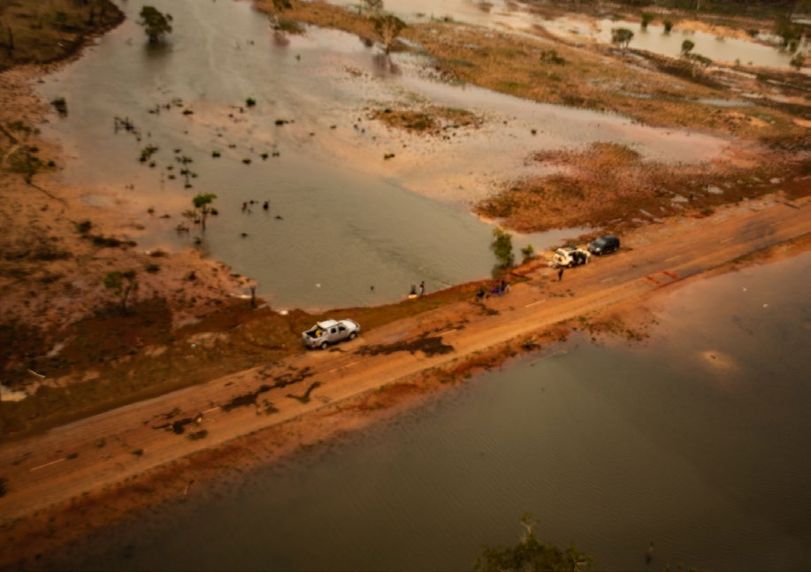

# AIDR Australian Emergency Management Arrangements (2023)

> Source: Australian Institute for Disaster Resilience (AIDR)
> URL: https://knowledge.aidr.org.au/media/10162/handbook_aema_web_2023.pdf

---
## Page 1

Australian Disaster Resilience Handbook Collection  |  2023   
Australian Emergency 
Management 
Arrangements

---
## Page 2

Australian Disaster Resilience  
Handbook Collection
Australian Emergency 
Management Arrangements 
Third edition 2023.

---
## Page 3

ii
Australian Emergency Management Arrangements Handbook
© Commonwealth of Australia 2023
Published by the Australian Institute for Disaster Resilience.
ISBN: 978-0-6457560-0-5
Copyright
The Australian Institute for Disaster Resilience encourages the 
dissemination and exchange of information provided in this 
publication.
The Commonwealth of Australia owns the copyright in all 
material contained in this publication unless otherwise noted.
Where this publication includes material whose copyright is 
owned by third parties, the Australian Institute for Disaster 
Resilience has made all reasonable efforts to:
	·
clearly label material where the copyright is owned by a 
third party
	·
ensure that the copyright owner has consented to this 
material being presented in this publication.
Wherever a third party holds copyright in material presented 
in this publication, the copyright remains with that party. 
Their permission is required to use the material.
All material presented in this publication is provided under 
a Creative Commons Attribution-NonCommercial 4.0 
International Public License, with the exception of:
	·
the Commonwealth Coat of Arms
	·
registered trademarks, including
	
−
the Australian Government’s National Emergency 
Management Agency logo
	
−
Australian Institute for Disaster Resilience logo
	·
materials specifically mentioned as not being provided 
under a Creative Commons Attribution 4.0 International 
Public Licence
	·
content supplied by third parties.
Details of the relevant licence conditions are available on the 
Creative Commons Attribution 4.0 website  
(http://creativecommons.org.au), as is the full legal code for 
the CC BY-NC 4.0 license.
Attribution
Where material from this publication is used for any purpose, 
it is to be attributed to the developer as follows:
Source: Australian Institute for Disaster Resilience (2023) 
Australian Emergency Management Arrangements East 
Melbourne, Australia
Using the Commonwealth Coat of Arms
The terms of use for the Coat of Arms are available from the 
It's an Honour website: www.dpmc.gov.au/government/its-
honour
Contact
Enquiries regarding the content, licence and any use of this 
document are welcome at:
The Australian Institute for Disaster Resilience 
Level 1, 340 Albert St, East Melbourne Vic 3002 
Telephone: +61 (0) 3 9419 2388
Disclaimer
The Australian Government’s National Emergency 
Management Agency and the Australian Institute for Disaster 
Resilience, in consultation with emergency management 
professionals and subject matter experts, exercise care in 
the compilation and drafting of this publication; however, 
the document and related graphics could include technical 
inaccuracies or typographical errors and the information may 
not be appropriate to all situations.
In no event shall the Commonwealth of Australia (acting 
through the National Emergency Management Agency) 
or the Australian Institute for Disaster Resilience be liable 
for any damages whatsoever, whether in an action of 
contract, negligence, or other tortious action, arising out of 
or in connection with the use of or reliance on any of the 
information in this publication.
Cover images, clockwise: Tom Rumble, unsplash, DFES, AIDR.

---
## Page 4

iii
Australian Emergency Management Arrangements Handbook
The Australian Disaster Resilience Handbook Collection provides guidance on national principles and practices for disaster 
resilience. 
The Handbook Collection: 
	·
provides an authoritative, trusted and freely available 
source of knowledge about disaster resilience principles in 
Australia
	·
aligns national disaster resilience strategy and policy 
with practice, by guiding and supporting jurisdictions, 
agencies and other organisations and individuals in their 
implementation and adoption
	·
highlights and promotes the adoption of good practice in 
building disaster resilience in Australia
	·
builds interoperability between jurisdictions, agencies, the 
private sector, local businesses and community groups by 
promoting use of a common language and coordinated, 
nationally agreed principles.
The Handbook Collection is developed and reviewed by 
national consultative committees representing a range of 
state and territory agencies, governments, organisations 
and individuals involved in disaster resilience. The collection 
is sponsored by the Australian Government Department of 
Home Affairs.
Access to the Handbook Collection and further details are 
available on the Australian Disaster Resilience Knowledge 
Hub (the Knowledge Hub): www.knowledge.aidr.org.au/
handbooks
Australian Disaster 
Resilience Handbook 
Collection
Australian Emergency Management Arrangements
Community Engagement for Disaster Resilience
Communities Responding to Disasters: Planning for 
Spontaneous Volunteers
Community Recovery
Disaster Resilience Education for Young People
Emergency Planning
Evacuation Planning
Flood Emergency Planning for Disaster Resilience
Health and Disaster Management
Incident Management
Land Use Planning for Disaster Resilient Communities
Lessons Management
Managing Exercises
Managing the Floodplain: A Guide to Best Practice in Flood 
Risk Management in Australia
National Emergency Risk Assessment Guidelines
Public Information and Warnings
Safe and Healthy Crowded Places
Systemic Disaster Risk
Tsunami Emergency Planning in Australia

---
## Page 5

iv
Australian Emergency Management Arrangements Handbook
Acknowledgements
This handbook was made possible through the support of a broad cross-section of the disaster resilience and emergency 
management sector.
AIDR also acknowledges the contribution and oversight by members of the Australian New Zealand Emergency Management 
Committee.
AIDR thanks Euan Ferguson AFSM for writing the handbook and Dr Michael Eburn for conducting the 2023 minor review to 
incorporate changes recommended by the 2020 Royal Commission into National Natural Disaster Arrangements.
Working group members
AIDR acknowledges the expert guidance from the working 
group in developing this handbook.
Australian Local Government Association – Monica Telesny, 
Senior Policy Advisor
Australian Red Cross – John Richardson, (former) National 
Resilience Adviser
Department of the Chief Minister, Northern Territory – 
Paul Terawsky, (former) Director, Security and Emergency 
Recovery
Department of Fire and Emergency Services, Western 
Australia – Muriel Leclercq, Director, Assurance
Emergency Management Australia (former) – Steve Dwyer, 
Assistant Director, Disaster Preparedness; Faruk Yay, Assistant 
Director, Public Safety Communications and Kelly Grocock, 
Policy Officer, Public Safety Communications 
Emergency Management Victoria – Susan Fayers, Manager, 
Emergency Management Doctrine
Office of Emergency Management, New South Wales 
– Bronwyn Weir, Principal Policy Analyst Emergency 
Management Coordination
Queensland Fire and Emergency Services – Kevin Walsh, 
Assistant Commissioner, Emergency Management and 
Community Capability
South Australia Fire and Emergency Services Commission – 
Linda Haskins, Senior Project Officer, Emergency Management 
Tasmania State Emergency Service – Cheryl Ames, Projects 
Coordinator, Emergency Management Unit
AIDR also acknowledges the support and input of the 
following individuals and organisations
Australian Capital Territory Emergency Services Agency – Nick 
Lhuede, Senior Director, Risk and Planning
Department of Fire and Emergency Services, Western 
Australian - Peta Turner, Principal Policy Officer; Abby Simons, 
Senior Policy Officer, and Matt Verney, Principal Policy Officer
Northern Territory Police, Fire and Emergency Services - David 
Willing, Executive Director, Northern Territory Fire, Rescue 
and Emergency Services
Office of Emergency Management, New South Wales – Ben 
Millington, Chief Superintendent, Emergency Management 
Coordination and Ivan Mills, Policy Officer, Emergency 
Management Coordination
South Australia Fire and Emergency Services Commission – 
Brenton Keen, Director, Emergency Management Office 
South Australia Police – Senior Sergeant First Class Russell 
Dippy, Emergency Management Coordinator, Emergency and 
Major Event Section
Queensland Fire and Emergency Services - John Rolfe, 
Director, Community Resilience and Risk Mitigation; Adam 
Green, Executive Manager, Hazard and Risk Unit and Wayne 
Hepple, Executive Manager, Severe Weather Mitigation

---
## Page 6

v
Australian Emergency Management Arrangements Handbook
Australian Disaster Resilience Handbook Collection  .......................................................................................................................  iii
Acknowledgements  .....................................................................................................................................................................................  iv
Executive summary  ....................................................................................................................................................................................  vii
Introduction  ...................................................................................................................................................................................................  ix
Principles of emergency management  .................................................................................................................................................  x
Chapter 1: Legal and administrative framework  ................................................................................................................................   1
Key points ........................................................................................................................................................................................ 2
1.1 Introduction ............................................................................................................................................................................... 2
1.2 National Strategy for Disaster Resilience .................................................................................................................................. 2
1.3 Sendai Framework for Disaster Risk Reduction 2015-2030 ..................................................................................................... 2
1.4 National Disaster Risk Reduction Framework ........................................................................................................................... 2
1.5 Governance ................................................................................................................................................................................ 3
1.6 PPRR - Prevention, preparedness, response and recovery ...................................................................................................... 3
1.7 Response and recovery arrangements ..................................................................................................................................... 3
1.8 Roles and responsibilities of governments ............................................................................................................................... 3
1.8.1 Local governments ........................................................................................................................................................... 4
1.8.2 State and territory governments ..................................................................................................................................... 5
1.8.3 Australian Government .................................................................................................................................................... 5
1.9 A shared approach ..................................................................................................................................................................... 7
1.9.1 Families and individuals .................................................................................................................................................... 7
1.9.2 Communities ..................................................................................................................................................................... 8
1.9.3 Schools and school communities ..................................................................................................................................... 8
1.9.4 Emergency management volunteers ............................................................................................................................... 9
1.9.5 Critical infrastructure owners and operators .................................................................................................................. 9
1.9.6 Businesses, industry and primary producers ................................................................................................................. 10
1.9.7 Residential and small businesses .................................................................................................................................... 10
1.9.8 Land use planners ............................................................................................................................................................ 11
1.9.9 Design, building and construction industries ................................................................................................................. 11
1.9.10 Insurance industry ......................................................................................................................................................... 11
1.9.11 Non-government organisations (NGOs)  ...................................................................................................................... 11
1.9.12 Not-for-profit sector ...................................................................................................................................................... 12
1.9.13 Natural resource management bodies ......................................................................................................................... 12
1.9.14 Broadcasters and information dissemination mechanisms ......................................................................................... 12
1.9.15 Scientists and researchers ............................................................................................................................................ 12
Contents

---
## Page 7

vi
Australian Emergency Management Arrangements Handbook
Chapter 2: Prevention and mitigation  ..................................................................................................................................................  14
Key points ....................................................................................................................................................................................... 15
2.1 Discussion ................................................................................................................................................................................. 15
Chapter 3: Preparedness  ..........................................................................................................................................................................  16
Key points ....................................................................................................................................................................................... 17
3.1 Discussion ................................................................................................................................................................................. 17
3.2 Emergency planning ................................................................................................................................................................. 17
Chapter 4: Response  ..................................................................................................................................................................................  18
Key points ....................................................................................................................................................................................... 19
4.1 Discussion ................................................................................................................................................................................. 19
4.2 Incident management .............................................................................................................................................................. 19
4.3 Relief ......................................................................................................................................................................................... 20
Chapter 5: Recovery  ..................................................................................................................................................................................  21
Key points ....................................................................................................................................................................................... 22
5.1 Discussion ................................................................................................................................................................................. 22
5.2 Recovery principles .................................................................................................................................................................. 22
5.3 Early recovery ........................................................................................................................................................................... 22
5.4 Medium to long-term recovery ............................................................................................................................................... 22
5.5 Transition .................................................................................................................................................................................. 23
5.6 Recovery arrangements ........................................................................................................................................................... 23
Chapter 6: Catastrophic disasters  ........................................................................................................................................................  24
Emergency management plans   ............................................................................................................................................................   26
References   ...................................................................................................................................................................................................  27
List of Figures
Figure 1: National Coordination Mechanism and Domain Concept ������������������������������������������������������������������������������������������������� 7
List of Tables
Table 1: Features of emergencies of increasing impact.......................................................................................................................4

---
## Page 8

vii
Australian Emergency Management Arrangements Handbook
Executive summary
Globally, losses from natural and human caused hazards are 
increasing. The factors affecting this impact are varied and 
complex, and include: 
	·
increasing population 
	·
improved standards of living and a rapidly growing middle 
class
	·
increasing concentration of people and assets in urban areas 
	·
settlement and industrialisation of vulnerable areas (such 
as coastal zones and flood plains) 
	·
increased complexity and interdependencies in supply 
chains
	·
intensification and accumulation of extreme weather 
events. 
Australia is not immune from these factors. These trends may 
increase the vulnerability to, and the impacts of, emergencies 
and disasters. 
To help prepare for a future that is complex and uncertain, 
the Australian Emergency Management Arrangements 
Handbook (AIDR 2023) has been prepared to articulate the 
national arrangements for emergency management within 
Australia and its states and territories.
The handbook establishes a set of principles that are intended 
to underpin and guide emergency management activities. 
It also describes the emergency management roles and 
responsibilities of all levels of government, non-government 
organisations (NGOs), businesses, communities and individuals. 
Arrangements and responsibilities for the comprehensive 
approach to emergency management - prevention, 
preparedness, response and recovery (PPRR) are discussed. 
These arrangements support emergency management in 
Australia through the concepts of an 'all hazards' approach 
and 'shared responsibility'.
Purpose of the Australian 
Emergency Management 
Arrangements
The Australian Emergency Management Arrangements (the 
Arrangements) are intended to guide Australian governments, 
NGOs, emergency management organisations, agencies, and 
communities in establishing their emergency management 
arrangements. They articulate the principles, structures and 
procedures that support national coordination of emergency 
management. 
The purpose of the Arrangements is to provide a high-level, 
scalable overview of how Australia addresses the risks and 
impacts of hazards through a collaborative approach to the 
prevention of, preparedness for, response to and recovery 
from emergencies. 
The principles and structures herein also support Australians 
affected by emergencies overseas and allow the Australian 
Government to assist (if requested by) foreign governments 
affected by emergencies and for assistance to be received 
from foreign governments.
The Arrangements outline the collaboration necessary to 
address the nature and scale of different emergencies. 
This handbook is intended to: 
	·
be the authoritative and trusted source of knowledge of 
the emergency management arrangements in Australia 
	·
provide nationally agreed principles that underpin 
emergency management arrangements in Australia 
	·
identify and promote the adoption of good practice in 
emergency management arrangements 
	·
build interoperability between jurisdictions, agencies, 
businesses, communities and individuals by the 
application of the principles and common language
	·
align national disaster resilience strategies, frameworks 
and policy with emergency management arrangements by 
informing and assisting jurisdictions, agencies, businesses, 
communities and individuals in the implementation and 
adoption of these arrangements.
The purpose of the handbook is not to specify the 
management of an emergency in response to a specific 
event or disaster. However, the underpinning principles 
provide a context for guiding the approach to these 
situations.
Context
This handbook is part of the Australian National Disaster 
Resilience Handbook Collection. 

---
## Page 9

viii
Australian Emergency Management Arrangements Handbook
This handbook is intended to complement other handbooks 
in the collection. Community Recovery (AIDR 2018) is an 
important reference that supports this handbook. 
This handbook reflects the intent and content of the National 
Strategy for Disaster Resilience (COAG 2011), Australia’s 
commitment to the Sendai Framework for Disaster Risk 
Reduction 2015-2030 (the Sendai Framework) and the 
National Disaster Risk Reduction Framework (Australian 
Government Department of Home Affairs 2018).
It updates and replaces the 2014 edition of Australian 
Emergency Management Arrangements. The handbook is 
published by the Australian Institute for Disaster Resilience, 
on behalf of the Australian Government. 
This 2023 edition of Australian Emergency Management 
Arrangements was reviewed, edited and updated during 
2018 and 2019. A working group including representatives 
from each Australian state and territory was established 
to review the handbook and provide input into the revised 
content. It was further revised in 2022 to take into account 
the recommendations from the 2020 Royal Commission into 
National Natural Disaster Arrangements. 
Scope
It is important to define the terms 'emergency management', 
'emergency' and 'disaster' as these terms are used frequently 
in this handbook. 
Emergency management: A range of measures to manage 
risks to communities and the environment; the organisation 
and management of resources for dealing with all aspects of 
emergencies. Emergency management involves the plans, 
structures and arrangements which are established to bring 
together the normal endeavours of government, voluntary 
and private agencies in a comprehensive and coordinated 
way to deal with the whole spectrum of emergency needs 
including prevention, response and recovery (COAG 2011). 
Emergency: An event, actual or imminent, which endangers 
or threatens to endanger life, property or the environment, 
and which requires a significant and coordinated response 
(AIDR 2019). 
Emergencies can and do happen on a daily basis. In some 
cases, the size, scale, impact, complexity or consequence of 
an emergency is such that the emergency is considered a 
disaster.
Disaster: A serious disruption of the functioning of a 
community or a society at any scale due to hazardous events 
interacting with conditions of exposure, vulnerability and 
capacity, leading to one or more of the following: human, 
material, economic or environmental losses and impacts 
(Australian Government Department of Home Affairs 2018). 
There is jurisdictional variation in the use of the terms 
'emergency' and 'disaster'. 
Catastrophic disaster: Is what is beyond our current 
arrangements, thinking, experience and imagination (i.e. 
that has overwhelmed our technical, non-technical and 
social systems and resources, and has degraded or disabled 
governance structures and strategic and operational decision-
making functions) (Australian Government Department 
of Home Affairs 2018). It should be noted that severe to 
catastrophic disasters differ from emergencies in that they 
exceed business-as-usual emergency management systems 
and capability design parameters.
These Arrangements: 
	·
outline the principles and structures that support national 
coordination of emergency management in Australia and 
its off-shore territories 
	·
recognise that states and territories have the primary role 
for emergency management 
	·
support the concept of an 'all hazards' approach 
	·
support the concept of 'shared responsibility' 
	·
are intended to support, not supersede or conflict with, 
specific sector or hazard specific guidance where it exists.
The role of the Australian Government is to provide 
support and assistance to the jurisdictions. The Australian 
Government, states and territories and local governments 
may have their own legislation and administrative 
arrangements for emergency management. The intent of this 
handbook is to support and reinforce these arrangements. 
It is intended for use and guidance by emergency 
management professionals in governments at every level, 
agencies (including not-for-profit entities), businesses and 
communities. 
This handbook should be read in conjunction with the National 
Strategy for Disaster Resilience, the Sendai Framework, 
Australian Disaster Preparedness Framework, the Australian 
Disaster Recovery Framework and the National Disaster Risk 
Reduction Framework. 
The Arrangements will be reviewed and reissued at least 
every three years or more frequently for major changes. The 
Australia-New Zealand Emergency Management Committee 
(ANZEMC) will oversee revisions and the Australian 
Government approves the publication of the handbook.

---
## Page 10

ix
Australian Emergency Management Arrangements Handbook
Introduction
Australians expect governments at all levels to work together 
with communities in building resilience to emergencies. 
Where emergencies occur, communities should be 
well served by prevention and mitigation plans and by 
preparedness, response, relief and recovery arrangements 
that are effective and forward thinking.
Under Australia’s constitutional arrangements, ‘state and 
territory governments have primary responsibility – and 
accountability – for emergency management’ (Royal 
Commission, p. 6), however all levels of government 
acknowledge that the impact of some emergencies will 
be particularly severe or widespread and may exceed the 
capability of a single state or territory. 
Australia’s emergency management arrangements bring 
together the efforts of the Australian, state, territory and local 
governments, NGOs, businesses, communities and individuals 
to deliver coordinated emergency management across all 
hazards. These arrangements rely on a high level of trust and 
cooperation between all parties. They reflect the result of 
shared experiences in dealing with and learning lessons from 
past emergencies and activities such as training exercises.
The National Cabinet (formerly COAG) and its associated 
Ministerial Council for Emergency Management focuses on a 
resilience and risk reduction-based approach to emergency 
management policy, which is aimed at enhancing resilience 
so that Australians and their communities are better able to 
withstand and recover from emergencies. 
Internationally, Australia forms strategic partnerships for 
mutual international assistance arrangements to mitigate or 
reduce the impact of emergencies domestically and globally, 
particularly in Australia’s region of interest.

---
## Page 11

x
Australian Emergency Management Arrangements Handbook
Principles of emergency 
management
Australia’s approach to the management of emergencies is guided by a number of high-level principles that are intended to provide 
guidance, flexibility and a broad understanding of the approaches to emergency management. The goal of these principles is to 
improve and provide consistency in policy and decision making and to support resilience to emergencies and disasters in Australia. 
An explanation of the emergency management principles follows:
Principle
Explanation
Primacy of life
The protection and preservation of human life (including both communities and emergency service personnel) and relief of 
suffering will be paramount over all other objectives and considerations.
Comprehensive
The development of emergency management arrangements will embrace the phases of prevention, preparedness, response, 
and recovery (PPRR) across all hazards. These phases of emergency management are not necessarily sequential.
Collaborative
Relationships between emergency management stakeholders and communities are based on integrity, trust and mutual respect, 
building a team atmosphere and consensus. Planning and systems of work reflect common goals and all stakeholders work with 
a unified effort.
Coordinated
The bringing together of organisations and other resources to support emergency management, risk reduction, preparedness, 
response, relief and recovery. It involves the systematic acquisition and application of resources (organisational, human and 
equipment) in an emergency situation. Activities of all stakeholders are synchronised and integrated. Information is shared to 
achieve a common purpose, and impacts and needs are continuously assessed and responded to accordingly.
Flexible
Emergency situations are constantly changing. Emergency management decisions may require initiative, creativity and 
innovation to adapt to new and rapidly emerging challenges. Emergency plans need to be agile to change and adapt to these 
new circumstances.
Risk based
Emergency managers use systemic risk management principles and processes in prioritising, allocating and monitoring resources 
to manage the risks from hazards. Systemic risk  based planning will anticipate the effect of efforts, the changing hazard 
landscape and the changing consequences of the emergency.
Shared 
responsibility
Everyone understands their own responsibility in an emergency, and the responsibility of others. Communities and individuals 
understand the risk. This encourages all stakeholders to prevent, prepare for, and plan for how they will safely reduce their risk, 
respond to and recover from an emergency situation.
Resilience
The ability of a system, community or society exposed to hazards to resist, absorb, accommodate, adapt to, transform and 
recover from the effects of a hazard in a timely and efficient manner, including through the preservation and restoration of its 
essential basic structures and functions through risk management (UNDRR 2017).
Communication
Information is crucial to decision making and to the preservation of life. Emergency managers need to support common 
information systems and are responsible for providing and sharing clear, targeted and tailored information to those who need it, 
and to those at risk, to enable better decision making by all stakeholders.
Integrated
Emergency management efforts must be integrated across sectors, not progressed in silos, ensuring the engagement of the 
whole of governments, all relevant organisations and agencies, the business sector and the community.
Continual 
improvement
All sectors continuously learn and innovate to improve practices and share lessons, data and knowledge so that future 
emergency management is better and the overall cost of impact of emergencies and disasters is reduced. Continuous 
monitoring, review and evaluation should examine the processes, timelines and outcomes of plans. Review informs communities 
and displays transparency and accountability. Review also enables facilitation of the adaptive change process with communities.

---
## Page 12

1
Chapter 1: Legal 
and administrative 
framework

---
## Page 13

2
Australian Emergency Management Arrangements Handbook
Key points
	·
The underpinning strategy for Australia’s approach to 
emergency management is the National Strategy for 
Disaster Resilience (COAG 2011). 
	·
The Sendai Framework for Disaster Risk Reduction and 
the National Disaster Risk Reduction Framework support 
disaster risk reduction activities in Australia. 
	·
The Australia-New Zealand Emergency Management 
Committee (ANZEMC) is responsible for influencing and 
advocating for national policies and capabilities that 
reduce the risk of emergencies, minimise the potential 
for harm and uphold public trust and confidence in 
emergency management arrangements. 
	·
Australian emergency management arrangements are 
scalable and underpinned by partnerships at every level. 
	·
Australia’s approach to emergency management is guided 
by a set of principles.
1.1 Introduction
State and territory governments have primary responsibility 
for emergency management legislation, policies and 
frameworks within their jurisdictions. Arrangements are 
underpinned by partnerships between the Australian, state, 
territory and local governments; businesses and industry; non-
government organisations; community groups; emergency 
management and volunteer organisations; and communities. 
These partnerships aim to: 
	·
recognise the primacy of life and the relief of suffering 
	·
build whole of community resilience to disasters by 
minimising vulnerability to risks associated with hazards 
	·
protect property and the environment 
	·
recognise the need to build resilience to emergencies into 
businesses and infrastructure 
	·
minimise adverse social and economic impacts during and 
after emergencies 
	·
facilitate recovery, restoration, rehabilitation and 
reconstruction.
1.2 National Strategy for Disaster 
Resilience
The National Strategy for Disaster Resilience (the Strategy) was 
adopted by the former Council of Australian Governments 
(COAG) in February 2011. 
The Strategy provides the basis for governments to shift from 
the traditional emphasis of response to and recovery from 
emergencies to one which emphasises the need for a greater 
focus on prevention, mitigation, preparedness and building 
capability. 
The Strategy is guided by the principle of shared responsibility 
between:
	·
all levels of governments 
	·
business and industry 
	·
Australian Government organisations 
	·
non-government organisations (NGOs) 
	·
the not-for-profit and for-purpose sectors 
	·
community groups (including community services) 
	·
emergency management and other volunteer 
organisations 
	·
landowners and landholders 
	·
communities. 
The Strategy acknowledges that all levels of government 
(national, state and territory, and local) have a role in driving 
systemic change for greater resilience to emergencies in 
Australia.
1.3 Sendai Framework for Disaster 
Risk Reduction 2015-2030
The Sendai Framework for Disaster Risk Reduction 2015-2030 
(the Sendai Framework) was adopted by Australia and other 
members of the United Nations at the third United Nations 
World Conference on Disaster Risk Reduction. Through the 
Sendai Framework, Australia recognises the importance of 
not only managing disasters, but managing disaster risk. 
The Sendai Framework states that to strengthen resilience, 
countries must prevent new and reduce existing disaster risk. 
It also outlines four global priorities for action to disaster 
risk: understanding disaster risk; strengthening disaster risk 
governance to manage disaster risk; investing in disaster risk 
reduction for resilience and enhancing disaster preparedness 
for effective response, and to 'Build Back Better' in recovery, 
rehabilitation and reconstruction.
1.4 National Disaster Risk 
Reduction Framework
Reducing disaster risk is critical to supporting communities and 
economies to be resilient when a shock occurs. Recognising 
this, in early 2018 the Australian Government invited all states 
and territories, local government, and key private sector 
representatives to work together to co-design and develop the 
National Disaster Risk Reduction Framework. The Framework 
was endorsed by the Ministerial Council for Police and 
Emergency Management (MCPEM) on 28 June 2019. 
The National Disaster Risk Reduction Framework, which is 
informed by the Sendai Framework, sets out the foundational 
work to proactively reduce risk now and into the future. It 
guides national, whole-of-society efforts to proactively reduce 
disaster risk in order to minimise the loss and suffering caused 
by disasters.

---
## Page 14

3
Australian Emergency Management Arrangements Handbook
1.5 Governance
The Australia-New Zealand Emergency Management 
Committee (ANZEMC) is the senior officials committee 
responsible for emergency management. ANZEMC is 
responsible for informing, influencing and advocating for 
national policies and capabilities that reduce disaster risk, 
minimise the potential for harm and uphold public trust and 
confidence in emergency management arrangements. 
ANZEMC comprises senior representatives from the 
Australian, state and territory governments, the Australian 
Local Government Association and the New Zealand 
government. ANZEMC is co-chaired by the Coordinator-
General, National Emergency Management Agency and 
a rotating state/territory representative. The National 
Emergency Management Agency is a Commonwealth member 
of the ANZEMC. The Mitigation and Risk Subcommittee 
(MaRS) and the Community Outcomes and Recovery Sub-
committee (CORS) are sub-committees of ANZEMC.
1.6 PPRR - Prevention, 
preparedness, response and 
recovery
The Australian approach to managing emergencies 
recognises four phases of emergency management: 
prevention, preparedness, response and recovery. This is 
abbreviated to PPRR. 
Some jurisdictions are redefining PPRR to three phases of the 
'before', 'during' and 'after' the emergency. Both approaches 
are in use in Australian states and territories.
1.7 Response and recovery 
arrangements
In times of emergency, national arrangements may be required 
from the outset (for example, a pandemic threatening 
Australia). However, most often it is the community who 
are first at the scene and who are able to provide the first 
response. Notwithstanding this initial community response, 
personnel in the emergency services and other agencies at 
the local level are usually the first organised response to an 
emergency. In most emergencies, communities, emergent 
groups, state, territory and local resources and emergency 
management NGOs (such as Australian Red Cross) become 
involved in providing emergency response and incident 
management support, relief and recovery.
Coordination and support at a regional level may be required 
to ensure the response is effective and tailored to the 
situation. The response may be progressively escalated, in a 
graduated and planned manner, from the local level to the 
region, state and national level as circumstances require. 
As the scale of impact and complexity of an emergency 
increases, intra-state/territory arrangements may be 
activated. Further escalation may activate inter-state/territory 
arrangements for additional assistance. 
Arrangements are also in place for provision of assistance 
from the Australian Government. Examples include the 
arrangements for assistance from the Australian Government 
National Situation Room, Bureau of Meteorology, Geoscience 
Australia and the Australian Defence Force.
National coordination may occur when assistance is 
requested by the state or territory, or if the crisis has the 
potential to affect, or has affected, multiple jurisdictions, the 
broader community or an Australian Government area of 
responsibility, regardless of the level of emergency. Table 1 
summarises the features of emergencies of different intensity 
and impact.
National coordination may occur in times of catastrophic 
disaster and when international assistance has been offered 
or received.
Catastrophic disasters are discussed further in Chapter 6.
1.8 Roles and responsibilities of 
governments
Each level of government has different roles and 
responsibilities in emergency management. A common and 
overriding principle of emergency management is the primacy 
of life. The federal, state and territory, and local governments 
have established legislative and organisational arrangements 
(and lines of reporting) to undertake emergency mitigation 
and to prepare for and deal with emergencies effectively. 
Jurisdictional legislation and organisational arrangements 
are tailored to best utilise available capabilities and deliver 
common intended outcomes.
Each level of government has responsibility, commensurate 
with their capacity and local legislation – and within its 
own jurisdiction, for emergency planning. This may include 
prevention (mitigation) and preparedness activities in 
relation to landscape, property, the environment, assets and 
infrastructure and relief and recovery planning.
An effective national framework for emergency management 
requires a high level of collaboration and coordination within 
and across all levels of government, and with non-government 
stakeholders, including communities and the business sector.
Decisions should be made at the lowest appropriate level 
of authority, in accordance with legislative requirements or 
delegations, with coordination at the highest necessary level 
of authority.

---
## Page 15

4
Australian Emergency Management Arrangements Handbook
Local responders are the building blocks of response and 
recovery on any scale. As the size, complexity, impacts and 
consequences of an emergency grow, the level of support 
from each level of government and other organisations may 
increase.
1.8.1 Local governments
Local governments play a fundamental role in emergency 
management. This is because of their strong relationship with 
their local community networks and knowledge of locally 
available resources. 
Local governments often have a more detailed knowledge of 
the population dimensions within a local government area 
(such as people with special needs, vulnerable and at risk 
people and special interest groups). 
Where local government powers exist, and state legislation 
enables, local governments have responsibilities, in 
partnership with respective state and territory governments, 
to contribute to the safety and wellbeing of their communities 
by participating in local emergency management planning and 
providing capability. 
The principal roles and responsibilities of local governments 
may include (but are not limited to):
	·
building and promoting resilience to emergencies 
	·
undertaking cost-effective measures to mitigate the 
effects of hazards on local communities and business, 
including routinely conducting emergency risk 
assessments and exercising emergency arrangements 
	·
systematically taking proper account of risk assessments 
in land use planning to reduce hazard risk 
	·
representing community interests in emergency 
management to other spheres of government and 
contributing to decision-making processes before, during 
and after emergencies 
	·
ensuring all requisite local emergency planning and 
preparedness measures are undertaken and that plans are 
exercised on a regular basis
	·
ensuring an adequate local emergency response and 
recovery capability is in place, including resources for local 
volunteers 
	·
undertaking public education and awareness to support 
community preparedness measures 
	·
assisting appropriate authorities with the provision 
of emergency risk information and (where necessary) 
emergency warnings 
	·
ensuring appropriate local resources and arrangements 
are in place to provide emergency relief and recovery 
services to communities 
	·
continuing to provide services to their municipalities (such 
as waste collection, pollution control, water provision, 
wastewater treatment and stormwater drainage) during 
emergencies 
	·
participating in post-emergency assessment, debrief 
analysis and lessons management.
Table 1: Features of emergencies of increasing impact
Increasing size, intensity and complexity
Intensity
Impact
Response
Catastrophic
	·
A whole of government response is required
	·
Normal decision-making may be degraded 
	·
Resource coordination may be overwhelmed 
	·
Crisis plans may be activated 
	·
Significant relief and recovery arrangements may be 
required 
	·
International assistance may be requested
	·
Impact may be greater than previous experience and 
modelling
	·
More than one state/territory may be impacted 
	·
Severe disruption to community, economic wellbeing, 
social networks, infrastructure and environment 
	·
Impact may be across an extensive area and may 
continue for a very long time 
	·
The consequences of the impact may be felt across 
numerous sectors
Major
	·
Multi-state/territory and multi-agency command, control 
and coordination arrangements are in place
	·
Strategic resource coordination may be required 
	·
Specific hazard plans may need activation 
	·
Specialised assistance from other states and territories, 
from the Australian Government, or internationally may 
be required
	·
Impact across a significant area 
	·
Significant population or population centres may be 
impacted 
	·
Impact over an extended period of time 
	·
The impact may have consequences beyond the area of 
the impact
Minor
	·
Response by individual state/territory
	·
Jurisdictional plans and arrangements sufficient
	·
Jurisdictional recovery plans sufficient
	·
Local and minor impact*
	·
Short duration
*Although the impacts may be minor when judged from the community or state level, it is acknowledged that these events have significant and often life altering impacts 
for those directly involved. 

---
## Page 16

5
Australian Emergency Management Arrangements Handbook
1.8.2 State and territory governments
State and territory governments have primary responsibility for 
protecting life, property and environment within their borders.
State and territory governments establish plans and 
arrangements for most of the functions essential for effective 
emergency management (prevention and mitigation, 
preparedness, response and recovery) and in the interests of 
community safety and wellbeing. For example, maintaining 
agencies that provide emergency services to the community 
(e.g. police, fire, ambulance, emergency, health and medical 
services). This may include responsibility for:
	·
building and promoting resilience to hazards 
	·
periodically undertaking risk assessment and assurance 
monitoring activities 
	·
developing, implementing and ensuring compliance 
with comprehensive emergency mitigation policies and 
strategies in all relevant areas of government activity, 
including land use planning, infrastructure provision and 
building standards compliance
	·
aligning jurisdictional emergency arrangements to 
national frameworks 
	·
strengthening partnerships with local governments 
and communities (including remote and Aboriginal and 
Torres Strait Islander communities), and encouraging 
and supporting them to undertake emergency risk 
assessments and carry out mitigation measures 
	·
developing arrangements and plans that articulate 
preparations for emergencies 
	·
ensuring provision of appropriate emergency awareness 
and education programs
	·
ensuring warning systems are in place and are effective 
	·
ensuring that arrangements for evacuation, refuge and 
relief are in place 
	·
ensuring community and emergency management agencies 
are prepared for and able to respond to emergencies, and 
that plans are exercised on a regular basis 
	·
maintaining adequate levels of capability, including 
appropriately equipped and trained career and volunteer 
emergency response and recovery personnel 
	·
ensuring appropriate emergency relief and recovery 
arrangements are in place 
	·
ensuring post-emergency assessment and debrief, analysis 
and lessons management processes are undertaken 
	·
developing and monitoring capability 
	·
ensuring arrangements for coordinating the allocation of 
resources and capabilities are in place and acted upon.
1.8.3 Australian Government
The Australian Government: 
	·
provides support to states and/or territories when 
coordinated assistance is requested  
	·
undertakes threat and security risk assessments and 
provides national security capabilities to prepare for 
and respond to events determined to be of national 
significance 
	·
supports a state or territory where, in the judgement of 
the Australian Government and following consultation 
with relevant jurisdictions where practicable, the nature 
of a crisis has or is expected to exceed the sovereign 
capacities of that state or territory to manage 
	·
jointly manages a crisis with states and/or territories 
if a crisis has the potential to affect, or has affected, 
multiple jurisdictions, the broader community or an 
Australian Government area of responsibility (for example 
a pandemic, a large scale or complex terrorist event or a 
cyber-incident) 
	·
manages a crisis that is not the responsibility of a state 
and/or territory (for example a crisis that occurs outside 
Australia but impacts Australians or Australia’s national 
interest) 
	·
works with states, territories, industry and the public 
to build national resilience against future hazards, 
particularly those with national consequences 
	·
provides financial assistance to eligible Australian 
residents who are adversely affected by a crisis
	·
support the states and territories through cost sharing 
arrangements to alleviate the financial burden associated 
with the provision of emergency relief and recovery 
services and activities 
	·
where necessary, provide direct assistance to affected 
communities 
	·
be a party to various international and foreign 
country agreements and guidelines intended to assist 
governments to become better prepared for international 
response and recovery operations 
	·
build national capability in conjunction with states and 
territories (e.g. Australian Medical Assistance Teams 
(AUSMAT) and Urban Search and Rescue (USAR)) 
	·
support the conduct of research of national significance to 
the management of emergencies 
	·
identify national priorities for the mitigation of 
emergencies, in collaboration with other levels of 
government, NGOs, business, community and individuals 
	·
provide support for emergency risk assessment and 
mitigation measures, in conjunction with state, territory 
and local governments
	·
support public information, such as public safety broadcasts 
	·
provide vital public warnings for severe weather, bushfire, 
flood and tsunami 
	·
assign resources in support of and at the request of 
jurisdictions, allocate resources from the Australian 
Government (such as from the Department of Defence) 
	·
provide information services such as meteorological, 
hydrological, geophysical and other geodata services that 
inform and underpin the management of emergencies.

---
## Page 17

6
Australian Emergency Management Arrangements Handbook
The Australian Government has a continuing role in providing:
	·
coordination of the national response to emergencies 
	·
a contact point for requests for assistance to, and for 
offers of assistance from, other countries 
	·
leadership on national emergency management related 
strategies 
	·
support to state, territory and local governments for cost-
effective, prioritised emergency risk management 
	·
financial assistance to state, territory and local 
governments to assist them in meeting their disaster 
mitigation responsibilities.
The Department of the Prime Minister and Cabinet is 
responsible for maintaining and updating the Australian 
Government Crisis Management Framework (AGCMF). The 
AGCMF underpins other crisis plans which are maintained 
by the National Emergency Management Agency (NEMA). 
Further, NEMA provides end-to-end oversight on risk 
reduction, prevention, preparedness, response and recovery. 
NEMA maintains a range of response plans that can support 
state and territory governments and international partners 
responding to an emergency. Further details of these plans 
can be found at the Department of Home Affairs website 
(www.homeaffairs.gov.au/about-us/our-portfolios/
emergency-management/emergency-response-plans). 
Recognising the need to invest in disaster risk reduction, the 
Australian Government has committed to investing up to 
$200 million per year (from 2023-24) on disaster prevention 
and resilience initiatives through the new Disaster Ready 
Fund (DRF). The DRF will curb the devastating impacts of 
natural hazards by investing in important disaster prevention 
projects like flood levees, sea walls, cyclone shelters, 
evacuation centres, fire breaks and telecommunications 
improvements. The jointly-funded Australian Government-
State Disaster Recovery Funding Arrangements (DRFA) assists 
state and territory governments with the costs of delivering 
certain relief and recovery assistance to disaster-affected 
communities. Where the arrangements have been activated, 
the Australian Government may fund up to 75 per cent of the 
assistance available to individuals and communities.
The Australian Government may provide direct assistance to 
affected individuals or businesses through a single disaster 
recovery payment, or an ongoing disaster recovery allowance.
A range of other Australian Government departments have 
important roles in developing policies and planning for 
emergencies, building community resilience and providing 
services during and after emergencies. As outlined in 
the National Emergency Declaration Act 2020, where 
an emergency is declared to be a ‘national emergency’, 
government Ministers may modify the administrative 
requirements of their departments in order to facilitate 
the response to the emergency. For example, they may 
modify the need for identification so that people can access 
government services even when their personal documents 
have been lost due to fire or flood.
The Australian Government is directly responsible for 
emergency management arrangements in Australia’s 
territories of Christmas Island, Cocos (Keeling) Islands, Jervis 
Bay, Ashmore and Cartier Islands, Coral Sea Islands, the 
Australian Antarctic Territory, the Territory of Heard Island 
and McDonald Islands, and Norfolk Island. It also has specific 
responsibilities in relation to national security and defence, 
border control, aviation and maritime transport, biosecurity 
measures, enforcement of Australian Government legislation, 
the safety and welfare of Australians overseas, international 
relations, provision of assistance to other countries and 
receiving assistance from other countries.
The National Coordination Mechanism
The NCM is an effective tool for national management of the 
consequences of any complex crises, it is hazard and vector 
agnostic. The NCM can be utilised in preparedness, response 
and recovery. The NCM uses the convening authority of the 
Australian Government to bring together a broad range of 
stakeholders that have equity in the problem and identify 
actions to mitigate the problem. The NCM identifies the 
problem, scopes options to mitigate or stabilise and tasks and 
coordinates actions accordingly. The NCM does not operate 
as a command-and-control model, rather a collaboration, 
coordination and communication model. 
The Deputy Coordinator-General (DCG) Emergency Management 
and Response, NEMA activates and chairs the NCM. 
While there is no legislative basis for the establishment of an 
NCM, forums are held regularly by NEMA during emerging, 
active and/or concurrent crisis events providing an ongoing 
forum for, private sector industries, charities, NGOs and 
volunteer groups to liaise directly with state and territory 
government representatives and key Australian Government 
departments. 
The NCM leverages existing authorities, systems, networks 
and sectors to unify effort to stabilise or mitigate the impacts 
and consequences of any crises or disaster. The NCM does not 
override any existing authorities or assume responsibilities of 
other departments, agencies or industry sectors. 
Attendees of an NCM engage in strategic coordination, 
stakeholder communication and collaboration to respond to 
and recover from domestic crises.

---
## Page 18

7
Australian Emergency Management Arrangements Handbook
Figure 1: National Coordination Mechanism and Domain Concept
1.9 A shared approach
Dealing with emergencies is not a matter for governments 
alone. Individuals, families and communities play a role in 
determining how well they are prepared for and safeguarded 
from emergencies, and their ability to recover from them. 
Sharing roles and responsibilities for key non-government 
stakeholders provides many benefits, including but not 
limited to those summarised below.
1.9.1 Families and individuals
Families and individuals have principal responsibility for their 
own safety, and for safeguarding their health and wellbeing, 
property, assets, and livelihoods. This is done through 
household, family and individual risk identification and 
implementing mitigation measures, including having adequate 
financial protection. This may include property, contents and 
income protection insurance.
The collective actions of individuals, families and neighbours 
can have a major influence on the severity and impact of a 
hazard. In significant emergencies and disasters, emergency 
management personnel do not, and never will, have the 
capability and capacity to solve the emergency threat for 
every individual at risk. Nor do governments, NGOs or not-
for-profits have the ability (or responsibility) to fully offset 
the economic, social, cultural and human losses incurred by 
families and individuals in the course of an emergency.
Defence
NaƟonal Security CommiƩee
NaƟonal Cabinet
NaƟonal CoordinaƟon
Mechanism (NCM)
Impacted
CommuniƟes
Legal
InternaƟonal assistance
Humanitarian
Supply chains
Food
EducaƟon
Banking and finance
TelecommunicaƟons
Data and GIS
Agriculture
Emergency management
agencies
Health/Aged care
Insurance
Coronial/mortuary
Border (people and goods)
Cyber
Foreign Affairs
Major events
Security, jusƟce 
and public safety
Water
Power
Transport
NaƟonal 
CoordinaƟon Node
Common OperaƟng Picture (COP)
De-conflicƟon and synchronisaƟon of acƟons
IdenƟficaƟon of interdependencies
PrioriƟsaƟon effort
Tasking and coordinaƟon of Lines of Effort (LOE)
AcƟon plans
CommunicaƟon, informaƟon and messaging
First 
Ministers
First 
Ministers
Prime Minister

---
## Page 19

8
Australian Emergency Management Arrangements Handbook
It is the role and responsibility of families and individuals to 
attain the highest degree of physical and financial self-reliance 
– before, during and after an emergency. In particular, they 
should:
	·
be fully aware of the risk that hazards may present to 
themselves, their home, work, school and holiday places 
	·
plan to ensure continuous access to health-related 
requirements during an emergency (for example: the 
provision of medications and ongoing operation of 
medical devices that rely on continuous electricity supply) 
	·
actively seek information as the risk environment around 
them increases or changes including having contingencies 
for staying connected, where to find information and who 
to call for help 
	·
follow the advice and messaging from emergency services 
in the event of an emergency 
	·
be aware of relevant legislation that may apply to the 
individual or the household (examples might include the 
restricted use of fire in many parts of Australia during 
periods of high bushfire risk and the restricted transport 
of fruits and vines in parts of rural Australia) 
	·
identify their strengths, capacities and potential 
vulnerabilities, and seek support where needed 
	·
build strong connections within the local neighbourhood 
to be able to draw upon these resources for support, 
before, during and after an emergency 
	·
arrange, where available, for adequate insurance to cover 
likely risks in their area including home, contents and 
income protection insurance 
	·
find out what relevant local plans are in place in the event 
of an emergency 
	·
make plans and prepare for dealing with emergencies 
and their likely impacts and consequences (including 
evacuation) 
	·
include consideration for companion animals, pets and 
livestock in emergency planning 
	·
prepare, plan and provide extra support to family 
members who may not be able to make personal safety 
decisions e.g. the elderly and the very young.
To assist individuals to understand their risk, the Royal 
Commission into National Natural Disaster Arrangements 
(Royal Commission) recommended that state and territory 
governments should work with the Australian Government 
to develop a process or mechanism through which to 
communicate natural hazard risk information to households 
(including prospective purchasers). In response to 
Recommendations 4.1 to 4.7 of the Royal Commission, the 
Australian Climate Service was established to provide a data 
and intelligence service which connects and leverages the 
Australian Government’s extensive climate and natural hazard 
information into a single national view.
State and territory governments are also urged to continue 
to deliver, evaluate and improve education and engagement 
programs aimed at promoting disaster resilience for 
individuals and communities.
1.9.2 Communities
A community can be defined as: a social group with a 
commonality of association and generally defined by location, 
shared experience, or function and with a number of things 
in common, such as culture, heritage, language, ethnicity, 
pastimes, occupation, or workplace (AIDR Glossary).
Local communities can take a wide range of actions to 
become more resilient to emergencies. In particular, 
communities should:
	·
promote high levels of awareness of the risks arising 
from hazards in their community, and the collective 
preparations and actions that should be taken to minimise 
vulnerability 
	·
take action to mitigate the consequences of such risks 
	·
provide active support for government and community 
efforts to minimise the possible consequences of 
emergencies, such as disaster risk reduction measures as 
well as helping to prioritise recovery efforts 
	·
promote a culture of support and recognition for 
emergency services and other volunteers 
	·
identify community strengths and capacities that can be 
used to support prevention, preparedness, response and 
recovery 
	·
provide local leadership in recovery.
State and territory governments and the Australian 
Government have roles to empower communities to become 
more resilient. These include: 
	·
providing nationally consistent community education 
on the function and limitations of different sheltering 
facilities, including evacuation centres, Neighbourhood 
Safer Places, places of last resort and disaster shelters
	·
ensuring that those responsible for evacuation 
planning periodically review plans and update them 
where appropriate including defining the roles of local 
communities and education of communities about 
signage and evacuation routes and consider those in the 
community who are unable to evacuate, either by reason 
of circumstances or personal characteristics.
1.9.3 Schools and school communities
Emergency plans for schools and school communities are 
particularly important. This is because:
	·
many communities have schools 
	·
schools may be associated with and organised by specific 
providers (this includes state government, private and 
independent schools and faith-based schools) 

---
## Page 20

9
Australian Emergency Management Arrangements Handbook
	·
during the school term, schools may house children who 
may be particularly vulnerable or at-risk during times of 
emergency 
	·
many people may be involved in the broader school 
community, including extended families and after school 
hours care-givers 
	·
through teaching and support staff, schools are able to 
communicate to school families about risks and actions in 
time of uncertainty, increased risk or emergency
	·
some school buildings may be specifically constructed to 
better withstand extremes of weather and risks such as 
bushfire and therefore offer some level of protection to 
occupants
	·
specific transport arrangements might mean that it is 
possible to move students and teachers in a timely and 
efficient manner away from areas of greater or emerging 
risk.
History has also shown that in times of emergency the 
leadership, actions and decisions made by teachers, principals 
and school committees can be instrumental in ensuring the 
health, safety and welfare of the school community.
Because of their network of contacts and databases, schools 
may be in a position to provide up to date and accurate 
information to school families. Schools are often in the unique 
position of being able to ensure that school aged children are 
transferred back to their home or to responsible households 
safely and securely.
Model school emergency plans are available from school 
providers and from state or territory education and training 
departments. School emergency plans deal with a range of 
threats and hazards. School emergency plans need to be 
shared with the broader community and should be exercised 
and audited on at least an annual basis.
School teachers may also be in a position to identify students 
that may need specific support during extended recovery.
Whilst this section is focussed on school aged children, other 
education providers, including universities, colleges and 
adult education centres also play a role in caring for students 
before, during and after an emergency.
1.9.4 Emergency management volunteers
Emergency management volunteers are a crucial component 
of community participation in preparing for, responding to 
and recovering from emergencies in Australia.
Emergency management volunteers include those that are 
involved in prevention and mitigation, (including community 
preparedness and education), response and relief and recovery 
activities that may extend for months and years after an event. 
Emergency management volunteers contribute a significant 
amount of time and skills – before, during and after 
emergencies. Further, in support of these emergency 
management volunteers, there are thousands of employers 
who generously release staff for volunteer-related activities.
Emergency management volunteers may have employment 
protection under national, state or territory laws to 
allow them to undertake their volunteer duties during 
an emergency or disaster. The 2020 Royal Commission 
recommended that governments establish a national register 
of fire and emergency services personnel, equipment and 
aerial assets to facilitate interstate deployment of both staff 
and volunteers. 
It is useful to consider two groups of non-traditional 
volunteers that may become involved in emergencies. One is 
largely self-organised and has a well-developed emergency 
management capability or technical skill that has been 
developed specifically for activation in times of emergency. 
These ‘extended volunteers’ usually have a level of leadership, 
command or supervision within their organisation and can 
generally be readily tasked (within their existing capability).
The other group are more individual based and require more 
support. These spontaneous volunteers may come together in 
an unplanned and sometimes unprepared way. 
The subject of spontaneous volunteers is dealt with in 
more detail in Communities Responding to Disasters: 
Planning for Spontaneous Volunteers (AIDR 2018).
1.9.5 Critical infrastructure owners and 
operators
Critical infrastructure is defined in the Critical Infrastructure 
Resilience Strategy (Australian Government 2015) as:
those physical facilities, supply chains, information 
technologies and communication networks, which if 
destroyed, degraded or rendered unavailable for an extended 
period, would significantly impact the social or economic 
wellbeing of the nation, or affect Australia’s ability to conduct 
national defence and ensure national security.
Critical infrastructure underpins the delivery of essential 
services such as power, water, health, transport, food, 
telecommunications and banking. 
Critical infrastructure operators should work with the 
Australian Government, to:
1.	
identify critical infrastructure 
2.	
assess key risks to identified critical infrastructure from 
disasters of national scale or consequence 
3.	
identify steps needed to mitigate these risks 
4.	
identify steps to make the critical infrastructure more 
resilient

---
## Page 21

10
Australian Emergency Management Arrangements Handbook
5.	
improve information flows during and in response to 
disasters
6.	
review supply chain risks, and consider options to ensure 
supply of essential goods in times of disasters
7.	
track achievement against an agreed plan.
The Department of Home Affairs works with critical 
infrastructure operators to co-design rules that underpin risk 
management programs to mitigate the risk to infrastructure 
and the subsequent risk to communities and individuals.
One of the first consequences of inadequate infrastructure 
protection will be on emergency services. For instance, 
emergency services and emergency response agencies 
will be reliant on telecommunications networks in order to 
alert, activate and provide safe and effective coordination 
of resources in response to an emergency. The Australian 
Government is working with industry to further improve the 
resilience of its telecommunications networks through the 
Strengthening Telecommunications Against Natural Disasters 
(STAND) program. 
Essential service providers and critical infrastructure owners 
and operators are ultimately responsible for determining and 
discharging their own legal obligations and managing risks to 
their operations that might have a material, financial, legal or 
reputation impact on themselves and others. Essential service 
providers may also have community service obligations. 
Essential service providers and critical infrastructure owners 
and operators meet their obligations through appropriate 
risk management practice. This includes the development 
and review of business continuity plans, providing adequate 
security for their assets, and making provision to protect/
replace their assets and business continuity, including arranging 
adequate levels of insurance. Refer to the Critical Infrastructure 
Resilience Strategy (Australian Government 2015). 
The occurrence of emergencies is one of the risks that any 
business enterprise should take into account in business 
planning. With regard to risk reduction, essential service 
providers and critical infrastructure owners and operators 
should:
	·
maintain an awareness of their operating environment 
	·
actively apply risk management techniques to their 
planning processes 
	·
conduct regular reviews of risk assessments, and security, 
emergency and contingency plans
	·
develop plans for crowded places in conjunction with 
other agencies and organisations
	·
use any physical or logistical measures to protect or 
remove assets and stock from the effects of any hazard, to 
ensure that supply chains are maintained
	·
make provision to protect/replace their assets, stock and 
business continuity from the likely risks in their area to 
minimise business interruption and loss of income (this 
could include arranging adequate levels of insurance)
	·
work with government through relevant jurisdictional 
arrangements to understand critical interdependencies 
and reliance on continued service delivery
	·
partner with government and emergency service 
organisations through relevant jurisdictional 
arrangements to plan for and manage consequences 
arising from emergencies, including environmental harm.
For more on planning for crowded places, refer to Safe 
and Healthy Crowded Places (AIDR 2018).
1.9.6 Businesses, industry and primary 
producers
A crucial part of businesses and industry resilience is business 
continuity planning. Business continuity planning should 
identify possible and likely risks from hazards and consequent 
threats to the conduct, viability and profitability of an 
enterprise. They also contribute to community preparedness 
and recovery. 
Businesses, industry and primary producers make a 
contribution to resilience and emergency management by 
understanding the risks they face, the risk their activities pose 
to the natural environment and to the community and by 
ensuring they are able to continue providing their business 
services during or soon after an emergency. 
Business owners need to be aware of relevant legislation 
that may apply to their enterprise and the activities they are 
involved in before, during and after emergencies. 
Additionally, businesses and primary producers should make 
their operation less vulnerable to emergency impacts (e.g. 
power failure) and protect their assets from the likely risks in 
their area, including arranging adequate levels of insurance. 
Primary producers have a responsibility to plan for the 
management of livestock during periods of increased risk 
before, during and after an emergency.
Businesses and industries can provide local, state, national 
and international knowledge. Particular industries may also 
provide a range of expert resources, before, during and 
after emergencies. Industry peak representative bodies also 
have a role in managing industry recovery programmes that 
may also improve resilience. Peak bodies may also be in a 
position to ensure that landholders and operators can access 
information, advice and support that is tailored to facilitate 
recovery for that industry.
1.9.7 Residential and small businesses
Residential businesses and small businesses contribute to a 
broader resilience by: 
	·
understanding the hazard environment and the risks they 
face 

---
## Page 22

11
Australian Emergency Management Arrangements Handbook
	·
being a key part of the community and promoting 
community connectedness 
	·
contributing to a robust local economy 
	·
acting, individually and collectively, to prevent or mitigate 
those risks 
	·
being informed and prepared as the risk profile increases/
changes 
	·
having a plan of how to manage animals and livestock in 
times of emergency 
	·
having a business continuity plan
	·
developing a response plan for expected emergencies.
For further discussion on emergency risk assessment 
refer to the National Emergency Risk Assessment 
Guidelines (NERAG) (AIDR 2020).
1.9.8 Land use planners
Land use planning and environmental management that 
takes into account hazard risks has been identified as the 
single most important measure in preventing and mitigating 
future vulnerabilities and emergency losses in areas of new 
development. Examples include planning decisions in areas 
subject to cyclones, riverine flooding, coastal erosion and 
bushfire risk.
All organisations, including state, territory and local 
governments, should consider present and future disaster risk, 
including climate risks when making land-use planning decisions 
for new developments and when planning for the mitigation 
of natural hazards. For example, low lying coastal areas and 
associated coastal environment landscapes will be most 
vulnerable to the impacts of storm tides and rising sea levels.
The professions involved with land use planning and design 
have important roles and responsibilities. These include 
prudent risk assessment and management, implementing 
best-practice planning and taking into account emergency 
risk reduction measures including evacuation routes. Planning 
needs to ensure that legislative and policy frameworks enable 
recovery operations and that urgently required works are not 
constrained during and after an emergency.
Land use planning is discussed in more detail in Land Use 
Planning for Disaster Resilient Communities (AIDR 2020).
1.9.9 Design, building and construction 
industries
The resilience of the built environment to hazards is a key 
factor in promoting human safety, reducing damage costs 
and enabling business continuity when emergencies occur. 
Hazard leaders, developers, architects, engineers and 
the construction industry have important roles to play in 
achieving improved resilience to emergencies:
Hazard leaders are responsible for understanding industry 
hazards and the consequent risks and to ensure that 
collaborative plans and networks are in place to mitigate, 
plan, and prepare for and recover from risks as they eventuate 
and as lessons are learned from events. 
	·
Developers have a responsibility to ensure that their 
projects do not compromise the long-term safety, health 
and wellbeing of those who will live and work in their 
developments or increase or transfer exposure to hazards 
or risks to others in society. 
	·
Architecture and engineering professionals have roles 
in educating their members about hazard impacts on 
structures, through tertiary courses and continuing 
professional education, and promoting best practice and 
innovation, and the use of suitable building products that 
are resilient to hazards. 
	·
The building and construction industry has a role in 
promoting hazard awareness and hazard minimisation 
in the industry and a culture of compliance with building 
codes and standards.
1.9.10 Insurance industry
The insurance industry assists individuals, business and 
the community more broadly to recover financially from 
emergencies.
Insurance is a key element in building community resilience. 
Insurance provides financial protection in the event of loss 
through a process of aggregating premiums and spreading 
risk. Insurance can also play a role in encouraging mitigation 
to reduce losses from future emergencies. All property 
owners – including home owners, occupiers and small 
businesses – are able to minimise the financial impact 
from emergencies by purchasing insurance. The price, or 
premium for, and availability of, insurance provide signals 
about the level of risk from a range of hazards and provide 
some encouragement for risk mitigation and therefore 
taking preventative action to reduce vulnerability to loss. 
The insurance industry is well placed to produce and 
communicate to consumers clear guidance on individual-
level natural hazard risk mitigation actions that insurers will 
recognise in setting insurance premiums. 
Having insurance for emergencies does not reduce the 
number of deaths and injuries, physical damage and 
disruption to normal life. However, it provides a confidence of 
readily available funds through the insurance industry’s well-
established delivery channels.
Insurance, which is essentially risk transfer, allows the economy 
to manage risk more effectively, reducing financial uncertainty 
in the event of an emergency and allowing for more efficient 
use of capital by individuals, business and government.

---
## Page 23

12
Australian Emergency Management Arrangements Handbook
1.9.11 Non-government organisations 
Non-government organisations (NGOs) operate at the local, 
national, or international levels. An NGO is distinct from a 
government organisation, having no statutory ties with a 
national government (AIDR Glossary).
NGOs play an important role in emergency management 
through mobilising resources and providing support and 
advice to individuals and communities before, during and 
after emergencies. They advocate on behalf of communities 
to governments. Through their strong community networks, 
NGOs also provide training and education that contribute to 
building community resilience to emergencies.
NGOs also have access to national and international expertise, 
participate in research and contribute to the development of 
best practice guidelines and policies.
They may also manage service provision on behalf of 
governments. An example is ‘Register. Find. Reunite.’ which is 
managed by Australian Red Cross on behalf of the state and 
territory governments.
NGOs and governments need to work together to ensure 
their efforts are coordinated and are directed to those 
most in need, achieving the best possible outcomes for the 
community.
In addition, NGOs should make provision to protect/replace 
their own assets from the likely risks in their area including 
arranging for adequate levels of insurance. NGOs should 
develop and test their business continuity plans so that their 
operations are able to continue when they are impacted by  
a hazard.
1.9.12 Not-for-profit sector
The not-for-profit sector plays an important role in 
emergency management. This includes the provision of funds 
directly to those in need or via emergency relief organisations 
and through philanthropy, which is the activity of helping 
those who are in need as a consequence of an emergency.
Not-for-profits also work to prevent and mitigate the impact 
of disasters, particularly natural hazards. The work done by 
conservation groups to mitigate the effect of flood waters and 
coastal erosion on the marine ecology is one such example.
1.9.13 Natural resource management 
bodies
Natural resource management bodies provide a crucial 
link between government, communities, community 
organisations, rural and public land interest groups, 
landowners and land managers. They have an important 
contribution to make in preventing or mitigating damage to 
the natural environment at a broad geographic landscape or 
catchment scale.
Good natural resource management such as specific 
strategies for the protection of waterways, conservation 
of rangelands, soil conservation and control of weed, 
vermin and pest animals provides a strong basis for better 
emergency management and improved economic, social and 
environmental outcomes.
1.9.14 Broadcasters and information 
dissemination mechanisms
Everyone involved in emergency management requires 
information to make appropriate and informed decisions and 
actions. In particular, the community require information that 
is timely, tailored and relevant and which enables their own 
decision-making.
Emergency managers rely on multiple modes of 
communication to the public. As the risk from a hazard 
increases, so too does the level of information and warnings 
about that hazard. Experience shows that having multiple 
modes of information transmission (for example: radio, 
television, web sites, social media, the national telephone-
based warning system Emergency Alert, and face-to-face 
meetings) reinforces the message.
Broadcasters and information dissemination media have an 
important role in the conversations about changing risks and 
vulnerabilities in the community. They can convey messages 
about how to best manage risks and about prevention, 
mitigation, and preparedness. Broadcasters and media 
managers can also provide vital information in advance of and 
during emergency response, relief and recovery operations.
Management and updating of incident information is essential 
when informing the community. Emergency managers rely on 
publishers, including broadcasters, to disseminate information 
on preparation and mitigation strategies, to enable 
community understanding about their local risks, and for the 
communication of timely warnings when an emergency is 
imminent or occurring.
Agreements exist between emergency agencies and 
key organisations such as the Australian Broadcasting 
Corporation, Commercial Radio and Audio, and local and 
community broadcasters to ensure educational and warning 
messages are distributed as required.
Contracts are maintained between state and territory 
governments and major telecommunication providers for the 
provision of emergency messages through Emergency Alert: 
www.emergencyalert.gov.au
For more information, refer to Public Information and 
Warnings (AIDR 2021).
 

---
## Page 24

13
Australian Emergency Management Arrangements Handbook
1.9.15 Scientists and researchers
Scientists and researchers can play a vital role in understanding 
and recording the factors around emergencies. Scientific 
endeavours may devise measures, including monitoring 
and early warning networks, to help forecast and inform 
decision makers of new opportunities to mitigate the impact 
of natural events. Science helps to understand the short, 
medium and long term impacts of the emergency. The social 
sciences contribute to our understanding of the impacts that 
emergencies have on individuals, families and communities. 
Science leaders can affect discussions on broader emergency 
management practice that lead to new thinking and 
changes in land management, design, engineering and social 
engagement programs.

---
## Page 25

14
Chapter 2: Prevention 
and mitigation

---
## Page 26

15
Australian Emergency Management Arrangements Handbook
Key points
	·
Prevention aims to decrease or eliminate the negative 
consequences of hazards. 
	·
Mitigation seeks to minimise the impact, and therefore 
reduce the consequences of an emergency. 
	·
Prevention and mitigation are primarily a role of state or 
territory government and are often legislated. 
	·
Landowners and landholders often play a key role in 
planning and implementing prevention and mitigation 
actions. 
	·
Disaster risk reduction activities and priorities should be 
informed by risk assessment.
2.1 Discussion
Risk management process should be guided by relevant 
industry standards. For further discussion on emergency risk 
assessment refer to the National Emergency Risk Assessment 
Guidelines (NERAG) (AIDR 2015).
Prevention measures seek to eliminate the impact of hazards 
and reduce vulnerability to them, whereas mitigation 
measures accept that the event will occur and seek to reduce 
the inevitable impact by both physical means (e.g. flood 
levees) and by increasing the resilience of the community 
subject to the impact of those hazards through education 
and awareness. Prevention and mitigation activities and 
strategies are undertaken by governments, NGOs, businesses, 
communities and individuals.
State and territory governments have the primary role 
in prevention within their respective jurisdictions. This 
role is often supported by legislation and policy; however, 
government agencies at all levels undertake prevention 
programs as part of their day-to-day functions within the 
scope of their responsibilities.
Examples of prevention and mitigation strategies that lead to 
greater resilience include:
	·
hazard-specific control programs, such as building flood 
levees, bushfire mitigation programs, and installation of 
automatic sprinkler systems 
	·
land use planning and building controls in legislation and 
regulations 
	·
quarantine and border control measures 
	·
public health strategies, such as vaccinations 
	·
community education and awareness, for example flood 
and cyclone safety messaging 
	·
hazardous material safety/security initiatives 
	·
critical infrastructure protection 
	·
crowded places health and safety/protection measures 
	·
ensuring access to publicly available geologic and 
topographic mapping and earthquake and tsunami 
monitoring services 
	·
implementing specific hazard and disaster risk research 
studies. 

---
## Page 27

16
Chapter 3: Preparedness

---
## Page 28

17
Australian Emergency Management Arrangements Handbook
Key points
	·
Preparedness is the ability to be ready for, or to anticipate 
action, in response to or recovery from a hazard or 
emergency. 
	·
Preparedness should be commensurate with the 
assessment of risk. Appropriate consultative risk-
based planning with relevant stakeholders is key to 
preparedness. 
	·
Preparedness activities include developing, auditing and 
testing emergency management legislation, policy, plans 
and procedures. 
	·
Preparedness plans should be amended as future risk 
changes. 
	·
Planning, exercising and lessons management are key to 
continually improving preparedness and development of 
capability systems. 
	·
Testing of procedures and systems is an indicator of a 
resilient community.
3.1 Discussion
Preparedness involves actions to ensure that, as the risk 
increases or when an emergency occurs, resources and 
services are available, and communities are capable of taking 
appropriate actions for response and recovery. 
Examples of preparedness activities include:
	·
developing household emergency plans and preparing 
emergency kits to last 72 hours 
	·
developing tailored response and recovery plans 
	·
critical infrastructure resilience planning and cooperation, 
across all levels of government and in partnership with the 
business sector 
	·
public communication arrangements 
	·
interoperability of systems across the country 
	·
warning systems for the public, including the national 
telephone-based warning system, Emergency Alert 
	·
stockpiling and distribution of essential items, such as 
generators and medicines 
	·
education and training programs 
	·
testing of procedures through exercise programs 
	·
lessons management and continually improving 
preparedness systems.
Planning will be guided by a risk-based approach to the 
actions taken and resources applied.
Agencies will individually and collectively prepare for known, 
potentially dangerous, conditions. This may include pre-
positioning scarce resources such as heavy plant, specialists, 
aircraft, and other resources (including incident management 
teams and personnel) to locations that can better service 
areas where conditions are likely to become hazardous. 
Preparedness for emergencies should also occur in 
businesses, industry, (including primary producers), 
communities, neighbourhoods, families and individuals.
3.2 Emergency planning
Planning is a key element of being prepared. It is facilitated by 
encouraging governments, business, NGOs and communities 
to develop and document appropriate anticipated and 
planned actions and develop capability and provisions for 
their own preparedness.
It is very important that emergency planning is done in a 
manner that is collaborative, integrated and inclusive.
A key principle of Australia’s emergency management 
arrangements is the collaborative and effective emergency 
planning for all hazards. The existence of such plans allows 
all emergency managers and responders to understand 
the roles, responsibilities, capability and capacity of other 
organisations. 
In some hazard types, risk management planning may 
be determined by relevant standards and legislation. 
Examples include standards for crowded places, bushfire 
risk minimisation, flood mitigation and built environment 
standards. 
These plans are tested through exercises and events to ensure 
they are current and appropriate to the task. This process 
also enhances relationship building between key personnel 
in different roles and in different organisations. This is critical 
because, in the urgency of a response when immediate 
decisions and actions are required, relationships between key 
personnel need to have already been established. 
The National Strategy for Disaster Resilience and the Critical 
Infrastructure Resilience Strategy acknowledge that it is not 
possible to have a plan for every scenario. The concept of 
resilience recognises that we cannot plan for every risk, but 
building resilience to known hazards assists in addressing risks 
that are unforeseen or unexpected. 
National, state and territory, and local government 
emergency management plans play an important role 
in emergency planning. Further details can be found in 
Emergency Planning (AIDR 2020) and the Emergency 
Planning Collection on the AIDR Knowledge Hub:  
www.knowledge.aidr.org.au/collections/emergency-
planning/.
 

---
## Page 29

18
Chapter 4: Response

---
## Page 30

19
Australian Emergency Management Arrangements Handbook
Key points
	·
Response is primarily about the protection of life, 
property and the environment. 
	·
First response to an emergency is often the local 
community and emergency responders. 
	·
States and territory governments are responsible for 
establishing response arrangements. 
	·
A key feature of response is the provision of warnings and 
information to enable the community to act to protect 
themselves. 
	·
Arrangements should include systems for incident 
management, unity of command and coordination. 
	·
Response planning should adopt an ‘all hazards’ approach 
and be applied at incident, region, state or territory levels 
as needed.
	·
Response may extend beyond borders and into foreign 
country borders. 
	·
Planning for relief and recovery commences in parallel 
with the response phase.
4.1 Discussion
Response involves actions taken in anticipation of, during and 
immediately after an emergency to ensure that its impacts 
are minimised, and people affected are given immediate relief 
and support. The response to an emergency is often managed 
first at the local level. Assistance from adjacent local areas, 
across the state or territory, other states or territories and 
the Australian Government, is provided according to the scale 
of the emergency. Some emergencies may require national 
arrangements from the outset, for example, a pandemic 
threatening Australia.
The protection and preservation of life is the over-riding 
goal of response. Preventing and mitigating losses, including 
damage to critical infrastructure and the natural environment, 
are also response goals.
A key factor of successful response is the provision of 
information and warnings to enable community action to 
minimise the risk to vulnerable and at-risk people, businesses, 
essential services and critical infrastructure. 
Response actions may include:
	·
risk assessment 
	·
providing warning messages and public information in 
relation to changing risks or vulnerabilities 
	·
evacuating people or communities 
	·
providing medical support 
	·
searching for, rescuing and re-uniting displaced or lost 
people and animals
	·
disaster victim retrieval and identification 
	·
containing or neutralising the threat from a hazard (e.g. 
firefighting; hazardous materials containment; eradication 
campaign for pests/diseases) 
	·
providing for animal/stock welfare (e.g. fodder drops; and 
the provision of veterinary services) 
	·
situation reporting 
	·
procuring and prioritising the application of key and 
specialist resources 
	·
assessing damage 
	·
incident cause investigation
	·
observations and insights to inform lessons management.
All jurisdictions have their own emergency management 
legislation, structures, plans and procedures that can be 
used to respond to an impending or actual emergency. All 
jurisdictions have established groups of representatives from 
emergency services that coordinate all available resources at 
local, regional and jurisdictional levels.
4.2 Incident management
Managing the response to an emergency can be complex 
and challenging. Most agencies develop standard operating 
procedures that provide good practice guidelines for 
managing and resolving common emergency operational 
response situations. 
Systems of work have been established to enable a structured 
and common approach to incident management. These 
systems include common terminology, a scalable incident 
action planning process and organisational structures to 
match the size, impact and complexity of the incident. 
As an incident grows in size, complexity and consequence 
there is a need to adopt a common and comprehensive 
system for incident management. Within Australia, fire and 
emergency services, police and biosecurity agencies have all 
adopted systems of incident management. 
Incident management systems have been developed to assist 
with the management of all incidents, imminent or actual, 
occurring in the natural or built environment; and for the 
many other activities that emergency management agencies, 
and those that support them, may have to deal with. 
Incident management systems include a number of principles 
that are consistent with the principles of emergency 
management. 
The National Coordination Mechanism is in place to assist in 
those emergencies that are beyond the resources available 
from within an impacted state or territory, or where 
assistance is being provided to or from another country.
More information on incident management can be found 
in Incident Management (AIDR 2023).

---
## Page 31

20
Australian Emergency Management Arrangements Handbook
4.3 Relief
Relief is the provision of material aid and emergency medical 
care necessary to save and preserve lives and enable families 
to meet their basic needs for shelter, clothing, water, food 
(including the means to prepare food) and psychosocial 
support. 
Relief services include:
	·
community information 
	·
emergency shelter 
	·
provision of food, water and sanitation 
	·
household drinking water 
	·
continuity of food supply 
	·
psychosocial support 
	·
disbursement of material aid (non-food material items) 
	·
reconnecting family and friends 
	·
primary first aid and health care 
	·
emergency financial assistance
	·
animal welfare.
Relief and recovery are linked. Relief is focussed on providing 
immediate needs, whereas recovery is a more gradual 
process of assisting individuals and communities to achieve an 
effective level of functioning after an emergency. 
Relief spans the response and recovery phases. 
An incident controller, as well as planning the response and 
control of an emergency, will have responsibilities to ensure 
that relief is coordinated and occurring in a way that is 
effective and meets immediate needs. 
As an emergency is brought under control, the emphasis shifts 
from response to relief and recovery. This transition should be 
done in an integrated and concurrent manner. 
Relief and recovery efforts may be coordinated at a regional 
or state level by a nominated relief and recovery coordinator 
as set out in state legislation and recovery plans. National 
relief and recovery efforts are led by the National Emergency 
Management Agency.

---
## Page 32

21
Chapter 5: Recovery

---
## Page 33

22
Australian Emergency Management Arrangements Handbook
Key points
	·
Planning for recovery commences well before an 
emergency. 
	·
Recovery includes working with responders to establish 
relief functions within and for the affected community. 
	·
Recovery extends across built, social, environmental and 
economic environments. 
	·
Recovery should recognise the key leadership role of 
landowners, local community organisations and their 
leaders. 
	·
Recovery is often protracted. 
	·
Recovery agencies must be an integral part of emergency 
management arrangements.
5.1 Discussion
It is not possible to prevent all emergencies. Well-connected 
and well-prepared individuals, businesses and communities 
with good financial and social resources are often able to adapt 
to their changed circumstances after an emergency with little 
or no formal assistance. However, for some, with less capacity, 
or with significant losses, formalised assistance is required after 
an emergency and throughout the recovery process. Therefore, 
customised recovery activities are needed to address 
reconstruction, rehabilitation and re-establishment demands 
across built, social, environmental and economic elements.
Recovery is more than the replacement of tangible losses. 
The psychosocial impacts affect and change how individuals 
live their lives, and communities function. These can be both 
positive and negative changes. The recovery process allows 
individuals and communities to adapt to these changed 
circumstances, as well as learn from the disaster experience 
to strengthen their resilience. 
Planning for recovery commences well before an emergency. 
Early planning for recovery is integral to emergency preparation. 
Mitigation actions may often be initiated as part of recovery.
Recovery starts with the initial response and may continue 
for a long time (months to years) – well after the physical 
damage has been repaired. It requires the collaboration 
of governments, business, NGOs and, most importantly, 
individuals and communities.
Recovery actions and associated management structures 
should be initiated during the response phase. As such, recovery 
personnel should be embedded within response activities. 
Recovery includes continuance of relief actions such as:
	·
providing immediate relief and short-term recovery 
arrangements (e.g. food, water and shelter)
	·
providing psychosocial support 
	·
establishing emergency coordination centres and 
evacuation and relief centres 
	·
providing financial services 
	·
reuniting separated families and companion animals.
5.2 Recovery principles
Recovery in Australia is based on the following six nationally 
endorsed principles: 
	·
Understand the context: Successful recovery is based on 
an understanding of the community context. 
	·
Recognise complexity: Successful recovery is responsive 
to the complex and dynamic nature of both emergencies 
and communities. 
	·
Use community-led approaches: Successful recovery is 
community-centred, responsive and flexible, engaging 
with communities and supporting them to move forward. 
	·
Coordinate all activities: Successful recovery requires a 
planned, coordinated and adaptive approach based on 
continuing assessment of impacts and needs. 
	·
Communicate effectively: Successful recovery is built 
on effective communication between the affected 
community and other partners. 
	·
Recognise and build capacity: Successful recovery 
recognises, supports and builds on individual, community 
and organisational capacity and resilience.
These principles are explored in more detail in the 
Recovery Collection on the AIDR Knowledge Hub:  
www.knowledge.aidr.org.au/collections/recovery/. 
5.3 Early recovery
In the early recovery phase, the affected community will 
have access to temporary or transitional shelter, services and 
supplies. Community routines will begin to re-emerge with 
children returning to school (albeit in temporary facilities) 
and people returning to work. Businesses will reopen, and 
may operate from temporary locations or be co-located with 
businesses that are less impacted. The restoration of critical 
infrastructure such as electricity, gas and telecommunications 
will be underway.
5.4 Medium to long-term recovery
The medium to long-term phase is characterised by the 
restoration of community connections and relationships, 
networks and social structures, which is supported by the 
repair of the built environment – houses, community facilities, 
road, bridges etc. Temporary arrangements established in the 
relief and early recovery stages will be replaced by, or evolve 
into more permanent, ongoing arrangements that reflect and 
support community priorities. Recovery may require support 
for months and even years.

---
## Page 34

23
Australian Emergency Management Arrangements Handbook
5.5 Transition
There is considerable overlap between the phases of 
recovery, given the complexity and the range of impacts and 
pre-existing situations that are present in any community. 
Each individual and community will experience this differently. 
The transition from one phase to another may occur quite 
quickly. In other circumstances, the duration of each phase 
can last for weeks or months, and in the case of medium 
to long-term recovery, may continue for years. In these 
circumstances, the movement of the community through 
the various recovery stages is likely to be less well defined. 
However, the transition from response to recovery and finally, 
the return to a post-disaster state of community functioning 
are critical milestones that require understanding, effective 
planning and public recognition.
5.6 Recovery arrangements
As with other emergency management arrangements, 
Australia has in place coordinated recovery arrangements 
across all levels of government. Recovery agencies are part 
of each state’s and territory’s emergency management 
committees to ensure continuity, consistency and 
coordination between response and recovery. This includes 
input from the community and NGOs.
The arrangements in jurisdictions are documented in recovery 
plans, or as sub-plans of broader emergency management 
plans. Generally, these plans:
	·
outline the arrangements for managing recovery activities 
at local, state or territory and national levels, including 
the involvement of community leadership in recovery 
activities 
	·
provide for ongoing impact and needs assessments 
	·
provide regular reporting that monitors recovery progress 
and improves its effectiveness
	·
monitor public health aspects of recovery (e.g. food 
safety) 
	·
provide protocols for establishing and managing local 
evacuation, and relief or recovery centres that offer 
immediate support and advice 
	·
provide processes for emergency relief and assistance 
measures 
	·
detail arrangements for establishing and managing public 
appeals, donated goods, and emergent volunteers and 
agencies 
	·
recommend approaches for providing continuing 
information to the affected population 
	·
detail arrangements for psychosocial support and 
counselling 
	·
identify the types of activities that rebuild communities, 
including economic activity and social cohesion, and clean 
and healthy environments 
	·
include the need to identify lessons then implement them, 
to improve systems and recovery operations in the future.
All Australian governments have a range of recovery 
coordination arrangements to support states and territories, 
communities and individuals during and after an emergency. 
These arrangements are documented in Australian Disaster 
Recovery Arrangements (AIDR 2022).
 

---
## Page 35

Chapter 6: Catastrophic 
disasters
24

---
## Page 36

25
Australian Emergency Management Arrangements Handbook
A catastrophic disaster is an event that is beyond our current 
arrangements, thinking, experience and imagination (i.e. 
that has overwhelmed our technical, non-technical and 
social systems and resources, and has degraded or disabled 
governance structures and strategic and operational decision-
making functions).
It should be noted that severe to catastrophic disasters 
differ from emergencies in that they exceed business as 
usual emergency management systems and capability design 
parameters. 
A catastrophic event could be of sudden or sustained impact 
over an extended timeframe. There may also be cascading 
events – loss of power, telecommunication outage, financial 
systems failure, transport/supply chain disruptions that 
occur concurrently and, collectively, result in a catastrophic 
consequence. 
A significant factor in responding to a catastrophic disaster 
is the extent to which emergency response and recovery 
capability is significantly affected by the disaster. There will 
be a need to prioritise response actions, and the deployment 
of resources to meet economic, social, environmental, 
infrastructure and medical needs. A catastrophic disaster is 
one that will take a considerable time from which to recover. 
A catastrophic level disaster may be characterised by one or 
more of the following:
	·
reduced ability of a government to function 
	·
a serious impact on a significant population or area 
	·
large numbers of casualties or displaced people, possibly 
in the tens of thousands 
	·
large numbers of people left temporarily or permanently 
homeless, and possibly requiring prolonged temporary 
housing and other assistance 
	·
a need for broader national coordination of interstate and 
international assistance 
	·
destruction of, or significant disruption to, critical 
infrastructure, such as utilities (water, gas, electricity, fuel, 
waste disposal), medical and health facilities, food supply, 
and telecommunications 
	·
a detailed and reliable operational picture of the impacts 
not being achievable for some time.
While Australia has faced few events that would be 
considered catastrophic, the need to be prepared for such 
events is recognised. Existing emergency management 
arrangements are well understood, are tested and exercised 
regularly and work well within existing capability and capacity. 
Existing emergency plans and arrangements will continue 
to apply in a catastrophic disaster. However, a catastrophic 
disaster will require enhanced measures, mainly in the area of 
strategic leadership and high-level coordination, to ensure the 
maximum good for the maximum number of people. 
Emergency planning should consider and address catastrophic 
disasters and articulate gaps in capability and capacity at 
every level. 
Priorities in a catastrophic disaster will be to preserve human 
life, provide food, water, shelter, medical assistance and 
access to financial services, reunite separated families, and 
communicate with the public. The manner in which these 
services are provided will depend on the nature of the 
catastrophe, but aim to be tailored to local need.
More information can be found in the Australian Disaster 
Preparedness Framework (2018)

---
## Page 37

26
Australian Emergency Management Arrangements Handbook
Emergency management 
plans 
Australian Government – https://nema.gov.au/about-us/emergency-management/emergency-response-plans 
Australian Capital Territory - www.esa.act.gov.au/emergency-management/emergency-arrangements/ 
New South Wales - https://www.nsw.gov.au/rescue-and-emergency-management/state-emergency-management-plan-emplan 
Northern Territory - https://pfes.nt.gov.au/emergency-service/emergency-management 
Queensland - www.disaster.qld.gov.au/cdmp/Documents/Queensland-State-Disaster-Management-Plan.pdf 
South Australia - https://www.dpc.sa.gov.au/responsibilities/security-emergency-and-recovery-management/state-emergency-
management-plan 
Tasmania - https://d2kpbjo3hey01t.cloudfront.net/uploads/2018/10/Tasmanian-Emergency-Management-Plan-Issue-8.pdf 
Victoria - https://www.emv.vic.gov.au/responsibilities/semp 
Western Australia - www.semc.wa.gov.au/resources/legislation-and-policy-framework 

---
## Page 38

27
Australian Emergency Management Arrangements Handbook
References 
Australian Government 2015, Critical Infrastructure Resilience Strategy: Plan, www.tisn.gov.au/Documents/
CriticalInfrastructureResilienceStrategyPlan.PDF 
Australian Government Department of Home Affairs 2018, National Disaster Risk Reduction Framework, www.homeaffairs.gov.
au/emergency/files/national-disaster-risk-reduction-framework.pdf 
Australian Government, 2018, Australian Disaster Preparedness Framework
Australian Government, Department of Prime Minister and Cabinet 2021, Australian Government Crisis Management Framework, 
https://www.pmc.gov.au/resource-centre/national-security/australian-government-crisis-management-framework
Australian Government, National Emergency Management Agency: About Us, https://nema.gov.au/about-us 
Australian Government, 2021, Royal Commission into National Natural Disaster Arrangements Implementation of 
Recommendations, https://recovery.gov.au/sites/default/files/files/royal-commission-natural-disaster-june-2021.pdf 
Australian Government, 2022, Australian Disaster Recovery Framework
Australian Institute for Disaster Resilience, Australian Disaster Resilience Glossary, www.knowledge.aidr.org.au/glossary/  
Australian Institute for Disaster Resilience, Australian Disaster Resilience Handbook Collection, https://knowledge.aidr.org.au/
collections/handbook-collection/ 
Australian Institute for Disaster Resilience, Australian Disaster Resilience Knowledge Hub, www.knowledge.aidr.org.au/  
Australian Red Cross, Register. Find. Reunite. https://www.redcross.org.au/emergencies/about-register-find-reunite/
COAG, 2011, National Strategy for Disaster Resilience, https://www.homeaffairs.gov.au/emergency/files/national-strategy-
disaster-resilience.pdf
Emergency Alert www.emergencyalert.gov.au/ 
Royal Commission into National Natural Disaster Arrangements, 2020, https://naturaldisaster.royalcommission.gov.au/ 
United Nations Office for Disaster Risk Reduction 2015, Sendai Framework for Disaster Risk Reduction 2015-2030, www.
preventionweb.net/files/43291_sendaiframeworkfordrren.pdf 

---
## Page 39

Australian Institute 
for Disaster Resilience 
Knowledge Hub
www.knowledge.aidr.org.au

