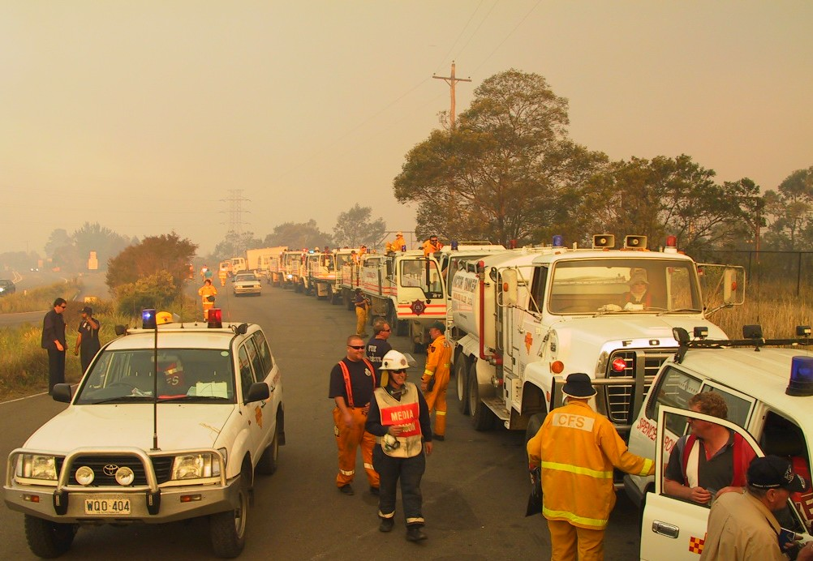
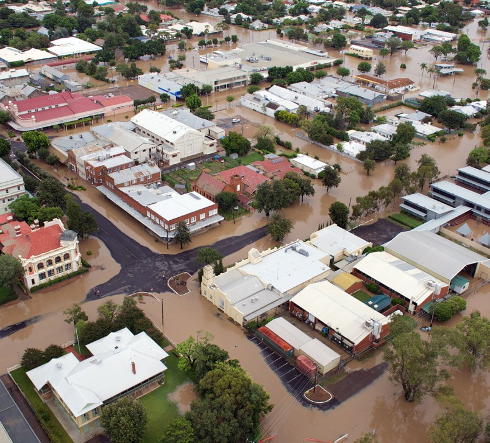

# AIDR Emergency Planning Handbook (2020)

> **Source**: Australian Institute for Disaster Resilience (AIDR)
> **URL**: https://www.aidr.org.au/media/8313/aidr_handbookcollection_emergencyplanning_2020.pdf
> *Converted from PDF to Markdown format.*

---
## Page 1

Emergency 
Planning
2020
Australian Disaster Resilience Handbook Collection

---
## Page 2

a
Emergency Planning Handbook
Cover images: AIDR, Australian Red Cross/Jack Tran, DOI/Neal Herbert

---
## Page 3

i
Emergency Planning Handbook
AUSTRALIAN DISASTER RESILIENCE 
HANDBOOK COLLECTION
Emergency Planning
Second edition 2020

---
## Page 4

ii
Emergency Planning Handbook
© Commonwealth of Australia 2020
Published by the Australian Institute for Disaster 
Resilience.
Copyright
The Australian Institute for Disaster Resilience 
encourages the dissemination and exchange of 
information provided in this publication.
The Commonwealth of Australia owns the copyright in all 
material contained in this publication unless otherwise 
noted.
Where this publication includes material, whose 
copyright is owned by third parties, the Australian 
Institute for Disaster Resilience has made all reasonable 
efforts to:
•	
clearly label material where the copyright is owned by 
a third party
•	
ensure that the copyright owner has consented to 
this material being presented in this publication.
Wherever a third party holds copyright in material 
presented in this publication, the copyright remains with 
that party. Their permission is required to reproduce the 
material.
All material presented in this publication is provided 
under a Creative Commons Attribution 4.0 International 
Public License, with the exception of:
•	
the Commonwealth Coat of Arms
•	
registered trademarks, including:
	
−
Department of Home Affairs logo
	
−
Australian Institute for Disaster Resilience logo
•	
materials specifically mentioned as not being 
provided under a Creative Commons Attribution 4.0 
International Public Licence
•	
content supplied by third parties.
Details of the relevant licence conditions are available on 
the Creative Commons Attribution 4.0 website  
(http://creativecommons.org.au), as is the full legal code 
for the CC BY-NC 4.0 license.
Attribution
Where material from this publication is used for any 
purpose, it is to be attributed to the developer as follows:
Source: Emergency Planning (AIDR 2020).
Using the Commonwealth Coat of Arms
The terms of use for the Coat of Arms are available from 
the It's an Honour website: https://www.dpmc.gov.au/
government/its-honour
Contact
Enquiries regarding the content, licence and any use of 
this document are welcome at:
The Australian Institute for Disaster Resilience
Level 1, 340 Albert Street, East Melbourne Vic 3002
Telephone +61 (0) 3 9419 2388
Disclaimer
The Australian Government Department of Home Affairs 
and the Australian Institute for Disaster Resilience, in 
consultation with emergency management professionals 
and subject matter experts, exercise care in the 
compilation and drafting of this publication; however, the 
document and related graphics could include technical 
inaccuracies or typographical errors and the information 
may not be appropriate to all situations.
In no event shall the Commonwealth of Australia 
(acting through the Department of Home Affairs) or 
the Australian Institute for Disaster Resilience be liable 
for any damages whatsoever, whether in an action of 
contract, negligence or other tortious action, arising out 
of or in connection with the use of or reliance on any of 
the information in this publication.

---
## Page 5

iii
Emergency Planning Handbook
Australian Disaster 
Resilience Handbook 
Collection
The Australian Disaster Resilience Handbook Collection 
provides guidance on national principles and practices for 
disaster resilience. 
The Handbook Collection: 
•	
provides an authoritative, trusted and freely available 
source of knowledge about disaster resilience 
principles in Australia 
•	
aligns national disaster resilience strategy and policy 
with practice, by guiding and supporting jurisdictions, 
agencies and other organisations and individuals in 
their implementation and adoption 
•	
highlights and promotes the adoption of good practice 
in building disaster resilience in Australia 
•	
builds interoperability between jurisdictions, agencies, 
the private sector, local businesses and community 
groups by promoting use of a common language and 
coordinated, nationally agreed principles. 
The Handbook Collection is developed and reviewed by 
national consultative committees representing a range of 
state and territory agencies, governments, organisations 
and individuals involved in disaster resilience.  
The collection is sponsored by the Australian Government 
Department of Home Affairs. 
Access to the Handbook Collection and further details  
are available on the Australian Disaster Resilience 
Knowledge Hub: www.knowledge.aidr.org.au/handbooks
Australian Emergency Management Arrangements
Community Engagement for Disaster Resilience 
Community Recovery
Communities Responding to Disasters: Planning for Spontaneous Volunteers
Emergency Planning
Evacuation Planning
Flood Emergency Planning for Disaster Resilience
Health and Disaster Management
Land Use Planning for Disaster Resilient Communities
Lessons Management
Managing Exercises
Managing the Floodplain: A Guide to Best Practice in Flood Risk Management in Australia
National Emergency Risk Assessment Guidelines
Public Information and Warnings
Safe and Healthy Crowded Places
Tsunami Emergency Planning in Australia

---
## Page 6

iv
Emergency Planning Handbook
This handbook was prepared by the Australian Institute for Disaster Resilience with the assistance of David Parsons of 
Crisis Management Australia, with financial assistance from the Australian Government. Responsibility for the views, 
information or advice expressed in this handbook does not necessarily reflect the views of the Australian Government.
This handbook was made possible through the support of a broad cross-section of the disaster resilience and emergency 
management sector.
Working group members:
Ambulance Victoria and Council of Ambulance Authorities – Justin Dunlop ASM CStJ, Director Emergency Management
Australian Red Cross – John Richardson, National Resilience Advisor
Country Fire Authority, Victoria – Len Leslie, Manager Natural Environment and Bushfire Safety, Fire Prevention and 
Preparedness, Ben Travena, Municipal Fire Management Plan Coordinator, Fire Prevention and Preparedness 
Department of Fire and Emergency Services, Western Australia – Suellen Flint, Deputy State Recovery Coordinator, 
Resilience and Recovery
Department of Jobs, Precincts and Regions, VIC – Kirsten Tanner, Manager Regional Recovery & Development, 
Regional Development Victoria
Emergency Management Victoria – Kaylene Jones, Senior Program Manager Planning Reform
Fire and Rescue New South Wales – Anne Pickles PSM, Operational Capability Project Officer
Livingstone Shire Council, Queensland – David Mazzaferri, Manager Community Wellbeing (Local Disaster Coordinator)
Fire Rescue Victoria – Barry Gray, Assistant Chief Fire Officer, Director Operational Capability, State Capability
Northern Territory Emergency Service – Robert Evans, Deputy Director
South Australia Police – Russell Dippy, Emergency Management Coordinator
South Australian State Emergency Service – Liz Connell, Manager Community Resilience
University of Tasmania – Steven Curnin, Senior Lecturer
Victorian Council of Social Services – Bridget Tehan, Senior Policy Analyst, Emergency Management
AIDR also acknowledges the support and input of the following individuals and organisations
New South Wales State Emergency Service – Dianne Gordon, Chief Superintendent, Manager, Operational Communications
Tasmania State Emergency Service – Cheryl Ames, State Planning and Education Officer, Emergency Management Unit
This handbook is available on the Australian Disaster Resilience Knowledge Hub:  
www.knowledge.aidr.org.au/resources/emergency-planning-handbook
For feedback and updates to this handbook, please contact AIDR: enquiries@aidr.org.au
Acknowledgements

---
## Page 7

v
Emergency Planning Handbook
Australian Disaster Resilience Handbook Collection  .......................................................................................................................  iii
Acknowledgements  .....................................................................................................................................................................................  iv
Executive Summary  ...................................................................................................................................................................................  vii
Introduction  ...................................................................................................................................................................................................   1
Chapter 1: Strategic context and principles of emergency planning  ..........................................................................................  3
1.1 What is emergency planning?  .............................................................................................................................................................................................  4
1.2 Why plan?  ........................................................................................................................................................................................................................................  4
1.3 Strategic context: enhancing disaster resilience  ................................................................................................................................................  4
1.3.1 National Strategy for Disaster Resilience  ......................................................................................................................................................  4
1.3.2 Sendai Framework for Disaster Risk Reduction 2015-2030  .........................................................................................................  6
1.3.3 National Disaster Risk Reduction Framework  ...........................................................................................................................................  6
1.3.4 Australian Disaster Preparedness Framework: A guideline to develop the capabilities required to manage 
severe to catastrophic disasters  ....................................................................................................................................................................................  6
1.3.5 Profiling Australia’s Vulnerability: The interconnected causes and cascading effects of systemic disaster 
risk   .......................................................................................................................................................................................................................................................  6
1.4 Emergency planning principles  .........................................................................................................................................................................................  7
1.5 Emergency planning framework  ......................................................................................................................................................................................  8
1.6 Planning for uncertainty  ........................................................................................................................................................................................................  8
Chapter 2: Developing the emergency plan  .......................................................................................................................................  10
2.1 Overview of the emergency planning process  ......................................................................................................................................................  11
2.1.1 Establish a project plan  ...............................................................................................................................................................................................  12
2.1.2 Establish a project team  ...........................................................................................................................................................................................  12
2.1.3 Communication and consultation  ......................................................................................................................................................................  12
2.1.4 Understand the risks and consequences  .....................................................................................................................................................  13
2.1.5 Develop strategies and arrangements  ...........................................................................................................................................................  14
2.1.6 Document and trial the plan  ...................................................................................................................................................................................  14
2.1.7 Endorsement of the plan  ...........................................................................................................................................................................................  14
2.1.8 Implement and exercise the plan  ........................................................................................................................................................................  15
2.1.9 Monitor and review  .......................................................................................................................................................................................................  15
Chapter 3: Documenting the emergency plan  ...................................................................................................................................  16
3.1 Writing for the plan users  .....................................................................................................................................................................................................  17
3.2 Plan administration  ..................................................................................................................................................................................................................  17
3.3 Plan elements  ..............................................................................................................................................................................................................................  17
3.3.1 Contents, abbreviations and glossary  ............................................................................................................................................................  17
3.3.2 Authority  ............................................................................................................................................................................................................................  17
3.3.3 Security rating  ................................................................................................................................................................................................................  17
3.3.4 Review schedule  ...........................................................................................................................................................................................................  17
3.3.5 Amendment register  ..................................................................................................................................................................................................  17
Contents

---
## Page 8

vi
Emergency Planning Handbook
3.3.6 Distribution list  ...............................................................................................................................................................................................................  17
3.3.7 Plan aim and objectives  ............................................................................................................................................................................................  17
3.3.8 Legislative and policy context  .............................................................................................................................................................................  17
3.3.9 Plan context  .....................................................................................................................................................................................................................  18
3.3.10 Plan scope  .......................................................................................................................................................................................................................  18
3.3.11 Leadership and network structures  ..............................................................................................................................................................  18
3.3.12 Roles and responsibilities  ......................................................................................................................................................................................  18
3.3.13 Financial management  ............................................................................................................................................................................................  18
3.3.14 Communication systems  ......................................................................................................................................................................................  18
3.3.15 Information management  .....................................................................................................................................................................................  18
3.3.16 Resource capability and capacity requirements  ..................................................................................................................................  19
3.3.17 Prevention and mitigation  .....................................................................................................................................................................................  19
3.3.18 Preparedness  ................................................................................................................................................................................................................  19
3.3.19 Public education and community engagement  ....................................................................................................................................  20
3.3.20 Plan scheduling and activation  .......................................................................................................................................................................  20
3.3.21 Response arrangements  ......................................................................................................................................................................................  21
3.3.22 Emergency control and co-ordination facilities  ..................................................................................................................................  21
3.3.23 Public information and warnings  ....................................................................................................................................................................  21
3.3.24 Evacuation management  .....................................................................................................................................................................................  21
3.3.25 Relief arrangements  ................................................................................................................................................................................................  21
3.3.26 Recovery arrangements  ......................................................................................................................................................................................  21
3.3.27 Exercise schedule  ....................................................................................................................................................................................................  22
Chapter 4: Implementing the emergency plan  ..................................................................................................................................  23
4.1 Accessing the plan  ...................................................................................................................................................................................................................   24
4.2 Establishing the structure  .................................................................................................................................................................................................   24
4.3 Notifications  ................................................................................................................................................................................................................................   24
4.4 Undertaking responsibilities  ............................................................................................................................................................................................   24
4.5 Developing supporting documentation  ....................................................................................................................................................................   24
4.6 Implementing risk controls  ................................................................................................................................................................................................   24
4.7 Exercising the plan  ..................................................................................................................................................................................................................   25
Chapter 5: Monitoring and reviewing the emergency plan  ...........................................................................................................   26
5.1 Monitoring and review  .............................................................................................................................................................................................................  27
5.2 Exercises  ........................................................................................................................................................................................................................................  27
5.3 Debriefs  ...........................................................................................................................................................................................................................................  27
References  ....................................................................................................................................................................................................  28
List of Figures
Figure 1. Emergency planning framework in government  ........................................................................................................................................  8
Figure 2. The emergency planning process  ......................................................................................................................................................................  11
List of Tables
Table 1. How emergency planning contributes to achieving each of the priorities  
in the National Strategy for Disaster Resilience (COAG 2011)   .............................................................................................................................  5

---
## Page 9

vii
Emergency Planning Handbook
Emergency planning plays an important role in the development of Australia’s disaster resilience capability.  
The emergency planning process is the collective and collaborative effort by which agreements are reached and 
documented between people and organisations to meet their communities' or entities’ emergency management needs. 
Emergency planning involves identifying and documenting strategies for preventing, preparing for, responding to and 
recovering from emergencies. Effective emergency planning contributes to reducing the likelihood and consequence 
of emergencies for individuals, communities, entities, and the environment and can have positive economic benefits.
Emergency Planning is part of the Australian Disaster Resilience Handbook Collection. The handbook reflects changes 
in the field of disaster risk reduction, emergency management and more broadly in society since the publication of the 
previous Emergency Planning Manual (AIDR 2004). Emergency planning is an essential element in the implementation 
of the policy framework established by the National Strategy for Disaster Resilience (COAG 2011). 
The handbook contextualises key messages for emergency planning as considered in the National Disaster Risk 
Reduction Framework (Australian Government Department of Home Affairs 2018), Profiling Australia’s Vulnerability 
(Australian Government Department of Home Affairs 2018), the Australian Disaster Preparedness Framework 
(Australian Government Department of Home Affairs 2018) and the Sendai Framework for Disaster Risk Reduction 
2015-2030 (United Nations Office for Disaster Risk Reduction 2015).
The handbook provides nationally agreed principles for good practice in emergency planning and draws on and 
complements current practices. The handbook introduces the strategic context and importance of emergency 
planning, the emergency planning process, the potential elements of an emergency plan, the actions needed to 
implement the plan, and monitoring and evaluation. 
Additionally, it introduces the application of a project management approach to the development of an emergency 
plan and recognises the need to plan for uncertainty. The approach in the handbook can be applied to developing 
emergency plans for all hazards and may cover all the phases of prevention, preparedness, response, and recovery.
Executive Summary

---
## Page 10

1
Emergency Planning Handbook
Purpose of this handbook
The Emergency Planning handbook provides nationally agreed principles for good practice in emergency planning. 
The handbook draws on and complements current practices and provides guidance on emergency planning for 
communities and entities. The emergency planning process described in the handbook can be used to develop a plan 
for any or all phases of prevention, preparedness, response, and recovery.
The handbook is for use by:
•	
emergency service organisations
•	
government agencies
•	
	private sector businesses
•	
critical infrastructure owners and operators
•	
community groups
•	
non-government and not-for-profit organisations
•	
community event committees
•	
educational institutions.
The handbook is not intended to be operational in nature. Entities accountable for response and recovery operations 
have planning arrangements in place relevant to their agency. Emergency planning as covered in the handbook is 
undertaken in the preparedness phase of emergency management.
Context
Emergency Planning is part of the Australian Disaster Resilience Handbook Collection. Emergency planning plays an 
important role in the development of Australia’s disaster resilience capability. Emergency planning should ensure that 
approaches to prevention, preparedness, response, and recovery are based on analysis, consultation, engagement, and 
agreement. Emergency planning is an essential element in the implementation of the policy framework established by 
the National Strategy for Disaster Resilience (COAG 2011).
The handbook contextualises key messages for emergency planning as considered in the National Disaster Risk 
Reduction Framework (Australian Government Department of Home Affairs 2018), Profiling Australia’s Vulnerability 
(Australian Government Department of Home Affairs 2018) and the Sendai Framework for Disaster Risk Reduction 
2015-2030 (United Nations Office for Disaster Risk Reduction 2015).
The handbook reflects changes in the field of disaster risk reduction, emergency management and more broadly 
in society since the publication of the previous Emergency Planning Manual (AIDR 2004). Some of the changes 
influencing the handbook include new approaches to:
•	
disaster risk reduction
•	
disaster resilience
•	
disaster recovery
•	
partnerships between the public, private and not-for-
profit sector
•	
community engagement, consultation, and shared 
responsibility
•	
planning for catastrophic, cascading, and concurrent 
events
•	
emergent capability and capacity
•	
lessons management.
Introduction

---
## Page 11

2
Emergency Planning Handbook
The handbook does not intend to repeat explanations of concepts or processes that are covered in other handbooks. 
This handbook refers to content further detailed in:
•	
Australian Emergency Management Arrangements 
(AIDR 2019)
•	
Community Engagement for Disaster Resilience  
(AIDR 2020)
•	
Community Recovery (AIDR 2018)
•	
Communities Responding to Disasters: Planning for 
Spontaneous Volunteers (AIDR 2018)
•	
Evacuation Planning (AIDR 2017)
•	
Land Use Planning for Disaster Resilient Communities 
(AIDR 2020)
•	
Lessons Management (AIDR 2019)
•	
Managing Exercises (AIDR 2017)
•	
National Emergency Risk Assessment Guidelines 
(AIDR 2020)
•	
Public Information and Warnings (AIDR 2018)
Scope
The handbook provides a generic guide for emergency planners producing community or entity emergency plans. 
'Entity' is used in this handbook as a proxy for the wide range of organisations, businesses and groups that develop 
emergency plans.
In this handbook the generic term 'risk management study' is used. The approach taken by a community or entity to 
applying the principles of risk management will vary.
The approach in the handbook can be applied to developing emergency plans for all hazards and may cover all the 
phases of prevention, preparedness, response, and recovery.
The handbook is not a guide to business continuity planning. There are specific standards and guides available for 
business continuity planning. However, the handbook can be utilised to develop an entity’s emergency management 
plan as part of an integrated business continuity management framework.
The handbook applies a project management approach to the development of an emergency plan. Entities may use 
their existing project management processes. The handbook uses the term 'project team' to describe the people 
developing the emergency plan. The project team may be an existing emergency planning committee.
The approach set out in the handbook will need to be scaled to meet the needs of the user. Factors to be considered 
include resources available for the planning project, complexity and scope of planning required, and the degree of 
community and stakeholder engagement required.

---
## Page 12

3
Emergency Planning Handbook
3
Chapter 1: Strategic 
context and principles of 
emergency planning

---
## Page 13

4
Emergency Planning Handbook
Summary of key points 
This chapter explains the national and 
international strategic context of emergency 
planning. Additionally, the chapter includes 
national principles underpinning emergency 
planning. Key points covered in this chapter 
include:
•	
implementation of emergency planning 
contributes to building disaster resilience
•	
an emergency plan sits within a framework of 
plans and documents
•	
an emergency plan is based on a risk study
•	
emergency planning requires effective 
communication and consultation
•	
emergency planning is an iterative process
•	
planning for uncertainty requires plans to be 
flexible and adaptive.
1.1 What is emergency planning?
The emergency planning process is the collective and 
collaborative effort by which agreements are reached and 
documented between people and organisations to meet 
their communities' or entities’ emergency management 
needs (Australian Disaster Resilience Glossary).
Emergency planning applies communication and 
consultation processes to gain agreement about:
•	
risks and consequences
•	
risk acceptance
•	
risk reduction strategies – prevention and mitigation
•	
preparedness arrangements
•	
response and relief arrangements
•	
recovery arrangements.
Effective emergency planning ensures that agreed 
outcomes are documented and continuously improved. 
At each step in the emergency planning process 
consideration should be given to consequences across 
the social, built, economic and natural environments. 
The process of emergency planning starts with a 
risk management study and requires a thorough 
understanding of the communities and entities the plan 
is for. Effective planning requires communication and 
consultation with the communities and stakeholders the 
plan applies to. Planning builds knowledge, relationships 
and networks that benefit all phases of emergency 
management. Developing an emergency plan is an 
iterative process, each step in the planning process 
builds knowledge that improves understanding of earlier 
planning steps. Once implemented, emergency plans 
need to be reviewed for their effectiveness. An effective 
lessons management process enables continuous 
improvement of emergency plans. Consideration needs 
to be given to ensuring arrangements in new plans 
are reflected in existing policies and plans to ensure 
effective interoperability.
1.2 Why plan?
Scientific evidence from the Bureau of Meteorology 
(BOM) and CSIRO indicates that a variable and changing 
climate is expected to further increase the severity 
and frequency of many natural hazards in Australia 
(CSIRO and BOM 2018). The Fifth Assessment Report 
of the Intergovernmental Panel on Climate Change 
(IPCC) states that there will be an ‘increased frequency 
and intensity of flood damage to settlements and 
infrastructure in Australia’, and an increase in the 
‘number of days with extreme fire weather’ and ‘greater 
frequency and intensity of droughts’ (IPCC 2014).
The economic cost of disaster to Australian communities 
in the 10 years to 2016 has averaged $18.2 billion 
per year. This figure is expected to rise to an average 
of $39 billion per year by 2050 (Australian Business 
Roundtable (ABR) 2017). It is noted that, at the time of 
this handbook’s publication, this projected figure is being 
updated. The intangible costs in terms of the impact 
on people’s lives, their health and wellbeing, education, 
employment, and community networks as well as 
environmental damage are at least equal to, if not greater 
than, tangible costs (ABR 2017).
Emergency planning involves identifying and 
documenting strategies for preventing, preparing 
for, responding to and recovering from emergencies. 
Effective emergency planning contributes to reducing 
the likelihood and consequence of emergencies for 
individuals, communities, entities, and the environment 
and can have positive economic benefits.
The interconnectedness of systems in society causes 
cascading consequences in emergencies. Effectively 
managing risks therefore requires all sectors of society 
to plan for emergencies. Emergency planning is a 
legislative or regulatory requirement for many entities 
under state, territory and Commonwealth legislation.  
1.3 Strategic context: enhancing 
disaster resilience
1.3.1 National Strategy for Disaster 
Resilience
The National Strategy for Disaster Resilience (the 
Strategy) was adopted by the Council of Australian 
Governments (COAG) in 2011. The Strategy provides

---
## Page 14

5
Emergency Planning Handbook
high-level guidance on emergency management to 
federal, state, territory and local governments, business 
and community leaders and the not-for-profit sector, 
and provides priority areas to build disaster resilient 
communities.
The Strategy highlights that, to increase disaster 
resilience, emergency planning should be based on risk 
and be integrated with strategic planning of government 
and communities.
Table 1. How emergency planning contributes to achieving each of the priorities in the National 
Strategy for Disaster Resilience (COAG 2011) 
NSDR Priority
How emergency planning contributes to achieving this priority 
PRIORITY 1 –  
Leading change and 
coordinating effort
•	
identifies the range of stakeholders with planning responsibilities
•	
connects planning stakeholders
•	
assists people to understand the risks in their community/entity
•	
facilitates information sharing about risks between entities
•	
ensures people know the actions to be taken across the phases of prevention, 
preparedness, response and recovery.
PRIORITY 2 –
Understanding risk
•	
enables people to understand the risks in their community/entity
•	
develops approaches to community education
•	
facilitates information sharing about risks between entities
•	
develops strategies to enable preparedness for risks.
PRIORITY 3 – 
Communicating with and 
educating people about 
risks
•	
identifies stakeholder groups who need to know about risks and risk reduction 
strategies
•	
identifies strategies to enhance stakeholder understanding of risk
•	
facilitates information sharing
•	
develops strategies for public information and warnings
•	
incorporates lessons from past events for future use.
PRIORITY 4 –  
Partnering with those 
who effect change
•	
brings together various sectors of the community to share knowledge and 
capabilities
•	
builds partnerships between and across the public, private and not-for-profit sectors
•	
engages with research institutions to develop new approaches.
PRIORITY 5 –  
Empowering individuals 
and communities to 
exercise choice and take 
responsibility
•	
ensures community members and entities have the risk information they need 
before, during and after a disaster to take appropriate action.
PRIORITY 6 –  
Reducing risks in the built 
environment
•	
informs communities and entities about risks
•	
provides information to enable improved decision making about risk reduction 
measures
•	
engages critical infrastructure owners and operators in resilience building.
PRIORITY 7 – 
Supporting capabilities 
for disaster resilience
•	
identifies capabilities required for effective prevention, preparedness, response, and 
recovery
•	
identifies the availability of capabilities across the public, private and non-
government organisation sectors
•	
identifies the capacity required for each capability
•	
identifies the capability and capacity of the community/entity.

---
## Page 15

6
Emergency Planning Handbook
1.3.2 Sendai Framework for Disaster Risk 
Reduction 2015-2030
The Sendai Framework for Disaster Risk Reduction 2015- 
2030 (the Sendai Framework) was adopted by Australia 
and other members of the United Nations at the third 
United Nations World Conference on Disaster Risk 
Reduction. Through the Sendai Framework, Australia 
recognises the importance of not only managing 
disasters, but managing disaster risk.
The Sendai Framework states that it is urgent and critical 
to anticipate, plan for and reduce disaster risk in order 
to more effectively protect persons, communities and 
countries, their livelihoods, health, cultural heritage, 
socioeconomic assets and ecosystems, and thus 
strengthen their resilience.
1.3.3 National Disaster Risk Reduction 
Framework
In early 2018 the Australian Government invited all 
states and territories, local government, and key private 
sector representatives to work together to co-design 
and develop the National Disaster Risk Reduction 
Framework (the Framework). The Framework was 
endorsed by COAG in March 2020.
The Framework, which is informed by the Sendai 
Framework, sets out the foundational work to proactively 
reduce risk now and into the future. It guides national, 
whole-of-society efforts to proactively reduce disaster 
risk in order to minimise the loss and suffering caused by 
disasters.
1.3.4 Australian Disaster Preparedness 
Framework: A guideline to develop the 
capabilities required to manage severe to 
catastrophic disasters
The Australian Disaster Preparedness Framework 
(the Preparedness Framework) informs the strategic 
governance, policy and investment required for 
disaster preparedness. The Preparedness Framework 
provides guidance and support for jurisdictions to 
develop the required capability to effectively prepare 
for and manage severe to catastrophic disasters. It 
incorporates consideration of risk and consequence, 
and new and emerging ideas and technologies, to inform 
the strategic capability requirements and arrangements 
across governments and the private, non-government 
community and international sectors.
1.3.5 Profiling Australia’s Vulnerability: 
The interconnected causes and cascading 
effects of systemic disaster risk 
The report Profiling Australia’s Vulnerability: The 
interconnected causes and cascading effects of systemic 
disaster risk is the result of a year-long initial study of 
the causes and effects of disasters in Australia. The 
purpose of this work is to advance understanding of and 
approaches to assessing disaster risk. This report is a 
significant and innovative contribution to transforming 
how we plan and prepare as a nation for emergency 
events, as well as informing new approaches to reducing 
disaster risk and building resilience. It raises important 
questions about the cascading effects of vulnerabilities 
and the limits of resilience at every level.

---
## Page 16

7
Emergency Planning Handbook
1.4 Emergency planning principles
Principles underpinning emergency planning include:
1 
Emergency planning is risk informed. Planning is based on a risk management study.
2
Emergency planning reduces unknowns. Planning increases understanding of risks, vulnerabilities, and 
treatment options across the social, built, economic, and natural environments.
3 
Emergency planning is collaborative and inclusive. Planning involves consultation and engagement with those 
affected by the plan.
4
Emergency planning is strategic. Planning develops strategic objectives, relationships, and networks.
5
Emergency planning is solutions oriented. Planning develops agreed approaches to managing risks and 
consequences.
6
Emergency planning is iterative. Learning from each step informs next steps.
7
Emergency planning enables adaptive capacity. Planning develops frameworks that provide a base on which 
to build flexible and adaptive solutions.
8
Emergency planning is a shared responsibility. Planning documents actions to be undertaken by a wide range 
of people/entities.

---
## Page 17

8
Emergency Planning Handbook
1.5 Emergency planning 
framework
An emergency plan commonly sits within a framework of 
plans and documents. An emergency plan may:
•	
fit within a hierarchical structure of plans e.g. national, 
state, regional and local
•	
cover a specific phase of comprehensive emergency 
management e.g. flood mitigation plan, bushfire 
response plan, community recovery plan
•	
cover a specific function or activity e.g. transport 
functional plan
•	
cover a specific supporting activity e.g. evacuation 
plan, public information and warning plan
•	
cover a specific hazard e.g. exotic animal disease plan
•	
cover a specific event or entity e.g. festival 
emergency plan, airport/aerodrome emergency plan.
Figure 1 represents the structure of emergency 
management plans developed for general emergency 
management purposes by government. Many other 
entities at a local and national level develop plans that 
are not covered by this framework but nevertheless 
interact with or impact plans in this government planning 
framework. These entities include the not-for-profit 
sector, private sector, critical infrastructure, non-
government organisations and community organisations. 
Entities are encouraged to ensure plans they develop 
acknowledge and effectively interface with government 
plans.
Consideration must be given to interoperability issues 
between plans such as consistent terminology, 
responsibilities and arrangements. Developing the 
integrated framework of plans is a shared responsibility.
1.6 Planning for uncertainty
The level of volatility, uncertainty, complexity, and 
ambiguity in contemporary society ensures that new 
issues continue to arise in emergency response and 
recovery. New issues may be caused by:
•	
catastrophic disasters exceeding planning 
arrangements
•	
complexity caused by cascading consequences
•	
emergencies not previously experienced by 
emergency planners and communities. 
Definition of a catastrophic disaster
A catastrophic disaster is what is beyond our 
current arrangements, thinking, experience 
and imagination (i.e. that has overwhelmed our 
technical, non-technical and social systems 
and resources, and has degraded or disabled 
governance structures and strategic and 
operational decision-making functions). It should 
be noted that severe to catastrophic disasters 
differ from emergencies in that they exceed 
business as usual emergency management 
systems and capability design parameters. 
(Australian Disaster Resilience Glossary 2019)
To manage volatility, uncertainty, complexity, and 
ambiguity the planning process needs to:
•	
be strategic in nature, adopting a principles-based 
approach
•	
identify subject matter specialists who can provide 
appropriate expert advice
•	
create flexible leadership structures that can 
integrate entities not identified in the planning 
process
•	
create collaborative networks and relationships 
that can provide support to each other and share 
innovative ideas
Local  
plans
District and 
regional plans
State and  
territory plans
National  
plans
International  
plans
Threat-specific 
plans
Support and 
functional plans
Australian 
Government plans
Figure 1. Emergency planning framework in 
government

---
## Page 18

9
Emergency Planning Handbook
•	
establish processes that enable adaptive and creative 
thinking to produce innovative solutions
•	
create a learning organisation approach which 
enables rapid prototyping, trialling and evaluation of 
solutions.
‘Decision makers need to recognise and possibly 
reframe their understanding of the scale, 
nature and opportunities that rapidly changing 
environments present. They will need to revisit 
values, objectives, assumptions and approaches 
underpinning strategy development, planning, 
risk management and economic assessment to 
be compatible with large-scale change and high 
uncertainty’.  
Guidance for Strategic Decisions on Climate And 
Disaster Risk: Guidance on Scenarios (Australian 
Government Department of Home Affairs 2019). 
See for more guidance on decision making and 
uncertainty. 
Vignette: Volatility, uncertainty, complexity, 
and ambiguity - South Australia’s extreme 
weather event
On 28 September 2016, South Australia 
experienced an extreme weather event which 
brought thunderstorms, destructive winds, 
large hailstones, and heavy rain. Cascading 
consequences from this event included:
•	
a loss of power to the whole state
•	
loss of access to food, medications, and fuel
•	
disruption to water supplies, 
telecommunications, banking services, and radio
•	
traffic disruption due to loss of traffic lights
•	
flooding of homes and business.
There were many learnings to improve future 
plans. One outcome was an alternative model 
for emergency relief and recovery to make 
these aspects of emergency management more 
effective and efficient.
Source: South Australian Government Department 
of Premier and Cabinet 2018, Independent Review 
of the Extreme Weather Event South Australia 28 
September – 5 October 2016. 
www.dpc.sa.gov.au/resources-and-
publications/extreme-weather-event-review

---
## Page 19

10
Emergency Planning Handbook
10
Chapter 2: Developing 
the emergency plan

---
## Page 20

11
Emergency Planning Handbook
Summary of key points 
This chapter presents the process involved in 
developing an emergency plan. Effective planning 
involves:
•	
taking a project management approach 
with clear deliverables, accountability and 
methodology
•	
using a risk study as a foundation on which to 
base strategies
•	
conducting consultation and communication 
not only within the project team but with 
entities and communities affected by the plan
•	
validating the plan through trials and exercises. 
2.1 Overview of the emergency 
planning process
The emergency planning process is a sequence of steps 
by which an emergency plan is prepared, implemented 
and continuously reviewed. The planning process has 
a role in building the knowledge of people involved and 
strengthening the relationship and networks between 
them.
The planning process can be scaled to match the size 
of the project. The size of the project team and scope of 
work undertaken will vary according to the size of the 
community group or entity involved. In a smaller entity 
the work of the project team may be undertaken by one 
person.
The emergency planning process as shown in Figure 2. 
involves several steps: 
•	
Establish a project plan.
•	
Establish a project team.
•	
Communicate and consult with communities, entities 
and stakeholders throughout the process.
•	
Understand the risk treatment options by conducting 
a risk management study.
•	
Develop strategies and arrangements for prevention, 
preparedness response and recovery.
•	
Document the plan. Multiple plans may be required 
for specific areas, activities or entities. Plans may be 
supported by other forms of documentation such as 
procedures, contracts, community information guides 
and mutual aid agreements.
•	
Endorsement of the plan.
•	
Implement the emergency plan through communication 
and education on arrangements, resource procurement, 
training, exercises and other resilience building activities.
•	
Monitor and review the planning process and plan.
Figure 2. The emergency planning process
Establish a project 
plan
Establish a 
planning team
Understand 
risk and 
consequences
Endorse the plan
Develop 
strategies and 
arrangements
Implement and 
exercise the plan
Document and 
trial the plan
Lessons 
management
Monitor and review
Communication and consultation

---
## Page 21

12
Emergency Planning Handbook
2.1.1 Establish a project plan
Confirm the plan sponsor
The plan sponsor is the person or entity responsible for 
providing the resources to enable the emergency plan 
to be developed and implemented. The plan sponsor is 
responsible for ensuring the emergency plan is approved 
by the authorising entity.
Establish authority
The project should be established under formal authority. 
Formal authority could include legislation, entity direction 
or community agreement. Clear authority for planning 
gives the emergency plan credibility, recognition and 
acceptance. There should be clear ownership of the 
responsibility for the development of the emergency plan.
Appoint a project manager
The project sponsor will appoint a project manager.  
The project manager will:
•	
organise the administrative support for the project
•	
ensure the right people are representing their entity
•	
gain consensus on the project plan
•	
lead the project team
•	
engage all project team members and leverage the 
available knowledge and skills
•	
communicate and consult with project stakeholders.
Develop a project plan
The project manager will develop a project plan. The 
project plan details:
•	
Project audience – Who is the audience the 
emergency plan is designed for?
•	
Project purpose – Why is the emergency plan being 
developed?
•	
Project scope – What is included and excluded from 
the emergency plan?
•	
Project aim and objectives – What will be produced by 
the project team?
•	
Project deliverables – What are the planning activities 
to be completed?
•	
Project timeline – What are the dates for information 
provision, meetings, feedback deadlines, consultation 
sessions?
•	
Project responsibilities – What are the responsibilities 
of the project sponsor, project manager, project team 
members and others?
•	
Resources – What resources are required to 
complete the project including time commitments?
•	
Administrative arrangements - What are the 
arrangements for document control and meeting 
support?
•	
Risk management – What risks could derail the 
project? What risk controls are required?
•	
Community and stakeholder engagement – How will 
the community and stakeholders be communicated 
and consulted with?
2.1.2 Establish a project team
The project team may be an existing emergency 
management committee, or a project team formed to 
undertake the development of the emergency plan. The 
project team members are individually responsible for:
•	
endorsing the project plan
•	
providing information and ideas to enable the 
development of the emergency plan
•	
reviewing documents and providing feedback
•	
organising their entity’s endorsement of the 
emergency plan.
There are several requirements for a project team to be 
effective. These requirements include:
•	
project team members should be sufficiently 
empowered to represent their entity
•	
project team members should be committed to the 
planning process
•	
continuity of project team membership.
Selecting the project team requires careful consideration 
to ensure communities and entities are represented 
by the appropriate people. The project team has to be 
limited to a functional size.
2.1.3 Communication and consultation
It is important that emergency plans meet the specific 
characteristics and requirements of the communities 
and entities they are for. Tailoring the emergency plan 
to the community or entity requires communication 
and consultation with communities and stakeholders 
impacted by the emergency plan. Communication and 
consultation are ongoing requirements throughout the 
planning process.
Aspects of communities and entities affected by the 
emergency plan will need to be understood through 
effective communication and consultation.  
Aspects include:
•	
the nature of the communities and entities affected 
e.g. demographics, distribution, mobility, language, 
vulnerability, cultural issues, previous experiences
•	
the capability and capacity of the communities and 
entities
•	
planning previously undertaken by communities and 
entities.

---
## Page 22

13
Emergency Planning Handbook
The nature of the planning project influences the scale 
and complexity of the communication and consultation 
process. Engaging with community members and 
stakeholders may require workshops, newsletters or 
community forums. 
Further information on community engagement 
can be found in Community Engagement for 
Disaster Resilience (AIDR 2020).
 
Vignette: Equi-Evac Centre Network - City 
of Mandurah Western Australia
The City of Mandurah has a Local Emergency 
Management Plan and an Animal Welfare Plan. 
The Equi-Evac Network project bought multiple 
agencies together in a collaborative approach to 
planning. This project won the Resilient Australia 
National Award in 2017.
The City of Mandurah Equi-Evac Centre Network 
project equips local public equestrian facilities 
as evacuation points for the surrounding 
community of horse owners in times of 
emergency. Public equestrian facilities deemed 
suitable are provided with a comprehensive 
activation kit including guidelines, contacts, 
equipment and information on animal welfare 
standards.
The project involved local governments, 
community members, the Department of Fire 
and Emergency Services, the Department for 
Communities, the Department of Agriculture and 
Food, the Australian Red Cross and the Royal 
Society for the Prevention of Cruelty to Animals. 
The project highlighted the need for inclusive 
evacuation planning.
Source: Australian Journal of Emergency 
Management, January 2018.
2.1.4 Understand the risks and 
consequences
The development of an emergency plan is based on 
the output of a risk management study. The project 
team may conduct the risk management study or use 
existing information. A risk management study provides 
information to understand risks and then decide on the 
most appropriate treatments to reduce these risks.  
Risk treatments may apply to any or all phases of 
prevention, preparedness, response and recovery.
The risk management study provides important 
information to enable effective emergency planning. 
Information resulting from a risk management study that 
is useful for an emergency plan includes:
•	
information on hazards
•	
register of risks
•	
level of risk reduction required
•	
risk treatment options and selected strategies
•	
cascading consequences from hazards
•	
information on community/entity values and 
changing community/entity profiles
•	
relevant characteristics of the community e.g. 
demographics, distribution, mobility, language, 
vulnerability, cultural issues, previous experiences
•	
describes the community/entity vulnerabilities
•	
opportunities to build community resilience
•	
stakeholders
•	
objectives to be met from the planning process
•	
plans required and responsible entities.
Throughout the emergency planning process, 
consideration should be given to other factors such as 
regulatory requirements and consultation with other 
entities able to influence the nature and application of 
risk treatments. For example:
•	
the emergency planning process may identify 
opportunities for risk treatments to be addressed 
through land use planning controls
•	
land use planning processes may require emergency 
planning within specified parameters.
Land use planning controls can support and enhance 
emergency management outcomes across all phases of 
emergency planning.
Further information on risk management can be 
found in National Emergency Risk Assessment 
Guidelines (NERAG) (AIDR 2020) which aligns with 
ISO 31000:2018 Risk management - Guidelines.
Further information on land use planning can be 
found in Land Use Planning for Disaster Resilient 
Communities (AIDR 2020).

---
## Page 23

14
Emergency Planning Handbook
Vignette: A collaborative catchment – 
Fitzroy Regional Resilience Strategy
Collaborative partnerships are required to plan 
effectively to prevent, prepare for, respond to 
and recover from emergencies.
The Fitzroy region is no stranger to floods. This 
vast catchment is one of Australia’s largest river 
systems, taking in the Isaac, Nogoa, Connors, 
Comet, Mackenzie and Dawson rivers and the 
mighty Fitzroy River itself.
For the Fitzroy Basin, resilience is fundamentally 
about understanding risk. The vast basin has a 
long history of flooding in all its sub-basins and 
townships.
The objectives of the Fitzroy Regional Resilience 
Strategy are:
1.	
understand risk – linking the optimisation 
and operability of the Flood Warning 
Network (and other hazards where relevant) 
to risk awareness, community education 
and business continuity
2.	
work together – understanding how best 
to share technical capability, knowledge 
and resources across the catchment for 
collective benefit and a common approach 
to asset management.
Benefits of the strategy include:
1.	
a better understanding of flood risk that 
supports improved social and economic 
resilience outcomes for the community
2.	
a plan for collaborative action to 
optimise the Fitzroy Basin flood warning 
infrastructure network set against funding 
options.
Source: A Collaborative Catchment – Fitzroy 
Regional Resilience Strategy, Queensland 
Reconstruction Authority, January 2020.
2.1.5 Develop strategies and 
arrangements
Emergency planning requires the undertaking of 
research and a literature review to establish good 
planning practice and to scope what must be considered 
in development of the plan e.g. other doctrine, national 
terminology. The development of strategies and 
arrangements should take into consideration those 
contained in other plans that they need to integrate with.
One of the issues to be considered by the project 
team is how much detail to include in the emergency 
plan. Where the problem and the solution are clearly 
understood and agreed to, the emergency plan can 
be detailed. However, a rigid emergency plan is less 
likely to cope with high levels of volatility, uncertainty, 
complexity, and ambiguity. Planning for uncertainty 
requires an emergency plan to provide guidance for 
adaptive decision making. In this case an emergency plan 
will be strategic in nature and adopt a principles-based 
approach.
The range of strategies and arrangements developed will 
depend on the aim, objectives and scope of the project.
2.1.6 Document and trial the plan
The format of the emergency plan depends on the 
requirements of the users. Users may require the 
emergency plan to be produced as an electronic or a 
paper-based document.
Content that changes frequently, such as phone 
numbers and email addresses, should be included in 
an annexure to the body of the document to assist in 
updating.
Emergency plans require administration and will include 
different elements depending on the purpose. 
Administration and elements of emergency plans are 
described in Chapter 3.
Once the plan is documented assurance is required that 
the plan will function effectively. Assurance can be 
achieved through trialling the plan or reviewing the plan 
with an assurance tool. Trialling the plan could involve the 
conduct of a desk top exercise. An assurance tool can be 
used to ensure that the emergency plan conforms with 
higher-level policy or statutory requirements. There are 
several review guides used within industry, regulatory 
authorities and the emergency management sector. 
Links to sample review guides are contained in 
the companion document Emergency Planning 
Resources Links.
2.1.7 Endorsement of the plan
The emergency plan must be approved by the person/s 
who have the authority to do so. This may include a sign 
off by the entities involved in the development of the 
emergency plan and those who have a functional role in 
the execution of the plan.

---
## Page 24

15
Emergency Planning Handbook
2.1.8 Implement and exercise the plan
Following the development of an emergency plan there 
is a requirement to ensure the plan is understood and 
the arrangements are effective. Plan implementation 
activities include:
•	
ensuring the plan is accessible to users
•	
communicating the emergency plan with the 
community and stakeholders
•	
communicating the emergency plan to relevant staff
•	
developing procedures, contracts, checklists, action 
cards
•	
educating those responsible for implementing the 
emergency plan
•	
exercising the plan
•	
assuring that capabilities and capacities identified in 
the emergency plan are available.
Implementing and exercising the plan is discussed 
further in Chapter 4.
2.1.9 Monitor and review
As part of the planning process, a timeline for monitoring 
and reviewing the outcomes of the process need to be 
programmed and the responsibilities defined. The review 
cycle needs to be included in the plan.
The nature of emergency-related risk changes over time. 
This includes shifting of priorities, perception and culture. 
As a result, the emergency plan needs to be updated 
regularly to ensure that approaches remain current.
The monitoring and review process should be 
documented in the emergency plan:
•	
ensuring identified arrangements are operating 
effectively and have not changed over time
•	
incorporating lessons identified from emergencies 
and exercises
•	
accounting for changes in the context of the risk 
assessment
•	
identifying and accounting for emerging risks.
Monitoring and reviewing the emergency plan is 
discussed further in Chapter 5.

---
## Page 25

16
Emergency Planning Handbook
16
Chapter 3: Documenting 
the emergency plan

---
## Page 26

17
Emergency Planning Handbook
Summary of key points 
This chapter explains what might be contained 
within an emergency plan. This includes:
•	
administrative arrangements that support 
the emergency plan
•	
content of an emergency plan
•	
arrangements to monitor and review the 
emergency plan.
3.1 Writing for the plan users
The project manager needs to format the emergency 
plan to meet the needs of the various users. The 
emergency plan should be structured in segments that 
allow users to easily find the information they require. 
The emergency plan should:
•	
have logically labelled sections
•	
be written in plain English
•	
be easily searchable
•	
use annexures for checklists and stand-alone parts.
3.2 Plan administration
An emergency plan must be reviewed and updated 
regularly. An effective emergency plan requires all 
parties to have the current version to work from. 
Emergency plans can be stored on a computer server 
or in the cloud and accessed when required. Whether 
emergency plans are distributed as electronic files or in 
paper-based formats, procedures to update them are 
required. Emergency plans should be version controlled, 
with the version number and date on every page so that 
users can compare copies and determine which version 
they have.
3.3 Plan elements
The structure of an emergency plan depends on its 
purpose. The plan may include elements in this section.
3.3.1 Contents, abbreviations and glossary
The emergency plan should contain a table of contents 
and an explanation of all abbreviations used in the 
emergency plan. If unfamiliar terms are used a glossary 
of terminology may be required.
Further information on terminology can be 
found in Australian Disaster Resilience Glossary.
3.3.2 Authority
State under what authority the plan has been prepared. 
This section may include endorsement by a range of 
entities showing their commitment to complying with the 
arrangements in the emergency plan.
3.3.3 Security rating
A security rating may be required if the information 
contained in the emergency plan needs to be restricted. 
Consider whether it is possible to give unrestricted 
access to some parts of the plan while maintaining 
security of classified or confidential information in 
annexures.
3.3.4 Review schedule
State the scheduled review period and identify who is 
accountable for implementing the review. 
3.3.5 Amendment register
The amendment register records:
•	
changes made to the emergency plan
•	
who made the changes
•	
date of the changes.
3.3.6 Distribution list
The distribution list records positions within entities 
that the emergency plan is distributed to. Copies of the 
emergency plan may be distributed to:
•	
entities involved in the planning process
•	
entities required to implement arrangements 
contained in the emergency plan
•	
entities whose procedures and priorities will interface 
with the emergency plan
•	
public or institutional libraries or websites
•	
higher levels of entities providing governance over 
the emergency plan.
3.3.7 Plan aim and objectives
State the aim and objectives to be achieved by the 
emergency plan. The aim sets out the goal or mission 
statement. The objectives set out what the emergency 
plan is putting in place to enable the aim to be achieved.
3.3.8 Legislative and policy context
Describe the legislative and policy arrangements in which 
the plan is required.

---
## Page 27

18
Emergency Planning Handbook
3.3.9 Plan context
Describe the hazard, event or entity that the emergency 
plan applies to.
3.3.10 Plan scope
This could include limitations to, inclusions or exclusions 
from the emergency plan.
Concisely set out:
•	
geographic area and timeframe of the emergency plan
•	
interfaces with other plans
•	
planning limitations
•	
planning assumptions.
3.3.11 Leadership and network structures
Identify the leadership and network structures required 
to achieve the aim and objectives of the emergency plan. 
This ensures clarity for stakeholders on accountability 
and decision making. Include:
•	
entities that have the authority to control, lead or 
coordinate others
•	
reporting chain
•	
roles of committees
•	
governance arrangements
•	
linkages to collaboration networks
•	
liaison requirements.
Entities must assess the roles and responsibilities they 
are allocated and confirm they have the capabilities and 
capacities expected of them.
3.3.12 Roles and responsibilities
Document the roles and responsibilities agreed to by 
entities.
Roles and responsibilities could include:
•	
the entity responsible for leading
•	
entities fulfilling functional leadership roles e.g. 
transport coordination
•	
entities responsible for prevention and mitigation 
strategies
•	
entities responsible for preparedness programs
•	
entities with capability and capacity to provide 
specific services e.g. Bureau of Meteorology
•	
community and business roles.
Entities listed in the plan may not be represented on the 
project team. If they are not represented on the project 
team then communication and consultation with them is 
required.
3.3.13 Financial management
Financial arrangements will need to be documented. 
It is imperative that the arrangements for paying 
for purchases and contractors is clear. Financial 
arrangements should include cost sharing arrangements 
between entities and levels of government e.g. national, 
state, regional, local. The type of costs to be considered 
cover all the phases of prevention, preparedness, 
response and recovery.
3.3.14 Communication systems
Detail the communications systems to be used between 
locations and entities. Communications systems can 
include:
•	
radio UHF, VHF, HF
•	
telephone
•	
phone trees
•	
social media
•	
websites
•	
satellite
•	
collaborative software platforms
•	
video conferencing
•	
courier.
All electronic communication systems have the risk 
of failure due to loss of electricity or physical nodes. 
Electronic communications may also be subject to cyber 
disruption. Emergency plans should identify contingency 
communication methods.
3.3.15 Information management
Describe arrangements for inter-entity information 
sharing. This includes arrangements to exchange 
information to build shared situational awareness. 
Information management includes strategies for the 
collection, collation, analysis, storage and dissemination 
of information.
Information sharing can occur between entities using:
•	
apps
•	
integrated computer aided despatch systems
•	
integrated command and common operating systems
•	
integrated administrative systems
•	
briefings.
Where there are requirements to share personal 
information, protocols must be in place to ensure 
compliance with relevant privacy legislation.
The responsibility and arrangements for records storage 
should be documented.

---
## Page 28

19
Emergency Planning Handbook
3.3.16 Resource capability and capacity 
requirements
Identify the resources and services required to implement 
the emergency plan. Considerations when identifying and 
planning to use resources and services include:
•	
resources and services may be held by the private, 
not-for-profit or community sector and may require 
development of contractual arrangements
•	
resource and service capability and capacity 
shortfalls should be identified
•	
resources and services may include the 
establishment of mutual aid agreements
•	
resources and services may involve the utilisation of 
emergent groups
•	
new resources and services may involve the conduct 
of risk assessments, development of safe work 
procedures or development of contingency planning
•	
resources and services may have limitations to their 
use.
The emergency plan should reference triggers and 
process to provide for surge capacity where business as 
usual resource capacity limits are reached.
Consideration should be given to planning for the 
management of emergent resources. Emergent 
resources may be formal or informal groups of 
people who do not have a routine role in emergency 
management but offer their services in an emergency. 
Emergent resources may include:
•	
existing community groups who take on a new role
•	
spontaneous volunteers
•	
emergent groups
•	
offers of assistance
•	
donated money and goods.
The management and integration of the capability and 
capacity of emergent groups should be pre-planned.
Further information on emergent groups such 
as spontaneous volunteers can be found in 
Communities Responding to Disasters: Planning 
for Spontaneous Volunteers (AIDR 2018).
3.3.17 Prevention and mitigation
While some risks cannot be eliminated, prevention aims 
at reducing vulnerability and exposure in such contexts 
where, as a result, the risk of disaster is removed (UNDRR 
2017). Mitigation refers to the measures taken in advance 
of a disaster aimed at decreasing or eliminating its impact 
on society and environment (Australian Disaster Resilience 
Glossary AIDR 2019).
The emergency plan may contain arrangements for 
implementing risk reduction strategies for prevention 
and mitigation across a broad range of entities. 
Prevention and mitigation strategies could include:
•	
land use planning
•	
building codes, standards and regulatory frameworks
•	
public health
•	
environmental health
•	
climate adaptation
•	
community development
•	
asset design
•	
vegetation management
•	
financial planning
•	
controls and or restrictions on movement and or 
activities.
3.3.18 Preparedness
Establish the preparedness measures to be 
implemented. Preparedness is the knowledge, capability 
and capacity developed by entities, communities and 
individuals to effectively anticipate, respond to and 
recover from the impacts of likely, imminent or current 
disasters. Preparedness action is carried out within 
the context of disaster risk management and aims to 
build the capacities needed to efficiently manage all 
types of emergencies and achieve orderly transitions 
from response to sustained recovery. Preparedness 
measures may include actions to be implemented by 
various sectors within the community such as residents, 
business, schools, health care, tourism operators, 
transport operators and event managers. Preparedness 
measures could include:
•	
developing business continuity plans
•	
training staff in emergency plans and procedures
•	
educating communities about risks and personal 
preparedness
•	
asset maintenance e.g. clearing gutters, maintenance 
of fire trails and levee banks
•	
ongoing compliance with planning and building 
permits, essential services maintenance for certain 
classes of buildings
•	
stockpiling or restocking emergency supplies e.g. 
sandbags, vaccines, personal protective equipment
•	
exercising emergency procedures.

---
## Page 29

20
Emergency Planning Handbook
3.3.19 Public education and community 
engagement
Public education and community engagement details 
how the public and stakeholders access information that 
enables them to take effective action across the phases 
of prevention, preparedness, response and recovery. 
Public education and community engagement strategies 
need to be developed with consideration to the wide 
range of groups within a community. Diverse approaches 
will be required to engage effectively with diverse 
groups. Some of these groups include:
•	
disability sector
•	
culturally and linguistically diverse (CALD) sector
•	
business sector
•	
tourism sector
•	
residential sector
•	
aged care sector
•	
people experiencing homelessness.
Public education can include a wide range of approaches 
including:
•	
community meetings
•	
school programs
•	
media
•	
social media
•	
print and electronic information.
It may be appropriate to make all, or parts, of the risk 
management study and emergency plans available to the 
public and stakeholders.
Further information on community engagement 
can be found in Community Engagement for 
Disaster Resilience (AIDR 2020).
Vignette: Implementing plans through 
community education
The Northern Territory Local Community 
Emergency Management Plans identify the 
significance of flood as a natural hazard.
The Northern Territory Emergency Service 
was highly commended in the 2019 Resilient 
Australia Awards for their flood safe short films 
designed to educate the Aboriginal and Torres 
Strait Islander population about the importance 
of flood safety.
Between 1960 and 2017, at least 27 fatal floods 
in the Northern Territory have claimed the lives 
of 38 people.
To overcome the barrier of language in public 
safety information and flood warnings, the 
films are available in English as well as six local 
languages – Kriol, Arrernte, Kunwinku, Murrinh 
Patha, Warlpiri and Yolngu Matha.
The films create awareness about the dangers 
of entering floodwater.
Source: Australian Journal of Emergency 
Management, January 2020.
3.3.20 Plan scheduling and activation
Identify schedules for implementation of prevention and 
preparedness arrangements. Examples of prevention 
and preparedness activities that may be scheduled in a 
program of works include:
•	
pre-bushfire season hazard reduction works
•	
pre-storm season home maintenance and safety 
awareness campaign
•	
essential services maintenance in buildings
•	
staged levels of preparedness and actions in 
emergency plans for buildings and institutions 
according to risk context
•	
pre-cyclone season review of contact lists
•	
flood levee and barrier, checks and maintenance
•	
dam integrity surveillance programs
•	
pre-special event planning meetings.
Identify clear triggers for activation of response and 
recovery arrangements. There may be a range of phases 
of activation, such as:
•	
Alert: the period when it is believed that resources may 
be required at an increased level of preparedness.
•	
Standby: the period during which personnel are to be 
immediately available at home or other locations.

---
## Page 30

21
Emergency Planning Handbook
3.3.21 Response arrangements
Establish the response arrangements to be implemented 
in an emergency. Response is the actions taken 
in anticipation of, during, and immediately after an 
emergency to minimise the effects of the emergency and 
give immediate relief and support to people affected.
3.3.22 Emergency control and  
co-ordination facilities
A response or recovery plan may identify the location to 
be used for coordinating the response and/or recovery 
operations. Consider identifying alternate locations. 
Arrangements for operating the facility should be 
contained in procedures. Documentation should include 
alert, standby, activation and deactivation arrangements.
Facilities may include:
•	
emergency operations centres
•	
emergency coordination centres
•	
crisis control centres
•	
incident control centres
•	
relief centres
•	
recovery coordination centres.
3.3.23 Public information and warnings
Establish responsibilities and strategies for issuing public 
information and warnings. 
Public information is provided to communities 
immediately before, during and after an emergency to 
reduce the potential impact of an emergency.
A public warning is defined as point-in-time information 
about a hazard that is impacting or is expected to 
impact communities. Warnings describe the impact and 
expected consequences for communities and include 
advice on what people should do.
The plan will record:
•	
who will produce, authorise and release public 
information and warnings  
•	
how entities contribute to public information and 
warnings  
•	
how public information and warnings will be 
distributed
•	
how the community reaction will be monitored.
Further information can be found in Public 
Information and Warnings (AIDR 2018).
3.3.24 Evacuation management
Describe evacuation principles and arrangements. 
Evacuation is a risk management strategy that may 
be used to reduce loss of life or lessen the effects of 
an emergency on a community, prior to the onset of, 
or during, an emergency. Evacuation is the movement 
of people threatened by a hazard to a safer location. 
It involves consideration of their safety and wellbeing 
during the evacuation and their timely return. For an 
evacuation to be as effective as possible, it must be 
appropriately planned and implemented. Evacuation of 
pets and livestock should also be considered.
Planning should cover all key steps in the evacuation 
process including:
•	
decision to evacuate – determine if managed 
evacuation is required and/or self-evacuation
•	
evacuation routes – including transport 
arrangements
•	
warning – may include remain in place
•	
withdrawal – manage the withdrawal process
•	
shelter – family and friends, commercial 
accommodation, evacuation centre, specialist facility, 
other safe location
•	
return – manage return process.
Further information can be found in Evacuation 
Planning (AIDR 2017).
3.3.25 Relief arrangements
Describe the arrangements for providing relief.  
This includes strategies for the provision of relief 
to affected communities and businesses during 
or immediately after a disaster. Relief may include 
temporary accommodation, catering, financial support 
and psychosocial support.
3.3.26 Recovery arrangements
Establish the recovery arrangements. Recovery management 
is the process of coming to terms with the impacts of 
a disaster and managing the disruptions and changes 
caused. Recovery is a long-term, multi-layered social and 
developmental process that is more than the replacement 
of what has been destroyed and the rehabilitation of 
those affected. All levels of government, along with non-
government, community, corporate and philanthropic 
agencies, and community groups involved in the 
recovery effort have a responsibility to work closely and 
collaboratively with the impacted community to provide a 
range of recovery activities, programs and services.

---
## Page 31

22
Emergency Planning Handbook
The 'build back better' principle underpins recovery in 
the built environment. Build back better encourages 
consideration of sustainable practices, which means 
investing in planning, designs, materials and community-
led processes that enable reconstructed assets, 
buildings and homes to be more resilient in the event of 
future disasters (Queensland Reconstruction Authority 
2017).
Recovery arrangements include:
•	
the social, built, economic and natural environment
•	
the structures enabling the effective coordination of 
recovery
•	
roles and responsibilities
•	
management of recovery funds
•	
restoration of essential services
•	
environmental restoration
•	
community consultation and engagement.
Further information on planning for recovery 
can be found in Community Recovery (AIDR 
2018).
3.3.27 Exercise schedule
An exercise schedule should be included in the 
emergency plan. The exercise schedule establishes the 
frequency and type of exercises required.
Further information on exercises can be found 
in Managing Exercises (AIDR 2017).

---
## Page 32

23
Emergency Planning Handbook
Chapter 4: Implementing 
the emergency plan
23

---
## Page 33

24
Emergency Planning Handbook
Summary of key points 
This chapter explains the requirement for action 
to be taken to ensure the emergency plan fulfils 
its aim and objectives:
•	
the emergency plan must be accessible
•	
establishment of the management structures 
and authorities
•	
stakeholders informed that the plan is 
endorsed
•	
procedures need to be developed and 
followed for people and entities with 
responsibilities in the emergency plan
•	
personnel, entities, and communities required 
to implement the emergency plan are 
educated in the plan
•	
capabilities and capacities required to 
implement the plan are available
•	
the emergency plan needs to be exercised.
4.1 Accessing the plan
The emergency plan must be available when required. 
Online emergency plans may not be accessible 
during infrastructure outages. Business continuity 
arrangements to ensure access to the emergency plan 
may include local file storage, thumb drives or paper-
based copies.
Any related and inter-dependent plans, procedures and 
complimentary documents must also be available and 
accessible when the emergency plan is required to be 
activated.
4.2 Establishing the structure
The authority that is the lead for the implementation 
of the plan may not be the authority that led the 
development of the plan. The authorities and structure 
documented in the plan must be established to enable 
implementation of the plan.
4.3 Notifications
Communication arrangements may be required informing 
stakeholders the plan has been activated.
4.4 Undertaking responsibilities
During implementation of the plan the responsibilities and 
tasks identified in the plan need to be undertaken for the 
risks to be mitigated, managed or resolved. Exercising 
the plan is a useful approach to clarifying and reinforcing 
roles and responsibilities.
The successful implementation of a plan is dependent 
on all positions, individuals and entities identified 
with responsibilities in the plan undertaking those 
responsibilities effectively.
4.5 Developing supporting 
documentation
The emergency plan may require supporting documents:
•	
sub plans and supporting plans
•	
mutual aid plans
•	
contracts
•	
agreements
•	
procedures
•	
checklists
•	
action cards.
The emergency plan may require the review of other 
plans to ensure consistency and interoperability.
4.6 Implementing risk controls
Implementation of risk controls for prevention and 
preparedness may involve a range of community 
resilience building initiatives. Examples include:
•	
land use planning policy frameworks, provisions and 
procedures to avoid, mitigate and manage hazards 
and risks
•	
property buy back schemes
•	
construction of levee banks
•	
community education programs
•	
erection of warning signs
•	
regulatory changes
•	
property maintenance programs
•	
training and exercising
•	
relationship building
•	
immunisation programs
•	
staff education and exercises.
Further information on the application of land 
use management in controlling risks can be 
found in the Land Use Planning for Disaster 
Resilient Communities (AIDR 2020).

---
## Page 34

25
Emergency Planning Handbook
4.7 Exercising the plan
Exercises assist in:
•	
educating staff and community members in the 
content and intent of the emergency plan
•	
bringing together entities in the emergency plan to 
strengthen relationships.
Exercises are essential to ensure that emergency plans 
are workable and effective. They are required when:
•	
the emergency plan has not been implemented for 
some time
•	
there have been significant changes to the 
emergency plan
•	
there have been significant changes to the people or 
entities required to implement the emergency plan
•	
the emergency plan is for a low likelihood and/or a 
high consequence event.
Regular exercises are important for maintaining the 
currency of arrangements in an emergency plan. Regular 
exercises ensure workability of plans, where people and 
entities know what is required of them if a response or 
recovery plan is activated. Exercises enable people and 
entities to understand how each other approaches their 
tasks and assists in building effective ways to work 
together.
An exercise schedule should be included in the 
emergency plan.
Further information on exercise management 
can be found in Managing Exercises (AIDR 
2017).

---
## Page 35

26
Emergency Planning Handbook
Chapter 5: Monitoring 
and reviewing the 
emergency plan
26

---
## Page 36

27
Emergency Planning Handbook
Summary of key points 
This chapter explains the requirement for 
ongoing monitoring and review of both the 
emergency plan and the knowledge underpinning 
it. To ensure an emergency plan is relevant:
•	
emergency plans should be reviewed on a 
regular basis to ensure they comply with 
higher level policy or statutory requirements
•	
emergency planning requires a continuous 
improvement approach
•	
emergency plans should be reviewed after 
their implementation in an exercise or event
•	
emergency plans should be reviewed to 
include lessons from other events.
5.1 Monitoring and review
Emergency planning is based on knowledge and 
assumptions collected during the planning process at a 
point in time. Emergency plans require continuous review 
and updates, which could be due to:
•	
changing planning context
•	
changing risks
•	
changing community vulnerability and strengths
•	
evolving community expectations
•	
new technology
•	
new and emerging entities
•	
new legislation
•	
entity changes in staffing and resources
•	
lessons learned from implementing the emergency 
plan in an exercise or event
•	
lessons learned from other emergency events.
The emergency plan should detail who is responsible for 
ensuring the emergency plan is reviewed. Changes to the 
emergency plan should be recorded in an amendment 
register. The authorising entity should retain copies of 
past emergency plans.
5.2 Exercises
Exercises can be used to assist in:
•	
validating the effectiveness of the emergency plan
•	
identifying opportunities to improve the emergency plan
•	
validating that an emergency plan has remained 
contemporary, meeting the changing needs of 
stakeholders
•	
testing the capability and capacity of those in the 
emergency plan.
Further information on exercise management 
can be found in Managing Exercises (AIDR 2017).
5.3 Debriefs
Reviewing the emergency plan requires identification 
of improvement opportunities. Effective debriefs or 
after action reviews feed information into the lesson 
management process. The emergency plan should 
document how lessons inform and are used in the review 
of the emergency plan.
Further information on learning from exercises 
and emergencies to improve plans can be found 
in Lessons Management (AIDR 2019).
Vignette: Learning from emergencies
Emergency planning can be improved through 
learning from other people’s experiences.
The Major Incidents Report 2018-19 highlights 
many observations from emergencies relevant 
to those responsible for emergency plans. 
Examples of observations include:
•	
Memorandums of Understanding between 
neighbouring local governments will improve 
access to skilled resources, particularly for 
those that have a deficit in recovery skills 
and capability.
•	
Processes to manage emergency incidents 
that are scalable upwards and downwards, 
tested to ensure they are adaptable to 
changing incident size and complexity, will 
enhance emergency management outcomes.
•	
Well implemented community education 
programs work, evidenced by the preparation 
of plans, and homes for the bushfire threat.
•	
When managing the evacuation of 
communities under threat, planners should 
be realistic when estimating the time needed 
to complete the withdrawal phase.
Source: Major Incidents Report 2018-19, AIDR 
2019, www.knowledge.aidr.org.au/resources/
major-incidents-report

---
## Page 37

28
Emergency Planning Handbook
Australian Business Round Table and Deloitte Access Economics 2017, Building resilience to natural disasters in our states and 
territories, http://australianbusinessroundtable.com.au/assets/documents/ABR_building-resilience-in-our-states-and-
territories.pdf
Australian Government Department of Home Affairs 2018, Australian Disaster Preparedness Framework: A guideline to develop the 
capabilities required to manage severe to catastrophic disasters, https://www.homeaffairs.gov.au/emergency/files/australian-
disaster-preparedness-framework.pdf
Australian Government Department of Home Affairs 2018, National Disaster Risk Reduction Framework, https://knowledge.aidr.org.
au/resources/national-disaster-risk-reduction-framework/
Australian Government Department of Home Affairs 2018, Profiling Australia’s Vulnerability: The interconnected causes and cascading 
effects of systemic disaster risk, https://knowledge.aidr.org.au/resources/profiling-australias-vulnerability/
Australian Government, Department of Home Affairs 2019, Climate and Disaster Risk: What they are, why they matter and how to 
consider them in decision making. 4 Guidance on Scenarios, https://www.aidr.org.au/media/6932/04-scenarios.pdf
Australian Institute for Disaster Resilience, Australian Disaster Resilience Glossary
Australian Institute for Disaster Resilience 2019, Australian Emergency Management Arrangements, https://knowledge.aidr.org.au/
resources/handbook-australian-emergency-management-arrangements/
Australian Institute for Disaster Resilience 2020, Community Engagement for Disaster Resilience, https://knowledge.aidr.org.au/
resources/handbook-community-engagement/
Australian Institute for Disaster Resilience 2018, Community Recovery, https://knowledge.aidr.org.au/resources/handbook-
community-recovery/
Australian Institute for Disaster Resilience 2018, Communities Responding to Disasters: Planning for Spontaneous Volunteers,  
https://knowledge.aidr.org.au/resources/handbook-spontaneous-volunteers/
Australian Institute for Disaster Resilience 2017, Evacuation Planning, https://knowledge.aidr.org.au/resources/handbook-
evacuation-planning/
Australian Institute for Disaster Resilience 2019, Major Incidents Report 2018-19, https://knowledge.aidr.org.au/resources/major-
incidents-report/
Australian Institute for Disaster Resilience 2017, Managing Exercises, https://knowledge.aidr.org.au/resources/handbook-
managing-exercises/
Australian Institute for Disaster Resilience 2018, Public Information and Warnings, https://knowledge.aidr.org.au/resources/public-
information-and-warnings-handbook/
Australian Institute for Disaster Resilience 2019, Lessons Management, https://knowledge.aidr.org.au/resources/lessons-
management-handbook/
Australian Institute for Disaster Resilience 2020, 'Children, councils and creative approaches to resilience at national awards' in 
Australian Journal of Emergency Management, https://knowledge.aidr.org.au/resources/ajem-january-2020-children-councils-
and-creative-approaches-to-resilience-at-national-awards/
Australian Institute for Disaster Resilience 2018, 2017 'Resilient Australia Awards' in Australian Journal of Emergency Management, 
https://knowledge.aidr.org.au/resources/ajem-jan-2018-2017-resilient-australia-awards/
City of Mandurah 2018, Local emergency management plans: Animal welfare, https://www.mandurah.wa.gov.au/-/media/Files/CoM/
Services/Community-Safety/Emergency-Management/Emergency-Planning/Animal-Welfare-Plan-2018.pdf
References

---
## Page 38

29
Emergency Planning Handbook
Council of Australian Governments (COAG) 2011, The National Strategy for Disaster Resilience, https://knowledge.aidr.org.au/
resources/national-strategy-for-disaster-resilience/
CSIRO and Bureau of Meteorology 2018, State of the Climate 2018, http://www.bom.gov.au/state-of-the-climate/State-of-the-
Climate-2018.pdf
Intergovernmental Panel on Climate Change (IPCC) 2014, Working Group II Report, Climate Change 2014: Impacts, Adaptation, and 
Vulnerability, https://www.ipcc.ch/report/ar5/wg2/
Queensland Reconstruction Authority 2020, A Collaborative Catchment – Fitzroy Regional Resilience Strategy, https://www.qra.qld.
gov.au/sites/default/files/2020-03/0540_Fitzroy/Resilience/Strategy_January2020_LR.pdf
South Australian Government, Department of the Premier and Cabinet 2018, Independent Review of the Extreme Weather Event 
South Australia 28 September – 5 October 2016, https://www.dpc.sa.gov.au/resources-and-publications/extreme-weather-
event-review
United Nations Office for Disaster Risk Reduction 2015, Sendai Framework for Disaster Risk Reduction 2015 – 2030,  
https://knowledge.aidr.org.au/resources/sendai-framework/

---
## Page 39

30
Emergency Planning Handbook

---
## Page 40

Australian Institute for Disaster Resilience 
Knowledge Hub
www.knowledge.aidr.org.au
www.aidr.org.au
