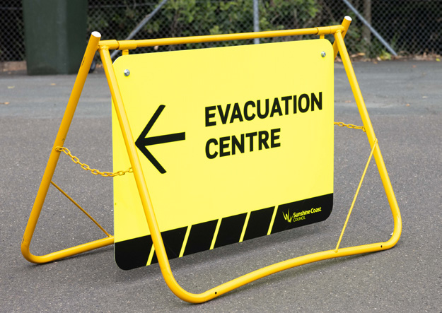

# AIDR Evacuation Planning Handbook (2023)

> **Source**: Australian Institute for Disaster Resilience (AIDR)
> **URL**: https://knowledge.aidr.org.au/media/10505/handbook_evacuation_planning_2023.pdf
> **Converted from PDF** — structure approximated from text extraction.

---
## Page 1

Australian Disaster Resilience Handbook Collection  |  2023   
Evacuation 
Planning

---
## Page 2

b
Evacuation Planning Handbook
The Australian Institute for Disaster Resilience 
acknowledges the Traditional Owners of Country 
throughout Australia and recognises their 
continuing connection to land, waters and culture. 
We pay our respects to Elders past and present.
This handbook was produced on the lands of the 
Wurundjeri people of the Kulin Nation.

---
## Page 3

Australian Disaster Resilience 
Handbook Collection
Evacuation Planning 
Second edition 2023

---
## Page 4

ii
Evacuation Planning Handbook
© Commonwealth of Australia 2023
Published by the Australian Institute for Disaster Resilience.
ISBN: 978-0-6457560-4-3
Copyright
The Australian Institute for Disaster Resilience encourages the 
dissemination and exchange of information provided in this 
publication.
The Commonwealth of Australia owns the copyright in all 
material contained in this publication unless otherwise noted.
Where this publication includes material, whose copyright is 
owned by third parties, the Australian Institute for Disaster 
Resilience has made all reasonable efforts to:
	·
clearly label material where the copyright is owned by a 
third party
	·
ensure that the copyright owner has consented to this 
material being presented in this publication.
Wherever a third party holds copyright in material presented 
in this publication, the copyright remains with that party. 
Their permission is required to reproduce the material.
All material presented in this publication is provided under 
a Creative Commons Attribution 4.0 International Public 
License, with the exception of:
	·
the Commonwealth Coat of Arms
	·
registered trademarks, including
	
−
the Australian Government’s National Emergency 
Management Agency logo
	
−
Australian Institute for Disaster Resilience logo
	·
materials specifically mentioned as not being provided 
under a Creative Commons Attribution 4.0 International 
Public Licence
	·
content supplied by third parties.
Details of the relevant licence conditions are available on the 
Creative Commons Attribution 4.0 website (creativecommons.
org.au), as is the full legal code for the CC BY-NC 4.0 license.
Attribution
Where material from this publication is used for any purpose, 
it is to be attributed to the developer as follows:
Source: Australian Institute for Disaster Resilience (2023) 
Evacuation Planning East Melbourne, Australia 
Front cover images clockwise from top: Tim McInerney, QFES 
and Alison Langevad.
Using the Commonwealth Coat of Arms
The terms of use for the Coat of Arms are available at: 
www.pmc.gov.au/honours-and-symbols/commonwealth-
coat-arms
Contact
Enquiries regarding the content, licence and any use of this 
document are welcome at:
The Australian Institute for Disaster Resilience 
Level 1, 340 Albert St, East Melbourne Vic 3002 
Telephone: +61 (0) 3 9419 2388
Disclaimer
The Australian Government National Emergency Management 
Agency and the Australian Institute for Disaster Resilience, 
in consultation with subject matter experts, exercise care 
in the compilation and drafting of this publication; however, 
the document and related graphics could include technical 
inaccuracies or typographical errors and the information may 
not be appropriate to all situations. 
In no event shall the Commonwealth of Australia (acting 
through the National Emergency Management Agency) 
or the Australian Institute for Disaster Resilience be liable 
for any damages whatsoever, whether in an action of 
contract, negligence, or other tortious action, arising out of 
or in connection with the use of or reliance on any of the 
information in this publication.

---
## Page 5

iii
Evacuation Planning Handbook
The Australian Disaster Resilience Handbook Collection provides guidance on national principles and practices for disaster resilience. 
The Handbook Collection: 
	·
provides an authoritative, trusted and freely available 
source of knowledge about disaster resilience principles in 
Australia
	·
aligns national disaster resilience strategy and policy 
with practice, by guiding and supporting jurisdictions, 
agencies and other organisations and individuals in their 
implementation and adoption
	·
highlights and promotes the adoption of good practice in 
building disaster resilience in Australia
	·
builds interoperability between jurisdictions, agencies, the 
private sector, local businesses and community groups by 
promoting use of a common language and coordinated, 
nationally agreed principles.
The Handbook Collection is developed and reviewed by 
national consultative committees representing a range of 
state and territory agencies, governments, organisations 
and individuals involved in disaster resilience. The collection 
is sponsored by the Australian Government Department of 
Home Affairs.
Access to the Handbook Collection and further details are 
available on the Australian Disaster Resilience Knowledge 
Hub (the Knowledge Hub): www.knowledge.aidr.org.au/
handbooks
Australian Disaster 
Resilience Handbook 
Collection
Land Use Planning for Disaster Resilient Communities
Lessons Management
Managing Exercises
Managing the Floodplain: A Guide to Best Practice in Flood 
Risk Management in Australia
National Emergency Risk Assessment Guidelines
Public Information and Warnings
Safe and Healthy Crowded Places
Systemic Disaster Risk
Tsunami Emergency Planning in Australia
Australian Emergency Management Arrangements
Community Engagement for Disaster Resilience
Communities Responding to Disasters: Planning for 
Spontaneous Volunteers
Community Recovery
Disaster Resilience Education for Young People
Emergency Planning
Evacuation Planning
Flood Emergency Planning for Disaster Resilience
Health and Disaster Management
Incident Management

---
## Page 6

iv
Evacuation Planning Handbook
Acknowledgements
This handbook was prepared by the Australian Institute for Disaster Resilience (AIDR) with the assistance of Anthony Murphy and 
with financial assistance from the Australian Government. Responsibility for the views, information or advice expressed in this 
handbook does not necessarily reflect the views of the Australian Government. This handbook was made possible through the 
support of a broad cross-section of the disaster risk reduction, disaster resilience and emergency management sector.
Working group members
AIDR acknowledges the expert guidance from the working 
group in developing this handbook:
Australian Capital Territory Emergency Services Agency,  
David Rose, Assistant Director Strategic Planning 
Australian Red Cross, Eleanor Carter, National Lead 
Emergency Response
Country Fire Authority Victoria, Assistant Chief Fire Officer 
Stephen Walls AFSM, Regional Commander Grampians Region 
Department of Fire and Emergency Services, Western 
Australia, Stuart Wade, Chief Superintendent Metropolitan 
Operations and Naomi Mynott, Director Land Use Planning
Department of Communities and Justice, New South Wales, 
Samantha Colwell, Deputy State Welfare Functional Area 
Coordinator 
Fire Rescue Victoria, Paul Horton, Assistant Chief Fire Officer 
Built Environment (ACT) 
Gender and Disaster Australia, Debra Parkinson, Director 
Macquarie University, Associate Professor Mel Taylor, 
Occupational Psychologist   
Northern Territory Emergency Service, Robert Evans, Deputy 
Director
Queensland Fire and Emergency Services, Courtney Russell, 
Manager Emergency Management Planning Unit,  
State Operations Coordination Branch 
South Australia Police, Senior Sergeant First Class Russell 
Dippy, Emergency Management Coordinator
Save the Children Australia, Danielle Brunton, Emergency 
Preparedness and Response Advisor    
South Australia State Emergency Service, Oshanna Alexander, 
Community Engagement Coordinator & Tiarne Easley, 
Incident Management Capability Coordinator 
Tasmania Department of Police, Fire and Emergency 
Management, Robin Wilson, Senior Constable 
Western Sydney University, Adjunct Associate Professor 
Karleen Gribble, School of Nursing and Midwifery

---
## Page 7

v
Evacuation Planning Handbook
Australian Disaster Resilience Handbook Collection  .......................................................................................................................  iii
Acknowledgements   ....................................................................................................................................................................................  iv
Executive summary   ...................................................................................................................................................................................  vii
Chapter 1: Introduction  ...............................................................................................................................................................................   1
What is evacuation?  ......................................................................................................................................................................................................................................................  2
Types of evacuation  ......................................................................................................................................................................................................................................................  2
Total, partial, and phased evacuations  .........................................................................................................................................................................................................  2
Evacuation approaches  .............................................................................................................................................................................................................................................  2
Shelter in place  ...................................................................................................................................................................................................................................................................  3
Planning for evacuation  .............................................................................................................................................................................................................................................  3
Stages of the evacuation process  ................................................................................................................................................................................................................  4
Chapter 2: Principles for developing an evacuation plan  ................................................................................................................  5
Evacuation planning in an emergency or disaster context  ....................................................................................................................................................  6
Inclusive community engagement  .................................................................................................................................................................................................................  6
The planning process  ...................................................................................................................................................................................................................................................  7
Chapter 3: Stage 1: Decision to evacuate  ...........................................................................................................................................   11
Introduction  .........................................................................................................................................................................................................................................................................  12
Authority to decide  ......................................................................................................................................................................................................................................................  12
Stakeholder management and the risk assessment process  ...........................................................................................................................................  12
Communicate the decision  ...................................................................................................................................................................................................................................  14
Mobilise resources  ........................................................................................................................................................................................................................................................  14
Documentation  ................................................................................................................................................................................................................................................................  14
Chapter 4: Stage 2: Warning  ....................................................................................................................................................................  15
Introduction  .........................................................................................................................................................................................................................................................................  16
Authority and responsibility to warn  ...........................................................................................................................................................................................................  16
Timely warnings  ...............................................................................................................................................................................................................................................................  16
Considerations  .................................................................................................................................................................................................................................................................  17
Documentation  ................................................................................................................................................................................................................................................................  20
Chapter 5: Stage 3: Withdrawal  .............................................................................................................................................................  21
Introduction  .........................................................................................................................................................................................................................................................................  22
Identifying authority and responsibility to manage withdrawal  ........................................................................................................................................  22
Considerations for withdrawal planning  ...................................................................................................................................................................................................  22
Documentation  ................................................................................................................................................................................................................................................................  26
Contents

---
## Page 8

vi
Evacuation Planning Handbook
Chapter 6. Stage 4: Shelter  .....................................................................................................................................................................  27
Introduction  .........................................................................................................................................................................................................................................................................  28
Authority and responsibility to manage shelter  ...............................................................................................................................................................................  28
Shelter options  .................................................................................................................................................................................................................................................................  28
Documentation  ................................................................................................................................................................................................................................................................  34
Chapter 7. Stage 5: Return  .......................................................................................................................................................................  35
Introduction  .........................................................................................................................................................................................................................................................................  36
Authority to decide and responsibility to manage return  .......................................................................................................................................................  36
Considerations  .................................................................................................................................................................................................................................................................  36
Documentation  ................................................................................................................................................................................................................................................................  38
Transition to recovery  ...............................................................................................................................................................................................................................................  38
Appendix 1 Sheltering terminology  ......................................................................................................................................................   39
Appendix 2 Towards a national approach to sheltering terminology  ........................................................................................   42
References  ...................................................................................................................................................................................................   43
List of Figures
Figure 1: Evacuation planning process  �����������������������������������������������������������������������������������������������������������������������������������������������������������������������������������������������������������  4
Figure 2: The emergency planning process  �����������������������������������������������������������������������������������������������������������������������������������������������������������������������������������������������  7

---
## Page 9

vii
Evacuation Planning Handbook
Introduction
Purpose
The Evacuation Planning handbook provides a nationally 
consistent approach to maximise the efficiency and 
effectiveness of a five-stage evacuation process. It presents 
authoritative, principles-based guidance on how to manage 
evacuations before, during, and after an emergency or 
disaster. The handbook is intended to support government, 
non-government organisations and communities in inclusive 
evacuation planning. Central to the handbook’s intent is the 
safety of community members and emergency personnel 
during the evacuation process, and the timely return of 
evacuees to minimise negative health, social and economic 
impacts for affected individuals and communities.
The Evacuation Planning handbook aims to enable communities 
and the emergency management sector to work together to 
be better prepared to manage these events. The handbook 
provides the opportunity to plan for locally led response and 
recovery activities which occur when all groups from individuals 
to households, businesses, non-government organisations and 
local governments take collective action so that communities 
become safer, stronger and more connected. 
Context
The Evacuation Planning handbook is part of the Australian 
Disaster Resilience Handbook Collection. It fulfils a critical role 
in the ongoing improvement of disaster preparation, response 
and recovery under the policy framework established by the 
National Strategy for Disaster Resilience (COAG, 2011). The 
handbook supports the Australian Disaster Preparedness 
Framework, 20181 and the United Nations Sendai Framework 
for Disaster Risk Reduction (Sendai Framework)2 (UNDRR 2015).
1	 This handbook contributes to the following components: Evacuation Planning and Support National Capability Requirement of the Australian Disaster 
Preparedness Framework.
2	 This handbook contributes to priority 4 of the Sendai Framework for DRR.
3	 Moon, B (2023) ‘Foreword’. Australian Journal of Emergency Management, Vol 38, Issue 1, January 2023, p.4.
The National Framework for Disaster Risk Reduction 
(Australian Government 2018) recognises that disaster 
resilience is not only the responsibility of emergency service 
and management organisations. Disaster resilience is a 
shared responsibility for individuals, households, businesses, 
communities and all levels of government. However, while 
individuals and communities have their roles to play, they 
do not control many of the levers needed to reduce some 
disaster risks. Government and businesses must take 
coordinated action to reduce disaster risks within their 
control to limit adverse impacts on communities. 
The 2020 Royal Commission into National Natural 
Disaster Arrangements commented that national 
arrangements are not confined to arrangements 
involving the Australian Government, they encompass 
all levels of government, the private and not-for-profit 
sectors, communities, families and individuals.
Limiting the impact of disasters now and in the future requires 
a coordinated effort across and within many areas including 
land use planning, infrastructure, emergency management, 
social policy, agriculture, education, health, community 
development, energy and the environment.
The relevance and importance of the Evacuation Planning 
handbook has been placed into perspective by the 
Coordinator-General of National Emergency Management 
Agency (NEMA), who identified there were critical challenges 
for communities and emergency management organisations 
throughout Australia.3 The challenges identified include an 
ageing population, growing populations along coastlines 
and more extreme weather patterns which are influencing 
Australia’s risk environment.
Climate change
Scientific evidence from the Bureau of Meteorology (BOM) and the Commonwealth Scientific and Industrial Research 
Organisation (CSIRO) indicates that a variable and changing climate is expected to further increase the severity 
and frequency of many natural hazards in Australia (CSIRO and BOM 2022). The Sixth Assessment Report of the 
Intergovernmental Panel on Climate Change (IPCC) notes that ‘frequency and severity of dangerous fire weather conditions 
is increasing’ and ‘extreme rainfall is projected to become more intense’ (IPCC 2022).
www.ipcc.ch/report/ar6/wg2/downloads/report/IPCC_AR6_WGII_FinalDraft_Chapter11.pdf

---
## Page 10

viii
Evacuation Planning Handbook
Background
The Evacuation Planning handbook was first published in 
1998. Periodic reviews have continued to incorporate and 
promote learnings in evacuation planning and practice that 
benefit communities. 
The handbook was revised in 2012 to align with key 
messages in the National Strategy for Disaster Resilience 
(NSDR) (COAG 2011): 
	·
disasters will happen 
	·
disaster resilience is your business 
	·
connected communities are resilient communities 
	·
know your risk  
	·
get ready, then act 
	·
learn from experience.
These key messages underpin each of the five stages of 
evacuation planning, from the decision to evacuate, through 
to the warning, withdrawal, shelter and return stages.
In 2017 the handbook incorporated concepts and guidance on 
the primacy of life and focus on public safety, the complexity 
of evacuations and human behaviour, the influence of 
technology and social media, and the nuance of evacuation 
planning for all hazards. 
This 2023 edition of the handbook incorporates and reflects 
recommendations, observations and learnings from the:
	·
2020 Royal Commission into National Natural Disasters 
Arrangements (the Royal Commission)
	·
2020 New South Wales Bushfire Inquiry (NSW Inquiry)
	·
Victorian Inspector General Emergency Management 
Inquiry undertaken into the 2019-20 Victorian Fire Season 
(Phase 1 and Phase 2 Reports)
	·
2022 Queensland Inspector General Emergency 
Management Southeast Queensland Rainfall and Flooding 
Event Report
	·
2022 New South Wales Independent Flood Inquiry. 
These inquiries recognise that Australia is experiencing more 
frequent and intense natural hazards. The handbook also 
recognises that recent disasters have exhibited complexity 
never seen or experienced before, with concurrent events 
such as fire, pandemic and flood causing compounding 
impacts on communities and the Australian landscape. 
These events highlight the need for an adaptive, flexible and 
inclusive approach to evacuation planning. 
Additionally, the handbook focusses on the specific needs 
of people and groups in communities who may require 
additional support in preparing for, responding to and 
recovering from a disaster. Updated content and material are 
based on evidence, organisational learnings and expert insight 
regarding sheltering and evacuation. 
 
This handbook is available on the AIDR Knowledge 
Hub: knowledge.aidr.org.au/resources/handbook-
evacuation-planning
Scope
This handbook outlines the nationally agreed principles 
for evacuation planning, using the nationally recognised 
five-stage evacuation process as a framework. It presents 
guidance for developing evacuation plans that can be applied 
in emergencies and disasters impacting communities, 
applicable across a range of hazards. The guidance focusses 
on the movement and management of people away from 
a hazard impact area, with arrangements for people who 
shelter in place outside the scope of this handbook.
The handbook works with the following definition of 
community: ‘a social group with a commonality of association 
and generally defined by location, shared experience, or 
function and with a number of things in common, such as 
culture, heritage, language, ethnicity, pastimes, occupation, 
or workplace’ (AIDR Glossary 2019). This handbook 
recognises communities of place, communities of interest 
and notes that there can be multiple communities within a 
community of place.
Evacuation plans described in the handbook may be specific 
to a hazard and a location, or more generic in nature, 
understanding that any generic plan will need to be adaptable 
and flexible to accommodate differences in the time, place 
and circumstance of a particular disaster. 
The handbook recognises variations in legislative powers, 
arrangements and terminology across jurisdictions. It should 
therefore be used in conjunction with applicable state and 
territory legislation, plans, guidelines and local arrangements, 
as well as other handbooks in the Handbook Collection. 
The handbook is not intended for use in planning site-specific 
evacuations, for example, for high-rise buildings. This type 
of evacuation planning is addressed in AS3745 Planning for 
Emergencies in Facilities, and in relevant state and territory 
legislation and other publications available from state and 
territory emergency management organisations.
While the handbook refers to ‘evacuation centres’, Appendix 2 
highlights a key finding from the 2020 Royal Commission into 
National Natural Disaster Arrangements of the inconsistency 
in sheltering terminology used to describe the purpose of the 
shelter by states and territories. For example, Victoria uses 
the term ‘relief centre’ to describe a facility that provides 
accommodation and other amenities whereas in NSW this 
same facility is typically called an evacuation centre. The 
process of working towards national consistency commenced 
in 2022. 

---
## Page 11

1
Chapter 1: Introduction 
to Evacuation

---
## Page 12

2
Evacuation Planning Handbook
What is evacuation?
Evacuation is a strategy used to reduce loss of life or lessen 
the effects of a hazard on a community, before or during 
a disaster. It involves the movement of people threatened 
by a hazard to a safer location and their safe and timely 
return. Removal of people from the threat is often the most 
effective way to manage public safety. For an evacuation to 
be as effective as possible it must be appropriately planned 
and implemented. 
Depending on the hazard and its impacts on communities, 
the evacuation process may take days, weeks or months to 
complete. Some evacuations may be carried out quickly and 
over short distances. For example, people may be warned to:
	·
move to higher ground pending a potential tsunami 
impact, or flash flooding
	·
move two streets away from a rural-urban interface to 
avoid a bushfire. 
In other circumstances, people evacuated from an area may 
be relocated many kilometres from their home and be unable 
to return for a considerable period of time due to access or 
contamination issues. 
Types of evacuation
There are two types of evacuation described in this handbook, 
pre-warned and immediate. Both evacuation types have 
distinctive characteristics, challenges and different planning 
dynamics and responses. 
1.	
Pre-warned evacuation: where a community has been 
provided with a warning of the impending hazard impact 
and a timely and coordinated preparedness and response 
actions have been facilitated in accordance with an 
evacuation plan. E.g. flood, cyclone or bushfire. 
2.	
Immediate evacuation: where a rapid onset hazard 
causes a threat with no or limited opportunity to warn 
the affected individuals or communities. These events 
require immediate and rapid protective movements of 
those affected. E.g. earthquake, structural collapse, gas 
explosion, active shooter or transport accident. 
With increasingly complex, concurrent and compounding 
events there may be a need for a two-step evacuation process 
in both an immediate and a pre-warned evacuation scenario. 
In this scenario:
	·
Step 1: move communities move out of harm’s way from 
the hazard. 
	·
Step 2: when the risk dissipates relocate communities to 
an evacuation centre(s).
Total, partial, and phased 
evacuations
	·
Total evacuation: when everyone in the affected 
communities is recommended or directed to evacuate. 
	·
Partial evacuation: when only some of the affected 
communities are evacuated. For example, only residents 
living in low-lying areas directly impacted by flood waters 
will need to evacuate. 
	·
Phased evacuation: when in either a total or partial 
evacuation, affected communities are recommended 
or directed to evacuate at different times. E.g. due to 
the slow onset of a hazard or to avoid congestion on 
transport routes.
Evacuation approaches 
The type of evacuation selected by the organisation managing 
the emergency will be influenced by whether the emergency 
is rapid onset, requiring immediate evacuation, or whether 
it is slow onset or pre-warned, allowing more time for the 
implementation of evacuation approaches.
Directed evacuation 
An evacuation in circumstances where a relevant government 
organisation has exercised a legislated power that requires 
people to evacuate. 
Recommended evacuation 
An evacuation where an evacuation warning has been issued 
but people have the option to remain.
Self-initiated evacuation 
This is the self-initiated movement of people to safer places 
prior to, or in the absence of, official warnings to evacuate. 
Some people may choose to leave early, even in the absence 
of a hazard but due to a forecast of high bushfire danger 
or a flood watch. Self-initiated evacuees manage their own 
withdrawal, including transportation arrangements. They may 
well have their own shelter arrangements, or they may still rely 
upon formal shelter arrangements and the support provided.
Self-initiated evacuation needs to be recognised in the 
planning process, particularly in the shelter and return stages 
as there may be the expectation of access to support services.

---
## Page 13

3
Evacuation Planning Handbook
Shelter in place
Shelter in place means finding a safe location and staying 
there until the threat has passed or you are told to evacuate.
Remaining and sheltering in place can also be recommended 
by the organisation managing the emergency for some or 
all the people in the expected hazard impact area when it is 
considered safer to remain than to evacuate. 
People may decide themselves to shelter in place (often 
where they live), even when an evacuation is directed or 
recommended. This may be:
	·
to protect homes, pets, livestock, crops, machinery, and/
or buildings 
	·
because they believe it is too late or unsafe to evacuate
	·
because warnings have not been received, understood 
and acted on in a timely manner. 
In some cases, steps may be taken by the organisation 
managing the emergency to protect residents in place, 
particularly those at increased risk such as the residents of 
aged care and medical facilities. The organisation managing 
the emergency should consult with and inform managers of 
such facilities of the decision to evacuate or shelter in place. 
The facilities' evacuation plans should be available to incident 
managers and appended to the local emergency management 
plan and/or evacuation plan.
Information will need to be provided to those who shelter 
in place, particularly during the warning and return stages. 
Communication to those who shelter in place should be 
coordinated with those managing the evacuation to ensure 
consistent messaging; e.g. about recovery arrangements and 
risk mitigation strategies for returnees (see: message content). 
Planning for evacuation
Effective evacuation management relies on detailed planning 
and exercising. Planning and working with communities 
before a disaster situation arises, can help to alleviate some 
of the factors that may otherwise jeopardise the success of an 
evacuation operation. 
Planning for evacuations is a key responsibility of 
governments at all levels, emergency management 
organisations, and other relevant non-government and 
community organisations. Engaging all relevant stakeholders, 
including the community, to develop, exercise and continually 
improve evacuation plans is likely to enhance evacuation 
planning and evacuation management outcomes. Individuals 
and households also have a responsibility, through their own 
household emergency planning, to consider when they will 
evacuate, what they will take, where they will go, and how 
they will reunite if they are separated.
Communities and individuals are unique and their behaviours 
during an emergency will be driven by different factors. 
It is good practice for evacuation planners to engage with 
communities at several stages to understand and consider 
how their values may influence responses to disaster and 
stress. These engagements provide the opportunity for the 
emergency management sector to support communities 
and householders in the development and delivery of 
readiness programs. These interactions build individual and 
community resilience and promote shared responsibility. 
This information also assists in managing the withdrawal and 
sheltering of evacuees.
Evacuation can be stressful for people. In addition to the 
risk of harm to their own life, other factors may influence 
behaviours and decisions made in an emergency. These 
factors can include but are not limited to:
	·
concern for the safety and welfare of family, friends, and 
animals
	·
concern for the safety of property and livelihoods
	·
dependency on others to assist with evacuation, in 
particular for those living with a disability and those 
reliant on others for the provision of care or the provision 
of transport
	·
reliance on equipment, devices, medications, and support 
to sustain life and maintain health
	·
exposure to misinformation on social media and informal 
communication platforms
	·
influence by thoughts and actions of those around them 
or are influential in their lives
	·
socially isolated or disconnected from communities and 
mainstream supports and services
	·
cultural or linguistic constraints  
	·
lack of trust in the organisations tasked with the 
evacuation process.
For guidance on community engagement see Community 
Engagement for Disaster Resilience (AIDR 2020). 
For guidance on exercising see Managing Exercises 
(AIDR 2023, 2017). 
For guidance on animals in disasters, see Planning for 
Animals in Disasters (AIDR, under development). 
For guidance on household emergency planning,  
see Australian Red Cross’ Emergency RediPlan:  
www.redcross.org.au/prepare

---
## Page 14

4
Evacuation Planning Handbook
Stages of the evacuation process
Evacuation planning requires consideration of a five-stage 
evacuation process, namely: 
1.	
Decision to evacuate 
2.	
Warning 
3.	
Withdrawal 
4.	
Shelter 
5.	
Return 
Structuring plans utilising these five stages of evacuation 
ensures that key aspects of the evacuation process are 
considered and addressed in detail. In parallel to the 
evacuation process is the fundamental need for individual, 
community, and organisational resilience which facilitates a 
more effective response to, and recovery from an evacuation 
emergency. The five stages are covered in more detail in the 
following chapters.
Figure 1: Evacuation planning process
Manage 
the return 
process
Family & friends
Commercial 
accommodation
Evacuation 
centre
Specialist facility
Other safer 
locations
Issue  
warning
Remain in 
place
Self-initiated 
evacuation
Determine 
if managed 
evacuation  
is required
Decision to evacuate
Warning
Withdrawal
Shelter
Return
1
2
4
3
5
Hazard threat/impact
Manage the 
withdrawal 
process

---
## Page 15

5
Chapter 2: Principles 
for developing an 
evacuation plan

---
## Page 16

6
Evacuation Planning Handbook
Evacuation planning in an 
emergency or disaster context
Evacuation planning is an integral part of emergency 
management planning. An evacuation plan should be consistent 
with an emergency management plan. Development of an 
evacuation plan should consider the context and capability of 
the individuals, organisations and communities at risk, together 
with an emergency management plan that identifies evacuation 
as an appropriate risk management strategy.
Emergency planning
Emergency planning plays an important role in the 
development of Australia’s disaster resilience capability. 
The emergency planning process is the collective and 
collaborative effort by which agreements are reached and 
documented between people and organisations to meet 
their communities’ or entities’ emergency management 
needs. Emergency planning involves identifying and 
documenting strategies for preventing, preparing 
for, responding to and recovering from emergencies. 
Effective emergency planning contributes to reducing 
the likelihood and consequence of emergencies for 
individuals, communities, entities and the environment, 
and can have positive economic benefits.
The process of developing an emergency plan is 
detailed in Emergency Planning (AIDR 2020). 
Inclusive community engagement 
Evacuation can be a complex process. As such, planning is 
needed to enhance community engagement and minimise 
risks associated with evacuations during emergencies. 
Evacuation planning should consider the cultural, social and 
geographic characteristics of communities.
Community representatives can provide valuable local 
knowledge and context especially if they have lived 
experience in emergencies and evacuations and good 
knowledge of community networks, capacities, and resources. 
Hazard-specific plans are likely to be more detailed and 
should involve input from a diverse range of stakeholders, 
including hazard specific organisations, special interest 
groups, cultural and community leaders, and community 
members and organisations reflective of the communities’ 
demographic characteristics. 
The diversity of Australian communities and specific support 
requirements need to be reflected in evacuation plans. 
Consideration should be given to the needs of groups, 
including but not limited to the following:
	·
Aboriginal and Torres Strait Islander peoples
	·
culturally and linguistically diverse groups (CALD)
	·
people with disability, chronic illness or mental health issues
	·
women
	·
people with diverse gender and sexual orientations
	·
infants, children and young people, including kinship 
arrangements and unaccompanied minors
	·
pregnant and breastfeeding women
	·
seniors 
	·
new migrants 
	·
asylum seekers and refugees
	·
those living in socially or physically isolated, or high-risk 
circumstances or locations 
	·
those experiencing homelessness, housing insecurity, 
unemployment or poverty 
	·
people living with or escaping family violence
	·
tourists, holiday makers and visitors
	·
international students and people on temporary  
work visas
	·
people living on state or territory borders
	·
those without access to independent transport. 
Consider: Taking the time to understand the diversity of 
community capacities and needs will assist in improving 
evacuation outcomes. There have been instances where 
an evacuation has been communicated by an emergency 
management organisation however, a high percentage of 
the community were unable to follow the advice due to 
a range of pre-existing barriers e.g. communities advised 
to evacuate the area in personal vehicles when many 
individuals did not have access to a vehicle or existing 
vehicles could not be driven for a range of reasons.
Engaging Indigenous communities in evacuation 
planning
Across Australia, discrete Indigenous communities are 
governed differently to other lands and townships, due to 
factors such as land tenure, cultural and heritage rights, 
and support requirements for community members 
who have unique cultural needs and responsibilities. 
Indigenous controlled community organisations can 
provide crucial guidance to increase the effectiveness 
of local evacuation plans and should be involved in the 
planning process. 
 

---
## Page 17

7
Evacuation Planning Handbook
Gendered needs in evacuation planning
Gender and Disaster Australia (GAD) have developed the 
Gender and Emergency Management (GEM) Guidelines 
that provide a shared and improved understanding of the 
specific issues (social, structural, psychological, financial, 
interpersonal, and physical) relating to gender and disaster 
– and a capacity to respond to these issues. It supports 
changed practices by key emergency management 
organisations and communities to help identify, prevent 
and respond to gender-based disaster impacts.
GAD’s Acting on Gendered Needs in Evacuation and Relief 
Centres Checklist provides guidance on considerations in 
the planning phase of evacuation planning.  
knowledge.aidr.org.au/resources/national-gender-
and-emergency-management-guidelines
Further guidance on community engagement can be 
found in Community Engagement for Disaster Resilience 
(AIDR 2020).
The planning process
Evacuation planning occurs as part of the broader emergency 
planning process (Figure 2) typically, as part of the step 
‘Develop strategies and arrangements’. The emergency 
planning process is covered in further detail in Emergency 
Planning (AIDR 2020). Plans act as guides to what should 
happen, and it should be recognised that with fast moving, 
high uncertainty evacuations, the implementation of the plan 
can be different.
The following are matters specific to evacuation planning:
	·
legislation 
	·
responsibility for planning an evacuation
	·
the risk management study
	·
responsibilities for evacuation management  
	·
resources and services needed
	·
management arrangements and systems
	·
documenting and promoting the evacuation plan
	·
exercising the plan
	·
monitoring and review.
Figure 2: The emergency planning process
Establish a project 
plan
Establish a 
planning team
Understand 
risk and 
consequences
Endorse the plan
Develop 
strategies and 
arrangements
Implement and 
exercise the plan
Document and 
trial the plan
Lessons 
management
Monitor and review
Communication and consultation

---
## Page 18

8
Evacuation Planning Handbook
Legislation
The authority to recommend or direct communities to 
evacuate will be found in relevant emergency management 
organisations and emergency management legislation. An 
evacuation plan must consider, and be consistent with, the 
applicable legislative provisions to ensure recommendations 
and directions are made with appropriate authority. Where 
directed evacuations are considered, organisations will need 
to be aware of the circumstances that must exist to trigger the 
authority to issue directed evacuation orders, and whether any 
people are exempt from any obligation to comply. 
When there is a legal obligation for evacuations, any 
mismanagement of the evacuation process could result in 
legal scrutiny and possibly liability. This includes the decision 
to evacuate, issuing warnings, managing the evacuation, 
providing shelter, and deciding when to allow people to 
return. State and territory legislation may specify factors to 
consider and provide liability limitations, particularly for state 
and territory emergency management organisations. 
 
Consider: The legal context of Indigenous communities 
including cultural and heritage rights must be 
considered in evacuation planning. Traditional Owners 
and cultural leaders have powers and responsibility 
amongst their communities as part of their cultural 
norms and practices which should be factored in to 
planning and decision making. 
For further information refer to the National Indigenous 
Australians Agency – Land and Housing Division. ADD - 
niaa.gov.au/areas-of-focus
Risk management study
An emergency risk management study completed by an 
emergency management committee is a critical first step in 
understanding the risks to a community that may require 
evacuation planning. Using a systemic risk approach will help 
the committee understand both the potential hazard risk, but 
also the consequences, and the interconnected nature of risk. 
The study should address all potential risks including specific 
known risks (such as the regular flooding of a town) as well 
as other less predictable, yet foreseeable, events (such as a 
bushfire threatening a rural-urban interface or transmissible 
diseases or viruses). The scope of the risk management 
study should be focused and specific to ensure the efficiency 
and effectiveness of the process, deliver value for money 
and inform a range of local government functions. The key 
elements of the study should include the hazard environment, 
demographics and social makeup of the council or regional 
catchment, population change, and critical infrastructure that 
supports the management of a disaster.
An outcome from the risk management study may be a 
need to develop an evacuation plan or plans for a particular 
hazard or community, and the need to convene an evacuation 
planning team.
For further information of conducting a systemic risk 
management study, see Systemic Disaster Risk  
(AIDR 2021).  
Responsibility for planning an evacuation
In some jurisdictions, an emergency management planning 
committee undertakes evacuation planning. In other 
jurisdictions, a separate evacuation planning committee may 
be formed, or responsibility assigned to an individual. 
Those responsible for developing evacuation plans should 
be aware of and familiar with any overarching emergency 
management plans, procedures and guidelines that the 
evacuation plan needs to align with. Those responsible for 
evacuation planning should work collaboratively with relevant 
stakeholders and consult with all emergency management 
organisations and other relevant organisations that have a 
role in an evacuation; including community representatives, 
who represent the diversity of the community. Active 
and sustained engagement is essential to leverage local 
knowledge, expertise and resources, and to gain commitment, 
ownership and understanding of what is required of all parties 
during an evacuation. Some, or all, of these key stakeholders 
may form part of an evacuation planning committee. 
The evacuation plan should detail who is responsible for 
carrying out each stage of the evacuation process, including:
3.	
Decision to evacuate 
4.	
Warning 
5.	
Withdrawal 
6.	
Shelter 
7.	
Return.  
Evacuation can also be integrated as a key function into 
Incident Management Teams (IMT). The Evacuation Unit 
within an IMT should have representatives from relevant 
organisations and potentially access to community leaders.
Further information on Incident Management Teams 
can be found in Incident Management (AIDR 2023).

---
## Page 19

9
Evacuation Planning Handbook
Responsibilities for evacuation 
management 
It is essential the community members, emergency 
management organisations, and other relevant organisations 
involved in evacuation planning have a clear understanding of 
relevant authorities, roles and responsibilities for each stage 
of the evacuation and that these are clearly identified in the 
evacuation plan. Authorities, roles and responsibilities may 
vary between stages in the evacuation process. 
The evacuation plan should describe how the activities of 
each organisation or group will be coordinated to ensure an 
evacuation can be implemented effectively and efficiently.  The 
management structure for each stage of the evacuation should 
be agreed upon and documented in the evacuation plan.
The evacuation plan should also identify who is responsible 
for engaging, informing and educating the community and 
broader public about ongoing evacuation related matters to 
promote community preparedness. This responsibility may 
shift across organisations as an evacuation moves across 
the five stages of the evacuation process. It is important to 
continue to keep communities updated following the warning 
stage, such as the reopening of roads and the opening and 
closing of evacuation centres. A communications sub-plan 
may be developed to support this function. 
Resources and services needed
The evacuation plan should identify all resources and services 
required to carry out an evacuation, and detail how these 
resources and services will be obtained. 
Resources required of key emergency management 
organisations and other relevant organisations should be 
identified, and any shortfalls addressed by the responsible 
organisation. Those preparing the evacuation plan should 
adopt a collaborative approach to planning and seek to 
ensure sufficient resources across different organisations are 
available during an evacuation.
As some critical resources (i.e. equipment or personnel) 
may be sourced from local businesses or community groups 
(e.g. local bus companies may be engaged to assist in 
the withdrawal stage), local community providers should 
be engaged in evacuation planning, and agreements 
documented, including reimbursement of costs, in the 
evacuation plan. Scarce local resources may need to be 
prioritised or shared across areas of operation. 
Contingency plans should be developed to address potential 
resource shortfalls or the need to organise or acquire 
resources from other locations such as regional centres, 
state or interstate, including arrangements for cross border 
community resource sharing, and access to Australian 
Government resources.
Arrangements and systems
Those preparing the evacuation plan should identify and 
develop specific management arrangements, addressing each 
of the five stages of evacuation. 
Assembly points, egress routes and traffic management 
points need to be identified, and effective warning 
arrangements (e.g. the Australian Warning System) 
developed. Community representatives with relevant 
experience or local knowledge can help identify assembly 
points and egress routes and provide critical advice (e.g. 
telephone blackspots and poor coverage, suitable radio 
stations and other informal communication channels, 
and effectiveness and resilience of evacuation routes in 
previous events). The use of local knowledge should inform 
hazard reduction and risk mitigation activities including, 
but not limited to, plans for vegetation management, road 
maintenance, land development and critical infrastructure 
for critical evacuation routes in the evacuation planning 
process. Local knowledge may also assist in identifying 
people with specific needs in the affected communities. 
Documenting and promoting the plan 
The evacuation plan should be documented and made 
available to the relevant community(-ies) and all organisations 
with an identified role in evacuation. This should include 
communities and authorities that reside along state or 
territory borders. The existence of the plan should be 
promoted to the wider community using a variety of means 
such as social media, websites, community radio, libraries, 
community notice boards, organisational and community 
newsletters. A broad knowledge and understanding of the 
plan will assist communities to become better prepared and 
more responsive to evacuation warnings. 
The community should understand its role in the evacuation 
process to improve their capability to evacuate safely. To 
achieve this goal the planning committee should consider 
developing a communications plan to promote the evacuation 
plan across the community. 
Detailed knowledge of the evacuation plan will be required by 
communities who live in high-risk settings as they are likely to 
encounter emergencies that would require evacuation. This 
may be achieved through a variety of community engagement 
activities including community evacuation exercises and 
workshops, household and community preparedness 
activities, community training, the development of 
community volunteer programs and initiatives, engagement, 
and consultation with community representatives. 
Leaders of the evacuation planning committee are 
accountable for embedding the evacuation plan across the 
community. Where possible, existing networks, forums and 
other community champions can play a role in this. The 
promotion, exercising and improvements of the plan is a 
continuous cycle.

---
## Page 20

10
Evacuation Planning Handbook
Exercising the plan
For continuous improvement in readiness and response, 
the evacuation plan should be reviewed, exercised, and 
updated regularly. Different approaches to exercising may 
be used, including discussion or field exercises. Community 
engagement is a critical component of emergency 
management. When relevant, community should be involved 
in exercises to provide local expertise, feedback, promote 
shared responsibility, and to build trust and social cohesion. 
Where possible, it is good practice that community members 
participating in the exercise reflect the diversity of the 
communities’ demographic to identify and respond to their 
specific needs. Including local arts organisations in exercises 
can also provide creative inputs into the scenarios and their 
implementation. 
Following any exercise, a report should be prepared with 
appropriate recommendations to improve the evacuation 
plan. Those responsible for maintaining the plan should 
consider the report and adopt relevant recommendations into 
a revised plan. 
The outcomes from the exercise should be shared with the 
community to promote the plan, keep them informed and 
mindful of evacuation and what community members can do 
to prepare.
Further information about managing exercises can be 
found in Managing Exercises (AIDR 2017).
Further information about community engagement 
can be found in Community Engagement for Disaster 
Resilience (AIDR 2020).  
Monitoring and review 
Those responsible for maintaining the evacuation plan should 
ensure that it is regularly monitored, reviewed, and updated 
in accordance with current evacuation practices and the 
emergency management plan lessons management process. 
Consideration should be given to:
	·
experience of affected communities
	·
lessons learned after activation of the plan
	·
agreed recommendations from inquiries or reviews
	·
evaluation reports from exercises and from the 
documented experiences and lessons of other like 
communities 
	·
changes in risk assessments
	·
changes in contact details
	·
new research or best practice. 
It is suggested that representatives from adjoining local 
governments who have responsibilities for evacuation 
planning attend and observe exercises to improve 
practice, capability and integration across borders. Data 
to inform improvements to the plan may be gathered 
during the evacuation process (e.g. by surveying evacuees 
accommodated at evacuation centres or when evacuees 
return home). 
Appropriate version control protocols for the finalised plan 
should be developed and implemented.
Further information can be found in Lessons 
Management (AIDR 2019).
New research can be found in the Australian Journal of 
Emergency Management, and on the AIDR Knowledge 
Hub. 

---
## Page 21

11
Chapter 3: Stage 1: 
Decision to evacuate

---
## Page 22

12
Evacuation Planning Handbook
The purpose of this section is to guide planning to make an informed decision about evacuation. The need to document the 
decision-making process and communicate the decision to stakeholders is also covered. 
Summary
1.	
Identify authority to make decision to evacuate.
2.	
Identify relevant stakeholders involved and impacted by the decision to evacuate.
3.	
Undertake a risk assessment process to support the decision to evacuate or not.
4.	
Decide how to let people know that a decision has been made.
5.	
Communicate the decision.
6.	
Document the decision.
Introduction
The decision to evacuate (or not) is the first of the five stages 
of the evacuation process. Many complex issues need to be 
considered in making this decision, often with only limited 
or rapidly changing information and time available. When an 
emergency occurs and the time comes to make the decision, 
the people and the organisations involved are in a better 
position to make informed decisions when they have planned 
for such an occurrence. 
Authority to decide
The decision to evacuate, the authority to evacuate and 
authority to warn may be the responsibility of several 
organisations. There needs to be clarity and understanding 
of how these functions will occur seamlessly during an 
emergency.
A decision not to evacuate is just as important as a decision 
to evacuate.
The evacuation plan should identify which organisation and/
or position has the authority to decide to evacuate. This 
organisation or position may vary depending on the nature 
of the hazard threat and may not be the same organisation 
or position that is responsible for managing other stages 
of the evacuation process. Reference should be made to 
relevant state or territory legislation, documented emergency 
management arrangements and emergency management 
plans to identify the organisation or person who has the 
authority to make the decision. 
In some cases, the relevant legislation, arrangements, or 
plans delegate this authority to whoever is in command and 
control of the incident. For organisations that have adopted 
the Incident Command and Control System Plus (ICCS+) 
or the Australasian Inter-service Incident Management 
System (AIIMS), this will be the Incident Controller. These 
arrangements ensure that a decision-maker is available when 
needed. There may be occasions when due to the size, scale, 
and expected impact of the disaster, the Incident Controller 
may need to delegate the evacuation function to a cell within 
the Incident Management Team. See Incident Management 
(AIDR 2023) for further details. 
In the event of a decision to use a directed approach to 
evacuation, there needs to be a clear understanding regarding 
which organisation has the legislative powers to direct the 
evacuation. There may be circumstances across states and 
territories where the authorised organisation delegates the 
role and some powers to undertake the evacuation to another 
organisation.
Stakeholder management and the 
risk assessment process
Assess the risk 
The existence of an evacuation plan does not mean that 
it will be implemented under all circumstances. Before 
deciding to undertake an evacuation for a particular 
hazard threat, an assessment of the risk presented by the 
expected hazard threat should be undertaken. Due to time 
constraints, this assessment will often be brief, although if 
time permits, relevant stakeholders should be consulted 
before deciding. The plan should identify the relevant 
stakeholders, typically including police, other relevant 
emergency management organisations, local government and 
community representatives from a diverse cross section of 
the community. 
The National Emergency Risk Assessment Guidelines (NERAG) 
(AIDR 2020) provide guidance on risk assessment. Risk 
assessment applying NERAG should include the following steps:
	·
establish the context 
	·
identify the risks
	·
analyse the risks
	·
evaluate the risks
	·
identify risk treatment options.

---
## Page 23

13
Evacuation Planning Handbook
Details on how to address these steps are outlined below. 
Where time is insufficient to undertake a detailed risk 
assessment, or the impact of the hazard potentially falls 
outside the parameters identified for a defined event (e.g. if 
a flood level is higher than expected or a cyclone is of a lower 
category), a dynamic risk assessment using an abbreviated 
version of NERAG, or an alternative dynamic risk assessment, 
will be necessary. 
Also using a systemic risk approach will help understand the 
interconnected nature of risk and its consequences.
Further information about risk management can be 
found in ISO 31000: 2018 Risk Management – Guidelines 
and Systemic Disaster Risk (AIDR 2021).  
 
For further information about approaches to dynamic 
risk assessment adopted by Australian emergency 
services, see: ACT Emergency Services Agency and 
‘Dynamic risk assessment overview’. esa.act.gov.au/
sites/default/files/wp-content/uploads/dynamic-risk-
assessment-overview.pdf
Establish the context
To inform a decision about evacuation, the evacuation plan 
should document the context with reference to the following:
	·
nature and severity of the threat being planned for, the 
boundaries of the area under threat and the capacity of 
organisations to manage the threat (including its impact 
on people and their assets)
	·
any predictive modelling tools, specialist advice or other 
intelligence available to assist decision makers with their 
situational awareness to reach a decision
	·
cultural and heritage land rights of the area under threat 
and associated cultural leadership responsibilities
	·
time required to complete the warning and withdrawal 
stages for the area under threat
	·
potential risk to life if people remain, and if they evacuate
	·
time of day (it is advisable to evacuate during daylight 
hours if possible)
	·
potential loss of infrastructure or assets
	·
existence and adequacy of an evacuation plan
	·
existence and adequacy of resources and networks (e.g. 
transport options, egress routes)
	·
community characteristics – demographics, values, 
mobility, presence of people more at risk (e.g. isolated 
seniors, residents of nursing homes, seasonal workers, 
tourists), community experience with similar threats, 
length of residence, preparedness for the threat in 
question, familiarity with the evacuation plan, likely 
responses to the threat (with and without a warning to 
evacuate), community cohesion and connectedness,  
and resilience.
Identify the risks
To inform a decision about evacuation, the relevant risks 
should be identified, including but not limited to the 
following: 
	·
time available until the threat impacts 
	·
potential harm (both physical and psychological) to 
people remaining, including any who may be particularly 
vulnerable to the hazard, and potential harm to people 
evacuating 
	·
potential harm to emergency services personnel 
undertaking different mitigation strategies, including 
evacuation
	·
potential psychological harm to those outside the area 
of impact by loss of contact and separation from family 
members, as well as those that may converge on disaster 
affected areas looking for loved ones
	·
potential cost of social and economic impacts of 
evacuation (e.g. interruption to social networks, loss 
of unprotected homes and businesses, loss of income, 
damage to unsecured property) 
	·
potential loss of telecommunications infrastructure, which 
may limit capacity to warn 
	·
potential for impact sooner than anticipated, and/or more 
severely than anticipated
	·
number of people likely to be unaware of the threat 
	·
number of people unable to or unlikely to respond to 
warnings
	·
recent experiences of evacuations and other threats
	·
number of people who may need extra assistance in 
responding to the threat or warnings or face significant 
barriers in responding to the threat or warning or with 
increased vulnerability (e.g. lone parents with babies and 
small children, pregnant women, isolated seniors and 
those with disabilities). 
3.3.4. Analyse the risks 
Analysis of the risks should consider the risks relevant to the 
hazard being addressed (e.g. flood, bushfire, cyclone) and how 
those risks vary with different hazard levels (e.g. flood levels, 
fire danger ratings or cyclone categories respectively), and the 
potential for compounding disasters (e.g. the intersection of 
a dual hazard such as a pandemic risk during floods or dealing 
with multiple and consecutive evacuations). The degree of 
confidence will vary according to the quality and relevance 
of information available, the convergence of views of those 
consulted, and the time available to make a decision.

---
## Page 24

14
Evacuation Planning Handbook
Evaluate the risks 
Evaluation of the risks should quantify the risks with respect 
to likelihood and consequence based on different impact 
severity (e.g. flood level, fire danger rating or cyclone 
category) so that risks may be ranked and those requiring 
treatment identified.
Identify risk treatment options
If evacuation is identified as an appropriate risk treatment 
option, the most appropriate type of evacuation in the 
circumstances will need to be determined (e.g. whether it is 
directed or recommended, and total, partial and/or phased). 
To help inform the most appropriate type of evacuation, 
a jurisdiction may have access to and use a timeline 
evacuation model.
In circumstances where evacuation is an appropriate strategy, 
but insufficient time is available to evacuate all those at risk, 
consider partial evacuation or increased efforts to protect at-
risk people in place. 
If evacuation is not the appropriate strategy, or there is no time 
to evacuate anyone, the Incident Controller should take steps 
to warn affected residents, and where necessary, act to protect 
them in place where possible.
Communicate the decision
The evacuation plan needs to incorporate a process for the 
timely and effective communication of evacuation decisions 
to key organisations and stakeholders with responsibility for 
subsequent evacuation stages. Additionally, it is important 
to make the risk evaluation available to those managing the 
withdrawal stage. The communication of the decision to 
evacuate needs to be timely and tailored as there will be 
many organisations that have a role to play to enable the 
evacuation to proceed without any delay. The decision also 
needs to be communicated to people likely to be affected by 
the decision i.e. potential evacuees (see Stage 2: Warning). 
The evacuation plan should also identify who will continue 
to update those responsible for subsequent stages about the 
progress of the incident, its implications for warnings and for 
managing the withdrawal stage.
Mobilise resources 
The evacuation plan needs to identify the resources required 
for subsequent stages, where they will be sourced from, 
and how they will be activated. Of critical importance at 
the decision stage is the capacity to mobilise sufficient and 
appropriate resources for the warning and withdrawal stages. 
Documentation 
To assist in documenting the decision to evacuate or not, the 
evacuation plan might include a template to facilitate the 
risk assessment that will assist the decision-making process. 
This will document relevant information considered in the 
decision, such as who was consulted, the decision itself, which 
stakeholders were informed and the dates and times these 
actions occurred. 
In circumstances where there is little if any time to document 
decisions and where possible it can be useful in transmitting 
information over a radio network or taking the time at the 
end of the evacuation to make relevant notes concerning the 
decision-making process.
Documentation will help with lessons management and 
continuous improvement processes. They may also contribute 
to independent or judicial inquiries or legal processes.

---
## Page 25

15
Chapter 4:  
Stage 2: Warning

---
## Page 26

16
Evacuation Planning Handbook
The purpose of this section is to guide the planning and development of arrangements to warn people about the need to evacuate 
and the steps they should take. 
Summary
	·
Identify authority and responsibility to warn. 
	·
Timely warnings.
	·
The Australian Warning System.
	·
Identify relevant stakeholders.
	·
Content of warning message templates.  
	·
Determine warning dissemination methods. 
	·
Ensure the message tells:
	
−
the right people 
	
−
when, how and where to go 
	
−
	why
	·
Document it.
Introduction
Warning is the second stages of the evacuation process. 
A warning is information at a point-in-time about a hazard 
that is impacting or is expected to impact communities. 
Warnings describe the impact and expected consequences for 
communities and includes advice on what people should do. 
The primary intent of issuing a warning to evacuate is to save 
lives and minimise harm by facilitating protective action.
Authority and responsibility  
to warn
The evacuation plan should identify which organisation(s) 
and/or position(s) have the authority and responsibility to 
issue evacuation warnings. These organisation(s) and/or 
position(s) may differ depending on the nature of the hazard 
threat and local arrangements. As such, reference should be 
made to relevant state and territory legislation, documented 
emergency management arrangements or emergency 
management plans which identify the relevant organisation(s) 
and/or position(s). 
The legislative framework in some jurisdictions may divide 
the responsibility for issuing evacuation warnings and the 
authority to evacuate across different organisations, however, 
given the dynamic and rapidly changing nature of disasters 
it is important the evacuation warnings and the evacuation 
function are considered and operate at the same time.
Jurisdictional statutory roles and responsibilities for 
warnings are identified in Table 3 in Public Information 
and Warnings (AIDR 2021). 
While the authority to issue an evacuation warning rests 
with the relevant organisation(s) and/or position(s), the Total 
Warning System (comprising relationships between scientific 
organisations, government organisations, emergency 
management organisations and the community) is the system 
that ensures accurate, timely and relevant information is 
included within the warnings that are issued.
The Total Warning System is explained in Public 
Information and Warnings (AIDR 2021).
The evacuation plan should include reference to any 
collaborative arrangements that exist between key 
organisations (e.g. the Bureau of Meteorology) and relevant 
state and territory organisations and identify arrangements 
to ensure message content relating to evacuations 
is consistent. In many cases, the relevant legislation, 
arrangements or plans are likely to delegate the authority 
to issue evacuation warnings to the person in command or 
control of the incident. For organisations that have adopted 
ICCS+ or AIIMS, this will be the Incident Controller. These 
arrangements ensure that the person with the appropriate 
authority is available when needed.
For further guidance on the role of an Incident 
Controller see Incident Management (AIDR 2022).
Timely warnings
Experience from recent emergencies suggest lives have 
been lost when decisions to evacuate are left until the last 
minute. There is often limited time available to warn people 
of impending impacts. Evacuation warnings should be 
communicated as early as possible. 
The purpose of a warning in the context of an evacuation is 
to provide: 
1.	
information about the nature and timing of the hazard 
impact  
2.	
specific advice about the evacuation, including who 
it applies to and why, when people should evacuate, 
where and when they should go and how to get to an 
appropriate evacuation point
3.	
information about the potential consequences of not 
evacuating, and protective measures to take if not 
evacuating. 

---
## Page 27

17
Evacuation Planning Handbook
Factors that may influence the effectiveness of warnings 
include:
	·
the nature and timing of the hazard impact 
	·
the sense of urgency or relevance the warning creates
	·
technological limitations
	·
previous experience with emergency situations
	·
how the message is constructed
	·
the cognitive state and stress levels of those receiving the 
message
	·
the trust in the organisations delivering the message (and 
whether it has been confirmed by a trusted source) 
	·
commentary in traditional and social media
	·
visual and auditory cues i.e., the more immediate and 
more obvious the threat, the greater the likelihood that 
people will accept and respond to a warning. 
The warning arrangements for an anticipated hazard threat 
should identify:
	·
the trigger for warnings 
	·
content of warning messages (such as specific actions 
people should take, location of assembly areas, evacuation 
centres and egress routes) 
	·
the methods for delivering warnings to the community. 
Warnings about evacuations should, where possible, be 
issued in a timely manner so people who receive them have 
enough time to confirm the message and respond to the 
information provided. 
Warnings are most effective when underpinned by 
community education and engagement prior to an 
emergency, so that people understand their responsibilities 
before, during and after an emergency, what preparations 
to undertake, what to expect, and what action they may 
need to take. Therefore, the evacuation plan should identify 
opportunities to engage with and educate communities about 
emergency warnings. 
Further guidance on warnings can be found in Public 
Information and Warnings (AIDR 2021).
Further guidance on community engagement can be 
found in Community Engagement for Disaster Resilience 
(AIDR 2020).
For guidance on household emergency planning, see 
Australian Red Cross’ Emergency RediPlan:  
www.redcross.org.au/prepare
Considerations
The Australian Warning System
The Australian Warning System (AWS) was adopted by the 
Australia-New Zealand Emergency Management Committee 
(ANZEMC) in March 2021 and aims to provide a consistent 
warnings approach to Australian communities. The system is 
a three-level scaled warning system and includes a nationally 
consistent set of hazard icons for each warning level to show 
warnings on various publishing platforms (e.g. websites and 
apps) and provides calls to action. There are icons for cyclone, 
bushfire, flood, extreme heat, storm, and other hazards. 
There is a consistent shape and colour scheme, with icons 
increasing in size as the warning level increases.
There may be instances where some hazards such as 
tsunamis have nationally agreed warning frameworks. The 
nature of the hazard sets out different levels of alert and 
message content. In these circumstances, the plan for issuing 
evacuation warnings should be as consistent as possible with 
the Australian Warning System.
Guidance on the Australian Warning system is detailed 
in Australian Warning System (AIDR 2021).
Message construction
Ensuring consistency of structure, language and warning 
levels can assist with recognition or comprehension of a 
message, particularly in dynamic emergencies where multiple 
warnings are issued.
A warning message should be relevant to the receiver and 
their location and, if possible, tailored to their situation. 
A warning message should be constructed so that people can 
easily identify that it applies to them, and that there is clear 
action(s) to take that will reduce their risk from the hazard. 
Warning messages should have the following characteristics: 
	·
authority 
	·
credibility 
	·
accuracy 
	·
clarity 
	·
consistency. 
The evacuation plan should include message templates and 
prepared scripts. Pre-prepared templates and scripts will help 
ensure warnings include critical message content and can be 
issued promptly when required.
Further guidance on message construction can be 
found in Warning Message Construction: Choosing Your 
Words (AIDR 2021). 

---
## Page 28

18
Evacuation Planning Handbook
Example 1: The risk assessment conducted during 
Stage 1: Decision to Evacuate may have identified that it 
is safer for the residents of nursing homes and hospitals 
to remain in place rather than evacuate. Those who 
manage these facilities will need to be informed of this 
decision so they can take appropriate steps to enact 
their facility emergency management plan and protect 
their residents in place.
Example 2: The decision-maker may have determined 
that the withdrawal stage is to be phased, with those 
people living at home that require assistance to 
evacuate, such as seniors or those with restricted 
mobility be assisted first, followed by residents of 
community A, then residents of community B. The 
warning message should include appropriate advice 
about these arrangements.
Message format
For many hazards, there are agreed standard messages or 
templates that should be used. As part of the evacuation 
planning process, pre-prepare messages that can be 
updated to reduce times to implement evacuation warning 
actions. The evacuation plan should identify and include 
these standard messages and templates and stipulate those 
warnings will use a consistent format. In Australia, the 
Common Alerting Protocol – Australia (CAP-AU) format should 
be used. 
The purpose of CAP-AU is to ensure the message content 
is appropriate and unambiguous, and the message format 
is consistent, so that messages can be broadcast across a 
variety of communication systems. 
Further information about the CAP-AU is available online. 
www.bom.gov.au/metadata/CAP-AU/About.shtml
Identifying relevant stakeholders
The evacuation plan should identify diverse community 
groups, businesses and organisations that may need to be 
reached. Different message content may need to be tailored 
to meet the specific needs of these groups. These may include 
but are not limited to: 
	·
Aboriginal and Torres Strait Islander peoples
	·
members of culturally and linguistically diverse (CALD) 
communities
	·
people living with a disability (physical and intellectual)  
	·
people with differing levels of language, literacy and 
numeracy
	·
people experiencing homelessness
	·
hospitals, aged care and health facilities
	·
people receiving home-based treatment or with specific 
health care needs 
	·
rehabilitation facilities and other supported 
accommodation 
	·
a parent travelling alone with infants and small children
	·
pregnant and breastfeeding women
	·
childcare centres, schools, and other education 
institutions and tertiary schools and institutions
	·
owners of pets and companion animals
	·
owners of assistance animals
	·
farmers with livestock and others with animal welfare 
responsibilities (e.g. boarding kennels, animal shelters, 
horse racing, private zoos, research facilities or agistment 
facilities)
	·
people who are experiencing homelessness or are socially 
isolated
	·
remote communities
	·
tourists and temporary visa holders
	·
residential camps 
	·
correctional facilities
	·
commercial and industrial precincts
	·
people aboard boats and ships, in bays/marinas or at sea
	·
recreational and sporting facilities
	·
places of worship
	·
transport hubs including train and bus stations and 
airports
	·
essential infrastructure operations (e.g. electricity 
generating plants, communications, fuel depots)
	·
people attending mass gatherings and major events
	·
those without ready access, reliable or suitable means of 
independent transport.
It may not always be possible to tailor customised messages 
to every sector of the community. Understanding the 
community profile of the area will help to prepare targeted 
messages. Consideration should be given to sending 
messages to community and social service organisations 
that are in regular contact with and support these groups of 
people, particularly those that are hard to reach. Evacuation 
Planning Committees may choose to road-test these 
customised messages with the various sectors to identify any 
opportunities for improvement.

---
## Page 29

19
Evacuation Planning Handbook
Message content
Warning messages should contain: 
	·
the name of the organisation issuing the warning 
	·
the date and time of issue 
	·
a description of the hazard and its potential impacts 
	·
when and over what area the hazard is likely to impact 
	·
the area to be evacuated, including a reference to specific 
'evacuation zones' for phased or partial evacuation if they 
have been identified and used for public education prior 
to the event 
	·
recommended evacuation routes and available evacuation 
centres 
	·
how or where to validate the information and/or gain 
further information 
	·
the consequence of not responding to the warning 
	·
the time the next warning will be issued, or advice that no 
further warning will be issued.
Other content that should be considered for evacuation 
specific warnings includes: 
	·
the expected duration of absence 
	·
what essential items to take 
	·
the need to secure one’s home/business before leaving, 
and arrangements made to maintain security of evacuated 
communities 
	·
need to advise family and friends of their evacuation plans
	·
how to manage pets 
	·
how to manage assistance animals 
	·
how to protect or where to relocate livestock
	·
safe egress routes 
	·
what means are available, or should be used, to evacuate 
	·
the locations of assembly areas and evacuation centres, 
and registration processes 
	·
the availability of assistance to evacuate, and assistance 
following evacuation 
	·
what is being done to control the hazard 
	·
what arrangements may be made to allow temporary re-
entry to property 
	·
advice for people not at home at the time of the warning. 
Consideration should be given to providing additional 
information for those remaining in place about personal 
safety and self-sufficiency, including: 
	·
the potential consequences of remaining 
	·
the need to be physically and psychologically prepared to 
remain
	·
protective measures to take 
	·
how to shelter safely 
	·
the need to source food, water, power and other essential 
services, now and/or later 
	·
the need to inform friends and/or relatives of plans
	·
the need to Identify places of last resort in the event your 
plan fails.
Further guidance on message construction can be 
found in Warning Message Construction: Choosing Your 
Words (AIDR 2021).
Further guidance on physical psychological 
preparedness, see Australian Red Cross Prepare your 
mind and RediPlan.
Cross-reference between authorities
In situations where relevant information is included from 
more than one authority, each authority should be identified 
in the warning. For example, tropical cyclone warnings or 
tsunami warnings might include hazard information from the 
Bureau of Meteorology together with evacuation instructions 
from the relevant state or territory emergency authority.
Dissemination methods and tools
The evacuation plan should identify a range of warning 
methods to be used to ensure maximum penetration in 
the target community. Not everyone has access to or uses 
mobile technology. There may be limitations to some of 
these warning methods including the absence of, or failure of, 
technology such as loss of power or telecommunications. The 
plan should identify contingencies in case preferred media are 
unavailable. Options include websites, social media, mobile 
apps, broadcast media (public, commercial and community), 
telephone, face-to-face, sirens and public address systems, 
print media, distribution lists, community noticeboards and 
roadside and variable messaging signs.
Dissemination methods and options are further described 
in Table 6: Common channels of communication when 
disseminating public information and warnings in Public 
Information and Warnings (AIDR 2021).

---
## Page 30

20
Evacuation Planning Handbook
Radio as a communication method
The 2020 Royal Commission into National Natural 
Disaster Arrangements Chapter 13 (Warnings and 
Information) discussed how radio provided an important 
‘lifeline’ to rural and regional communities that had no 
other means of obtaining information. 
The Royal Commission highlighted:
	·
having a battery-operated AM radio improves 
redundancy because communities may lose power in 
an emergency 
	·
ABC AM radio network is accessible to over 99% of 
the Australian population
	·
the importance of community radio stations acting as 
a potential source of emergency information
	·
there are 89 regions across Australia where 
Indigenous community radio stations services are 
the only available services in the region with most of 
these broadcasting emergency warning advice to fire 
affected remote Indigenous communities.
As part of household planning, residents should have 
a battery, solar or wind-up radio and spare batteries, 
as well as knowing the frequencies of their local radio 
stations.
For more information see: Australian Red Cross 
Prepare your mind and RediPlan, and ABC Emergency. 
Documentation
To assist in documenting the warnings stage, the evacuation 
plan should include: 
	·
warnings templates 
	·
pre-prepared scripts 
	·
details of who needs to be warned for different hazards
	·
networks that may be used to deliver warnings to 
vulnerable groups
	·
relevant contact details of organisations involved in 
warnings
	·
locations of sites for face-to-face warnings and briefings 
	·
channels to be used to warn people
	·
tools and templates to record dates and times that 
warnings were issued, the nature and content of those 
warnings, and details of who was warned.

---
## Page 31

21
Chapter 5:  
Stage 3: Withdrawal

---
## Page 32

22
Evacuation Planning Handbook
The purpose of this section is to guide planning on how to withdraw people safely from an emerging threat following a decision and 
warning to evacuate being delivered. 
Summary
	·
Identify authority and responsibility to manage 
withdrawal. 
	·
Considerations for withdrawal planning:
	
−
	identifying relevant stakeholders
	
−
planning for different types of withdrawal 
	
−
planning for contingencies 
	
−
linking to resources needed and routes to take 
	
−
considering traffic management points and plans 
	
−
considering security measures 
	
−
planning communications for the withdrawal 
stage 
	
−
preparing maps for withdrawal management 
	·
Document the process.
4	 www.afac.com.au/docs/default-source/ru/community-emergency-response-model-validation-project.pdf
Introduction
Withdrawal is the third stage of the evacuation process and 
involves the organised movement of people from a dangerous 
or potentially dangerous area to one that is safer. 
Some people in the hazard impact area will self-evacuate and 
others will choose to remain. There is a responsibility for the 
those managing the withdrawal phase to provide guidance 
and assistance to those who choose to or are directed to 
withdraw. 
Withdrawal is likely to be more effective if it is managed 
and carried out in accordance with a prepared plan. The 
arrangements for withdrawal should be developed in 
consultation with relevant stakeholders. These may include:
	·
local government 
	·
community representatives 
	·
elders
	·
local police and emergency management organisations
	·
managers of local facilities
	·
transport agencies 
	·
hazard management organisations.
Some facilities and groups of people whose withdrawal may 
need to be managed are listed in Section 4.4.4 Identifying 
relevant stakeholders. 
Withdrawal arrangements should be consistent with any 
advice provided to people affected by the evacuation warning 
and with the decision to evacuate.
Withdrawal may involve the use of computational models 
(or 'agent-based models') to help predict how people and 
vehicles ('agents') behave under different circumstances. 
The Community Emergency Response Model (CERM)4 is 
an example of a model that seeks to predict the response 
of communities (based on demographic characteristics) to 
warnings of different hazards and different intensities. 
Identifying authority and 
responsibility to manage 
withdrawal
The evacuation plan should identify which organisation(s) 
and/or position(s) have the authority and responsibility to 
manage the withdrawal stage. These organisation(s) and/
or position(s) may vary depending on the nature of the 
hazard threat. Reference should be made to relevant state 
and territory legislation, emergency management plans or 
documented emergency management arrangements to 
identify the organisation(s) and/or position(s). 
The evacuation plan should identify arrangements necessary 
to ensure those managing the withdrawal remain well-
informed about the nature of the incident, particularly any 
aspects that impact on the capacity to safely complete the 
withdrawal stage. For example, the plan should identify how 
updates on the progress of the incident will continue to be 
received, and any impacts on egress routes.
Considerations for withdrawal 
planning
The following factors should be considered in withdrawal 
planning:
Time available for withdrawal
The evacuation plan should include realistic estimations 
of how long the withdrawal stage will take to complete 
for different scenarios. This information should inform 
the person making the decision to evacuate. In some 
circumstances, evacuation may be the only safe option but 
the time available may be less than the time required to 
complete the withdrawal stage. The evacuation plan should 
include contingencies for such circumstances that may focus 
on partial evacuation for people most at risk, or increased 
efforts to protect them in place where possible. There is a 
direct relationship between the time available to conduct the 
withdrawal, the time required to move people at higher risk 
and the time of impact of the emergency.

---
## Page 33

23
Evacuation Planning Handbook
People at higher risk
The evacuation plan should identify people at higher 
risk, where more detailed withdrawal or shelter in place 
arrangements may need to be prepared. For some people, 
specific transport arrangements and destinations may need to 
be identified. 
For places such as aged care facilities, schools, and medical 
facilities, where the risk to occupants is high during an 
emergency, the facility’s evacuation plan should be added 
to or referenced within the emergency management plan. 
These plans should guide how people at these facilities will be 
managed during all stages of the evacuation process.
Those who remain
The person responsible for the withdrawal stage should 
focus on managing, guiding and assisting the withdrawal of 
those who have chosen or been directed to withdraw. Some 
people will self-initiate evacuation before, during or after the 
withdrawal stage, and while they may present at evacuation 
centres, they will often self-manage their withdrawal. 
Others may choose to remain in place. This may be to protect 
their property, care for their animals or simply to shelter in 
place. Others will remain to wait and assess the situation 
before deciding whether to evacuate. Seeking to encourage 
any of these people to withdraw can be time-consuming 
and may endanger personnel managing the withdrawal. 
Only in circumstances where it is clearly unsafe for people to 
remain should efforts be made to remove them to safety. The 
evacuation plan should identify the relevant legislation and 
formal plans or arrangements that exist to inform how people 
who choose to remain should be managed.
Family groups and those groups familiar 
with one another
The evacuation plan should seek, whenever possible, to 
move groups of people familiar with each other (such as 
families, residents and staff of care facilities, neighbours) as a 
complete unit, to minimise the sense of dislocation likely to be 
experienced during an evacuation and maintain a continuity 
of care. 
Exceptions must also be planned for. For example, some 
cultural practices may not allow certain family members 
to travel unaccompanied or travel and be accommodated 
together. These cultural practices may be set aside in 
life saving situations. Understanding the demographic of 
a community will assist evacuation planners in cultural 
considerations that may arise so plans can be developed to 
manage the situation. It is preferable these situations are 
identified and managed prior to any evacuation.
Consider that intervention orders issued by the judiciary 
or police may restrict the capacity of some individuals to 
travel unaccompanied or be accommodated with specified 
others. Consider the personal safety of those who might 
be experiencing family violence. Evacuation routes may see 
people encounter someone who they have intervention 
orders against. 
Withdrawal planning and family violence
Gender and Disaster Australia worked with 1800RESPECT 
on an announcement highlighting a safety plan for those 
experiencing family violence. The announcement was 
aired across 57 ABC Radio stations nationally and a 45 
second video was promoted online: www.youtube.com/
watch?v=j-CGTRmsC2c
Infants and young children and their 
caregivers, pregnant and post-partum 
women
Those caring for infants and young children may have more 
difficulty evacuating and require more time to evacuate. 
Infants who are formula fed are particularly vulnerable 
during evacuations as they require uninterrupted access 
to infant formula and safe water for reconstitution and hot 
water for washing. Caregivers of formula fed infants should 
be encouraged to store feeding supplies in their emergency 
kit. However, it should be kept in mind that some families 
will not have the time or financial means to do this prior to 
evacuation.  
Those managing the withdrawal need to be aware that 
parents and caregivers will not evacuate to environments that 
they feel are unsafe or unsuitable for their children. Heavily 
pregnant or postpartum women may find walking and driving 
difficult or impossible which may be a barrier to evacuation. 
Women who evacuate on their own with children may require 
proactive assistance in evacuation settings. Where possible, a 
separate space for families with very young children should be 
provided in evacuation centres.
Animal management
Individuals have a responsibility to make decisions about the 
safety and welfare of their pets and animals which may be 
affected by:
	·
evacuation withdrawal timings
	·
capacity to move their pets or animals
	·
availability of an appropriate location to move their pets 
or animals to. 

---
## Page 34

24
Evacuation Planning Handbook
Research suggests pet owners may be reluctant to evacuate 
if there is no provision made for their pets and animals which 
may result in negative outcomes to personal safety. Some 
people may choose to remain in place to care for these 
animals rather than evacuating without them. Evacuation 
planners should consider this evidence when developing 
evacuation plans. 
People with assistance animals need special consideration in 
the evacuation plan. Under the Disability Discrimination Act 
1992 (Cth), people cannot be separated from their assistance 
animal. While this may not present a significant challenge 
for those managing the withdrawal stage, those managing 
the shelter stage need to plan for the management of any 
evacuated animals. 
Evacuees accompanied by animals should be advised of the 
location of any evacuation centres able to accommodate 
animals. 
For further information about the management of pets, 
companion animals, assistance animals and livestock, see 
the National Planning Principles for Animals in Emergencies 
(Australian Veterinary Association 2014).5 
Visitors and tourists
When an evacuation is declared, visitors, tourists and 
seasonal workers may be among the community and may 
require additional assistance. Local emergency management 
planning committees need to consider the diverse needs 
of these groups in the evacuation planning stage. Prior to a 
hazard consider:
	·
establishing relationships and encouraging active 
involvement of tourism and accommodation providers and 
major employers of seasonal workers in the evacuation 
planning process 
	·
signposting evacuation/egress routes, centres, assembly 
areas, and/or places of last resort
	·
maintaining additional services, essential supplies 
and capacity of evacuation centres in popular tourist 
destinations. 
Partial and phased evacuations
A partial or phased evacuation may be identified as part of 
the risk assessment during Stage 1: Decision to Evacuate. If 
a partial evacuation is possible, the evacuation plan should 
identify who is likely to be withdrawn, who is not and the 
arrangements in place to manage both groups. For example, 
to avoid traffic congestion, some at-risk groups may be 
withdrawn before the general population is encouraged to 
withdraw, and some may be protected in place. 
5	 www.ava.com.au/siteassets/advocacy/natural-disasters/final-national-planning-principles-for-animals-in-disasters.pdf
If phased evacuation is appropriate, the evacuation plan 
should identify how this will unfold, including estimated 
timelines and assembly areas likely to apply for hazard 
impacts of varying intensities. For example, for a flood, 
upstream communities may be encouraged to evacuate before 
downstream communities. Similar arrangements may be made 
for communities in the path of an advancing bushfire. 
Assembly areas
It may be necessary to escort people from the hazard impact 
area to ensure they are safe. For this purpose, the evacuation 
plan should identify assembly areas (or in some jurisdictions, 
transit areas) where people in cars, buses and other transport 
can assemble in safety safely before being escorted from the 
hazard impact area.
The evacuation plan should identify who will attend 
assembly areas to marshal, brief and escort those who have 
gathered there. 
At assembly areas, plans should be made to:
	·
register evacuees, e.g. Register.Find.Reunite (identifying 
name, address, contact details, destination, mode of 
transport and vehicle registration number)
	·
provide toilet facilities, refreshments, fuel resupply (liquid 
and electricity) 
	·
provide relevant information about the hazard threat, the 
evacuation process, shelter options and locations, likely 
duration until the return stage, and how/where to access 
further information and support.
Evacuees may have to remain at assembly areas for a 
significant period of time pending safe passage to their 
onward destination.
Register.Find.Reunite.
Register.Find.Reunite is activated when people are 
displaced in an emergency and may occur when a 
decision to evacuate is made, simultaneous with a 
warning being issued or when the withdrawal stage 
commences enabling people to access the Register.Find.
Reunite. system.

---
## Page 35

25
Evacuation Planning Handbook
Transportation options
The evacuation warnings issued during the warnings stage 
should include advice about transport options for withdrawal. 
To minimise the number of people who will require transport 
arrangements, evacuees can be encouraged to make their 
own arrangements to withdraw before the hazard impacts. 
Typical options include: 
	·
walking/cycling/scooters  
	·
own or friend’s car
	·
taxi 
	·
watercraft
	·
commercial transport providers
	·
public transport.
Evacuation on foot or bicycle should only be encouraged 
where distances to be travelled are short, either to immediate 
safety or to a nearby assembly area. 
Transportation arrangements may need to be made for 
some at-risk groups. The evacuation plan should identify 
the resources that are needed, and the arrangements that 
have been or need to be made to transport these people to 
an appropriate destination. There may be a need to arrange 
specialist transport such as:
	·
buses 
	·
wheelchair-accessible vehicles
	·
cars with child seats
	·
ambulances
	·
boats or aircraft to help people most at-risk, those who 
may be isolated or otherwise in need of assistance
	·
accommodation of pets/service animals. 
The likely extent of self-initiated evacuation should be 
considered as this will affect the number of transport 
resources required, or the prioritisation and use of limited 
resources. 
Implications for air traffic control should be considered where 
multiple aircraft may need to converge near evacuation 
centres. Consider seeking Civil Aviation Safety Authority 
(CASA) assistance in planning for and managing the 
withdrawal and return stages, and the additional risks posed 
by the hazard for air and water transport.
Consideration should be given to protocols for managing 
‘avoidance relationships’ in Aboriginal and Torres Strait 
Islander communities, where it will not be possible for shared 
transport of some community members. Advice should be 
sought from community Elders.
Egress routes
The evacuation plan should identify safe egress routes and 
alternative routes to be announced in evacuation warnings. 
The evacuation plan should also identify:
	·
arrangements to signpost egress routes that may not be 
obvious to evacuees
	·
egress routes that can accommodate expected traffic 
volumes
	·
egress routes for pedestrian/cycle traffic
	·
traffic management models, in the case that there are 
many evacuees.
Traffic management
The evacuation plan should link to traffic management plans 
and identify the location of appropriate places for vehicle 
control points to help control the flow of traffic leaving the 
hazard impact area, avoid bottlenecks and to restrict the 
entry of traffic into the impact area until it is safe. 
Traffic is often managed by police or contracted traffic 
personnel to first facilitate entry for emergency response 
vehicles while the hazard is being managed, and later for 
people and vehicles supporting the restoration of facilities 
and services during the return phase. 
The evacuation plan should identify who will staff these 
vehicle control points, including relevant contact details. 
To reduce the risk of high-speed collisions, consider making 
egress routes one-way, supported at each end by appropriate 
signage and/or vehicle control points, and/or introducing 
lower speed limits. Platooning or escorting convoys of 
evacuee’s transport is another way of managing traffic and 
providing reassurance to the community. 
Consider: The identification of egress routes, assembly 
areas and vehicle control points should be done in 
consultation with community representatives, as they 
will be able to readily identify the routes and places that 
locals are likely to use and provide safe passage.
Contingencies
The evacuation plan should identify available contingencies 
to respond to vehicle breakdowns, road blockages and 
where vehicle fuel (liquid and electricity) can be accessed, if 
necessary, shortages of signage or personnel and anticipate 
other challenges to people withdrawing from an area. Again, 
relevant contact details should be included in the plan.

---
## Page 36

26
Evacuation Planning Handbook
Security
Whenever circumstances permit, the security of vacated 
communities should be arranged to discourage theft. These 
arrangements, such as routine police patrols, should be 
made in consultation with local police and detailed in the 
evacuation plan so that details can be announced during 
emergency warnings. A process for identifying or recording 
which premises have been vacated during the evacuation 
emergency can be helpful in maintaining security.
Communications
The evacuation plan should include a communications sub-
plan that identifies how information about withdrawal will be 
communicated between those managing the withdrawal and 
how this will be communicated to evacuees. For example, 
getting information out that planned egress routes have 
become unusable due to bridges being damaged, or large 
trees downed by strong winds.
In some circumstances, the time evacuees spend enroute may 
be considerable. These people can be communicated with via 
broadcast radio, about where to access fuel for petrol/diesel 
and electric vehicles, food, water, cash, and other services. In 
more remote locations, communication may be via two-way 
radio. Local radio frequencies could be promoted on signs on 
highways for travellers and people not familiar with the area.  
Documentation
To assist in documenting the withdrawal stage, the evacuation 
plan should include: 
	·
details of the specific plans to manage at-risk groups 
(including plans to evacuate and/or shelter people in 
place, prepared by facilities managers), location of 
facilities housing at-risk groups, and relevant contact 
details
	·
location of egress routes including alternate routes 
	·
location of vehicle control points and assembly areas 
	·
use of Register.Find.Reunite. as a registration tool 
	·
transportation arrangements including contact details 
	·
security arrangements 
	·
communications sub-plan. 
The evacuation plan should facilitate the recording of details 
of the evacuation plan as it unfolds. These details should 
include who was evacuated, at what time and to where. 
Maps (preferably digitised to readily enable sharing) should 
clearly identify the location of at-risk groups (including those 
where shelter in place arrangements have been made), 
preferred egress routes, and the locations of assembly areas, 
evacuation centres and traffic management points.

---
## Page 37

27
Chapter 6:  
Stage 4: Shelter

---
## Page 38

28
Evacuation Planning Handbook
The purpose of this section is to guide the development of a plan to provide adequate shelter, places, and spaces for any evacuees 
who require it. This may include self-initiated evacuees, as well as any animals accompanying evacuees. 
Summary
	·
Identify authority and responsibility.
	·
Identify shelter options.
	·
Evacuation centres purpose and features.
	·
Evacuee support, health safety and security 
considerations. 
	·
Management of evacuation centres.
	·
Animal management and welfare.
	·
Contingency arrangements when a shelter is 
compromised, or capacity exceeded.
	·
Plan for the registration and intake of evacuees.
	·
Keeping evacuees and others informed.
	·
Transition to recovery.
	·
Planning for closure.
	·
Documentation.
	·
Plan communications for the shelter stage.
	·
Document it.
Introduction
Shelter is the fourth stage of the evacuation process. Shelter 
involves the provision of places and spaces to meet the basic 
needs of people affected by the emergency, away from the 
immediate or potential effects of the hazard. Shelter is critical 
for evacuees who cannot remain at home due to a hazard 
impact or potential impact and who cannot access their own 
sheltering solution. The shelter stage provides short term 
accommodation for evacuees who do not have alternative 
options. The shelter needs of individuals, the types of shelter 
and spaces they seek, or that can be provided can vary 
throughout the evacuation process. 
There are two types of shelter spaces:
1.	
Planned and designated spaces that are the subject of 
guidelines.
2.	
Informal, community initiated sheltering solutions that 
may emerge in support of evacuated communities. 
Those planning for and managing shelter options will need to 
be aware of these potential emergent sites.
Authority and responsibility to 
manage shelter
The evacuation plan should identify the lead organisation with 
authority and responsibility to manage the shelter stage. This 
organisation and the associated roles and responsibilities may 
vary depending on the nature of the hazard threat. Reference 
should be made to relevant state or territory legislation, 
emergency management plans, and documented emergency 
management arrangements to identify local arrangements. 
In many cases, legislation, arrangements, or plans delegate 
this authority and responsibility to local government or a 
state government organisation. In some states and territories, 
Australian Red Cross may also play a significant role. 
Shelter options
The evacuation plan should describe the range of shelter 
options available, their different purposes and features, and 
how they may be used.
Self-shelter options
The evacuation plan should include arrangements to promote 
self-organised shelter options, encouraging evacuees to 
make their own accommodation arrangements away from 
the hazard impact area. This should be part of household 
emergency preparedness campaigns and activities (see 
Australian Red Cross’ Emergency RediPlan). This promotes 
self-efficacy and reduces the burden on the responsible 
organisation, particularly where assisted accommodation 
options may be in short supply. 
Self-organised options may include evacuees: 
	·
staying with family or friends 
	·
using commercial or other forms of accommodation (e.g. 
hotels, motels, guest houses, mobile or holiday homes). 
There will be some people unable to organise their own 
shelter options, where they do not have financial resources 
for commercial options or transport, or they do not have 
strong social networks within the community. Some 
households that experience overcrowding may not be able to 
act as host options.   
Plans should be made to communicate with those who have 
elected to make their own accommodation arrangements to 
help manage the return stage and future recovery activity. 

---
## Page 39

29
Evacuation Planning Handbook
Assisted accommodation options
For those who are unable to access their own shelter 
arrangements, plans should be made to provide the 
following options:
1.	
Evacuation centres – the evacuation plan should 
document the arrangements that have been made 
with the owners of facilities to be used as evacuation 
centres. Details should include how and by whom they 
will be activated, what responsibilities remain with the 
facility owner, and what responsibilities the organisation 
responsible for the shelter stage shall have. 
2.	
Commercial accommodation – evacuees may be 
redirected to commercial accommodation. The plan 
therefore should list commercial accommodation 
providers who have been identified for this purpose, 
including relevant contact details and any agreed 
arrangements.
3.	
Specialist facilities – it is recognised that not all evacuee 
needs can be appropriately met in the context of an 
evacuation centre. This may include higher level health 
and disability care needs as well as the unique needs of 
some cultural groups. Evacuation centre planning should 
include engagement with specialist organisations to 
provide guidance on alternative sheltering and support 
solutions for people requiring more tailored assistance. 
Plans should also consider good practice arrangements 
already underway in the local community and should 
seek to leverage off those arrangements. 
The unique needs of Indigenous Peoples should be 
considered when determining sheltering solutions.  
This may include:
	·
Observing protocols for accommodation, 
engagement and support of community Elders and 
Traditional Owners.
	·
Making provision for maintaining family connection 
and structure which includes the placement of large 
and extended families together in one location.
	·
Facilitating arrangements that consider cultural 
safety and the management of avoidance 
relationships which can include the need for Elders 
to travel together, separation of male and females 
with determined avoidance relationships or feuding 
families. Where possible, more than one transport 
option should be organised so that communities are 
not expected to travel together as one large group.
Evacuation centres
The purpose of an evacuation centre is to temporarily 
house evacuees who have limited capacity to find alternate 
accommodation following withdrawal from an area of 
risk. Evacuees may be feeling vulnerable, stressed, and 
traumatised by the uncertainty of the emergency experience. 
This may manifest in a range of reactions and behaviours 
within the centre. The evacuation centre should be a safe and 
secure place of shelter that provides for their basic needs and 
where they can start their recovery. 
Unlike other shelter options, an evacuation centre is often 
not purpose-built for accommodation, but is adapted for this 
purpose infrequently, or as required.
Examples of facilities that may be suitable as evacuation 
centres include sporting complexes, community and 
neighbourhood centres, entertainment venues, RSL clubs, 
schools and showgrounds. The evacuation plan should have 
estimates of the capacity that each designated shelter can 
safely support. There may be situations where due to the 
number of evacuees that more than one evacuation centre is 
required. Consideration should be given to the complexity of 
issues that could arise when selecting venues such as access 
to alcohol and gambling, and separation of evacuees and 
school children if a school is still operating. 
For further information of common reactions and 
behaviours in emergencies, see Australian Red Cross’ 
Coping with a Major Personal Crisis.

---
## Page 40

30
Evacuation Planning Handbook
To ensure evacuation centres are fit for purpose, they should: 
	·
be located outside the expected hazard impact area and be appropriately identified, maintained, and sufficiently 
prepared for an emergency 
	·
where possible be separate from locations being as control centres, staging areas or base camps by responding 
organisations
	·
be available for the duration of the shelter stage (and potentially ongoing), confirmed in formal agreements with owners
	·
have sufficient space and appropriate bedding (which may be brought in) to enable evacuees to sleep comfortably
	·
have power, communications, water supply, and emergency redundancies including the ability to connect to 
emergency supplies
	·
have adequate heating, cooling and airflow
	·
have adequate toilet and washing facilities (consider family and non-gender specific facilities) 
	·
have access to laundry facilities (or arrangements if occupied for an extended period) 
	·
have adequate provisions for dining and recreation
	·
be accessible to people living with disabilities or mobility needs
	·
have areas that can be allocated as safe spaces for families with young children and people with specific support needs
	·
have arrangements in place to safeguard children and vulnerable adults from harm (e.g. power point covers, fenced 
water areas and stair rails) 
	·
be safe for those experiencing or survivors of family violence
	·
be safe for people of diverse gender and sexual identities
	·
have services for pets (or access to services)
	·
accommodate a range of support services
	·
be secure 
	·
have sufficient parking
	·
have access to transport to local population centres 
	·
have insurance appropriate for the intended use
	·
have appropriate waste management facilities.
Evacuee support
Some people might require additional support. This 
includes those who identify as LGBTIQIA+, are from a 
CALD background, or are Indigenous, infants, children and 
young people, seniors, people experiencing homelessness, 
parents of babies and infants, pregnant women, women and 
children experiencing family violence, people living with a 
disability and/or with health needs (including mental health 
and addiction issues), and tourists. They can be particularly 
vulnerable as their regular safeguards, routines and support 
structures have been interrupted or altered. The evacuation 
plan should consider how diverse needs could be met while 
sheltering, including but not limited to: 
	·
access to health, wellbeing, cultural, and personal 
support, including for people living with a disability
	·
access to psychosocial supports, including psychological 
first aid, service referrals, pastoral care and specialist 
mental health support (for those with acute or chronic 
mental illness)  
	·
additional measures to ensure the safety and protection 
of children, including the establishment of 'child friendly 
spaces', age-appropriate activities and recovery support 
programs 
	·
designation of areas for those caring for infants and young 
children to have a comfortable, and supportive space 
for caring for their children, including breastfeeding, or 
expressing milk
	·
arrangements to support safe infant feeding including 
the provision of age-appropriate infant formula and 
food, bottles, sterilising equipment, and mechanisms for 
heating and storing baby food, breast milk, and bottles 
and washing feeding implements, signage saying ‘do not 
wash baby bottles here’ should be displayed in toilets and 
women experiencing breastfeeding difficulties should 
be referred for assistance, including via the National 
Breastfeeding Helpline (1800 686 268)
	·
provision of supplementary signage on code of conduct 
and behavioural expectations, including zero tolerance for 
drugs, alcohol, antisocial behaviours, racism, homophobia, 
and domestic or family violence
	·
provision of services in other languages and the use of 
symbols
	·
displaying LGBTQIA+ and pride symbols. 

---
## Page 41

31
Evacuation Planning Handbook
Where possible, infant formula and feeding supplies should 
be immediately available in locations to which families are 
evacuated and after assessment of need by a health worker 
wherever possible. 
Breastfeeding provides infants with a safe and continuous 
supply of food and water as well as protection from infections. 
For breastfeeding women or those who are expressing milk, 
providing a private location is strongly recommended.
Further information on infant feeding in emergencies can 
be found with the Australian Breastfeeding Association. 
www.breastfeeding.asn.au/resources/feed-baby-
emergency
For further resources to assist in establishing child-
friendly spaces, visit: knowledge.aidr.org.au/
resources/handbook-evacuation-planning
Practical guidance on supporting gendered needs can 
be found in Acting on Gendered Needs in Evacuation 
and Relief Centres Checklist. knowledge.aidr.org.
au/resources/national-gender-and-emergency-
management-guidelines
Further resources for establishing and managing 
evacuation centres, including details of essential, 
recommended, and desirable features, are available on 
the Australian Red Cross website. www.redcross.org.
au/emergencies/resources
Health, safety, and security
The evacuation plan should identify measures to ensure the 
health, safety and security of shelter staff and evacuees, 
addressing: 
	·
appropriate induction of staff, volunteers, and evacuees 
into the premises 
	·
environmental health issues including food safety, 
waste management, and the prevention and control of 
communicable diseases
	·
local health network for the purpose of accessing specific 
critical pharmaceuticals, mental health support, primary 
health support, and mental health medications
	·
applying protective distancing and hygiene measures 
during a public health emergency or outbreak
	·
fire safety
	·
site safety and safe work practices 
	·
site security, which may include support from police, 
private security services or other authorised persons. 
	·
management of evacuees that have to meet parole and 
bail requirements.
	·
management of evacuees who may have intervention 
orders taken out against them and evacuees who may be 
registered sex offenders
	·
restricting access to the centre to evacuees and approved 
personnel who have a role at the evacuation centre, 
which assists in maintaining safety, security and privacy 
of evacuees. Police and security contractors can assist 
with this function. Police services need to be engaged in 
the planning process to ensure they are aware of and can 
resource this role.
Experiences of lack of security in evacuation 
centres: family violence
The diversity of Australian communities and specific 
support requirements need to be reflected in evacuation 
plans and shelters including people living with or 
escaping family violence. Read Kim’s experience below.
Kim struggled into the Evacuation Centre with a baby in 
her arms and a toddler clinging to her skirt. She had a 
full backpack on her back and a pillow under her arm. 
She was exhausted after preparing her home for the fire 
that was predicted to affect her neighbourhood. She’d 
moved there three years ago as it was the only place she 
could afford to rent. She always worried about bushfires. 
She’d attended bushfire information sessions and knew 
where the designated Evacuation Centre was. However, 
just getting there was dangerous and frightening. The 
carpark was full, and lugging the kids and the bag was 
hard going too. 
The woman at the intake table was kind, she asked for 
Kim’s address and wrote it down clearly. Kim worried 
others could see it. The woman didn’t ask Kim about her 
safety, so at the end of the intake, Kim had to tell her 
there was an Intervention Order to prevent her ex-partner 
coming near her or her children. The woman didn’t seem 
to understand the danger Kim was in if her partner came 
to the same Evacuation Centre – which he was likely to 
do. There was no safe room for Kim, and there was no 
way to speak with someone from the family violence 
service. No-one seemed to know what to do.  
Information to support evacuation centre planning 
during a public health emergency can be found in the 
Red Cross Evacuation Centre Planning and Operational 
considerations COVID-19 guide: www.disaster.qld.gov.
au/dmg/st/Documents/RG1283-Evacuation-Centre-
Planning-and-Operational-Considerations-COVID-19.pdf 

---
## Page 42

32
Evacuation Planning Handbook
Management of evacuation centres 
Effective management and operation of evacuation centres 
requires support from multiple organisations and services. 
The evacuation centre plan should include details of the 
management and reporting structure to be utilised and 
determine accountability and governance arrangements. 
Roles and responsibilities of all supporting organisations 
should be clearly documented, together with arrangements 
for ensuring the seamless delivery of services over an 
extended period. The services required at an evacuation 
centre are likely to change over time, and accommodation for 
some or all evacuees may be shifted off-site as more suitable 
accommodation options become available. 
To ensure effective communication and to minimise 
disruption to service delivery as evacuation centre services 
evolve, reporting lines should be detailed in the evacuation 
plan, as well as arrangements for communicating between 
service providers and for managing disputes. 
The evacuation plan should identify sources for all goods 
and services that will be required during evacuation centre 
operations, including food, water, bedding, hygiene products, 
animal supplies, infant supplies and other necessary supplies, 
as well as health and welfare services. 
In some circumstances such as widespread damage, road 
closures, or a population surge (tourists/holidaymakers) in 
the impacted area, food supplies may be compromised. The 
plan should identify supply contingencies which may include 
arrangements between state and territory governments 
and supply chain managers to address these circumstances. 
Further support may be required from the Australian 
Government in addressing large scale supply issues.
Evacuation centres often bring large numbers of people 
unknown to each other into proximity, sometimes for 
extended periods. Managing appropriate behaviour in these 
circumstances can be a dynamic and challenging process. The 
evacuation plan should include communication of expected 
behaviour to shelter staff and evacuees, and contingencies to 
manage anti-social behaviour. 
There may be multiple evacuation centres activated. It 
is important there are adequate numbers of trained and 
culturally competent staff available to operate these centres. 
Effective planning should include the identification of a surge 
workforce which may be drawn from a range of organisations 
including community volunteers. Consideration may be given 
to arranging mutual aid agreements to share resources when 
demand exceeds supply.
For further information on managing spontaneous 
volunteers refer to Communities Responding to Disasters: 
Planning for Spontaneous Volunteers (AIDR 2017).
Animal management and welfare  
Evidence suggests some people may be reluctant or refuse 
to evacuate if they are unable to bring their pets and 
companion animals to an evacuation centre or commercial 
accommodation. The evacuation plan should consider at 
least one site that will cater for pets. Owners of pets and 
companion animals should be advised that they retain 
responsibility for the welfare of their animals including 
feeding, cleaning up and control. The location of evacuation 
centres that cater for pets should be included in the content 
of warning messages.
Assistance animals 
Assistance animals are not classified as pets, but rather are 
highly trained disability support assets that enable a person 
with a disability to safely participate in private and public life 
activities. There are a range of disabilities that might require 
the use of an assistance animal. An assistance animal with an 
evacuee should not be denied access to any form of emergency 
shelter including evacuation centres. All plans should consider 
how evacuees with assistance animals are supported and 
assisted during an evacuation. The Disability Discrimination Act 
1992 (Cth) sets out the legal definition of an assistance animal 
and provides other relevant supporting information. 
Additional services for evacuees
Registration of evacuees
The separation of family members during an emergency 
is highly stressful and can have long term mental health 
impacts. Facilitating reunification reduces this stress as well as 
long-term impacts and reduces the potential for convergence 
on the emergency site of people seeking their missing family 
members. Australia has a nationally agreed registration and 
enquiry system; Register.Find.Reunite which provides for the 
registration and reunification of people displaced or impacted 
by an emergency event. The system is operated primarily by 
the Australian Red Cross and police, with the support of other 
responding organisations. There are jurisdictions that use 
local case management systems in addition to Register.Find.
Reunite.
The evacuation plan should identify the necessary 
arrangements for use of the registration system during the 
shelter stage and for its promotion across a range of media. 
This will enable all those affected by the hazard impact, 
including self-initiated evacuees, those who remained, and 
those who are seeking to establish contact with them, to 
register their contact details. 
Arrangements should be made to enable people to register 
using several options, including telephone and internet. 
People at assembly areas and evacuation centres should 
be able to readily access the register. Consideration should 
be given to evacuees using Wi-Fi and being able to charge 
devices in the evacuation centre to register via their own 
devices to avoid queues forming.

---
## Page 43

33
Evacuation Planning Handbook
Established shelters will require the use of a registration and 
intake process to facilitate the management and support of 
evacuee needs whilst in the shelter. 
Keeping evacuees and others informed
The evacuation plan should include a communications sub-
plan that identifies how evacuees will be kept informed about 
shelter and recovery matters. Community Elders and leaders 
can play a valuable role in informing and sharing community 
messaging.  
Plans should be made to keep evacuees informed about: 
	·
the evolving emergency 
	·
known impacts on the community
	·
road closures and access restrictions 
	·
any risks associated with early return, and how to 
mitigate them
	·
services, resources, and financial assistance available to 
evacuees 
	·
recovery plans and progress 
	·
expected closure date of any evacuation shelters, and 
plans and dates for return
	·
opening of a recovery centre and access to recovery 
support services. 
Evacuees in an evacuation centre may be communicated with 
using a noticeboard and regular face-to-face briefings. The 
communications sub-plan should identify how more widely 
dispersed evacuees, and those who chose to remain in place, 
will be kept informed with consistent messages, such as 
through social media and community meetings. 
All communications should be open, honest, relevant, and up 
to date. Any information about damage to specific homes and 
properties should be dealt with sensitively, and only directly 
with affected property owners and occupants. 
In addition to evacuees, messages should be tailored to meet 
the needs of the owners of any facilities being used, and 
their staff, as well as those managing the evacuation centre. 
Plans should also be made so that relevant information 
from organisations responsible for evacuation stages can 
be shared with the surrounding community and emergency 
management personnel.
Key message: People under stress may struggle to receive 
and process information. Further guidance on effective 
communication is available in Public Information and 
Warnings (AIDR 2021) and Community Engagement for 
Disaster Resilience (AIDR 2020). Additional resources are 
also available on the Australian Red Cross website: www.
redcross.org.au/globalassets/cms-assets/documents/
emergency-services/communicating-in-recovery-
resource.pdf
Contingency arrangements when a 
shelter is compromised, or capacity is 
exceeded 
A shelter may become compromised or exceed capacity 
requiring the activation of contingency arrangements. 
Alternative shelter sites with the appropriate capacity, 
infrastructure and support services should be identified in 
the evacuation plan. If appropriate shelter cannot be safely 
provided locally, the plan should identify arrangements for 
the movement and shelter of evacuees to neighbouring 
communities or larger population centres. Plans should also 
account for the situation escalating to a point where the 
provision of additional resource requirements are beyond the 
capacity of the existing services and organisations, and the 
early identification of those escalation points.
Transition to recovery
The services available to evacuees in a shelter should 
transition to those available under local recovery plans and 
arrangements, with many of the same organisations. This 
will assist with a seamless transition to recovery, noting 
that recovery centres may be established in the same or 
separate facilities during the shelter stage to provide recovery 
assistance.
Planning for closure
The evacuation plan should include a clear exit strategy 
for the provision of shelter. Consultation with evacuees, 
supporting organisations, and those responsible for managing 
the evacuation process, will assist in determining and applying 
appropriate closure strategies. Safe access to community, 
and housing, and local social support services, are often a 
key inhibitor to evacuees returning home, which impacts on 
timings for the evacuation centre closure. The evacuation 
centre maybe the first time someone has had contact with 
support services and may need referral to additional support. 
Targeted solutions may be required to support access to 
alternative accommodation solutions and ongoing recovery 
supports and services (see Chapter 7: Stage 5: Return).
The closure of evacuation centres involves significant logistical 
effort by all stakeholders and requires that the facility utilised 
is restored back to its original function. Detailed briefing 
and tasking of centre personnel is required to ensure that 
all resources are demobilised, and appropriate document 
management protocols are observed.  

---
## Page 44

34
Evacuation Planning Handbook
Documentation
To assist in documenting the shelter stage, the evacuation 
plan should include details (including floor plans) of the 
facilities available for sheltering evacuees. It should also 
include agreed arrangements with the owners and managers 
of those facilities to set up, activate and operate those 
facilities as shelters and relevant contact details. A template 
document or software application for registering evacuees 
should also be included. 
A communications sub-plan should be prepared to ensure 
appropriate information continues to be communicated 
to evacuees via suitable media. Communications should 
be available in multiple languages in accordance with the 
demographic profiles of the area.
Additional supporting documentation may include: 
	·
a register of supplies required to support shelter 
operations (with recommended quantities of, e.g. 
bedding, furnishings, food, hygiene products, infant 
supplies, cleaning supplies, waste management, 
communications tools) 
	·
shelter management templates including: 
	
−
sign in/out sheets 
	
−
registration and intake forms 
	
−
incident report forms 
	
−
resupply request forms 
	
−
situation reporting templates
	
−
signage in multiple languages and symbols based on 
local demographic profiles of the local area.

---
## Page 45

35
Chapter 7:  
Stage 5: Return

---
## Page 46

36
Evacuation Planning Handbook
The purpose of this section is to guide the making of an informed decision about the safe and timely return of evacuees to their 
homes and businesses, and the development of a plan to manage the return effectively and efficiently. 
Summary
	·
Identify authority and responsibility to manage return.
	·
Do it early – when safe to do so.
	·
Identify and engage relevant stakeholders.
	·
Develop risk management processes for return. 
	·
Identify return options. 
	·
Plan communications for the return stage. 
	·
Link with recovery plans.
	·
Document it.
Introduction
Return is the final stage of the evacuation process. It is the 
period during which those who have left the hazard impact 
area can return or relocate on a temporary or permanent basis. 
The return stage should be a planned and managed process 
to ensure that it is carried out as soon as possible and as 
safely as practicable. Returning is not without risk, but to 
delay return in the hope that all risks will be eliminated is not 
realistic. To delay return itself carries risks, as delay can have 
negative impacts on the wellbeing and recovery of returnees. 
Return can be stressful, particularly for people who have 
lost loved ones, pets, employment and/or property. 
Damaged landscapes change people’s mental maps and 
can be disorienting and distressing.  There may also be 
misinformation or tension due to differing experiences of 
the emergency and associated psychological trauma. People 
respond to stress differently, which may result in increased 
conflict, particularly during the return stage. 
Community support for the commencement or delaying 
of return will be enhanced if appropriate community 
representatives are involved in developing the evacuation 
plan and informing the decision to, and timing of, the return. 
The evacuation plan should therefore include strategies to 
promote reconnection and to minimise and manage the 
potential for conflict, including the provision of timely and 
accurate information to promote shared understanding, 
ensuring support services are available, providing 
professionals to support distressed or traumatised community 
members and the meaningful engagement of community in 
the return process. 
Not all evacuees will return permanently to their home or 
business. Some will choose to relocate, and others may be 
resettled elsewhere at the directive of government (e.g. as 
followed the Christchurch earthquake in New Zealand).
The return stage is not complete until all evacuees have 
either returned to their primary place of residence or have 
relocated or resettled in another location. In circumstances 
where people have lost their primary accommodation, or it is 
uninhabitable, it is important that transitional arrangements 
are in place for temporary or alternative accommodation.
For further information on returning home, see 
Australian Red Cross’  Returning home and coping after a 
crisis: www.redcross.org.au/emergencies/coping-after-
a-crisis/returning-home-and-coping-after-a-crisis
Authority to decide and 
responsibility to manage return
The evacuation plan should identify which organisation(s) 
and/or position(s) have the authority and responsibility to 
decide when the return stage can commence and to manage 
the return. The organisation(s) and/or position(s) may vary 
depending on the nature of the hazard threat. Reference 
should be made to relevant state or territory legislation, 
emergency management plans or documented emergency 
management arrangements to identify the organisation(s) 
and/or position(s).
Considerations
Context
The managed return of people suggests that evacuees 
have remained outside the hazard impact area pending a 
formal decision that will enable them to return. Experience 
has shown that many will have returned earlier despite 
recommendations and arrangements against this. These 
actions suggest that people undertake their own risk 
assessment based on their needs, access to local information, 
and risk appetite. For example, farmers and people with 
animal welfare responsibilities may need to return quickly to 
attend to their livestock, and business owners will be keen to 
restore their means of making a living as quickly as possible. 
Households that have lost most of their possessions will often 
want to return to see what remains, to salvage items, and to 
secure it.

---
## Page 47

37
Evacuation Planning Handbook
Risk assessment 
When to start the formal return stage should be based on 
a risk assessment process like that described in Stage 1: 
Decision to Evacuate. The evacuation plan should include 
a template that facilitates the conduct and documentation 
of the risk assessment. Once the risk assessment has been 
completed and the risks treated to the extent required, the 
return stage should commence. 
The evacuation plan should detail arrangements to have 
properly trained and equipped teams in the field gathering 
data, to enable the risk assessment to take place as soon as 
the organisation(s) managing the incident authorise it. Teams 
should include representatives of government organisations, 
infrastructure owners and affected communities whose 
local knowledge and diverse representation will add value to 
assessments and credibility to analysis and evaluation. The 
evacuation plan should document how data will be captured 
and include either data capture forms or an electronic 
application to enable data capture and analysis.
Risks to be assessed may include: 
	·
the residual hazard, or the possibility of the hazard 
returning
	·
availability of emergency services and health services in 
line with pre-disaster levels
	·
new hazards (e.g. ground, air or water contaminated 
by asbestos, sewage, deceased animals, dangerous and 
distressed wildlife)   
	·
risk mitigation measures 
	·
safety of access and egress routes 
	·
safety of structures 
	·
safety of electrical and gas facilities and infrastructure, 
fuel storage and other hazardous facilities 
	·
the capacity to reconnect services to damaged buildings 
and treat contaminated water supplies 
	·
the availability of facilities, utilities, services, food and 
water necessary to sustain returnees 
	·
evidence of crime.
Temporary re-entry
The evacuation plan should provide for the temporary re-
entry of people (such as householders, business owners, 
and farmers) to the hazard impact area prior to opening the 
area to the broader community. Temporary re-entry may be 
enabled to assess damage, collect belongings, or attend to 
livestock, and should only follow an appropriate assessment 
of the risk. Consider issuing permits to those temporarily re-
entering (see Section 7.3.5. Permit system).
Phased return 
Phased return should be considered in the evacuation plan. 
Enabling those with homes, employment, and businesses 
(e.g. agricultural and commercial) to return as soon as 
it is reasonably safe to do so should be facilitated, while 
continuing to restrict access to those who merely want to visit 
the hazard impact area. In instances where entry is restricted, 
vehicle control points may be used to assess people seeking 
to return to the hazard impact area.
To inform staged return and speed up the return process, 
the evacuation plan should identify the range of services 
and infrastructure that may be interrupted by the hazard 
impact. The plan should also include details of key contacts to 
enable service providers to enter impacted areas to restore 
services and infrastructure as soon as practicable following 
risk assessment and the implementation of necessary risk 
treatments applicable to their operations.
Permit system 
A permit system may be appropriate to facilitate the re-entry 
or return of some people prior to complete resolution of the 
hazard. For example, farmers and people with animal welfare 
responsibilities such as boarding kennels, stables, agistment 
facilities and feedlots may require urgent access to attend to 
injured animals, locate, and contain wandering stock and to 
provide water and feed. Traditional Owners may also require 
access to assess damage to cultural sites of significance and 
undertake cultural business. Permits should only be issued 
following an appropriate assessment of the risk in the area 
being accessed. In addition to a risk assessment the following 
should be considered: 
	·
the identification of high risk ‘no-go’ areas 
	·
times of entry and exit 
	·
mode of transport and speed and load restrictions 
	·
confinement of activities to specific properties and 
access/egress routes 
	·
any limitations due to infrastructure restoration activities 
	·
legal indemnity and responsibility for safety. 
Any existing emergency management arrangements that 
guide the process of permitted access to hazard impacted 
areas should be appended to the evacuation plan. 
Restricted access to high-risk areas 
Risk treatment may include identifying areas that cannot be 
accessed by the public until the risk has been eliminated (such 
as hazardous trees, road wash outs or areas contaminated by 
asbestos or sewage) but enabling access to other parts of the 
hazard-impacted area as soon as possible. 
The evacuation plan should identify how to restrict access to 
those areas that still pose a threat to health and safety. Signage, 
roadblocks and/or vehicle control points may be appropriate. 

---
## Page 48

38
Evacuation Planning Handbook
Communication
To help evacuees make well-informed decisions before 
returning and remaining in hazard impact areas, the 
evacuation plan should include a communications sub-plan 
for sharing relevant information with returnees prior to and 
after their return. 
Information should be provided about:
	·
what to expect when they return (e.g. what they will see, 
smell, feel, impacts to essential services such as sewerage  
and power) 
	·
the residual risks returnees face
	·
mitigation strategies that organisations have put in place, 
and additional strategies returnees may put in place to 
augment them
	·
travel and accommodation arrangements for those 
requiring assistance to return 
	·
location of and reason for restricted areas 
	·
support services available in the vicinity (e.g. health, 
welfare, banking, insurance, education, childcare) 
	·
food and water supplies, access to fuel, hardware stores.
Evacuees should be encouraged to weigh up this information 
and consider if and when they will return given their own 
needs, capacities and circumstances. 
How this information is delivered should be described in the 
communications sub-plan. Returnees should continue to be 
consulted about their information needs, which will vary over 
time. This consultation should identify when communication 
is no longer required.
For further information on returning home, see 
Australian Red Cross’ Returning home and coping after a 
crisis: www.redcross.org.au/emergencies/coping-after-
a-crisis/returning-home-and-coping-after-a-crisis
Documentation
To assist in documenting the return stage, the evacuation 
plan should include a template to enable risk assessment 
to be undertaken quickly, as well as a template or software 
application to facilitate data collection and analysis of risks. It 
should identify essential infrastructure likely to be impacted, 
and key contact details for infrastructure owners/managers. 
Vehicle control points should also be identified in the plan, 
including location information. 
A communications sub-plan should be included, to ensure 
appropriate information continues to be communicated to 
returnees via suitable media. Given the importance of this 
stage, provision should be made to include a feedback loop 
from the community to inform actions of those controlling 
the return.
Transition to recovery 
Some elements of the return stage will overlap with 
components of the recovery plan. During this stage there 
will be a transition of control and coordination. The return 
should be coordinated between the person(s) responsible 
for managing the return stage and the person(s) responsible 
for recovery. The integration of return and recovery should 
be described consistently in both the evacuation plan and 
the recovery plan. The point at which the return stage is 
completed should be agreed between those managing return 
and recovery.
Not all who left the hazard impact area will be able to return 
permanently until their home or business is restored or 
rebuilt, there will be some who do not wish to return at all. 
The needs of these two groups will remain a strong focus for 
those managing the recovery process. 
Further information about the recovery process can be 
found in Community Recovery (AIDR 2018).

---
## Page 49

39
Evacuation Planning Handbook
Appendix 1
Sheltering terminology
The terms for emergency shelters vary across jurisdictions. The following table outlines the names used in each jurisdiction. 
The source of the information is from the evidence provided to the 2020 Royal Commission into National Natural Disaster 
Arrangements.
Table 1: Sheltering terminology use across jurisdictions.
ACT
NSW
NT
QLD
SA
TAS
VIC
WA
Evacuation centre
G
G
G
G
G
G
Relief centre
G
G
Neighbourhood 
safer place
G
G
G
Nearby safer place
G
Safer place
G
Place of refuge
G
Community fire 
refuge
G
Emergency or 
cyclone shelter
G
G
Limited to 
public cyclone 
shelters
Bushfire safer 
place
G
Bushfire last resort 
refuge
G

---
## Page 50

40
Evacuation Planning Handbook
The following are details of shelters, their service provision, and their physical attributes across the jurisdictions.
Table 2: Sheltering terminology and attributes
Shelter/space
Purpose 
Attributes
Jurisdiction 
Shelters with service provision
Evacuation centre
Evacuation centres are facilities at which 
people can seek temporary shelter 
and basic supports, in a location not 
anticipated to be adversely affected by 
the unfolding disaster. These centres are 
intended to temporarily accommodate 
and support people who are unable to 
seek safe shelter elsewhere. Evacuation 
centres are not normally purpose- built 
facilities.
	·
Building or temporary structure
	·
Overnight accommodation
	·
Basic amenities: shelter, food, 
water, toilets
	·
Animals allowed on some sites
	·
Support services
	·
Location may differ depending 
on type of hazard.
ACT, NSW, NT, 
QLD, TAS and WA
Note: VIC and 
SA do recognise 
evacuation 
centres.
Relief centre
In essence the same function as an 
evacuation centre. In some instances, 
may not accommodate people on site but 
may direct people to other pre-organised 
commercial accommodation such as 
hotels and motels.
	·
Building or temporary structure
	·
Overnight accommodation
	·
Basic amenities: shelter, food, 
water, toilets
	·
Animals may allowed on some 
sites
	·
Location may differ depending on 
type of hazard.
SA and VIC
Community fire 
refuge
Are purpose-built or modified buildings 
that can provide protection from radiant 
heat and embers. These facilities, like 
Neighbourhood Safer Places, are a last 
resort option when other plans have 
failed. They do not guarantee safety from 
a bushfire and cannot be relied upon as 
primary plan of action in a bushfire. 
	·
Building
	·
No amenities provided
	·
Bushfire specific.
VIC
Bushfire safer place
Are used as a place for people to stay in 
or as a place of first resort for those who 
have decided that they will leave high risk 
locations early on a bad fire weather day. 
	·
Building
	·
Overnight accommodation
	·
Basic amenities: shelter, food, 
water, toilets
	·
Animals may be allowed
	·
Bushfire specific.
SA

---
## Page 51

41
Evacuation Planning Handbook
Emergency or 
cyclone shelter
Is a public purpose-built building, usually 
constructed to meet a specific building 
standard, designed to be used during an 
emergency to shelter from its effects. 
It is not intended to be long term 
accommodation. These buildings are 
commonly used in relation to cyclones. 
	·
Building
	·
Basic amenities: shelter, toilets, 
water
	·
Cyclone specific.
NT and QLD 
(limited to public 
cyclone shelters)
Place of refuge
Is usually a building that will provide a 
level of protection from the effects of 
a cyclone as it passes but has not been 
built or designed in accordance with the 
disaster-related standards or guidelines.
	·
Building
	·
No amenities provided
	·
Cyclone specific.
QLD
Places / spaces no amenities provided
Nearby safer places
A place of last resort for people during 
a bushfire emergency, if you have no 
bushfire survival plan, or your plan has 
failed, a nearby safer place may be your 
last resort when there is an imminent 
threat of bushfire.
	·
Open-air, outside space away 
from hazard
	·
No amenities provided
	·
Bushfire specific.
TAS
Safer place
In essence the same function as a 
neighbourhood safer place.
	·
Open-air, outside space away 
from hazard
	·
No amenities provided
	·
Location may differ depending on 
type of hazard.
WA

---
## Page 52

42
Evacuation Planning Handbook
Appendix 2
Towards a national approach to sheltering terminology
A key finding from the 2020 Royal Commission into National Natural Disaster Arrangements highlighted the inconsistency in 
sheltering terminology used to describe the purpose of the shelter by states and territories. It recommended more consistent 
terminology nationally could reduce the confusion for community members seeking shelter in a disaster. Appendix 1, Table 1 
outlines the terminology and definitions used across the jurisdictions as highlighted in the Royal Commission final report.
Each jurisdiction in Australia provides sheltering facilities for people evacuating from natural hazard events and other human-
made events including structural fires, explosions, major transport incidents and building collapse. These facilities provide 
different levels of protection, services and personnel. The terminology and features of sheltering facilities can differ across states 
and territories. 
In some cases, different terminology is used for the same type of facility. For example, Victoria uses the term ‘relief centre’ to 
describe a facility that provides accommodation and other amenities whereas in NSW this same facility is typically called an 
evacuation centre.
Table 1 captures the various labels that states, and territories adopt to identify these different evacuation facilities. 
The Royal Commission stated clearly that understanding the different functions of these facilities can be challenging and 
confusing, especially when the terminology is similar, but their functions are entirely different. They called on examples where 
evacuees thought that a neighbourhood safer place could be used as an evacuation centre or that it would ‘turn into’ an 
evacuation centre if attended by enough people. 
They also recorded strong support from the states and territories for nationally consistent terminology in relation to sheltering 
facilities. The process of working towards national consistency commenced in 2022. Disaster risk reduction and resilience subject 
matter experts have begun the process of identifying key attributes of this sheltering terminology (see Appendix 1, Table 2).
Royal Commission Recommendation 12.4 Sheltering terminology should be made nationally consistent:
State and territory governments should, as a priority, adopt nationally consistent terminology and functions for the different 
sheltering facilities, including evacuation centres, Neighbourhood Safer Places, places of last resort and natural disaster 
shelters.
The Royal Commissions call to action is that: 
More consistent terminology nationally could reduce confusion. The main barriers to this process appear to be the costs and 
time required to change to consistent terms, and the difficulty of jurisdictions agreeing on the national terminology. 
This process is necessary and must not take years.
naturaldisaster.royalcommission.gov.au/publications/royal-commission-national-natural-disaster-arrangements-report

---
## Page 53

43
Evacuation Planning Handbook
References
Branchi et al (2017) Environmental circumstances surrounding bushfire fatalities in Australia 1901-2011. Environmental Science 
and Policy. Volume 37, March 2014, pp.192-203.
McCarthy et al 2018. ‘Emergency Preparedness and planning for animals: a case study in the Blue Mountains’. Australian Journal 
of Emergency Management Volume 35. Issue 4, October 2018, pp. 50-56.
Taylor et al 2015 ‘The challenges of managing animals and their owners in disasters: perspectives of Australian response 
organisations and stakeholders’. Australian Journal of Emergency Management Volume 30. Issue 2, April 2015, pp.31-37.
Richardson, J. F., Baker, E., Gallagher, H. C., Gibbs, L., Block, K., Lusher, D., Smith, M. (2017). Separation and reunification 
in disasters The importance of understanding the psychosocial consequences. In Awotona, A. (Ed.) Planning for 
Community-based Disaster Resilience Worldwide: Learning from Case Studies in Six Continents (pp. 357-372). Routledge. 
doi:10.4324/9781315600734.

---
## Page 54

44
Evacuation Planning Handbook

---
## Page 55

45
Evacuation Planning Handbook

---
## Page 56

Australian Institute 
for Disaster Resilience 
Knowledge Hub
www.knowledge.aidr.org.au

