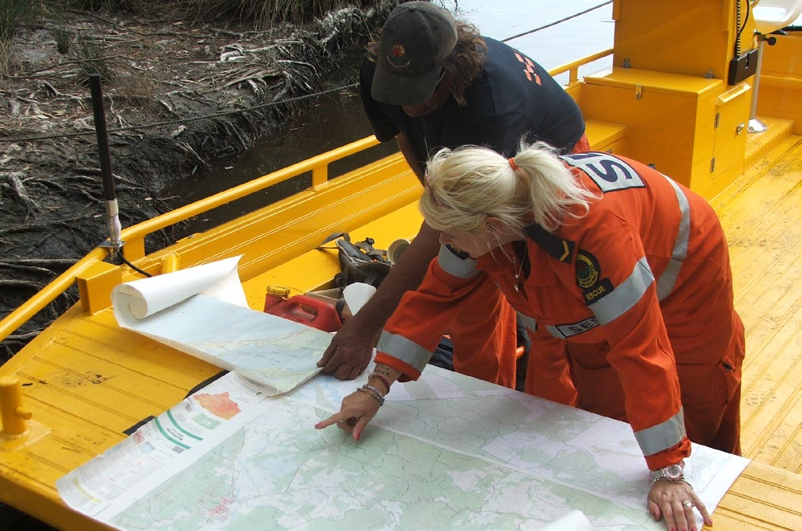
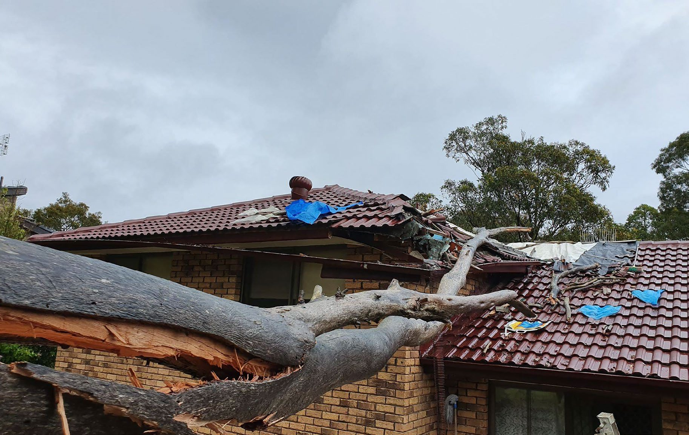
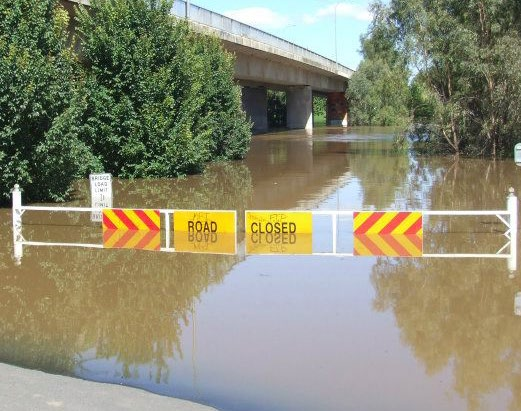
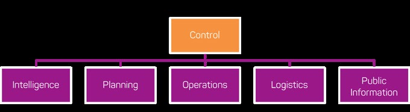
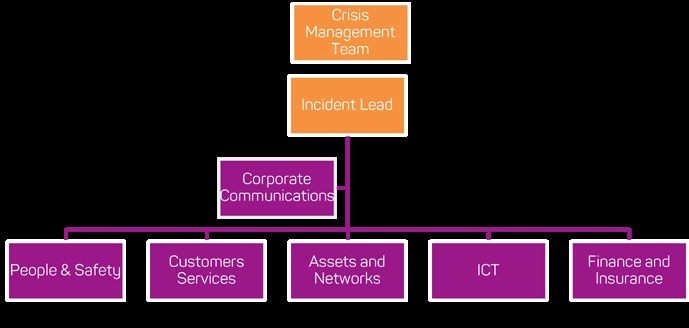
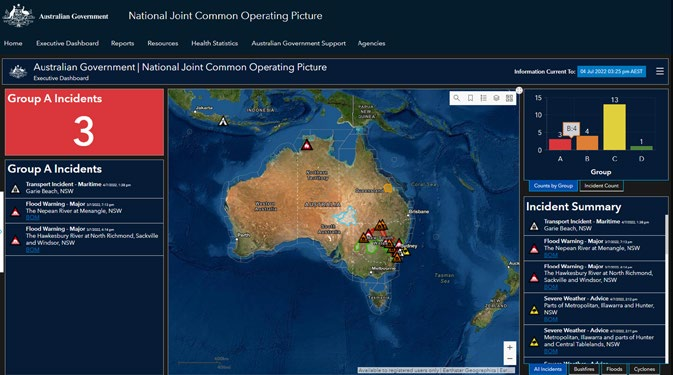

# AIDR Incident Management Handbook (2023)

> *Converted from PDF to Markdown format.*
> Source: Australian Institute for Disaster Resilience (AIDR)
> URL: https://knowledge.aidr.org.au/media/10161/handbook_incidentmanagement_2023.pdf

---
## Page 1

Australian Disaster Resilience Handbook Collection  |  2023   
Incident 
Management

---
## Page 2

a
Incident Management Handbook

---
## Page 3

Australian Disaster Resilience 
Handbook Collection
Incident Management 
First edition 2023.

---
## Page 4

ii
Incident Management Handbook
© Commonwealth of Australia 2023
Published by the Australian Institute for Disaster Resilience.
ISBN: 978-0-6457560-0-5
Copyright
The Australian Institute for Disaster Resilience encourages the 
dissemination and exchange of information provided in this 
publication.
The Commonwealth of Australia owns the copyright in all 
material contained in this publication unless otherwise noted.
Where this publication includes material whose copyright is 
owned by third parties, the Australian Institute for Disaster 
Resilience has made all reasonable efforts to:
	·
clearly label material where the copyright is owned by a 
third party
	·
ensure that the copyright owner has consented to this 
material being presented in this publication.
Wherever a third party holds copyright in material presented 
in this publication, the copyright remains with that party. 
Their permission is required to use the material.
All material presented in this publication is provided under 
a Creative Commons Attribution-NonCommercial 4.0 
International Public License, with the exception of:
	·
the Commonwealth Coat of Arms
	·
registered trademarks, including
	
−
the Australian Government’s National Emergency 
Management Agency logo
	
−
Australian Institute for Disaster Resilience logo
	·
materials specifically mentioned as not being provided 
under a Creative Commons Attribution 4.0 International 
Public Licence
	·
content supplied by third parties.
Details of the relevant licence conditions are available on the 
Creative Commons Attribution 4.0 website  
(http://creativecommons.org.au), as is the full legal code for 
the CC BY-NC 4.0 license.
Attribution
Where material from this publication is used for any purpose, 
it is to be attributed to the developer as follows:
Source: Australian Institute for Disaster Resilience (2023) 
Incident Management East Melbourne, Australia
Using the Commonwealth Coat of Arms
The terms of use for the Coat of Arms are available from the 
It's an Honour website: www.dpmc.gov.au/government/its-
honour
Contact
Enquiries regarding the content, licence and any use of this 
document are welcome at:
The Australian Institute for Disaster Resilience 
Level 1, 340 Albert St, East Melbourne Vic 3002 
Telephone: +61 (0) 3 9419 2388
Disclaimer
The Australian Government’s National Emergency 
Management Agency and the Australian Institute for Disaster 
Resilience, in consultation with emergency management 
professionals and subject matter experts, exercise care in 
the compilation and drafting of this publication; however, 
the document and related graphics could include technical 
inaccuracies or typographical errors and the information may 
not be appropriate to all situations.
In no event shall the Commonwealth of Australia (acting 
through the National Emergency Management Agency) 
or the Australian Institute for Disaster Resilience be liable 
for any damages whatsoever, whether in an action of 
contract, negligence, or other tortious action, arising out of 
or in connection with the use of or reliance on any of the 
information in this publication.

---
## Page 5

iii
Incident Management Handbook
The Australian Disaster Resilience Handbook Collection provides guidance on national principles and practices for disaster 
resilience. 
The Handbook Collection: 
	·
provides an authoritative, trusted and freely available 
source of knowledge about disaster resilience principles in 
Australia
	·
aligns national disaster resilience strategy and policy 
with practice, by guiding and supporting jurisdictions, 
agencies and other organisations and individuals in their 
implementation and adoption
	·
highlights and promotes the adoption of good practice in 
building disaster resilience in Australia
	·
builds interoperability between jurisdictions, agencies, the 
private sector, local businesses and community groups by 
promoting use of a common language and coordinated, 
nationally agreed principles.
The Handbook Collection is developed and reviewed by 
national consultative committees representing a range of 
state and territory agencies, governments, organisations 
and individuals involved in disaster resilience. The collection 
is sponsored by the Australian Government Department of 
Home Affairs.
Access to the Handbook Collection and further details are 
available on the Australian Disaster Resilience Knowledge 
Hub (the Knowledge Hub): www.knowledge.aidr.org.au/
handbooks
Australian Disaster 
Resilience Handbook 
Collection
Australian Emergency Management Arrangements
Community Engagement for Disaster Resilience
Communities Responding to Disasters: Planning for 
Spontaneous Volunteers
Community Recovery
Disaster Resilience Education for Young People
Emergency Planning
Evacuation Planning
Flood Emergency Planning for Disaster Resilience
Health and Disaster Management
Incident Management
Land Use Planning for Disaster Resilient Communities
Lessons Management
Managing Exercises
Managing the Floodplain: A Guide to Best Practice in Flood 
Risk Management in Australia
National Emergency Risk Assessment Guidelines
Public Information and Warnings
Safe and Healthy Crowded Places
Systemic Disaster Risk
Tsunami Emergency Planning in Australia

---
## Page 6

iv
Incident Management Handbook
Acknowledgements
This handbook was prepared by the Australian Institute for Disaster Resilience (AIDR) with the assistance of Euan Ferguson 
from Euan Ferguson Pty Ltd and David Parsons from Crisis Management Australia Pty Ltd and with financial assistance from the 
Australian Government. Responsibility for the views, information or advice expressed in this handbook does not necessarily 
reflect the views of the Australian Government. 
This handbook was made possible through the support of a broad cross-section of the disaster risk reduction, disaster resilience 
and emergency management sector. 
Working group members
Australian Capital Territory Emergency Service Agency, Greg 
Potts, Superintendent, Assistant Director Community Bushfire 
Protection
Australian Red Cross, Debra Shaddock, National Senior Project 
Officer, Response, Emergency Services
Charles Sturt University, Helen Foster, Policing, Law, Security, 
Customs and Emergency Management
Department of Health, Victoria, Kieran Colgan, Senior 
Capability Officer, Operations and Capability, Emergency 
Management Branch, Public Health Division; Marc Bellette, 
Senior Capability Officer Emergency Management and 
Regional Public Health
Department of Fire and Emergency Services, Western 
Australia, Dr Greg Penney, Superintendent Operational 
Delivery, Strategy and Emergency Management Command
Department of Transport, Victoria, Lisa Hucker, Senior 
Resilience Advisor, Business Continuity (endorsement as 
an individual, not as a representative of Department of 
Transport)
National Emergency Management Agency, Joe Buffone, 
Deputy Coordinator General, Emergency Management and 
Response 
International Resilience Group Pty Ltd, Graham Manson, 
Director
Local Government Association Queensland, Mike Lollback, 
Group Manager, Member and Advisory Services
National Broadband Network, Cameron Scott, Senior 
Manager, Network Emergency Management 
New South Wales Rural Fire Service, Paul Seager, Director 
Training and Doctrine
Resilience Planning, David Campbell, Managing Director
South Australia Police and Australia New Zealand Policing 
Advisory Agency, Russell Dippy, Emergency Management 
Coordinator, Emergency and Major Event Section
St Johns Ambulance Western Australia and World Association 
for Disaster and Emergency Medicine, Joe Cuthbertson, Head 
of Specialist Operations
AIDR also acknowledges the work, review and input of
Australasian Fire and Emergency Service Authorities 
Council, Erin Listen-Abel, Executive Director, Strategy and 
Performance; Sandra Lunardi, Director, Industry Workforce 
Development
University of Tasmania, Dr Christine Owen, Associate 
Professor and Research Fellow
UNICEF Australia – Nicole Breeze, Director of Australian 
Programs and Child Rights
University of Melbourne – Lisa Gibbs, Director, Child and 
Community Wellbeing Unit, Centre for Health Equity, 
Melbourne School of Population and Global Health and 
Academic Lead, Community Resilience, Centre for Disaster 
Management and Public Safety

---
## Page 7

v
Incident Management Handbook
Australian Disaster Resilience Handbook Collection  .......................................................................................................................  iii
Acknowledgements  .....................................................................................................................................................................................  iv
Introduction   .................................................................................................................................................................................................  vii
Purpose  ....................................................................................................................................................................................................................................................................................  vii
Context  .....................................................................................................................................................................................................................................................................................  vii
Scope  ........................................................................................................................................................................................................................................................................................  viii
Chapter 1: Strategic context and principles of incident management  .......................................................................................   1
Key points  ...............................................................................................................................................................................................................................................................................  2
Why is incident management relevant to an entity?  ....................................................................................................................................................................  2
A comprehensive approach  ...................................................................................................................................................................................................................................  2
Evolving risk profile  ........................................................................................................................................................................................................................................................  2
Principles for good incident management practice  ........................................................................................................................................................................  3
Chapter 2: Preparing to manage an incident response  ....................................................................................................................  4
Key points  ...............................................................................................................................................................................................................................................................................  5
Preparation stage  ............................................................................................................................................................................................................................................................  5
Risk assessment and planning  ...........................................................................................................................................................................................................................  5
Stakeholder and community engagement  .............................................................................................................................................................................................  6
Incident management structures  ...................................................................................................................................................................................................................  6
Incident Management Team staffing  ............................................................................................................................................................................................................  7
Incident management facilities  ...........................................................................................................................................................................................................................  7
Relationships and partnerships  ........................................................................................................................................................................................................................  8
Business continuity management  .................................................................................................................................................................................................................  8
Chapter 3: Managing incident response  ...............................................................................................................................................  9
Key points  .............................................................................................................................................................................................................................................................................  10
Early warning systems  .............................................................................................................................................................................................................................................  10
Readiness  ..............................................................................................................................................................................................................................................................................  10
Declaration, activation, and notification  ...................................................................................................................................................................................................  10
The Incident Management Team  ......................................................................................................................................................................................................................  11
Working in an incident response context  ...............................................................................................................................................................................................  12
Situational awareness and Common Operating Picture  ..........................................................................................................................................................  12
Forecasts and predictions  ....................................................................................................................................................................................................................................  13
Situation reports  ............................................................................................................................................................................................................................................................  13
Briefings  ..................................................................................................................................................................................................................................................................................  13
Incident records  ..............................................................................................................................................................................................................................................................  14
Contents

---
## Page 8

vi
Incident Management Handbook
Issue of information, alerts and warnings  ..............................................................................................................................................................................................  15
Media, stakeholder and community engagement  ..........................................................................................................................................................................  15
Operational rhythm  ......................................................................................................................................................................................................................................................  15
Chapter 4: Dynamic planning during an incident  ..............................................................................................................................  17
Key points  .............................................................................................................................................................................................................................................................................  18
Forecasts  ..............................................................................................................................................................................................................................................................................  18
Dynamic planning  ...........................................................................................................................................................................................................................................................  18
Chapter 5: Managing incident recovery  ..............................................................................................................................................   20
Key points  .............................................................................................................................................................................................................................................................................  21
Recovery  ................................................................................................................................................................................................................................................................................  21
Continuous improvement and lessons management  .................................................................................................................................................................  21
Chapter 6: Developing capability in Incident Management Teams  .............................................................................................  22
Key points  .............................................................................................................................................................................................................................................................................  23
Core incident management capabilities  ...................................................................................................................................................................................................  23
References  ....................................................................................................................................................................................................  25
List of Figures
Figure 1: Crisis Appreciation and Strategic Planning (CASP) approach  ������������������������������������������������������������������������������������������������������������������������  19
Figure 2: CASP methodology  ��������������������������������������������������������������������������������������������������������������������������������������������������������������������������������������������������������������������������������  19
Figure 3: Core incident management capabilities (source: Owen et al 2018).  �������������������������������������������������������������������������������������������������������  24

---
## Page 9

vii
Incident Management Handbook
Introduction 
Purpose
The Incident Management Handbook presents nationally 
agreed principles for good practice in incident management. 
It draws on and complements current good practice and 
provides guidance to entities in establishing an effective 
incident management capability.
The handbook is for use by:
	·
private sector businesses
	·
critical infrastructure owners and operators
	·
non-government and not-for-profit organisations
	·
event organisers
	·
educational institutions
	·
emergency management and service agencies
	·
entities with incident management responsibilities.
The handbook is not intended to be agency or industry 
specific. It provides generic guidance on principles for good 
practices in incident management.
Context
The Incident Management Handbook is part of the Australian 
Disaster Resilience Handbook Collection. The Handbook aligns 
incident management practice with the increasing emphasis 
on disaster resilience as a shared responsibility as established 
in the National Strategy for Disaster Resilience (COAG 2011).
The handbook reflects the national capability requirements 
outlined in the Australian Disaster Preparedness Framework 
(Australian Government Department of Home Affairs 2018) 
and reinforces the need to plan for effective response and 
to build disaster resilience as highlighted by the National 
Disaster Risk Reduction Framework (Australian Government 
Department of Home Affairs 2018) and the Sendai Framework 
for Disaster Risk Reduction 2015-2030 (United Nations Office 
for Disaster Risk Reduction 2015).
Policy landscape
Sendai Framework for Disaster Risk Reduction 2015-2030 (United Nations Office for Disaster Risk Reduction 2015)
The Sendai Framework for Disaster Risk Reduction 2015-2030 (the Sendai Framework) was adopted by Australia and other 
members of the United Nations at the third United Nations World Conference on Disaster Risk Reduction. Priority 4 of the 
framework focuses on enhancing disaster preparedness for effective response, noting the importance of training existing 
workforce and voluntary workers in disaster response, and strengthening technical and logistical capacities and promoting 
exercises to ensure better response in emergencies.
National Strategy for Disaster Resilience (Council of Australian Governments 2011)
The National Strategy for Disaster Resilience (the Strategy) was adopted by the former Council of Australian Governments 
(COAG) in 2011. The Strategy provides high-level guidance on emergency management to the Australian, state, territory 
and local governments; business and community leaders and the not-for-profit sector; and provides priority areas to build 
disaster resilient communities. The Strategy highlights how governments at all levels have a significant role in strengthening 
disaster resilience. It ensures effective and well-coordinated responses from emergency services and volunteers when 
disaster happens. It also notes the importance of partnerships and networks to build resilience at the government, 
business, neighbourhood, and community levels. These partnerships are based on a sense of shared responsibility, and an 
acknowledgement of the need for coordinated planning and response.
Australian Disaster Preparedness Framework (Australian Government, Department of Home Affairs 2018)
The Australian Disaster Preparedness Framework (the Preparedness Framework) supports the development of the 
required capability to effectively prepare for and manage severe to catastrophic disasters. The Preparedness Framework 
highlights key National Capability Requirements including enabling effective response efforts in the built environment and 
infrastructure, the ability to lead and manage a response to a crisis or emergency using incident management systems, the 
ability to respond to a hazard and its consequences in a timely manner, and the ability to collaboratively plan for responses 
through partnering with the community and building capacity for local plan implementation and recovery management.

---
## Page 10

viii
Incident Management Handbook
Scope
The guidance presented in this handbook is principles-based 
and derived from contemporary knowledge of incident 
management lessons learnt by the Australian Government, 
state and territory governments, emergency services, the 
private sector and communities. The term ‘entity’ is used in 
this handbook to describe the wide range of organisations, 
businesses and groups that may require an incident 
management capability.
The handbook is not intended for use as a manual by 
emergency responders as instructional procedure in actual 
operations. It is a foundational reference for building 
incident management knowledge to inform good practice 
across different entities. Further reading and resources are 
referenced throughout the document to provide additional 
and more specific guidance. 
Out of scope is broader community emergency management. 
The handbook focuses on incident management as applied by 
an entity, where the response to an incident may be managed 
by a team of people assembled (in person or virtually) for the 
specific purpose of resolving an incident. The assembled team 
may have a specific name such as an Incident Management 
Team, Emergency Management Team, or Emergency Control 
Team. In this handbook term ‘Incident Management Team’ is 
used.
The handbook will, over time, be accompanied and 
supplemented by companion documents such as checklists, 
case studies and practical tools.
The handbook recognises that effective incident response 
relies on significant work being undertaken in the prevention 
and preparedness phases prior to an incident occurring. 
See other titles in the Australian Disaster Resilience 
Handbook Collection for additional guidance, including 
Community Engagement for Disaster Resilience (AIDR 
2020):  https://knowledge.aidr.org.au/collections/
handbook-collection/ 

---
## Page 11

1
Chapter 1: Strategic 
context and principles of 
incident management

---
## Page 12

2
Incident Management Handbook
Key points
	·
Effective incident management capability and capacity 
is a key strategy for reducing business and community 
disruption and building resilience
	·
Creating the conditions for the successful resolution of 
an incident requires activities to be undertaken in the 
prevention and preparedness phases before an incident 
occurs
	·
Effective incident response relies on having a pre-
established method of operations
	·
The operating environment present in an incident can 
be challenging and requires appropriate skills, tools and 
training support
	·
Continuous improvement in incident management 
requires an effective approach to lessons management.
Why is incident management 
relevant to an entity?
Incident management includes the activities undertaken to:
	·
prepare for an effective response to an incident
	·
respond to an incident
	·
enable an effective transition to recovery.
Having the capability and capacity to respond effectively to 
incidents reduces the likelihood of incidents escalating into an 
uncontrolled emergency or crisis. The effective management 
of an incident can assist in limiting the scale of consequences 
arising from the incident. Consequences can include death, 
injury, psychological distress, financial loss, disruption to an 
entity or community, reputational damage, environmental 
damage and loss of confidence and trust.
Having an effective incident management capability and 
capacity assists to build the resilience of an entity and the 
community within which it operates.
Entities have a range of reasons for requiring effective incident 
management capability and capacity. These reasons may include:
	·
reducing the impact of disruptive events to an entity’s 
operations
	·
an imperative to the entity’s core mission
	·
compliance with requirements under regulation, operating 
licence, standards and certifications, e.g.:
	
−
ISO 22301:2019 – Security and resilience – Business 
continuity management systems – Requirements
	
−
AS/NZS 5050:2020 – Business continuity – Managing 
disruption related risk
	
−
ISO 22320:2011 – Societal security – Emergency 
management – Requirements for incident response
	
−
BS 11200:2014 – Crisis management – Guidance and 
good practice
	
−
BS 65000:2022 – Guidance for organisational 
resilience
	
−
ISO 55001:2014 – Asset Management – Management 
systems – Requirements
	
−
ISO 31000:2018 – Risk management – Guidelines
	
−
ISO 14001:2015 – Environmental management 
systems – Requirements with guidance for use
	
−
ISO 9001:2015 – Quality Management – Management 
systems – Requirements
	
−
ISO 45001:2018 – Occupational health and safety 
management systems – Requirements with guidance 
for use
	
−
ISO 27001 – Information security management.
A comprehensive approach
A comprehensive approach to incident management aligns 
with the four phases of the emergency management lifecycle, 
outlined in Australian Emergency Management Arrangements 
(AIDR 2023). These phases are:
	·
prevention: actions taken to mitigate the likelihood of an 
incident occurring e.g. implementation of risk controls
	·
preparedness: actions taken to be ready for managing 
the consequences of an incident e.g. risk assessment 
and planning, stakeholder engagement, establishment 
of management structures, Incident Management Team 
staffing, training, exercising and relationship building
	·
response: actions taken to manage the consequences of 
an incident e.g. monitoring for early warning indicators, 
implementation of response plans and procedures
	·
recovery: actions taken to return to pre-incident 
conditions or establish a new normal e.g. asset repairs, 
psychosocial support, environmental restoration, 
insurance claims, community recovery.
For more information on PPRR, refer to the Australian 
Emergency Management Arrangements Handbook (AIDR 
2023).
Evolving risk profile
Incident management currently takes place in an evolving risk 
context, which may include but is not limited to challenges 
such as:
	·
the increase in large-scale, non-routine and overwhelming 
events (‘out-of-scale’ events)
	·
the increasing costs of disaster
	·
increased vulnerability associated with increasing 
population, urbanisation and reliance on technology
	·
a changing climate, contributing to more severe weather 
events
	·
increasingly connected systems

---
## Page 13

3
Incident Management Handbook
	·
increasingly dynamic and unpredictable emergencies
	·
decision making that uses information that is incomplete, 
inconsistent or ambiguous
	·
emergency workers operating in situations of uncertainty, 
unpredictability and complexity
	·
changing population demographics, including ageing and 
diversifying communities and communities who lack local 
‘hazard literacy’
	·
complex globalised supply chains
	·
geopolitical instability
	·
critical and social infrastructure vulnerability to disruption 
(i.e. communities, water, electricity, energy, food supply, 
and telecommunications).
Principles for good incident 
management practice
Good incident management practice is underpinned by key 
principles, which complement and are set in the broader 
context of a risk-based framework and the principles 
of emergency management contained in the Australian 
Emergency Management Arrangements Handbook (AIDR 2023). 
These principles provide guidance on achieving good practice 
in incident management and are explained and contextualised 
throughout the handbook.
1. Incident management protects life and reduces harm
Incident management prioritises the protection and preservation of human life and relief of suffering over all other objectives 
and considerations.
2. Incident management enhances existing arrangements
Incident management plans and procedures integrate with and enhance business as usual arrangements.
3. Incident management requirements are risk based
Incident management capability and capacity requirements are determined through risk assessments.
4. Incident management requires effective preparation
Incident management involves undertaking preparedness measures before an incident occurs.
5. Incident management embraces and manages uncertainty
Incident management creates an ability to manage and reduce uncertainty. While uncertainty can’t be eliminated, incident 
management enables leadership to rapidly adapt to changing operating contexts.
6. Incident management is forward leaning
Incident management involves proactively anticipating new risks. This enables the proactive raising of readiness for them.
7. Incident management builds personnel capability and confidence
Incident management exercises build the confidence of personnel to effectively respond to an incident through familiarisation 
and exercising of plans, procedures and systems.
8. Incident management empowers personnel
Incident management provides personnel with the authority and clarity of purpose to take the required appropriate action to 
resolve an incident.
9. Incident management builds relationships
Incident management requires effective established relationships to work with suppliers, contractors, emergency services and 
regulators.
10. Incident management promotes good organisational outcomes
Incident management assists entities to achieve governance, social and environmental objectives. 
11. Incident management requires continuous improvement
Incident management involves learning from an entity’s experience and the experiences of others. Lessons management is a 
key element of effective incident management.

---
## Page 14

4
Chapter 2: Preparing 
to manage an incident 
response

---
## Page 15

5
Incident Management Handbook
Key points
	·
Effective incident management capability and capacity 
involves pre-incident activities such as conducting risk 
assessments, developing plans, engaging stakeholders, 
building relationships, establishing facilities and 
conducting training and exercises.
	·
Appropriate facilities and technology are required to 
enable effective incident management.
	·
The organisational structure for managing the response to 
an incident should be specific to the entity and identified 
prior to an incident occurring.
	·
Clear authority, delegation and role responsibilities are 
important for an effective incident management structure.
	·
Business continuity planning is required so personnel and 
systems can operate in times of disruption.
	·
An entity’s readiness to respond to an incident should be 
confirmed through audits and exercises. 
	·
Personnel in the incident management structure will be 
more effective if they train and exercise together.
Capability and capacity: Are we ready?
The initial risk assessment should indicate the incident 
management capability and capacity required. 
	·
Capability is what an entity needs to be able to do 
and includes skills and resources. 
	·
Capacity refers to the amount, size or duration that 
capability is required for. 
For example, the risk assessment may identify a requirement 
to provide 24x7 public affairs coverage for a 4-week incident 
response. This indicates the capability and capacity an 
entity needs. The defined capabilities and the capacity 
required may include:
	·
personnel and skill sets
	·
plans and procedures
	·
facilities
	·
equipment and technology
	·
relationships.
Training and exercising builds an entity’s incident 
response capability and can also be used to test incident 
response capability and capacity. Independent audits 
can also be used to assess an entity’s capability and 
capacity. An entity’s incident management arrangements 
may also be certified to provide assurance that they are 
fit for purpose, for example through the US Emergency 
Management Accreditation Program (www.emap.org).
Preparation stage
The successful management of an incident response is highly 
dependent on the activities undertaken to prepare before an 
incident occurs. The range of preparation activities include:
	·
conducting risk assessments and planning
	·
engaging stakeholders
	·
designing incident management structures
	·
conducting Incident Management Team training and 
exercising
	·
establishing incident management facilities and systems
	·
developing relationships and building partnerships
	·
confirming incident management capability and capacity.
Risk assessment and planning
A risk assessment process identifies the consequences to be 
managed when an incident occurs. The outputs of identified 
consequences are then used in the incident planning process 
to highlight what capability and capacity is needed. 
For further guidance and frameworks on risk assessment:
ISO 31000: 2018 Risk management – Guidelines:  
https://www.iso.org/standard/65694.html
National Emergency Risk Assessment Guidelines 
Handbook (AIDR 2020): https://knowledge.aidr.org.
au/resources/handbook-national-emergency-risk-
assessment-guidelines/
Plans provide a guide for managing the response to an incident. 
An Incident Management Plan outlines arrangements to 
be applied in incident response and recovery. An Incident 
Management Plan is enacted through the implementation of 
procedures that are documented and regularly revised. The plan  
and procedures will be important resources for conducting training, 
managing operations and enabling continuous improvement.
During an incident response there may be a requirement to 
modify and adapt from the Incident Management Plan to 
manage unforeseen consequences. This is called an Incident 
Response Plan. 
The Incident Response Plan may include:
	·
risk assessment
	·
activation, alert and notification requirements
	·
operational objectives
	·
leadership and network structures
	·
roles and responsibilities
	·
financial delegations
	·
communication arrangements
	·
information management 
	·
capability and capacity arrangements e.g. mutual aid
	·
contingency arrangements
	·
transition to recovery or business resumption arrangements.
Further information on elements of a generic plan can be 
found in Emergency Planning (AIDR 2020).

---
## Page 16

6
Incident Management Handbook
Stakeholder and community 
engagement
Internal and external stakeholders need to be informed of 
risks and prevention and preparedness actions they can take 
to mitigate and prepare for the consequences of an incident. 
Stakeholders may also have actions that should be taken in 
the management of the response to an incident. Depending 
on the context, stakeholders may include:
	·
personnel
	·
community groups and/or members
	·
contractors and suppliers
	·
customers
	·
regulators
	·
emergency services
	·
neighbouring residents and businesses.
Stakeholders may be required to take prevention or 
preparedness actions, such as:
	·
developing business continuity plans
	·
storing supplies
	·
establishing supplier arrangements or contracts
	·
developing evacuation plans
	·
developing hazard response plans
	·
conducting emergency drills.
Where community engagement is required, consideration 
should be given to:
	·
the diversity of community groups that need to be 
engaged with
	·
language and cultural differences
	·
identification of trusted community leaders.
For further guidance on community engagement see 
Community Engagement for Disaster Resilience Handbook 
(AIDR 2020). 
Incident management structures
An Incident Management Team structure may be based on 
the entity’s existing business units or be a temporary business 
structure based on concepts of functional management. 
Functional management is used to structure organisations 
based on areas of specialty e.g. operations or planning. 
Functional management creates silos of expertise. This 
temporary team may be called an Incident Management Team 
(IMT). The organisational structure used for an IMT needs to:
	·
establish a leader responsible for managing the IMT 
performance in achieving the desired outcome
	·
establish clear accountabilities and responsibilities for IMT 
members
	·
establish clear lines of supervision and reporting
	·
establish clear responsibilities for strategic and tactical 
leadership
	·
integrate personnel from across an entity into a 
temporary organisational unit for the purpose of 
responding to the incident
	·
integrate key partners such as contractors and emergency 
services.
Examples of incident management structures
This example of a functional incident management 
structure is based on the Australasian Inter-service 
Incident Management System. In this model a temporary 
structure is created for the duration of the incident.
The functional roles would involve:
	·
Control providing strategic leadership
	·
Intelligence gathering and assessing data to 
understand the hazard and likely consequences
	·
Planning developing a plan for the management of 
the incident
	·
Operations delivering the plan to resolve the incident
	·
Logistics obtaining products and services required to 
support the operation
	·
Public Information providing information to and 
receiving information from customers and the 
community.
Another approach taken by entities is to use existing 
functional business units. The Incident Management 
Team may report to a Crisis Management Team. The 
Crisis Management Team would provide strategic 
guidance to the Incident Management Team and 
appropriate governance of the event. The Crisis 
Management Team would comprise members of the 
Executive Leadership Team and corporate advisers such 
as legal, risk, and regulatory services. This example of an 
Incident Management Team is based on routine business 
functions:

---
## Page 17

7
Incident Management Handbook
Incident Management Team 
staffing
When selecting personnel to be part of the Incident 
Management Team, consideration needs to be given to the 
operating environment personnel will be working under. 
Managing the response to an incident may be a fast moving, 
dynamic and stressful situation and not all personnel function 
well in the context of high stress, uncertainty and fatigue.
The Incident Management Team are more likely to be 
effective if they:
	·
are pre-nominated and trained to perform their specific 
role in the team
	·
are trained in, and are familiar with, the operating system 
to be used by the team
	·
have built high levels of familiarity with their fellow team 
members
	·
have rehearsed the patterns of interaction required 
between team members in an incident
	·
know the requirements of the incident plan and 
supporting procedures.
Options for establishing an Incident Management 
Team
The structure and functions of an Incident Management 
Team need to be tailored to the needs of the entity. 
A variety of options can be used for establishing an 
Incident Management Team including:
1.	
Trained: Members are selected and trained in the 
incident management role they will perform.
2.	
Trained and accredited/authorised: Members 
are selected and trained in a particular Incident 
Management Team role. Assessment has led to 
accreditation or authorisation for that role.
3.	
Pre-formed: The team is, to the greatest extent 
possible, comprised of accredited and authorised 
personnel who are selected into pre-formed and pre-
identified teams.
4.	
Pre-positioned: In some situations, pre-formed Incident 
Management Teams are activated before an incident or 
as the risk of an incident escalates. The team is ready to 
commence operations as the risk requires.
Incident management facilities
The facility used to manage an incident should be determined 
before an incident occurs. It may be purpose-built or a multi-
use space that is transformed into an incident management 
facility. If the facility is a multi-use space such as a board room 
or training room that needs transformation, consideration 
should be given to the time required to establish the facility 
and storage of incident resources.
There are many software programs for the conduct of 
a virtual incident management facility. Staff required to 
use virtual Incident Control Centre software should be 
experienced in using the program before an incident occurs. 
There should also be technology assistance available should 
there be any systems issues. If a person is working in a high 
stress and pressure environment, they will find it more 
difficult to utilise new software.
The resources required for an incident management facility 
may include:
	·
communications (telephones/VOIP services) 
	·
ample power outlets
	·
white boards
	·
computers
	·
display screens
	·
stationery
	·
plans and procedure documents 
	·
adequate space and seating
	·
break out rooms
	·
24x7 access and building services.
There are many layouts used in incident management facilities. 
The right layout is determined by the nature of the work being 
undertaken and needs to consider the level of collaboration, 
structure of work groups and information sharing requirements 
to enable agile and adaptive work groups.
Pre-planned facilities with an established layout, access to 
systems, technology and back up for critical functions will 
result in a quicker establishment of the Incident Management 
Team. In considering the establishment, size and location of 
incident management facilities the following factors should be 
considered:
	·
capability of continuous operations (24 hours a day, 
7 days a week) and sustained operations in situations 
where critical infrastructure and essential services may be 
disrupted
	·
safety from being impacted by the incident itself and 
secure from unauthorised access.
	·
regular testing of system access and technology to ensure 
effective operation during an incident.
Exercising the incident management plan, procedures, 
facilities and team
The management of the response to an incident can be a 
challenging context in which to work. The operating context 
may include:
	·
significant risks to life, property, the environment or 
survival of a business
	·
critical decision making based on ambiguous and deficient 
information
	·
high levels of stress
	·
fatigue
	·
around the clock operations

---
## Page 18

8
Incident Management Handbook
	·
high media attention
	·
requirement for coordinated action across multiple 
organisations or levels of government
	·
post event analysis and reputational/legal risk
	·
specialist software.
Exercises are critical to ensuring incident management plans 
and procedures are understood and evaluated. Exercises 
enable Incident Management Teams to build:
	·
confidence in performing their roles in an incident
	·
high levels of familiarity with their team members
	·
experience the operating context that is present in an 
incident
	·
familiarity with the behaviours and interactions required 
between Incident Management Team members
	·
confidence in use of incident management software.
For further guidance on exercises see: Managing 
Exercises (AIDR 2017): https://knowledge.aidr.org.au/
resources/handbook-managing-exercises/
The value of exercises and simulations
The 2019-20 Major Incidents Report identified the value 
of scenario-based discussions and multiple exercises 
involving all stakeholders during the development and 
revision of policies and plans were invaluable during the 
volcanic eruption in Whakaari/White Island, New Zealand.
Additionally, the 2020-21 Major Incident Report 
observation from the tsunami in Norfolk Island that the 
nature and impacts of these events and the readiness 
and resilience of the system could be further enhanced 
by running regular exercises and public education 
campaigns to raise tsunami awareness and help coastal 
communities be prepared for the next tsunami.
https://knowledge.aidr.org.au/resources/major-
incidents-report/ 
Relationships and partnerships
Effective incident response may require entities to work 
together to achieve the desired outcome. Identifying partners 
and establishing a relationship with them starts long before 
an incident occurs. Developing relationships with stakeholders 
and partner organisations enables teamwork and mutual 
collaboration. 
Establishing relationships between entities before an incident 
occurs is important for:
	·
developing an understanding between entities of their 
individual terminology, approaches, and priorities
	·
ensuring an understanding of each entity’s information 
requirements
	·
ensuring an understanding or each entity’s capabilities
	·
information sharing
	·
collaborative decision making
	·
assisting in conflict resolution
	·
arranging mutual aid.
Key relationships
The Australian Government’s Trusted Information 
Sharing Network (TISN) is a platform for developing 
relationships and networks between industry sectors to 
support incident management. The TISN has been used 
to support cross industry sector planning, exercising and 
lesson sharing.
https://www.cisc.gov.au/engagement/trusted-
information-sharing-network/tisn-sectors
Mutual Aid
Many industry sectors operate mutual aid arrangements 
to enable sharing of resources in incident response. Pre-
established plans, procedures and relationships underpin 
effective mutual aid.
Fire and emergency services sector:
https://www.afac.com.au/initiative/nrsc 
Australian water sector:
https://www.tisn.gov.au/Documents/
Australian+Water+Sector+Mutual+Aid+Guidelines.pdf  
Business continuity management
The purpose of business continuity management systems 
(BCMS) is to prepare for, provide and maintain controls and 
capabilities for managing an organisation’s overall ability to 
continue to operate during disruptions (ISO 22301:2020).
Business continuity is the capability of an organisation 
to continue the delivery of products and services within 
acceptable timeframes at predicted capacity during a 
disruption.
The response to an incident utilises a range of resources 
including people, technology and suppliers. The availability 
of people may be disrupted. Reasons may include illness, 
industrial action and transport disruption. Technological 
systems can be impacted by electricity disruption, internet 
outages and system failures. Suppliers may have competing 
demands, product shortages or be temporarily closed. 
Business continuity plans should be in place in the event loss 
of critical people or systems occur.

---
## Page 19

9
Chapter 3: Managing 
incident response

---
## Page 20

10
Incident Management Handbook
Key points
	·
Monitor developing risks to enable proactive actions to be 
taken to increase readiness.
	·
Declaration, activation, notification triggers and 
responsibility must be clear.
	·
Incident management structures should be flexible and 
adaptable.
	·
Forecasting and dynamic planning are key tools.
	·
Alerts and warnings empower others to manage their risk.
	·
Managing incident response may involve partnering with 
other entities.
	·
Effective communication between stakeholders is critical.
	·
Records need to be maintained of decisions made 
and actions taken. This includes the rationale for such 
decisions based on the situation at the time, especially in a 
dynamic evolving incident.
Early warning systems
Many incidents will be preceded by indicators of increasing 
likelihood of risk. Examples include fire weather forecasts, 
flood watches, tsunami alerts, space weather warnings for 
solar storms, cyber security alerts, Smart Traveller travel 
advice and World Health Organisation alerts.
The monitoring of early warning indicators and identification of 
weak signals allows an entity’s Incident Management Team to 
raise an entity’s readiness in advance of an incident occurring.
Clear responsibility for risk monitoring and procedures for 
raising an alert are required.
Further guidance on warnings can be found in Public 
Information and Warnings (AIDR 2021).
Alerts and warnings - cyber
The Australian Government’s Cyber and Infrastructure 
Security Centre issues alerts for cyber security risks.
https://www.cisc.gov.au/
Alerts and warnings - heatwave
The Australian Bureau of Meteorology produces 
heatwave assessments and forecasts. This information 
is used by entities to raise readiness to manage risks 
to public health, water supplies, electricity supplies, 
transport infrastructure and bushfires.
http://www.bom.gov.au/australia/heatwave/
Alerts and warnings - health
The Australian Government Department of Health 
issues alerts to provide a warning on disease outbreaks 
within Australia where multiple states and territories 
are affected, and outbreaks that may affect Australian 
travellers overseas. Alerts can also relate to health 
emergencies including natural hazard disasters and 
bioterrorist acts where national action is required.
https://www.health.gov.au/health-alerts
Readiness
Monitoring early warning indicators enables the escalation of 
readiness measures prior to an incident occurring. Readiness 
activities may include:
	·
implementing risk reduction measures
	·
checking the readiness of equipment
	·
checking the availability of personnel
	·
standing down resources to rest and ensure their availability
	·
stockpiling of consumables
	·
confirming contact arrangements
	·
preparing incident management facilities
	·
establishing an Incident Management Team
	·
providing information to staff and the community.
Dynamically monitoring risk profile change and 
increasing readiness
Heatwave alerts
Water authorities monitor predicted weather conditions 
to develop forecasts on water consumption. This may 
result in altering through water treatment plants and 
increasing stored water levels to raise the resilience of 
the water supply system to increased demand. This is 
particularly important for life safety in a heatwave or to 
support firefighting operations.
Flood watches and flood warnings
The issue of flood watches and flood warnings enable 
rural producers to relocate stock and raise pumps near 
rivers in readiness.
Declaration, activation, and 
notification
Effective incident management has a structured system of 
declaring and escalating an incident. It needs to be clear:
	·
Who needs to be notified of an actual or potential incident?
	·
Who has the authority to activate an incident response?
	·
Who needs to be notified of the incident activation?

---
## Page 21

11
Incident Management Handbook
An incident can be declared based on the potential for an 
incident to occur rather than waiting until the incident has 
happened. This provides clear leadership and empowerment 
for the escalation of readiness.
Declaring an incident may be associated with changes to 
normal business practices. For example, the person leading 
the incident response may have expanded authority or there 
may be changes to financial delegations. 
Notification of an incident may involve advice to:
	·
senior management team members
	·
Incident Management Team members
	·
staff
	·
environmental or safety regulators
	·
law enforcement
	·
emergency services
	·
other entities
	·
community
	·
customers.
When declaring an incident it is useful to have a system of 
levels for declaration. Incident levels are commonly based 
on the scale of consequence or scale of incident response 
required. Examples of levels are:
	·
Level 1, Level 2, Level 3
	·
Yellow, Amber, Red
	·
Minor, Significant, Major.
Examples of incident levels:
	·
Level 1: A local storm event that has partly damaged 
three houses and interrupted energy supply. Response 
completed the same day as the storm impact.
Local event resolved using normal business practices. 
No special leadership arrangements.
	·
Level 2: A bushfire that affects a suburb or small 
settlement. Response occurs over more than one 
24-hour period and affects some community functions 
(e.g. local road closures).
Broader impact and disruption. Longer duration. 
Resources from multiple agencies. Requirement for 
multi-agency teamwork.
	·
Level 3: A tropical cyclone that affects communities 
and infrastructure on a regional basis. Response and 
recovery occur over an extended period and involve 
many organisations and affects many households 
and businesses. Normal community functioning is 
disrupted.
Wide scale impact and disruption. Long duration 
response and recovery activity. Resources from public 
and private sector. Requirement for multi-agency 
coordination.
(AIIMS 2017)
Command, control and 
coordination
Common incident management terms used by emergency 
services are command, control and coordination. 
	·
Command: is the leadership and internal direction of the 
members and resources of an entity by someone who has 
the authority and skills to make decisions for that entity. 
Command operates vertically within an entity.
	·
Control: refers to the overall direction of emergency 
management activities in an emergency situation. Control 
relates to situations and operates horizontally across 
entities. Often control of an incident relates to an entity’s 
purpose and its authority to act.
	·
Coordination: is the bringing together of entities to 
support an emergency management response in an 
orderly manner and for a common purpose. 
In Australian jurisdictions, the responsibility for exercising 
command, control and co-ordination may be defined through 
legislation and articulated through emergency management 
plans and policies.
Entities should be aware of the arrangements within 
jurisdictions for the control of specific hazards such as 
bushfires and floods. Jurisdictions will also have arrangements 
for the coordination of support to agencies who are in control 
of designated hazards.
In large or complex incidents, the functions of command, 
control and coordination can occur at the same time within 
impacted entities.
Good practice in incident management also includes:
	·
Collaboration: requires that relationships are based on 
having a common purpose based on trust, mutual respect 
and integrity. The aim is to build a team environment and 
consensus decision making.
	·
Communication: refers to the Incident Management Team 
providing clear, targeted and tailored information and 
warnings to stakeholders and the community. Incident 
communications may occur within an entity or be tailored 
to external stakeholders.
In establishing an incident structure, it is important that:
	·
the incident management structure is scaled to the nature 
of the incident and its consequences
	·
decisions are made at the appropriate level within the 
incident management structure.
The Incident Management Team
The roles and responsibilities of the Incident Management 
Team should be described in the entity’s plans and procedures. 
The Incident Management Team (IMT):
	·
brings together functional specialists from within and external 
to the organisation (e.g. legal, communications, technical)

---
## Page 22

12
Incident Management Handbook
	·
builds a picture of shared situational awareness about the 
incident
	·
develops forecasts and predictions
	·
prepares a plan of action detailing what needs to be done, 
how, when and by who
	·
considers the risks associated with implementing the plan 
and what are the mitigation strategies for such risks
	·
monitors implementation of the plan
	·
manages resources and implements actions to achieve the 
plan
	·
continually review the plan and reassess the risks as the 
incident evolves ensuring the plan remains fit for purpose 
engages with stakeholders, customers and communities
	·
maintains and stores records of deliberations and 
decisions
	·
·plans and initiates a transition to recovery.
Incident Management Team roles in an entity may result in 
people multi-tasking and being required to perform multiple 
roles during an incident across multiple areas.
Working in an incident response 
context
An incident can create a difficult working environment. The 
work environment may be complicated by:
	·
staff experiencing high levels of stress and fatigue which 
can impair cognitive ability
	·
information which may be incomplete, contradictory or 
overwhelming in volume
	·
competing priorities and inadequate resources
	·
complex risk environments
	·
complex and copious decision making.
Managers who function effectively in a business as usual 
environment may not be as effective in an incident response 
environment. Leadership attributes required in an incident 
response are well researched and include:
	·
calmness
	·
high emotional intelligence
	·
adaptability
	·
empathy
	·
ability to create the background conditions to enable team 
members to perform well
	·
ability to inspire others to maintain motivation in difficult 
situations.
(Boyatzis 2017; Hayes & Omodei, 2011; Owen, Scott, Adams & 
Parsons 2017)
Situational awareness and 
Common Operating Picture
Incident Management Teams need to maintain a high level 
of situational awareness as the incident rapidly evolves. 
Critical to this is effectively exchanging, communicating and 
collating information. This ensures that the team is working 
with a common understanding of what has happened, what is 
happening and what may happen next.
One way to ensure information is commonly shared is to 
establish a Common Operating Picture (COP). A COP is the 
collation of the collective information used by the Incident 
Management Team. The COP includes information that has 
been analysed and processed into a ‘value added’ format such 
as graphs or maps, with the purpose to support informed 
decision making.
The COP can be depicted or displayed as a ‘knowledge wall’ of 
key information that allows a whole of situation overview and 
may be actual or virtual.
National Joint Common Operating Picture
The National Joint Common Operating Picture (NJCOP) is 
an IT-based geospatially enabled platform providing all-
hazards near-real-time situational awareness and impact 
assessment of nationally significant events.
The NJCOP is available to all Australian Government 
stakeholders, and has been made available to all state 
and territory emergency management authorities. 
This common picture informs decisions through the 
Australian Government Crisis and Recovery Committee, 
National Co-ordination Mechanism, and Commissioners 
and Chief Officers Strategic Committee.
The NJCOP is maintained by the Australian Government 
National Situation Room. 

---
## Page 23

13
Incident Management Handbook
Victorian Common Operating Picture
The Victorian Emergency Management Common Operating 
Picture or EM-COP is a web-based communication, 
planning and collaboration tool that has been rolled out 
state-wide to enable emergency personnel to quickly share 
information and make strategic decisions.
EM-COP provides real-time situational awareness and 
a common view for personnel and agencies across 
Victoria’s emergency management sector.
Through enhanced access to real time information, 
the sector can now make better and timely decisions, 
resulting in better outcomes and a safer community.
https://www.emv.vic.gov.au/about-us/current-
projects/em-cop
Questions to ask for situational awareness, 
strategic direction and deciding what actions to 
take. 
Situation
	·
What has happened, what is happening now and 
what is being done about it?
	·
So what? What might the implications and wider 
impacts of this be?
	·
What might happen in the future?
	·
What if? What if the unplanned for arises, and what 
contingencies and actions will then apply?
Direction
	·
Ends: what are we trying to achieve, what is the 
desired end state?
	·
Ways: what options are open to us and what 
constraints apply?
	·
Means: what capabilities are available to us to realise 
our objectives?
Action
	·
What do we need to do now? 
	·
What do we need to find out?
	·
What do we need to communicate?
	·
What do we need to do next?
	·
What might we need to do in the future?
Forecasts and predictions
An important role of the Incident Management Team is to 
forecast future incident conditions and issues so that pre-
emptive action can be taken. The Incident Management Team 
needs to forecast:
	·
how the incident may develop in the coming hours, days, 
and weeks
	·
what future consequences may arise from the incident
	·
whether warnings, information and advice are going 
out to the public and other stakeholders in a timely and 
appropriate manner
	·
whether everyone who needs to be notified and engaged 
has been
	·
what future resources and technical expertise 
requirements might be needed
	·
what the recovery needs of the entity, stakeholders, 
individuals, and community are.
These forecasts and predictions enable effective dynamic 
planning during incident response. 
For more details on dynamic planning, see Chapter 4.
Forecasting tools
The Tools for Futures Thinking and Foresight Across UK 
Government provides a useful set of tools for developing 
forecasts.
https://assets.publishing.service.gov.uk/government/
uploads/system/uploads/attachment_data/
file/674209/futures-toolkit-edition-1.pdf
Situation reports
Situation reports provide a status and progress report of the 
incident response at a point in time. Situation reports (SITREPS) 
are published and updated continually during an incident. They 
inform organisational leaders and stakeholder of the details 
of the incident, the issues being managed, and the response 
being undertaken. SITREPS use and share information from the 
Common Operating Picture and is correct at a point in time.
A situation report may include:
	·
a concise summary of the incident
	·
the current situation and issues
	·
current actions being deployed
	·
current resource numbers
	·
progress to date
	·
critical issues
	·
predictions and forecasts of future developments.
Briefings
Briefings are a key communication tool used to ensure that all 
members involved with the incident understand the incident 
objectives, the strategies to control the incident, risks and 
safety issues. There are many forms a briefing may take, but the 
critical element is that messages are clearly communicated in a 
way that they are received, understood and actioned.

---
## Page 24

14
Incident Management Handbook
A related process is ‘back briefing’. A back briefing is where 
the person receiving the briefing gives a summary of the 
instructions they have just received. The leader giving the 
original briefing can then determine whether the message 
was received properly and aligns with their intent.
Example briefing format: Situation, Task, Intent, Concern, Calibrate (STICC) protocol
The STICC protocol has been developed as a communication tool for high reliability organisations. The protocol is useful 
when there is significant uncertainty in the situation and the solution. The tool is designed to promote voice amongst those 
involved and recognise uncertainty in the situation.
	·
Situation: Here’s what I think we face.
	·
Task: Here’s what I think we should do.
	·
Intent: Here’s why I think this is what we should do.
	·
Concern: Here's what we should keep our eye on, because if that changes, we’re in a whole new situation.
	·
Calibrate: Now talk to me. Tell me if you don’t understand, cannot do it, or see something I do not.
Source: Weick and Sutcliffe (2007) p156.
Example briefing format: SMEACS-Q briefing process
Many emergency service organisations have adopted a systematic way of preparing and delivering briefings. One such process 
is called the SMEACS-Q (Situation, Mission, Execution, Administration and logistics, Command and communication, Safety, 
Questions) briefing process. SMEACS-Q is particularly suited to agencies using command-based approaches. The acronym 
SMEACS-Q represents the key components of a briefing where there is clear direction of what needs to occur.
	·
Situation: The current and predicted situation. Includes weather, terrain, assets at risk, resources deployed.
	·
Mission: A statement of the Incident Controller’s intent.
	·
Execution: Objectives set for the incident response strategies, constraints, resources allocated, access, shift times, 
contingency plans, public information plan.
	·
Administration and logistics: Key support locations and roles, including Staging Area location, catering, supply, medical, 
check in/out arrangements, record keeping.
	·
Command and communication: Incident management structure, sectors and divisions, reporting relationships and 
timings, plan, contact numbers and radio channels.
	·
Safety: Known or likely hazards including weather changes, ‘watch out situations’, safety requirements (including personal 
protective clothing), water, first aid arrangements.
	·
Questions: Encourage participants to ask questions for clarification. Ask participants questions to ensure they understand 
the briefing points.
Source: Australian Inter-service Incident Management System Manual (2017)
Incident records
The Incident Management Team may operate in a time 
pressured and dynamic environment. A record of key 
information and decisions should be maintained for use in 
briefings. It is also important to maintain records of what 
happened and how the incident was managed for later review 
and accountability. If incident records are not kept at the time, 
it may be difficult to recall details later.
The Incident Management Team should establish a records 
management system. Incident records provide evidence 
of events, decisions, actions and timings. The minutes of 
meetings held and decisions taken are particularly important 
and may be delegated to a specific person to prepare. Records 
may be necessary to pay staff, suppliers and contractors, for 
good administration and to enable recall of specific events.
Log books or virtual records may be maintained for 
individuals, work groups or for the Incident Management 
Team as a whole, containing notes and timings of events, 
meetings, decisions and the rationale for a decision. The 
records may be in the form of a physical notebook or an 
electronic record. 
In some cases, key incident management personnel may 
appoint a scribe to assist in maintaining a log book. However, 
it is important for all Incident Management Team members to 
keep records of their decisions and actions.
Where a critical incident (e.g. a fatality) occurs, the need to 
have a log book becomes imperative. If there is insufficient 
time to make a log entry at the time, then it should be made 
as soon as possible.

---
## Page 25

15
Incident Management Handbook
Issue of information, alerts and 
warnings
The structured release of information, alerts and warnings 
is an important tool to ensure stakeholders are aware of a 
developing risk and take measures to reduce their risk.
Examples of alerts and warnings include electricity supply 
disruption notifications, food safety recalls, notifications of 
public transport disruptions, public health alerts, fire and 
flood emergency alerts.
The issue of alerts and warnings need to:
	·
be understood by the target audience
	·
be accessible to the target audience
	·
be verifiable by the target audience
	·
create action
	·
be monitored for effectiveness.
When there is a community emergency, warnings from 
government agencies may be centrally coordinated so there is 
integrated consistent messaging.
Further guidance on warnings can be found in 
Public Information and Warnings (AIDR 2021) and 
the Warnings Collection on the Australian Disaster 
Resilience Knowledge Hub.
The Australian Warning System
The Australian Warning System has been designed based 
on feedback and research across the country and aims to 
deliver a more consistent approach to emergency warnings. 
It uses a nationally consistent set of icons to show incidents 
on websites and apps, supported by calls to action.
There are three warning levels:
1.	
Advice: An incident has started. There is no immediate 
danger. Stay up to date in case the situation changes.
2.	
Watch and Act: There is a heightened level of threat. 
Conditions are changing and you need to start acting 
now to protect you and your family.
3.	
Emergency Warning: An Emergency Warning is the 
highest level of warning. You may be in danger and 
need to act immediately. Any delay now puts your life 
at risk.
https://knowledge.aidr.org.au/resources/australian-
warning-system/ 
Media, stakeholder and 
community engagement
The response to an incident may involve impacts on a range 
of stakeholders across the community.  Incident Management 
Team members will require an understanding of the culture 
and values of those affected to develop effective engagement. 
The Incident Management Team may need to consider a 
range of community segments including:
	·
urban residents
	·
customers
	·
regulators
	·
Indigenous perspectives
	·
agriculture sector
	·
multicultural sector
	·
disability sector
	·
business sector
	·
tourism sector.
The information required by these different sectors and 
groups may be diverse. Effectively communicating with each 
sector and group requires consideration of their information 
needs and the communication methods relevant to them.
Effective communication may use a range of channels 
including TV, radio, newspapers, social media and community 
meetings. Managing incident public affairs is a specialist task.
Further guidance on community engagement and 
communication Community Engagement for Disaster 
Resilience (AIDR 2020) and Public Information and 
Warnings (AIDR 2021).
Operational rhythm
The Incident Management Team should establish a daily 
cycle (or ‘rhythm’) of activities and products. This operational 
rhythm may include set timings of Incident Management Team 
meetings, planning meetings, briefings, media conferences and 
shift changes over a 24-hour cycle. The operational rhythm 
enables the team to establish patterns of work and forecast 
what is required to be done. 

---
## Page 26

16
Incident Management Handbook
Incident Management Teams should be aware of and consider: 
	·
that they may be established at short notice and operate for extended periods of time
	·
that they will need to operate in shifts to ensure continuous operations
	·
that there are adequate incident facilities established with appropriately qualified personnel
	·
increasing complexity and consequence of incident management can draw in many individuals and organisations with 
different expectations
	·
the consequence of the incidents may result in multiple areas of focus
	·
insufficient resources for initial response to the incident or to concurrent incidents
	·
the potential lack of foresight on the potential incident progression
	·
the potential failure to:
	
−
issue community warnings in a timely, tailored and relevant manner
	
−
develop a dynamic plan and communicate it in a timely manner
	
−
delegate
	
−
prioritise the deployment of resources on a risk basis
	
−
collaborate and communicate with other entities and stakeholders
	
−
understand entity and stakeholder responsibilities
	
−
have an up to date and understood Common Operating Picture
	
−
communicate effectively with stakeholders
	
−
attend to the welfare (food, water, rest) and safety of incident personnel
	
−
understand local, political or social aspects of the incident
	·
the emergence of egos causing a lack of awareness and consideration of self and other’s needs.
	·
unchecked psychological or behavioural biases.

---
## Page 27

17
Chapter 4: Dynamic 
planning during an 
incident

---
## Page 28

18
Incident Management Handbook
Key points
	·
During the response to an incident there will be a need to 
develop a dynamic plan.
	·
Dynamic plans are based on forecasts.
	·
Developing forecasts and acknowledging the assumptions 
underpinning them is critical.
	·
Forecasts and plans require ongoing monitoring and 
review.
	·
Early identification of the full range of consequences 
arising from an incident enables pro-active management.
	·
Dynamic planning requires input from across the Incident 
Management Team.
	·
Dynamic plans require carefully managed implementation.
	·
The effectiveness of plans needs ongoing monitoring and 
feedback into forecasting.
Forecasts
Building and maintaining high situational awareness and 
sharing it as a Common Operating Picture   is a critical activity 
undertaken by an Incident Management Team.
Information developed from situational awareness and the 
Common Operating Picture is used to develop forecasts, 
which are key to developing an effective plan.
Forecasting involves developing projections of the range 
of possible future pathways the incident may take. A single 
prediction may be chosen from this range of pathways 
however constant monitoring and review is required to 
ensure the prediction is correct and the forecast is holding.
Forecasts need to consider the forces that are influencing 
the way that an incident is unfolding and assess the effect 
that current and proposed response actions will have on the 
incident. Forecasting needs to consider that an incident’s 
consequences can be geographically far reaching through 
supply chains or dispersed customers.
Dynamic planning
Pre-determined plans should form the basis for incident 
response. A plan is based on a set of assumptions and 
forecasts about the way an incident will unfold. When an 
incident occurs these pre-determined plans may not fully 
cover the consequences, and the assumptions made may 
not be correct or may change. There is often a requirement 
to adapt the plan or create solutions to unforeseen issues. 
Developing a dynamic plan of action will provide a roadmap to 
be implemented by the Incident Management Team. 
Terms used to describe this type of plan include an 
incident action plan, event action plan, or battle plan. The 
development of a dynamic plan of action ensures unity of 
purpose, clarity of responsibility and enables the monitoring 
of performance against the plan. It ensures all those involved 
are clear on what is to be achieved, how, when and by who. 
The development of the plan should be the responsibility of 
a member of the Incident Management Team and involve 
collaboration with other team members. In its simplest form, 
an incident action plan is developed mentally and expressed 
verbally. As the complexity of the plan increases, so will the 
need to formally document the plan and disseminate it. 
(Australian Inter-service Incident Management System Manual 
2017)
The dynamic planning process will typically have the following 
steps:
1.	
gathering and analysing information to develop forecasts
2.	
assessing risks
3.	
developing incident goals
4.	
identifying and evaluating options available to implement 
these goals in additional to managing and treating 
incident risks
5.	
selecting the best option to minimise risks and to 
optimise the likelihood of achieving the goals
6.	
preparing and disseminating the incident action plan to 
the Incident Management Team and stakeholders
7.	
monitoring implementation progress to determine 
effectiveness; and
8.	
modifying the plan, where necessary.
The development of a dynamic plan would include:
	·
the desired outcome (e.g. goal, mission, objective, leaders’ 
intent)
	·
the building blocks of activity required to achieve the 
desired outcome
	·
management structure and reporting arrangements
	·
accountability for the building blocks of activity
	·
the resources allocated to implement the building blocks 
of activity
	·
stakeholder communication arrangements
	·
logistics arrangements
	·
safety issues
	·
constraints and limitations.
Dynamic planning can be carried out at three levels:
1.	
Strategic: that considers the broader impacts across the 
whole entity, community and whole-of-government.
2.	
Operational: the bridge between strategic and tactical 
plans. Operational plans identify activities needed to 
achieve the incident goal.
3.	
Tactical: relates to frontline activities being conducted by 
incident response personnel in accordance with the plan 
established by the Incident Management Team.

---
## Page 29

19
Incident Management Handbook
Example of strategic level planning - the Australian Government’s Crisis Appreciation and Strategic 
Planning (CASP) approach
The Australian Government has developed the Crisis Appreciation and Strategic Planning (CASP) approach to respond to the 
emerging complexity of crises that arise from emergency incidents and disasters. CASP consists of processes and products 
that help to clarify complex issues.
The purpose for using CASP is to lower the risk of unwanted outcomes (e.g. minimise value of losses) and increase the 
chances for positive outcomes (e.g. reduced community impacts). CASP accomplishes this through a structured, systematic 
methodology that uses strategic thinking and conceptualising the big picture in crisis and emergency planning.
Figure 1: Crisis Appreciation and Strategic Planning (CASP) approach
CASP provides a process that maintains the rigor of critical thinking and analysis for planning and responding to such crises. 
The CASP process:
	·
facilitates a diversity of thought, perspective and input so that informed decisions guide operations
	·
enables decision makers to evaluate and categorise risk to ensure appropriate prioritisation of the values at risk, lines of 
effort and objectives
	·
provides a practical guide to plan and manage challenges systematically and to develop multiple courses of action and 
contingency plans helps managers prioritise critical event messaging. 
The CASP methodology consists of four steps:
1.	
Defining the environment to create a common operating picture.
2.	
Analysing the mission. The centrepiece of mission analysis is the strategic intent, which includes lines of effort to 
achieve a desired end state. The end state clarifies what the environment will look like once defined success conditions 
have been met.
3.	
Developing courses of action by identifying broad-scale actions and evaluating those actions required to accomplish 
lines of effort.
4.	
Executing the plan. Execution and coordination of tasks involves breaking down broad courses of action into tasks 
and assignments appropriate for resources and IMTs. Tasks and assignments must align with the strategic intent and 
connect to strategic priorities. In this way, operational and tactical personnel have a clear understanding of how their 
work fits into and supports the overall objectives. 
DEFINE THE ENVIROMENT
MISSION ANALYSIS
COURSES OF ACTION TO GIVE  
EFFECT TO LINES OF EFFORT
EXECUTION
	·
Establish the inital common 
operating picture
	·
Situational awareness
	·
Develop priorities and 
conduct gap analysis
	·
Develop end state and lines 
of effort
	·
Approve strategic intent
	·
Development
	·
Analysis
	·
Comparison
	·
Approval/authority
	·
Tasking and 
coordination
Figure 2: CASP methodology
CASP
EXISITING INCIDENT 
MANAGEMENT SYSTEMS 
(AIIMS, ICCS+)
STRATEGIC LEVEL
	·
Executive Authority End States
	·
Broad Intent and Priorities, Sequence
	·
Strategic Risk Assessment and Limits
OPERATIONAL LEVEL
	·
Operation Planning
	·
Lines of Effort
	·
Objectives and Strategies
TACTICAL LEVEL
	·
Incident Resource Management
	·
Short-term Planning
	·
Tactical Action

---
## Page 30

20
Chapter 5: Managing 
incident recovery

---
## Page 31

21
Incident Management Handbook
Key points
	·
Incident response and recovery activities may be 
occurring at the same time.
	·
Recovery includes restoration, betterment, repair, 
restocking and insurance.
	·
Recovery includes staff welfare support and recognition.
	·
Recovery includes the implementation of continuous 
improvement processes.
Recovery
Recovery activities may include:
	·
repairing damage
	·
rebuilding housing and infrastructure
	·
restoration of the natural environment 
	·
managing financial support, including insurance, 
government and non-government assistance
	·
rebuilding confidence or trust
	·
restocking supplies
	·
providing medical and psychological support
	·
preparing for an inquiry
	·
supporting communities through the process.
The effective coordination of these activities may require 
the appointment of a person to lead the recovery effort. The 
leadership transition from response to recovery should be 
done in an integrated and concurrent manner. Planning for 
recovery needs to recognise that recovery can take months to 
years.
Further guidance and national principles of recovery can 
be found in Community Recovery (AIDR 2018)
Continuous improvement and 
lessons management
Each incident response or exercise provides an opportunity 
to identify improvement opportunities. These improvement 
opportunities may relate to areas such as plans, operational 
procedures, staff capability, stakeholder management or 
response resources.
It is imperative to incorporate continuous improvement 
through lessons management into incident management 
policies, plans and practices. This provides mechanisms to 
inform future incident management responses.
To ensure a continuous learning organisational culture is in 
place, a after action review (AAR) should be conducted to 
identify lessons that can be learned. 
If an incident results in a formal review or inquiry, members 
of the Incident Management Team can have their actions and 
decisions scrutinised, which can result in significant pressures 
on Incident Management Team members. 
Further guidance on lessons management can be found 
in Lessons Management (AIDR 2019)
Continuous improvement: after action review 
(AAR)
An after action review (AAR) is a review of an incident 
focusing on what went well, what needs to be retained 
and what opportunities for improvement exist. AARs can 
maximise learning from every operation, training event, 
exercise or task.
An AAR is a form of continuous improvement. It is a 
positive learning process rather than being a critique or a 
scoring process.
AARs answer four main questions about an event:
1.	
What was planned?
2.	
What happened?
3.	
What went well and should be retained?
4.	
What could be done better next time?
The AAR is a dynamic, candid discussion of the team’s 
performance. Everyone on the team should be present 
and be encouraged to speak if they have an observation, 
insight or a question that might help facilitate continuous 
improvement.
The objective of the AAR is to provide lessons for 
improving the entity’s incident management outcomes.
For more information on AARs and continuous 
improvement, see Lessons Management (AIDR 2019).

---
## Page 32

Chapter 6: Developing 
capability in Incident 
Management Teams
22

---
## Page 33

23
Incident Management Handbook
Key points
	·
The ability to work under stress and pressure and with 
uncertainty are critical skills.
	·
High emotional intelligence is a key attribute required by 
incident management leaders.
	·
Leaders need to create the background conditions to 
enable team members to perform effectively.
	·
All incident team members need to engage in critical 
thinking to plan and act strategically.
Core incident management 
capabilities
The task of IMT members is to assess the incident, set 
objectives for those responding, choose suitable strategies 
to achieve set objectives, develop and implement a plan, and 
monitor the effectiveness of that implementation.
Owen (2014) highlights the importance of human factors 
in emergency management. The “demands associated with 
incident complexity, increasing expectations, and the changes 
occurring within the industry, result in particular human 
factors challenges” (p.10). It is also important to acknowledge 
that human factors are “relevant in understanding how 
to help communities prepare for emergencies, and how 
to communicate warnings and other prominent incident 
information for at-risk communities” (p.11).
Owen points to the fact that human factors are central to 
effective performance in this team-based and technology-
oriented environment. Increasingly, response and recovery 
teams are comprised of personnel with a wide range 
of expertise. Response and recovery are often likely 
to be a multi-agency effort, placing more emphasis on 
interoperability, and cooperation.
To better understand the role of human factors, there is 
a wide body of knowledge that identifies the attributes 
required for optimising outcomes of incident management 
teams. Readers are encouraged to review the work of the 
authors included in the Reference List. The research evidence 
proposes the following considerations for training and 
preparing for managing incidents:
	·
designating staff exclusively to incident management roles
	·
developing simulation exercises of sufficient scale and 
complexity
	·
highlighting the need for emergency managers to operate 
in a more open political environment
	·
taking account of the impact of stress in thinking and 
critical incident decision making
	·
developing ‘worst-case scenario’ thinking
	·
recognising the importance of personal self-awareness
	·
considering the impact of familiarity between Incident 
Management Teams
	·
the critical importance of managing external relations
	·
managing incidents in situations where conditions are 
degraded
	·
creating opportunities to reflect on past incident events 
so that observations and insights can inform a lessons 
management process.
In reviewing the evidence to support capability development 
requirements in the emergency management sector Owen, 
Hayes, Scott, Brooks & Conway (2018) developed a framework 
that includes three capability categories, each with three sub-
capabilities important in managing the incident:
1.	
Model leadership and teamwork: the ability to act with 
integrity, influence others and facilitate team efforts 
towards the achievement of common goals. Sub-
capabilities are:
	
−
models, ethics, inclusiveness and good governance
	
−
creates effective background conditions to 
build confident and capable teams and engaged 
stakeholders
	
−
applies effective decision making. 
2.	
Plan and think strategically: the ability to consider 
multiple perspectives and scenarios to engage in 
strategic planning and consequence management. Sub-
capabilities are:
	
−
pursues sense-making and encourages sense-making 
in others
	
−
practices planning and strategic thinking
	
−
enables consequence management. 
3.	
Demonstrate self-awareness: the ability to monitor stress 
and fatigue, display resilience and agility and reflect and 
adjust to feedback. Sub-capabilities are:
	
−
monitors and manages self for symptoms of stress and 
fatigue
	
−
displays resilience and agility
	
−
recognises own strengths and limitations.
This leadership and team framework is in use nationally and 
is being applied in some jurisdictions to inform capability 
development needs. 
 

---
## Page 34

24
Incident Management Handbook
Figure 3: Core incident management capabilities (source: Owen et al 2018).
The understanding of human factors and capability development requirements for incident management is growing. For 
further information, see the following websites and publication sources:
Australian Journal of Emergency Management: https://knowledge.aidr.org.au/collections/australian-journal-of-
emergency-management/ 
Joint Centre for Disaster Research: https://www.massey.ac.nz/research/research-centres/joint-centre-for-disaster-
research/ 
Natural Hazards Research Australia: https://www.naturalhazards.com.au/ 
National Preparedness Leadership Initiative: https://npli.sph.harvard.edu/crisis-leadership-training/ 
Response and Recovery Aotearoa New Zealand: https://rranz.org.nz/ 
Bushfire and Natural Hazards Co-operative Research Centre: https://www.bnhcrc.com.au/
 
 
HAZARD
Specialist understanding of the risks,  
consequences and behaviours of hazards.
TECHNICAL
Solid understanding of  policies, systems and 
doctrine and their strengths and limitations. 
 Models ethics, inclusiveness and good governance
Creates effective background conditions to build confident and capable teams and engaged stake-holders
Applies effective decision-making
Pursues sense-making and encourages in others
Practices planning and strategic thinking 
Enables consequence management 
Monitors and manages self for symptoms of stress and fatigue 
Displays resilience and agility 
Recognises own strengths and limitations 
MODEL
Integrity, influence, 
governance 
THINK
Sense-making, 
scenarios, 
consequence
SELF-AWARE
Reflect, adapt, 
persevere 
INCIDENT MANAGEMENT CAPABILITIES 
CORE INCIDENT MANAGEMENT CAPABILITIES
HAZARD CONTEXT CAPABILITIES

---
## Page 35

25
Incident Management Handbook
References
Australasian Fire and Emergency Service Authorities Council, 
2017, The Australasian Inter-Service Incident Management 
System, https://www.afac.com.au/initiative/aiims 
Australasian Fire and Emergency Service Authorities Council, 
2016, Core Incident Management Team Capabilities - Supporting 
evidence for Emergency Management Professionalisation 
Scheme, https://www.emps.org.au/wp-content/
uploads/2020/01/IMTCoreCapabilities_2016-12-21_2.0.pdf 
Australian Institute of Disaster Resilience, Australian Emergency 
Management Glossary, https://knowledge.aidr.org.au/glossary/
Australian Institute for Disaster Resilience, 2018, Community 
Recovery, https://knowledge.aidr.org.au/resources/handbook-
community-recovery/ 
Australian Institute for Disaster Resilience, 2019, Australian 
Emergency Management Arrangements, https://knowledge.
aidr.org.au/resources/handbook-australian-emergency-
management-arrangements/ 
Australian Institute for Disaster Resilience, 2020, National 
Emergency Risk Assessment Guidelines, https://knowledge.
aidr.org.au/resources/handbook-national-emergency-risk-
assessment-guidelines/ 
Australian Institute for Disaster Resilience, 2020, Emergency 
Planning, https://knowledge.aidr.org.au/resources/
emergency-planning-handbook/ 
Australia New Zealand Policing Advisory Agency, 2017, ICCS 
Plus (version 2) A common approach to incident management, 
https://www.anzpaa.org.au/publications/general 
Bearman C & Hayes P, 2021, Embedding non-technical skills 
as part of core business in emergency management – final 
project report, https://www.bnhcrc.com.au/sites/default/files/
managed/emnots/ 
Boyatzis R, Thiel K, Rochford K, Black A, 2017, Emotional and 
social intelligence competencies of incident management 
team commanders fighting wildfires, The Journal of Applied 
Behavioral Science, vol. 53, no. 4, pp 498–516.
Brooks, B, Curnin, S, Owen, C, & Bearman, C, 2019, Managing 
cognitive biases during disaster response: the development of 
an aide memoire, Cognition, Technology & Work, pp 1-13.
Brooks, B, Curnin, S, Owen, C, & Boldeman, J, 2019, New 
human capabilities in emergency and crisis management: 
from non-technical skills to creativity, Australian Journal of 
Emergency Management, vol. 34, no. 4, pp 23-30.
Clancy, D 2011, Can acceptable risk be defined in wildland 
firefighting? Proceedings of Second Conference on the human 
dimensions of Wildland Fire, Newtown Square, PA. United 
States Department of Agriculture, Forest Service, Northern 
Research Station.
Ellis S, MacCarter K, 2016, Incident Management in 
Australasia. Lessons Learned from Emergency Responses, 
Australasian Fire and Emergency Service Authorities Council, 
CSIRO Publishing, Clayton South Victoria.
Hayes, P, Bearman, C, Butler, P, & Owen, C 2021, Non‐technical 
skills for emergency incident management teams: A literature 
review, Journal of Contingencies and Crisis Management, vol. 
29, no.2, pp 185-203.
Hayes, P A J & Omodei M M, 2011, Managing emergencies: 
Key competencies for incident management teams, The 
Australian and New Zealand Journal of Organisational 
Psychology, vol. 4, 1-10.
International Organization for Standardization and Standards 
Australia 2018, Risk management - Guidelines, AS/ISO 3100, 
NSW.
Owen, C, 2014, Human Factors Challenges in Emergency 
Management, Enhancing Individual and Team Performance 
in Fire and Emergency Services, Ashgate Publishing Limited, 
Surrey, England. 
Owen, C, Hayes, P, Brooks, B, Scott, C, & Conway, G, 2018, 
Evidence to support incident management team capability, 
Australian Journal of Emergency Management, vol. 33, no. 
3, 44-49. https://knowledge.aidr.org.au/resources/ajem-
jul-2018-evidence-to-support-incident-management-team-
capability/
Owen, C, Scott, C, Adams, R & Parsons, D, 2017, Beyond 
Command and Control: Leadership, culture and risk, Taylor and 
Francis, New York.
Weick, K E & Sutcliffe, K M, 2007, Managing the unexpected. 
Wiley & Sons.

---
## Page 36

26
Incident Management Handbook

---
## Page 37

27
Incident Management Handbook

---
## Page 38

Australian Institute 
for Disaster Resilience 
Knowledge Hub
www.knowledge.aidr.org.au

