# AIDR Monitoring and Evaluation Framework for Disaster Recovery Programs (v2)

> **Source**: Australian Institute for Disaster Resilience (AIDR)
> **URL**: https://knowledge.aidr.org.au/media/5967/a-monitoring-and-evaluation-framework-for-disaster-recovery-programs-v2.pdf
> *Converted from PDF to Markdown format.*

---
## Page 1

A Monitoring and Evaluation Framework 
for Disaster Recovery Programs 
Version 2 - May 2018

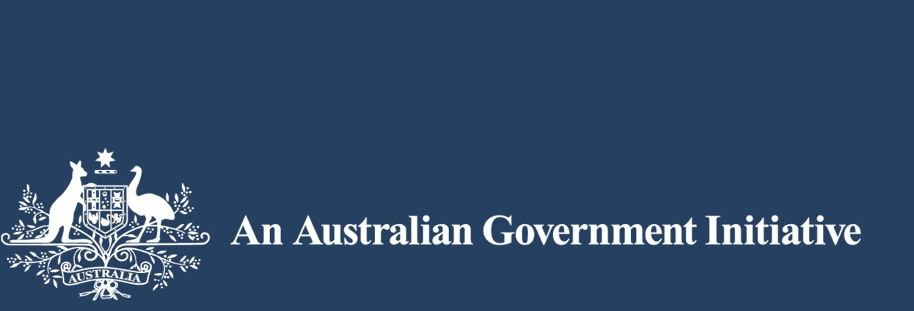

## Page 2

Page 2 of 52
A Monitoring and Evaluation Framework for 
Disaster Recovery Programs 
 
 
 
 
 
 
 
 
 
 
 
 
 
 
 
 
 
 
 
 
 
 
 
 
 
 
 
 
 
 
 
 
 
 
 
 
Dr George Argyrous 
Australia and New Zealand School of Government  
May 2018 
The Australia and New Zealand School of Government Ltd ACN 102 908 118 
PO Box 230 Carlton South Victoria T +61 3 8344 1990 F +61 3 9650 8785 anzsog@anzsog.edu.au anzsog.edu.au

## Page 3

Page 3 of 52
A Monitoring and Evaluation Framework for 
Disaster Recovery Programs 
Table of Contents 
1. 
A Monitoring and Evaluation Framework for Disaster Recovery Programs 
5 
1.1. 
Purpose of this Framework 
5 
1.2. 
What is a disaster recovery program? 
5 
1.3. 
Evaluation and evaluative activity 
6 
1.4. 
Using the Framework 
7 
1.4.1. 
Program staff involved in the design of recovery programs 
7 
1.4.2. 
Disaster recovery practitioners who commission evaluations 
8 
1.4.3. 
Government at all levels 
8 
1.4.4. 
The affected communities 
8 
1.4.5. 
Evaluators 
8 
1.4.6. 
NGOs who might want to evaluate their programs 
8 
1.4.7. 
The research community 
8 
2. 
Disaster recovery outcomes 
9 
2.1. 
Disaster recovery as an outcome 
9 
2.2. 
Steps for taking an outcome-focused approach 
10 
Step 1: Define the community or communities 
11 
Step 2: Select the appropriate outcome(s) 
11 
Step 3: Restate the outcomes so that they are relevant to the affected community 
16 
Step 4: Communicate the intended outcomes 
16 
3. 
Developing a program logic for disaster recovery 
17 
3.1. 
Theory of change 
17 
3.2. 
National program logic for disaster recovery 
18 
3.3. 
Ex ante and ex post program logics 
21 
3.4. 
Steps for devising an ex ante program logic 
22 
Step 1: Develop an outcomes chain 
22 
Step 2: Add activities, resources, and outputs to the outcomes chain 
23 
Step 3: Add relevant elements from the national program logic 
25 
Step 4: Construct a timeline for achieving the program outcomes 
26 
Step 5: Communicate the program logic to relevant stakeholders in an appropriate format 
26 
3.5. 
Developing an ex post program logic 
26 
Step 1: Determine the structure of the program and how it is delivered 
27 
Step 2: Identify the final outcome(s) against which the program will be judged as a ‘success’ or not 27 
Step 3:  Identify any intermediate outcomes that the program activities, either explicitly or implicitly, 
are intended to bring about and how these might lead to the final outcomes. 
27 
Step 4: Communicate the program logic to relevant stakeholders in an appropriate format 
27 
3.6. 
Developing a program logic: Some practical suggestions 
29 
4. 
Outcomes, indicators, and standards of successful recovery 
30 
4.1. 
Standard setting for ‘successful recovery’ 
31 
4.2. 
Outcomes, indicators, and methodologies for data collection 
32 
5. 
Planning an evaluation 
33 
5.1. 
The evaluation focus and scale 
33

## Page 4

Page 4 of 52
A Monitoring and Evaluation Framework for 
Disaster Recovery Programs 
5.2. 
Key evaluation questions 
33 
5.2.1. 
Governance of the recovery process 
33 
5.2.2. 
Community engagement 
34 
5.2.3. 
Effectiveness 
35 
5.2.4. 
Efficiency 
35 
5.2.5. 
Implementation 
35 
5.3. 
Other sources of KEQs 
36 
6. 
Monitoring disaster recovery 
36 
7. 
Presenting, disseminating, and learning from evaluation findings 
37 
7.1. 
Presenting findings 
38 
7.2. 
Disseminating and learning from the evaluation findings 
39 
8. 
Implementation and review of the Framework 
41 
9. 
References 
42 
Appendix 1: Resources for disaster recovery evaluation 
43 
Official government resources 
43 
Disaster recovery literature reviews 
44 
Data collection and methodological literature 
44 
Whole of Government evaluation guidelines 
44 
Appendix 2: Glossary 
45 
Appendix 3: Example of a flyer for community engagement in evaluation 
47 
Appendix 4: Disaster recovery data collection plan template 
48 
Appendix 5: Developing an evaluation plan 
49 
Appendix 6: Monitoring and evaluation summary sheet 
50 
Appendix 7: Our approach to developing this Framework 
51 
Meta-review of previous literature reviews 
51 
Meta-review of official disaster recovery guidelines 
51 
Review of past evaluations 
51 
Facilitated workshops with ongoing expert review 
51 
Peer-review 
52 
Trial of using the Framework to evaluate two recovery programs 
52

## Page 5

Page 5 of 52
A Monitoring and Evaluation Framework for 
Disaster Recovery Programs 
1. 
A Monitoring and Evaluation Framework for 
Disaster Recovery Programs 
Australia is subject to a wide variety of disasters. According to the Commonwealth Government’s Community 
Recovery handbook: “Disasters and emergencies are the result of an interaction between a hazard and a 
vulnerable population that disrupts lives and communities” (2018: 2). These disasters vary in terms of their 
intensity, location, scale, and the extent to which they are human-made or ‘natural’.  
Federal, state and local governments invest heavily to respond to these disasters. This includes efforts to 
prevent and mitigate disasters, emergency response and relief when a disaster happens, and recovery 
programs to rebuild affected communities.  
This Framework relates specifically to recovery from disaster events.  
1.1. 
Purpose of this Framework 
A Monitoring and Evaluation Framework (the Framework) is needed to ensure that disaster recovery programs 
can be evaluated for their effectiveness. By improving the quality of disaster recovery evaluations, 
governments will be able to improve subsequent disaster recovery programs, to the extent that the learnings 
from these evaluations are incorporated into program design and delivery.  
This Framework has been developed in response to recommendation 6(a) of the Review of Commonwealth 
and State/Territory Relief and Recovery Payments: Report to COAG/SCPEM from the Australia-New Zealand 
Emergency Management Committee Recovery Sub-Committee (2012), which was endorsed by COAG in 
2012. Among other gaps and issues, the report highlighted that “jurisdictions and the Commonwealth do not 
measure or report on the effectiveness of their [disaster assistance] programs”. Similarly, the National Strategy 
for Disaster Resilience (COAG 2011) highlights the increasing incidence and cost of disasters in Australia. To 
better deal with the increasing incidence of disasters, the National Strategy affirms a cooperative response 
that emphasizes shared responsibility and empowering communities. 
This Framework provides a consistent approach to the evaluation of any individual disaster recovery program 
that will allow the lessons learned from each program evaluation to feed into an evidence base to improve 
subsequent disaster recovery programs. To achieve this, the Framework provides: 
 
a common understanding of the meaning of ‘disaster recovery’ 
 
a common understanding of what successful disaster recovery ‘looks like’ 
 
a high-level program logic for how successful recovery can be achieved 
 
an evidence base to support disaster recovery planning and evaluation 
 
a list of key evaluation questions that can be addressed in any disaster recovery evaluation 
 
a guide to source, collect, and use data to assess recovery 
 
a guide for disseminating the findings from recovery program evaluations. 
1.2. 
What is a disaster recovery program? 
The word ‘program’ is sometimes used interchangeably with other terms such as ‘project’ or ‘effort’; in this 
Framework, we will use the word program whenever we talk about a set of coordinated activities that have 
disaster recovery as their key objective. A disaster recovery program is a set of activities that deploys resources 
to achieve desired recovery objectives and outcomes. These recovery activities are: 
1 
above and beyond the usual services that government provides to similar communities that are not 
affected by disasters, and

## Page 6

Page 6 of 52
A Monitoring and Evaluation Framework for 
Disaster Recovery Programs 
2 
specifically focused on getting affected communities to a point where they can continue the recovery 
process on their own terms.  
Even though other government programs may contribute indirectly to successful disaster recovery, this 
Framework only applies to programs that specifically have disaster recovery as their core objective.  
The focus of this Framework is on government sponsored recovery programs, recognizing that such programs 
may be implemented by a variety of organisations. Government recovery programs include any activities that 
are ‘sponsored’ by government agencies, even where these activities are delivered by non-government 
organisations (NGOs).  
Recovery programs may operate at different scales. The broadest scale is the entire set of activities that help 
affected communities recover. A recovery program may itself be made up of more discrete programs or 
projects that focus on aspects of the recovery process. For example, a grants program to promote economic 
recovery may be part of a much larger community recovery program. Similarly, projects may be funded to help 
specific groups of people within the community. Evaluation can focus on programs at any (or all) of these 
levels, but it must be made clear at what level the evaluation will focus. For example, the report by the Virginia 
Horticulture Centre, South Australia, Gawler River Flood Recovery Program 2005–2007 (2008) only evaluated 
the horticulture recovery program rather than the entire flood recovery program.  
Given that a broad recovery program will encompass several more targeted programs or projects within it, 
more than one evaluation may be conducted following a single disaster. If this Framework is used as a common 
guide for these evaluations, they can collectively contribute to a shared understanding of how recovery 
programs can be improved. 
1.3. 
Evaluation and evaluative activity 
For the purposes of this Framework, evaluation is any structured evidence-based analysis that draws together 
data (quantitative and/or qualitative) to answer questions about the effectiveness, efficiency, appropriateness, 
and implementation of disaster recovery programs, using clear criteria and standards for assessing the 
‘success’ of the program against desired outcomes. This definition applies to any work that meets this criterion, 
even when not labelled as an evaluation, such as ‘program review’, ‘after action review’, ‘project assessment’, 
‘appraisal’, ‘effectiveness review’, project audit’, or ‘post-implementation review’. 
Routine monitoring information is an important input for answering evaluative questions. Monitoring supports 
evaluation through the collection of structured information on what is being done within programs, the outputs 
of program activity, and how these are contributing to the achievement of recovery outcomes. Routine 
monitoring information can be used by program managers to track progress of a program, adapt the program 
activities to changes in circumstances, and to support accountability.  
Monitoring and evaluation depend on a range of evaluative activities conducted throughout disaster recovery 
planning and implementation and are therefore relevant to a broad range of people involved in disaster 
recovery. Table 1 lists the range of evaluative activity supported by this Framework, and identifies the relevant 
stakeholders involved.

## Page 7

Page 7 of 52
A Monitoring and Evaluation Framework for 
Disaster Recovery Programs 
Table 1: Evaluative activity supported by this Framework 
Evaluative activity 
Who is involved 
Framework section 
Identifying program outcomes  
Senior managers 
Section 2 and database 
Developing a program logic 
Evaluation advisor; program staff; 
funding agencies 
Section 3 
Community needs analysis  
Consultants; evaluators 
Section 2 
Preparing a monitoring and evaluation 
plan  
Evaluators; recovery program staff; 
stakeholders 
Section 9 and database 
Early-stage process evaluation 
Evaluation team 
Section 2-5 
Internal program/project review 
Program staff 
Section 2-5 
Monitoring and reporting progress 
Program staff 
Section 6 
Interim evaluation of program processes 
and progress toward outcomes  
Evaluators 
Section 2-4 
Outcome evaluation of a recovery 
program or its components 
Evaluators 
Whole document 
Disseminating evaluation findings and 
updating database 
Senior managers; program team 
Section 7 and database 
1.4. 
Using the Framework 
1.4.1. 
Program staff involved in the design of recovery programs 
The ultimate test for this Framework is whether it leads to better recovery programs. Over time, recovery 
programs should achieve their desired outcomes in more effective and efficient ways.  
Evaluative thinking is an approach to designing, managing and evaluating programs to improve their 
effectiveness. Evaluative thinking requires an outcome-focus and thinking about appropriate outcomes and 
how a program can be designed to achieve these outcomes. It also involves ensuring that activities and 
resources are aligned with recovery outcomes, program logics are established as planning tools, and data 
collection and monitoring is facilitated through ‘up-front’ evaluation planning. In other words, even if an 
evaluation is not actually conducted for a disaster recovery program, that program will be more successful if 
evaluative thinking is incorporated into the design and implementation phase.1 
Recovery programs will also be improved through the feedback between the knowledge gained from past 
recovery evaluations and the delivery of future recovery programs. The National Disaster Recovery Monitoring 
and 
Evaluation 
Database, 
(https://knowledge.aidr.org.au/resources/national-recovery-monitoring-and-
evaluation/) is the key tool through which this knowledge is captured and made available to help those involved 
in the design of disaster recovery programs. It is therefore essential that program staff (and others) consult the 
database early in the recovery planning phase to draw on the knowledge learned from previous recovery 
evaluations. A guide for this is presented in Box 1. 
 
 
                                                     
 
1 Government staff should also be mindful of the requirements for evaluation planning and program design specified in their respective 
Whole of Government guidelines, which are listed in Appendix 1 of this Framework.

## Page 8

Page 8 of 52
A Monitoring and Evaluation Framework for 
Disaster Recovery Programs 
Box 1: Using the database to learn from the past 
For program designers who are working with a ‘blank page’ to set up a new recovery program, or for program 
designers who have already designed a program and want to learn from past practice, the database provides 
a useful starting point. The following steps provide a guide for finding evaluations of past recovery programs, 
and other relevant resources such as Royal Commission reports. These resources can inform any aspect of 
disaster recovery planning and evaluation: 
1. Go to https://knowledge.aidr.org.au/resources/national-recovery-monitoring-and-evaluation/ 
2. Select Search monitoring and evaluation resources to use the various search options to target the kind 
of resources that you want to find. 
3. Click Search. The results will appear on a new page, the evaluations and other resources listed down the 
page.  
1.4.2. 
Disaster recovery practitioners who commission evaluations 
Providers of recovery program will be able to commission more rigorous evaluations of their programs through 
more focused tender briefs and clearer understanding of evaluation needs. These tender briefs should at 
minimum identify the recovery outcome(s) that the relevant program is trying to achieve. 
1.4.3. 
Government at all levels 
This Framework will help facilitate planning and coordination for disaster recovery at all levels of government 
to ensure that public resources are used effectively. 
1.4.4. 
The affected communities 
The Framework can help affected communities hold the government accountable for delivering recovery 
outcomes by clarifying what these outcomes are and how they can be identified. The Framework can also 
signal to the community the various ways the community can be involved in the recovery process.  
1.4.5. 
Evaluators 
Skilled evaluators will often undertake the evaluation of disaster recovery programs. In many instances these 
will be independent consultants or universities contracted by a government agency. Ideally, these evaluators 
will be involved in the upfront planning of the evaluation, as well as the conduct and reporting of the evaluation. 
It is also expected that evaluators will add their findings and information to the database so that it continues to 
grow and inform future disaster recovery programs. 
1.4.6. 
NGOs who might want to evaluate their programs 
The delivery of recovery programs is not always done by government agencies; non-government organisations 
also play a crucial role. These NGOs, whether funded by government or through their own resources, will also 
be interested in assessing the effectiveness of what they do, and, where possible, this should be consistent 
with the principles laid out in this Framework. 
1.4.7. 
The research community 
Interest in the effectiveness of disaster recovery programs extends beyond those immediately involved in 
funding and delivering the programs. A broader community of people, such as academics, are interested in 
understanding the process of recovery and the factors that support recovery. This Framework can provide 
topics of interest to guide basic and applied research into the area of disaster recovery and, through the 
database, provide material to support this research.

## Page 9

Page 9 of 52
A Monitoring and Evaluation Framework for 
Disaster Recovery Programs 
2. 
Disaster recovery outcomes 
One of the principal objectives of this Framework is to ensure that recovery programs are focused on achieving 
outcomes. For the purpose of this Framework, outcomes refer to: 
 
changes in the knowledge, behaviour, skills, status, and level of functioning, of a group or set of 
individuals; or changes to an institution such as its context and organisational capacity. 
Disaster recovery programs in the past, and the evaluations of them that have been conducted, have usually 
focused on processes and outputs rather than outcomes (Ryan, 2016). Shifting recovery planning to have an 
outcome focus is arguably the single most important change that this Framework can bring about; indeed, the 
other evaluative activities listed in Table 1 depend on this outcome focus. 
Clear statements about disaster recovery outcomes will: 
 
assist the design of recovery programs through a clear and consistent understanding of what disaster 
recovery programs should achieve 
 
focus the evaluation of recovery programs around common notions of success and the types of 
activities that will help achieve it. 
2.1. 
Disaster recovery as an outcome 
The objective of disaster recovery programs is to help communities reach a point where they are sustainable 
and resilient. By achieving these objectives, the government can withdraw from the recovery process and allow 
the community to manage its own recovery. 
The terms ‘sustainable‘ and ‘resilient’ are used widely in recovery literature, but not always with the same 
meaning. For the purposes of this Framework, these terms are defined in the following way: 
1. A sustainable community has the capability to manage its own recovery, without government 
disaster-related assistance. In other words, if government disaster-related programs are withdrawn, 
the recovery process in a sustainable community will continue; the gains achieved during the 
government-assisted phase will not stop or reverse. 
2. A resilient community is better able to withstand a future disaster. A successful recovery process 
“promotes practices that minimize the community’s risk to all hazards and strengthens its ability to 
withstand and recover from future disasters, which constitutes a community’s resilience” (FEMA 2011, 
National Disaster Recovery Framework, 11). An example of building disaster resilience is illustrated 
by the Queensland Government's response to Tropical Cyclone Oswald, which included programs to 
reduce the impact of future floods on soil erosion (see www.youtube.com/watch?v=syplVTHjuRU for 
a presentation of this example). 
Box 2 provides an example of a program designed to improve a community’s sustainability and resilience. The 
Brush with Kindness program aimed to make the community sustainable by restoring affected homes so that 
they are in a liveable condition. It also built resilience by training local volunteers to respond to any future 
disasters that reduce the liveability of homes.

## Page 10

Page 10 of 52
A Monitoring and Evaluation Framework for 
Disaster Recovery Programs 
Box 2: Supporting a sustainable and resilient community through recovery programs 
As part of providing recovery support for the South Australian Sampson Flat and Pinery fires recovery, Habitat 
for Humanity recognized a need to engage with and recruit volunteers to enhance their ability to respond 
effectively and quickly to future disasters. 
Through a South Australian Natural Disaster Resilience Program (NDRP) grant, Habitat for Humanity was 
funded to deliver the Brush with Kindness program to build volunteers’ capability for disaster recovery. Brush 
with Kindness recruits and trains volunteers to go into the homes of people who are experiencing hardship and 
complete minor work to get these homes into a liveable condition. 
Volunteers are recruited to provide services in the immediate term with Brush with Kindness, but with the 
understanding that when the next disaster strikes they will be mobilized as trained and experienced volunteers 
to the affected community. Habitat for Humanity believe this will improve the community’s capability, in the 
event of another disaster, to respond straight away and 'hit the ground running'. 
 
Resilience and sustainability are separate objectives of disaster recovery programs. They may overlap in 
important respects, but may not be achieved at the same time. In some instances, there may be a trade-off 
between resilience and sustainability. For example, to become more resilient a community may have to 
compromise its economic sustainability by relocating some industries to locations that are safer but slightly 
more remote. 
The rest of this section details the steps involved in taking an outcome-based approach to disaster recovery. 
These steps should involve a range of people who bring a variety of perspectives and knowledge about what 
recovery programs should achieve. Some of these people might be:  
 
funding agencies and program sponsors 
 
recovery experts in relevant agencies 
 
the expert or academic community for that recovery context 
 
agency-level evaluation experts 
 
members or leaders of the affected community and specific groups within it 
 
service delivery teams 
 
interest and advocacy groups 
 
local government recovery officers. 
2.2. 
Steps for taking an outcome-focused approach 
To take an outcome-focused approach in disaster recovery planning and evaluation, the following series of 
steps can be followed: 
1. Define the community or communities. 
2. Select the appropriate outcome(s). 
3. Restate the outcomes so that they are relevant to the community. 
4. Embed the outcomes into relevant documents.

## Page 11

Page 11 of 52
A Monitoring and Evaluation Framework for 
Disaster Recovery Programs 
Step 1: Define the community or communities 
The affected community is not always coincident with a clear geographic area, such as the region physically 
impacted by the disaster. It can also include people outside the impact region, such as people who are 
bereaved due to loss or emotional attachment with the affected area. As the Community Recovery Handbook 
(2018: 5) states: 
When identifying disaster-affected communities or parts of a community, it is also important not to be 
restrictive in how affected communities are defined. Caution needs to be exercised so that the process 
does not alienate people who, although not appearing to be obviously affected, may be experiencing 
consequences from the disaster. These people may include those who have witnessed an event, 
helped others affected, become distressed by hearing information about the emergency or felt they 
were at potential risk of the emergency (even if that risk did not eventuate). 
Evaluators should draw on the guide for identifying the relevant community in the Community Recovery 
Handbook (2018: 5) when developing evaluation plans. A summary of what makes up an evaluation plan is 
presented in Appendix 5. 
Step 2: Select the appropriate outcome(s) 
Sustainable and resilient communities exist when they are characterized by specific disaster recovery 
outcomes. A list of these has been developed in consultation with a wide group of stakeholders at a national 
level, presented in Tables 2–6. This nationally agreed list of outcomes is the starting point for identifying what 
is the ultimate objectives of a recovery program, or component of a recovery program.  
These recovery outcomes are organized around the four domains from the Community Recovery Handbook: 
Economic, Social, Built, and Environment. There are several outcomes, however, that cannot be identified 
directly with a single domain, but rather are essential to all of them, which are presented in Table 2. 
 
Table 2: Overarching recovery outcomes 
Description 
Broad, overarching outcomes that affect more than one of the recovery domains 
Sustainability outcomes 
 
Displaced populations can return to the community if they prefer to return.  
 
The needs of vulnerable groups are addressed in disaster recovery. 
 
The community is aware of the disaster recovery processes. 
 
The community can express its changing disaster recovery needs. 
 
Government, private sector and civil society and organisations are engaged in plans for mitigation 
and management of the recovery. 
Resilience outcomes 
 
Community members are aware of the risks of future disasters.  
 
The community has access to insurance (covering lives, homes and other property) through 
insurance markets or micro-finance institutions, where appropriate and viable.

## Page 12

Page 12 of 52
A Monitoring and Evaluation Framework for 
Disaster Recovery Programs 
Table 3: Economic recovery outcomes 
Description 
The local economy is the system whereby the affected community’s material and service needs are met 
through appropriate labor and employment, business development, land use, financial resources, and 
interaction with the broader economy. It sustains the livelihoods of the members of the community and 
contributes to the broader economy (see the Community Recovery Handbook, 2018: 102). 
Sustainability objectives 
Sustainability outcomes 
Economy as a whole is functioning 
 
Local business networks foster growth 
 
Economic activity is appropriately diverse 
 
Key industry sectors for the community are restored 
Community members can meet their 
material and service needs and 
participate in the economy 
 
Households have access to an adequate range of goods 
and services  
 
Individuals and households have sufficient financial 
security to allow them to take advantage of economic 
opportunities  
 
Community members have access to banking and financial 
services  
 
Vulnerable groups are not further disadvantaged by the 
impact of the disaster, in terms of their ability to participate 
in the economic system (e.g. employment prospects, 
accessing credit) 
Businesses and industries in the local 
economy can operate and trade in line 
with broader economic trends 
 
Consumer and business confidence levels support 
business operations (both within and outside of the 
community)  
 
Business models are appropriately adaptive to market 
conditions and fluctuations  
 
Local businesses have information they need to continue 
recovering from the disaster  
 
Early-stage and small businesses have the capacity to 
continue operation  
 
Businesses and not for profits can access or attract 
appropriately skilled workers  
 
Business and not for profits have access to critical banking 
and financial services  
 
Not-for-profit community service organisations can 
continue to provide regular services 
 
Businesses have secure and stable access to supply 
chains and networks (including markets, physical 
infrastructure and assets, as well as telecom networks) 
Resilience objectives 
Resilience outcomes 
Business and not for profits have in 
place adequate mitigation practices for 
risks and threats 
 
Businesses and not-for-profits have business continuity 
plans and dynamic organisational resilience practices that 
address relevant risks and threats 
 
Business insurance is accessible where viable 
 
Businesses and not-for-profits know and understand the 
risks and threats of operating in the area 
The economy is sufficiently flexible and 
adaptable to shocks 
 
Economic activity is appropriately diverse 
 
The workforce has transferable skills

## Page 13

Page 13 of 52
A Monitoring and Evaluation Framework for 
Disaster Recovery Programs 
Table 4: Social recovery outcomes 
Description 
The social domain is defined by “relationships and connected by networks of communication ... [it] 
consists of individuals, families and common interest groups that form whole communities” (Community 
Recovery Handbook, 2018: 79). 
Sustainability objectives  
Sustainability outcomes 
Adequate housing is available to 
community members at appropriate 
times in the recovery process 
 Community members have access to appropriate and 
affordable housing in a timely manner 
Community members have access and 
can meet health needs (including mental 
health) arising from the disaster 
 Community health levels are appropriate for the community 
profile 
 Existing health clients receive continuity of their care e.g. 
pharmaceutical supplies 
 Community members have the knowledge, skills, and 
resources for dealing with health issues related to the 
disaster experience 
 Community members can access appropriate services to 
deal with health needs 
 The community is not experiencing excessive stress and 
hardship arising from the disaster 
 The community has access to clean drinking water and 
basic food supplies 
 The community has access to adequate sewerage and 
sanitation services 
Community members have access to 
psychosocial support 
 Community members have social networks to support each 
other 
 Cultural and racial diversity is respected 
 The community can express its diverse spiritual 
composition 
 The community has opportunities for creative expression 
that help the community recover from disaster 
 Leisure, sport and artistic activities are part of the fabric of 
the community 
Households, families, and individuals 
can act autonomously to contribute to 
the recovery process 
 Households, families, and individuals have the information 
needed to make decisions 
 Households, families, and individuals are enabled to affect 
their own recovery through appropriate income sources 
Community members have access to 
education services 
 Community members receive continuity in the education 
services they need 
Community members have access to 
appropriate and coordinated social 
services 
 Community members receive appropriate social services 
 Displaced populations are reconnected with essential 
health and social services 
Community members feel sufficiently 
safe and secure following a disaster to 
engage in social activities and 
interactions with other members of the 
community 
 Possibilities for crime and social disorder because of the 
disaster are minimized 
 Community members can manage their own safety

## Page 14

Page 14 of 52
A Monitoring and Evaluation Framework for 
Disaster Recovery Programs 
Resilience objectives 
Resilience outcomes 
The community has improved capacity 
and capability to respond to future 
disasters 
 Community members are aware of each other’s potential 
needs from future disasters through formal and informal 
networks and plans (i.e. social connectedness) 
 Community members can respond to their own needs and 
can support the needs of other members of the community 
 Mutual assistance systems, social networks and support 
mechanisms can adapt to emergencies when these occur 
 Community members have the knowledge, skills, and 
resources, for dealing with disaster related health risks 
(e.g. hygiene, sanitation, nutrition, water treatment) 
 
Table 5: Environmental recovery outcomes 
Description 
‘[The] effects of disaster on the natural environment are considered in terms of the ecosystem 
components: air, water, land and soil (and organic matter, plants and animals” (Community Recovery 
Handbook, 2018: 114). 
Sustainability objectives  
Sustainability outcomes 
The environment has returned to 
pre-disaster state, or to a state that is 
acceptable to the community 
 
The community’s exposure to environmental health 
risks and public health risks is minimized 
 
The natural environment operates to maintain healthy 
biodiversity and ecosystems 
 
Cultural heritage sites or assets of importance are 
restored, where possible, in a way that provide these 
values to the community 
Resilience objectives  
Resilience outcomes 
The risk of adverse impacts of future 
disaster on the environment is 
minimized 
 
The impact of future disasters on biodiversity and 
ecosystem is minimized 
 
The community is aware of the risks of future disasters 
to natural and cultural heritage assets 
 
The community understands the characteristics and 
functioning of local natural environment and 
ecosystems

## Page 15

Page 15 of 52
A Monitoring and Evaluation Framework for 
Disaster Recovery Programs 
Table 6: Built environment recovery outcomes 
Description 
“The built environment is broadly defined as those human-made assets that underpin the 
functioning of a community” (Community Recovery Handbook, 2018: 92). 
Sustainability objectives  
Sustainability outcomes 
Infrastructure that relates to the 
provision of services to the community 
by infrastructure owners/operators, 
including water, sewerage, electricity 
and gas, transport, telecommunications 
 
Provide infrastructure that delivers 
essential services to the community 
 
Infrastructure is built in accord with 
changing recovery needs 
 
Local infrastructure is appropriately 
integrated with wider state and 
commonwealth infrastructure 
Infrastructure that relates to education, 
health, justice, welfare and any other 
community infrastructure/buildings that 
support the community (private or 
public owned assets) 
 
Infrastructure is built in accord with 
changing recovery needs 
Private infrastructure, including 
residential, commercial/industrial and 
rural assets 
 
Infrastructure is built in accord with 
changing recovery needs 
Resilience objectives  
Resilience outcomes 
Infrastructure is rebuilt to reduce to a 
reasonable degree the impact of future 
disasters on communities 
 
Infrastructure is built with regard to local 
disaster risks 
 
Infrastructure is built in accord with current 
knowledge and practices for mitigating 
disaster impact 
 
To illustrate how to select recovery outcomes we can refer to the Brush with Kindness example in Box 2. This 
program aims to achieve two outcomes from the social domain. One is a sustainability outcome: ‘Community 
members have access to appropriate and affordable housing in a timely manner’. The other is a resilience 
outcome: ‘Community members can respond to their own needs and can support the needs of other members 
of the community’. Note, however, some programs may not have both sustainability and resilience outcomes; 
the selection of outcomes from the tables will depend on the program objectives. 
This example highlights that, depending on the scale of the program to be evaluated, not all the outcomes 
listed in these tables will be relevant. In some instances, such as this example (i.e. a small-scale program 
funded by a grant) only one or two outcomes may be relevant.  
When selecting outcomes, program designers may wish to identify which of the selected outcomes are those 
against which the program will be evaluated, and those outcomes the program might bring about but which 
are not considered as crucial to judging the program’s success. For example, in addition to the primary 
outcomes for the Brush with Kindness program in Box 2, this program might also try to achieve ‘Community 
members have social networks to support each other’. By identifying at the planning stage this ‘secondary’ 
outcome as something that is desirable, the program might be redesigned in some way to increase the chance 
of achieving this secondary outcome, along with the primary ones. In other words, some final outcomes may 
be considered more important than others, based on how crucial each outcome is to the success of the 
program.

## Page 16

Page 16 of 52
A Monitoring and Evaluation Framework for 
Disaster Recovery Programs 
Step 3: Restate the outcomes so that they are relevant to the affected community 
The list of Framework outcomes presented in Tables 2–6 use generic terms such as ‘infrastructure’ and 
‘community members’. As an overarching Framework that can be applied to a variety of disaster types, it is 
not possible for these to be more specific. Thus, after having selected one or more of the Framework outcomes 
from the list, the next step is to restate these Framework outcomes according to the context to which they are 
being applied. An example is provided in Table 7, where one of the outcomes from the environment domain is 
restated in a way that makes it program specific. 
Table 7: An example of restating an outcome for a specific recovery program 
Framework outcome (from Tables 2–6) 
Program specific version of the outcome 
(restated in terms of the specific context for a 
recovery program) 
The community is aware of the risks of future 
disasters to natural and cultural heritage assets 
Residents living near the town hall know how to 
reduce the hall’s vulnerability to future bushfires  
 
This restatement of a Framework outcome involves identifying the particular cultural heritage asset (i.e. the 
town hall) and also the particular community members to whom this outcome applies (i.e. residents living near 
the hall). Such a restatement of Framework outcomes into program specific terms will help focus the 
evaluation.  
A different disaster recovery program may target the same Framework outcome, but will restate it in different 
terms depending on the asset in question and the composition of its community. But where program specific 
outcomes are all forms of the same Framework outcome, some comparison and learning can occur across the 
evaluations of these separate disaster recovery programs. 
Identifying program specific outcomes is also the point at which the needs of vulnerable groups in the 
community can be identified, as emphasized by the Community Recovery Handbook (2018). It is essential that 
these outcomes are recast, where relevant, to identify any vulnerable individuals or groups that are “likely to 
be more susceptible to loss, or to have less resilience than other individuals and groups” (Community Recovery 
Handbook, 2018: 38). For more detailed guidance on how to assess recovery outcomes for vulnerable groups, 
the 
Vulnerable 
Sections 
of 
Society 
(an 
emergency 
management 
perspective) 
report, 
https://knowledge.aidr.org.au/media/5938/vulnerable-sections-of-society-anzemc.pdf should be consulted). 
Step 4: Communicate the intended outcomes  
Program outcomes can be used in various ways to indicate the intent of the program. To develop a shared 
understanding of the program’s objectives, the intended outcomes developed through the preceding steps 
should be communicated to relevant groups and expressly used in a variety of important documents. These 
include: 
1. Relief and response teams. If it’s possible to identify intended recovery outcomes while relief and 
response efforts are still underway, these can be communicated to the relief and response teams.  
These teams will thereby be able, to the extent that it is practical, to have recovery outcomes in mind 
so that their efforts can support, or at least not hinder, later recovery efforts. 
2. Strategic Recovery Plans. Stating outcomes will give a clear focus and purpose to recovery program 
implementation. Indeed, best practice will be to develop a combined Strategic Recovery and 
Evaluation Plan.  
3. Communication documents to the community. Inherent to the objective of community led recovery is 
the notion that the community is appropriately informed and involved from the early stages of recovery. 
It is essential that the community knows the outcomes that the program is trying to achieve; indeed, 
developing the intended outcomes can be done jointly with the community. 
4. Evaluation tender documents. Evaluations, especially where the work will be contracted to consultants 
must be guided by the intended recovery outcomes. Tender briefs, approaches to market, and other

## Page 17

Page 17 of 52
A Monitoring and Evaluation Framework for 
Disaster Recovery Programs 
related documents should cite these outcomes so that consultants can plan evaluations with these 
outcomes in mind. 
5. Service delivery organisations. Disaster recovery programs are often delivered by a variety of 
organisations, including non-government organisations (NGOs). These organisations should work 
toward achieving the desired program outcomes. For example, a grant program may state the intended 
outcome(s) in grant application documents and ask applicants to describe how they will achieve the 
outcome(s) with the funding.  
 
3. 
Developing a program logic for disaster 
recovery 
Once program outcomes have been determined, the next major task is to construct a program logic. A program 
logic provides a ‘map’ of the key elements that constitute the program, and how they contribute to achieving 
the intended outcomes. A program logic is a useful planning tool for program design, and a guide for evaluation, 
by setting out how the specific set of activities and resources deployed in a recovery program will achieve the 
intended outcomes. But before we discuss the steps involved in constructing such a program logic, it is 
important to understand some of the nationally agreed principles of disaster recovery that can inform the 
development of a specific program logic. 
3.1. 
Theory of change 
A program logic captures in a diagrammatic form some underlying understanding – theory of change – about 
what it takes to achieve ‘successful’ recovery. Based on the principles in Community Development in Recovery 
from Disaster (Emergency Management Australia 2003) and the National Principles for Disaster Recovery 
(Social Recovery Reference Group 2018) the theory of change that guides this program logic can be 
summarised as community-led/government-assisted recovery. By placing affected communities at the 
center of the recovery process, the role of government takes on a specific meaning. In particular, it highlights 
that government activities support and facilitate recovery by building community capability, and that there will 
be a stage at which recovery can continue without government assistance. 
This theory of change captured in the National Principles for Disaster Recovery states that successful recovery 
relies on the following activities: 
 
Understand the context. Successful recovery is based on an understanding of the community context, 
with each community having its own history, values and dynamics. 
 
Recognize complexity. Successful recovery is responsive to the complex and dynamic nature of both 
emergencies and the community. 
 
Use community-led approaches. Successful recovery is community-centred, responsive and flexible, 
engaging with community and supporting them to move forward. 
 
Coordinate all activities. Successful recovery requires a planned, coordinated and adaptive approach, 
between community and partner agencies, based on continuing assessment of impacts and needs. 
 
Communicate effectively. Successful recovery is built on effective communication between the 
affected community and other partners. 
 
Acknowledge and build capacity. Successful recovery recognises, supports and builds on individual, 
community and organisational capacity and resilience. 
Disaster recovery programs must contribute to building a community’s capability to manage the recovery 
process once the government assistance has been withdrawn, and it is the extent to which program activities 
have developed this capability that will be the benchmark for judging success.

## Page 18

Page 18 of 52
A Monitoring and Evaluation Framework for 
Disaster Recovery Programs 
Aspects of this theory of change worth noting are: 
1. Recovery continues even after communities become sustainable and resilient, and the government is 
no longer involved in any substantial way. In other words, government assistance is not aimed at 
restoration or returning communities to ‘normal activity’ or a ‘pre-disaster’ state, but to getting them to 
a state of affairs whereby communities continue the recovery processes themselves. 
2. There is not a sharp transition between the government-assisted recovery phase and the phase where 
recovery continues without government assistance. 
3. Disaster recovery might provide the opportunity to help communities go beyond the requirements of 
sustainability and resilience. The extent to which this happens can be an evaluative criterion for 
‘successful’ recovery. Evaluations might investigate whether the program assisted communities to go 
beyond recovery, but this will not usually be an assessment of the success of the program. 
3.2. 
National program logic for disaster recovery 
The principle of community-led/government-assisted recovery, and how recovery programs try to achieve this 
is presented in Figure 1 which captures, at a highly-aggregated level, the major outcomes and the broad factors 
that will contribute to the achievement of recovery outcomes, regardless of the specific disaster recovery 
program being evaluated. This national program logic embodies the following narrative for how recovery 
programs ‘work’.  
Disaster-affected communities functioned in a particular way prior to the event, and this includes any previous 
experience with disaster recovery, and the community’s pre-disaster capability to manage its development.  
Following a disaster, and once response and relief efforts have dealt with the immediate emergency, recovery 
programs will be designed and implemented with the aim of building the community’s capability to manage its 
own recovery process. The National Principles for Disaster Recovery will guide how the program is 
constructed. This will include a governance structure to oversee the government-assisted phase of recovery 
that involves the community in the decision-making process.

## Page 19

Page 19 of 52
A Monitoring and Evaluation Framework for 
Disaster Recovery Programs 
Figure 1: A high-level national program logic for disaster recovery 
 
In response to the changing nature and extent of the disaster, and in response to changes in the external 
environment affecting the community, disaster recovery programs will be re-assessed. This re-assessment will 
ensure the activities are delivering the desired outcomes across four domains: economic, social, environment, 
and built; and that outcomes ‘work together’ to ensure that the community is sustainable and resilient. For 
many recovery programs, the government-assisted stage might itself be broken down into distinct but 
overlapping phases. For example, it is not uncommon to delineate an early recovery phase that emphasizes 
the transition from response to recovery efforts, such as Figure 5, from the Community Recovery Handbook 
(2018: 32).

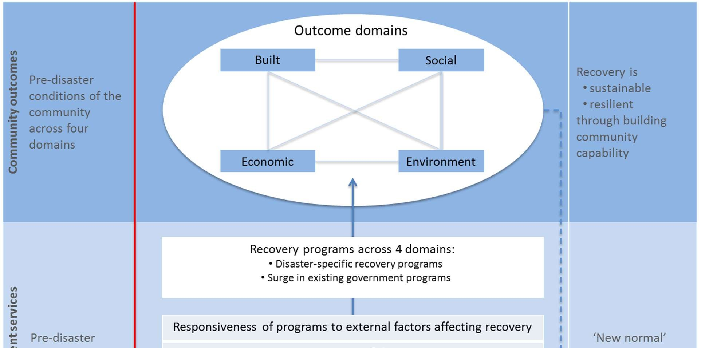

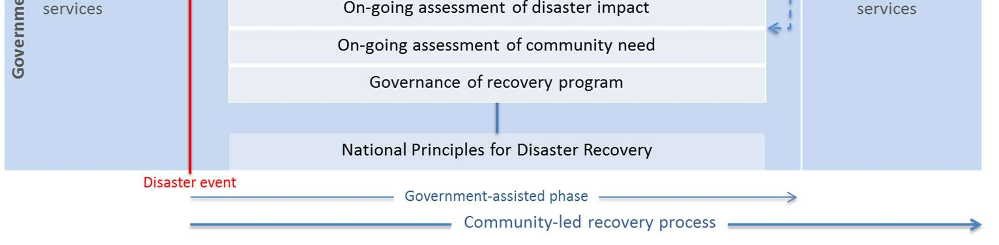

## Page 20

Page 20 of 52
A Monitoring and Evaluation Framework for 
Disaster Recovery Programs 
Figure 2: Effect of disaster on ongoing community development and interface with relief and 
recovery 
 
If these outcomes are achieved so that the community can manage its own recovery, government services 
can return to some ‘new normal’ level. The term ‘new normal’ has been used in slightly different ways in the 
past (e.g. Ellis et al 2004: 176; Winkworth 2007: 81; Archer et al 2015: 31; Ryan et al 2015b: 18), all of which 
emphasize the idea of government services operating at a level that is consistent with a similar community not 
affected by disaster. In other words, ‘surge’ activity, whereby pre-disaster services are expanded to meet 
recovery needs, and disaster specific recovery programs, are no longer necessary for the community to 
function. There may be limited disaster recovery activities that persist even after the government-assisted 
phase has finished, for example, to deal with chronic health problems arising from the disaster for a small 
segment of the community. But overall, the type of government programs that are available to the community 
as ‘new normal’ will not be characterised by the needs of disaster recovery.  
These ‘new normal’ services may be different in type and level to the services that were in place before the 
disaster. The aim is not necessarily to ‘restore’ the community to where it was before the disaster, nor to 
necessarily use the recovery context to ‘build back better’ (although that may be something that governments 
want to do). As the NSW Emergency Management Plan states, recovery is about “returning an affected 
community to its proper level of functioning” (2011: 32), and it might be appropriate for the community to 
operate at some other level or in a different way than that which existed prior to the disaster. The principal aim 
is to equip the community and identify a point where it can manage the continuing recovery process without 
the need for special services or for increases to services that previously existed. 
A program logic at this level of abstraction is not a prescription for how disaster recovery programs are to be 
designed. The specific way in which individual programs are designed to achieve these outcomes, for any 
disaster, cannot be prescribed in advance. The program logic in this Framework is an archetype that articulates 
a nationally agreed, consistent approach to achieving disaster recovery.  
Some specific features of the program logic in Figure 1 are worth pointing out in more detail to help the 
development of specific program logics for individual disaster recovery programs: 
 
The four outcome domains are not presented in any hierarchical fashion in Figure 1; program logics 
for specific disasters should assess whether in a particular disaster context, a sequential ordering of 
these outcome domains is appropriate.

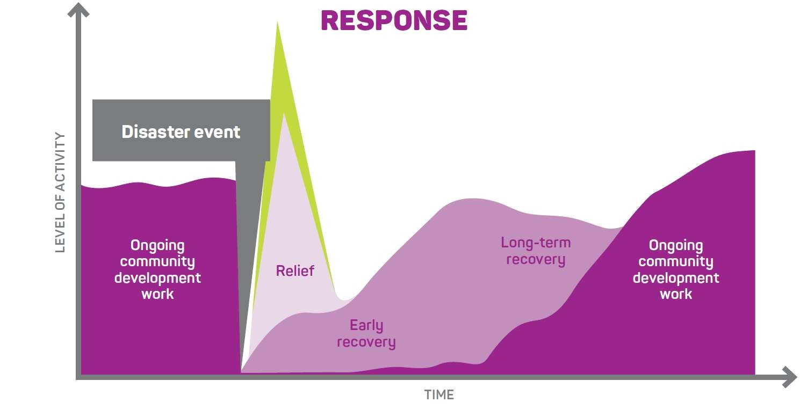

## Page 21

Page 21 of 52
A Monitoring and Evaluation Framework for 
Disaster Recovery Programs 
 
The process of achieving the community-led recovery outcomes is not linear; there must be an iterative 
process of program redesign as the recovery process unfolds. There may be distinct ‘peaks’ and 
‘troughs’ in the level of disaster recovery programs as community needs change and evolve. Some 
outcomes may be achieved earlier than others or may in fact be ‘enablers’ that are preconditions for 
the achievement of other ‘ultimate’ outcomes.  
 
Two types of recovery programs are separately identified. One is the set of activities that are 
specifically designed to assist the community to recover (disaster-specific). The other set comprises 
existing programs that are provided to the community, but which receive extra (‘surge’) resources or 
functions so that they can contribute to the recovery process. 
 
Governance of a recovery program is itself a key activity that must be examined as part of an 
evaluation. Part of this will include the extent to which the community has been involved in governing 
the recovery program, and also the coordination of the response efforts with recovery. 
 
The coordination and communication between recovery and relief efforts will be a major element 
affecting the success of recovery efforts. 
3.3. 
Ex ante and ex post program logics 
The rest of this section will work through the steps for devising a program logic for a recovery program. These 
steps will vary depending on whether the program logic is being developed ‘up front’, or ex ante, as part of the 
program planning stage. This is considered best practice, especially by the recent whole of government 
guidelines for evaluation (see Appendix 1). Developing program logics at this early stage of the program cycle 
will not only allow better evaluations, but will also interact with recovery planning to improve the delivery of the 
program itself. 
However, it is not always possible to develop program logics prior to program implementation. For example, 
the need to deliver a recovery program in a timely manner may not allow the time needed to develop a logic 
for that program, especially if the capability to devise it is not readily available. In such situations, an ex post 
program logic is still desirable, whereby the program logic is devised after the program has been designed, 
and possibly even after it has been implemented.  
We will begin with the steps for an ex ante program logic, given that this is seen as best practice, and then 
follow with the steps for an ex post program logic, acknowledging that the latter situation is probably the one 
that practitioners will encounter most often in practice. In either case, the final program logic will illustrate the 
program characteristics in the same way. 
Before detailing the steps involved in constructing a program logic, we should note that in practice these steps 
are not always followed in a strict linear way. It is usually the case that there is an iterative process whereby 
the planning of outcomes, activities, resources, and outputs occur simultaneously and interact with each other. 
This is necessarily the case for something as complex as a disaster recovery plan (Rogers 2008), that 
inherently requires some element of creativity and input from multiple sources, which may include government 
recovery agents, evaluation experts, members of the affected community, and funding bodies. Thus, while we 
present these steps conceptually as distinct and sequential, so that those unfamiliar with them can understand 
each one separately, in practice these steps will often have considerable overlap.

## Page 22

Page 22 of 52
A Monitoring and Evaluation Framework for 
Disaster Recovery Programs 
3.4. 
Steps for devising an ex ante program logic 
The following lists the steps for devising an ‘up front’, or ex ante, program logic for a recovery program, or for 
some smaller component of a larger program: 
 
Develop an outcomes chain. 
 
Add activities, resources, and outputs. 
 
Add relevant elements from the national program logic. 
 
Construct a timeline for achieving the program outcomes. 
 
Communicate the program logic to relevant stakeholders in an appropriate format. 
Step 1: Develop an outcomes chain 
In the previous section, we discussed the process of selecting outcomes that will define ‘successful recovery’ 
for a program. A program logic needs to show how the achievement of these final outcomes will emerge from 
the achievement of other outcomes that are necessary steps to the final ones. This is the development of an 
outcomes chain, which shows the sequence of earlier outcomes that will have to be realized for the final 
outcomes to emerge. In other words, recovery planning may have to bring about outcomes in a causal and 
sequential way before the final outcomes appear. Sometimes these earlier outcomes in the chain are described 
as ‘enabling’ or ‘intermediate’ (as opposed to ‘ultimate’ or ‘final’); in other instances, they are grouped into 
‘short term’ and ‘medium term’, as opposed to ‘long term’ outcomes. 
Based on the high-level program logic in Figure 1, these earlier, enabling outcomes, will often involve building 
the capability of communities to manage the recovery process. For example, one part of a larger recovery 
program may identify the following Framework outcome as its ‘target’: community members are better able, in 
the event of a future disaster, to respond to their own needs, and can support the needs of other members of 
the community.2  The program specific version of this Framework outcome (from Step 3 in the previous section) 
is ‘community members assist each other to write documented emergency plans’ (DEPs). The program 
objective is for DEPs not to be 'done by government' for households, but for households to create DEPs for 
themselves and for each other. To prepare such emergency plans, recovery program designers believe that 
the community must first be aware of the importance of having a DEP. They must then know what goes into a 
DEP and have resources to help them develop a DEP for themselves and each other. This casual sequence 
is represented as an outcomes chain in Figure 3. 
Figure 3: An outcomes chain example 
 
                                                     
 
2 This example is based on the Queensland Community Preparedness Survey November 2013 – Household Preparedness for Natural 
Disasters, 2013: 24, www.disaster.qld.gov.au/dmp/Archive/ 
Pages/QLD-Preparedness-Survey.aspx.

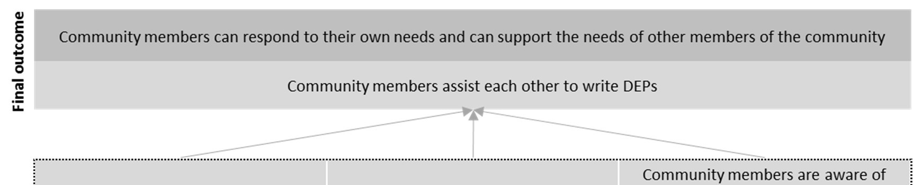

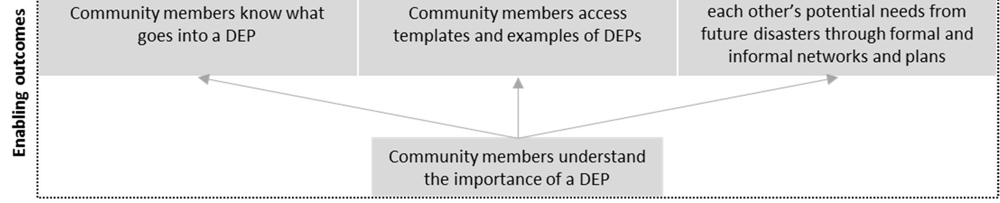

## Page 23

Page 23 of 52
A Monitoring and Evaluation Framework for 
Disaster Recovery Programs 
This outcomes chain has two features worth noting. The first is that one of the enabling outcomes (Community 
members are aware of each other’s potential needs from future disasters through formal and informal networks 
and plans) is a Framework outcome from Table 4, which supports the realization of the final outcome. The 
second is that other outcomes had to be developed that are not in Tables 2–6. Because of the variety of 
recovery programs that may be implemented, it is not possible to list all the possible outcomes that they might 
need to bring about. 
Step 2: Add activities, resources, and outputs to the outcomes chain 
The previous step gives program design and evaluation an outcome-focus. A program logic, however, also 
identifies the activities, resources, and outputs that are intended to bring about these outcomes. These terms 
are defined in Table 8. 
Table 8: Elements of a program logic – Definitions 
Term 
Definition  
Outcomes 
Changes in knowledge, behavior, skills, status, and level of functioning, of a group or 
set of individuals; or changes to an institution such as its context and organisational 
capacity 
Resources 
The inputs, such as staff, funding, and materials that are used to deliver program 
activities 
Activities 
Things the program does with available resources to meet its objectives 
Outputs 
Direct products of the program’s activities that can be used as evidence that the 
program was implemented 
 
For the example of achieving resilience through DEPs, separate activities might be undertaken to achieve 
each of the enabling outcomes. Each of these activities will require resources and may lead to specific outputs, 
such as DEP templates. A program logic that captures this information (and builds on the outcomes chain), is 
presented in Figure 4.

## Page 24

[Type her e]
 
  
  
  
  
ssss 
Page 24 of 52
A Monitoring and Evaluation Framework for 
Disaster Recovery Programs
Figure 4: A program logic for a Documented Emergency Plans program

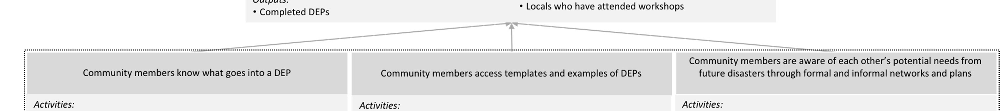

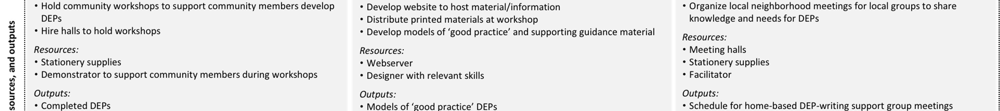

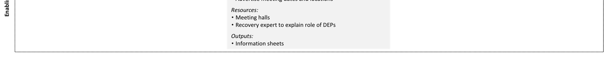

## Page 25

[Type her e] 
 
  
  
 
  
  
ssss 
Page 25 of 52
A Monitoring and Evaluation Framework for 
Disaster Recovery Programs 
A starting point for devising program activities and resources to achieve the intended outcomes is the database 
(https://knowledge.aidr.org.au/resources/national-recovery-monitoring-and-evaluation/) This database draws 
on an extensive review of past disaster recovery programs to facilitate better program design and program 
evaluation in the future. One of its principal uses is as a starting point for program design; the database 
identifies activities that have been used in the past to try and achieve selected outcomes. Box 3 provides a 
guide for using the database to help design outcome-focused recovery programs. 
Box 3: Using the database to think about program activities  
For program designers who are working with a ‘blank page’ to set up a new recovery program, or for program 
designers who have already designed a program and want to refine it based on past practice, the database 
provides a useful starting point. The following steps provide a guide for using the database: 
1. 
Go to https://knowledge.aidr.org.au/resources/national-recovery-monitoring-and-evaluation/. 
2. 
Select Disaster Recovery Outcomes Search and select the desired outcomes that your program is 
intended to achieve from the list provided under the relevant domain(s). 
3. 
Click View Activities and Indicators at the bottom of the page. 
4. 
The results will appear on a new page, with activities listed under each of the selected outcomes.  
5. 
You can refine the list of activities based on criteria relevant to your program, by clicking Show Filters. 
For example, if you are designing a recovery program for a flood disaster, you can choose Flood 
under the Disaster Types drop-down menu. 
6. 
Not all of these listed activities will be relevant to your program; they are simply a record of what has 
been done in the past. You need to look at past evaluations, reviews, or other assessments of recovery 
programs contained in the database, to decide which of these activities were actually effective and 
which you should build into your program. 
 
The program logic in Figure 4 shows how the capability of community members to develop and document 
emergency plans is brought about. It reflects the underlying principle of community-led/government-assisted 
recovery because it shows that when enough community members have developed the capability for 
developing DEPs they can then act as a community resource to help others do the same so that government 
programs can be withdrawn. The objective is to get to a point where the special government programs, such 
as information sessions, can be withdrawn, and households continue to develop DEPs without this aspect of 
the recovery program.  
Step 3: Add relevant elements from the national program logic 
Where possible, a program specific program logic such as that in Figure 4 should illustrate how it is applying 
the general principles represented in the program logic discussed earlier (Figure 1). Central to this is the need 
to show how the program is achieving community-led/government-assisted recovery. Other possible factors 
that a specific program logic may include are:  
 
How the program is being governed, and the role of the community in this governance 
 
How community need is being assessed and reassessed, especially in relation to the changing impact 
of the disaster 
 
How external factors beyond the control of the program may affect the desired outcomes.

## Page 26

Page 26 of 52
A Monitoring and Evaluation Framework for 
Disaster Recovery Programs 
Step 4: Construct a timeline for achieving the program outcomes 
The final element that should be added to a program logic is a timeline by which the final program outcomes 
are intended to be achieved. It might be realistic for the outcomes of a very focused and small-scale program, 
such as the DEP example, to be achieved within a very short timeframe such as 12 months. But for more 
complex programs that have several components, each with their own respective outcomes, the timeframe 
may be much longer. For ‘whole of disaster’ programs, the timeframes for some outcomes, such as those 
related to psychosocial wellbeing, may take many years to successfully achieve. 
Step 5: Communicate the program logic to relevant stakeholders in an appropriate format 
Program logics serve several functions. They guide evaluation activity by drawing attention to how the program 
is intended to ‘work’. They are also important communication tools, providing a shared understanding for how 
the program should unfold and what it is meant to achieve. It is also a planning tool that will help coordinate 
the actual implementation of the program. 
Program logics should be communicated to the relevant stakeholders if they are to meet the various functions. 
Some of these stakeholders include: 
 
Program managers, who need to know the broad outlines of how a recovery program is intended to 
bring about recovery outcomes, in order to ensure the program is effectively implemented. 
 
Program delivery agents, who need to plan and see through the roll-out of the program and integrate 
it with other recovery activities that may be occurring in parallel with it. 
 
The affected community, who need to understand why a program looks the way it does and how it will 
help them eventually manage the recovery process. 
 
Evaluation or program review teams, who need to assess the actual way that a program has been 
implemented against how it was intended to be implemented and the outcomes it was meant to bring 
about. 
 
Program funding agencies, who need assurance that their funds are being spent with a clear 
understanding of how they will produce desired outcomes. 
 
Service delivery providers, including NGOs, who need to understand how their contribution to the 
program contributes to outcomes. 
Given this array of stakeholders and their different needs, it is usually the case that a program logic should be 
presented in a variety of formats suitable to the audience to which it is being given, and what the audience 
needs to know. For example, a program logic might be presented in a summarized format when given to senior 
managers, who only need to understand the main components of the program. For program delivery staff, on 
the other hand, that program logic will have a lot more detail about the links between activities, resources, and 
outcomes. For the affected community, the program logic should be stripped of any technical language and 
may use engaging graphics. 
3.5. 
Developing an ex post program logic  
The previous section presumes that a program logic is developed as part of the recovery planning phase, 
which then underpins later evaluations of the program. However, such ‘best practice’ is not always possible, 
and program logics, such as that in Figure 4, sometimes must be constructed after a program has been 
implemented. Much of the same processes that were discussed in the previous section are followed in 
constructing these ex post program logics, but in a different order. The steps below are illustrated in Figure 5, 
which is a program logic developed to evaluate the Queensland Community Recovery Package, which was 
implemented following Tropical Cyclone Debbie in 2017.

## Page 27

Page 27 of 52
A Monitoring and Evaluation Framework for 
Disaster Recovery Programs 
Step 1: Determine the structure of the program and how it is delivered 
The first step is to lay out the ‘architecture’ of the program as it has been or is planned to be delivered. The 
structure of the activities and resources that are rolled out as part of a recovery program can be determined 
by: 
 
reviewing key program documents such as recovery plans 
 
reviewing program descriptions in funding requests such as grant applications 
 
reviewing communications among program planning staff when they were deciding how to design and 
implement the program 
 
discussions with program delivery staff 
 
funding bodies and decision-makers 
 
stakeholder consultations.  
In Figure 5 this is represented by the orange boxes, which show that there were two broad sets of activities to 
the Tropical Cyclone Debbie Community Recovery Package: the Individual Support Program and the 
Community Development Program. Within each of these ‘arms’ of the program there were several interrelated 
activities undertaken, sometimes in a sequential manner.  
Step 2: Identify the final outcome(s) against which the program will be judged as a ‘success’ 
or not 
Ideally the program outcome(s) will have been determined in advance of planning and implementation, even 
though the program logic was not. For example, in Figure 5 the final outcomes are those in the dark blue boxes 
and were determined as part of the funding package between the Commonwealth and the Queensland 
governments.  
If program outcomes were not determined before implementation, these will have to be imputed, from those in 
Tables 2–6, by following the procedures listed in Step 1. If such imputation of final outcomes must occur, it is 
important that this corresponds with and is cross-checked with the understanding of key program managers 
and sponsors of the evaluation. 
Step 3:  Identify any intermediate outcomes that the program activities, either explicitly or 
implicitly, are intended to bring about and how these might lead to the final outcomes. 
As with Step 2, these intermediate outcomes may have to be imputed from the evidence about the nature of 
the program and what was intended by the funding agencies, the program managers, and other key 
stakeholders. These outcomes may be listed in Tables 2–6, but may also be new ones that are specific to the 
program. They should be linked to specific activities/resources that were established in Step 1, as shown by 
the lighter blue boxes in Figure 5. 
Step 4: Communicate the program logic to relevant stakeholders in an appropriate format 
This is identical to Step 5 for developing an ex ante program logic, above.

## Page 28

[Type her e]
 
  
  
  
  
ssss 
Figure 5: Ex post program logic for Cyclone Debbie Community Recovery Package

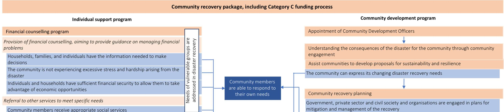

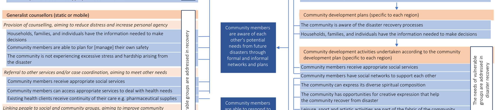

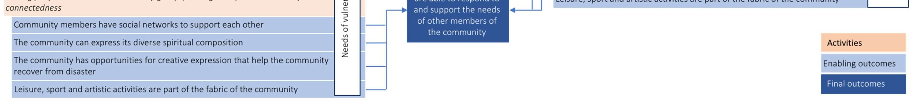

## Page 29

ssss 
Page 29 of 52
A Monitoring and Evaluation Framework for 
Disaster Recovery Programs 
 
3.6. 
Developing a program logic: Some practical suggestions 
Developing specific program logics to guide actual disaster recovery programs and their respective evaluations 
is a skill that requires some expertise, and program staff should refer to Appendix 1 of this Framework for 
starting points. An example of a disaster specific program logic that details how activities and interventions are 
intended to lead to very specific outcomes can be found in UNICEF, 2009, Children and the 2004 Indian Ocean 
Tsunami: Evaluation of UNICEF’s Programmes in Aceh, Indonesia, Child Protection Report, 
www.unicef.org/evaldatabase/index_59604.html. For a more general and very accessible guide for developing 
program logics, people involved in disaster recovery should consult the resources available at 
www.betterevaluation.org and Funnell and Rogers (2011).

## Page 30

Page 30 of 52
A Monitoring and Evaluation Framework for 
Disaster Recovery Programs 
4. 
Outcomes, indicators, and standards of 
successful recovery 
Indicators that measure progress need to be identified for the outcomes identified in a recovery program logic. 
Box 4, for example, shows how specific resilience-building outcomes from the infrastructure domain can be 
measured in a community survey. 
Box 4: An example of outcome indicators for bushfire recovery 
A community has experienced a bushfire that destroyed several homes. As part of resilience-building, the 
recovery program aimed to ensure that housing is better able to withstand a future fire. It therefore 
targeted the following two built environment outcomes: 
 Infrastructure is built with regard to local disaster risks 
 Infrastructure is built in accord with current knowledge and practices for mitigating disaster impact. 
The program also aimed at ensuring that households are better prepared to take care of themselves in the 
event of another bushfire, which relates to the following social resilience outcome:  
 Community members can respond to their own needs. 
To identify whether these outcomes have been achieved, relative to a pre-disaster benchmark, the 
following items were included in a community survey (adapted from the Pinery Bushfire Community 
Survey). 
For each of the following, indicate whether 
these were in place before the fire, and 
whether they are now in place 
Did your house 
have any of the 
following safety 
features prior to 
the fires? 
Does your house 
now have any of 
the following safety 
features? 
a. Metal gutter guards 
No 
Yes 
No 
Yes 
b. A fire-rated roof 
No 
Yes 
No 
Yes 
c. A clearing on the fire-prone side of the house 
No 
Yes 
No 
Yes 
d. An emergency water supply 
No 
Yes 
No 
Yes 
e. An emergency electricity supply/generator 
No 
Yes 
No 
Yes 
f. Other (specify): 
 
All the items relate to the two infrastructure outcomes, and the last two items (d and e) also relate to the 
desired social outcome.  
 
Given the range of outcomes that a recovery program may try to achieve, it is not possible to provide a definitive 
list of indicators for these outcomes. To provide a starting point for constructing indicators for the outcomes in 
Section 2, the database provides a suggestive list. These indicators come from three sources: 
 
past evaluations of disaster recovery 
 
official statistics such as ABS publications 
 
input from specialists in the field of disaster recovery and related expertise.

## Page 31

Page 31 of 52
A Monitoring and Evaluation Framework for 
Disaster Recovery Programs 
Box 5: Using the database to develop outcome indicators 
For program designers who are working with a ‘blank page’ to set up a new recovery program, or for program 
designers who have already designed a program and want to refine it based on past practice, the database 
provides a useful starting point. The following steps provide a guide for using the database: 
1. Go to https://knowledge.aidr.org.au/resources/national-recovery-monitoring-and-evaluation/. 
2. Select Disaster Recovery Outcomes Search and select the desired outcomes that your program is 
intended to achieve from the list provided under the relevant domain(s). 
3. Click View Activities and Indicators at the bottom of the page. 
4. The results will appear on a new page, with indicators listed under each of the selected outcomes. 
5. You can refine the list of indicators based on criteria relevant to your program, by clicking Show Filters. 
For example, if you are designing a recovery program for a flood disaster, you can choose Flood under 
the Disaster Types drop-down menu. 
6. Not all listed indicators will be relevant to your program; they are simply a record of what has been done 
in the past. You need to look at past evaluations, reviews, or other assessments of recovery programs 
contained in the database, to decide which of these indicators can be used to measure the outcomes for 
a program. 
 
The list of indicators in the database is not complete; they are sufficiently general in nature so that they might 
be commonly used across a variety of disaster recovery programs. But each recovery program is also unique, 
and it is expected that other indicators will also be used where relevant to a specific context. It should also be 
stressed that while these indicators lend themselves to quantitative measures; qualitative measures for some 
indicators will usually be required to fully capture the complexity of the disaster recovery process. 
When completed, each disaster recovery evaluation will add the indicators it uses into the database so that it 
grows over time from the accumulated experiences of real-world disaster evaluations (see Section 7). 
4.1. 
Standard setting for ‘successful recovery’ 
Indicators on their own will not suggest whether successful recovery is occurring or has occurred; some ‘target’ 
level or rate needs to be set for what will constitute successful recovery, as defined by the community-led 
approach. This is the process of ‘standard setting’. 
Such standard setting will not be part of this Framework; it is the function of evaluation plans to identify which 
indicators are relevant for the outcomes that are desired, and the ‘values’ these indicators need to attain before 
we can specify that recovery is happening or has finally been achieved. Many of the outcomes use words such 
as ‘adequate’ and ‘appropriate’. Such words are deliberately vague because there cannot be a predetermined 
and universal standard of success that applies for all recovery programs. In other words, specific recovery 
evaluation plans will decide what is ‘adequate’ and ‘appropriate’ in their circumstances. 
Setting standards for outcome indicators often involves measuring change against some comparator for 
judgment. A number of factors can be taken into account when selecting an appropriate comparator: 
 
Pre-disaster state. The state of affairs prior to the disaster will act as a reference point for setting 
standards. Official data sets such as the Census or the National Health Survey can often provide such 
pre-disaster measures. It should be noted, however, that it is not the main purpose of recovery to 
redress non-disaster related problems that existed prior to the disaster, except in so far as these may 
impact on the sustainability and resilience of the community.  
 
Disaster impact. The pre-disaster state of affairs also needs to be coupled with the nature, severity, 
and extent of the disaster. In some circumstances, it may not be reasonable or necessary to expect 
disaster recovery to achieve pre-existing levels of community functioning. Recovery may become

## Page 32

Page 32 of 52
A Monitoring and Evaluation Framework for 
Disaster Recovery Programs 
sustainable and resilient before these levels are achieved. There are a range of possible sources of 
impact measures, such as state and territory damage, loss and impact assessments, and the National 
Impact 
Assessment 
Framework 
(https://knowledge.aidr.org.au/resources/recovery-further-
resources/#niaf), which can help inform ‘reference’ measures for many outcomes, against which 
recovery can be assessed. 
 
On-going community needs assessment. This will help establish the time-frame over which it is 
reasonable to expect the desired outcome ‘targets’ to be reached. 
 
Comparison with generally recognised standards e.g. safe levels of air pollution; safe levels of 
asbestos risk. 
 
Time-frame. For some recovery outcomes it will not be possible to observe a significant change within 
a short time period. Indicators and standards for change need to be mindful of what a ‘realistic’ change 
can be observed at different times. 
 
Comparison with similar communities unaffected by disasters.  
4.2. 
Outcomes, indicators, and methodologies for data collection 
The mapping of outcomes to indicators in the database is a starting point for constructing a data collection 
plan. However, evaluators should not feel restricted to this list. They should also be open to forms of data 
collection and associated indicators that are emerging. The following approaches to data collection and 
measurement should be considered: 
 
Most Significant Change (MSC). This is a method that explores the important outcomes and how they 
are identified, through a qualitative approach to community values. MSC can be used to construct the 
specific program logic for a given disaster recovery process, based on a structured feedback process 
that engages the community and other stakeholders. But it can also be used in conjunction with 
quantitative measures to assess movement toward community outcomes such as disaster recovery; 
for example, to uncover important outcomes that were not identified in the evaluation plan. It is 
important that qualitative indicators be used in conjunction with the quantitative indicators listed in the 
evidence base to ensure a ‘complete’ picture of recovery is presented. MSC, among other techniques, 
provides a useful way of doing this (useful guides for using this method are Dart and Davies (2003), 
and Davies and Dart (2005)). 
 
The Australian Regional Environmental Accounts. The Wentworth Group of Concerned Scientists has 
developed a system for measuring the state of environmental assets at any given point in time, and 
over time. The application of these Accounts should be assessed: if they are conducted nationally and 
at regular intervals they will provide an invaluable source of secondary data for measuring 
environmental recovery outcomes. If this does not happen, the methods developed for constructing 
these accounts can still be used to gather primary data, where appropriate, for disaster recovery 
(wentworthgroup.org/programs/environmental-accounts). 
 
Innovations in data collection using digital and other tools. For example, developments in geospatial 
imagery and the use of satellite data may provide tools that can capture in detail changes in a 
community’s structure and assets (Brown, et al 2011). The scope for using such innovations in 
collecting monitoring and evaluation data needs to be constantly assessed, and the experience gained 
by using such innovations fed back into the database. 
 
Community involvement, for example, by using social media, and through qualitative methods such 
as ethnographic studies.

## Page 33

Page 33 of 52
A Monitoring and Evaluation Framework for 
Disaster Recovery Programs 
5. 
Planning an evaluation 
5.1. 
The evaluation focus and scale 
Evaluations can focus on different aspects of a recovery program. For example, an evaluation can focus on 
the whole recovery program, or an individual component of the overall recovery program, such as a grant 
program. Depending on the focus of the evaluation, there will be implications for the degree of evaluation 
expertise required, the resources needed to conduct the evaluation, the time period within which it can be 
concluded, and the degree of planning required. 
Some factors that help determine the evaluation focus and scale are: 
 
The audience for which the evaluative activity is conducted. If the staff delivering a recovery program 
need to assess how the program is tracking in the early stages of implementation, then the scale of 
evaluative activity will probably be small and highly focused. If, on the other hand, the audience is 
major funders who require a comprehensive assessment of the program over its lifecycle, then a major 
evaluation will be needed. 
 
Process or outcomes. While all evaluations should be guided by the outcomes that the program 
intends to achieve, some may focus on the process by which these outcomes are achieved. 
Alternatively, the focus may be on whether the outcomes have been achieved.  
 
Range of outcomes. Some recovery programs may target a small set of outcomes (rather than the full 
set listed in Section 2), which then allows for a narrower focus in evaluative activity. 
 
Type of disaster. Some disasters require recoveries that will occur over a long period, and evaluation 
timing will have to correspond to this.  
 
Timing of evaluation. For example, where some sense of progress needs to be made in a very short 
time-frame, a more focused and internally conducted review may be sufficient.  
 
Community data collection capability. Larger communities tend to have better data collection systems 
already in place, and/or are better able to build systems specifically for monitoring disaster recovery 
progress. Similarly, disaster-affected communities that align with the boundaries of existing ‘statistical 
areas’ tend to have an advantage in terms of data collection, as they are able to draw more neatly on 
government and other publicly available data sources.  
5.2. 
Key evaluation questions 
Evaluations are also given focus by the identification of Key Evaluation Questions (KEQs). We first list a set 
of KEQs that relate to common elements of recovery programs: the governance of the recovery process, and 
community engagement. 
5.2.1. 
Governance of the recovery process 
It is generally recognized that the system to manage and oversee the delivery of recovery programs is itself 
an important element in achieving recovery objectives. Governance arrangements are needed to ensure that 
interventions are timely and efficient, and because governance is crucial to engaging the community, key 
stakeholders, and agencies. It is central to the theory of change guiding this Framework that the governance 
arrangements are understood as critical activities for achieving community-led recovery. 
Governance structures can help achieve recovery outcomes by: 
 
taking a long-term perspective on outcomes and recognizing the complexity of the process 
 
ensuring recovery programs are monitored on a regular basis 
 
ensuring programs are adaptive to changing needs and impact

## Page 34

Page 34 of 52
A Monitoring and Evaluation Framework for 
Disaster Recovery Programs 
 
ensuring recovery plans clearly define roles and responsibilities for disaster recovery 
 
ensuring governance procedures conform to legislation, polices, and other plans 
 
establishing community-managed funds and other resources for disaster recovery 
 
having a shared understanding among stakeholders regarding disaster recovery responsibilities, 
authority and decision-making 
 
ensuring governance is transparent and accountable 
 
managing unintended consequences that might flow from recovery activities 
 
coordinating response and relief efforts with the recovery process so that the two ‘work together’. 
Each of these functions of recovery governance can be recast as evaluation questions to assess the extent to 
which these functions supported the realization of recovery outcomes. 
5.2.2. 
Community engagement 
If the disaster recovery process is to be community-led, the affected communities must be involved in the 
governance of the recovery programs. This will include: 
 
stakeholder/community engagement in a timely and on-going way that provides adequate 
representation of community views 
 
establishing a shared vision of a sustainable and resilient community that is understood by the 
community 
 
joint planning between community actors and emergency teams and structures 
 
organisations having capacity to develop and manage community volunteers for disaster recovery 
 
recovery plans are developed through participatory processes 
 
the community having the capacity and formal avenues to lobby and challenge external agencies on 
disaster recovery plans, priorities, and actions 
 
inclusion/representation of vulnerable groups in community decision-making and management of 
disaster recovery 
 
agreed plans and management arrangements are well understood by the community and all disaster 
management agencies 
 
information is developed and disseminated in multiple media, multi-lingual formats, alternative formats; 
is appropriate to a diverse audience, user-friendly; and accessible to under-served populations 
 
community members have information they need to continue recovering from the disaster 
 
evolving community needs are assessed and prioritized during the recovery process to inform recovery 
activities 
 
governance processes are appropriately inclusive and representative of the affected community. 
Reformulating each of these functions into questions will help answer the overarching engagement question: 
‘How appropriately did the engagement process draw from the community to ensure the community was 
integral to the recovery process?’ 
In addition to KEQs addressing these two aspects of the recovery process, some evaluations will focus on 
whether these outcomes were achieved (effectiveness) or achieved in the most efficient manner (efficiency). 
Other evaluations may focus on the process by which they outcomes are being achieved (implementation). 
For each of these broad objectives, several KEQs can be adopted.

## Page 35

Page 35 of 52
A Monitoring and Evaluation Framework for 
Disaster Recovery Programs 
5.2.3. 
Effectiveness 
 
To what extent did the disaster recovery program produce a sustainable community? 
 
To what extent did the disaster recovery program produce a resilient community? 
 
Was there any trade-off between achieving resilient outcomes and sustainable outcomes? If yes, how 
was this negotiated?  
 
To what extent did program activities and resources allow positive interaction among the recovery 
domains? 
5.2.4. 
Efficiency 
 
To what extent did the program achieve the right balance between centralisation of some activities to 
achieve economies of scale while at the same time being responsive to local needs and conditions? 
 
Did the program prevent price escalation stemming from the level of demand and competition between 
organisations? 
 
How well did the program balance the need to optimize between cost of restoring essential public 
assets and the cost of delaying such projects? 
 
How appropriate were the price benchmarks used to evaluate service providers? 
5.2.5. 
Implementation 
 
Was the recovery program consistent with the National Principles for Disaster Recovery? 
 
To what extent has the program been implemented according to the recovery plan? In cases where 
activity has departed from the recovery plan, how was this managed and what were the implications?  
 
Did the speed of the recovery process compromise quality of services? 
 
Did the recovery program meet community needs as they changed over time and in response to 
changes in disaster impact? 
 
To what extent did program activities and resources effectively encourage interaction between 
outcome domains (for example, did the restoration of cultural assets also promote economic tourism)? 
 
Where disaster recovery involved several separate components or projects, how well coordinated 
were these with each other? If each of these components or projects were evaluated separately, did 
these evaluations draw common conclusions? 
 
To what extent was the recovery process affected by external factors that may have had an impact on 
the community’s ability to recover (e.g. general economic conditions, microeconomic conditions in 
specific markets, demographic changes, technological changes, government policy and climate and 
weather patterns)?

## Page 36

Page 36 of 52
A Monitoring and Evaluation Framework for 
Disaster Recovery Programs 
5.3. 
Other sources of KEQs 
In addition to these KEQs, evaluation plans can draw on previous evaluations and the questions they tried to 
answer. Many of these can be found on the database (see Box 1). Another source of KEQs is the checklist in 
Applying 
the 
National 
Principles 
for 
Disaster 
Recovery 
post-disaster 
(available 
at 
https://knowledge.aidr.org.au/resources/recovery-further-resources/). The items listed there in the tables can 
be rephrased as KEQs for the relevant aspect of recovery program evaluation. 
 
6. 
Monitoring disaster recovery 
Disaster recovery is an on-going and iterative process whereby programs are adapted as community needs 
evolve and the impact of the disaster changes in scope and intensity. The progress toward sustainability and 
resilience cannot therefore be captured retrospectively or at a single point in time; some monitoring of 
outcomes, and how program activities are delivering those outcomes, must take place. 
This regular and planned monitoring of disaster recovery outcomes will help ensure that: 
 
programs are adapted to emerging needs 
 
resources can be redirected to meet other outcomes as early outcomes are achieved 
 
an early warning system is in place to identify progress towards outcomes that are not progressing as 
planned 
 
progress toward successful recovery is communicated to the community and other relevant 
stakeholders 
 
all the groups involved in the delivery of recovery programs are accountable for their respective 
performance. 
Monitoring should happen through the periodic publication of community recovery progress reports (CRPR). 
Such reports should be completed according to a timetable set out in the evaluation plan, but it is envisaged 
that these reports should occur at least annually, and in the early recovery phases on a more regular basis, 
such as quarterly. The outcomes that are monitored will be specified as part of the data collection plan, a 
template for which is available at Appendix 4. 
Community recovery progress reports must be more than periodic ‘newsletters’ or information leaflets. These 
types of publications tend to focus on ‘good news’ stories and on individual case studies, rather than providing 
a comprehensive assessment of progress toward recovery outcomes.

## Page 37

Page 37 of 52
A Monitoring and Evaluation Framework for 
Disaster Recovery Programs 
To provide this comprehensive assessment, recovery reports should include sections that: 
 
report on key outcome indicators that are considered significant ‘markers’ of progress for a particular 
recovery program (rather than reporting on all the indicators that might be relevant). In selecting the 
indicators that will be included in the reports, consideration needs to be given to any ethical issues 
related to gathering and reporting the data, ease of data collection, the extent to which the community 
can be involved in reporting on these indicators, and the range of disaster recovery outcomes that 
they cover 
 
provide appropriate qualitative assessments of recovery progress 
 
summarize the key activities that have been undertaken in the reporting period 
 
summarize the key activities that will be undertaken in the next reporting period and the outcomes that 
they are expected to achieve 
 
identify where progress has not met expectations and discuss the reasons for this and the responses 
that will be taken for future progress 
 
identify the ways in which the community has been involved in the recovery process. 
This Framework does not specify a format for presenting these community recovery progress reports or a 
mode of distribution. The media and format for reporting will depend on the nature of the community and other 
audiences to whom these reports are directed. Indeed, the same report may be presented in multiple formats 
to suit the needs of different audiences. The relevant forms of reporting should be specified in the evaluation 
plan, but also be adapted to suit changing needs. But to assist in the development of CRPRs, we cite the 
following two examples: 
 
The Greater Christchurch Earthquake Recovery includes a Monitoring and Reporting Plan 
(http://ceraarchive.dpmc.govt.nz/sites/default/files/Documents/monitoring-and-reporting-plan-june-
2013.pdf) that provides an overarching guide for monitoring activity, with specific and regular 
monitoring reports organized around the main outcome domains, such as the Canterbury Wellbeing 
Index (https://www.cph.co.nz/your-health/canterbury-wellbeing-index/ ) 
 
The New Orleans Index provides an international example from a very wide scale disaster, which has 
been published annually (see for example www.datacenterresearch.org/reports_analysis/new-
orleans-index-at-ten/). Significantly, the community has been heavily involved in developing this index 
through the Greater New Orleans Data Center. 
 
7. 
Presenting, disseminating, and learning 
from evaluation findings 
Evaluations of recovery programs are not undertaken for their own sake; they must contribute to the 
improvement of that recovery effort (if it is ongoing) and subsequent recovery efforts. In other words, while 
program evaluations are important to ensure accountability (e.g. that funds have not been misspent; programs 
have been delivered as planned), they are also important to ensure learning takes place and is fed back into 
program design.

## Page 38

Page 38 of 52
A Monitoring and Evaluation Framework for 
Disaster Recovery Programs 
7.1. 
Presenting findings 
Findings should be presented in a way that is suitable for the intended audience. This general point should be 
particularly borne in mind when the intended audience includes the affected community. A balance needs to 
be struck between accessibility of these findings to the affected communities and to the broader public, and 
the need to be sufficiently comprehensive to inform decision-making.3  This can be addressed by using multiple 
forms of publication to suit the needs of specific audiences. An example from the US is provided by FEMA at 
www.fema.gov/pdf/rebuild/ltrc/2011_report.pdf. 
The evaluation report itself should include: 
 
 
a clear answer to each of the Key Evaluation Questions 
 
a discussion of the limitations of the evaluation such as any possible sources of bias 
 
alternative explanations for the results, including the extent to which factors external to the recovery 
process may have had an impact on recovery outcomes 
 
a discussion of the extent to which the evaluation looked for both positive and negative unintended 
consequences 
 
a discussion of how the results compare with those of similar recovery programs 
 
a discussion of the extent to which the different data collection methods lead to similar results and a 
discussion of any differences. 
                                                     
 
3 In deciding what elements of an evaluation report need to be published and publicly available, the requirements specified by each 
jurisdiction’s whole-of-government evaluation guidelines need to be followed (see Appendix 1).

## Page 39

Page 39 of 52
A Monitoring and Evaluation Framework for 
Disaster Recovery Programs 
Figure 6: Disaster recovery evaluation and learning process 
 
7.2. 
Disseminating and learning from the evaluation findings 
As indicated in Figure 6, the findings from evaluations need to inform future recovery planning. A written 
evaluation report on its own does not ensure that future practice will change. It is important therefore that 
evaluation reports are accessible to all who might need them, and the findings are widely disseminated. To 
build this ‘culture of learning’ several approaches can be taken, listed below. The main issue is to ‘repackage’ 
the evaluation report in a way that extracts only the relevant information and presents it in a way that suits the 
intended audience. Some examples include: 
 
A summary newsletter to the community or a report in the local media 
 
An ‘advice to practitioners summary sheet’ that clearly explains the main aspects of the evaluation that 
should guide future practice 
 
For findings that require major changes to future practice, a ‘critical reflection workshop’ among 
relevant decision-makers 
 
Presentations to appropriate committees or groups involved in high-level recovery planning. 
Apart from these forms of dissemination, the database should be updated to provide a single point of 
reference for evaluation learning. Box 6 provides a guide for doing this.

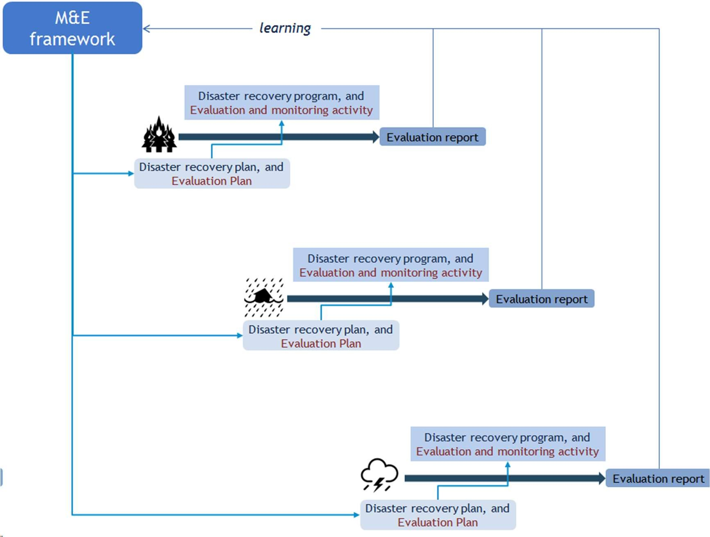

## Page 40

Page 40 of 52
A Monitoring and Evaluation Framework for 
Disaster Recovery Programs 
Box 6: Using the database to add evaluation findings 
To upload an evaluation report, and other relevant information that will help learning for future recovery 
programs:  
1. 
Go to https://knowledge.aidr.org.au/resources/national-recovery-monitoring-and-evaluation/ 
2. 
Instructions on how to Contribute a resource to the database is located at the bottom of the page. 
3. 
Complete the form (ensuring you select ‘yes’ to ‘National Recovery Monitoring & Evaluation 
Database’), upload the report and any other relevant information and select ‘submit’. 
To facilitate the updating of the database, key elements of an evaluation report can be summarised and 
uploaded along with the report. Appendix 5 provides an illustrative example of a table that would capture this 
information. In essence, this table is simply a reformulation of the program logic that was used to guide the 
evaluation, with additional information from the data collection plan. The production and uploading of such a 
table, along with the evaluation report, could be made a required output when contracting external evaluators.

## Page 41

Page 41 of 52
A Monitoring and Evaluation Framework for 
Disaster Recovery Programs 
8. 
Implementation and review of the 
Framework 
The existence of a Framework for disaster recovery on its own will not ensure that it is implemented. A series 
of workshops with key stakeholders were held in parallel with the development of this Framework to discuss 
practical steps that can be taken to ensure the Framework is implemented. The following lists these steps. 
1. Build evaluation capability among the various groups that might be involved in implementing this 
Framework. For example, program design staff will have to have some working knowledge of how to 
design program logics and how to commission evaluations that will satisfy the requirements of this 
Framework. This will not be the same set of capabilities that might be expected of the team of people 
who will undertake the evaluations. 
To support capability building, a set of disaster recovery case examples have been developed and are 
available from the database (https://knowledge.aidr.org.au/resources/national-recovery-monitoring-and-
evaluation/). These case examples can be used to build the skills needed to apply the Framework in a 
context that does not have the immediate urgency of an actual disaster. They can be used as scenarios 
around which relevant teams can be brought together and build the relevant capability. For example, 
these examples can be used to work through the steps detailed in Section 2 or Section 3, or both. The 
output of these exercises can then be part of a reflective practice exercise to further develop necessary 
skills in evaluation planning and implementation. 
2. Ensure senior management understand the principles embodied in the Framework and communicates to 
all staff the need to follow its principles. 
3. Reference the Framework in relevant material and documentation. This includes State and local 
government tools for disaster recovery planning, such as state recovery plans, emergency management 
plans, community recovery handbooks and operations manuals. It also includes staff ‘induction’ 
processes and documents, websites, and evaluation tender documents and other tender documents 
involving evaluation work. 
4. Communicate the role and principles of the Framework with preparedness and relief/response teams so 
that they can draw on any relevant content. 
5. Communicate the role and principles of the Framework to NGOs and other external organisations. 
6. Coordinate with other relevant government agencies, such as those involved with asbestos removal, 
biohazards, and counterterrorism. 
7. Engage with relevant public-sector evaluation units. Many government agencies have evaluation teams 
with high levels of expertise. To effectively draw on this expertise when conducting evaluative activity, 
the content of this Framework can be proactively discussed with them and how they can support its 
implementation. 
8. Ensure funding for evaluative activity is built into recovery planning and implementation budgets ‘up front’. 
9. The key findings from each disaster recovery evaluation are incorporated into the database to inform 
subsequent disaster recovery programs. 
The Framework itself should be periodically reviewed and revised. This can only be done after a sufficient 
period has elapsed and experience using the Framework has accumulated (for an example of how this can be 
done see the Case studies section of Twigg, 2009). It is anticipated that a review of this Framework will be 
undertaken every 3–5 years. After a sufficient body of evaluations have been conducted this Framework itself 
should be reviewed. This will include the extent to which the community-led/government-assisted logic that 
guides this Framework is appropriate for designing recovery programs. It should also involve a meta-review of 
evaluations to assess the extent to which they met the requirements of the Framework and whether they lead 
over time to improved program delivery.

## Page 42

Page 42 of 52
A Monitoring and Evaluation Framework for 
Disaster Recovery Programs 
9. 
References 
Brewin, C, Fuchkan, N and Huntley, Z, 2009, Evaluation of the NHS Trauma Response to the London 
Bombings: Final Report to the Department of Health, Clinical, Educational and Health Psychology, University 
College London, February, http://disaster.efpa.eu/resources/evaluation/  
Canterbury Earthquake Recovery Authority, 2014, Canterbury Wellbeing Index, 2014, 
https://www.cph.co.nz/your-health/canterbury-wellbeing-index/  
Community Recovery Committees of the 2009 Victorian Bushfires, 2011, Lessons Learned by Community 
Recovery Committees of the 2009 Victorian Bushfires: Advice We Offer to Communities Impacted by 
Disaster, Community Recovery Committees of the 2009 Victorian Bushfires, May, 
https://www.redcross.org.au/getmedia/7f796fb7-958f-4174-98da-00b6e0182856/Lessons-Learned-by-
Community-Recovery-Committees-of-the-2009-Victorian-Bushfires-v1-0.pdf.aspx  
Ellis, S, Kanowski, P and Whelan, R, 2004, National Inquiry on Bushfire Mitigation and Management, 
Commonwealth of Australia, Canberra. 
Greater Christchurch Earthquake Recovery, 2013, Monitoring and Reporting Plan: Measuring, Monitoring 
and Reporting on the Progress of Recovery. https://ceraarchive.dpmc.govt.nz/documents/monitoring-
reporting-and-review-recovery-strategy  
Plyer, A, Ortiz, E, Horwitz, B and Hobor, G, 2013, The New Orleans Index at Eight: Measuring Greater New 
Orleans’ Progress Towards Prosperity, August, 
http://gnocdc.s3.amazonaws.com/reports/GNOCDC_NewOrleansIndexAtEight.pdf 
Plyer, A, Shrinath, N, and Mack, V, 2015, The New Orleans Index at Ten: Measuring Greater New Orleans’ 
Progress Toward Prosperity, The Data Center, July, www.datacenterresearch.org/reports_analysis/new-
orleans-index-at-ten/ 
Ryan, R, Wortley, L, O’Shea, É, Éidín Ní Shé, 2016, Evaluations of post-disaster recovery: A review of 
practice material, Evidence Base, Issue 4, doiI: 10.21307/eb-2016-001. 
Sturgis, LA, Tiffany C, Smythe, and Tucci, AE, 2014, Port Recovery in the Aftermath of Hurricane Sandy: 
Improving Port Resiliency in the Era of Climate Change. Voices from the Field. Center for a New American 
Security, August, 
https://s3.amazonaws.com/files.cnas.org/documents/CNAS_HurricaneSandy_VoicesFromTheField.pdf?mtim
e=20160906081313  
United Nations Children’s Fund (UNICEF), 2009, Children and the 2004 Indian Ocean Tsunami: Evaluation 
of UNICEF’s Programmes in Aceh, Indonesia, Child Protection Report, October, 
www.unicef.org/evaldatabase/index_59604.html  
Victorian Auditor-General’s Office, 2013, Flood Relief and Recovery: Victorian Auditor-General’s Report, 
June, https://www.audit.vic.gov.au/report/flood-relief-and-recovery  
Virginia Horticulture Centre South Australia, 2008, Gawler River Flood Recovery Program 2005-2007, 
Virginia Horticulture Centre South Australia, March 25.

## Page 43

Page 43 of 52
A Monitoring and Evaluation Framework for 
Disaster Recovery Programs 
Appendix 1: Resources for disaster recovery 
evaluation 
Official government resources 
National Principles for Disaster Recovery, 2018, December, https://knowledge.aidr.org.au/resources/recovery-
further-resources/ 
Community Recovery Handbook 2, 2018, Australian Emergency Management Handbook Series, 
https://knowledge.aidr.org.au/resources/handbook-2-community-recovery/  
Council 
of 
Australian 
Governments, 
2011, 
National 
Strategy 
for 
Disaster 
Resilience, 
https://knowledge.aidr.org.au/resources/national-strategy-for-disaster-resilience/  
Emergency Management Australia, 2003, Community Development in Recovery From Disaster, September, 
https://knowledge.aidr.org.au/media/1986/manual-29-community-development-in-recovery-from-disaster.pdf  
NSW 
Recovery 
Plan, 
https://www.emergency.nsw.gov.au/Pages/publications/plans/supporting-
plans/recovery-plan.aspx  
NSW Ministry for Police and Emergency Services, 2012, NSW State Emergency Management Plan, 
(EMPLAN), December 2012, https://www.emergency.nsw.gov.au/Documents/publications/EMPLAN.pdf  
Emergency Management Victoria, www.emv.vic.gov.au 
Emergency Management Victoria, 2015, Vulnerable Sections of Society (an emergency management 
perspective), https://knowledge.aidr.org.au/media/5938/vulnerable-sections-of-society-anzemc.pdf 
Queensland Reconstruction Authority, 2010/11, Queensland Flood and Cyclone Disaster Value for Money 
Strategy, June, qldreconstruction.org.au/u/lib/cms/VfM-Strategy.pdf  
FEMA, 2011, National Disaster Recovery Framework: Strengthening Disaster Recovery for the Nation, 
September, www.fema.gov/media-library-data/20130726-1820-25045-5325/508_ndrf.pdf 
Social Recovery Reference Group, 2018, Applying the National Principles for Disaster Recovery post-disaster, 
available at https://knowledge.aidr.org.au/resources/national-principles-disaster-recovery/

## Page 44

Page 44 of 52
A Monitoring and Evaluation Framework for 
Disaster Recovery Programs 
Disaster recovery literature reviews 
Archer, F, McArdle, D, Spencer, C and Roberts, F, 2015. Literature Review: What Does Good or Successful 
Recovery Look Like? Monash University Injury Research Institute. 
Regional Australia Institute, 2013, Domestic and International Practices in Long-Term Economic Recovery: 
Literature Review, Regional Australia Institute. http://inform.regionalaustralia.org.au/rai-
research/item/domestic-and-international-practices-in-long-term-economic-recovery-literature-review  
Regional Australia Institute, 2013, From Disaster to Renewal: The Centrality of Business Recovery to 
Community Resilience, www.regionalaustralia.org.au/wp-content/uploads/2013/08/From-Disaster-to-
Renewal.pdf 
Ryan, R, Wortley, L, O’Shea, É, Molloy, L, and Campbell, N, 2015, Review of Current Evaluation Practice 
Material, Centre for Local Government, University of Technology, Sydney. 
Twigg, J, 2009, Characteristics of a Disaster-Resilient Community: A Guidance Note, London, November 2, 
http://discovery.ucl.ac.uk/1346086/1/1346086.pdf 
Winkworth, G, 2007, Disaster Recovery: A Review of the Literature, Institute of Child Protection Studies, 
Australian Catholic University,  
www.acu.edu.au/__data/assets/pdf_file/0004/469255/Disaster_RecoveryLiterature_Reviewl.pdf  
 
Data collection and methodological literature 
Brown, D, K Saito, R Spence, T Chenvidyakarn, B Adams, A McMillan, and S Platt, 2011, Indicators for 
Measuring, Monitoring and Evaluating Post-Disaster Recovery, 
http://mceer.buffalo.edu/publications/workshop/RS-6/Papers/16Brown.pdf  
Dart, J and Davies, R, 2003, A Dialogical, Story-Based Evaluation Tool: The Most Significant Change 
Technique, American Journal of Evaluation, 24(2): 137–155, doi: 10.1177/109821400302400202 
Davies, R and Dart, J, 2005, The ‘Most Significant Change’ (MSC) Technique: A Guide to Its Use, 
http://www.mande.co.uk/wp-content/uploads/2005/MSCGuide.pdf 
Funnell, S and Rogers, P, 2011, Purposeful Program Theory, Josey-Bass, San Francisco. 
Rogers, P, 2008, Using Programme Theory to Evaluate Complicated and Complex Aspects of Interventions, 
Evaluation, 14; 29, doi: 10.1177/1356389007084674 
 
Whole of Government evaluation guidelines 
Commonwealth Department of Finance, Public Governance, Performance and Accountability Act, 
www.finance.gov.au/resource-management/performance/  
New South Wales Government, 2016, Program Evaluation Guidelines, January, 
www.dpc.nsw.gov.au/programs_and_services/policy_makers_toolkit/evaluation_in_the_nsw_government 
Queensland Government, 2014, Program Evaluation Guidelines, November, 
www.treasury.qld.gov.au/publications-resources/qld-government-program-evaluation-guidelines/index.php 
Western Australia Government, 2015, Program Evaluation, 
www.treasury.wa.gov.au/Treasury/Program_Evaluation/Program_Evaluation/

## Page 45

Page 45 of 52
A Monitoring and Evaluation Framework for 
Disaster Recovery Programs 
Appendix 2: Glossary 
Activities 
Things the program does with available resources to meet its objectives. 
Built domain 
“Those human-made assets that underpin the functioning of a community” (Community Recovery Handbook, 
2018: 92). 
Capability 
Skills and knowledge possessed by members of the affected community, such as awareness of disaster 
risks and appropriate disaster mitigation strategies.  
Community  
“A group with a commonality of association and generally defined by location, shared experience, or 
function. A social group which has a number of things in common, such as shared experience, locality, 
culture, heritage, language, ethnicity, pastimes, occupation, workplace, etc.” AIDR Knowledge Hub Glossary 
Community Recovery Progress Reports 
Documents that monitor and report on a regular basis the progress and future plans for meeting disaster 
recovery outcomes. 
Disaster recovery program 
A set of activities that deploy resources with the aim of achieving disaster recovery outcomes. Disaster 
recovery programs can range from small programs targeted at a particular outcome or outcomes, or towards 
overall community recovery. 
Economic domain 
The system whereby the affected community’s material and service needs are met through appropriate 
labour and employment, business development, land use, financial resources, and interaction with the 
broader economy.  
Environmental domain  
Encompasses the natural and cultural resources of the community. 
Evaluation  
Any structured evidence-based analysis that draws together data (quantitative and/or qualitative) to answer 
questions about the effectiveness, efficiency, appropriateness, and implementation of disaster recovery 
programs, using clear criteria and standards for assessing the ‘success’ of the program against particular 
desired outcomes. 
Evaluation plan 
A ‘document’ that sets out in detail how evaluation activities will be conducted to ensure that key evaluation 
questions are properly answered in the evaluation report, and that standards of success are established prior 
to evaluation activity being undertaken.  
Evaluation report 
The ‘document’ that presents the findings and recommendations from a disaster recovery program 
evaluation. 
Government assistance for disaster recovery 
Any activities that are ‘sponsored’ by government agencies, even where these activities are delivered by 
non-government organisations (NGOs). They are activities that are (1) more than the usual level and type of 
government services that would be provided to similar communities that are not affected by disasters, and 
(2) whose aim is to get affected communities to a point where they can continue the recovery process on 
their own terms.

## Page 46

Page 46 of 52
A Monitoring and Evaluation Framework for 
Disaster Recovery Programs 
New normal government services 
Government services provided to a community after disaster recovery that are consistent with a similar 
community not affected by disaster. 
Outputs  
Direct products of the program’s activities; evidence that the program was implemented. 
Outcomes 
Changes in participants’ knowledge, behavior, skills, status, and level of functioning, or changes to an 
institution such as environmental conditions and organisational capacity, because of the program. 
Program logic  
Captures in a diagrammatic form some underlying understanding about what it takes to achieve ‘successful’ 
recovery.  
Resilient community 
A community that is better able to withstand a future disaster. 
Social domain  
The “relationships connected by networks of communication ... [it] consists of individuals, families and 
common interest groups that form whole communities” (Community Recovery Handbook, 2018: 79). 
Sustainable community  
A community that has the capability to manage its own recovery, without government disaster-related 
assistance.

## Page 47

ssss 
Appendix 3: Example of a flyer for community engagement in evaluation 
EVALUATION OF THE DECEMBER STORMS RECOVERY PROGRAM 
BACKGROUND 
 
HOW YOU CAN BE INVOLVED 
The Australian and State governments, with your local 
council, have funded a range of activities to help your 
community recover from the December storms. 
As part of this the government would like to know if this 
recovery program is effective: has it helped your 
community recover? 
To answer this question, we have engaged XYZ 
Consultants to work with the community to evaluate the 
recovery program. 
 
You can participate in this evaluation in several ways: 
• Attend a community briefing session where the evaluation team will outline what it plans to do. 
This will be held in the Community Hall on 12 February at 7 pm 
• Be part of a committee to give regular feedback and advice to the evaluation team on the work 
it will do 
• Join one of the focus groups where the evaluation teams will hear about community experience 
of the recovery program. 
KEY CONTACTS 
 
HOW THE COMMUNITY WILL BENEFIT 
If you would like more information, or would like to 
express your interest in being involved in the evaluation, 
contact: 
Grace Crealy 
Director, XYZ Consulting 
gcrealy@xyz.com.au 
 
Helping the evaluation team will benefit your community by: 
• Ensuring that government programs address the real needs of the community 
• Improving the community’s resilience to future disasters 
• Making sure that all community views are represented in recovery planning. 
The evaluation team will report its findings in July and this will be made available to the 
community. Watch the local media and local government website for more details.

## Page 48

Appendix 4: Disaster recovery data collection plan template 
Outcome 
Indicators 
Data collection 
method 
Responsibility 
for collection 
Baseline 
measure 
Interim 
reporting 
requirements 
Desired change 
in measure and 
date 
Selected from the 
database across 
the four domains 
Selected from the 
database and any 
others that are 
appropriate 
 
 
Where appropriate, 
this should be 
pre-disaster 
measures, or 
comparison 
measures from 
similar unaffected 
communities 
Indicate whether 
this will be included 
in a Community 
Recovery Progress 
Report 
At least specify 
date at which 
outcome is 
expected to be 
reached and the 
desired 
level/change that 
will define success 
Outcome 1 
 
 
 
 
 
 
…

## Page 49

ssss 
Page 49 of 52
A Monitoring and Evaluation Framework for 
Disaster Recovery Programs 
 
Appendix 5: Developing an evaluation plan 
The processes described in the Framework will often be captured in an evaluation plan, which lays out how a 
specific disaster recovery project will be evaluated. The plan serves both as a management tool to ensure 
that the evaluative work follows agreed procedures, and also ensures that the final evaluation report will 
have the necessary elements that will facilitate learning. The plan should include the following sections: 
1. Statement of objectives and outcomes. 
This section should identify its audience and the decisions that will be informed by the evaluation 
2. A program logic. 
3. A grouped list of evaluation questions. 
4. Agreed definitions of key constructs and how to measure them. 
5. Data collection and management. 
As part of this the following issues are addressed: 
 
Issues of sampling 
 
Ethical considerations in conducting the evaluation and how these will be handled. 
6. Evaluation management plan and governance structure.  
This will identify how the evaluation will be conducted independently and to an appropriate standard 
of rigour. It will also discuss how community engagement will occur as well as an overall stakeholder 
engagement plan. 
7. Evaluation capability needs and development.

## Page 50

ssss 
Appendix 6: Monitoring and evaluation summary sheet 
Complete this summary sheet4 with submission of recovery program evaluation reports to the National Disaster Recovery Monitoring and Evaluation Database. 
Examples are provided below each criteria – provide the relevant information for your submission by typing over the grey text in final row of the table.  
Outcome 
Major activities used to 
achieve the outcome 
Outcome indicators 
Method of data collection 
Notes 
The outcomes that were 
evaluable (from Tables 2-6 in 
the National Monitoring and 
Evaluation Framework for 
Disaster Recovery Programs). 
These are usually identified in 
the program logic. 
For each outcome, provide a 
high-level outline of the major 
activities carried out to 
achieve it as part of the 
program (even where these 
were not effective). 
Outline the indicators by which 
the outcomes were measured 
(not the results of the 
measurements).  
Outline the techniques used to 
collect data on the indicators 
(for example, community 
survey; secondary data from 
the ABS Census). 
Outline other important 
considerations that should be 
taken into account when using 
these outcomes, activities and 
indicators in the future. 
Examples 
The community is not 
experiencing excessive stress 
and hardship arising from the  
disaster. 
Provision of financial 
counselling through existing 
financial counsellors.  
 
Demand for financial 
hardship support through 
NGO welfare agencies  
 
Number of community 
members registered on 
energy retailers’ hardship 
programs  
 
Secondary data from 
NGOs 
 
Secondary data from 
energy retailers 
Need to ensure data is 
specifically about financial 
counselling and support. 
Outcome 
Activities 
 
Indicator 
 
Indicator 
 
 
Technique 
 
Technique 
 
Notes 
 
                                                     
 
4 This summary sheet is derived from the National Disaster Recovery Monitoring and Evaluation Framework for Disaster Recovery Programs developed by the Australia and New Zealand School of Government.

## Page 51

ssss 
Page 51 of 52
A Monitoring and Evaluation Framework for 
Disaster Recovery Programs 
 
Appendix 7: Our approach to developing this 
Framework 
This Framework was developed through several related processes. 
Meta-review of previous literature reviews  
This Framework is informed by a number of reviews of the literature on disaster recovery. These are not 
extensively cited within this Framework, but we acknowledge the contribution that each has made to the 
development of this Framework: 
 
Archer, F, McArdle, D, Spencer, C and Roberts, F, 2015, Literature Review: What Does Good or 
Successful Recovery Look Like? Monash University Injury Research Institute. 
 
Regional Australia Institute, 2013, Domestic and International Practices in Long-Term Economic 
Recovery: Literature Review, Regional Australia Institute. http://inform.regionalaustralia.org.au/rai-
research/item/domestic-and-international-practices-in-long-term-economic-recovery-literature-review 
 
Regional Australia Institute, 2013, From Disaster to Renewal: The Centrality of Business Recovery to 
Community Resilience, www.regionalaustralia.org.au/wp-content/uploads/2013/08/From-Disaster-to-
Renewal.pdf. 
 
Ryan, R, Wortley, L, O’Shea, É, Molloy, L, and Campbell, N, 2015, Review of Current Evaluation 
Practice Material, Centre for Local Government, University of Technology, Sydney. 
 
Winkworth, G, 2007, Disaster Recovery: A Review of the Literature, Institute of Child Protection 
Studies, Australian Catholic University. 
Meta-review of official disaster recovery guidelines 
Australian disaster recovery guidelines, as well as disaster recovery guidelines from other English-speaking 
countries, were collected. These official disaster recovery guidelines served as an important base to establish 
common meanings of disaster recovery, an understanding of disaster recovery concepts and to begin 
conceptualising the program logic for disaster recovery. 
Review of past evaluations 
Past evaluations were collected, guided by the grey literature accumulated by Ryan et al (2015). From these 
evaluations we were able to understand how disaster recovery has been evaluated in the past, source common 
activities undertaken in disaster recovery, as well as how success was measured quantitatively and 
qualitatively. The activities and indicators were entered into a database, which forms the database for future 
evaluations of disaster recovery. 
There is a variety of reports that assess disaster recovery programs: formal inquiries or reviews, academic 
papers, consultant reports, agency evaluations and community reports.  
Facilitated workshops with ongoing expert review 
A series of workshops were held to seek the former Australia-New Zealand Emergency Management 
Committee Recovery Sub-committee’s feedback in developing various parts of the Framework. Experts were 
also enlisted during this process to attend workshops and provide continuous feedback as the Framework was 
developed.

## Page 52

Page 52 of 52
A Monitoring and Evaluation Framework for 
Disaster Recovery Programs 
Peer-review 
Evaluators experienced in disaster recovery were engaged to provide feedback on the first draft of the 
Framework and the database from a practical evaluation perspective. 
Trial of using the Framework to evaluate two recovery programs  
ANZSOG was engaged by the Australian Government to undertake a trial of the first (2016) version of the 
Framework in two jurisdictions using real life disaster events. The aim of the trial was to assess the practical 
application of the Framework. Results from the trial were used to further refine this second version of the 
Framework.  
The two recovery programs chosen to trial the Framework were: 
 
the Pinery bushfires recovery program in South Australia, and 
 
the Mildura storm recovery program in Victoria. 
ANZSOG sub contracted University of Technology, Sydney (UTS) and Urbis Pty Ltd (Urbis) to assist in the 
trial. A Discussion Paper with recommendations was discussed in December 2017 at a national workshop, 
and the suggestions from this meeting were used to revise the Framework.

