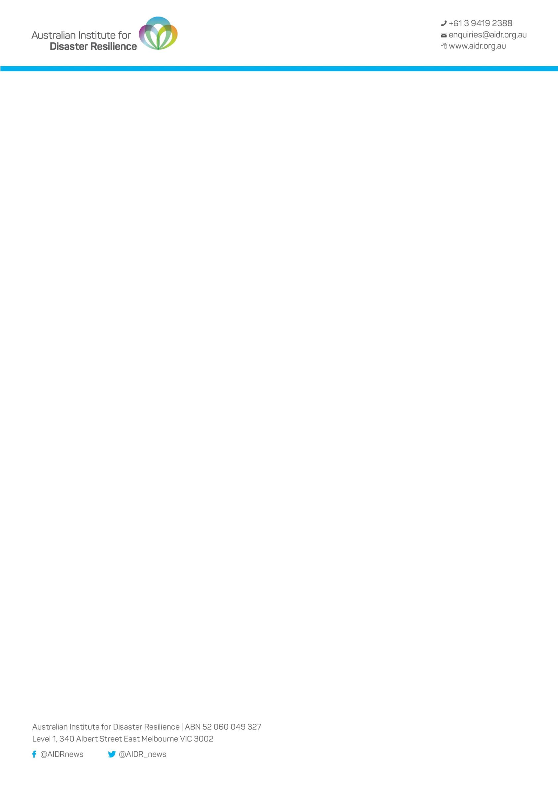

# AIDR Outcomes, Activities and Indicators for Recovery Programs

> **Source**: Australian Institute for Disaster Resilience (AIDR)
> **URL**: https://knowledge.aidr.org.au/media/9844/outcomes-activities-and-indicators-for-recovery-programs.pdf
> *Converted from PDF to Markdown format.*

---
## Page 1

Outcomes, Activities and Indicators for Recovery Programs 
 
Domain: Resilience and Sustainability  
Outcome: Community members are aware of the risks of future disasters 
Activities:  
• 
Communication to the community about recovery activities - through events (forums, 
briefings, etc) 
• 
Communication to the community about recovery activities - through media releases, radio, 
TV or newspapers 
• 
Events to educate the community about disaster risk and resilience 
• 
Plan for future disasters and build resilience and responsive capability for future disasters 
• 
Risk assessment to inform future plans and policies 
Indicators:  
• 
People who believe that they can do something to reduce the impact of future disaster 
events 
• 
People who have prepared disaster response kits at home 
Outcome: Displaced populations are able to return to the community if they prefer to return 
Activities:  
• 
Community engagement to inform recovery planning (e.g. needs assessment, social impact 
study, recovery teams working in communities) 
• 
Employment, training and work experience programs for local economic recovery 
Indicators:  
• 
Estimated resident population, by age group 
• 
Households returned to a new home in the area 
• 
Households returned to their pre-disaster homes 
• 
Households that have moved out of the area 
• 
Households that have moved properties 
• 
Local population growth (annually, since the disaster) 
• 
Neighbourhoods that have recovered at least 90% of population 
• 
Neighbourhoods where fewer than 50% of residents have returned 
• 
Net permanent and long-term movement of residents 
• 
People unable to return due to cost of return or housing 
• 
Reasons for last move 
• 
Regional internal migration estimates: gross and net

---
## Page 2

Outcome: Government, private sector and civil society and organisations are engaged in plans for 
mitigation and management of the recovery 
Activities:  
• 
Coordination arrangements for managing recovery activities between agencies and with 
communities 
• 
Plan for future disasters and build resilience and responsive capability for future disasters 
Indicators:  
• 
No indicators were developed for this outcome 
Outcome: The community can express its changing disaster recovery needs 
Activities: 
• 
Advice and support to businesses on technical and business aspects of recovery 
• 
Assessment of loss of livestock and animal welfare 
• 
Communication to the community about recovery activities - in writing (newsletters, fact 
sheets, websites, social media, etc) 
• 
Community engagement to inform recovery planning (e.g. needs assessment, social impact 
study, recovery teams working in communities) 
• 
Community engagement to monitor recovery and receive community feedback on the 
recovery program and process 
• 
Community information point that provides recovery information and advice in response to 
questions and needs (e.g. hotline, home visits) 
• 
Coordination arrangements for communication to affected communities 
• 
Coordination arrangements for managing recovery activities between agencies and with 
communities 
• 
Events to build community connection 
• 
Plan for future disasters and build resilience and responsive capability for future disasters 
• 
Plan the community recovery program with community engagement 
Indicators: 
• 
No indicators were developed for this outcome 
Outcome: The community has access to insurance (covering lives, homes and other property) 
through insurance markets or micro-finance institutions, where appropriate and viable 
• 
No activities or indicators were developed for this outcome 
 
Outcome: The community is aware of the disaster recovery processes 
Activities:  
• 
Communication to the community about recovery activities - by door-knocking 
• 
Communication to the community about recovery activities - in writing (newsletters, fact 
sheets, websites, social media, etc)

---
## Page 3

• 
Communication to the community about recovery activities - through events (forums, 
briefings, etc) 
• 
Communication to the community about recovery activities - through media releases, radio, 
TV or newspapers 
• 
Community information point that provides recovery information and advice in response to 
questions and needs (e.g. hotline, home visits) 
• 
Community services hub that assists households and individuals to obtain services, advice 
and support (through a local hub site and/or recovery team) 
• 
Coordination arrangements for communication to affected communities 
• 
Coordination arrangements for managing recovery activities between agencies and with 
communities 
• 
Environmental clean-up and remediation 
• 
Plan the community recovery program with community engagement 
Indicators: 
• 
Unique visits to community recovery website 
 
Outcome: The needs of vulnerable groups are addressed in disaster recovery 
• 
No activities or indicators were developed for this outcome

---
## Page 4

Domain: Social  
Outcome: Community health levels are appropriate for the community profile 
Activities:  
• 
Monitoring trends in substance abuse, domestic violence and suicide risk 
Indicators:  
• 
Alcohol consumption (level and frequency) 
• 
Causes of death, by age range 
• 
Hazardous drinking rates 
• 
Health status of the community affected by the disaster, by age 
• 
Hospital admissions by age, sex and clinical category 
• 
How often felt depressed (in last 4 weeks) 
• 
Instances of trauma related psychosocial issues return to pre-event levels (DV, violence, 
substance abuse, gambling, suicide, mental health issues) 
• 
Level of problem gambling in the community 
• 
Life expectancy 
• 
Number of GP consultations in last 12 months, per person 
• 
People who have seen a GP in the last two weeks 
• 
People who have seen a medical specialist in last two weeks 
• 
Physical measures (body mass index, blood pressure, etc) 
• 
Rates of prescribing for medication for mental health conditions 
• 
Self-assessed health status 
• 
Smoking level in the population by age and sex 
• 
Vaccination levels in the community 
Outcome: Community members are able to manage their own safety 
Activities:  
• 
Communication to the community about recovery activities - in writing (newsletters, fact 
sheets, websites, social media, etc) 
• 
Risk assessment to inform future plans and policies 
Indicators:  
• 
Feelings of safety at home alone (during the day, and after dark) 
• 
Perceptions of safety from disaster 
• 
Take up of safety advice from e.g. website or police information 
Outcome: Community members are able to respond to their own needs and to support the other 
members of the community 
Activities:  
• 
Community established a Fire Recovery Action Group to coordinate recovery activities 
• 
Community gatherings to hear from visiting psychologist on recovery issues for children 
• 
Community information sessions on bushfire awareness and preparedness

---
## Page 5

• 
Community training sessions on firefighting skills for women 
• 
Community training sessions on resilience covering preparedness and responding to hazards 
• 
Community Women's Association events on using local farm products 
• 
Community workshop to provide strategic direction for the Community Recovery Fund 
program 
• 
Disaster relief appeal fund provided money and donations to households 
• 
Economic development agency identified skills gaps in the area and offered training for 
upskilling 
• 
Emergency management training for staff of local NGOs 
• 
Health department provided information on child behaviours in recovery 
Indicators:  
• 
Cared for a person with either a disability, illness or old age in last 4 weeks 
• 
Community members have increased capacity and capability to deal with future events 
• 
Participation in volunteer activities (frequency, type, etc) 
• 
People who have prepared disaster response kits at home 
• 
People who knew how to protect their homes 
• 
People who say their household has all the items they need for basic emergency preparation 
• 
People who say they are more resilient after the disaster 
• 
Perceptions that making homes too resilient was too much 
• 
Person provides supriport to other relatives living outside the household 
• 
Persons needing assistance with core activities 
• 
Provided unpaid assistance to persons living outside the household in last 4 weeks 
• 
Types of support provided to other relatives living outside the household 
• 
Whether unpaid help is provided to a person with a disability 
Outcome: Community members are aware of each other's potential needs from future disasters 
through formal and informal networks and plans (i.e. social connectedness) 
Activities:  
• 
Events to build community connection 
• 
Plan for future disasters and build resilience and responsive capability for future disasters 
Indicators:  
• 
Extent to which people felt a sense of community with others in the neighbourhood 
• 
Participation in disaster preparedness training and events 
• 
People have someone to turn to in case of serious injury, illness or in need of emotional 
support 
Outcome: Community members can access appropriate services to deal with health needs 
Activities:  
• 
Community services hub that assists households and individuals to obtain services, advice 
and support (through a local hub site and/or recovery team) 
• 
Financial counselling services

---
## Page 6

• 
Grants to community organisations - to provide support for health and wellbeing 
• 
Health services that provide continuity of healthcare as well as responding to additional 
health needs arising from the disaster 
• 
Mental health services, counselling and support for wellbeing 
• 
Referral networks for case management established 
Indicators:  
• 
Access to a broad range of support 
• 
Awareness of psychosocial support 
• 
Consultations with dentist/dental professional in last 12 months 
• 
Hospital admissions by age, sex and clinical category 
• 
Mental health patients with improved outcomes (measured by instruments such as the Beck 
Depression Inventory, Kessler Psychological Distress Scale or Post-traumatic Diagnostic 
Scale) 
• 
Number of GP consultations in last 12 months, per person 
• 
Patient satisfaction with treatment from a trauma response program or service 
• 
Patients completing treatment from a trauma response program or service 
• 
Patients treated by a trauma response program or service 
• 
People accessing mental health services 
• 
People who reported having undergone counselling or PTSD treatment 
• 
Proportion of affected people who received mental health care 
• 
Respondents who did not have trouble accessing GP services 
• 
Satisfaction with support services provided 
• 
Waiting list time for trauma response program or service 
Outcome: Community members have access to appropriate and affordable housing in a timely 
manner 
Activities:  
• 
Community engagement to inform recovery planning (e.g. needs assessment, social impact 
study, recovery teams working in communities) 
• 
Council advice on process for rebuilding, insurance and design issues 
• 
Council held community information sessions on re-building 
• 
Council process for fast-tracking approvals for rebuilding 
• 
Grants to households - to assist with costs of clean-up, repair or rebuilding 
• 
Habitat for Humanity 'Brush with Kindness' program trained volunteers to help return 
damaged homes to a liveable condition 
• 
Short-term accommodation assistance and temporary housing provided to people whose 
homes were destroyed or damaged 
• 
Temporary accommodation 
Indicators:  
• 
Community report that current housing situation meets their needs 
• 
Habitability of social housing units 
• 
Homelessness in the disaster-affected area 
• 
Homes that are suitable for local climate conditions (insulation, shading, etc)

---
## Page 7

• 
House prices and rents by housing type 
• 
Household composition as measured by the ABS 
• 
Household satisfaction with new dwelling 
• 
Households in temporary accommodation 
• 
Households in temporary accommodation with rebuilding arrangements in place 
• 
Households resettled out of disaster risk zone 
• 
Households returned to their pre-disaster homes 
• 
Households who have rebuilt, purchased a new property or begun rebuilding process 
• 
Housing affordability: households spending 30% or more of pre-tax income on housing 
• 
Housing affordability: renters in the city paying more than 50% of their pre-tax income on 
rent 
• 
Housing affordability: renters with <$480 a week after housing costs are paid 
• 
Housing finance statistics as measured by the ABS (e.g. value of dwellings financed, 
construction of dwellings; purchase of established dwellings) 
• 
Housing tenure, landlord type, and demographic characteristics of households 
• 
Mix of housing stock available for rent or purchase 
• 
Neighbourhoods that have recovered at least 90% of population 
• 
Neighbourhoods where fewer than 50% of residents have returned 
• 
Number and proportion of occupied and unoccupied private dwellings 
• 
Number of affordable dwellings in the rental market 
• 
People who have moved house, and the reason for moving 
• 
Residential vacancy rates 
• 
Social housing waiting lists 
Outcome: Community members have social networks to support each other 
Activities:  
• 
Commemorative book on the history of the region and its community 
• 
Communication to the community about recovery activities - through events (forums, 
briefings, etc) 
• 
Community art project in memory of a community member who died in the fire 
• 
Community events - women's resilience days to support recovery for women affected by the 
fire 
• 
Community events to mark the first anniversary of the event 
• 
Community function to acknowledge all the work and support of people involved in the 
recovery 
• 
Community services hub that assists households and individuals to obtain services, advice 
and support (through a local hub site and/or recovery team) 
• 
Events to build community connection 
• 
Grants to community organisations - to support community recovery activities (e.g. 
community building, social networks, arts activities) 
• 
MensWatch program established to help men understand the mental health risks in 
recovery and to support other men 
• 
Mental health services, counselling and support for wellbeing

---
## Page 8

Indicators: 
• 
Access to online resources and social networks such as Facebook 
• 
Community networks functional and supportive 
• 
Divorce rate 
• 
Extent to which people felt a sense of community with others in the neighbourhood 
• 
Participation in sports organisations and physical activities (by activity type) 
• 
Participation in volunteer activities (frequency, type, etc) 
• 
People who feel that most people (in community) can be trusted 
• 
People who have regular contact with family or friends living outside the household 
• 
People who have someone to turn to for support outside the household 
• 
Social networks and unity within communities 
 
Outcome: Community members have the knowledge, skills, and resources for dealing with 
disaster related health risks (e.g. hygiene, sanitation, nutrition, water treatment) 
• 
No activities or indicators were developed for this outcome 
 
Outcome: Community members have the knowledge, skills, and resources for dealing with health 
issues related to the disaster experience 
Activities:  
• 
Community services hub that assists households and individuals to obtain services, advice 
and support (through a local hub site and/or recovery team) 
• 
Health education and awareness campaigns relating to disaster impacts 
• 
Mental health services, counselling and support for wellbeing 
Indicators:  
• 
Actions taken for health in last 12 months 
• 
Bed nets provided to prevent insect-borne diseases 
• 
Has access to motor vehicles to drive 
• 
Level of exercise undertaken for fitness, recreation or sport in last month 
• 
People accessing mental health services 
• 
People currently covered by private health insurance 
• 
People who delayed medical consultation because could not afford it 
• 
People who delayed purchasing prescribed medication because could not afford it 
• 
Proportion of people covered by a government health concession card 
• 
Relevant website traffic e.g. asbestos safety 
Outcome: Community members receive appropriate social services  
Activities:  
• 
Case management service that assesses the needs of households and individuals and assists 
them to obtain services, advice and support 
• 
Childcare services are made available based on community need

---
## Page 9

• 
Communication to the community about recovery activities - in writing (newsletters, fact 
sheets, websites, social media, etc) 
• 
Community information point that provides recovery information and advice in response to 
questions and needs (e.g. hotline, home visits) 
• 
Community services hub that assists households and individuals to obtain services, advice 
and support (through a local hub site and/or recovery team) 
• 
Donations of money or goods are collected and distributed to affected residents 
• 
Grants to community organisations - to assist with costs of recovery from the impacts of the 
disaster 
• 
Identification cards for people who have lost identification documents required for access to 
services 
• 
Local governments modify development approval and other processes to support timely 
recovery 
• 
Plan repair and rebuilding, and prioritise according to community needs and values 
Indicators:  
• 
Children who received psychosocial support 
• 
Demand for counselling and personal support services 
• 
Difficulty accessing service providers (type of service and reason for difficulty) 
• 
Families supported by special childcare program 
• 
Households who received service referrals from the Red Cross 
• 
People receiving support through a case management program 
• 
Proportion of requests for assistance that result in services being received 
• 
Schools where psychosocial support was provided 
Outcome: Community members receive continuity in the education services they need 
Activities:  
• 
Grants to schools - for clean-up, repair or rebuilding 
• 
Schools provide resources and facilities for continuity of education (e.g. alternate locations, 
online classrooms) 
Indicators: 
• 
Children attending school, by age and type of school 
• 
Children continuing education through temporary schooling arrangements 
• 
Children enrolled in preschool and other early childhood education 
• 
Children not participating in education 
• 
Children who failed a main school subject, by care type 
• 
Graduation from public schools 
• 
Participation in tertiary education, by age range and education level 
• 
Pupil-days disrupted 
• 
School closures after disaster 
• 
School participation rates, and rates of progression and retention 
• 
School results, by age 
• 
Schools operating from original location 
• 
Schools relocated

---
## Page 10

• 
Schools reopened after rebuilding 
• 
Student engagement (age-standardized rate of exclusions, expulsions, stand-downs and 
suspensions in school) 
• 
Youth not in employment, education or training 
Outcome: Cultural and racial diversity is respected 
Activities:  
• 
Events to build community connection 
Indicators:  
• 
Acceptance of other cultures 
• 
Crime against diverse groups 
• 
Cultural groups are not driven away 
• 
Demographic characteristics of the community (age, sex, family type, Aboriginal and Torres 
Strait Islander status) 
• 
Measures of cultural and linguistic diversity (such as country of birth and language spoken at 
home, religious affiliation) 
Outcome: Displaced populations are reconnected with essential health and social services 
Activities:  
• 
Case management service that assesses the needs of households and individuals and assists 
them to obtain services, advice and support 
• 
Community services hub that assists households and individuals to obtain services, advice 
and support (through a local hub site and/or recovery team) 
• 
Health services that provide continuity of healthcare as well as responding to additional 
health needs arising from the disaster 
• 
Mental health services, counselling and support for wellbeing 
Indicators:  
• 
Appropriateness of health and social services provided 
• 
Children separated from their families who have been assisted by recovery program 
• 
Children separated from their families who have been reunited with relatives and known 
neighbours 
• 
Priority of access for disaster-affected people 
Outcome: Existing health clients receive continuity of their care e.g. pharmaceutical supplies 
Activities:  
• 
Health services that provide continuity of healthcare as well as responding to additional 
health needs arising from the disaster 
• 
Mental health services, counselling and support for wellbeing 
• 
Repair and rebuild - health facilities 
Indicators: 
• 
Access to essential medication

---
## Page 11

• 
Proportion of hospital and primary health care facilities functioning after the disaster 
(percentage of available beds from pre-event capacity of available beds) 
Outcome: Households, families, and individuals are enabled to affect their own recovery through 
appropriate income sources 
Activities:  
• 
Payments to households and individuals to cover the loss of income due to the disaster 
Indicators:  
• 
Can afford food on time 
• 
Comparison of income sources to recovery needs 
• 
Continuity of income for people receiving Centrelink payments 
• 
Employment rate by age, sex, and other demographic characteristics 
• 
Households receiving hardship income support or other disaster-related payments 
Outcome: Households, families, and individuals have the information needed to make decisions 
Activities:  
• 
Advice and support to households for timely and fair assessment by insurers 
• 
Advice to business on how to access available grants, advice and other resources 
• 
Advice to households on repairing and rebuilding homes 
• 
Community information point that provides recovery information and advice in response to 
questions and needs (e.g. hotline, home visits) 
• 
Community services hub that assists households and individuals to obtain services, advice 
and support (through a local hub site and/or recovery team) 
• 
Donations management system to coordinate receipt and distribution of donations (of 
money or goods) 
• 
Donations of money or goods are collected and distributed to affected residents 
• 
Financial counselling services 
• 
Grants to community organisations - to provide support for health and wellbeing 
• 
Grants to households - to assist with costs of clean-up, repair or rebuilding 
• 
Local governments adjust rates and other charges for affected businesses and households 
• 
Payments to households and individuals to cover the immediate costs of the impact of the 
disaster (accommodation, food, personal needs, etc) 
• 
Payments to households and individuals to cover the loss of income due to the disaster 
Indicators:  
• 
Access to a broad range of information 
• 
Interactions on social media including online recovery resources and Facebook 
• 
Personally knows someone in an organisation to contact for information 
• 
Satisfaction with information received 
• 
Satisfaction with the range of support services 
• 
Visits to online housing damage database and map

---
## Page 12

Outcome: Leisure, sport and artistic activities are part of the fabric of the community 
Activities:  
• 
Arts and culture programs and activities 
• 
Events to build community connection 
• 
Grants to community organisations - to re-establish sport and recreation facilities and 
services 
• 
Grants to community organisations - to support community recovery activities (e.g. 
community building, social networks, arts activities) 
• 
Local facilities and assets are made available and used for a range of purposes to support 
recovery 
• 
Repair and rebuild - community facilities (e.g. halls, sports grounds, places of worship) 
• 
Repair and rebuild - public assets (infrastructure or buildings) 
Indicators:  
• 
Availability of cycling facilities (urban or recreational) 
• 
Availability of parks, playgrounds, walking tracks and other recreational facilities 
• 
Continuation of arts and culture nonprofits 
• 
Continuation of community and youth development nonprofits 
• 
Participation in arts and cultural activities (by activity type) 
• 
Participation in sports organisations and physical activities (by activity type) 
• 
Revenues to arts and culture nonprofits (annual) 
• 
Revenues to community and youth development nonprofits (annual) 
Outcome: Mutual assistance systems, social networks and support mechanisms are capable of 
adapting to emergencies when these occur 
Activities:  
• 
Events to build community connection 
• 
Plan for future disasters and build resilience and responsive capability for future disasters 
• 
Volunteer programs for community connection and social networks 
Indicators:  
• 
Civil Defence preparedness 
• 
Participation in volunteer activities (frequency, type, etc) 
• 
People who feel that most people (in community) can be trusted 
• 
SES volunteers and trained members 
• 
Sources of support in times of crisis 
• 
Trust in doctors 
• 
Trust in police 
Outcome: Possibilities for crime and social disorder as a result of the disaster are minimized 
Activities:  
• 
Events to educate the community about disaster risk and resilience

---
## Page 13

Indicators:  
• 
Child abuse investigations 
• 
Documentation, medical report and follow up rates of incidents involving the abuse of 
women and children 
• 
Feelings of safety walking alone in local area after dark 
• 
Imprisonment rates 
• 
Perceptions of social disorder in the local area 
• 
Police treatment of women and children 
• 
Public corruption 
• 
Referrals to community support services e.g. refuges 
• 
Reported offences, by type (assault, property, etc) 
• 
Victim of actual or attempted break-in in last 12 months 
• 
Victim of physical or threatened violence in last 12 months 
Outcome: The community can express its diverse spiritual composition 
Activities:  
• 
Repair and rebuild - community facilities (e.g. halls, sports grounds, places of worship) 
Indicators: 
• 
Participation at places of worship and faith community groups 
Outcome: The community has access to adequate sewerage and sanitation services 
Activities:  
• 
Repair and rebuild - water supply and sewerage 
Indicators:  
• 
Households that are (or are likely to be) adversely impacted due to damage to sewage 
containment and disposal systems 
• 
Incidence of diseases related to the disaster or post-disaster conditions (e.g. water-borne or 
insect-borne disease) 
• 
Proportion of sewerage schemes operating to regulatory standards 
Outcome: The community has access to clean drinking water and basic food supplies 
Activities:  
• 
Community services hub that assists households and individuals to obtain services, advice 
and support (through a local hub site and/or recovery team) 
• 
Donations of money or goods are collected and distributed to affected residents 
• 
Environmental health programs (water quality, disease risk, etc) 
Indicators:  
• 
Households whose water supply is, or is reasonably believed to be, contaminated and no 
longer meets the Australian Drinking Water Guidelines 2004 as a result of the disaster

---
## Page 14

• 
Incidence of diseases related to the disaster or post-disaster conditions (e.g. water-borne or 
insect-borne disease) 
• 
Proportion of water supply schemes operating to regulatory standards 
Outcome: The community has opportunities for creative expression that help the community 
recover from disaster 
Activities:  
• 
Arts and culture programs and activities 
• 
Events in memory of people killed in the disaster 
• 
Grants to community organisations - to support community recovery activities (e.g. 
community building, social networks, arts activities) 
Indicators: 
• 
Continuation of arts and culture nonprofits 
• 
Participation in arts and cultural activities (by activity type) 
• 
Participation in community events and perceived success of community events 
• 
Revenues to arts and culture nonprofits (annual) 
Outcome: The community is not experiencing excessive stress and hardship arising from the 
disaster 
Activities:  
• 
Bereavement community advisory group to provide advocacy and support for the bereaved 
• 
Bereavement service to coordinate support for bereaved families 
• 
Events for specific groups affected by the disaster 
• 
Grants to community organisations - to provide support for health and wellbeing 
• 
Mental health services, counselling and support for wellbeing 
Indicators: 
• 
Alcohol consumption (level and frequency) 
• 
Demand for counselling and personal support services, and level of services provided 
• 
Hazardous drinking rates 
• 
How often felt depressed (in last 4 weeks) 
• 
Mental health patients with improved outcomes (measured by instruments such as the Beck 
Depression Inventory, Kessler Psychological Distress Scale or Post-traumatic Diagnostic 
Scale) 
• 
People affected by the disaster who have symptoms of post-traumatic stress reactivity 
• 
People for whom disaster-related issues are no longer having a strong negative impact 
• 
People reporting that dealing with insurance had a negative effect on their lives 
• 
People who have experienced at least one stressor in the last 12 months 
• 
People who reported having undergone counselling or PTSD treatment 
• 
People whose quality of life had changed since disaster 
• 
Percentage of the population reporting high levels of stress 
• 
Physical measures (body mass index, blood pressure, etc) 
• 
Rates of prescribing for medication for mental health conditions

---
## Page 15

• 
Self-assessed quality of life 
• 
Severity of mental health issues (measured by instruments such as the Beck Depression 
Inventory, Kessler Psychological Distress Scale or Post-traumatic Diagnostic Scale) 
• 
Types of family stressors experienced in last 12 months 
• 
Types of personal stressors experienced in last 12 months 
• 
WHO-5 Wellbeing index for emotional wellbeing

---
## Page 16

Domain: Economic 
Outcome: Business insurance is accessible where viable 
Activities: 
 
• 
Advice and support to businesses on technical and business aspects of recovery 
 
Indicators: 
• 
Business insurance claims paid in full 
• 
Businesses who were adequately insured 
• 
Property owners or business operators with insurance receiving payment 
• 
Proportion of businesses with adequate insurance in place relative to pre fire 
Outcome: Business models are appropriately adaptive to market conditions and fluctuations 
Activities: 
• 
Employment, training and work experience programs for local economic recovery 
• 
Grants or loans to businesses - to assist with costs of recovery from the impacts of the 
disaster 
• 
Grants or loans to businesses - to employ apprentices and trainees 
• 
Partnerships to support businesses to recover and build business capacity 
• 
Plan for economic development that engages with the community and identifies 
opportunities 
• 
Private sector investment for local economic development 
• 
Research to support business recovery and future planning (e.g. new products or markets) 
• 
Tourism marketing 
Indicators: 
• 
No indicators were developed for this outcome 
Outcome: Businesses and not-for-profits can access or attract appropriately skilled workers 
Activities:  
• 
Employment, training and work experience programs for local economic recovery 
• 
Employment, training and work experience programs for repair and rebuilding 
• 
Grants to local government - to employ additional apprentices 
• 
Repair and rebuild - education facilities (schools, childcare centres, etc) 
Indicators: 
• 
Adult educational attainment 
• 
Businesses that retained workforce after disaster, by type 
• 
Job vacancies (by employment type, sector, or skill level) 
• 
Labour force status by type of qualification 
• 
Labour market outcomes by displacement and return levels 
• 
Participation in tertiary education, by age range and education level 
• 
Population 25 years and older with a University qualification

---
## Page 17

• 
Population aged 15-74 in formal and informal learning (number and proportion) 
• 
Profitability as a result of training provided 
• 
School leavers achieving above a certain level 
Outcome: Businesses and not-for-profits have access to critical banking and financial services  
Activities: 
• 
Advice and support to businesses on technical and business aspects of recovery 
• 
Financial counselling services 
• 
Grants or loans to businesses - to assist with costs of recovery from the impacts of the 
disaster 
Indicators:  
• 
Re-establishment of key services (banks, Australia post) 
• 
Venture capital funding per capita 
Outcome: Businesses and not-for-profits have business continuity plans and dynamic 
organisational resilience practices that address relevant risks and threats 
Activities:  
• 
Advice and support to businesses on technical and business aspects of recovery 
• 
Businesses and organisations plan for future disasters and build disaster resilience 
• 
Economic development agency held business continuity plan training 
• 
Economic development agency held grant-writing training for businesses 
Indicators: 
• 
Business respondents who agreed that business continuity planning reduced disruption to 
their services 
• 
Businesses who had taken steps to improve disaster resilience 
• 
Intention to use business plans for resilience in the future 
• 
Likelihood of using business plans in the future / perceptions of benefits from business plan 
programs in the future 
• 
Organisations with continuity plans and resilience plans 
• 
Perceptions of benefits from business plans for future resilience 
• 
Perceptions of benefits from business plans in disaster recovery 
• 
Proportion of farmers, business owners, not-for-profits who have developed dynamic 
disaster resilience and continuity plans 
Outcome: Businesses and not-for-profits know and understand the risks and threats of operating 
in the area 
Activities:  
• 
Businesses and organisations plan for future disasters and build disaster resilience

---
## Page 18

Indicators: 
• 
Business respondents who consider extreme weather a threat in their business continuity 
plans 
• 
Managers who believed that having a business continuity plan was important to their 
organisation 
• 
Stated mitigation practices for risks and threats 
Outcome: Businesses have secure and stable access to supply chains and networks (including 
markets, physical infrastructure and assets, as well as telecom networks) 
Activities:  
• 
Repair and rebuild - ports and related infrastructure 
• 
Repair and rebuild - roads and bridges 
• 
Transport services to assist businesses to send products to market 
Indicators: 
• 
Proportion of the affected rail network restored to service 
• 
Proportion of the affected roads and bridges that have been reopened 
• 
Vessels that are scheduled to dock or depart Australian ports and are unable to do so as a 
direct or indirect result of the emergency / disaster event, as reported by the relevant 
authority. 
Outcome: Community members have access to banking and financial services 
Activities:  
• 
Banking facilities or other ways to access personal and business finances 
• 
Financial counselling services 
Indicators:  
• 
Financial services are re-opened including temporary locations for banking 
• 
Re-establishment of key services (banks, Australia post) 
• 
Take up of financial counselling 
Outcome: Consumer and business confidence levels support business operations (both within and 
outside of the community) 
Activities:  
• 
"Buy local" campaign 
• 
Businesses and organisations that are part of larger organisations are given support to 
recover from their head office 
• 
Grants or loans to businesses - to assist with costs of recovery from the impacts of the 
disaster 
• 
Local governments adjust rates and other charges for affected businesses and households 
• 
Tourism marketing

---
## Page 19

Indicators:  
• 
Businesses confident that they will survive to the end of the year 
• 
Businesses operational and remaining in business, by location 
• 
Businesses operational and remaining in business, by type 
• 
Businesses that expected to be able to expand 
• 
Businesses that performed according to plan/better than planned 
• 
Businesses that retained staff initially funded by recovery program 
• 
Crop volumes and values 
• 
Farms recovered to pre-disaster levels (includes considerations of closures) 
• 
Growers and retail outlets carrying branded products developed through the program 
• 
Land in use for agricultural or horticultural production 
• 
Mines returned to production, and level of production 
• 
Passengers arriving and leaving by plane 
• 
Production and yield as a result of the program 
• 
Short-term crops established as part of the recovery program 
• 
Sources of farm income: grants, government transfers, relief funding 
• 
Tourism - international arrivals 
• 
Tourism - international or domestic visitors 
• 
Tourism business indicators (room occupancy rates, revenue, etc) 
• 
Tourist spending patterns 
• 
Visitors to tourist websites for the region 
Outcome: Early-stage and small businesses have the capacity to continue operation 
Activities: 
• 
Advice and support to businesses on technical and business aspects of recovery 
• 
Assessment of loss of livestock and animal welfare 
• 
Employment, training and work experience programs for local economic recovery 
• 
Events for specific groups affected by the disaster 
• 
Grants or loans to businesses - to assist with costs of recovery from the impacts of the 
disaster 
• 
Local facilities and assets are made available and used for a range of purposes to support 
recovery 
• 
Private sector investment for local economic development 
• 
Volunteer programs for clean-up, fence-building and repairs 
Indicators:  
• 
Businesses operational and remaining in business, by type 
• 
Entrepreneurship levels 
• 
Farming infrastructure recovered 
• 
New horticultural products developed

---
## Page 20

Outcome: Economic activity is appropriately diverse 
Activities:  
• 
Plan for economic development that engages with the community and identifies 
opportunities 
Indicators:  
• 
Agricultural land that has been rendered temporarily commercially unviable, with 
agricultural production not possible without intervention 
• 
Business size by sector 
• 
Distribution of job types by sector 
• 
Economic activity by sector 
• 
Employment in the tourism sector 
• 
Jobs by sector (number and proportion) 
• 
Jobs by sector (number and proportion) and changes over time 
• 
Minority-owned businesses 
• 
Productivity growth 
• 
Proportion of "export" and local-serving jobs 
• 
Regional economic growth 
Outcome: Households have access to an adequate range of goods and services 
Activities:  
• 
No activities were developed for this outcome 
Indicators:  
• 
Community satisfaction that adequate goods and services are affordable and accessible 
• 
Households that have access to discretionary goods and services 
• 
Households that have access to essential goods and services 
• 
Residents per supermarket (access to groceries) 
Outcome: Individuals and households have sufficient financial security to allow them to take 
advantage of economic opportunities 
Activities:  
• 
Payments to households and individuals to cover the immediate costs of the impact of the 
disaster (accommodation, food, personal needs, etc) 
• 
Payments to households and individuals to cover the loss of income due to the disaster 
Indicators:  
• 
Apprentices who retained jobs as a result of an economic recovery program 
• 
Average earnings of workers by sector 
• 
Community satisfaction with financial support received 
• 
Duration of unemployment 
• 
Employment rate by age, sex, and other demographic characteristics 
• 
Engagement in employment, education and training (EETP)

---
## Page 21

• 
Household debt levels, by debt type and household type 
• 
Household income, by household type 
• 
Households in the lowest income quintile 
• 
Jobs by sector (number and proportion) 
• 
Labour force participation rate 
• 
Number of hours worked in a specified period (e.g. the last week) 
• 
Number of jobs created as a result of disaster recovery programs 
• 
Number of jobs created within disaster recovery projects 
• 
Number of new apprentice positions created as a result of disaster recovery programs 
• 
Number of people who are actively looking for work 
• 
People who had at least one cash flow problem in last 12 months 
• 
People who have ceased a job in the period since the disaster 
• 
Principal source of household income 
• 
Proportion of children living in low-income households 
• 
Reduced dependence on disaster-related income support 
• 
Self-employment (number and proportion) 
• 
Size of the middle class (households in middle income quintiles) 
• 
Time that government support has been main source of income in last 2 years 
• 
Took at least one dissaving action in last 12 months 
• 
Unable to raise $2,000 within a week for something important 
• 
Underemployment ratio (underemployed workers expressed as a percentage of total 
employed persons) 
• 
Unemployment rate by age, sex, and other demographic characteristics 
• 
Youth not in employment, education or training 
Outcome: Key industry sectors for the community are restored 
Activities:  
• 
Clean-up recovery grants for farmers  
• 
Established primary producers’ network to coordinate recovery activities 
• 
Short-term assistance for re-establishing farm fences 
Indicators:  
• 
Area under production relative to pre fire 
• 
Farms / business owners confident about profit outlook 
• 
Livestock numbers relative to pre-fire 
• 
Major employment sites reopened (mines, ports, etc) 
• 
Operational capacity of businesses that is still functional after the emergency or disaster 
event 
• 
Program helped businesses provide vital services to the community

---
## Page 22

Outcome: Local business networks foster growth 
Activities:  
• 
"Buy local" campaign 
• 
Donations management system to coordinate receipt and distribution of donations (of 
money or goods) 
• 
Donations of money or goods are collected and distributed to affected residents 
• 
Employment, training and work experience programs for local economic recovery 
• 
Employment, training and work experience programs for repair and rebuilding 
• 
Local facilities and assets are made available and used for a range of purposes to support 
recovery 
Indicators:  
• 
Activity of the local Chamber of Commerce and business organisations 
• 
Venture capital funding per capita 
Outcome: Local businesses have information they need to continue recovering from the disaster 
Activities:  
• 
Advice and support to businesses on technical and business aspects of recovery 
• 
Advice to business on how to access available grants, advice and other resources 
• 
Agriculture industry groups provided resources for advice and support 
• 
Assessment process to identify local businesses in need of support 
• 
Government agencies prepare revised valuations of affected properties and provide financial 
assistance 
• 
Grants or loans to businesses - to assist with costs of recovery from the impacts of the 
disaster 
• 
Research to support business recovery and future planning (e.g. new products or markets) 
• 
Technical advice service for agriculture 
Indicators:  
• 
Farmers given referrals for support on animal welfare and recovery advice 
• 
Perceptions of effectiveness of assistance to farm businesses 
• 
Satisfaction with technical information and advice for primary production 
Outcome: Not-for-profit community service organisations can continue to provide regular services 
Activities:  
• 
Donations management system to coordinate receipt and distribution of donations (of 
money or goods) 
• 
Grants to community organisations - to assist with costs of recovery from the impacts of the 
disaster 
• 
Partnerships with community service providers to provide services and advice for 
community recovery

---
## Page 23

Indicators: 
• 
No indicators were developed for this outcome 
Outcome: The workforce has transferable skills 
Activities:  
• 
Businesses and organisations plan for future disasters and build disaster resilience 
• 
Employment, training and work experience programs for local economic recovery 
Indicators: 
• 
No indicators were developed for this outcome 
 
Outcome: Vulnerable groups are not further disadvantaged by the impact of the disaster, in terms 
of their ability to participate in the economic system (e.g. employment prospects, accessing credit) 
Activities:  
• 
Employment, training and work experience programs for local economic recovery 
• 
Employment, training and work experience programs for repair and rebuilding 
• 
Grants to local government - to employ additional apprentices 
• 
Regulatory changes - land use planning, building standards, development guidelines, or 
other requirements 
Indicators: 
• 
Households in each income quintile by ethnicity 
• 
Households in the lowest income quintile 
• 
Housing costs (rent or mortgage) for households where at least one person was Aboriginal 
and/or Torres Strait Islander 
• 
Housing quality for households where at least one person was Aboriginal and/or Torres 
Strait Islander 
• 
Income inequality (income at the 95th and 20th percentiles) 
• 
Labour market outcomes by displacement and return levels 
• 
Locations with above average levels of households in poverty 
• 
Number of income support recipients transferred into employment 
• 
People who cannot access, or have difficulty getting to the places needed 
• 
Share of jobs by local area 
• 
Socioeconomic indicators by ethnicity and gender 
• 
Unemployment rate by age, sex, and other demographic characteristics

---
## Page 24

Domain: Environmental 
Outcome: Cultural heritage sites or assets of importance are restored, where possible, in a way 
that provides these values to the community 
Activities:  
• 
Community groups grew seedlings for re-planting gardens 
• 
Environmental clean-up and remediation 
• 
Environmental monitoring to track recovery and identify further issues for attention 
• 
Plan for environmental recovery and resilience 
• 
Repair and rebuild - public assets (infrastructure or buildings) 
Indicators:  
• 
National parks re-opened 
• 
Parks, reserves and beaches open for public access 
• 
Satisfaction that needs are being met 
Outcome: The community is aware of the risks of future disasters to natural and cultural heritage 
assets 
Activities:  
• 
Arts and culture programs and activities 
• 
Environmental monitoring to track recovery and identify further issues for attention 
• 
Government support for the restoration of essential services 
• 
Plan for environmental recovery and resilience 
Indicators:  
• 
Community satisfied that facilities (especially damaged facilities) meeting their needs 
 
Outcome: The community understands the characteristics and functioning of local natural 
environment and ecosystems 
Activities:  
• 
Plan for environmental recovery and resilience 
Indicators: 
• 
Participation in bushcare/landcare activities 
• 
Quality measures of environmental management plans 
Outcome: The community's exposure to environmental health risks and public health risks is 
minimised 
Activities:  
• 
Asbestos safety inspections and clean-up 
• 
Clean-up, hazard inspection, and waste removal 
• 
Environmental clean-up and remediation

---
## Page 25

• 
Grants or loans to businesses - to assist with costs of recovery from the impacts of the 
disaster 
• 
Grants to households - to assist with costs of clean-up, repair or rebuilding 
• 
Information provided to community about potential environmental health risks and how to 
address them 
• 
Insect surveillance and control to reduce risk of disease (dengue, etc) 
• 
Training for community members participating in clean-up and recovery (e.g. chainsaw 
safety) 
Indicators:  
• 
Catchment area that has been polluted as a result of the emergency or disaster event that 
make the water unsafe for any form of life, as reported by relevant authority. 
• 
Crops produced are below permissible level of radioactivity 
• 
Days with unhealthy air quality (air quality below an agreed threshold) in a specified period 
• 
Environmental radiation concentrations in water, sediment and suspended sediment 
• 
Incidence of diseases related to the disaster or post-disaster conditions (e.g. water-borne or 
insect-borne disease) 
• 
People receiving medical care from exposure to environmental health risks 
• 
Pollution of air, water or land, by pollutant type and impact 
• 
Stated ability to manage environmental health risks 
Outcome: The impact of future disasters on biodiversity and ecosystem is minimised 
Activities:  
• 
Environmental clean-up and remediation 
• 
Environmental monitoring to track recovery and identify further issues for attention 
• 
Grants to local government - to restore and improve infrastructure 
• 
Plan for environmental recovery and resilience 
• 
Risk assessment to inform future plans and policies 
Indicators:  
• 
Ground cover (resilience against fires) 
• 
Potential future risks identified and appropriate strategies implemented 
Outcome: The natural environment operates to maintain healthy biodiversity and ecosystems 
Activities:  
• 
Community revegetation events in the affected area 
• 
Environment agency site visits to assess natural recovery needs and provide technical advice 
• 
Environmental clean-up and remediation 
• 
Environmental monitoring to track recovery and identify further issues for attention 
• 
Information and events for land holders regarding regeneration of natural environment 
• 
Inspect and assess environmental damage and options for remediation 
• 
Local Natural Resources Management Board plant give-away 
• 
Plan for environmental recovery and resilience 
• 
Volunteer programs for environmental clean-up and remediation

---
## Page 26

Indicators:  
• 
Area remediated (revegetation, weed removal, erosion control, etc) 
• 
Coastal wetlands lost 
• 
Coastline that is unusable or environmentally degraded as a result of the emergency or 
disaster event resulting in the requirement for intervention. 
• 
Concentration of chloride in the water (indicator of saltwater encroachment and salinity) 
• 
Current number of native species and ongoing monitoring of species 
• 
Erosion in areas affected by the disaster 
• 
Food stock availability for local wildlife 
• 
Groundwater salinity 
• 
Hectares of National Park Area that is unusable or environmentally degraded as a result of 
the emergency or disaster event and requires an intervention. 
• 
Marine pollution which has occurred as a result of the emergency or disaster event, as 
reported by the relevant State/Territory or Australian Government authority. 
• 
Natural habitat supports healthy levels of biodiversity 
• 
Pollution of air, water or land, by pollutant type and impact 
• 
Proportion of affected stream flow gauges repaired 
• 
Sediment yields across watersheds

---
## Page 27

Domain: Built  
Outcome: Infrastructure is built in accord with changing recovery needs 
Activities:  
• 
Asbestos safety inspections and clean-up 
• 
Clean-up, hazard inspection, and waste removal 
• 
Community grants for repairing and upgrading community facilities, with community 
involved in prioritising the projects to be funded 
• 
Council provided rate and fee relief 
• 
Inspect and assess damage to public assets (buildings and infrastructure) 
• 
Inspect and assess damage to transport infrastructure 
• 
Local governments modify development approval and other processes to support timely 
recovery 
• 
Regulatory changes - land use planning, building standards, development guidelines, or 
other requirements 
• 
Repair and rebuild - fences 
• 
Risk assessment to inform future plans and policies 
Indicators:  
• 
Building approvals issued, by building type 
• 
Construction statistics as measured by the ABS (e.g. total construction by type and 
ownership, alterations to buildings) 
• 
Farms have necessary equipment to support operations 
• 
Housing projects that have secured financing 
Outcome: Infrastructure is built in accord with current knowledge and practices for mitigating 
disaster impact 
Activities:  
• 
Communication to the community about recovery activities - in writing (newsletters, fact 
sheets, websites, social media, etc) 
• 
Community rebuilt homes to higher bushfire safety standards 
• 
Community-led project to install new fire water storage tanks, with the local water authority 
donating the first filling of each tank 
• 
Construct shelters and safe places for use in future disasters 
• 
Grants to households - to assist with costs of clean-up, repair or rebuilding 
• 
Grants to local government - to restore and improve infrastructure 
• 
Inspect and assess damage to private buildings 
• 
Plan for future disasters and build resilience and responsive capability for future disasters 
• 
Regulatory changes - land use planning, building standards, development guidelines, or 
other requirements 
• 
Repair and rebuild - drainage, irrigation and storm water management systems 
• 
Repair and rebuild - roads and bridges 
• 
Risk assessment to inform future plans and policies

---
## Page 28

• 
Utilities (energy, water, etc) review and improve their infrastructure to be more resilient to 
future disasters 
Indicators:  
• 
People awarded grants to undertake resilience-building repairs to homes 
• 
People who had undertaken resilience-focused rebuilding measures 
• 
Proportion of water transport facilities that have been upgraded to meet new standards 
• 
Rebuilt properties have increased fire safe design 
Outcome: Infrastructure is built with regard to local disaster risks 
Activities:  
• 
Land buy-back or land-swap schemes 
• 
Plan for future disasters and build resilience and responsive capability for future disasters 
• 
Plan repair and rebuilding, and prioritise according to community needs and values 
• 
Regulatory changes - land use planning, building standards, development guidelines, or 
other requirements 
• 
Repair and rebuild - disaster monitoring infrastructure (e.g. flood gauges, fire spotting 
towers) 
• 
Repair and rebuild - rail infrastructure 
• 
Risk assessment to inform future plans and policies 
Indicators:  
• 
Households that have properties in a safer location as a result of land swap or buy-back 
scheme 
• 
Infrastructure developed or rebuilt in line with disaster risk standards 
• 
Properties acquired by government under land swap or buy-back scheme 
Outcome: Local infrastructure is appropriately integrated with wider state and commonwealth 
infrastructure 
• 
No activities or indicators  were developed for this outcome 
Outcome: Provide infrastructure that delivers essential services to the community 
Activities:  
• 
Clean-up, hazard inspection, and waste removal 
• 
Demolition of unsafe buildings and structures 
• 
Employment, training and work experience programs for repair and rebuilding 
• 
Grants to local government - to assist with costs of recovery from the impacts of the disaster 
• 
Grants to local government - to restore and improve infrastructure 
• 
Inspect and assess damage to private buildings 
• 
Inspect and assess damage to water supply and sewerage infrastructure 
• 
Plan repair and rebuilding, and prioritise according to community needs and values 
• 
Repair and rebuild - disaster monitoring infrastructure (e.g. flood gauges, fire spotting 
towers) 
• 
Repair and rebuild – homes

---
## Page 29

• 
Repair and rebuild - public assets (infrastructure or buildings) 
• 
Repair and rebuild - rail infrastructure 
• 
Repair and rebuild - roads and bridges 
• 
Repair and rebuild - tourist facilities 
• 
Secure unsafe buildings and structures 
• 
Utilities (energy, water, etc) provide assistance to customers who have lost supply 
• 
Volunteer programs for clean-up, fence-building and repairs 
Indicators: 
• 
Affected homes and businesses where power was restored 
• 
Customers without electricity as identified by the relevant utility provider 
• 
Customers without gas as identified by the relevant utility provider 
• 
Customers without telecommunications as identified by the relevant utility provider 
• 
Damaged public/essential service type assets rebuilt and operating 
• 
Damaged residential/commercial/industrial assets rebuilt 
• 
Households with internet access 
• 
Main roads and bridges which have been closed as a result of the disaster event, as reported 
by the relevant authority 
• 
Other roads and bridges which have been closed as a result of the disaster event, as 
reported by the relevant authority 
• 
People who cannot access, or have difficulty getting to the places needed 
• 
Ports restored to full operation 
• 
Proportion of ferry terminals and services that have been reopened 
• 
Proportion of sewerage schemes operating to regulatory standards 
• 
Proportion of the affected electricity network restored to service 
• 
Proportion of the affected rail network restored to service 
• 
Proportion of the affected roads and bridges that have been reopened 
• 
Proportion of water supply schemes operating to regulatory standards 
• 
Rail lines that are closed as a result of the emergency or disaster event, resulting in an 
interruption to rail passenger or freight movements. 
• 
Re-establishment of key services (banks, Australia post) 
• 
Repair status of damaged water supply schemes 
• 
Repair status of ports, marinas and other water facilities 
• 
Time taken for fuel crisis to be mitigated

