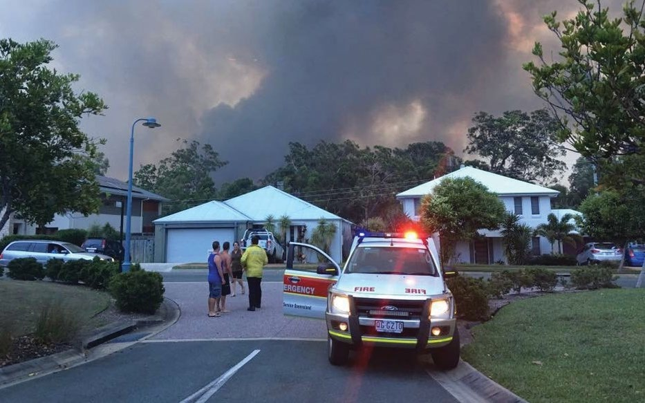

# AIDR Public Information and Warnings Handbook (2021)

> **Source:** Australian Institute for Disaster Resilience (AIDR)
> **URL:** https://knowledge.aidr.org.au/media/9104/aidr_handbookcollection_publicinfoandwarnings_2021.pdf
> **Converted from PDF** — structure and images preserved where possible.

---
## Page 1

Public Information 
and Warnings  
2021
Australian Disaster Resilience Handbook Collection

---
## Page 2

b
Public Information and Warnings Handbook
Cover images, clockwise from top: QFES, NSW RFS, Lumix2004 via Pixabay.

---
## Page 3

AUSTRALIAN DISASTER RESILIENCE 
HANDBOOK COLLECTION
Public Information  
and Warnings  
Second edition 2021

---
## Page 4

ii
Public Information and Warnings Handbook
© Commonwealth of Australia 2021
Published by the Australian Institute for Disaster 
Resilience.
Copyright
The Australian Institute for Disaster Resilience 
encourages the dissemination and exchange of 
information provided in this publication.
The Commonwealth of Australia owns the copyright in all 
material contained in this publication unless otherwise 
noted.
Where this publication includes material, whose 
copyright is owned by third parties, the Australian 
Institute for Disaster Resilience has made all reasonable 
efforts to:
•	
clearly label material where the copyright is owned by 
a third party
•	
ensure that the copyright owner has consented to 
this material being presented in this publication.
Wherever a third party holds copyright in material 
presented in this publication, the copyright remains with 
that party. Their permission is required to reproduce the 
material.
All material presented in this publication is provided 
under a Creative Commons Attribution 4.0 International 
Public License, with the exception of:
•	
the Commonwealth Coat of Arms
•	
registered trademarks, including
	
−
National Resilience and Recovery Agency logo
	
−
Australian Institute for Disaster Resilience logo
•	
materials specifically mentioned as not being 
provided under a Creative Commons Attribution 4.0 
International Public Licence
•	
content supplied by third parties.
Details of the relevant licence conditions are available 
on the Creative Commons Attribution 4.0 website 
(creativecommons.org.au) as is the full legal code for  
the CC BY 4.0 license.
Attribution
Where material from this publication is used for any 
purpose, it is to be attributed to the developer as follows:
Source: Public Information and Warnings (AIDR 2021).
Using the Commonwealth Coat of Arms
The terms of use for the Coat of Arms are available 
from the It’s an Honour website: www.pmc.gov.au/
government/its-honour
Contact
Enquiries regarding the content, licence and any use of 
this document are welcome at:
The Australian Institute for Disaster Resilience 
Level 1, 340 Albert St, East Melbourne Vic 3002 
Telephone: +61 (0) 3 9419 2388
Disclaimer
The Australian Government National Recovery and 
Resilience Agency and the Australian Institute for 
Disaster Resilience, in consultation with emergency 
management professionals and subject matter experts, 
exercise care in the compilation and drafting of this 
publication; however, the document and related graphics 
could include technical inaccuracies or typographical 
errors and the information may not be appropriate to all 
situations.
In no event shall the Commonwealth of Australia (acting 
through the National Recovery and Resilience Agency) or 
the Australian Institute for Disaster Resilience be liable 
for any damages whatsoever, whether in an action of 
contract, negligence or other tortious action, arising out 
of or in connection with the use of or reliance on any of 
the information in this publication.

---
## Page 5

iii
Public Information and Warnings Handbook
The Australian Disaster Resilience Handbook Collection provides guidance on national principles and practices for 
disaster resilience. 
The Handbook Collection: 
•	
provides an authoritative, trusted and freely available 
source of knowledge about disaster resilience 
principles in Australia
•	
aligns national disaster resilience strategy and policy 
with practice, by guiding and supporting jurisdictions, 
agencies and other organisations and individuals in 
their implementation and adoption
•	
highlights and promotes the adoption of good 
practice in building disaster resilience in Australia
•	
builds interoperability between jurisdictions, agencies, 
the private sector, local businesses and community 
groups by promoting use of a common language and 
coordinated, nationally agreed principles.
The Handbook Collection is developed and reviewed 
by national consultative committees representing a 
range of state and territory agencies, governments, 
organisations and individuals involved in disaster 
resilience. The collection is sponsored by the Australian 
Government Department of Home Affairs.
Access to the Handbook Collection and further details 
are available on the Australian Disaster Resilience 
Knowledge Hub: www.knowledge.aidr.org.au/handbooks
Australian Disaster 
Resilience Handbook 
Collection
Australian Emergency Management Arrangements
Community Engagement for Disaster Resilience
Communities Responding to Disasters: Planning for 
Spontaneous Volunteers
Community Recovery
Disaster Resilience Education for Young People
Emergency Planning
Evacuation Planning
Flood Emergency Planning for Disaster Resilience
Health and Disaster Management
Land Use Planning for Disaster Resilient Communities
Lessons Management
Managing Exercises
Managing the Floodplain: A Guide to Best Practice in 
Flood Risk Management in Australia
National Emergency Risk Assessment Guidelines
Public Information and Warnings
Safe and Healthy Crowded Places
Systemic Disaster Risk
Tsunami Emergency Planning in Australia

---
## Page 6

iv
Public Information and Warnings Handbook
Acknowledgements
This handbook review was prepared by the Australian Institute for Disaster Resilience (AIDR) with the assistance of 
Amisha Mehta, Dominique Greer and Paula Dootson of the Queensland University of Technology and with financial 
assistance from the Australian Government. Responsibility for the views, information or advice expressed in this 
handbook does not necessarily reflect the views of the Australian Government. 
This handbook was made possible through the support of a broad cross-section of the disaster risk reduction, disaster 
resilience and emergency management sector. 
Warnings group members
AIDR acknowledges the efforts of the AFAC Warnings Group to support the review of this handbook:
Australian Broadcasting Corporation – Anthony Gerace
Australian Capital Territory Emergency Service Agency – Kaylee Rutland
Australasian Fire and Emergencies Authorities Council and Australian Institute for Disaster Resilience – Amanda Leck
Bureau of Meteorology – Carla Mooney
BushfiresNT – Akshy Athukorala
Country Fire Authority, Victoria – Angela Gardner
Department of Fire and Emergency Services, Wester Australia – Anni Fordham
Department of Home Affairs, Emergency Management Australia – Steve Dwyer
Emergency Management Victoria – Andrew Crisp and Reegan Key
Fire & Rescue New South Wales – Philip Lindsay
Fire Rescue Victoria – Barry Gray
Inspector-General of Emergency Management, Queensland – Corinne Mulholland
New South Wales Rural Fire Service – Anthony Clark
New South Wales State Emergency Service – Kirra Waine
Northern Territory Police, Fire and Emergency Services – Mark Cunnington
Queensland Fire and Emergency Services – Greg Leach and Kath Ryan
Queensland University of Technology – Dominique Greer, Paula Dootson and Amisha Mehta
Sout Australia Country Fire Service – Fiona Dunstan
South Australia Fire and Emergency Services Commission – Sita Bacher
South Australia Metropolitan Fire Service – Nicole Ely
South Australia State Emergency Service – Liz Connell
Tasmania Fire Service – Peter Middleton
Victoria State Emergency Service – Fiona O’Loughlin

---
## Page 7

v
Public Information and Warnings Handbook
Australian Disaster Resilience Handbook Collection ........................................................................................................................  iii
Acknowledgements ......................................................................................................................................................................................  iv
Preface ............................................................................................................................................................................................................  vii
Purpose of this handbook .............................................................................................................................................................................................................  vii
Who is this handbook for? ............................................................................................................................................................................................................  vii
How is this handbook has been developed? ....................................................................................................................................................................  viii
Companion documents ...................................................................................................................................................................................................................  viii
Context .............................................................................................................................................................................................................  ix
Public information and warnings as a priority ..................................................................................................................................................................  ix
Part of a broader approach to disaster resilience .........................................................................................................................................................  ix
An evolving discipline ........................................................................................................................................................................................................................  ix
Part 1: Warning fundamentals ...................................................................................................................................................................   1
1.1 What is a warning? .......................................................................................................................................................................................................................  2
1.1.1 What is public information? .........................................................................................................................................................................................  2
1.2 Warning principles .......................................................................................................................................................................................................................  3
1.3 Why we warn ...................................................................................................................................................................................................................................  4
1.3.1 Warnings empower people and foster shared responsibility .............................................................................................................  4
1.3.2 A mandate and responsibility to warn ...............................................................................................................................................................  4
1.3.3 Public value ..........................................................................................................................................................................................................................  4
1.3.4 Community expectation .............................................................................................................................................................................................  4
1.4 A total warning system ............................................................................................................................................................................................................  5
1.4.1 Elements of the Total Warning System .............................................................................................................................................................  6
1.5 How do people react to warnings? ..................................................................................................................................................................................  8
1.5.1 Trust and personal verification of warning ......................................................................................................................................................  8
1.5.2 Interpretation of risk and decision to act ........................................................................................................................................................  9
1.5.3 Taking protective action ............................................................................................................................................................................................  10
1.6 Who provides warnings? ........................................................................................................................................................................................................  11
1.6.1 Statutory providers of warnings ...........................................................................................................................................................................  11
1.6.2 Established emergency broadcasters .............................................................................................................................................................  11
1.6.3 Individuals and community members ...............................................................................................................................................................  11
1.6.4 Private warning publishers or disseminators ..............................................................................................................................................  14
1.6.5 Working with warnings republishers .................................................................................................................................................................  14
Part 2: Delivering effective warnings ....................................................................................................................................................  15
2.1 The decision to warn .................................................................................................................................................................................................................  16
2.1.1 A scaled approach ............................................................................................................................................................................................................  16
2.1.2 Factors informing a decision to warn ................................................................................................................................................................  16
2.1.3 Managing uncertainty in dynamic events ......................................................................................................................................................  17
2.1.4 Public information: complementing official warnings ............................................................................................................................  18
2.1.5 De-escalation messages ...........................................................................................................................................................................................  18
Contents

---
## Page 8

vi
Public Information and Warnings Handbook
2.2 Essentials of message construction ...........................................................................................................................................................................  18
2.2.1 The issuing authority.....................................................................................................................................................................................................  18
2.2.2 Call-to-action ....................................................................................................................................................................................................................  18
2.2.3 Structure .............................................................................................................................................................................................................................  19
2.2.4 Consistency ......................................................................................................................................................................................................................  19
2.2.5 Timing and frequency of issue .............................................................................................................................................................................  19
2.2.6 Maps and visuals ...........................................................................................................................................................................................................  20
2.2.7 Easily shared .....................................................................................................................................................................................................................  20
2.2.8 Accessible ...........................................................................................................................................................................................................................  21
2.2.9 Targeted to specific locations  .............................................................................................................................................................................  21
2.2.10 Tailored for local communities and diverse audiences ......................................................................................................................  21
2.2.11 Managing a wealth of information ...................................................................................................................................................................  23
2.3 Getting the message out .....................................................................................................................................................................................................  23
2.3.1 Tailoring warnings for different channels ......................................................................................................................................................  26
2.3.2 Standard Emergency Warning Signal .............................................................................................................................................................  26
2.3.3 Communicating with hard-to-reach communities ................................................................................................................................  26
2.3.4 Reaching people beyond the geographic warning area .....................................................................................................................  26
2.3.5 Working with changing technology and user expectations .............................................................................................................  27
2.3.6 Warning publishing systems ..................................................................................................................................................................................  27
2.4 Planning for system failures and unexpected challenges  ...........................................................................................................................  27
2.4.1 The importance of consistent education: Do not expect a warning ..........................................................................................  28
2.4.2 Loss of power and telecommunications networks  .............................................................................................................................  28
2.4.3 The importance of local networks and resources .................................................................................................................................  28
24.4 Capacity of public information resources  ...................................................................................................................................................  29
2.4.5 Failure of publishing and dissemination systems  .................................................................................................................................  29
2.4.6 Increased use of social media ..............................................................................................................................................................................  29
Part 3: Evaluating public information and warnings  ........................................................................................................................  31
3.1 Evaluating public information and warnings ............................................................................................................................................................  32
3.1.1 A lessons management approach .......................................................................................................................................................................  32
3.1.2 An outcomes focus ......................................................................................................................................................................................................  32
3.1.3 Readiness to review .....................................................................................................................................................................................................  33
References ....................................................................................................................................................................................................   34
List of Figures
Figure 1: A timeline of key events in the warnings landscape in Australia and internationally 1989-2018  ���������������������������  x
Figure 2: Australia’s Total Warning System  ������������������������������������������������������������������������������������������������������������������������������������������������������������������������  5
Figure 3: The decision to warn is based on risk ���������������������������������������������������������������������������������������������������������������������������������������������������������������  16
List of Tables
Table 1: Australia’s warning principles .........................................................................................................................................................................................3
Table 2: Elements of Australia’s Total Warning System .................................................................................................................................................6
Table 3: Jurisdictional statutory roles and responsibilities for warnings ........................................................................................................12
Table 4: An example of data and questions used to inform assessment of the need to warn ........................................................17
Table 5: Different factors about each community should inform the tailoring of warnings .............................................................22
Table 6: Common channels of communication when disseminating public information and warnings .....................................24

---
## Page 9

vii
Public Information and Warnings Handbook
Preface
Purpose of this handbook
The effective communication of public information and warnings is a critical element of emergency management, 
with the power to save lives. This handbook provides insight and guidance to people who have responsibility for 
communication with the public in the event of an emergency. The handbook presents nationally agreed principles  
for warning policy and practice and explores the essential elements and discipline of effective public information  
and warning delivery.
This handbook is designed to be of value across a wide range of hazards. Whether it is a natural hazard or weather 
event, a public health emergency, or a hostile attack in an urban setting, the principles, importance and discipline of 
effective communication are broadly applicable.
The handbook aligns national disaster resilience strategy and policy with practice, notably the National Strategy for 
Disaster Resilience (COAG 2011) and Strategic Directions for Fire and Emergency Services in Australia and New Zealand 
2021–2026 (AFAC 2021), by guiding and supporting jurisdictions, agencies and other organisations and individuals in 
their implementation and adoption. It also responds to Recommendation Two of the 2014 National Review of Warnings 
and Information (ANZEMC 2015), to advance a national approach through improved knowledge management.
The scope of the handbook spans public information and warnings and has a specific and intentional focus on the 
delivery of warnings. Future revisions of the handbook will expand discussion to include relevant good practice on the 
provision of public information.
The handbook is not intended to be operational in nature. Organisations with responsibilities for the provision of 
warnings have local arrangements in place, tailored to their role and responsibilities.
See Part 1.1 What is a warning? for definition and use of warnings and public information terms.
Who is this handbook for?
This handbook is designed to support organisations and individuals with specific responsibilities for developing and 
disseminating public information and warnings in an emergency. It will benefit Australian leaders and practitioners 
in emergency management, meteorological services, policing and security, health agencies, and other hazard 
management organisations. Broadcasters and other organisations committed to sharing warnings effectively will also 
find the handbook useful.
Individuals and community groups, regulators, auditors- general, the legal fraternity, international practitioners in 
disaster resilience and emergency management, and those working in communication and behavioural science may 
also value the information and research presented.
This handbook is available on the Australian Disaster Resilience Knowledge Hub at knowledge.aidr.org.au/
resources/public-information-and-warnings-handbook

---
## Page 10

viii
Public Information and Warnings Handbook
How has this handbook been developed?
Public Information and Warnings (AIDR 2021) is part of the Australian Disaster Resilience Handbook Collection. The 
handbook takes into account that there are diverse arrangements and specific requirements for public information 
and warnings practice across Australia. The Handbook Working Group has set out to present a shared perspective on 
known and emerging good practice, with an all-hazards view. The handbook does not necessarily capture or reflect 
current policy and practice across all agencies and is not intended for this purpose.
The handbook is presented in three parts: 
•	
Part 1: Warning fundamentals
•	
Part 2: Delivering effective warnings
•	
Part 3: Evaluating public information and warnings
While references are provided throughout, it is important to note this handbook is not an academic paper. References 
for further reading are provided at the end of this handbook.
The 2021 revision of Public Information and Warnings includes latest research outputs from the Bushfire and Natural 
Hazards Cooperative Research Centre communications and warnings research project and to reflect the adoption of 
the Australian Warning System, endorsed by ANZEMC in March 2021. 
Companion documents
Three separate companion documents are available online to support people’s use and application of Public Information 
and Warnings. These companion documents have been updated in July 2021 to ensure currency:
1.	
Warning Message Construction: Choosing your words (Guideline 1)
2.	
Warnings Republishers (Guideline 2)
3.	
Australian Warning System
Terms used in this handbook
Warning is defined in this handbook as point-in-time information about a hazard that is impacting or is expected to 
impact communities. Warnings describe the impact and expected consequences for communities and include advice 
on what people should do.
Public information is information provided to the public immediately before, during and after an emergency to reduce 
the potential impact of an emergency or hazard.
Total warning system describes a means of collecting information about an impending emergency, understanding the 
nature of the threat, communicating that information to those likely to be affected by it, and facilitating protective 
action and timely response (Mileti & Sorensen 1990; Sorensen 2000).
Early warning system is an integrated system of hazard monitoring, forecasting and prediction, disaster risk 
assessment, communication and preparedness activities systems and processes that enables individuals, 
communities, governments, businesses and others to take timely action to reduce disaster risks in advance of 
hazardous events (Source: United Nations Office for Disaster Risk Reduction, 2009).
Call-to-action is a clear instruction of the (protective) action people should take.
Event, incident and emergency are used interchangeably throughout this handbook, unless noted otherwise.
The Australian Disaster Resilience Glossary on the Knowledge Hub provides further detail on terms and definitions 
used in emergency and disaster management: knowledge.aidr.org.au/glossary

---
## Page 11

ix
Public Information and Warnings Handbook
Context
In an emergency, the provision of public information and warnings plays a significant role in making people and 
communities safer. Timely, targeted and tailored information and warnings empower people to make informed 
decisions, to take protective action, and to reduce the potential impacts and consequences of a hazard.
Public information and warnings as a priority
Warnings are a critical component of emergency management, and the evolution of both policy and practice over 
recent years has been transformative. A series of significant and devastating emergencies across Australia including 
the Black Summer fires in 2019–20, major flooding in Queensland during 2010–11 and Victoria’s Black Saturday 
bushfires in 2009, highlighted the power of warnings to save lives and a need to learn more about why some warning 
strategies were more successful than others.
Today, the provision of warnings is seen as a priority action in any emergency, equal to any other aspect of traditional 
response. This applies to any hazard, whether it is a natural hazard such as fire, flood or heatwave, an incident of 
public safety and security, or a health-related event such as a pandemic. Across Australia, Commonwealth, state and 
territory governments and their emergency service organisations and statutory bodies hold responsibilities for issuing 
warnings. Community members and organisations also play a shared role in communicating warnings.
Part of a broader approach to disaster resilience
Public information is one part of an integrated approach to emergency management and the building of disaster 
resilience. Activities such as community engagement and education about risk and preparation for emergencies, 
have an integral role in enhancing the impact of public information and warnings. People have a greater likelihood of 
acknowledging and acting on a warning if they have prior awareness of local risks and confidence to act.
Warnings on their own will never be able to assist everyone, every time. We know complex factors impact every 
person’s situation and decision-making, particularly during times of significant stress. Thus, the practice of warning 
effectively embraces shared responsibility for public safety and disaster resilience with communities and the pursuit 
of good practice continues.
An evolving discipline
Experience and research on the effectiveness of warnings and their role in motivating people to take protective action 
has shifted over time (see Figure 1). Warnings once tended to focus on describing a hazard and providing instructions 
without relevant information or justification. Greater emphasis is now placed on interpreting and explaining both the 
impacts and consequences a hazard will have and including a clear call to take protective action. The use of simple 
language, specific information on affected locations, and practical advice on actions people can take are all features of 
what is now considered good practice.
Over the previous decade, there has also been rapid expansion and improvement in capability, systems and policy to 
develop and deliver public information and warnings. Today, messages are created and disseminated using a diversity 
of channels from sirens and radio, to websites and social media, community meetings, and targeted text messages. 
The role and capability of communities in shaping and sharing information and warnings during emergencies is also 
increasing, bringing shared responsibility for public safety to life. As technology improves our fire and emergency 
service agencies adapt and innovate to deliver new warning systems and products. While communities increasingly 
expect the provision of near ‘real time’ warnings, this is limited by technology failure during major disasters. An over 
reliance on this by communities can create greater risk.
These are not insignificant shifts. A national, multi-hazard collaborative approach supported by a program of research 
assists agencies and public information practitioners to drive change.

---
## Page 12

x
Public Information and Warnings Handbook
N AT I O N A L E V E N T S
I N T E R N AT I O N A L E V E N T S
20 1 8
Australia’s Warning Principles revised and adopted
20 2 1
Endorsement of the Australian Warning System 
by ANZEMC
2 0 1 4
WMO HIWeather Project initiated 2014-2024 & 
UNDRR Global Assessment report
20 14
National Review of Warnings and Information 
guiding the future direction of warnings in Australia
World Conference on DRR 
Bureau of Meteorology services expand to 
include map-based graphical forecasts
1 9 8 9
1 9 9 3
19 9 5
20 0 3
20 0 4
20 0 6 -7
20 0 8
20 0 9
20 10 -1 1
20 11
20 12
20 1 5
20 19 -20
2 0 0 3
2 0 0 5 -1 5
2 0 0 9
1 9 9 7
2 0 0 5
2 0 0 6
2 0 1 0
2 0 1 5
2 0 2 1
Member states of the UN declare the International 
Decade of Natural Risk Reduction 1990-2000
A decade of rapid emergence of social media, 
mobile device use & mobile apps 
UN Guiding Principles on Early Warning 
Systems Published & the IDNDR Report on 
Early Warning Capabilities later that year 
Second International Conference on Early 
Warnings (Bonn, Germany)
World Conference Hyogo Framework for Action 
2005-2015 is created & includes a priority on 
disaster risk & early warning
International Strategy on Disaster 
Reduction Global Survey of Early Warning 
Systems (EWS)
World Disaster Report with emphasis on 
people-centered approach to EWS
World Meteorological Organization 
(WMO) Expert Advisory Group on Multi-
hazard EWS established 
WMO guidelines on Multi-hazard Impact-
based Forecast & Warning Services
WMO Guidelines on Multi-hazard Impact-based Forecast 
and Warning Services Review of 2015 guidelines 
UNISDR Sendai Framework for 
Disaster Risk Reduction 2015-2030
Establishment of AFAC Warnings Group July 
National Disaster Organisation becomes 
Emergency Management Australia 
Total Flood Warning System concept introduced
Risk based warnings during the Victorian Alpine 
Fires were rapidly adopted by Victoria following 
Canberra fires of January 2003 
Australian Emergency Management Committee 
(AEMC) guidelines for use of Standard 
Emergency Warning Signal (SEWS) 
ABC’s role as an official emergency 
broadcaster is developed
Gippsland & North East Victoria Fires - bushfire 
warning systems in place utilising multiple channels 
Warning principles published by the 
Australian Government. 
2009 Manual 21 Flood Warnings released 
Emergency Alert established nationally by the 
Australian Government
National adoption of scaled warnings for bushfire
Black Saturday fires and subsequent Royal Commission 
Victorian Floods, including use of 
Emergency Alert 
20 1 3-20
Bushfire and Natural Hazards CRC 
research program 
National Strategy for Disaster Resilience – Council of 
Australian Governments
2011-13 South East Queensland Floods (SEQ) Floods 
and subsequent inquiries NSW, VIC, QLD
Australia’s Common Alerting Protocol 
(CAP-AU) established 
TC Debbie impacts SEQ and NSW, 
subsequent review delivered
Black Summer bushfires 
20 1 3
Australia's Emergency Warning Arrangements 
published by the Australian Government 
Figure 1: A timeline of key events in the warnings landscape in Australia and internationally 1989-2021
Source: Adapted from Anderson-Berry, L., et al. 2018, Sending a message: How significant events have influenced the warnings landscape in Australia, 
International Journal of Disaster Risk Reduction 

---
## Page 13

xi
Public Information and Warnings Handbook

---
## Page 14

1
Part 1: Warning 
fundamentals

---
## Page 15

2
Public Information and Warnings Handbook
1.1 What is a warning? 
A warning provides point-in-time information about 
a hazard that is impacting or is expected to impact 
communities. It describes the impact and expected 
consequences for communities and includes advice 
on what people should do.
In this handbook, general advice about ever-present 
hazards, such as living in a fire or flood-prone area, 
road safety behaviour, or managing health risks, is 
not considered to be a warning, although such advice 
might be included in a warning. A ‘total warning system’ 
explains how warnings relate to general communication 
and education about risk.
Some organisations have a legislative responsibility 
to provide warnings. Legislation may include a 
definition of what this means or must include, and it 
should be followed.
See Part 1.6 Who provides warnings? for further 
information.
1.1.1 What is public information?
Information provided to the public immediately 
before, during and after an emergency to reduce the 
potential impact of an emergency or hazard.
Public information is a term used by emergency 
management organisations to describe the function and 
provision of information and warnings to the public during 
an emergency. Warnings are a specific form of public 
information.
In an approaching or current emergency, communities 
require a wide range of information including, but not 
limited to, official warnings. This might include, for 
example, general information about the nature of an 
approaching hazard, information on looking after your 
health during an emergency, forthcoming community 
meetings, local resources, relief and recovery services.
Warning messages are often presented separately to 
more detailed public information about an emergency to 
ensure they remain easily identifiable and understood.
The Australasian Inter-service Incident Management 
System (AIIMS) prescribes and outlines the function 
of public information as including the provision of all 
warnings and advice, media liaison and community 
liaison activity.

---
## Page 16

3
Public Information and Warnings Handbook
1
Life-saving: Warnings can save lives and protect people from harm. They prompt and encourage 
protective action to minimise the social and economic impacts of an emergency. Warnings are an 
essential element of effective emergency management.
2
Empowering: The provision of warnings enacts a national commitment to building shared 
responsibility for disaster resilience, by empowering people to make decisions about their  
own safety.
3
Trusted, authoritative and verifiable: For greatest effect, warnings must come from a trusted 
source and be verifiable through multiple channels. Warnings should therefore be easily and widely 
shared to recognise the diversity of potential trusted sources. The official authority issuing a 
warning should always be clearly stated.
4
Scaled based on risk: Scaled warning frameworks should guide the delivery of all warnings and 
support the consistent risk assessment of a hazard, its impact and its consequence.
5
Timely, targeted and tailored: Warnings should be timely, targeted to communities at risk and 
tailored to provide detail and relevance. Specific consideration should be given to harder to reach 
and vulnerable members of the community.
6
Conveying impact: Warnings should describe the expected impacts and consequences of  
an approaching or current hazard, to assist people to understand and be motivated to take 
protective action.
7
Including a call-to-action: Warnings should include practical calls-to-action using  
language tailored to the level of risk, ranging from advice and persuasive recommendations  
to authoritative direction.
8
Clearly communicated: Warnings should be easy to understand and use a consistent structure 
to provide information. Both written and visual information should be considered to assist with 
clearly conveying risk and encouraging protective action.
9
Readily accessible: Warnings should be disseminated via multiple channels, tailored to suit each 
channel, and consider accessibility for diverse audiences. Ease of sharing and rapid dissemination 
should be supported with use of nationally agreed technical standards, and dissemination 
strategies should be in place to adapt to failure of technology or other systems.
10
Part of a bigger picture: Warnings are one component within a systems-based approach to 
community safety. Community engagement, education and awareness programs better prepare 
communities to receive, understand and act upon warnings.
1.2 Warning principles
Ten principles guide the development and use of warnings in Australia. They outline why warnings are important and 
how warnings are provided most effectively (see Table 1).
The design and use of warnings should be guided by a total warning system, underpinned by clear governance 
arrangements, operate within an integrated incident management system, and be supported by delivery systems.
Table 1: Australia’s warning principles

---
## Page 17

4
Public Information and Warnings Handbook
1.3 Why we warn
The provision of public information and warnings is 
a priority for any organisation with responsibility for 
community safety in an emergency.
Warnings save lives and minimise harm by facilitating 
protective action.
People’s lives can be placed at risk during an emergency 
if they do not have the necessary information to take 
protective action, or lack specific guidance on what to do.
Warnings play a critical role in saving and protecting 
life and property. They serve and support broader risk 
management actions ranging from hazard reduction and 
traditional response, to ongoing community education 
and resilience building.
1.3.1 Warnings empower people and foster 
shared responsibility
The National Strategy for Disaster Resilience (COAG 
2011) has a central focus on shared responsibility 
for resilience to disasters across governments, non-
government organisations, businesses, communities and 
individuals. One of its key commitments is to empower 
individuals and communities to exercise choice and take 
responsibility before, during and after a disaster.
Having access to clear public information and warnings 
about imminent or current emergencies means 
communities can better understand their risk, consider 
their personal situation and take protective action. This 
can also assist people to consider the needs of others, 
building a shared responsibility for disaster resilience 
and safety.
1.3.2 A mandate and responsibility  
to warn
Authorities have moral and various legal obligations to 
protect life and property from the impacts of hazards 
and emergencies, including through the provision of 
knowledge and information.
International human rights law recognises a fundamental 
right to life and rights to information. In an emergency,  
the provision of public information and warnings serves  
to uphold these rights.
Many organisations also have specific legislative 
responsibilities and duties to provide warnings.  
For some, requirements are set out, defining when  
and how warnings are to be issued, and by whom.
See Part 1.8 Who provides warnings? for further 
information.
1.3.3 Public value
The social, economic and environmental cost of 
emergencies is significant. The economic cost of 
disasters to Australian communities in the 10 years to 
2016 has averaged $18.2 billion per year. This figure is 
expected to rise to an average of $39 billion per year by 
2050 (Australian Business Roundtable (ABR) 2017). It 
is noted that, at the time of this handbook’s publication, 
this projected figure is being updated. The intangible 
costs of the impact on people’s lives, their health and 
wellbeing, education, employment and community 
networks as well as environmental damage are at least 
equal to, if not greater than, tangible costs (ABR 2017). 
The Insurance Council of Australia (ICA) has reported 
that the cost of insurance claims from four disasters 
over the summer of 2019-20 alone has passed $5.19 
billion, noting this does not include the impact of the 
COVID-19 pandemic (ICA 2020). 
Effective warnings make a clear contribution to 
mitigating and minimising the lasting consequences 
disasters can have on households, businesses and 
communities.
1.3.4 Community expectation
Community expectations of government agencies and 
emergency services continue to grow in an era of rapidly 
evolving information sharing technologies.
Experience from previous disasters highlight challenging 
expectations that timely, targeted and tailored warnings 
will always be provided. Communities expect that near 
‘real time’ information will be shared promptly and 
effectively.
Recent research into the 2019–20 bushfires found that 
catastrophic fire danger messages were largely seen as 
timely (90%), easy to understand (92%) and useful (88%) 
(Whittaker 2021).

---
## Page 18

5
Public Information and Warnings Handbook
1.4 A total warning system
A total warning system describes a means of 
collecting information about an impending emergency, 
understanding the nature of the threat, communicating 
that information to those likely to be affected by it, and 
facilitating protective action and timely response (Mileti 
& Sorensen 1990; Sorensen 2000).
Australia’s Total Warning System (Figure 2) defines the 
essential elements of delivering warnings effectively, 
with a lifecycle of action before, during and after 
emergency. It is made possible with commitment to 
a partnership approach across agencies and with 
communities.
Figure 2: Australia’s Total Warning System
This Total Warning System adapts Australia’s Total Flood Warning System, originally presented in 1995 within Manual 21:  
Flood Warnings (AIDR 1995). It has been revised to encompass all-hazards and reflect contemporary practices.
Community 
response
Situational 
awareness
Communication
Interpretation
Message 
construction
Monitoring and 
prediction
Bu
ild
in
g 
co
m
mu
ni
ty
 r
es
ili
en
ce
Or
ga
ni
sa
tio
na
l r
ea
di
ne
ss
Co
nti
nu
ou
s r
ev
iew
 a
nd 
im
pr
ov
em
en
t

---
## Page 19

6
Public Information and Warnings Handbook
1.4.1 Elements of the Total Warning System
Each element of the Total Warning System plays a critical role, and all elements interact. Table 2 provides further detail 
for each element within the system.
Table 2: Elements of Australia’s Total Warning System
ELEMENTS OF AUSTRALIA’S TOTAL WARNING SYSTEM
ELEMENT
DESCRIPTION
ALWAYS
Situational awareness
Continuous attention to and connection with the past, current and 
emerging situation
Warnings should be informed and regularly reviewed with the most up-to-date intelligence, a clear 
understanding of operational strategies and an understanding of the informational needs of the 
community. This connection, at all times, is central to the coordinated, informed and timely delivery 
of warnings.
BEFORE
Building community 
resilience to disasters
Engagement and education with communities well prior to any 
emergency about their risk, shared responsibilities and options for 
protective action
Warnings are more effective when engagement and education has occurred with communities 
about their risk, shared responsibilities, and options for protective action, well prior to any 
emergency (COAG 2011). This awareness of risk and confidence to act upon receiving a warning 
requires ongoing focus on:
•	 Risk communication, awareness raising and education
•	 Community engagement with communities at risk
•	 Development of local strategies and networks to mitigate local risk, including participatory 
planning processes
•	 Fostering empowerment and shared responsibility for risk.
Organisational readiness  
to warn
Setting organisational capability, systems and arrangements in 
place to warn effectively
Essential capabilities and arrangements to put in place include:
•	 Warning systems and protocols, with capable teams ready to respond
•	 Training, exercising and testing of systems, including with communities
•	 Forecasting, prediction and impact modelling to inform warning systems
•	 Knowledge of at-risk communities to target and tailor warnings during an emergency, including 
strategies to reach diverse or vulnerable groups.
DURING
Monitoring and prediction
Detecting conditions that can lead to threat to life and property 
and predicting the likelihood, timing, level and nature of impact
Diverse inputs such as weather and current incident activity need to be continuously monitored. 
Hazard modelling and relevant information inputs allow for the dynamic prediction and analysis of 
risk. The likelihood, timing, level and nature of impact on communities will continually adjust and 
should inform the creation and ongoing review of all warnings.
Interpretation
Understanding the impact as predicted and deciding whether and 
how to warn
The need for, level of, and location of warnings to be issued should be determined considering 
consequence and drawing on further inputs such as local history of similar events, community 
characteristics, and seasonal or concurrent events.  
Use of a warning framework supports consistent interpretation.

---
## Page 20

7
Public Information and Warnings Handbook
ELEMENTS OF AUSTRALIA’S TOTAL WARNING SYSTEM
ELEMENT
DESCRIPTION
DURING
Message construction
Devising the content of a message to inform and warn people of 
their risk, including recommended or required action
Warnings should be well-constructed, targeted and include pertinent information about the hazard, 
its expected impact, consequences for communities, a clear call-to-action and tailored advice to 
those affected.
Communication
Disseminating timely, targeted and tailored warnings through 
multiple channels to all who may be affected
Messages should be made available through a wide range of channels appropriate for each hazard 
and targeted to impacted communities.
Sharing of messages by other parties can be facilitated and encouraged. This can also encompass 
two-way discussion with warning recipients, e.g. via telephone, face-to-face meetings, radio and 
digital media channels. Messages should address any conflicting information causing confusion in 
community response.
Communication should continue throughout an event and include announcement or advice when a 
threat has reduced or passed.
Community response
Seeking assurance communities have received, understood and 
are acting upon warnings
Insight should be sought on whether warnings have reached their intended audience and how 
communities are responding with protective action.
Community response should then inform the issue of any subsequent warnings and response 
strategies.
AFTER
Continuous review and 
improvement
Examining all aspects of the Total Warning System through 
evaluation, research and engagement
All activities across the Total Warning System should be evaluated to continuously improve the 
delivery and effectiveness of warnings. Ongoing improvement requires:
•	 real-time and post-incident review pre-event exercises to test message construction and 
community interpretation and action research and evaluation of policy, systems, processes  
and outcomes community involvement in review and evaluation activities.
Table 2: Elements of Australia’s Total Warning System cont.

---
## Page 21

8
Public Information and Warnings Handbook
1.5 How do people react to 
warnings?
Understanding how people respond to warnings is an 
area of great study through research, post-incident 
evaluation, and community engagement. Complex 
factors drive the decision-making and behaviour of 
people, particularly during an emergency where their 
safety is at risk (Box: Predictive Action Decision Making 
Model).
It is important to remember a principle of shared 
responsibility applies. Warnings should facilitate and 
encourage people to be responsible for decisions about 
their own safety. While everything possible should be 
done to warn, and warn effectively, warnings cannot be 
relied upon to guarantee safe and appropriate action.
For further information see Lindell, M., Perry, R., 
2012, ‘The Protective Action Decision Model: 
Theoretical Modifications and Additional Evidence’, 
Risk Analysis, Vol. 32, No. 4 pp. 616-632.
This chapter explores some of the psychological and 
practical responses people have when receiving, 
assessing and acting upon warnings.
1.5.1 Trust and personal verification of 
warnings
People are more likely to act on a warning when the 
source of that warning is someone they trust (Heilbrun 
et al. 2010; Terpstra et al. 2014). For some individuals 
and communities, the trusted source may be an official 
authority or emergency service, and for others it may be 
a family member, local community leader, media outlet, or 
a public figure they recognise (Liu & Mehta 2020).
Almost always, people will want to verify a warning by 
seeking additional information or investigating how 
others in the area are responding. Confirmation is an 
important step in the process of warning response (Mileti 
& Sorensen 1990). They might, for example, connect 
with personal networks online, talk with neighbours, seek 
direct visual confirmation (Whittaker & Taylor 2018), or 
review warning information on additional channels (Mehta 
et al. 2017). This step takes time, delaying immediate 
action, but is known to be a key determinant of whether 
and how people will respond.
This means it is important to promote and support the 
sharing of official warnings across diverse channels. 
Consistent, up-to-date information across multiple 
sources, and with sufficient detail, is important to 
build confidence in the message and encourage action 
without further delay.
The role of leaders, influencers, friends and family 
here should not be understated. Their own response 
to warnings, including sharing warnings, proactively 
contacting others, tagging people online, or posting to 
local community groups, can positively influence others.
Protective Action Decision Model (PADM)
Complex psychological processes occur in the 
receipt, acknowledgement and interpretation of 
warnings. The Protective Action Decision Model 
(PADM) (Liddell & Perry 2012)* describes the 
elements and processes that typically inform an 
individual’s decision to take protective action when 
at risk.
The PADM sets out pre-requisite elements to 
protective action as:
•	 exposure to or receipt of information (including 
warnings and other social or environmental cues);
•	 attention to this information;
•	 comprehension and interpretation;
•	 perception of risk and feasibility to act; and,
•	 consideration of protective action options 
(including no action).
Following these steps, protective action can be 
facilitated or impeded by a range of additional 
situational, physical or emotional, and information 
factors.
Lindell and Perry note while the stages are 
sequential, few people are likely to follow every step 
in detail and in an exact sequence. For example, 
a directive to evacuate immediately from an 
extremely credible or powerful source might result in 
compliance, even if there was no explanation about 
why evacuation was necessary or what alternative 
protective actions were feasible.
* Several psychosocial models of risk perception and action exist.

---
## Page 22

9
Public Information and Warnings Handbook
1.5.2 Interpretation of risk and decision  
to act
Once a warning has been acknowledged as credible and 
relevant, interpretation of personal risk can occur.
Sometimes referred to as optimism bias, research argues 
‘individuals routinely try to maintain their definition of the 
environment as ‘normal’ in the face of evidence that it is 
not’ (Lindell & Perry 2012). Warnings can respond to this 
phenomenon in several ways.
Past experience
Many people draw upon local knowledge or personal 
experience to inform their interpretation of risk. This is 
supported by recent research that has shown people’s 
ability to recognise risk and their behaviour towards 
risk is strongly influenced by the type and location of 
their home (Metrix 2019). This can impact positively or 
negatively on their likelihood to follow recommended 
actions within a warning. For example, in a community 
with a history of flood, people may have their own 
informal markers of dangerous water levels and these 
markers may not align with official warnings. Thus, it is 
essential warnings describe why the current situation  
is different to previous events.
In a high bushfire risk community, some may have a 
lived experience of bushfire and understand how quickly 
conditions can escalate. Others without that experience 
may not appreciate the risk so clearly, and warnings can 
help by describing, for example, the danger of erratic fire 
behaviour, using plain language.
Bushfire warnings 
prompted 
awareness 44%.
Flood warnings 
prompted 
awareness 45%.
Cyclone warnings 
prompted 
awareness 41%
Extreme weather 
warning prompted 
awareness 56%. 
Increases to 60% for those who 
have had a personal experience 
with a bushfire. 
Increases to 65% for those who 
have had a personal experience 
with a flood. 
Increases to 79% for participants 
who have had a personal 
experience with a cyclone. 
Increases to 70% for those who 
have had a personal experience 
with an extreme weather event. 
Extreme heat 
warning prompted 
awareness 55%.
Increases to 71% for those who 
have had a personal experience 
of extreme heat.
Research results:
Metrix (2019)
44%
45%
55%
71%
65%
56%
70%
41%
79%
60%

---
## Page 23

10
Public Information and Warnings Handbook
Complacency or ‘warning fatigue’
People with previous lived experience of receiving 
warnings, or those living through multi-day events may 
develop what appears to be complacency. This may be 
expressed along the lines of, ‘we’ve been warned like this 
before and nothing happened’, or ‘nothing has changed 
for days’. To combat this reaction the following advice is 
offered:
•	
Include information about specific contributing 
factors to this event that differentiate it from  
past events.
•	
Where warnings are re-issued, emphasising even 
minor updates to information or altering phases (e.g. 
changing ‘monitor information’ to ‘stay informed’) can 
be helpful to retain attention. Unchanging warnings 
are likely to become increasingly less effective at 
attracting people’s attention (Mayhorn & McLaughlin 
2014).
•	
Research into complacency or ‘warning fatigue’ has 
identified that a lack of action can sometimes be due 
to a perceived inability or lack of confidence on how 
to act (Mackie 2013). Consider this in designing clear, 
achievable calls-to-action.
•	
Remember a total warning system reinforces the 
value of ongoing engagement, education and review. 
This might include communication following an 
event where warnings were issued, discussing how a 
pending emergency was effectively mitigated, or why 
there were perceived ‘false alarms’. Every warning 
contributes to people’s overall understanding and 
assessment of future warnings.
The importance of specific, persuasive 
information
Lindell and Perry (2012) note ‘Ambiguity is likely to 
cause warning recipients to spend more time in seeking 
and processing information rather than preparing for 
and implementing protective action’. To combat this, 
warnings should contain concise information, removing 
uncertainty where possible. Warning providers should 
target and tailor warnings so they are unmistakably 
about particular communities or locations and use 
persuasive language suited to the situation, particularly 
in high-risk scenarios.
Warning providers should keep in mind, recipients may 
be processing information and making decisions while 
stressed or under duress, and our capacity to make 
decisions alters while under stress (McLennan & Elliott 
2011).
The art of effective warning is less about instruction 
and more about clear, persuasive information that builds 
motivation and confidence to act.
Recent research also indicates this with individuals 
stating that words used in warnings need to be short, 
simple, action-oriented and consistent.  
See handbook companion document Warning 
Message Construction: Choosing your words 
(AIDR 2021) for more information on language and 
techniques to encourage action.
1.5.3 Taking protective action
Numerous factors affect how people take protective 
action. Even with a personal realisation that there is a 
threat to safety and a need to act, some people will not 
act or react as predicted. Life is more complex than a 
single yes or no decision. People may lack access to 
transport or a vehicle to leave the area, perhaps the 
desire to stay and protect animals or assets will override 
the threat to personal safety for now, perhaps people will 
wait to gather other family members before leaving an 
area or will not feel they have somewhere safe to go.
Inhibitors to action should be considered when 
constructing a warning. If calls-to-action are to be 
followed, they should be practical and perceived as 
achievable. Sometimes the inclusion of additional public 
information or warning detail tailored to build confidence 
and remove doubt will assist. In the above examples, 
offering advice on what to do for pets and livestock, 
how local schools or sporting clubs are responding, or 
where relief or evacuation centres are located may be 
valued. Strong advice to prioritise life over property can 
be persuasive.
In summary, it is important to remember inaction is not 
necessarily ignorance or complacency to a warning.
Many factors contribute to each person’s receipt, 
validation, interpretation and decision to act.

---
## Page 24

11
Public Information and Warnings Handbook
1.6 Who provides warnings?
The issue of official warnings is primarily the 
responsibility of various Commonwealth, state, territory 
and local government authorities. However, partnerships 
are crucial between all levels of government, emergency 
services organisations, the community, industry and 
business, and the media, to ensure communities receive, 
share and act upon warnings in an emergency.
Authorities should work with a wide range of warning 
dissemination groups who are trusted by individuals and 
communities. Some key groups are outlined here.
1.6.1 Statutory providers of warnings
In Australia, each state and territory has 
legislation governing its emergency management 
arrangements, including requirements or provisions 
to warn. The Commonwealth also holds warning 
responsibilities, particularly through the work 
of the Bureau of Meteorology. Table 3 outlines 
each jurisdiction’s specific statutory roles and 
responsibilities for the issue of warnings.
A coordinated approach
It is important to highlight a need for multi-agency 
coordination. Warnings often include information and 
advice sourced from various agencies and experts. For 
example, a fire agency might issue public information 
about a fire and incorporate tailored advice from health, 
environment management and local government 
authorities.
A single, well-prepared message, rather than several 
separate messages from different agencies, is more 
likely to be effective, garner trust and be widely shared.
Arrangements to coordinate this approach should be 
outlined in relevant incident management systems  
and policies.
1.6.2 Established emergency 
broadcasters
Radio, television and online media broadcasters are 
important to the reach and success of warnings.
All broadcast media can play a role in the dissemination 
of warnings. Due to the importance of their role in an 
emergency, many outlets have established partnerships 
with local emergency service organisations to act as 
an emergency broadcaster under a Memorandum of 
Understanding. These partnerships establish agreed 
protocols and help to ensure warnings are issued in a 
consistent, timely, and complete fashion.
Some media outlets also have obligations under their 
Codes of Conduct or editorial policies for the delivery  
of emergency information to the community.
Emergency broadcasting of warnings is a specific 
activity and is different to general news journalism. 
Media outlets will frequently deliver concurrent news 
reporting of emergencies and events, in addition to 
providing services as an emergency broadcaster.
1.6.3 Individuals and community members
Prior to any emergency, community engagement will 
often identify local community groups or leaders who 
can act as dissemination channels during an emergency. 
Community radio stations, Facebook groups, local 
emergency service units and brigades, or local clubs, are 
just a few examples.
During an emergency, it is not uncommon for individuals 
to emerge as key dissemination points for warnings.
They typically have a personal connection to the 
impacted areas, and a limited background in warnings 
policy and practice.
Sometimes referred to as ‘influencers’, they can play 
an important role in amplifying the reach and impact of 
official messages (see Case Study 1).

---
## Page 25

12
Public Information and Warnings Handbook
JURISDICTION
COMMONWEALTH 
GOVERNMENT
Australian Emergency Management Arrangements  
knowledge.aidr.org.au/resources/handbook-australian-emergency-management-
arrangements 
Emergency Management Australia  
www.homeaffairs.gov.au/about-us/our-portfolios/emergency-management 
Bureau of Meteorology  
www.bom.gov.au 
Geoscience Australia  
www.ga.gov.au/scientific-topics/community-safety 
AUSTRALIAN CAPITAL 
TERRITORY
ACT Emergency Arrangements 
esa.act.gov.au/emergency-management/emergency-arrangements
NEW SOUTH WALES
NSW Emergency Management Arrangements  
www.nsw.gov.au/rescue-and-emergency-management
NORTHERN TERRITORY
Northern Territory Emergency Management 
www.pfes.nt.gov.au/emergency-service/emergency-management 
QUEENSLAND
Local Government Disaster Management Plans 
www.disaster.qld.gov.au/cdmp/Pages/default.aspx 
State Disaster Management Plan 
www.disaster.qld.gov.au/cdmp/Documents/Queensland-State-Disaster-
Management-Plan.pdf 
State Disaster Management Guideline 
www.disaster.qld.gov.au/dmg/Pages/DM-Guideline.aspx 
SOUTH AUSTRALIA
State Emergency Management Plan 
www.dpc.sa.gov.au/responsibilities/security-and-emergency-management/state-
emergency-management-plan 
TASMANIA
Tasmanian Emergency Management Plan 
www.ses.tas.gov.au/emergency-management-2/tasmanian-emergency-
management-arrangements-tema
VICTORIA
Emergency Management Manual Victoria 
www.emv.vic.gov.au/publications/emergency-management-manual-victoria 
WESTERN AUSTRALIA
State Emergency Management Framework 
semc.wa.gov.au/emergency-management 
Table 3: Jurisdictional statutory roles and responsibilities for warnings

---
## Page 26

13
Public Information and Warnings Handbook
Case Study 1: Cyclone Yasi and 
community managed information
Cyclone Yasi and the community-managed, 
purpose-built Facebook page ‘Cyclone Yasi 
Update’
Severe Tropical Cyclone Yasi began forming near 
Fiji on 29 January 2011 and was confirmed as a 
Category 5 system on 2 February. With uncertainty 
over where it would make landfall, a large coastal 
section of northern Queensland was on alert. The 
Queensland Premier urged people to evacuate; 
and tens of thousands of people left the region. 
Residents in areas likely to be impacted were told 
by the State Emergency Coordinator they would 
be on their own for up to 24 hours due to the 
dangerous conditions. Media heralded Yasi as a 
cyclone that could be the worst in Queensland’s 
history; one that could ‘annihilate’ the entire 
Queensland coast.
Against this backdrop, Queensland community 
member Garrett Wells launched a ‘Cyclone Yasi 
Update’ Facebook page on 31 January, building on 
experience and insight administering a similar page 
for a previous flood event. The rationale was simple: 
‘helping people to help themselves’.
Garrett recruited 11 additional ‘admins’ 
(administrators and content managers) to 
the Cyclone Yasi Update team. They were 
geographically dispersed – from northern NSW 
to northern Queensland – and brought a range of 
complementary skills, networks and knowledge.
Cyclone Yasi Update was coordinated as a disaster 
management ‘hub’; bringing together official 
information from many sources in a timely manner 
and combining that with two-way communication 
with people in the affected areas. This mix 
enabled the team to listen and correct inaccurate 
information, orientate people to the most helpful 
and relevant sources of official advice, ‘de-bunk’ 
rumours, and personalise information, if necessary, 
through direct contact. In doing so, they were able 
to provide a single initial trusted point of contact 
for people who needed to prioritise their activities 
to protect themselves, rather than spend time 
searching for information.
In addition to the provision of timely information, the 
Cyclone Yasi Update team provided psychological 
and emotional support to frightened and anxious 
people, and those doubting their ability to take 
effective action to protect themselves or their 
loved ones.
The success of this community-owned-and-led 
Cyclone Yasi Update page is reflected in its usage 
statistics. The member base reached 15,000 in 
the first 24 hours and grew to 92,299 at its peak 
on 2 February. On that day there were 509,743 
direct page views, 3576 wall posts and almost 
22.5 million ‘impressions’ (posts viewed across 
Facebook feeds).
In 2012, Mel Taylor, Garrett Wells, Gwyneth Howell, 
and Beverley Raphael conducted a survey with 
1146 respondents who had used social media in 
relation to a recent natural disaster. When asked 
the extent to which they would rely on social media 
or official sources of information, e.g. response 
agencies, 56 per cent of respondents reported 
they would rely equally on both, 38 per cent would 
rely more on official sources and only 6 per cent 
indicated they would rely more on social media 
sources of information.
Edited extract from: Taylor, M., Wells, G., Howell, 
G., Raphael, B., (2012) The role of social media as 
psychological first aid as a support to community 
resilience building: a Facebook study from 'Cyclone 
Yasi Update', Australian Journal of Emergency 
Management, Vol 27, Issue 1 2012.

---
## Page 27

14
Public Information and Warnings Handbook
1.6.4 Private warning publishers  
or disseminators
Some individuals and organisations have an ongoing 
interest in emergency warnings and have developed 
their own channels or warning platforms to create, 
disseminate and communicate warnings.
They include global digital service providers (e.g. Google 
and Facebook offer dedicated crisis response services), 
insurers, businesses with experience or deep interest in 
emergency management, and individuals or groups with a 
passion for communication about emergencies.
While some groups focus on sharing or disseminating 
official warnings, others create and deliver their own 
information and warnings, or augment and tailor official 
warnings with additional detail.
Handbook companion document Guideline 2: Warnings 
Republishers (AIDR 2021) contains further information 
about warnings republishers and their roles.
1.6.5 Working with warnings republishers
Wherever possible, agencies with authority and 
responsibility to warn proactively should engage with 
ongoing or emerging groups, to optimise the effective 
and responsible dissemination of warnings. A companion 
document to this handbook, Guideline 2: Warning 
Republishers (AIDR 2021) provides further detail and 
guidance for warnings republishers.
Key advice to provide to anyone republishing or 
disseminating warnings includes:
•	
Always link to official warning providers for the latest 
updates
•	
Verify authenticity and provenance of visual media 
(e.g. images and videos) being circulated to avoid 
amplifying inaccurate representations of the situation
•	
Advise listeners and followers that information 
can change quickly, and official sources should be 
monitored and relied upon
•	
Take care not to imply all warnings will be provided in 
a timely form on unofficial channels. Sustained 24/7 
events can be fatiguing or overwhelming, technology 
can stall or fail, and a high level of group conversation 
can sometimes distract from release of official 
warnings and critical updates
•	
Inform yourself of any personal liability or risk in 
acting as a source for warnings.
Where timeframes allow for deeper engagement, there 
may also be opportunity to share and discuss how 
research informs good practice, explain or respond to 
any questions about how warnings are determined, 
and support providers to understand the benefits and 
impacts they can have in their community.

---
## Page 28

15
Part 2: Delivering 
effective warnings

---
## Page 29

16
Public Information and Warnings Handbook
2.1 The decision to warn
Not every event requires a warning. Determining when 
a warning is required, and the nature of that warning 
requires a guiding structure and process.
2.1.1 A scaled approach
Using a consistent scale or categorised system to 
determine a level of warning is broadly acknowledged as 
good practice. A defined system assists officials and the 
community by offering a consistent way to assess and 
describe the level of risk and need for action.
The Australian Warning System was adopted by 
ANZEMC in March 2021 and aims to provide consistent 
warnings to Australian communities so that people know 
what to do when they see a warning level. 
It was designed based on feedback and research across 
the country through the National Fire Danger Ratings 
System and Multi Hazard Warning System Social 
Research and aims to deliver a more consistent approach 
to emergency warnings throughout Australia.
The Australian Warning System is a three-level scaled 
warning system. It includes a nationally consistent set of 
icons to show incidents on websites and apps, supported 
by calls to action.
There are three warning levels:
1.	
Advice: An incident has started. There is no 
immediate danger. Stay up to date in case the 
situation changes.
2.	
Watch and Act: There is a heightened level of threat. 
Conditions are changing and you need to start taking 
action now to protect you and your family.
3.	
Emergency Warning: An Emergency Warning is the 
highest level of warning. You may be in danger and 
need to take action immediately. Any delay now puts 
your life at risk.
Learn more: 
•	
National Fire Danger Ratings System and Multi 
Hazard Warning System Social Research: 
knowledge.aidr.org.au/resources/multi-hazard-
warning-system-social-research 
•	
Australian Warning System: knowledge.aidr.org.
au/resources/australian-warning-system 
2.1.2 Factors informing a decision to warn
The widely used discipline of risk management underpins 
decisions to warn. An impact-based risk assessment 
ensures the likelihood and consequence of a hazard, not 
simply its magnitude, informs decision-making.
Assessment should consider the nature of a hazard, 
exposure to the hazard, vulnerability to this exposure, 
and the overall level of certainty (see Figure 3).
In Australia, the shift to impact-based risk assessment 
and warning is ongoing. Some warning frameworks are 
designed for this, while others will better reflect this 
approach with future development.
To assess for hazard, exposure and vulnerability, a broad 
range of information inputs are required. Table 4 offers 
example inputs and is not exhaustive. Each hazard brings 
specific features, and each warning framework will 
further define necessary detail.
For a more detailed outline of this approach, see 
the WMO Guidelines on Multi-hazard Impact-based 
Forecast and Warning Services (World Meteorological 
Organization 2015): library.wmo.int/doc_num.
php?explnum_id=7901 
 
Figure 3: The decision to warn is based on risk
This requires assessment of the hazard; exposure to that 
hazard; and, vulnerability of those exposed. Source: Adapted 
from Hedwig Van Delden et al. 2016 presentation: A Spatial 
Decision Support System (SDSS) for Understanding and 
Reducing Long-Term Disaster Risk.
VULNERABILITY
EXPOSURE
HAZARD
RISK

---
## Page 30

17
Public Information and Warnings Handbook
JURISDICTION
HAZARD, COMMUNITY AND 
ENVIRONMENTAL DATA
Insight might include:
•	 actual and predicted weather
•	 instrument or gauge readings (e.g. river levels, dam heights)
•	 calculations or prior modelling
•	 local pre-planning
•	 historical activity of similar events
•	 critical and community infrastructure
•	 community profile
•	 road networks in the area
•	 available imagery and observations.
CONTEXT
What else is occurring or relevant to this situation? For example, are there high 
numbers of tourists or major events in this area? Are emergency services positioned 
to mitigate the impact of this hazard? Are road closures and conditions known?
SITUATIONAL AWARENESS
What intelligence can frontline resources offer about current community response 
to the hazard? Does social media offer any further intelligence on community 
awareness or sentiment to this hazard?
CONSEQUENCE
What will happen when this hazard impacts upon communities?
LIKELIHOOD / CERTAINTY
How likely is it this hazard will impact communities? How certain are we of the nature 
of impact expected?
TARGETED COMMUNITIES (BY 
LOCATION OR PROFILE)
Do we have the necessary information to target this warning? Are there multiple 
areas or groups of people who will be impacted in different ways?
TIMING
Will this warning be most effective if it is released now? Is there a critical 
window where community action is required? Does issuing this warning require 
corresponding action?
Table 4: An example of data and questions used to inform assessment of the need to warn
2.1.3 Managing uncertainty in dynamic 
events
The uncertainty of predicted and current events will 
often mean a decision to warn is complex. Importantly, 
uncertainty should not result in the delay or lack of 
warning. Rather, this uncertainty should be conveyed in 
simple terms and revised regularly.
Any decision to warn (or not warn) should also be 
regularly re-evaluated. Emergencies are dynamic, and 
risks can escalate rapidly. New information about the 
hazard, level of exposure or vulnerabilities should prompt 
review of the warning required.
Significant emergencies will sometimes see cascading 
events and consequences emerge. For example, the risk 
of landslide can follow fire or flooding, new health risks 
can emerge, community infrastructure can be potentially 
unsafe, hospitals might be overwhelmed, or physical 
safety and security needs can arise.
Warnings too, become more complex in these scenarios. 
The coordination of official communication and collation 
of expertise is essential. Generally, coordinated 
warnings are more effective than several different 
warnings spanning different subjects. While incident 
management systems will support the coordination and 
delivery of multi-agency activity, public information and 
warnings practitioners should, as a priority, consider the 
information needs necessary to prompt protective action.

---
## Page 31

18
Public Information and Warnings Handbook
2.1.4 Public information: complementing 
official warnings
Before, during and after a specific event, it can be helpful 
to provide information to complement official warnings. 
For example, a general notification can be offered where 
an incident poses no current threat and a warning is 
not required. While warnings are focused on succinctly 
and persuasively encouraging protective action, further 
public information can elaborate on relevant detail that 
people may be seeking.
Some examples of common information needed during 
different phases of a disaster include: a general update 
for the broader community on visible smoke in the area; 
information on road conditions due to operational activity 
or weather; public health information; animal welfare 
guidance; updates on any school closures in the area; 
detail on operational activity such as aircraft and crews 
attending; and, relief and recovery information.
It is also important to acknowledge many people who 
are not at risk will seek out information about an event. 
While warnings should be designed for and delivered to 
those at risk, it can be necessary to keep the broader 
community informed. Rather than amend a warning, a 
separate message with more generalised information 
can be helpful.
See Part 2.3 Getting the message out for further 
information.
2.1.5 De-escalation messages
Just as it is important to warn, it is equally important 
to advise community members when a threat has 
passed. Warning frameworks and operational protocols 
generally provide expectations on when a reduced threat 
message or an all clear message should be provided. This 
information can be critical for community members and 
should be treated as a priority. When determining the 
need to provide this messaging, keep in mind that while 
a particular risk may have subsided, new or residual risks 
may remain, and these should be clearly communicated.
2.2 Essentials of message 
construction 
The key elements that should feature in the construction 
of every warning are outlined below. The handbook 
companion document Guideline 1: Warning Message 
Construction: Choosing your words (AIDR 2021) provides 
further detail and advice to practitioners. Many of the 
essentials outlined below apply equally to other forms of 
public information and are not exclusive to warnings.
2.2.1 The issuing authority
Each warning should clearly state the official source 
and authority (or authorities) behind its issue. This 
is important to the credibility of a message and may 
improve the likelihood that it is acted upon.
Clear language
Warnings should be written using plain, clear language. 
Reading and comprehension levels vary widely across 
communities and warnings should be written to be 
understood by as many people as possible. Under stress, 
information comprehension and processing are further 
reduced.
Operational terms and scientific concepts that are 
familiar to emergency services or meteorological 
specialists are not easily understood by others. Some 
incidents also require technical information to be relayed 
in simple terms.
Use of Easy English guidelines may be helpful in the 
design of templates, training and construction of 
messages.
44% of Australians aged 15-65 have some difficulty 
reading or writing in English. Source: ABS report 
4228.0 (ABS 2013)
2.2.2 Call-to-action
Emerging research highlights that upon receiving a 
warning, community members want to understand the 
specific action officials are asking them to take. A call-
to-action offers a clear instruction of the protective 
action people should take and should be targeted and 
tailored to the at-risk community. Examples are provided 
in the handbook companion document Guideline 1: 
Warning message construction: Choosing your words. 
(AIDR 2021)
The Australian Warning System has a set of action 
statements to give the community clearer advice about 
what to do. Calls-to-action can be used flexibly across all 
three warning levels, and contextualised for each hazard 
within each state or territory. For further information 
refer to the handbook companion document Australian 
Warning System (AIDR 2021).

---
## Page 32

19
Public Information and Warnings Handbook
2.2.3 Structure
In the past, warnings typically began with detail 
about the hazard followed by information about how 
emergency services were responding. Advice on what 
the community should do would then be offered. More 
recent experience, research and input from communities 
has revealed improved structures which prioritise 
simple, essential information. This responds to insight on 
people’s ability to scan for and comprehend information 
while under duress or stress. The Australian Warning 
System utilises a nested model that includes the warning 
level + hazard / location + action statements.
Good practice warnings should include:
•	
the title of the warning
•	
the issuer of the warning and date/time of issue
•	
a clear call-to-action
•	
the type of threat and how likely it is to occur, with a 
short description
•	
an explanation of the expected impacts and 
consequences, including detail on the specific 
communities at risk and expected time of impact.
•	
where to get more information
•	
when to expect the next update (as appropriate)
•	
further advice on action people should take, 
described as specifically and succinctly as possible
•	
general information if relevant, including how 
emergency services are responding
•	
the above written structure can be supported by the 
inclusion of a spatial or graphical representation (e.g. a 
map or diagram) of the warning area with detail about 
the current or expected impacts and consequences.
The order outlined here is not definitive and all agencies 
continue to evaluate and learn more about the most 
effective structures and formats. Handbook companion 
document Guideline 2: Warning message construction: 
Choosing your words (AIDR 2021) provides further advice 
on effective wording and construction of content.
2.2.4 Consistency
The consistency of structure, language and warning 
levels can assist with recognition or comprehension of 
a message, particularly in dynamic emergencies where 
multiple warnings are issued.
Most warning systems and frameworks prescribe 
and support a consistent approach. Pre-configured 
templates for different event types and warning levels, 
and automated publishing of basic incident information 
also drive consistency.
Wherever possible and appropriate, consistent 
approaches should be shared by agencies providing 
warnings, minimising the need for warning recipients  
to get to know each agency’s terms and approach  
to warnings.
However, a word of caution: A ‘cut and paste’ 
familiarity for warnings might erode the credibility and 
effectiveness of a message. It is essential consistent 
structure and use of language does not translate to 
a lack of tailored, targeted information for specific 
communities and about a specific event.
2.2.5 Timing and frequency of issue
Determining how often to update or issue subsequent 
warnings about an incident requires consideration of 
several factors, including:
•	
any change to the situation or risk for community 
members
•	
new or changed advice or call-to-action information 
(e.g. public health advice is released, or relief services 
are in place)
•	
whether a warning might be queried or dismissed due 
to its age (release date and time)
•	
if there is an agreed cadence or time period set for 
provision of updates (e.g. tropical cyclone updates 
are provided by the Bureau of Meteorology at regular 
intervals).
Remember, people will seek to verify and confirm 
warnings before taking further action. A sustained or 
repeated message can assist in building confidence in a 
warning and motivation to take subsequent protective 
action. The frequency of warnings issued can also 
indicate the dynamism or severity of a situation.
Conversely, the release of repetitive warnings that 
do not appear to change can be frustrating and there 
is a risk people will ‘tune out’. One way to combat this 
is to provide advice at the beginning of a message 
summarising any changes and explaining the warning 
is being renewed and the situation remains largely 
unchanged.
Finally, every incident is different. Too many warnings, 
too frequently, may result in confusion for some 
communities, but be called for to provide timely 
and targeted advice in others. Listen to community 
sentiment and response to warnings, gather feedback 
from social media, broadcast media and frontline 
resources, and use this insight to adjust the timing and 
frequency of warnings appropriately.

---
## Page 33

20
Public Information and Warnings Handbook
2.2.6 Maps and visuals 
Use of visuals
Visuals (e.g. videos and images) are a critical part of risk 
communication. Visuals help by documenting the event; 
communicating the possible risk, impact and severity 
of the event; and, showcasing the desired action(s) and 
action(s) of others (Dootson et al. 2021; Liu et al. 2020; 
Morss et al. 2018). Often paired with text-based content, 
visuals help anchor text meaning and make the relevant 
information more salient, credible, and easier to interpret 
and remember (Mortensen, Hull & Boling 2017; Zhao, 
Zhan & Liu 2018). 
Visual information should be purposeful and focused on 
assisting people to understand essential information and 
persuading them to take protective action. 
Visuals might assist when the hazard is unobservable 
(e.g. blue sky flooding) to illustrate to the community the 
forthcoming potential threat and encourage protective 
action.
Use of maps
The inclusion of maps with warnings can assist with 
comprehension and interpretation of a warning (Fisher 
et al. 2017). Research continues to explore how best 
to design and utilise maps as public information but 
suggests it can complement text, provide visual detail 
on the location of the hazard to assist understanding, 
outline safe travel routes or road closures, and 
add information on the location of relief centres or 
evacuation points. Maps might also show, where 
applicable, the direction a hazard is travelling. Care 
should be taken in defining at-risk communities via map, 
as those beyond areas identified may disengage with 
warnings. A legend should be included, and consistent 
colours and symbols used wherever possible. The 
construction of a map should not delay the issue of a 
text-based warning.
Similar to the language used in text-based warnings 
and public information, maps should avoid including 
operational or technical terms or icons not easily 
understood by the community, to aid in comprehension 
of the information being portrayed.
Recent research has found that fire spread prediction 
maps were effective in communicating risk and 
motivating people to take protective action 
(Whittaker 2021).
Verify visual media
Issues arise when the visuals being circulated at 
scale and speed about an event are manipulated, 
fake, or originate from an unrelated event or location. 
The sharing of problematic visuals by news outlets, 
citizens, politicians or organisations subsequently 
increases the reach of problematic visuals, 
amplifying an inaccurate representation of an 
event. In natural hazard emergencies, amplification 
of problematic visuals could mean spreading an 
interpretation of an event that may be in direct 
conflict with what emergency services agencies are 
asking the public to do (Dootson et al. 2021).
The Verification Handbook (Silverman 2014) and the 
Verification Handbook for disinformation and media 
manipulation (Silverman 2020) provide information, 
tips, and tools for journalists and aid-responders 
to use to verify user-generated content, including 
disinformation and media manipulated content during 
emergency coverage. 
•	 Verification Handbook (Silverman 2014): s3.eu-
central-1.amazonaws.com/datajournalismcom/
handbooks/Verification-Handbook-3.pdf 
•	 Verification Handbook for disinformation 
and media manipulation (Silverman 2020): 
verificationhandbook.com/downloads/
verification.handbook.pdf 
2.2.7 Easily shared
Warnings are more effective when they are widely 
shared. This requires that the construction and 
publishing of a warning allows for easy sharing and 
retains its integrity. People can, and frequently do, edit 
or paraphrase official warnings using their own language 
and voice, to tailor the message to their own audiences. 
Warning providers should aim for key messages and 
essential links to be easily retained, shared and used by 
others.
The technical construction of a warning should follow 
the Australian Common Alerting Protocol (CAP-AU-STD) 
so it is readily shareable through automated feeds and 
compatible warning systems.
Australian Common Alerting Protocol (CAP-AU-STD): 
www.bom.gov.au/metadata/CAP-AU/About.shtml 

---
## Page 34

21
Public Information and Warnings Handbook
2.2.8 Accessible
Warnings should be constructed to be accessible 
to diverse audiences. In addition to the use of clear 
language, there are various tools and services that  
can be utilised.
Web-based content should be compliant with web 
accessibility standards. For example, all visual content 
should offer alternative-text, and speech readers should 
be able to follow the content in a logical order. Use of 
colour should account for common colour-blindness 
conditions and support those with low vision.
Translation and interpretation services should be 
considered, both as automated or prior-built services, 
or as live services made available during emergencies. 
For example, AUSLAN interpreters and closed caption 
technology during live media briefings and reports are 
highly valued. Telephone interpretation services can also 
be well connected and utilised. Some warning systems 
can publish to multiple languages.
Providing accessible warnings is not an option. It 
is a necessity, and one all agencies should seek to 
continuously improve upon. People with physical, 
cognitive or mental disabilities can be particularly 
vulnerable during emergencies.
Peak bodies and community groups can offer advice and 
support, and there are numerous tools available to test 
compliance with online accessibility standards.
2.2.9 Targeted to specific locations
Broad, generalised warnings are less effective than 
warnings targeted to specific locations that provide 
specific advice. In a widespread event such as flooding 
for example, it can be more effective to issue multiple 
warnings concurrently, targeted and tailored to different 
locations, rather than one broad warning.
When describing locations, consider the particular 
area and the community impacted. Where possible, 
use place names and markers that will be familiar to 
people. Include, for example, the common name for a 
local road, rather than just its official name or a locally 
known place of interest and avoid reliance on names that 
sound technical or unfamiliar, such as forecast districts 
or catchment areas. This can help your message be 
perceived as relevant, add clarity and improve trust in 
the content.
Where a warning relates to locations beyond the 
immediate area of an incident, be sure to explain why 
these localities are being included (e.g. flooding extent, 
expected wind change upon a bushfire, or toxic smoke 
travelling from a hazardous materials event).
2.2.10 Tailored for local communities and 
diverse audiences
Understanding the characteristics of communities being 
warned is critical to delivering an effective warning. 
Ideally, this involves drawing upon prior planning and local 
knowledge to understand a wide range of factors, set out 
in Table 5.
It can also be useful to consider the information needs 
of specific groups and audiences within communities 
(see inset).

---
## Page 35

22
Public Information and Warnings Handbook
FACTOR
QUESTIONS TO CONSIDER
LANGUAGES SPOKEN, 
CULTURAL DIVERSITY
Do you need to provide warnings in languages other than English?
Are there cultural customs that mean your warnings should be directed to particular 
people or leaders within the community, or that your suggested actions will be 
difficult to enact?
HISTORY AND STABILITY 
WITHIN THE COMMUNITY
Has this community experienced a similar incident in the past? Will this affect their 
behaviour or response to your warning?
Are people within this community familiar with local risks or landmarks or are they 
predominantly new to the area, or perhaps tourists?
SOCIAL OR ECONOMIC 
DISADVANTAGE
If this area has known social or economic disadvantage, how might your 
dissemination of warnings, or the language used within your warnings be most 
effective? Is your suggested action achievable?
POPULATION AGE
Is this a community with a high proportion of older or younger people? How might this 
impact the language you use, dissemination channels and advice provided?
SPECIFIC AT-RISK OR 
VULNERABLE COMMUNITIES 
How might people with disabilities be affected in this incident? Do they need 
additional information or advice? Which channels and communication methods will 
best assist these groups?
Is this an area with a high population of tourists who may be unfamiliar with their 
surroundings or unaware of their risk? Can messages include easy to identify 
landmarks for tourists lacking local knowledge? Where might tourists travel to if 
early departure or evacuation is recommended? 
Research has indicted that Tourist Leave Zone messages were effective during the 
2019–20 Black Summer bushfires in communicating risk and motivating people to 
take protective action (Whittaker 2021). 
TELECOMMUNICATION 
COVERAGE
Many areas have limited telecommunication access, and in an emergency, access 
can be put at further risk if usage is higher, or power or infrastructure is damaged. 
What kind of coverage exists for the areas you are warning? What alternative 
channels might you utilise or prioritise?
ROAD ACCESS AND 
CONDITIONS
Many areas have limited telecommunication access, and in an emergency, access 
can be put at further risk if usage is higher, or power or infrastructure is damaged. 
What kind of coverage exists for the areas you are warning? What alternative 
channels might you utilise or prioritise?
What are road networks and conditions like in this area? Should this inform specific 
advice in your warnings – from driving safely, to the importance of early departure, 
use of key roads by emergency services or ability to leave/return to an area?
Table 5: Different factors about each community should inform the tailoring of warnings

---
## Page 36

23
Public Information and Warnings Handbook
Considering diverse audiences and places at risk
The following list is not exhaustive, and it is provided 
to illustrate the diversity of different groups 
and audiences within the community. Consider 
this diversity across communities at risk when 
developing and tailoring public information and 
warnings. Some groups and places may have specific 
information needs which can be supported or met.
Groups and audiences:
•	 Aboriginal and Torres Strait Islander communities
•	 members of culturally and linguistically diverse 
(CALD) communities
•	 people with disabilities
•	 remote communities
•	 people who are homeless or socially isolated
•	 people attending mass gatherings and major 
events
•	 pregnant women and parents of young children
•	 those with livestock, assistance animals, pets or 
responsibility for animal welfare
•	 tourists, including hikers, campers and 
caravanners
•	 people with specific health care needs
•	 business owners, commercial and industrial 
precincts
•	 people in boats and ships, in bays/marinas or  
at sea.
People responsible for or within:
•	 hospitals, aged care and supported 
accommodation facilities
•	 schools, childcare centres, and education 
precincts
•	 school camps
•	 correctional and secure facilities
•	 recreational and sporting facilities
•	 critical infrastructure operations (e.g. electricity 
generating plants, fuel depots)
•	 transport precincts.
See the handbook companion document Guideline 1: 
Warning Message Construction: Choosing your words 
(AIDR 2021) for more information about diverse 
audiences and places at risk.
2.2.11 Managing a wealth of information
Many incidents have widespread and cascading impacts, 
and a corresponding complexity in communication 
is typical. In these scenarios a strategic approach to 
coordinating the preparation and dissemination of public 
information is necessary.
In addition to the initial hazard, diverse secondary 
impacts can emerge, including public health, power 
outages or utility shortages, road conditions and 
closures, availability of key supplies, school closures, 
availability of relief centres, care for livestock and 
animals, and dangerous conditions as a result of the 
initial event.
Collating and presenting information across impacted 
areas and presenting it efficiently is resource intensive 
and time-consuming work. Clarity about which 
information should be presented as a critical warning, 
and which is best provided as general public information 
is also important. Decisions should be based on impact 
and consequence for communities.
2.3 Getting the message out
A multi-channel approach to issuing public information 
and warnings is widely acknowledged as good practice. 
No single warning mechanism is guaranteed to reach 
everyone who may be impacted by an emergency at 
any given point in time, and some groups (e.g. younger 
people, older people, or those from non-English speaking 
backgrounds) may have preferred or popular channels. 
Common channels of communication are outlined in 
Table 6.

---
## Page 37

24
Public Information and Warnings Handbook
CHANNEL
DESCRIPTION
WEBSITES AND APPS
Most statutory agencies responsible for warning communities provide incident 
information and current warnings on their official websites.
Many also provide an application (app) for use on digital devices. Each app offers 
different functionality however, all allow users to see where warnings have been 
issued and to view those warnings. Some apps allow users to save watch zones  
for areas where they want to receive an immediate warning notification.
BROADCAST MEDIA
Radio and television broadcasters play a key role in the dissemination of warnings. 
From official emergency broadcasting of warnings to news bulletins and break-in 
messaging, and to provision of news ticker updates, broadcasters are a key partner 
in effective communication.
Trained media liaison officers play an important role here, as they provide a two-way 
conduit for the media to connect with and can anticipate and assist with specific 
requests media outlets might have (e.g. coordination of interviews, capture of vision, 
or deadline-driven news).
DIGITAL AND SOCIAL MEDIA
The use of digital and social media, for example Facebook, Twitter, YouTube and 
various news feeds, continues to diversify and grow. These channels provide an 
easy way for community members to share public information and warnings with 
others in their network. Some social media platforms have also incorporated warning 
notification features. Most emergency services now utilise multiple social media 
channels to disseminate public information.
These channels can also be used to monitor community response to warnings, 
gather local intelligence and situational awareness, and respond in a timely way to 
incoming questions or requests to clarify or elaborate upon information.
Many broadcast and print media outlets also manage dynamic online media websites 
where public information and warnings can be shared in a timely fashion.
Use of these channels for this purpose does not replace in any way the role of  
Triple 000 or any other call-taking and dispatch services.
TELEPHONE AND SHORT 
MESSAGE SERVICES (SMS)
Australia’s national telephony alert system is known as Emergency Alert. It enables 
authorised emergency services to send an essential warning to landlines and mobile 
phones within a specific geographic area. This is sometimes referred to as a ‘push’ or 
‘intrusive’ alert and no subscription or opt-in action is required of the public. This form 
of communication is generally reserved for highest-risk situations.
Prior community education should encourage people to proactively seek information 
and not rely on receiving a text message or telephone warning. It is important to 
counteract unsafe assumptions that it is okay to wait to receive a personalised 
warning.
Emergency Alert does have some limitations including: the length of text messages; 
limits to the number of concurrent campaigns; selection of phones to be contacted*; 
potential for delays in delivery; and reliance upon telecommunications infrastructure.
Many agencies also offer telephone hotlines, so people can call and listen to the 
latest warnings or speak with a live operator for assistance. Private operators also 
host subscription-based telephone alert systems.
* Landlines to be contacted are currently defined via billing address, which may differ to the location of the 
service. Similarly, mobiles are contacted if they are currently roaming within the warning area.
Table 6: Common channels of communication when disseminating public information and warnings

---
## Page 38

25
Public Information and Warnings Handbook
CHANNEL
DESCRIPTION
FACE-TO-FACE
Face-to-face advice through community meetings or door-knocking can be highly 
effective, and in some scenarios, will be a necessity.
Community meetings can be helpful to convey complex information and answer 
questions. Door-knocking can be useful in events where the hazard is difficult to 
see or comprehend (e.g. air pollution), where community engagement may be low, or 
where particular groups within the community are at higher risk. In areas with poor 
telephone and internet reception, door-knocking may be an essential communication 
channel.
Direct liaison with community leaders can also offer a format to effectively 
disseminate information through locally trusted networks.
Trained community liaison officers plan an important role in face-to-face 
engagement and dissemination. 
SIRENS AND PUBLIC- 
ADDRESS SYSTEMS
A traditional form of alerting the public, sirens can play a role in alerting people to 
an incident and serve as a prompt to seek further information. Prior community 
education to encourage information-seeking behaviour when sirens sound is 
important. People should also be made aware they may not hear a siren and should 
not rely on this as their only trigger.
Public address systems are an additional channel that may be available, particularly 
in cities or specific activity centres. They can be used to broadcast warnings to 
people in an immediate area.
Many emergency service vehicles include both sirens and a capacity for amplified 
public-address. They should be noted as a further channel for communicating 
warnings.
PRINT MEDIA
In longer running incidents, print media can play an important role in raising 
awareness, providing detail and summarising the current situation. While less 
suitable for the issue of timely warnings in a fast-running event, this channel of 
communication should remain part of overall planning.
DISTRIBUTION LISTS
Establishing and using distribution lists (typically email lists) can be a targeted way 
to deliver warnings to specific organisations or people. Lists offer a way for agencies 
to communicate directly with target groups (e.g. media outlets, community service 
organisations, or real estate agents) who opt in to receive messages. They can be 
particularly useful where organisations might assist in the further dissemination of 
messages.
COMMUNITY NOTICEBOARDS
Community noticeboards can provide an important location to post regular updates 
or news bulletins about an incident. They can be particularly useful in longer 
running events, smaller communities or areas with limited access to technology and 
telecommunication.
ROADSIDE AND VARIABLE 
MESSAGE SIGNS
In some areas, and on many major roads, variable message signs (VMS) provide an 
option for communicating essential information. For example, a short message to 
turn on radios might enable motorists to be advised of an emergency or incident 
ahead. In rural areas or where other communication channels are limited or have been 
lost, roadside signs can play a key role and advise of any road closures.
Table 6: Common channels of communication when disseminating public information and warnings cont.

---
## Page 39

26
Public Information and Warnings Handbook
2.3.1 Tailoring warnings for different 
channels
Each communication channel has its strengths and 
limitations and to be most effective, warnings should be 
tailored to suit the channel they are being provided on. 
For example, Twitter includes a short character limit, so 
links to further information are important. Hashtags can 
assist people to monitor for updates.
The power of the #hashtag
Research and exploration about the use of social 
media has identified a range of good practice.
The United Nations Office for the Coordination 
of Humanitarian Affairs (OCHA) has suggested 
standards for the use of hashtags to assist effective 
communication during disasters. See the Hashtag 
Standards for Emergencies (OCHA 2014) for details: 
www.unocha.org/sites/unocha/files/Hashtag%20
Standards%20for%20Emergencies.pdf 
In their research, Lin, Spence, Sellnow and Lachlan 
(2016) argue authorities should ‘own the hashtag’, 
fully integrate social media, actively engage in 
dialogue online and cooperate with the public and 
peers to share and promote information online.
Dissemination via radio removes the ability to include 
a map or visual information so written location-based 
information should be clear.
2.3.2 Standard Emergency Warning 
Signal
The Standard Emergency Warning Signal (SEWS) is 
Australia’s distinctive siren sound reserved exclusively 
for use to alert the public to an urgent message posing 
an imminent threat to life and safety.
SEWS is not intended for use as an alert when issuing 
minor warnings or general information. It is vital the 
impact of SEWS be preserved by ensuring it is used only 
for emergencies of major community significance and for 
a limited time period.
Only authorised government agencies may approve of 
the use of SEWS in an emergency.
See Part 1.6 Who provides warnings? for further 
information on authorised agencies.
2.3.3 Communicating with hard-to-reach 
communities
Some groups within communities are harder to reach 
during an emergency. They include, for example, 
isolated communities or individuals, people with 
limited or no access to commonly used technologies 
and telecommunication, those from culturally and 
linguistically diverse backgrounds, people with low 
literacy, and people with a disability requiring specific 
modes of communication. It is critical these groups 
are well catered for in the design and issue of public 
information and warnings.
Pre-planning and community engagement is particularly 
valuable for hard-to-reach communities. Prior 
engagement might identify important networks, clubs, 
supporting organisations and communication channels 
used by different groups, that can be called upon or 
utilised in the event of an emergency. Relationships 
or partnerships can be established e.g. with AUSLAN 
interpreters for the deaf, local churches or community 
radio stations.
Proactive, personalised contact might be possible in 
some scenarios. For example, in a heatwave, authorities 
could call upon services such as meals on wheels to 
share public information with the elderly or vulnerable.
See Part 2.2 Essentials of message construction and 
Community Engagement for Disaster Resilience (AIDR 
2020) for more information.
2.3.4 Reaching people beyond the 
geographic warning area
Warnings are written for those who are at risk of 
being directly impacted by a hazard. It is important to 
appreciate people beyond this geographic area may also 
have a genuine need to consider and act upon warnings.
Some examples include:
People who are not at home when a hazard may be 
approaching or impacting their home area. These people 
may need tailored advice on what to do, e.g. ‘do not 
return home at this time’, or information about time until 
impact of a disaster event, safe road access, or what 
authorities can do for livestock on properties.
People who are assisting others located in the 
geographic warning area. For example, friends and family 
might monitor warnings for someone in the warning area, 
to relay information, to translate warnings in a preferred 

---
## Page 40

27
Public Information and Warnings Handbook
language, or to make an assessment about isolated or at- 
risk loved ones. In this scenario, people may be unfamiliar 
with the area and be supported by additional detail such 
as a map, or description of main roads or terrain.
People who are interested in or concerned about an 
event. This might include people planning to travel 
through or visit an area, organisations assessing risks for 
their employees or wanting to understand the potential 
for service interruption or impact to their business, local 
or international family members, and media outlets.
It is important critical warnings for those most at-risk are 
not diluted. Support for some of the above groups might 
be better provided through additional public information. 
Other considerations include the use of particular 
channels to best assist different groups. For example, if 
hotlines are promoted, are they accessible by interstate 
or international callers? If not, are alternatives needed? If 
people want to locate or check on the safety of someone 
in the area, what information or advice should be included 
in messages? In a major event, how might appropriate 
information be prepared for an international audience?
Public information will be sought out and expected for 
diverse groups, well beyond those directly impacted. 
While warnings are critical, the effective creation and 
dissemination of public information is also important.
2.3.5 Working with changing technology 
and user expectations
Technology and user trends evolve continuously and 
can change quickly. Warning systems and protocols 
should also continuously adjust in response. Changes 
can present both opportunity and risk. For example, 
the rise in use of streaming media for music, radio or 
television requires agencies to seek new arrangements 
to break-in to or share warnings with people using these 
channels. In addition, the significant role of algorithms 
in defining the content presented to social media users 
requires agencies to understand and design for this, to 
maximise the possibility the latest warnings will appear 
for targeted audiences.
For social media channels, getting the message out is 
only part of the work. Social media channels inherently 
promote comment and conversation, and the degree to 
which agencies encourage and respond to commentary 
will depend on various factors. Responding to individual 
questions or comments can be time-consuming and 
resource intensive.
People will contribute their own comments or insight, 
self-managing so questions are often not put to 
‘authorities’, but to a wider group. Monitoring of 
sentiment and review of comments can highlight an 
information gap, misinformation, or dis-information to be 
addressed in subsequent updates.
Triple Zero (000)
The use of social media channels to communicate 
does not extend to the reporting of new 
emergencies. Authorities should continue to 
promote all new emergencies be reported via 
telephone to Triple Zero (000).
2.3.6 Warning publishing systems
Many organisations responsible for issuing warnings 
utilise purpose-built information systems to create, 
disseminate and manage public information and 
warnings. These systems typically integrate with 
incident management systems, draw upon current 
incident information, offer the ability to include a map or 
imagery, have templates available, provide a publishing 
mechanism that can tailor and deliver messages to 
multiple communication channels instantly, and keep a 
record of publishing actions.
Such systems improve the timeliness of warnings, 
assist incident management teams, and minimise the 
risk of missing warnings, poorly constructed warnings 
or warnings falling out of date. They are also particularly 
valuable when coordinating post-incident analysis 
activities.
2.4 Planning for system failures 
and unexpected challenges
It is essential organisations responsible for the provision 
of warnings plan for a variety of system failures and 
catastrophic events. It is not unforeseeable that critical 
public infrastructure or key warning systems will fail or 
be unavailable for critical periods of time, or that an event 
will overwhelm or confound usual processes.
Communication and the sharing of information are 
fundamental requirements to maintaining community 
safety and should be a priority in any business continuity 
and capability planning or training.
Experience providing warnings during complex events 
continues to grow, and there is much to learn. Planning 
for genuinely unexpected events requires imagination 
and innovation. How can warning systems rapidly adapt 
to different circumstances? What are the most likely 
cascading impacts if public information and warnings 
cannot be provided as planned? How do communities 
respond when expected supports fail?

---
## Page 41

28
Public Information and Warnings Handbook
The following insight is provided to support agency 
planning and exercising and is not exhaustive. It 
draws upon lessons learned in post-incident reviews 
both locally and internationally. All organisations 
should undertake detailed contingency and business 
continuity planning.
2.4.1 The importance of consistent 
education: do not expect a warning
Preparation for and resilience to catastrophic events 
begins in early engagement and education with 
communities. Community safety campaigns should 
stress that community members should not expect 
or wait for a warning in an emergency. This point is 
pertinent when considering the impact of system failures 
and the loss of typical communication channels.
Further information on community engagement can 
be found in Community Engagement for Disaster 
Resilience (AIDR 2020).
2.4.2 Loss of power and 
telecommunications networks
The loss of power in localised or widespread areas during 
an emergency is not uncommon. For public information 
and warnings, the consequences of this risk are critical.
Many communication channels rely upon power, including 
much of Australia’s telecommunication and internet 
connectivity for homes and business. Loss of these 
channels can also place subsequent stress on mobile 
communication channels as use increases dramatically. 
Without key channels, timely dissemination of critical 
information is curtailed, and alternative communication 
strategies are necessary. Pre-prepared protocols, 
training and exercising for this scenario are valuable.
The importance of providing public information and 
warnings should be factored into strategic pre-planning, 
response activity and the restoration of any lost 
services. Agencies can work with local utility providers to 
articulate this priority and to assist in defining vulnerable 
communities (e.g. where mobile coverage is limited, or 
where particular communities might rely more heavily on 
information and advice).
 
Australia’s National Broadband Network (nbnTM) 
provides advice about:
•	
What to expect in a power outage: www.nbnco.
com.au/learn-about-the-nbn/what-happens-
in-a-power-blackout.html
•	
How to prepare for an emergency: www.nbnco.
com.au/learn-about-the-nbn/what-happens-
in-a-power-blackout/emergencies-and-
outages.html
2.4.3 The importance of local networks 
and resources
Where principal communication channels are lost or 
limited, local information sharing channels will play an 
important role. These may be known prior or may emerge 
during an event, e.g. at relief centres or evacuation 
points. Tap into both official and spontaneous community 
hubs as important dissemination points.
Community meetings, street corner briefings, 
newsletters and local noticeboards can all play a more 
significant role where power or telecommunication 
outages are ongoing.
Consideration of how to connect with, resource, deploy 
and support resources on the ground to take up a role 
in disseminating public information and warnings should 
form part of continuity strategies.
While frontline personnel are usually charged with 
response to the hazard rather than communication of 
warnings, the loss of standard channels may call for 
their increased involvement in dissemination of essential 
information.
Notably, efforts to gather information and understand 
community response may also be more challenging when 
typical channels are lost. Maintaining a connection with 
local networks and resources is equally important here.
Communicating uncertainty 
Large scale events and disruptions can introduce 
higher levels of uncertainty in information. It is 
important to be transparent about this, to enable 
people to plan and respond accordingly. For 
example, information about the expected duration 
of power outages might include a best and worst 
case scenario to assist decision-making by those 
affected.

---
## Page 42

29
Public Information and Warnings Handbook
2.4.4 Capacity of public information 
resources
Small teams of public information and warning 
professionals can quickly be overwhelmed in a large- 
scale event or major disruption. Rapid recruitment 
of additional resources to assist with crafting and 
issuing public information and warnings requires prior 
planning. Procedures and guidance will need to be well 
documented, and alternative team structures providing 
greater supervision and support may also be required.
2.4.5 Failure of publishing and 
dissemination systems
Business continuity planning and ICT strategies should 
provide plans for loss of systems, including loss of 
critical data or loss of power to publishing systems and 
infrastructure. Even a temporary loss of these systems 
could be life threatening for communities seeking 
information during an emergency.
In addition to any local redundancy and disaster recovery 
arrangements, agencies should consider establishing 
reciprocal arrangements with partner agencies or 
interstate colleagues to act as publishers on their behalf 
in some format. Establishing basic publishing capacity in 
lieu of formal systems might also be worthwhile.
Protocols to promptly advise all stakeholders, including 
the community, of loss of warning capability should 
be in place. For example, notification to emergency 
broadcasters may be one avenue of advising the public 
that warnings may be delayed or limited at this time.
To build system resilience and preparedness, the loss 
of publishing and dissemination systems should be 
considered as a training and exercise scenario.
2.4.6 Increased use of social media
In a major event, the volume of social media activity has a 
potential to overwhelm officials. In a 24-hour period during 
the 2012 Queensland floods, Queensland Police Service 
Facebook ‘likes’ grew from 17,000 to 100,000, generating 
39 million post impressions (equating to 450 impressions 
per second) (QPS 2011). In New Zealand, shortly after the 
2011 Christchurch earthquake, 7,500 tweets per hour 
(just over two tweets per second) were being posted using 
the dedicated hashtag #nzeq (OCHA 2013).
Strategies to rapidly resource and escalate social 
media monitoring, message production and response 
are needed. Analytic software that can discern which 
discussions are occurring within or beyond impacted 
communities, and rapidly distil conversations and 
sentiment can be highly valuable in high-traffic events.
Without this analysis, the sheer volume of activity can 
be distracting, and potentially unhelpful if it is dominated 
by the conversation of people who are not in or near 
impacted areas.

---
## Page 43

30
Public Information and Warnings Handbook
Case Study 2: South Australia's 
state-wide power outage
Public information and warnings during a 
state-wide loss of power
On 28 September 2016, South Australia was 
impacted by an extreme weather event which 
included widespread thunderstorms, destructive 
winds, hail, heavy rain and tornadoes. Twenty-
three power transmission towers were damaged, 
triggering a state-wide power outage.
As a consequence of the power outage and 
storm damage, significant disruption and loss was 
experienced by communities and businesses. 
Power was able to be restored to Adelaide and most 
metropolitan areas within several hours. However 
large areas of the state, including major regional 
centres, remained without power for several days.
In the days leading up to this forecast weather 
event, the State Emergency Service (SES) Public 
Information Team provided tailored early messaging 
across diverse channels. Public information and 
warnings were also issued during and post-impact 
with a coordinated multi-agency approach, drawing 
upon interstate agency support.
An independent review was subsequently 
commissioned by the South Australian government. 
Key lessons identified included:
Loss or impact on key communication 
channels
Extensive loss of power quickly impacted 
communication infrastructure and diminished 
capacity to disseminate and receive warnings. 
A loss of power meant many businesses and 
households lost telecommunications and internet 
connectivity. As a result, mobile networks were also 
quickly congested or overwhelmed in some areas. 
Loss of power supply also affected some radio 
broadcasters for a period.
Alternative communication channels
Battery-operated radios were able to be utilised 
by community members, and the review found 
some communities were able to utilise VHF/UHF 
radio networks. Informal information points also 
emerged. One such example included the Port 
Lincoln Hotel. With sustained power outages in 
the community, the hotel became an active hub, 
providing showers, meals and accommodation for 
many. The review identified emergent points such 
as the hotel could have been better utilised to share 
public information and warnings and recommended 
effective community liaison activities be better 
outlined.
Nature and scope of public information 
needs
The diverse and cascading impacts of this event 
required preparation and provision of broad public 
information in a coordinated fashion. Information 
spanned, for example, access to and storage 
of food; water and sewerage; medical services, 
medication and life support or other medical 
technology; updates on utility outages; information, 
communication and technology; home safety 
and essential home appliances; accessing fuel; 
managing credit card and cash transactions; and 
mental and physical health impacts.
Despite efforts, there were criticisms information 
lacked detailed local information to allow people 
to make better, more informed decisions and plan 
for their situation. As an example, more detailed 
information on estimated timeframes to restore 
power (and the level of confidence in these 
estimates), would have been beneficial.
Business continuity planning
The review identified many business continuity 
plans were inadequate across both the public and 
private sectors. Many lacked contingencies for loss 
of power and other planned contingencies failed. 
The loss of landline and mobile telecommunication 
capacity was also highlighted as an issue requiring 
greater attention in future plans.
Distracting commentary
Editorial and political commentary quickly 
emerged during response to and recovery from 
this event. The review highlighted the deleterious 
damaging effects this can have on the reach and 
effectiveness of important public information 
and warnings. Distracting commentary is not an 
uncommon challenge, and prior relationships, codes 
of conduct or their equivalent, and education on 
the impact of this kind of distraction can help to 
prevent or address it.
Developed with reference to: Burns, G., Adams, 
L., Buckley, G., (2017) Independent Review of 
the Extreme Weather Event South Australia 28 
September – 5 October 2016: Report presented to 
the Premier of South Australia.

---
## Page 44

31
Part 3: Evaluating  
public information  
and warnings

---
## Page 45

32
Public Information and Warnings Handbook
3.1 Evaluating public information 
and warnings
The discipline of public information as a core component 
of emergency management is constantly evolving. It 
is richly complex, spanning technical and operational 
systems, decision-making, and community behaviour in 
response to warnings.
A range of post-incident evaluation and research has 
been conducted in Australia and overseas to better 
design, deliver and understand the impact of warnings 
during emergencies. It spans predictive modelling, risk 
communication, behavioural science and psychology, 
decision-making, legal considerations and more.
The need for an evidence-based approach is highly 
valued. Best endeavours and assumptions about what 
works have been challenged over time by research 
outcomes, and more can be achieved as the research 
matures.
Accessing research
A range of research related to public information and 
warnings can be explored at the Bushfire and Natural 
Hazards Cooperative Research Centre (www.bnhcrc.
com.au) and at the AIDR Knowledge Hub  
(www.knowledge.aidr.org.au).
3.1.1 A lessons management approach
Importantly, the distinction between lessons identified 
and lessons learned (i.e. embedded as the new normal) 
is made. The latter takes time and applied effort at all 
levels.
Identifying lessons and the review of warnings practice 
and effectiveness is part of contemporary emergency 
management. A 2017 review of 55 post-incident 
reviews and inquiries held in Australia since 2009 found 
recommendations related to community warnings and 
communication to be the third most common theme 
(Cole et al. 2017).
Recurrent themes across these relevant 
recommendations include:
•	
the prioritisation of warnings
•	
prior engagement and planning to better tailor and 
disseminate warnings
•	
the importance of warning systems and procedures
•	
use of clear language and structure to assist 
interpretation
•	
use of diverse channels for dissemination
•	
timeliness of issue as a priority.
In addition, independent reviews are regularly 
commissioned by organisations to conduct post-incident 
research with communities or targeted reviews that aim 
to evaluate, understand or improve particular areas of 
public information and warnings practice.
A small sample of these reviews can be found on the 
Bushfire and Natural Hazards Cooperative Research 
Centre website at: www.bnhcrc.com.au/research/
cluster/communications-warnings
For further details on models and approaches to 
lessons management see Lessons Management 
(AIDR 2019)
3.1.2 An outcomes focus
Much of the learning about this area of emergency 
management is deeply connected with understanding 
community response. Post-incident analysis in 
emergency management typically focuses on review of 
operational systems, strategy and effectiveness (what 
worked well, what requires change etc.). Early evaluation 
of warnings also focused on operational effectiveness 
and the reach of warnings to targeted audiences.
However, the impact of a warning cannot truly be 
evaluated without gathering insight into community 
understanding, sentiment and response to that warning.
While each jurisdiction and agency is responsible for 
their assurance, lessons management and evaluation of 
services, public information practitioners can advocate 
for the importance of working closely with communities 
to continuously improve practices and outcomes.
Australia’s warning principles, as outlined in Part 1 of this 
handbook, offer a foundation for evaluation focused on 
warning effectiveness, impact and outcomes.
Research and evaluation as a priority
Recommendation 8 of the 2014 National Review of 
Warnings and Information (ANZEMC 2015) calls for 
a stronger evidence-base to inform warnings policy 
and practice.
Recommendation 9 of the same review calls for the 
advancement of performance indicators and post-
incident evaluation processes.

---
## Page 46

33
3.1.3 Readiness to review
Being ready and able to undertake post-incident 
evaluation activities requires proper preparation.
Designing evaluation
Social research is a discipline. Whether evaluation is 
planned or occurring in response to an event, clear 
consideration for and ideally, consultation with, the 
community is required. It is essential all evaluation is 
conducted ethically and appropriately. Agencies can be 
guided by experienced researchers, Human Research 
Ethics Committees and official guidance from, e.g. the 
National Health and Medical Research Council.
Working with communities who may have been impacted 
by an emergency requires care, respect and expertise.
Methods of data collection, understanding of issues such 
as trauma, accuracy of recall or bias, careful phrasing 
of questions, and consideration of sample sizes are 
all example factors for consideration. Even use of the 
word ‘warning’ should be carefully considered. Research 
highlights that people define or recognise official 
warnings in different ways and will include a range of 
informal information and detail, related and (seemingly) 
unrelated to their responses.
Evaluation of systems and capability to deliver warnings 
is also important, and possibly more easily aligned with 
broader operational reviews. Consideration of policies 
and processes; suitability of systems; training and 
resourcing; and availability of data and intelligence to 
make decisions and inform warnings can all provide 
insight and improve practice.
Pre-planning for activation
Rapid activation of real-time and post-incident evaluation 
teams is important. Monitoring of community response 
can begin as soon as resources are in place if evaluation 
rationale, design, data capture and necessary pre- 
approvals are in place.
Having systems that capture data for post-incident 
analysis and evaluation is valuable. They may include: 
a full and searchable archive of warnings created and 
published during an emergency; media monitoring; 
social media analytics; or logs, maps, and situation data 
available at particular points throughout an incident.
It may also be possible to connect with selected 
communities well prior to any event to establish valuable 
baseline information, collaborate on the design of 
evaluation, or proactively advance the development  
of warnings.
 
 

---
## Page 47

34
Public Information and Warnings Handbook
References
Anderson-Berry L, Achilles T, Panchuka S, Mackie B, Canterford S, Leck A, Bird D 2018 (in press), Sending a message: 
How significant events have influenced the warnings landscape in Australia, International Journal of Disaster Risk 
Reduction doi.org/10.1016/j.ijdrr.2018.03.005
Attorney-General’s Department 2013, Australia’s Emergency Warning Arrangements, Commonwealth of Australia, 
Canberra. Attorney-General’s Department 2013, Best practice guide for warning originators, Commonwealth of 
Australia, Canberra
Attorney-General’s Department 2013, Code of practice for warning republishers, Commonwealth of Australia, 
Canberra
Australian Broadcasting Corporation 2018, Unofficial weather forecaster Higgins Storm Chasing criticised for alarmist 
social media flood post, accessed 16 March 2018, www.abc.net.au/news/2018-03-15/higgins-storm-chasing-
criticised-by-farmers-for-flood-forecast//9549878
AFAC 2016, Strategic directions for fire and emergency services in Australia and New Zealand 2017-2021, www.afac.
com.au/ docs/default-source/publications/strategic-directions-plan-2017-2021.pdf?sfvrsn=38&download=false
AFAC 2009, A national systems approach to community warnings: AFAC Discussion Paper, Melbourne
Australian Bureau of Statistics 2013, 4228.0 Programme for the International Assessment of Adult Competencies, 
Australia, 2011-12, viewed 2 March 2018, www.abs.gov.au/ausstats/abs@.nsf/mf/4228.0
Australian Institute for Disaster Resilience 2009, Manual 21: Flood Warning knowledge.aidr.org.au/resources/manual-
series
Baker-Jones M 2017, Social Media in Emergencies: An examination of government accountability for risk 
communication and warning, Queensland University of Technology, QLD
Bates J 2017, Cascading and complex network failures, Australian Journal of Emergency Management, Vol 32, No 3,  
pp 32-33
Burns G, Adams L, Buckley G 2017, Independent Review of the Extreme Weather Event, South Australia: Report 
presented to the Premier of South Australia, South Australia
Cole L, Dovers S & Eburn, M 2017, Major post-event inquiries and reviews: review of recommendations, Bushfire and 
Natural Hazards Cooperative Research Centre, Melbourne
Council of Australian Governments 2011, National Strategy for Disaster Resilience, knowledge.aidr.org.au/resources/
national-strategy-for-disaster-resilience
Crosweller M 2015, Improving our capability to better plan for, respond to, and recover from severe-to-catastrophic 
level disasters, Australian Journal of Emergency Management, Vol 30, No 4, pp 41-45
Deloitte Access Economics 2017, Building resilience to natural disasters in our states and territories, Australian 
Business Roundtable for Disaster Resilience and Safer Communities
Dootson, P., Thomson, T. J., Angus, D., Miller, S., Hurcombe, E., & Smith, A. 2021, Managing problematic visual media in 
natural hazard emergencies. International Journal of Disaster Risk Reduction, 102249

---
## Page 48

35
Public Information and Warnings Handbook
Emergency Management Victoria 2014, National Review of Warnings and Information: Final report, Victorian 
Government, Melbourne
Fisher Liu B, Wood M, Egnoto M, Bean H, Sutton J, Mileti D, Madden S 2017, Is a picture worth a thousand words?  
The effects of maps and warning messages on how publics respond to disaster information, Public Relations Review, 
vol. 43, issue 3, pp. 493-506
Heilbrun K, Wolbransky M, Shah S & Kelly R 2010, Risk communication of terrorist acts, natural disasters, and criminal 
violence: Comparing the processes of understanding and responding, Behavioral Sciences & the Law, Vol 28, Issue 6, 
pp 717-729
LeClerc J & Joslyn S 2015, The Cry Wolf Effect and Weather-Related Decision Making, Risk Analysis, vol. 35, no. 3,  
pp. 385-395 
Lin X, Spence PR, Sellnow TL & Lachlan KA 2016, Crisis communication, learning and responding: Best practices in 
social media, Computers in Human Behavior, vol. 65, issue c, pp. 601-605
Lindell MK & Perry RW 2012, The protective action decision model: theoretical modifications and additional evidence, 
Risk Analysis, vol. 32, no. 4, pp. 616-632
Liu, B. F., Seate, A. A., Iles, I., & Herovic, E. 2020, Tornado warning: Understanding the National Weather Service’s 
communication strategies. Public Relations Review, 101879
Mackie B 2013, Warning Fatigue: Insights from the Australian Bushfire Context, University of Canterbury, New Zealand 
ir.canterbury.ac.nz/bitstream/handle/10092/9029/Thesis_fulltext.pdf?sequence
Mayhorn CB, & McLaughlin AC 2014, Warning the world of extreme events: A global perspective on risk communication 
for natural and technological disaster, Safety science, vol. 61, pp 43-50
McLennan J 2014, Capturing community members’ bushfire experiences: interviews with residents following the 12 
January 2014 Parkerville (WA) fire, Bushfire & Natural Hazards Cooperative Research Centre, Australia
McLennan J & Elliott G 2011, Community Members’ Decision Making Under the Stress of Imminent Bushfire Threat - 
Murrindindi Fire, Bushfire CRC, Australia
Metrix 2019, Multi Hazard Warnings Social Research: Research Report - Stages 1 to 3, knowledge.aidr.org.au/
media/7791/2337-sa-cfs-warnings-full-report.pdf
Mileti DS & Sorensen JH 1990, Communication of emergency public warnings: A social science perspective and state-
of-the-art assessment (No. ORNL-6609), Oak Ridge National Lab., Tennessee, USA
Moore R & Verity A 2014, Hashtags standards for emergencies, United Nations Office for the Coordination of 
Humanitarian Affairs www.unocha.org/sites/unocha/files/Hashtag%20Standards%20for%20Emergencies.pdf
Morss, R. E., Cuite, C. L., Demuth, J. L., Hallman, W. K., & Shwom, R. L. 2018, Is storm surge scary? The influence of 
hazard, impact, and fear-based messages and individual differences on responses to hurricane risks in the USA. 
International Journal of Disaster Risk Reduction, 30, 44-58
Mortensen, T. M., Hull, K., & Boling, K. S. 2017, Really social disaster: An examination of photo sharing on twitter during 
the# SCFlood. Visual Communication Quarterly, 24(4), 219-229
National Academies of Sciences, Engineering, and Medicine 2017, Emergency Alert and Warning Systems: Current 
Knowledge and Future Research Directions, The National Academies Press, Washington, DC. doi:  
doi.org/10.17226/24935
Queensland Police Service 2011, Queensland Police Service Disaster Management and Social Media - a case study 
www.police.qld.gov.au/corporatedocs/reportsPublications/other/Documents/QPSSocialMediaCaseStudy.pdf
Ryan B 2011, 'What is the significance of communication in emergency management? An empirical analysis', Australian 
Journal of Emergency Management, vol. 25, issue 1, pp. 54-57

---
## Page 49

36
Public Information and Warnings Handbook
Ryan B 2018, A model to explain information seeking behaviour by individuals in the response phase of a disaster, 
Library and Information Science Research, Vol 40, Issue 2, pp. 73-85
Skinner & Skinner Consultants 2014, A Synthesis of Bushfire CRC Community Safety Research (2003-2013) Including 
Post-fire Contact Surveys, Bushfire Cooperative Research Centre, Melbourne
Sorensen J 2000, Hazard Warning Systems: Review of 20 years of progress, Natural Hazards Review, vol. 1, issue 2, 
pp. 119-125
Sutton J & Woods C 2016, Tsunami warning message interpretation and sense making: Focus group insights. Weather, 
Climate, and Society, Vol 8, Issue 4, pp.389-398
Taylor M, Wells G, Howell G, Raphael B 2012, The role of social media as psychological first aid as a support to 
community resilience building. A Facebook study from ‘Cyclone Yasi Update’, The Australian Journal of Emergency 
Management Volume 27, No. 1, pp. 20- 26
Terpstra T, Zaalberg R, Boer JD & Botzen WJW 2014, You have been framed! How antecedents of information need 
mediate the effects of risk communication messages, Risk analysis, Vol 34, Issue 8, pp 1506-1520
Tippett V, Greer DA, Mehta A, Christensen S, Duncan W, Stickley AM, & Dootson P 2016, Emergency warning message 
comprehension: Community focus groups, Bushfire and Natural Hazards Cooperative Research Centre, Melbourne
United Nations Office for Disaster Risk Reduction, Sendai Framework for Disaster Risk Reduction 2015-2030
United Nations Environment Programme 2015, Early Warning as a Human Right: Building Resilience to Climate-related 
Hazards, Nairobi, Kenya, wedocs.unep.org/handle/20.500.11822/7429
United Nations Office for the Coordination of Humanitarian Affairs 2013, Humanitarianism in the network age including 
world humanitarian data and trends 2012, United Nations www.unocha.org/sites/unocha/files/HINA_0.pdf
United Nations International Strategy for Disaster Risk Reduction 2005, Hyogo Framework for Action 2005-2015: 
Building the Resilience of Nations and Communities to Disasters, Hyogo, Japan
Van Delden H, Riddell G, Vanhout R, Maier H, Zecchin A, Newman J, Daniell J, Dandy G 2016, A Spatial Decision Support 
System (SDSS) for Understanding and Reducing Long-Term Disaster Risk, paper presented at the 6th International 
Disaster and Risk Conference IDRC 2016 Integrative Risk Management - Towards Resilient Cities. 28 August - 01 
September, Davos, Switzerland viewed 21 April, 2018 www.slideshare.net/GRFDavos/a-spatial-decision-support-
system-sdss-for-understanding-and-reducing-longterm-disaster-risk-hedwig-van-delden
Webber D, Gissing A, Dufty N, Bird D 2017, Community participation in emergency planning: NSW State Emergency 
Service case study, Australian Journal of Emergency Management vol. 32, issue 2, pp. 28-34
Whittaker J & Taylor M 2018, Community preparedness and responses to the 2017 New South Wales bushfires: 
Research for the New South Wales Rural Fire Service, Bushfire and Natural Hazards Cooperative Research Centre, 
Melbourne
Whittaker, J, Haynes, K, Wilkinson, C, Tofa, M Dilworth, T, Collins, J, Tait, L & Samson, S 2021, Black Summer  
- how the NSW community responded to the 2019-20 bushfire season, Bushfire and Natural Hazards Research 
Centre, Melbourne  
World Meteorological Organization 2015, WMO Guidelines on Multi-hazard Impact-based Forecast and Warning 
Services, Geneva, Switzerland
Zhao, X., Zhan, M., & Liu, B. F. 2018, Disentangling social media influence in crises: Testing a four-factor model of social 
media influence with large data. Public Relations Review, 44(4), 549-561

---
## Page 50

37
Public Information and Warnings Handbook

---
## Page 51

38
Public Information and Warnings Handbook

---
## Page 52

Australian Institute for Disaster Resilience 
Knowledge Hub
www.knowledge.aidr.org.au
www.aidr.org.au

