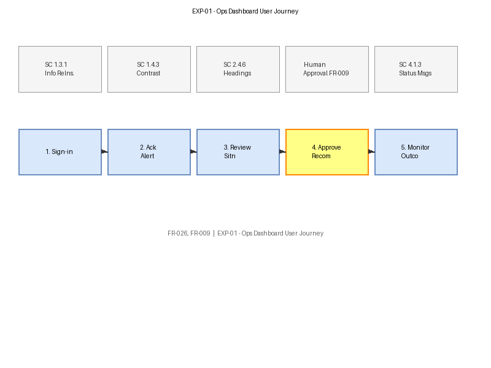

# EXP-01 — Ops Dashboard User Journey

[→ Architecture index](../README.md)

> **Note**: skill-fallback authored — refine before merge.

<!-- spec-cross-ref: spec-020 -->

This view documents the Incident Commander's journey through the ops dashboard with WCAG 2.2 AA touchpoint annotations, enabling UX and PO review of accessibility obligations per step.

## Journey Steps

| Step | WCAG 2.2 Criterion | AA Requirement | Implementation Note |
| --- | --- | --- | --- |
| Sign-in | SC 1.3.1 Info and Relationships | Programmatic structure for form labels | Use semantic HTML `<label>` with `for` binding |
| Acknowledge Alert | SC 1.4.3 Contrast (Minimum) | 4.5:1 text contrast ratio | Alert banner uses approved colour palette |
| Review Situation | SC 2.4.6 Headings and Labels | Descriptive headings for each panel | Map panel titles use `<h2>` hierarchy |
| Approve Recommendation | SC 4.1.2 Name, Role, Value | Button state communicated to AT | Approval button uses `aria-pressed` |
| Monitor Outcome | SC 4.1.3 Status Messages | Status changes announced without focus move | Use `role="status"` live region |

> **👤 Human Approval Gate (FR-009)**: The "Approve Recommendation" step is a mandatory human decision point. The platform must not auto-publish recommendations; the Incident Commander explicitly approves before actuation.

## FR Notes

- **FR-026**: Ops-dashboard user journey documented with per-step WCAG 2.2 AA annotations.
- **FR-009**: Human approval gate is marked on the diagram and documented in the Journey Steps table.

## Related Pages

- [Architecture index](../README.md)
- [WCAG Coverage Map](wcag-coverage.md)
- [QUAL-01 — Test Pyramid](../quality/test-pyramid.md)
