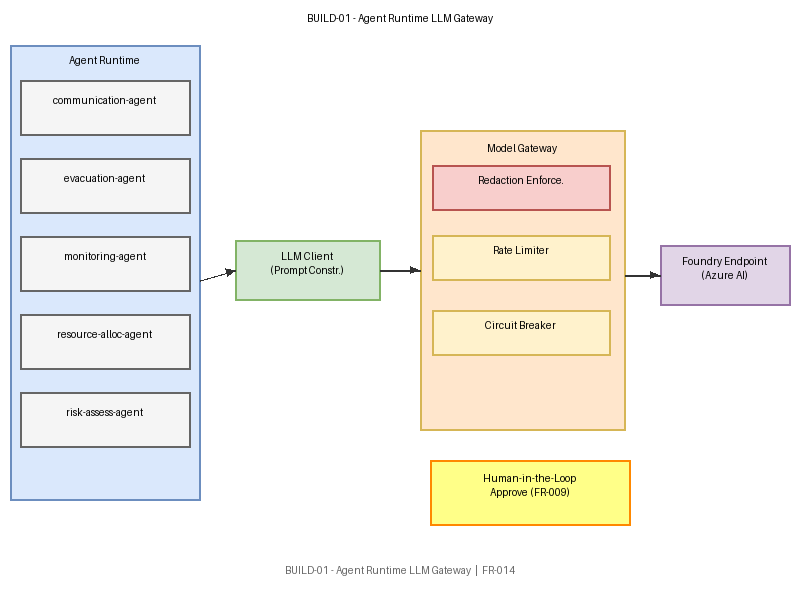

# BUILD-01 — Agent Runtime LLM Gateway

[→ Architecture index](../README.md)

> **Note**: skill-fallback authored — refine before merge.

<!-- spec-cross-ref: spec-024 -->
<!-- spec-cross-ref: spec-025 -->
<!-- spec-cross-ref: spec-030 -->

This view traces the internal path from agent invocation through prompt construction, model-gateway redaction enforcement, and Foundry endpoint dispatch for AI/ML Engineers.

## Key Elements

- **5 Named Agents**: communication-agent, evacuation-agent, monitoring-agent, resource-allocation-agent, risk-assessment-agent — each invokes the LLM Client.
- **LLM Client**: Prompt-construction layer; assembles structured prompts with context from the Coordination Hub.
- **Model Gateway**: Redaction enforcement point (PII/sensitive data scrubbing before dispatch); routing logic selects endpoint; rate-limiter and circuit-breaker protect downstream.
- **Redaction Enforcement**: Mandatory gate — no prompt reaches the Foundry endpoint without passing redaction checks.
- **Foundry Endpoint**: Azure AI Foundry / Azure OpenAI model endpoint (AU region primary; non-AU carve-out per FOUNDRY-REGION known gap).
- **Human-in-the-Loop**: Callout at the recommendation-output step — high-confidence recommendations flagged for Incident Commander approval before actuation.
- **Rate Limiter**: Token-per-minute and request-per-minute throttles per agent type.
- **Circuit Breaker**: Trips on consecutive failures; falls back to cached recommendation or graceful-degradation path.

## FR Notes

- **FR-014**: Model-gateway redaction enforcement is mandatory; no raw PII reaches the Foundry endpoint.

## Related Pages

- [Architecture index](../README.md)
- [C4-L3-Agents — Agents Runtime Components](component-agents.md)
- [C4-L2 — Container View](container.md)
