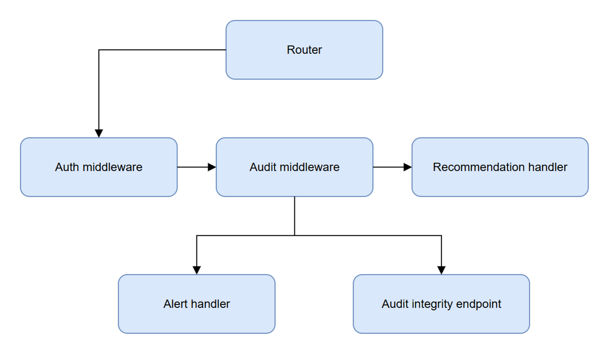

# C4 Level 3 — Coordination API Components

[→ Architecture index](../README.md)

## Diagram

## Related Pages

- [C4 Level 1 — System Context](system.md)
- [C4 Level 2 — Container View](container.md)
