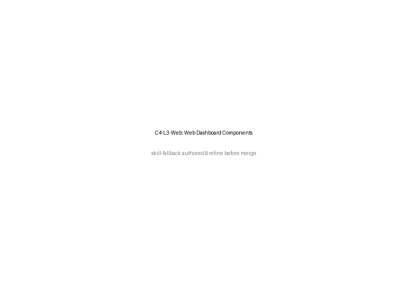

# C4 Level 3 — Web Dashboard Components

[→ Architecture index](../README.md)

## Diagram

> **Skill-fallback note:** This diagram is skill-fallback authored and the PNG is a placeholder; refine before merge.

## Related Pages

- [C4 Level 1 — System Context](system.md)
- [C4 Level 2 — Container View](container.md)
