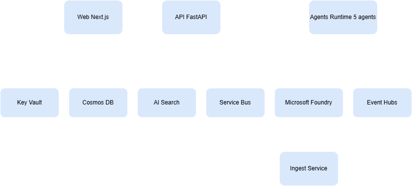

# C4 Model — Container View

[→ Architecture index](../README.md)

**Notation**: [C4 Model](https://c4model.com/) — Container.
**Audience**: developers, infra, SRE, security.

## Diagram

```mermaid
C4Container
  title Container View — Disaster Response Coordination Hub (within Azure AU East)

  Person(operator, "AIIMS Operator")
  System_Ext(public, "Public + Partner Agencies")
  System_Ext(signals_ext, "External Signal Sources", "BoM, GA, state CAD, IoT")
  System_Ext(aoai, "Azure OpenAI", "Private Endpoint")
  System_Ext(content_safety, "Azure AI Content Safety", "Private Endpoint")
  System_Ext(ai_search, "Azure AI Search", "Private Endpoint")
  System_Ext(foundry_phi, "Foundry carve-out endpoint (conditional non-AU)")

  Container_Boundary(c1, "Disaster Response Coordination Hub") {
    Container(web, "Web Dashboard", "Next.js 16.2 on App Service", "Operator UI; hosts Redoc API docs at /api-docs (FR-DOC02)")
    Container(api, "Coordination API", "FastAPI on Container Apps", "REST API + audit ledger + integrity check; OTel auto-instrumented")
    Container(ingestion, "Ingestion", "Python on Container Apps", "Signal normalisation + dead-letter handling")

    Container_Boundary(agents, "Agent Runtime") {
      Container(monitoring, "Monitoring Agent", "Python", "Detects threats + triages signals")
      Container(risk, "Risk Assessment Agent", "Python", "NERAG-aligned risk + recommendations")
      Container(evacuation, "Evacuation Agent", "Python", "Phased evacuation planning")
      Container(resource, "Resource Allocation Agent", "Python", "Tracks + allocates personnel/vehicles")
      Container(comms, "Communication Agent", "Python", "Multilingual public alerts (AWS)")
    }

    ContainerDb(cosmos, "Cosmos DB", "Australia East, CMK, PE-only", "Audit segments, recommendations, jurisdiction policies, killswitches, signals")
    ContainerDb(storage, "Storage", "Australia East, CMK, PE-only", "Blobs + queues for evidence + workbooks JSON")
    ContainerQueue(sb, "Service Bus", "killswitch-events topic + handoff topics")
    Container(kv, "Key Vault", "HSM-backed CMKs + cosign verify keys + secrets")
  }

  Rel(operator, web, "HTTPS")
  Rel(web, api, "HTTPS (Entra-authenticated)")
  Rel(api, cosmos, "Cosmos SDK")
  Rel(api, storage, "Storage SDK")
  Rel(api, sb, "Publish handoffs + killswitch")
  Rel(api, kv, "Read CMKs + cosign keys")

  Rel(signals_ext, ingestion, "HTTPS / Event Hubs")
  Rel(ingestion, cosmos, "Persist signals")
  Rel(ingestion, sb, "Publish to monitoring queue")

  Rel(monitoring, sb, "Subscribe to signals; publish handoffs")
  Rel(risk, sb, "Subscribe + publish")
  Rel(evacuation, sb, "Subscribe + publish")
  Rel(resource, sb, "Subscribe + publish")
  Rel(comms, sb, "Subscribe + publish")

  Rel(monitoring, aoai, "LLM calls (Private Endpoint)")
  Rel(risk, aoai, "LLM calls")
  Rel(comms, aoai, "LLM calls")
  Rel(comms, content_safety, "Output safety check")

  Rel(api, ai_search, "RAG retrieval for grounded prompts (FR-AI01)")
  Rel(api, foundry_phi, "Conditional model path when carve-out registry permits")

  Rel(web, public, "Public alerts dashboard (read-only)")
  Rel(comms, public, "SMS/push/social/email")
```

## Networking

- All data planes attached to a hub VNet; spoke per environment.
- AOAI, Content Safety, AI Search, Cosmos, Storage, Key Vault: Private Endpoint with private DNS zones in the hub.
- `/api/health/audit-integrity` is the only public read; rate-limited.

## Resilience patterns (Stream 4 + 5)

- Circuit breaker (`pybreaker`) wraps every outbound LLM + Content Safety call.
- Service Bus dead-letter queues monitored; alert at depth threshold.
- Per-agent kill-switch (push-based, ≤ 30 s P99) drains in-flight handoffs.
- Cosmos PITR (continuous backup) → 7-day window → paired-region read for DR.

## Observability

- Azure Monitor OpenTelemetry Distro on api + agents + ingestion + eval-runner; OTLP/HTTP to App Insights.
- Workbooks for executive governance, ingestion health, agent flow, LLM cost (FR-O04).
- App Insights availability tests from 5 APAC POPs (FR-O10).

## See also

- [System context](system.md)
- [Sequence: Monitoring → Risk → Communication](../sequence/monitoring-risk-comms.md)
- [Cosmos partitioning math](../cosmos-partitioning.md)

## Deployment topology

Each environment (dev / staging / production) is a single Azure resource group inheriting:

- A hub VNet with private DNS zones (per `infra/modules/private-endpoints.bicep`, T401 + T403 + T404 + T405 + T406).
- A spoke VNet per app tier (apps/api, apps/agents, apps/web, apps/ingestion, apps/eval-runner).
- Container Apps environment + workload identity per tier.
- Cosmos DB account + Storage account + Key Vault Premium + Log Analytics workspace + App Insights.
- Optional: Eval Runner and other evaluation jobs are operational tooling, not one of the five business agents shown in this C4 container view.
- Optional: Defender for Cloud, Sentinel, and Chaos Studio remain environment-specific governance/tooling overlays.

## Component lifecycles

- **Container Apps** revisions are immutable; deploys create a new revision and swap traffic via `cd.yml`. Revision retention preserves rollback per the model-rollback runbook.
- **Cosmos containers** are versioned by ETag at the document level; PITR (continuous backup) gives 7-day point-in-time restore (FR-D04).
- **Prompt artefacts** are versioned by semver in `packages/prompts/` and signed by cosign on every change (FR-AI09 + ADR-035).
- **Foundry carve-out registry** is YAML in `infra/parameters/foundry-carveout.yaml`; mutations require 2 approver signatures (ADR-033).
