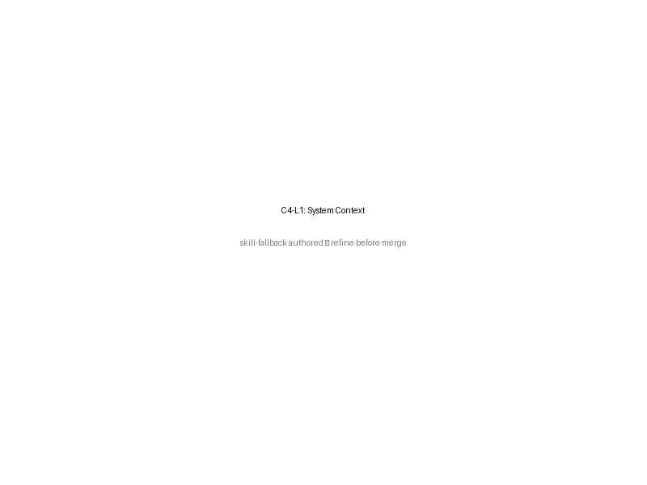
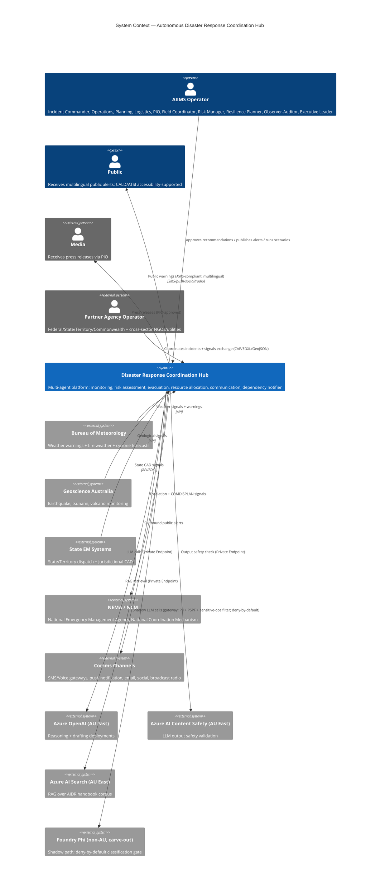

<!-- markdownlint-disable-file MD041 -->

[→ Architecture index](../README.md)

# C4 Model — System Context

**Notation**: [C4 Model](https://c4model.com/) — System Context.
**Audience**: cross-agency reviewers (operational, technical, executive). Pairs with the Container view in `container.md`.

## Diagram

> **Skill-fallback note:** This diagram is skill-fallback authored and the PNG is a placeholder; refine before merge.

## Boundaries

- **Tenant** boundary: each Australian jurisdiction (`act|nsw|vic|qld|sa|wa|tas|nt|commonwealth`) is a tenant; data is partitioned by `/tenant_id` in Cosmos and segregated by Entra group + RBAC.
- **AU residency** boundary: every data plane (Cosmos, Storage, App Insights, Log Analytics, Key Vault, ACR, AI Search, Content Safety, AOAI primary) is in **Australia East**, replicated to **Australia Southeast** for DR.
- **Foundry carve-out** boundary: only model-hosting endpoints listed in `infra/parameters/foundry-carveout.yaml` may be called outside Australia. Every call passes through the classification gate (ADR-033).

## Quality attributes (drivers)

- **Life safety primacy** — every recommendation requires human approval before life-safety publication.
- **AIIMS COP integrity** — single shared operating picture across operators.
- **Auditability** — append-only ledger with cryptographic continuity (spec-032 US1).
- **Graceful degradation** — when LLM/AI Search/Content Safety degraded, agents fall through deterministic templates.

## See also

- [Container view](container.md)
- [Sequence: Monitoring → Risk → Communication](../sequence/monitoring-risk-comms.md)

## Trust boundaries

The platform recognises four primary trust boundaries:

1. **Public internet → Web Dashboard**: TLS termination at App Service / Front Door; Entra-authenticated session.
2. **Web Dashboard → Coordination API**: same-origin or CORS-restricted; bearer token verified by API middleware.
3. **Coordination API → data planes**: managed identity (no static credentials); Cosmos / AOAI / AI Search behind Private Endpoint.
4. **Coordination API → Foundry carve-out endpoints (Phi)**: classification gateway (deny-by-default per ADR-033) + carve-out registry (deploy-time gate).

Cross-tenant isolation is enforced at every boundary by tenant-scoped middleware + OPA policy (`tenant-isolation.rego`).

## Constitution mapping

| Constitution clause | How honoured in this view |
| --- | --- |
| I. Primacy of life | Operator-in-the-loop approval gates all life-safety publication; degraded-mode fallback never blocks publication. |
| II. AIIMS | All five business agents map to AIIMS functions via the typed registry (FR-P05). |
| III. Multi-hazard / multi-agency | Tenant boundary per jurisdiction; jurisdiction policy drives autonomy + language priorities. |
| IV. Auditability | Audit ledger with hash chain (US1); every recommendation carries provenance. |
| V. Warning + public information | Communication agent + Content Safety + AWS-compliant tier mapping. |
| NN-2 Data sovereignty | All data planes AU East; Phi carve-out only via gateway. |
