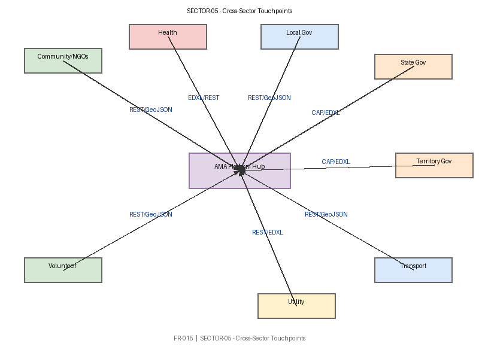

# SECTOR-05 — Cross-Sector Touchpoints

[→ Architecture index](../README.md)

> **Note**: skill-fallback authored — refine before merge.

<!-- spec-cross-ref: spec-015 -->

This view documents the data exchange protocols and lead-agency designation rules at each cross-sector boundary for Community/NGOs, Health, Local Gov, State Gov, Territory Gov, Transport, Utility, and Volunteer personas.

## Touchpoint Reference

| Sector Pair | Data Format | Lead-Agency Rule | Spec Citation |
| --- | --- | --- | --- |
| Community/NGOs ↔ AMA Hub | REST/GeoJSON | State Government designated lead | spec-022 |
| Health ↔ AMA Hub | EDXL/REST | Health jurisdiction lead | spec-015 |
| Local Gov ↔ AMA Hub | REST/GeoJSON | Local authority designated | spec-022 |
| State Gov ↔ AMA Hub | CAP/EDXL | State designated lead agency | spec-022 |
| Territory Gov ↔ AMA Hub | CAP/EDXL | Territory designated lead agency | spec-022 |
| Transport ↔ AMA Hub | REST/GeoJSON | Transport authority lead | spec-015 |
| Utility ↔ AMA Hub | REST/EDXL | Utility operator designated | spec-015 |
| Volunteer ↔ AMA Hub | REST/GeoJSON | Coordinating agency designated | spec-022 |

## FR Notes

- **FR-015**: Cross-sector integration touchpoints documented with protocol labels and lead-agency designation rules.

## Related Pages

- [Architecture index](../README.md)
- [SECTOR-04 — Jurisdiction-Filter Behaviour](jurisdiction-filter.md)
- [SECTOR-01 — Multi-Jurisdiction Tenancy](multi-jurisdiction-tenancy.md)
