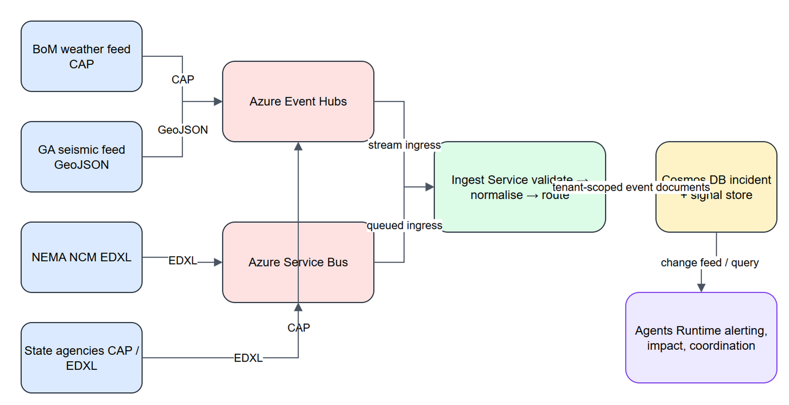

# SECTOR-02 — Ingestion Data-Flow

[→ Architecture index](../README.md)

This page traces external CAP, EDXL, and GeoJSON signals from source systems through the AMA ingestion path to Cosmos DB and agent consumers.

## Key Elements

- FR-014 coverage for BoM, Geoscience Australia, NEMA, and state agency signal sources.
- Event Hubs and Service Bus act as the broker layer before the Ingest Service normalises payloads.
- Cosmos DB stores jurisdiction-scoped events before the Agents Runtime consumes them.

## Related Pages

- [SECTOR-01 — Multi-Jurisdiction Tenancy](multi-jurisdiction-tenancy.md)
- [SECTOR-03 — Integration-Point Map](integration-point-map.md)
- [SECTOR-04 — Jurisdiction-Filter Behaviour](jurisdiction-filter.md)
- [Architecture known gaps](../known-gaps.md)
