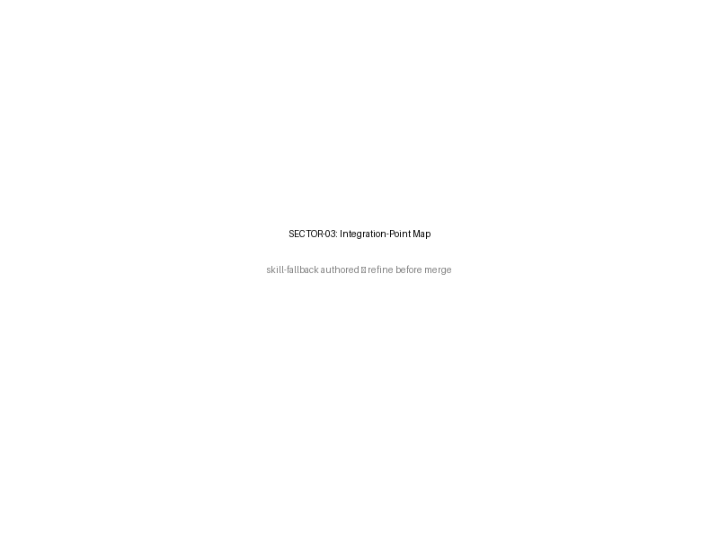

# SECTOR-03 — Integration-Point Map

[→ Architecture index](../README.md)

This page maps each named external system to its incoming data format, its AMA ingestion endpoint, and the agent that consumes the resulting signal.

## Key Elements

- FR-014 coverage names BoM, GA, NEMA, and state agency feeds explicitly.
- Each source identifies its payload format before it reaches the matching ingestion endpoint.
- Ingestion workers inject a `SignalRepository` dependency into pipeline construction so normalized signals persist with partition metadata (`scope/jurisdictionId/dataSourceId`) before downstream consumption.
- Consuming agents are shown as canonical ownership targets; external broker delivery and every downstream consumer remain implementation-specific and must not be inferred from this orientation view alone.

## Related Pages

- [SECTOR-01 — Multi-Jurisdiction Tenancy](multi-jurisdiction-tenancy.md)
- [SECTOR-02 — Ingestion Data-Flow](ingestion-data-flow.md)
- [SECTOR-04 — Jurisdiction-Filter Behaviour](jurisdiction-filter.md)
- [Architecture known gaps](../known-gaps.md)
