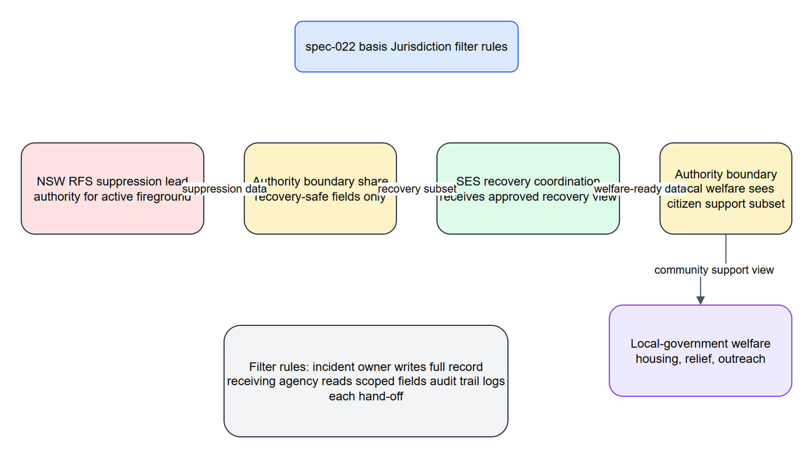

<!-- spec-cross-ref: spec-022 -->

# SECTOR-04 — Jurisdiction-Filter Behaviour

[→ Architecture index](../README.md)

This page shows how jurisdiction filters enforce authority boundaries as an incident moves from suppression to recovery and then to community welfare coordination.

## Key Elements

- FR-015 applies when the active lead agency changes and data visibility must follow authority.
- spec-022 governs the filter rules shown at each authority boundary.
- The hand-off example traces RFS suppression to SES recovery to local-government welfare.

## Related Pages

- [SECTOR-01 — Multi-Jurisdiction Tenancy](multi-jurisdiction-tenancy.md)
- [SECTOR-02 — Ingestion Data-Flow](ingestion-data-flow.md)
- [SECTOR-03 — Integration-Point Map](integration-point-map.md)
- [Architecture known gaps](../known-gaps.md)
