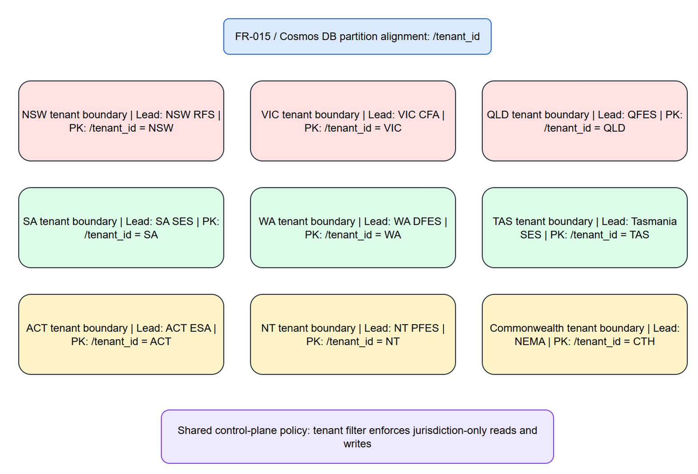

# SECTOR-01 — Multi-Jurisdiction Tenancy

[→ Architecture index](../README.md)

This page documents production isolation boundaries using hierarchical partition metadata: `/scope`, `/jurisdictionId`, and `/dataSourceId`.

## Key Elements

- FR-015 coverage for NSW, VIC, QLD, SA, WA, TAS, ACT, NT, and Commonwealth boundaries.
- Scope and jurisdiction are separate controls: `scope=live` for operational traffic and `scope=sim-*` for simulation replay traffic.
- Cosmos partition alignment uses `scope/jurisdictionId/dataSourceId`, with jurisdiction filters on read paths.
- Lead-agency designation is hazard-dependent (for example fire suppression, flood response, or welfare recovery) and is not a static per-state mapping.

## Related Pages

- [SECTOR-02 — Ingestion Data-Flow](ingestion-data-flow.md)
- [SECTOR-03 — Integration-Point Map](integration-point-map.md)
- [SECTOR-04 — Jurisdiction-Filter Behaviour](jurisdiction-filter.md)
- [Architecture known gaps](../known-gaps.md)
