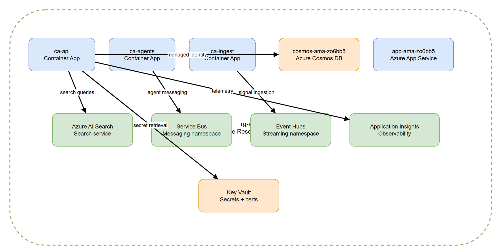

# DEPLOY-02 — Azure Resource Topology

[→ Architecture index](../README.md)

<!-- spec-cross-ref: spec-001 -->
<!-- spec-cross-ref: spec-017 -->

## Key Elements

- `rg-ama` — Azure resource group boundary.
- `ca-api` — Azure Container App for the coordination API.
- `ca-agents` — Azure Container App for agent workloads.
- `ca-ingest` — Azure Container App for ingestion workloads.
- `cosmos-ama-zo6bb5` — Azure Cosmos DB account.
- `app-ama-zo6bb5` — Azure App Service for web hosting.
- `Azure AI Search` — search service.
- `Service Bus` — messaging namespace.
- `Event Hubs` — streaming namespace.
- `Application Insights` — observability service.
- `Key Vault` — secrets and certificate store.
