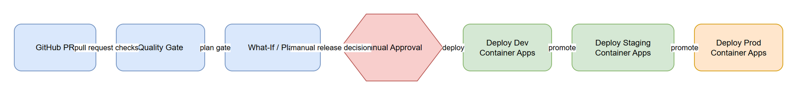

# DEPLOY-01 — CI/CD Pipeline

[→ Architecture index](../README.md)

<!-- spec-cross-ref: spec-017 -->
<!-- spec-cross-ref: spec-029 -->

## Stages

| Stage | Control |
| --- | --- |
| Push to `dev` / `staging` / `production` | Triggers CI, then `cd.yml` `workflow_run` deployment for the same branch environment |
| CI Success Gate | Deployment only runs when upstream `ci` concludes `success` |
| Environment Credential Gate | `AZURE_CREDENTIALS` must exist for the target GitHub Environment |
| Provision and Deploy | `azd provision` then `azd deploy` to the branch-mapped environment and resource group; no repository-defined what-if stage is shown |
| Health and Rollback Controls | Staging and production use rollback workflow on critical failure; dev fails loudly |

## Resource group naming conventions

- Historical fixed naming: `rg-ama` (legacy topology snapshots in architecture diagrams).
- Branch-environment naming (current CD): `rg-drh-dev`, `rg-drh-staging`, `rg-drh-production`.
- AZD environment naming basis: `drh-<env>` (`AZURE_ENV_NAME`) from which deployment resource group selection is derived.

Manual approvals and environment-protection gates are required governance controls, but they are external GitHub Environment settings and must be verified separately from repository YAML.
