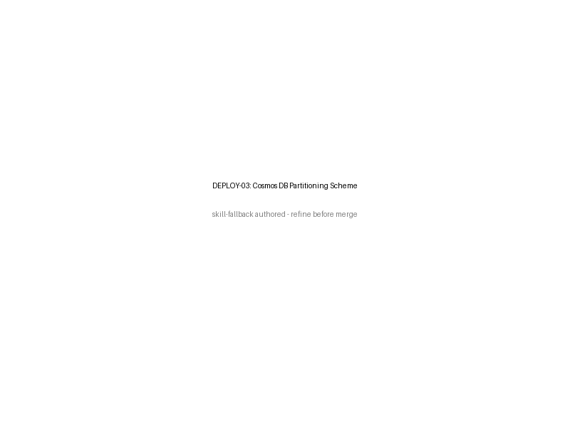

# DEPLOY-03 — Cosmos DB Partitioning Scheme

> **Note**: The root-level `../cosmos-partitioning.md` is a legacy copy; this page is authoritative. See known-gaps COSM-MIG-01.

[→ Architecture index](../README.md)

> **Skill-fallback note**: This diagram source and PNG are skill-fallback authored. Refine before merge.

<!-- spec-cross-ref: spec-001 -->
<!-- spec-cross-ref: spec-035 -->

## Partition keys

| Container set | Partition key | Reason |
| --- | --- | --- |
| `signals`, `incidents` | `/tenant_id` | Keeps tenant and jurisdiction traffic isolated for the primary operational write path |
| `recommendations`, `timeline_events` | `/incident_id` | Optimises incident-scoped replay, retrieval, and operator review |
| `audit_segments` | `/segment_id` | Balances append-only evidence segments while preserving audit sealing workflows |

## Routing model

Disaster-event documents arrive with tenant and incident metadata. The routing layer selects the correct partition key path, then forwards operational writes and audit segments in a way that preserves the multi-jurisdiction isolation model described by SECTOR-01.
