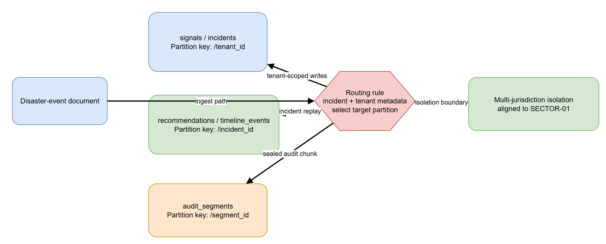

# DEPLOY-03 — Cosmos DB Partitioning Scheme

> **Note**: The root-level `../cosmos-partitioning.md` is a legacy copy; this page is authoritative. See known-gaps COSM-MIG-01.

[→ Architecture index](../README.md)

<!-- spec-cross-ref: spec-001 -->
<!-- spec-cross-ref: spec-035 -->

## Partition keys

| Container set | Partition key | Reason |
| --- | --- | --- |
| `signals` | `/scope`, `/jurisdictionId`, `/dataSourceId` (hierarchical) | Separates live and simulation workloads while preserving jurisdiction and source-level isolation |
| `recommendations`, `timeline_events` | `/incident_id` | Optimises incident-scoped replay, retrieval, and operator review |
| `audit_segments` | `/segment_id` | Balances append-only evidence segments while preserving audit sealing workflows |

## Routing model

Signals are persisted with deterministic partition metadata: `scope` (`live` or `sim-*`), `jurisdictionId`, and `dataSourceId`, then composed into partition routing for the `signals` container. Disaster-event and audit records continue using their workload-specific partitioning to preserve replay and audit traversal performance.

## Environment-specific throughput

The active deployment entry point is `infra/main.bicep`. For `environmentTier=dev`,
all 37 platform containers use dedicated autoscale with a maximum of 1,000 RU/s
per container and a minimum billed allocation of 100 RU/s per container.
The seven Help containers, four evacuation containers, and `signals` use
tier-aware parameter defaults. The three workflow and seven evidence-harness
containers explicitly select autoscale in dev instead of implicitly receiving
separate manual 400-RU/s offers.

Staging and production retain the previous defaults: 6,000 maximum RU/s for
`signals`, 4,000 per Help/evacuation container, and unchanged throughput options
for workflow/evidence-harness containers. Partition keys, indexing, retention,
backup, networking, and Defender coverage are unaffected.

At Australia East retail rates of USD 0.0138 per 100 autoscale RU/s-hour, the
dev idle throughput floor is approximately USD 372.74 per 730-hour month,
excluding Defender and storage. Autoscale bills hourly peaks above that floor;
the maximum is a capacity ceiling, not the continuously billed allocation.

Existing manual offers must first be migrated in place with
`az cosmosdb sql container throughput migrate --throughput-type autoscale`,
then lowered with `az cosmosdb sql container throughput update --max-throughput 1000`.
Both commands also require the subscription, resource group, account, database,
and container arguments. A Bicep-only mode change does not perform that migration.
Re-read the permitted minimum before reducing capacity, verify the final offers,
and monitor throttling and latency under representative simulation bursts.
