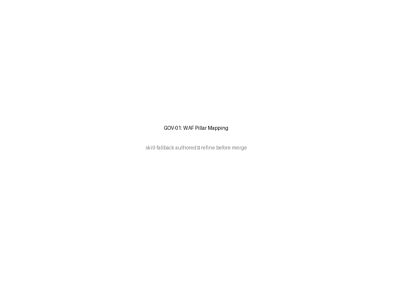

# GOV-01 — WAF Pillar Mapping

[→ Architecture index](../README.md)

## Diagram

> **Skill-fallback note:** This diagram is skill-fallback authored and the PNG is a placeholder; refine before merge.

## WAF Pillar Notes

| Pillar | Architecture focus | Relevant specs | Notes |
| --- | --- | --- | --- |
| Reliability | Coordination API, Agents Runtime, Ingest Service | spec-015, spec-028 | Focuses on resilient signal flow, failover, and degraded operations. |
| Security | Auth middleware, Key Vault, audit integrity endpoint | spec-015, spec-028 | Emphasises identity, secret handling, and tamper-evident audit paths. |
| Cost Optimisation | Eval Runner, Azure OpenAI/Foundry, AI Search | spec-015, spec-028 | Tracks model usage, evaluation cost, and retrieval efficiency across services. |
| Operational Excellence | App Insights, Service Bus, deployment automation | spec-015, spec-028 | Highlights observability, runbook coverage, and governed release workflows. |
| Performance Efficiency | Web Dashboard, Azure Maps, Event Hubs | spec-015, spec-028 | Maps user responsiveness and ingestion throughput to platform components. |
