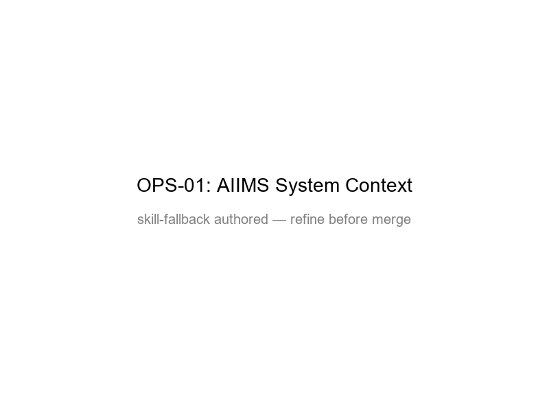

# OPS-01 — AIIMS System Context

[→ Architecture index](../README.md)

> **Note**: skill-fallback authored — refine before merge.

This context view maps each named AIIMS role to at least one hub capability so new joiners can see who interacts with which part of the platform.

## Key Elements

- **Incident Commander**: confirms strategic direction with the Coordination Hub.
- **Operations**: reviews active recommendations and operational tasks.
- **Planning**: uses scenario and planning outputs from the Recommendation Engine.
- **Logistics**: coordinates resource actions through the Coordination Hub.
- **Public Information**: publishes approved public warnings through the Public Warning Console.
- **Field Coordinator**: feeds field status into the Coordination Hub.
- **Resilience Planner**: uses recovery-oriented analysis from the Recommendation Engine.
- **Executive Leader**: monitors major communications and escalations through the Public Warning Console.
- **Observer/Auditor**: inspects decision trails in the Audit Ledger.
- **Risk Manager**: reviews risk scoring and escalation cues from the Recommendation Engine.

## FR Notes

- **FR-013**: all 10 AIIMS functional roles are named explicitly and connected to system components.

## Related Pages

- [Architecture index](../README.md)
- [OPS-02 — Escalation Paths](escalation-paths.md)
- [SEQ-02 — Cross-Agency Recommendation](../sequence/cross-agency-recommendation.md)
