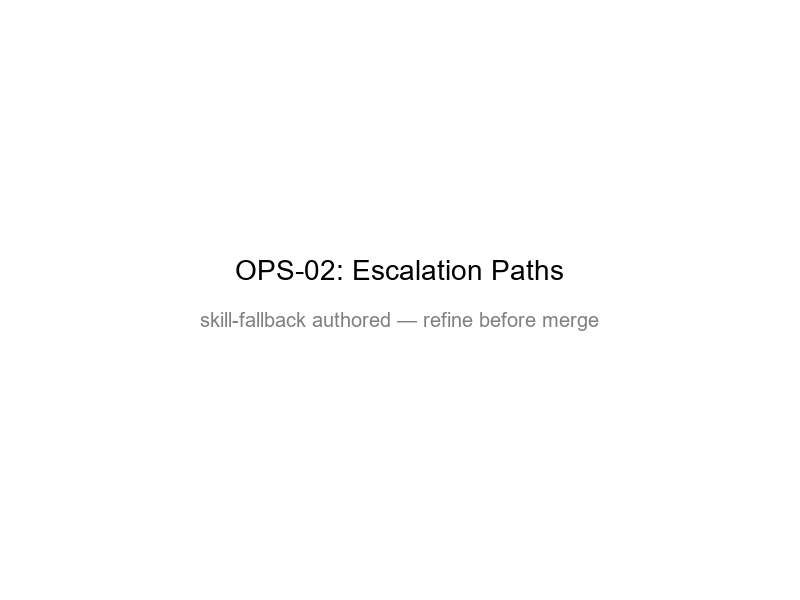

# OPS-02 — Escalation Paths

[→ Architecture index](../README.md)

> **Note**: skill-fallback authored — refine before merge.

This escalation view shows how the operating posture changes from L1 to L3, which AIIMS role owns each decision, and what action the system takes when the threshold is met.

## Escalation Summary

| Level | Triggering condition | Responsible AIIMS role | Resulting system action |
| --- | --- | --- | --- |
| L1 | Localised incident with high-confidence data | Operations Lead | Notify dashboard and keep monitoring active |
| L2 | Multi-sector impact or prolonged disruption | Incident Commander | Coordinate alerting and assign partner-agency tasks |
| L3 | State-wide or national consequence | Executive Leader with Planning | Escalate coordination and activate strategic reporting |

## FR Notes

- **FR-013**: the diagram names L1, L2, and L3 escalation thresholds with triggers, responsible roles, and system actions.

## Related Pages

- [Architecture index](../README.md)
- [OPS-01 — AIIMS System Context](aiims-system-context.md)
- [SEQ-01 — Alert Approval Publication](../sequence/alert-approval-publication.md)
