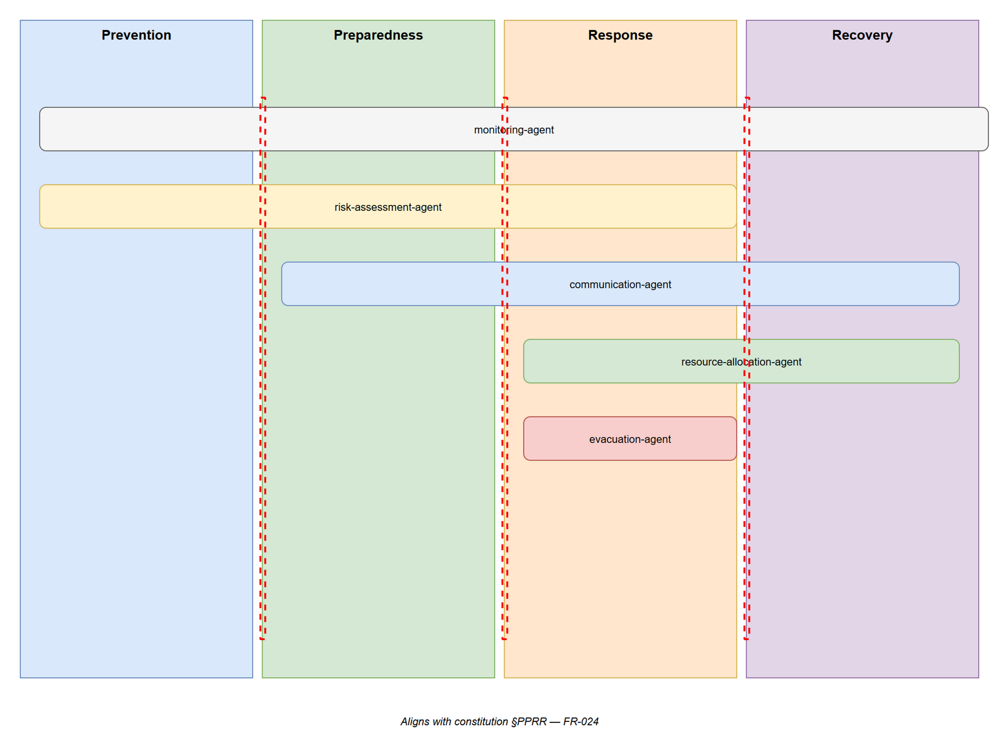

# OPS-03 — PPRR Phase Overlay

[→ Architecture index](../README.md)

<!-- spec-cross-ref: spec-019 -->

This view maps platform capabilities and AIIMS roles to each PPRR phase so Resilience Planners can identify which system functions are active during Prevention, Preparedness, Response, and Recovery.

> Aligns with constitution §PPRR — FR-024.

## PPRR Phase Notes

| Phase | Active System Capabilities | Engaged AIIMS Roles | Key Platform Events |
| --- | --- | --- | --- |
| Prevention | Risk assessment, monitoring | Risk Manager, Resilience Planner | Hazard monitoring alerts, risk register updates |
| Preparedness | Risk assessment, monitoring, communication | Risk Manager, Resilience Planner, Logistics, Planning | Preparedness exercises, resource pre-positioning |
| Response | All capabilities active | All AIIMS roles | Incident activation, alert publication, evacuation, resource dispatch |
| Recovery | Monitoring, communication, resource allocation | Incident Commander, Logistics, Resilience Planner | Stand-down, recovery coordination, lessons-learned capture |

## FR Notes

- **FR-024**: PPRR phase alignment documented with agent active-phase mapping.

## Related Pages

- [Architecture index](../README.md)
- [OPS-01 — AIIMS System Context](aiims-system-context.md)
- [OPS-02 — Escalation Paths](escalation-paths.md)
