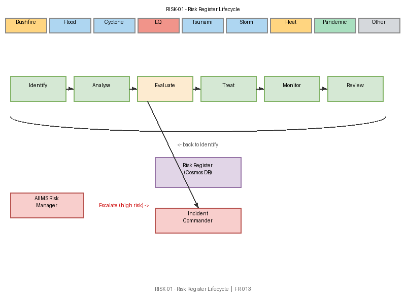

# RISK-01 — Risk Register Lifecycle

[→ Architecture index](../README.md)

> **Note**: skill-fallback authored — refine before merge.

<!-- spec-cross-ref: spec-019 -->

This view traces the end-to-end lifecycle of a risk record from identification through treatment to closure, showing the Risk Manager's decision points and escalation path to the Incident Commander on high-residual-risk treatments.

## Key Elements

- **Hazard Taxonomy**: Nine hazard categories (Bushfire, Flood, Cyclone, Earthquake, Tsunami, Storm, Heat, Pandemic, Other) feed the risk register.
- **Identify**: Risk Manager captures hazard, location, and initial severity estimate.
- **Analyse**: Likelihood × impact matrix produces a risk rating score.
- **Evaluate**: Rating compared against threshold; high-residual-risk triggers escalation to Incident Commander.
- **Treat**: Treatment options selected (avoid, reduce, transfer, accept); treatment plan recorded.
- **Monitor**: Ongoing monitoring against KRIs; alerts if risk profile changes.
- **Review/Close**: Periodic review; risk closed when residual risk falls below threshold.
- **Risk Register Data Store**: Central Cosmos DB collection holding all active and historical risk records.

## FR Notes

- **FR-013**: AIIMS Risk Manager role is the primary actor; escalation to Incident Commander is shown on high-residual-risk treatments.

## Related Pages

- [Architecture index](../README.md)
- [OPS-01 — AIIMS System Context](aiims-system-context.md)
- [OPS-02 — Escalation Paths](escalation-paths.md)
