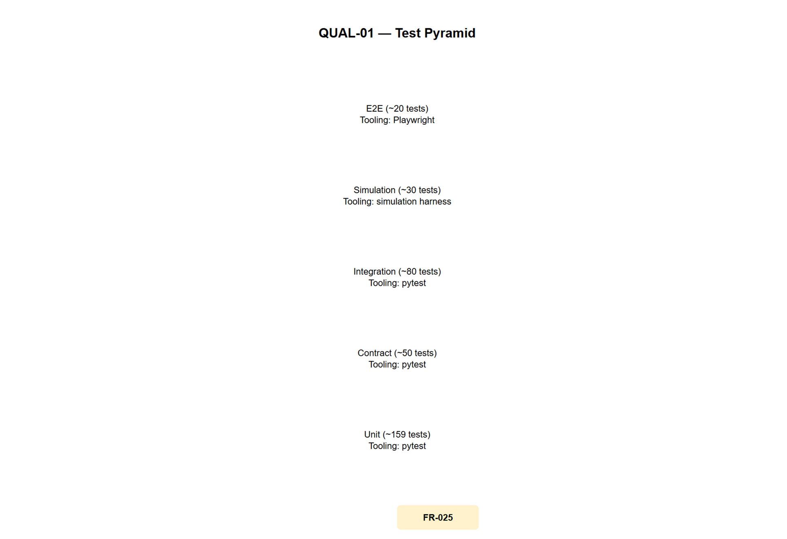

# QUAL-01 — Test Pyramid

[→ Architecture index](../README.md)

<!-- spec-cross-ref: spec-024 -->

This view defines the five-tier test pyramid with relative volumes and tooling for the AMA platform so QA Engineers can scope test investment correctly.

## Test Tiers

| Tier | Relative Volume | Tooling | Example Test Target | Notes |
| --- | --- | --- | --- | --- |
| Unit | 209 source test files (2026-09-18 inventory) | pytest; Vitest for web unit/a11y suites | Individual agent functions, utility helpers | Widest tier; fast feedback |
| Contract | 186 source test files (2026-09-18 inventory) | pytest | API schema contracts, CAP/EDXL payload shapes | Producer/consumer and schema invariants |
| Integration | 160 source test files (2026-09-18 inventory) | pytest (+ selected infra fixtures) | DB reads/writes, adapter integration | Environment-dependent; not all use testcontainers |
| Simulation | 30 source test files (2026-09-18 inventory) | pytest + simulation harness | Multi-agent scenario behaviors in sandbox | Synthetic incidents with deterministic fixtures |
| E2E | 157 source test files under `tests/e2e` plus 30 web test files (2026-09-18 inventory) | pytest (backend) + Playwright/Vitest (web) | Full ops-dashboard journeys and backend-user flows | Narrowest tier; highest execution cost |

## FR Notes

- **FR-025**: Five-tier test pyramid documented with volumes and tooling per tier.

Count provenance: PowerShell inventory of source files (`.py`, `.ts`, `.tsx`, `.js`, `.jsx`) under the named roots on 2026-09-18. These are inventory counts, not pass/fail execution results; the Draw.io export remains pending.

## Related Pages

- [Architecture index](../README.md)
- [C4-L3-Agents — Agents Runtime Components](../c4/component-agents.md)
- [EXP-01 — Ops Dashboard User Journey](../accessibility/ops-dashboard-user-journey.md)
