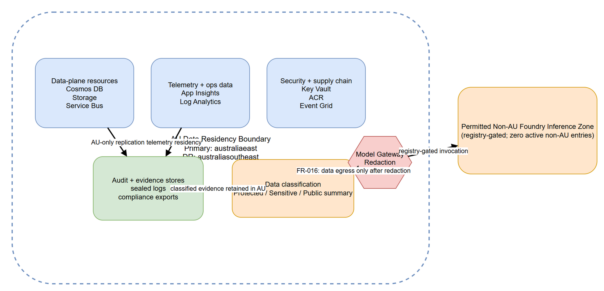

# SEC-01 — AU Residency and Data Classification

[→ Architecture index](../README.md)

<!-- spec-cross-ref: spec-036 -->

## Overview

FR-016 requires an explicit AU residency boundary across all data-plane services, plus a gated carve-out path for any permitted non-AU Foundry inference.

## Residency boundary

| Scope | AU residency expectation | Notes |
| --- | --- | --- |
| Cosmos DB, Storage, Service Bus | Primary in `australiaeast`, paired recovery in `australiasoutheast` | No steady-state data-plane placement outside AU |
| Event Grid, App Insights, Log Analytics | Operated inside the documented AU boundary for operational telemetry and event routing | Evidence and audit exports stay inside AU stores |
| Key Vault, ACR, audit/evidence stores | Residency enforced inside the same AU boundary zone | Supply-chain and compliance artefacts remain in-country |

## Data-classification controls

| Classification | Typical content | Control |
| --- | --- | --- |
| Protected | Incident payloads, recommendations, audit evidence | Must remain inside the AU boundary |
| Sensitive | Operational telemetry, alert drafts, responder identifiers | Redaction enforced before any inference egress |
| Public summary | Sanitised outbound summaries | Can exit only through the model-gateway redaction enforcement point |

## Foundry carve-out

The diagram labels the carve-out zone exactly as `Permitted Non-AU Foundry Inference Zone (registry-gated; zero active non-AU entries)` to avoid hard-coding region names while still documenting the approved mechanism.

## WAF Security pillar note

This control set aligns to the Azure Well-Architected Framework Security pillar by minimising data exposure, enforcing redaction before egress, and keeping audit-grade evidence within the AU residency boundary.
