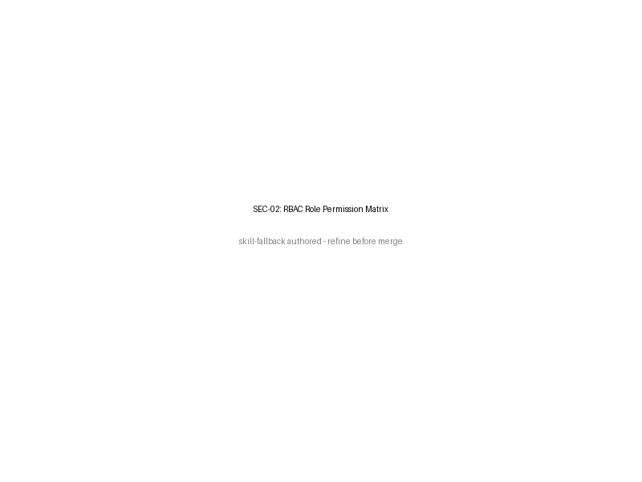

# SEC-02 — RBAC Role/Permission Matrix

[→ Architecture index](../README.md)

> **Skill-fallback note**: This diagram source and PNG are skill-fallback authored. Refine before merge.

<!-- spec-cross-ref: spec-017 -->
<!-- spec-cross-ref: spec-019 -->

## Overview

FR-017 requires explicit role and permission boundaries for all 10 AIIMS-aligned platform personas.

## Permission boundaries

| Boundary | Spec basis | Summary |
| --- | --- | --- |
| Incident and recommendation access | `spec-017` | Operational roles receive only the incident and recommendation rights needed for their function |
| Alert approval and publication | `spec-019` | Public-facing alert actions are separated from routine incident editing |
| Audit, killswitch, and admin controls | `spec-017`, `spec-019` | Only tightly scoped oversight roles retain elevated control-plane privileges |

## Roles covered

Incident Commander, Operations, Planning, Logistics, Public Information, Field Coordinator, Resilience Planner, Executive Leader, Observer/Auditor, and Risk Manager all appear in the matrix with their mapped permissions.
