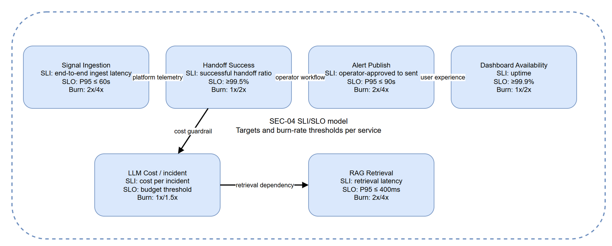

# SEC-04 — SLI/SLO Model

[→ Architecture index](../README.md)

<!-- spec-cross-ref: spec-015 -->
<!-- spec-cross-ref: spec-017 -->

## Service objectives

| Service | SLI definition | SLO target | Error-budget burn-rate alerts |
| --- | --- | --- | --- |
| Signal Ingestion | P95 time from accepted signal to durable ingest completion | P95 ≤ 60s | Page at 4x burn over 15 min; investigate at 2x burn over 1 h |
| Handoff Success | Ratio of successful agent handoffs to attempted handoffs | ≥99.5% | Page at 2x burn over 1 h; investigate at 1x burn over 6 h |
| Alert Publish | P95 time from operator approval to publication fan-out | P95 ≤ 90s | Page at 4x burn over 15 min; investigate at 2x burn over 1 h |
| Dashboard Availability | Successful dashboard availability checks over total checks | ≥99.9% | Page at 2x burn over 1 h; investigate at 1x burn over 6 h |
| LLM Cost/incident | Cost accumulated per incident against approved budget | Within incident budget envelope | Alert at 1.5x burn over 24 h; investigate at 1x burn over 72 h |
| RAG Retrieval | P95 retrieval latency for grounded evidence lookups | P95 ≤ 400ms | Page at 4x burn over 15 min; investigate at 2x burn over 1 h |

## Error-budget policy

| Term | Definition | Measurement window | Purpose |
| --- | --- | --- | --- |
| SLI | The observed metric that represents user-relevant service behaviour | Rolling 15 min, 1 h, 6 h, and 24 h windows | Anchors alerting and reporting |
| SLO | The target threshold for each service's SLI | Monthly objective with short-window monitoring | Sets the reliability commitment |
| Error budget | The permitted gap between perfect service and the SLO target | Tracked per calendar month | Allows controlled change while protecting reliability |
| Burn rate | The speed at which the service consumes its remaining error budget | Fast-burn and slow-burn windows | Triggers proportional operational response |
