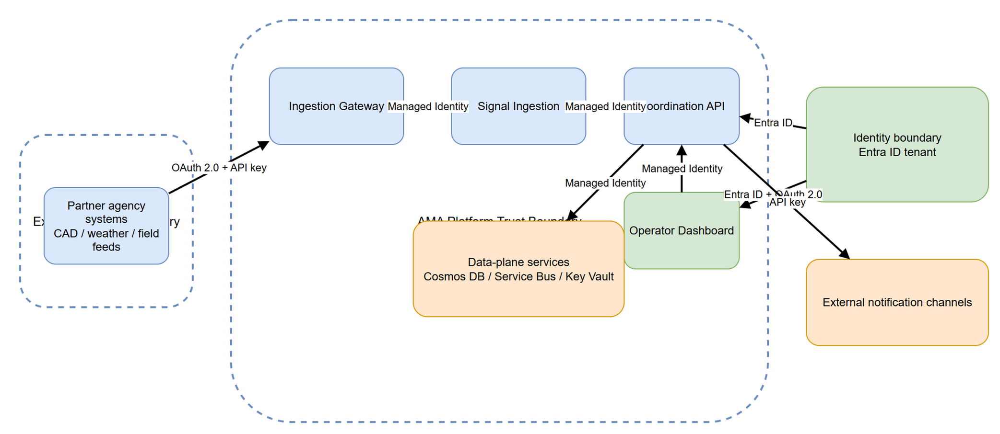

# SEC-03 — Trust Boundary Diagram

[→ Architecture index](../README.md)

<!-- spec-cross-ref: spec-001 -->
<!-- spec-cross-ref: spec-017 -->

## Overview

FR-018 requires every trust-boundary crossing to show the authentication and authorisation mechanism that permits the flow.

## Cross-boundary mechanisms

| Crossing | Mechanism | Purpose |
| --- | --- | --- |
| External agency to ingestion gateway | OAuth 2.0 + API key | Validates partner-system identity and feed entitlement |
| Ingestion and API services to data plane | Managed Identity | Removes shared secrets from service-to-service access |
| Operators to dashboard and API | Entra ID + OAuth 2.0 | Enforces workforce identity, tenant policy, and session scopes |
| API to external notification channels | API key | Documents third-party publication integration boundaries |

## End-to-end ingestion path

The diagram traces the external agency path through the ingestion gateway, signal ingestion workload, coordination API, and data-plane services so the full auth/authz chain is visible in one view.
