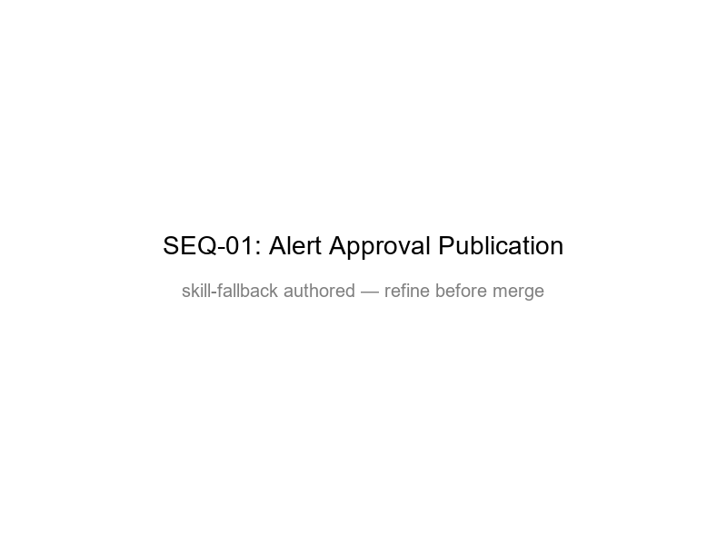

# SEQ-01 — Alert Approval Publication

[→ Architecture index](../README.md)

> **Note**: skill-fallback authored — refine before merge.

This sequence shows that alert drafting, approval, and publication are intentionally separated so publication can only occur after explicit human approval.

## FR Notes

- **FR-009**: the human approval gate is a distinct red-bordered decision point before publication.
- **FR-010a**: the flow covers authoring, approval, and publication as three separate stages.

## Related Pages

- [Architecture index](../README.md)
- [SEQ-02 — Cross-Agency Recommendation](cross-agency-recommendation.md)
- [OPS-02 — Escalation Paths](../operational/escalation-paths.md)
