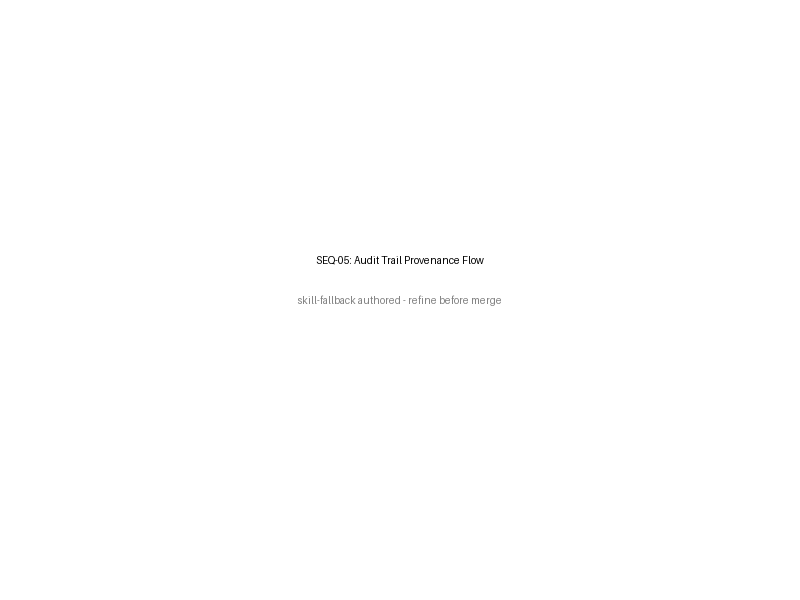

# SEQ-05 — Audit-Trail Provenance Flow

[→ Architecture index](../README.md)

> **Skill-fallback note**: This diagram source and PNG are skill-fallback authored. Refine before merge.

<!-- spec-cross-ref: spec-020 -->
<!-- spec-cross-ref: spec-025 -->

## Flow highlights

- FR-009 keeps a mandatory human approval gate in front of every actuation.
- FR-010e requires every actuation, approval, and rejection to be recorded in the audit trail.
- FR-020 requires evidence bundles that can support later compliance reporting and review.

## Evidence captured

| Evidence item | Captured when | Review audience |
| --- | --- | --- |
| Proposed actuation payload and rationale | Before approval | Incident Commander, Risk Manager |
| Approver identity, timestamp, and decision | At the human gate | Observer/Auditor, Risk Manager |
| Executed actuation result and downstream acknowledgements | Immediately after actuation | Incident Commander, Observer/Auditor |
| Policy references, source signals, and supporting artefacts | As the evidence bundle is sealed | Compliance reviewers and audit stakeholders |
