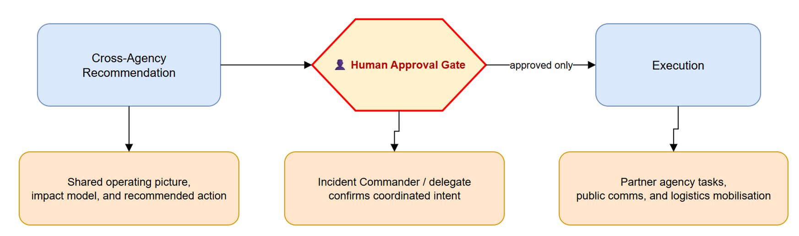

# SEQ-02 — Cross-Agency Recommendation

[→ Architecture index](../README.md)

This view captures how a shared recommendation is prepared for partner agencies, reviewed by a human decision-maker, and then released for coordinated execution.

## FR Notes

- **FR-009**: execution is gated by a visible human approval checkpoint.
- **FR-010b**: the sequence covers recommendation, approval, and coordinated execution.

## Related Pages

- [Architecture index](../README.md)
- [SEQ-01 — Alert Approval Publication](alert-approval-publication.md)
- [OPS-01 — AIIMS System Context](../operational/aiims-system-context.md)
