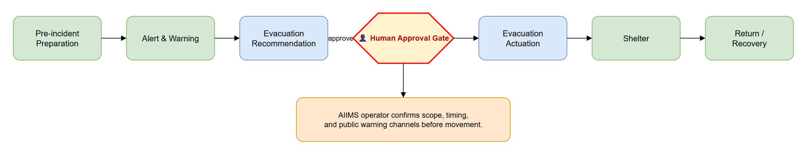

# SEQ-03 — Evacuation Five-Stage Flow

[→ Architecture index](../README.md)

This page shows the five-stage AIIMS evacuation flow from preparation through return and highlights where a human decision gates the actuation step.

## Human Approval Gate

The human approval gate sits between the generated evacuation recommendation and the actuation step. Operators validate scope, timing, public messaging, and jurisdictional authority before any movement order is issued.

## FR Notes

- **FR-009**: the actuation path includes a distinct human approval marker before evacuation instructions are actioned.
- **FR-010c**: the five named stages are Pre-incident Preparation, Alert & Warning, Evacuation, Shelter, and Return / Recovery.

## Related Pages

- [Architecture index](../README.md)
- [SEQ-04 — Recovery Transition](recovery-transition.md)
