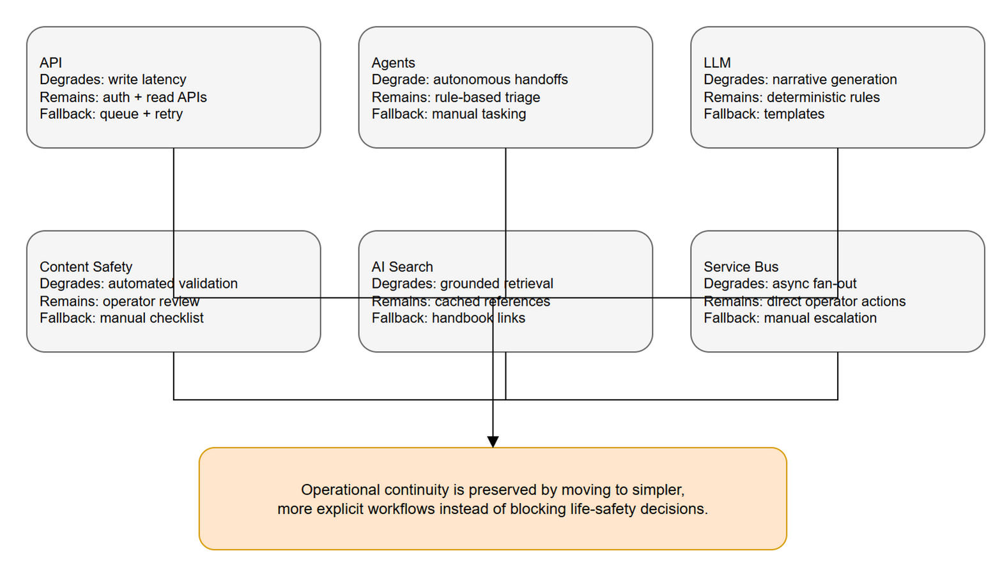

# SEQ-06 — Graceful Degradation Behaviour

[→ Architecture index](../README.md)

The graceful-degradation sequence documents how the hub stays usable when automation components are impaired and which fallback path operators should expect per subsystem.

## Subsystem Coverage

| Subsystem | Degrades | Remains | Fallback |
| --- | --- | --- | --- |
| API | Write and orchestration latency | Authentication and essential reads | Queue, retry, and operator confirmation |
| Agents | Autonomous hand-offs | Rule-based triage | Manual tasking by operators |
| LLM | Narrative generation | Deterministic rules and policy checks | Template-backed drafting |
| Content Safety | Automated moderation | Human review | Manual publication checklist |
| AI Search | Retrieval grounding | Cached references | Direct handbook links |
| Service Bus | Async fan-out | Direct user actions | Manual escalation and status tracking |

## FR Notes

- **FR-010f**: each named subsystem states what degrades, what remains available, and which fallback activates.

## Related Pages

- [Architecture index](../README.md)
- [SEQ-01 — Alert Approval Publication](alert-approval-publication.md)
