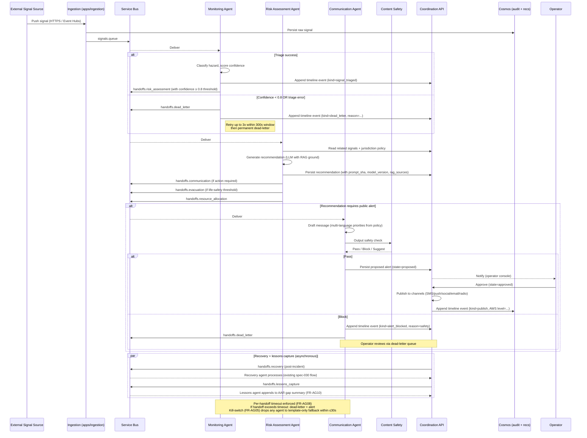

# Sequence — Monitoring → Risk Assessment → Communication

**Purpose**: capture the multi-agent flow from signal ingestion through public alert publication, including dead-letter and recovery cycles. Closes FR-A04.

## Notes

- **Confidence gating**: monitoring → risk requires confidence ≥ 0.8 (per existing risk-assessment thresholds). Below threshold → dead-letter.
- **Retry policy**: 3 attempts in a 300 s window per existing `handoff_retry` (Stream 2 will retain semantics; FR-P03 swap to `pybreaker` for the LLM call breaker).
- **Recovery + lessons** are asynchronous and do not block primary publication.
- **Approval workflow**: every public alert requires operator approval (Constitution NN-1).
- **Audit timeline**: every transition appends a typed event (`signal_triaged`, `dead_letter`, `recommendation_proposed`, `approved`, `publish`, `recovery`, `lessons`).

## Related

- Saga / Process Manager doc — `docs/agents/saga-approval-workflow.md` (T311)
- Decision-rights matrix — `docs/agents/decision-rights.md` (T027)
- Multi-agent state graph — `apps/agents/tools/render_state_graph.py` (T709) generates a state-graph rendering that consumes the same configuration this sequence reflects.
