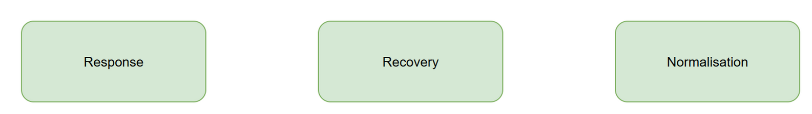

# SEQ-04 — Recovery Transition

[→ Architecture index](../README.md)

This transition view shows how AIIMS responsibilities shift as the incident moves from response into recovery and then back to steady-state normalisation, including periods where response and recovery operations run concurrently.

## Phase Notes

- **FR-010d**: the diagram documents the Response -> Recovery -> Normalisation progression and highlights the AIIMS roles most active in each transition.
- Recovery overlap note: transition governance is condition-driven, so late response activities can continue while recovery activities begin.

## Related Pages

- [Architecture index](../README.md)
- [SEQ-03 — Evacuation Five-Stage Flow](evacuation-five-stage.md)
- [OPS-01 — AIIMS System Context](../operational/aiims-system-context.md)
