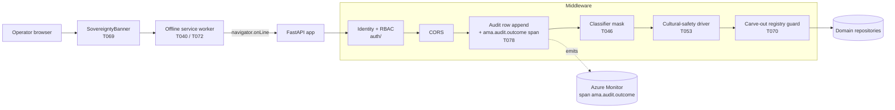
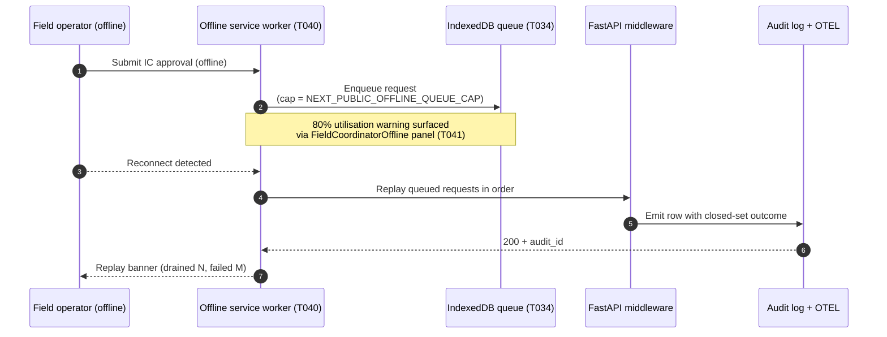

# spec-035 — Middleware stack & offline-replay flow

> Spec-035 T079. Captures the production-reachable middleware order and the
> offline reconnect-replay sequence so reviewers can audit precedence + the
> closed-set audit-outcome surface added in this spec.

## Middleware stack diagram

The diagram below shows the request path through the API middleware after
spec-035 closure. Order is significant — it is enforced by the activation-mutex
build gate ([scripts/verify-activation-mutex.ps1](../../scripts/verify-activation-mutex.ps1)).

### Middleware ordering rationale

| Stage | Why this order |
|------|----------------|
| AuthZ first | All downstream stages assume an authenticated principal; spec-035 NN-1 / NN-2 closed-set role identity. |
| Audit second | Every request that reaches handlers must produce an audit row; positioning Audit before mutating logic guarantees the audit row exists *before* the closed-set outcome is finalised. T078 enriches the active OTEL span with `ama.audit.outcome` at this stage. |
| Classifier third | T046 mask runs *after* audit so the masked-field count is captured in the audit row. |
| Cultural-safety fourth | T053 routes drafts to elders + materialises `cultural_safety_timeout_override` / `cultural_safety_held` outcomes (closed set). The decision feeds back into the audit row before downstream domain handlers run. |
| Carve-out registry fifth | T070 surfaces stale-review entries to the SovereigntyBanner. The 90-day CI gate enforces this stays current. |

## Offline replay flow

## See also

- [spec-035 plan.md](../../specs/035-webapp-capstone-closure/plan.md)
- [spec-035 research.md § R-011](../../specs/035-webapp-capstone-closure/research.md)
- [Cultural-safety contract](../../specs/035-webapp-capstone-closure/contracts/cultural-safety.contract.md)
- [Audit-event schema](../../contracts/audit-event.schema.json)
