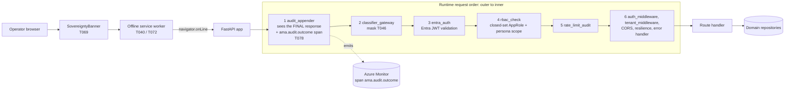
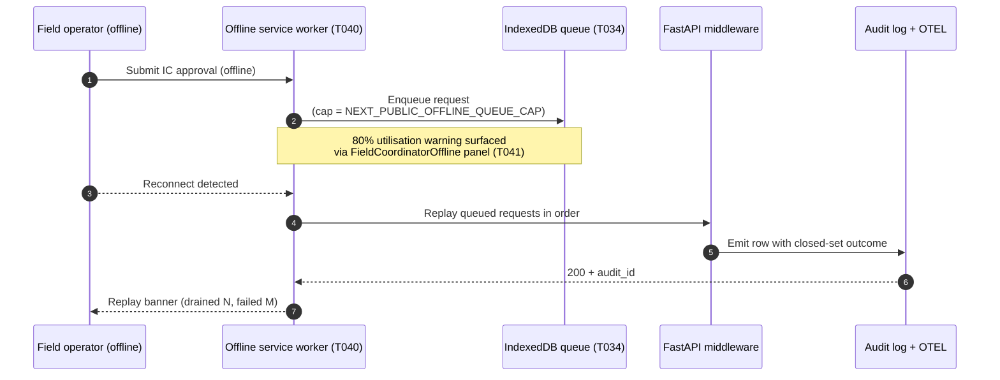

# spec-035 — Middleware stack & offline-replay flow

[→ Architecture index](README.md)

> **Migration**: This file is pending migration to a named view-type subdirectory. See known-gaps entry `MDW-MIG-01`.

<!-- spec-cross-ref: spec-035 -->

> Spec-035 T079. Captures the production-reachable middleware order and the
> offline reconnect-replay sequence so reviewers can audit precedence + the
> closed-set audit-outcome surface added in this spec.

## Middleware stack diagram

The diagram below shows the request path through the API middleware as actually
registered in [apps/api/app/main.py](../../apps/api/app/main.py). In Starlette the
**last** registered middleware is the **outermost** one, so the runtime request order
is the reverse of the registration order. The spec-035 production-auth stack
(`audit_appender`, `classifier_gateway`, `entra_auth`, `rbac_check`,
`rate_limit_audit`) is registered only when `AMA_ENABLE_PRODUCTION_AUTH=1`; the
activation-mutex build gate
([scripts/verify-activation-mutex.ps1](../../scripts/verify-activation-mutex.ps1))
enforces that this stack is not partially activated.

### Middleware ordering rationale

| Stage | Why this order |
| --- | --- |
| `audit_appender` outermost | It must observe the **final** response, after rate-limit and classifier rewrites. Because it is registered last it runs first on the request and last on the response. Authentication therefore happens *inside* audit, not before it. |
| `classifier_gateway` second | T046 masking runs before identity resolution so masked-field accounting is available to the outer audit frame. |
| `entra_auth` third | Validates the Entra JWT and populates `request.state.claims` for the next stage. |
| `rbac_check` fourth | Consumes the claims from `entra_auth` and applies the closed-set AppRole and AIIMS-function checks to protected prefixes only. |
| `rate_limit_audit` fifth | Runs closest to the handler so limits apply to requests that already passed authorisation. |
| Base stack innermost | `auth_middleware`, `tenant_middleware`, CORS, resilience and the error handler are registered before the spec-035 stack and therefore sit inside it. CORS preflight is answered before the base auth/tenant checks. |

> **Historical note**: earlier revisions of this page showed an
> `AuthZ → CORS → Audit → Classifier` order. That ordering is superseded by the
> registration order above; it is retained here only to explain the change.

## Offline replay flow

## See also

- [spec-035 plan.md](../../specs/035-webapp-capstone-closure/plan.md)
- [spec-035 research.md § R-011](../../specs/035-webapp-capstone-closure/research.md)
- [Cultural-safety contract](../../specs/035-webapp-capstone-closure/contracts/cultural-safety.contract.md)
- [Audit-event schema](../../contracts/audit-event.schema.json)
