# ACT Bushfire Survival Plan

> **Source**: ACT ESA
> **URL**: https://esa.act.gov.au/sites/default/files/wp-content/uploads/bushfire-survival-plan.pdf
> **Licence**: © ACT Government; emergency-management practitioner reference
> **Retrieved**: 2026-05-07T23:45:47Z
> **SHA-256**: `14b5da41bee2f19387c7cf20f511f8ca4129225dbb087ced4d93961807ca947c`
> *Converted from PDF to Markdown format.*

---
## Page 1

PREPARE. ACT. SURVIVE.

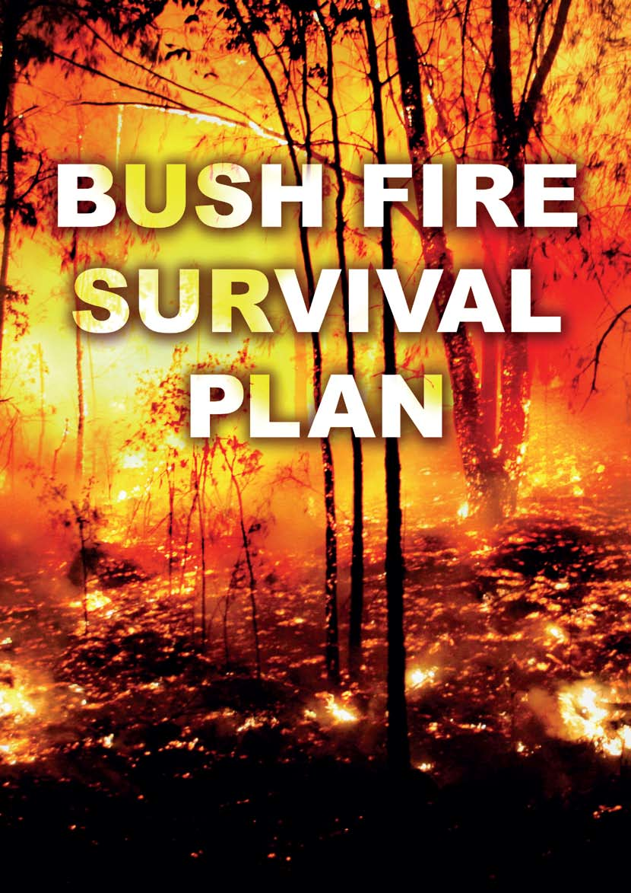

---
## Page 2

Heading
2
Bush fires in THE ACT
PREPARE. ACT. SURVIVE.
It is your responsibility to prepare yourself, your family and your 
home for the threat of bush fire. You need to make the decision 
to either Leave Early or Stay and Defend. Regardless of your 
decision you must prepare your property to give you, your family and 
your home the best chance of survival. 
The increased frequency of extreme bush fires in the last 10 years, 
and the recent experience of the Black Saturday fires in Victoria, have 
encouraged fire services throughout Australia to introduce new levels 
of Bush Fire Danger Rating (FDR).
The highest level is Catastrophic. On a day of Catastrophic FDR 
leaving early is the safest option to ensure your survival. You must 
leave early to a safer location, hours or the day before a fire occurs. 
Under no circumstances will it be safe to Stay and Defend.
The next highest level is Extreme. Should a fire occur in your area 
on a day of Extreme FDR leaving early will always be the safest option. 
Staying and defending can only be considered for homes that:
have been designed and constructed specifically to address the 
• 
threat of bush fire
have been maintained to those levels
• 
are currently well prepared, and
• 
There are four key considerations when dealing with bush fire: 
The safety of you and your family
• 
The defendability of your property
• 
The protection of irreplaceable valuables and important documents
• 
The maintenance of adequate levels of insurance
• 
The south east region of Australia remains one of the most bush fire prone 
areas on earth. In the last thirty years alone over 300 people have lost 
their lives to bush fire and some 7,500 homes and buildings have been 
destroyed.
It is vital that you understand on these days that your survival will depend solely on how well you have prepared 
and how decisively you act.
CATASTROPHIC
EXTREME
The safety of you and your family always comes first.  
This Bush Fire Survival Plan will provide you with the  
information you need to survive a bush fire.
can be actively defended by people with the skills, knowledge 
• 
and confidence to implement a well-rehearsed plan.
On days of Catastrophic or Extreme FDR:
Fires will likely be uncontrollable, unpredictable and very fast 
• 
moving with highly aggressive flames extending high above tree 
tops and buildings.
Thousands of embers will be violently blown into and around 
• 
homes causing other fires to start rapidly and spread quickly up 
to 20km ahead of the main fire.
Fire can threaten suddenly, without warning and be incredibly hot 
• 
and windy making it difficult to see, hear and breathe as the fire 
approaches.
People in the path of the fire will almost certainly die, or be 
• 
injured and significant numbers of homes and businesses 
destroyed or damaged.
Even well prepared and constructed homes will not be safe.
• 
Expect power, water and phone networks to fail as severe winds 
• 
bring down trees, power lines and blow roofs off buildings well 
ahead of the fire.
If you live in or near the bush, it is your responsibility to prepare 
yourself, your family, and your home to survive a bush fire. There 
is a wide range of planning and preparation activities that you can 
undertake which will dramatically increase the chances of you, your 
family, and your home surviving a bush fire.

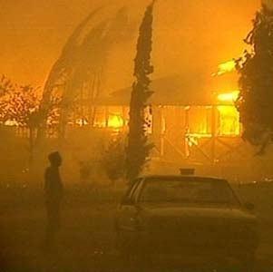

---
## Page 3

3
prepare. ACT. SURVIVE.
If you are in any doubt, LEAVE EARLY.
The first step in planning to survive a bush fire is to understand your 
own level of risk. If you live in an Ember Zone or in a Rural Area of 
the ACT your risk from bushfire will be higher, but all residents of 
the ACT need to be prepared for bushfires as you may live, work or 
travel in these areas. By understanding your own level of risk you will 
be able to make informed decisions that are right for you and your 
family. One of the most important decisions you need to make is 
whether you will Leave Early or Stay and Defend a well prepared 
property. This decision is the basis of your Bush Fire Survival 
Plan.
If you have already decided to Leave Early, turn to page 4 and 
carefully read the Leave Early information before completing your 
Bush Fire Survival Plan.
What will you do?
The following questions may help you make the right decision for 
you and your family.
Is your home adequately constructed, maintained and prepared 
• 
to withstand the impact of a fire, or in other words, is your home 
defendable?
Do you need to consider family members who are young, elderly 
• 
or infirm?
Are you able to maintain the necessary bush fire preparations for 
• 
yourself and your property?
Are you physically and emotionally prepared to actively defend 
• 
your property?
What will you do if a rapid onset fire leaves you with no time to 
• 
leave. Where will you shelter and how will you get there?
Do you have the knowledge, skills, confidence and equipment to 
• 
Stay and Defend your property?
If you are going to Leave Early prepare for where you are going to 
go, how you are going to get there and what you are going to take.
If you are going to Stay and Defend you must have a plan for how 
you are going to survive and where you will shelter. 
In either case have a backup plan in case things don’t go the way you 
expect.
Once you have completed your Bush Fire Survival Plan practise it 
regularly to ensure everyone involved knows exactly what to do in the 
event of a fire. 
Prepare yourself
Being involved in a fire will be one of the most traumatic experiences 
of your life. Bush fires can impact the health, safety and welfare of 
you and your family. 
You need to be both mentally and physically prepared to carry out 
• 
your Bush Fire Survival Plan.
Include the whole household in creating your 
• 
Bush Fire 
Survival Plan.
Prepare your Bush Fire Survival Kit.
• 
Prepare your Bush Fire Relocation Kit.
• 
Prepare your property
There are a number of measures you can take to prepare your home 
and property for bush fire. Once your property has been properly 
prepared a regular maintenance routine will greatly reduce the work 
required.
Your maintenance routine should include:
Mowing your grass regularly
• 
Removing excess ground fuels and combustible material 
• 
(long dry grass, dead leaves and branches)
Clearing leaves, twigs, bark and other debris from the roof 
• 
and gutters
Trimming low lying branches 2 metres from the ground 
• 
surrounding your home.
You should also:
Enclose open areas under your decks and floors
• 
Install fine steel wire mesh screens on all windows, doors, vents 
• 
and weep holes
Relocate flammable items away from your home including 
• 
woodpiles, paper, boxes, crates, hanging baskets and garden 
furniture
Seal all gaps in external roof and wall cladding
• 
Remeber embers can get through gaps as small as 2mm.
• 
Regardless of your decision, an unprepared property is not only 
at risk itself, but may also present an increased danger for your 
neighbours and their homes. Firefighters will carefully assess the risk 
before deciding if they are able to defend unprepared properties.
Know the Fire Danger Rating for any given day. You and your 
family should be aware of the actions you will take at the various 
Fire Danger Rating levels and it is important to ensure this is 
incorporated into your Bush Fire Survival Plan.
In the event of a bush fire you need to act decisively in accordance 
with your Bush Fire Survival Plan. To protect yourself from injury 
or death, do not adopt the ‘wait and see’ option. Fires can threaten 
suddenly and without warning, so you must be prepared to act 
decisively rather than wait for a warning that may not come.
Always be aware of the current fire danger rating in your area.
• 
Act decisively the moment you know there is danger.
• 
Put your plan into action; do not ‘wait and see’.
• 
Be alert for signs of fire, particularly the smell of smoke or the 
• 
sight of flames.
Look and listen for information on radio, television, the internet, 
• 
mobile phones and by speaking to people in your community.
This section takes you step-by-step through each option – Leave 
Early or Stay and Defend. Use it to complete your personalised 
Bush Fire Survival Plan lift-out starting on page 7.
Preparation is the key to survival

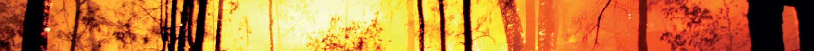

---
## Page 4

4
If you make the decision to LEAVE EARLY, you need to prepare your relocation kit.
Leave Early
Thinking “I will Leave Early” is not enough. You must 
PREPARE to ACT and SURVIVE.
If you plan to Leave Early, then you must leave your home 
well before a bush fire threatens and travelling by road becomes 
hazardous. 
Please remember that leaving late is a deadly option.
Step 1: Preparation
Your property should be well prepared for bush fire even if you intend 
to Leave Early. The better prepared your home, the more likely it 
will survive a bush fire, regardless of whether residents or firefighters 
are present to protect it. 
Step 2: Bush Fire Survival Plan
In making the decision to Leave Early, here are a few things you 
need to consider.
When will you leave – have you decided what will be your trigger 
• 
for action? (for example forecast conditions)
Will your plan be different for weekdays, weekends or if someone 
• 
is at home sick or injured?
Are all members of your household going to 
• 
Leave Early?
Where will you and your family go to ensure you are all safe?
• 
What route will you take to get there?
• 
What will you take in your Relocation Kit when you 
• 
Leave Early?
What will you do if there are multiple 
• 
Catastrophic or 
Extreme fire danger days in one week?
Do your friends, family and neighbours know the details of your 
• 
plan?
What will you do with your pets?
• 
Do you have a backup plan in the event it is unsafe to leave?
• 
Step 3: Travelling in your vehicle near a bush fire
Sheltering inside a vehicle is a high risk strategy that can result in 
death. Whilst sheltering inside a vehicle offers you a slightly higher 
chance of survival than being caught in the open, having a Leave 
Early or Stay and Defend strategy is a much safer option.
You should never take a journey into areas where the fire danger is 
Catastrophic or Extreme. You should consider postponing or finding 
alternative routes if necessary. If you can smell or see smoke in the 
distance it is best to u-turn and drive away from the danger.
If you are confronted with smoke or flames while on the road STOP 
as soon as it is safe to do so and immediately turn on the vehicle’s 
headlights and hazard warning lights. If you do need to shelter in 
your vehicle drive your car into a bare, clear area well away from 
surrounding trees, leaving your headlights and hazard lights on. Turn 
off the ignition, close all windows and vents then cover yourself 
with woollen or cotton blankets to protect from radiant heat and take 
shelter below the window level. Drink water frequently and stay in the 
vehicle until the fire front has passed. Once the fire front has passed 
exit the vehicle to inspect the damage and ensure other passengers 
are safe. 
Step 4: Backup Plan
Although you have made the decision to Leave Early, bushfire can 
become unpredictable and sometimes even the best laid plans may 
become unsafe to implement when circumstances change. Rapid 
onset of bushfire in your local area may make roads inpassable or 
travel particularly dangerous.
You must have other options:
Fill out the 
• 
Stay and Defend plan on page 7 of this booklet in 
case you are unable to leave early. Ensure every member of the 
family understands it in case one or more of them are caught at 
home.
Is your house well prepared? It can provide you with protection 
• 
from radiant heat and is far safer than being out in the open air or 
in a vehicle.
Identify areas within your neighbourhood where you could seek 
• 
shelter or refuge from fires and radiant heat when a bushfire is 
impacting such as a neighbour’s home.
prepare. ACT. SURVIVE.

---
## Page 5

5
If you make the decision to STAY AND DEFEND, you need to prepare your SURVIVAL kit.
Stay and Defend
You can not just Stay and Defend without careful planning and 
preparation. You must PREPARE to ACT and SURVIVE.
Step 1: Preparation 
Planning is absolutely critical to successfully Stay and Defend. 
Staying to actively defend your house involves the risk of 
psychological trauma, injury and death. Your property must be 
well prepared as the better prepared your home, the more likely it 
will survive a bush fire. Well prepared properties that are actively 
defended can provide a safe refuge for you and your family to shelter 
from radiant heat and ember attack.
Step 2: Bush Fire Survival Plan
In making the decision to Stay and Defend, here are a few things 
you need to consider.
Is your property defendable?
• 
Are you physically and emotionally prepared to actively defend 
• 
your property?
Do you have well maintained resources and equipment and do 
• 
you know how to use them?
Do you have appropriate protective clothing?
• 
Will your 
• 
Bush Fire Survival Plan need to be different for 
weekdays, weekends or if someone is home sick?
Do you have a contingency plan?
• 
What will you do with your pets?
• 
Do you have a back up plan in the event it is unsafe to leave?
• 
Do your friends, family and neighbours know the details of your 
• 
plan?
Step 3: Things you will need to do if you choose to 
Stay and Defend
Before the fire approaches:
Locate your Bush Fire Survival Kit
• 
Tune your radio to a local station and have a battery back up
• 
Ensure there is enough drinking water as it will be extremely hot
• 
Secure livestock and pets in well cleared areas with sufficient 
• 
drinking water
Prepare water buckets, a torch and ladder ready to check the 
• 
ceiling space
Communicate with your neighbours.
• 
As the fire approaches:
Remove flammable items from the exterior of your house  
• 
(e.g. blinds, outdoor furniture, door mats etc)
Block down pipes and fill gutters with water as well as any 
• 
available buckets
Shut all windows and doors and place wet blankets and towels 
• 
around windows and door edges
Prepare inside your house (e.g. remove curtains, move furniture 
• 
away from windows, close doors & windows)
Patrol the inside of your home as well as the outside for embers 
• 
or small fires that may start
Wet vegetation near your house with a hose or sprinkler.
• 
As the fire front arrives:
Take all fire fighting equipment inside such as hoses and pumps 
• 
as they may melt during the fire
Patrol the inside of your home, including the ceiling space, for 
• 
embers or small fires that may start.
After the fire front has passed:
Go outside and extinguish small spot fires and burning embers
• 
Patrol your property inside and out, including the ceiling space, 
• 
and extinguish any fires
Stay at your property until the surrounding area is clear of fire
• 
If your house has caught on fire, protect your life.
• 
Step 4: Backup Plan
Although you have made the decision to stay and actively defend, a 
change in circumstances on the day may require you to reconsider 
your Bush Fire Survival Plan. These changes may include a family 
member being caught at home alone or unexpected visitors, an 
illness or a fire danger rating of Catastrophic or Extreme.
Fill out the 
• 
Leave Early plan on page 7 of this booklet so you 
understand the things you need to consider should you have the 
opportunity to Leave Early.
Have task lists for able bodied visitors or ensure they are aware 
• 
of the safer locations in your neighbourhood where they can seek 
shelter or refuge from fires.
Communicate with neighbours about backup plans.
• 
prepare. ACT. SURVIVE.

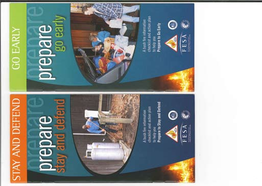

---
## Page 6

6
FIRE DANGER RATING
Recommended Action and Potential Fire Behaviour
CATASTROPHIC:  FDI 100+
The safest option is for you and your family to leave early, hours or the day before a fire occurs. Even well 
prepared and constructed homes will not be safe. 
EXTREME:  FDI 75 – 99
Leaving early (hours before) will always be the safest option for you and your family. Staying and Defending 
should only be considered if your home is well prepared, specifically designed and constructed for bush fire 
and you are currently capable of actively defending it.
SEVERE:  FDI 50 – 74
Leaving early will always be the safest option for you and your family, Staying and Defending is only an option 
if your home is well prepared, and you are currently capable of actively defending it. 
VERY HIGH:  FDI 25 – 49
Be prepared to implement your Bush Fire Survival Plan and keep informed of current fire activity by 
monitoring local media and regularly checking for updates on the RFS website or Information Line. 
HIGH:  FDI 12 – 24
Ensure that you, your family, your home and property is well prepared for the risk of bush fire. 
LOW-MODERATE:  FDI 0 – 11
Review and rehearse your Bush Fire Survival Plan.
prepare. ACT. SURVIVE.
Critical Advice and 
Warnings
During a bush fire your survival and safety depends on your 
preparations, and the decisions you make. 
Your main priority is to ensure that you and your family are safe. The 
lives of you and your family are more important than any building.
Preparation is the key to surviving a bush fire so whatever happens:
Make a 
• 
Bush Fire Survival Plan
Ensure everyone in your household understands the bush fire 
• 
survival plan
Don’t wait and see, act decisively
• 
Always be aware of the Fire Danger Rating (FDR)
• 
Seek out information, do not assume you will receive a warning
• 
Practice your plan.
• 
The safest option is always to be away from the fire, but that may 
not always be possible so regardless of your plan to Leave Early or 
Stay and Defend a well prepared property, you must have a back up 
plan. 
Bush Fire Alerts
If you receive an emergency warning about a bush fire or other 
emergency, take notice – it could save your life.
Fires can threaten suddenly and without warning making it impossible 
to get messages out in time. For this reason it is important that your 
Bush Fire Survival Plan does not rely solely on receiving an alert. 
You should always be aware of what is happening and be prepared to 
act regardless of whether you receive an official emergency warning. 
Fire agencies provide as much information as is possible through a 
wide range of mechanisms. 
There are three types of alert messages to help you make the right 
safety choices. These messages will change if the risk to you 
changes:
Bush fire Advice message – a fire has started - general 
information to keep you up to date.
Bush fire Watch and Act message – represents a heightened level 
of threat. Conditions are changing, a fire is approaching; lives may 
come under threat. Take appropriate action.
Bush fire Emergency Warning – is the highest level message 
advising of impending danger. It may be preceded with the Standard 
Emergency Warning Signal (SEWS). An Emergency Warning means 
there is a threat to lives and protective action is required immediately.
Fire Danger Ratings
The Fire Danger Rating (FDR) is an early indicator of potential danger 
and should act as your first trigger for action. The higher the rating, 
the greater the need for you to ACT. The FDR is an assessment of 
the potential fire behaviour, the difficulty of suppressing a fire, and 
the potential impact on the community should a bush fire occur on a 
given day.
If you make the decision to LEAVE EARLY, you need to prepare your relocation kit.

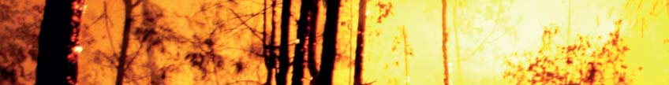

---
## Page 7

7
lift out
Your Bush Fire Survival Plan
Personal Details
Important phone numbers: 000 (Fire, Police & Ambulance)
Family:	
 Family:	
Family: 
Work: 	
 Friends:	
Friends: 
School: 
Important contact details – name and phone number:
Insurer:	
Policy Number:	
Phone:
Electricity: 	
	
Phone:
Water:	
	
Phone: 
Gas:	
	
Phone: 
Phone Company:	
	
Phone: 
Canberra Connect: 	
	
Phone: 13 22 81	
Leave Early
For those who have decided to Leave Early list their names and contact phone numbers then complete Section 1
Names:
Phone number:
Stay and Defend
For those who have decided to Stay and Defend list their names and contact phone numbers then complete Section 2
Names:
Phone number:
EMERGENCY CONTACTS
Check ACT Road Closures www.tams.act.gov.au
Check fire activity at www.esa.act.gov.au or call 
Canberra Connect on 13 22 81
Complete your personalised Bush Fire Survival Plan lift-out. 
PULL this Bush Fire Survival Plan lift-out from this document and keep in a safe place

---
## Page 8

8
Leave early – Section 1
For more information see “Bushfire Stay or Go Kit” at www.esa.act.gov.au
Leaving Early will always be the safest option for you and your family. It is extremely important for you 
to prepare a detailed Leave Early plan to ensure everyone understands what to do and when. Use the 
boxes below to list tasks to do.
Where to go – Identify one or more safer locations. You don’t have to travel far to be safe.
Remember to put on Personal Protective Clothing before you leave home. See page 11.
How to get there – What roads will you take to your destination and have an alternate route. Have a map of alternative routes.
What to take – Make a list of your most valuable items (e.g. Insurance papers, computer, photo albums, passports, birth 
certificates and other important documents). See Relocation Kit on page 13.
PULL this Bush Fire Survival Plan lift-out from this document and keep in a safe place
On CATASTROPHIC days the safest option 
is for you and your family to Leave Early, 
hours or the day before a fire occurs. Even 
well prepared and constructed homes will not 
be safe. Fires will likely be uncontrollable, 
unpredictable and very fast moving with highly 
aggressive flames extending high above tree 
tops and buildings.
On EXTREME days Leave Early (hours 
before) will always be the safest option for you 
and your family. Stay and Defend should only 
be considered if your home is well prepared, 
specifically designed and constructed for bush 
fire and you are currently capable of actively 
defending it. Fires will likely be uncontrollable, 
unpredictable and fast moving with flames in 
the tree tops, and higher than roof tops.
Everyone must have a BACK UP Plan
When to go – Think of different triggers that will cause you and your family to Leave Early.

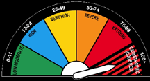

---
## Page 9

9
lift out
Stay and defend – Section 2
For more information see “Bushfire Stay or Go Kit” at www.esa.act.gov.au
Anyone who is NOT going to Leave Early MUST be involved in completing this Stay and Defend plan 
to ensure they know what to do. Every Stay and Defend plan will be different depending on your 
circumstances. Use the boxes below to list tasks to do.
Before the fire approaches – Start getting yourself and your property ready for a bush fire.
As the fire approaches – Prepare for ember attack on or near your home.
Remember to put on Personal Protective Clothing. See page 11.
As the fire front arrives – Stay safe by monitoring the fire from inside your home.
After the fire has passed – Patrol your property and extinguish any spot fires or burning embers. 
You may need to keep this up for several hours.
PULL this Bush Fire Survival Plan lift-out from this document and keep in a safe place
Everyone must have a BACK UP Plan OR PLAN B
Know where you will seek shelter or refuge from fires and 
radiant heat when a bushfire is impacting.
Identify other safer locations which could include a 
neighbour or friend’s house, sporting field or recreation 
oval close to your home that will offer you a better level of 
protection.
Back up plan – what will you do if you can’t activate your plan? Remember that leaving late can lead to loss of lives.

---
## Page 10

10
Activating your 
bush fire survival plan
Once you have prepared your Bush Fire Survival Plan and completed your preparations, it is absolutely essential 
that you regularly practise and review your plan. This will make sure you and your family are well organised in 
the event of a bush fire. If there is a risk to you and your family because of a fire or the forecast FDR, you need to 
Activate your Bush Fire Survival Plan.
STEP 1   Activate your Bush Fire Survival Plan
Someone must take charge and lead other family members through 
this emotional experience by carefully communicating the various 
tasks set out in the plan. Know who is going to Leave Early and who 
is going to Stay and Defend.
STEP 3   Keep informed of bush fire activity
Listen to ACT local radio and television, firefighters and/or police for 
information on the fire. Bush fire is dynamic and unpredictable so you 
need to be prepared for the unexpected. Warnings are not guaranteed 
so do whatever is necessary to ensure you remain safe.
OR
STEP 2A   Pack your vehicle and Leave Early
If your plan is to Leave Early, pack all valuables 
in your vehicle (See Relocation Kit page 13) and 
relocate to your designated safer location. Give 
yourself enough time to get you and your family to 
safety. Don’t return home until it is safe to do so.
STEP 2B   Implement your strategy to 
Stay and Defend
If your plan is to Stay and Defend, ensure you have 
all the items in the Bush Fire Survival Kit ready to go 
(See page 14). This can be a dangerous option and  
you should be physically and mentally prepared.
PULL this Bush Fire Survival Plan lift-out from this document and keep in a safe place

---
## Page 11

11
Protective clothing
wide-brimmed hat
goggles
smoke mask or wet cloth
long-sleeved shirt
leather work boots
heavy cotton pants
work gloves
In the event of fire everyone involved should wear: 
•	 Natural fabrics i.e. cotton, denim or wool. Synthetic fabrics can 
melt or burn. 
•	 A long-sleeved shirt made from thick cotton or wool is ideal to 
prevent burns to the upper body and arms (e.g. flannelette or 
cotton drill work shirt). 
•	 A pair of heavy cotton pants will shield your legs from the radiant 
heat emitted from the fire. For example denim jeans, oil-free drill 
pants or cotton overalls. 
•	 Sturdy leather work boots along with a pair of woollen socks 
prevent burns to the feet. 
•	 A wide-brimmed hat can stop embers from dropping onto your 
head or down the back of your shirt. 
•	 Work gloves to protect your hands. 
•	 A good pair of goggles will safeguard your eyes against any 
smoke, embers and debris that may be in the air. 
•	 A smoke mask or wet cloth (non-synthetic) to cover your nose 
and mouth to protect you from inhaling smoke and embers.

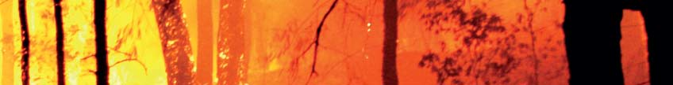

---
## Page 12

12
Relocation kit
Write a list of all items your family will need before, during and after your relocation. 
The list below shows items that you might like to put in your relocation kit.
	 Protective clothing for the whole family 
 	 Battery operated radio and spare batteries
 	 Eye glasses
 	 Mobile phone and battery charger
 	 Bottled water (enough for each 
relocated family member) 
 	 Family and friends phone numbers 
 	 Items of high importance  (e.g. family photos, 
valuables, important documents) 
 	 Blankets (natural fibres) 
 	 Children’s toys
 	 Medications
 	 Wallet/purse and money
 	 Clothing (2 sets of clothes for each family 
member) 
 	 Identity information (passports, birth certificates)

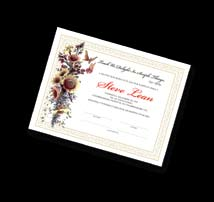

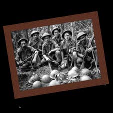

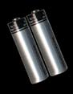

---
## Page 13

13
	 Goggles
	 Gloves
	 Battery operated radio
	 Torch
	 Spare batteries
	 Smoke mask (Respirator mask)
	 Shovel 
	 Ladder 
	 Towels
	 Medications
	 Buckets
	 Mop
	 Protective clothing for the whole family (e.g. boots or sturdy footwear, 
jeans, long sleeve shirt made from natural fibres or cotton drill 
overalls) 
 	 Drinking water
	 Woollen blankets
	 Fire extinguishers
	 First aid kit
	 Hoses 
You should have a bush fire survival kit stored in an area 
of the house that is safe to access.
The kit should contain:
Bush fire survival kit

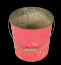

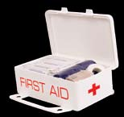

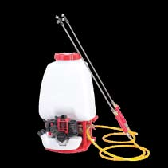

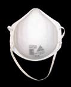

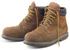

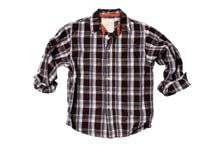

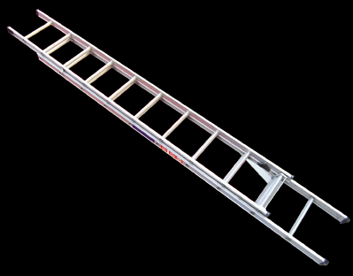

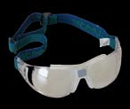

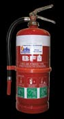

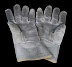

---
## Page 14

14
Other considerations
Professional firefighting equipment such as pumps, canvas hose 
• 
or sprinkler systems are recommended as they will withstand 
higher temperatures.
Your pets, livestock and other animals require proper care and 
• 
attention during fires. Consider food, medication, transportation 
and sleeping arrangements for your animals.
Firefighters may need access to your property during a bush fire 
• 
so it is in your best interests to allow enough space for fire trucks 
(4m wide by 4m high) to access your property and be able to 
turn around.
MYTH
REALITY
There will be a fire truck available to defend  
my home.
Fire trucks and firefighters are a limited resource so it is important they 
are deployed in an appropriate manner to best manage the fire. The 
larger a fire the more likely it is that you will not see a fire truck before, 
during or after the bush fire.
I know the back streets in town like the back of my 
hand so it is OK for me to leave at the last minute.
If your decision in your Bush Fire Survival Plan is to Leave Early, 
then you should leave well before the fire front reaches your property. 
Irrespective of your local area knowledge you must stick to your plan 
and Leave Early. Leaving late can be fatal.
Someone from an emergency service will knock on my 
door when it is time to leave.
Emergency services personnel are not always available to alert the 
community of potential risks by door knocking and encouraging you to 
leave. You need to be ready to Leave Early if your life or the people in 
your care are at risk.
My house will not burn down because there is 
more than 50 metres between my home and nearby 
bushland.
Most houses lost in bush fires are lost as a result of ember attack. 
Under certain conditions embers can cause ignitions up to 20kms in 
front of the main fire. A combination of your level of preparation and 
your homes construction will determine the survivability of your home.
I only have to clean my gutters and mow my lawns to 
prepare my property for bush fire.
Fire requires fuel, heat and oxygen to occur. This means that flames 
or embers do not necessarily rely solely on your gutters and lawns 
for fuel. They might utilise overhanging trees, woodpiles, old building 
materials under the deck or chemicals in the garden shed to sustain 
them. Do yourself and your neighbours a favour by taking the time to 
properly prepare your whole property, which includes yourself, your 
house and your land.
More information can be found on www.esa.act.gov.au  
Myths versus Reality
There are a range of other things to be considered regardless of your decision to Leave Early or Stay and Defend:
PREPARE. ACT. SURVIVE.
Your life is the first priority during 
bush fires. Prepare well, act 
decisively – and survive. 
ACT EMERGENCY SERVICES AGENCY
ACT EMERGENCY SERVICES AGENCY
FIRE DANGER RATINGS
An early indicator to you 
about the potential danger 
if a bushfire starts.

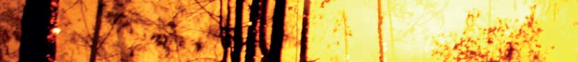

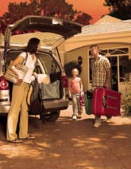

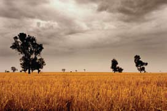

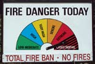

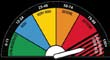

---
## Page 15

15
S U P P O R T E D  B Y
For more information on 
bushfires go to
www.esa.act.gov.au
or call
Canberra Connect
13 22 81
ACT Emergency Services Agency
phone: 6207 8444
mail: PO Box 104 Curtin ACT 2605
email: esahaveyoursay@act.gov.au
web: www.esa.act.gov.au
Canberra Connect 13 22 81
Parts of this brochure have been reproduced with permission from NSW Rural Fire Service©
© Australian Capital Territory through ACT Emergency Services Agency 2009.

