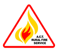

# ACT Regional Fire Management Plans

> **Source**: ACT ESA
> **URL**: https://esa.act.gov.au/sites/default/files/wp-content/uploads/1-24-Regional-Fire-Management-Plans.pdf
> **Licence**: © ACT Government; emergency-management practitioner reference
> **Retrieved**: 2026-05-07T23:45:54Z
> **SHA-256**: `0c40ff4cfaaaae0ca9e95a9b3f3bf34441d2afaa6f013f149adfddbc7f0127a7`
> *Converted from PDF to Markdown format.*

---
## Page 1

 
 
ACT Rural Fire Service 
Standard Operating Procedure 1.24 
Regional Fire Management  Plans 1.24 
Administrative 
Management 
 
Page 1 of 2 
 
Purpose 
This Standard Operation Procedure (SOP) provides a framework to clarify and outline 
procedures relating to the creation, approval, review and reporting of Regional Fire 
Management Plans (RFMPs).  
Scope 
This SOP applies to the ACT RFMPs approved by the ESA Commissioner to meet the 
requirements of the Strategic Bush Fire Plan (SBMP). The RFMPs are produced to provide 
guidance to the development of Bushfire Operations Plans (BOPs). 
Procedures 
1. Creation  
Under the Act, TAMS must supply to the ACT Emergency Services Agency (ACTESA) 
Commissioner (the Commissioner) draft RFMPs in accordance with the Strategic 
Bushfire Management Plan (SBMP). The draft RFMPs are produced for five (5) year 
periods and must ‘detail the timing, type and location of fuel-reduction, access and 
infrastructure activities proposed to be taken in the ACT. 
 
TAMS in developing RFMPs, must consult with the Community, ESA and the 
Conservator. 
 
2. Approval  
Once a draft RFMP is received the Commissioner will consider if the plan is consistent 
with the Emergencies Act 2004, and the SBMP. The Commissioner may also consider 
the interactions with NSW Fire Management Plans were appropriate.  
 
Approved RFMPs will be made publicly available through links from ESA and TAMS 
websites. 
 
3. Review  
The RFS, TAMS and EDP (Conservation Planning & Research) in preparing the TAMS 
BOP, will review the RFMPs considering factors that may underpin significant changes. 
As per the SBMP, these may include unplanned bushfires, urban development both 
‘green field’ or interface, or significant changes to bushfire fuel accumulation.  
 
The ESA Commissioner will seek advice annually from the RFS Chief Officer whether 
the changes require an update to the published RFMPs. The ESA Commissioner must 
approve any changes to published RFMPs. 
 
4. Reporting  
The RFS Chief Officer will provide a report regarding the annual review of the RFMPs. 
This report will include the progress of activities completed as identified of the RFMP in 
the context of the 5 year cycles.

---
## Page 2

 
 
ACT Rural Fire Service 
Standard Operating Procedure 1.24 
Regional Fire Management  Plans 1.24 
Administrative 
Management 
 
Page 2 of 2 
 
Supporting Documentation 
Form Title 
Location (document path) 
ACT SBMP 
http://esa.act.gov.au/community-
information/publications/sbmp/ 
ACT RFMPs 
http://esa.act.gov.au/community-
information/publications/sbmp/ 
Related Material 
Name 
Location (document path) 
Document 
Type 
Emergencies Act 2004 
http://www.legislation.act.gov.au/a/2004-
28/default.asp  
ACT Legislation 
Territory Records Act 2002 
http://www.legislation.act.gov.au/a/2002-
18/default.asp  
ACT Legislation 
 
 
Maintained By:  Manager Community Bushfire Protection 
 
Approved By: Andrew Stark 
 
 
Position:  Chief Officer

