# ACT Strategic Bushfire Management Plan (Version 3)

> **Source**: ACT ESA
> **URL**: https://esa.act.gov.au/sites/default/files/wp-content/uploads/Strategic-Bushfire-Management-Plan-v3-formatted.pdf
> **Licence**: © ACT Government; emergency-management practitioner reference
> **Retrieved**: 2026-05-07T23:45:41Z
> **SHA-256**: `0bf75ba360518aa46fdcc5864993ab7614eb11cdac19aa12c4cdc55975b6b531`
> *Converted from PDF to Markdown format.*

---
## Page 1

ACT Strategic Bushfire  
Management Plan
Version 3 2014

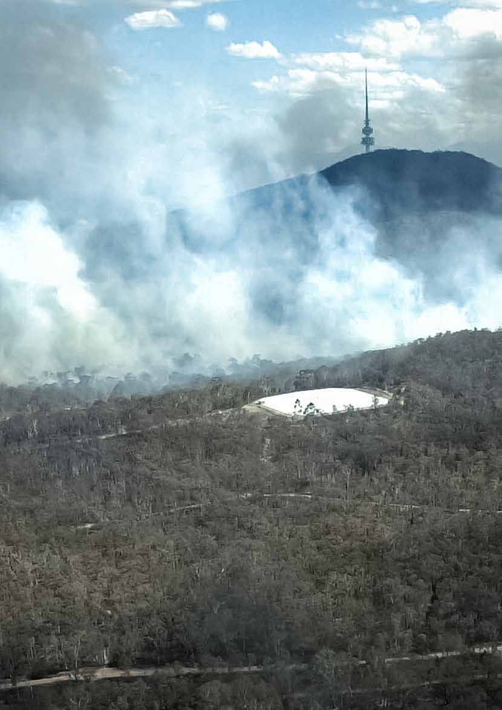

---
## Page 2

Prepared in accordance with the Emergencies Act 2004
ISBN‑0-642-60632-3
© ACT Government. This work is copyright. Apart from any use as permitted under the Copyright Act 1968, no part may 
be reproduced by any process without written permission from the Territory Records Office, Community and Infrastructure 
Services, Territory and Municipal Services, ACT Government.
GPO Box 158, Canberra City ACT 2601
Produced by Publishing Services for the Emergency Services Agency
Publication No: 14/1071
Telephone: Canberra Connect 13 22 81
Also published on www.esa.act.gov.au
N Lhuede, ACT Emergency Services Agency
Project management: N Lhuede, K Rutland, R Amin, D Kendall, L Szychowska, E Van der Moezel
Strategic direction and advice through the Bushfire Management Plan Steering Committee: D Lane (Chair, Emergency 
Services Commissioner), P Swain, C Barr, A Stark, D Iglesias, N Cooper, M Kitchin, S Gianakis, K Jeffery, J Starr, C 
Goonrey, C Henderson, P Barling, J Sharples, G Buffinton
Special thanks for the provision of Case Studies: R McCrae, D Kendall, J Seddon, M Kitchin, S Forbes, S Katz, G Potts, D 
Cutrupi, P Simakoff‑Ellims, C Barr
ii

---
## Page 3

Contents
Abbreviations and acronyms	
iv
Minister’s foreword	
1
Summary	
2
Part 1: Background to fire management in the Australian Capital Territory	
5
1.	
Purpose of the Strategic Bushfire Management Plan	
6
	
Past achievements	
6
	
Understanding this plan	
8
2.	
Scope of the Strategic Bushfire Management Plan	
9
3.	
Context for bushfire management in the Australian Capital Territory	
10
	
Legislative requirements 	
10
4.	
Fire management planning in the Australian Capital Territory 	
17
	
Plans of management 	
17
	
Regional fire management plans 	
17
	
Bushfire operational plans 	
17
	
Bushfire Management Standards 	
17
	
Bushfire survival plans 	
17
	
Response and coordination plans	
18
	
Mapping of areas of bushfire management	
18
	
Cross border arrangements	
20
5.	
Implementation, compliance and accountability of bushfire management in the  
	
Australian Capital Territory	
21
	
Implementation	
21
	
Compliance	
21
	
Governance and accountability	
21
6.	
Statement of resources needed to meet the objectives of the Plan.	
22
Part 2: Objectives and strategies for bushfire management in the Australian Capital Territory	
25
1.	
A reduction in bushfire ignitions	
26
2.	
Effective firefighting operations by skilled and motivated personnel	
29
3.	
Effective firefighting operations with the necessary equipment and resources 	
32
4.	
Extinguish bushfires when they occur	
35
5.	
Planned fire management on rural lands	
38
6.	
Broad area bushfire fuel reduction across the natural and rural landscape of the ACT 	
40
7.	
Access for vehicles and firefighters to undertake bushfire fighting and fuel reduction	
44
8.	
Adaptive management to provide continuous improvement in bushfire management	
46
9.	
A community that is prepared for bushfires 	
49
10.	 Effective land‑use policy and planning that reduces bushfire risk	
52
11.	 Integrated measures for bushfire protection at the urban edge 	
54
12.	 The community and government recover from the effects of bushfires	
60
Part 3: Schedules to the Strategic Bushfire Management Plan	
63
Schedule 1. Assets which are at risk from the impact of bushfires	
64
	
Property	
64
	
Critical and social infrastructure	
64
	
Business – services and industry	
64
iii

---
## Page 4

	
Business – agricultural production	
64
	
Water catchments	
65
	
Biodiversity and threatened species and Communities	
65
	
Cultural heritage	
65
Schedule 2. List of agencies and entities required to prepare bushfire operations plans	
66
Schedule 3. SBMP Version 3 Implementation Plan	
67
Glossary	
78
Abbreviations and acronyms	
78
List of figures
Figure 1 – The rIsk triangle	
2
Figure 2 – Non-urban fuels – Open Forest, Mt Ainslie Nature Reserve	
11
Figure 3 – Non-urban fuels – Grassy Woodland, Goorooyaroo Nature reserve	
11
Figure 4 – Urban fuels – CanberraFigure 4 – Urban fuels – Canberra	
11
Figure 5 – Average monthly FFDI (Average maximum DF) and maximum FFDI (Maximum monthly DF)	
12
Figure 6 – Canberra Airport wind ray – top 500 FFDI days at 3 pm	
12
Figure 7 – Assets at risk from bushfire, northwest Canberra	
14
Figure 8 – Representation of the cumulative increase in exposure from future risk	
16
Figure 9 – Relationship between the different fire management plans	
18
Figure 10 – Relationship between the different fire management maps	
18
Figure 11 – Bushfire Prone Areas (in red) – Cook and Aranda	
19
Figure 12 – Hall Village Fire Management Zones, with the photo showing the Inner APZ	
20
Figure 13 – Fire trail along an Asset Protection Zone at Tuggeranong Hill	
44
Figure 14 – The adaptive management cycle	
46
Figure 15 – The Bushfire Survival Plan	
51
Figure 16 – A sealed edge road, Forde	
55
Figure 17 – Inner Asset Protection Zone in an established area – Aranda Bushland	
56
List of tables
Table 1 – Fuel management works 2009–2013	
7
Table 2 – Firefighter capability as at 30 June 2014	
22
Table 3 – List of vehicles as at 30 June 2014	
23
Table 4 – Bushfire alert levels and key messages	
50
Table 5 – Ability to apply integrated measures for protection at the urban edge	
54
Table 6 – Fire Management Planning in the ACT	
67
Table 7 – A reduction in bushfire ignitions	
68
Table 8 – Effective firefighting operations by skilled and motivated personnel bushfires	
68
Table 9 – Effective firefighting operations with the necessary equipment and resources	
69
Table 10 – Extinguish bushfires when they occur	
70
Table 11 – Planned fire management on rural lands	
70
Table 12 – Broad-area bushfire fuel reduction across the natural and rural landscape of the ACT	
71
Table 13 – Access for vehicles and firefighters to undertake bushfire fighting and fuel reduction	
72
Table 14 – Adaptive management to provide continuous improvement in bushfire management	
72
Table 15 – Effective land‑use policy and planning that reduces bushfire risk	
75
Table 16 – Integrated measures for bushfire protection at the urban edge	
76
iv

---
## Page 5

Minister’s foreword
Bushfires are an inevitable part of living in the ACT. Canberra is described as the bush 
capital for good reason with forest and grassland woven through its urban areas. Along 
with the rural areas and the mountainous and forested landscape to the west and south, 
living in the ACT means we live in or near an environment in which bushfire is a natural 
occurrence. 
Living in this environment exposes us to an increased risk to the effects of those bushfires. 
We have added to this risk by changing the nature of bushfire fuels in the landscape and 
by increasing the number of bushfires that occur. Climate change only increases this risk 
further.
All bushfires can cause damage. Bushfires that burn large parts of the landscape with 
high intensity and threaten the community are those which present the greatest risk to life, 
property and the environment. Such bushfires are likely to occur again in the future with the 
right confluence of weather, climate and ignition. As a community we need to prepare for 
the possibility of such events. 
There is much we can do and this plan sets out complementary and integrated strategies 
through which the government and the community will reduce the risks of bushfire in the 
ACT. 
The ACT’s firefighters, career and volunteer, are well practised in responding to fires and 
we will continue to maintain high standards of response and capability with skills and 
experience gained from suppressing small bushfires and conducting prescribed burns. 
When the time comes, this experience will serve us well in responding to larger and 
more intense bushfires. Rapid, decisive and coordinated response controls and contains 
bushfires. Limiting the potential sources of ignition through regulation such as Total Fire 
Bans as well as community awareness will reduce the frequency with which they occur. 
Urban design and layout, building standards and effective fuel management at the urban 
edge will also reduce the risk of bushfires to communities living in urban areas. Similarly, a 
responsive whole of government approach to recovery following bushfires will lessen the 
longer term impact on individuals and allow the community as a whole to begin functioning 
quickly after significant bushfires.
The importance of planned burning to reduce bushfire fuels in the wider landscape of our 
National Parks and Nature Reserves cannot be underestimated. This plan continues the 
work set out in the previous Plan that implemented large scale hazard reduction burns in 
the landscape, providing protection to the community of the ACT, as well as biodiversity and 
catchment values.
This plan identifies the vital role the community has to play in understanding and addressing 
the risk they and their families may face. The capacity of individuals and the community to 
plan and prepare for bushfires is crucial in reducing their impact on the people of the ACT, 
both urban and rural. The government will support the community in facing these risks 
through targeted programs and information. 
As the Minister responsible for the Strategic Bushfire Management Plan, I am confident that 
this plan will serve the Canberra community well into the future and thank you for taking the 
time to read it. 
Yours sincerely,
Simon Corbell MLA 
Minister for Police & Emergency Services 
1

---
## Page 6

ACT Strategic Bushfire Management Plan – Version 3 2014
Summary
A bushfire requires fuel to burn, air to breath and heat to sustain it. This concept is the traditional way of understanding fire 
and its characteristics, and is described in the ‘fire triangle’. Removal or modification of any one of the three components 
will extinguish or reduce the fire, and is the basis of all fire fighting efforts.
This approach to understanding and managing fire is extended to describe this plan. The ‘bushfire risk triangle’ has at its 
centre bushfire risk. Bushfire risk can be understood as the likelihood of whether a bushfire will start, whether it will spread 
and whether it has consequences on, or impacts human life, property or the environment. As with the fire triangle, removal 
or modification of any one of the three components will reduce the risk. 
Many factors contribute to the components of risk. Some of them cannot be modified (e.g. weather and natural ignitions), 
however there are many that can either by reducing or entirely eliminating their contribution to the risk triangle. For 
example, reducing bushfire fuel loads is an important action that will reduce the likelihood of bushfires spreading in the 
wider landscape, as well as reducing consequences on properties.
 
Figure 1 – The Risk Triangle. Complementary strategies to reduce bushfire risk in the ACT.
Understanding all of the factors that contribute to bushfire risk and carefully considering what may be done to modify and 
change them forms the basis of this plan. 
This Plan describes complementary strategies to reduce this risk that is formed around 12 objectives. These address 
the risks of bushfire starting, spreading and impacting on people, property and the environment and are detailed on 
pages 3-4. Part 2 of the plan details the policies and actions for each objective and provides the framework for bushfire 
management in the ACT over the next five years.
2

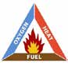

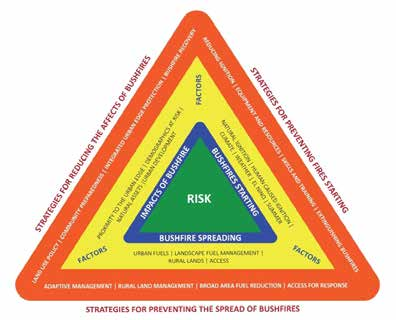

---
## Page 7

Objectives and Strategies
Objective 1.	
A reduction in bushfire ignitions
Programs will be implemented to reduce the number of unplanned ignitions, targeting systemic and 
human‑caused factors of deliberately lit bushfires (arson) and the careless use of fire.
Objective 2.	
Effective firefighting operations by skilled and motivated personnel
The ACT Government will support a responsive bushfire fighting capability with sufficient numbers of skilled and 
motivated personnel to respond to bushfires
Objective 3.	
The necessary equipment and resources to respond to and  
	
extinguish bushfires
The ACT Government will ensure an adequate supply of equipment and resources, supported by clear principles 
and systems of work to support operations, so that firefighters can respond to bushfires safely and effectively.
Objective 4.	
Extinguish bushfires when they occur
A rapid, decisive and coordinated response will provide the best opportunity to control bushfires in the shortest 
possible time and in a safe manner.
Objective 5.	
Planned fire management on rural lands
With the support of the ACT Government, rural land managers will undertake a planned, whole‑of‑property 
approach to reduce the risk of bushfire to their business and surrounding areas.
Objective 6.	
Broad Area bushfire fuel reduction across the natural and rural  
	
landscape of the ACT 
Broad‑Area fuel reduction practices will be used to establish and maintain a range (or mosaic) of differing fuel 
loads across the broader natural and rural landscape of the ACT, to assist in suppressing bushfires and reducing 
the impact of bushfires on life and property and the environment.
Objective 7.	
Access for vehicles and firefighters to undertake bushfire fighting  
	
and fuel reduction
Government and private land managers will work together to ensure the network of fire trails and helipads 
provides for rapid response to bushfires and effective bushfire fighting and fuel reduction operations.
3

---
## Page 8

ACT Strategic Bushfire Management Plan – Version 3 2014
Objective 8.	
Adaptive management to provide continuous improvement in  
	
bushfire management
The ACT Government will commit to bushfire research and analysis and maintaining the flexibility to modify 
programs to reduce current and future risk based on sound modelling, monitoring, evaluation and lessons 
learned.
Objective 9.	
A community that is prepared for bushfires 
Having a community that is prepared for bushfires is a shared responsibility. 
The ACT Community is asked to increase its knowledge of bushfire risk and to take actions, as individuals and 
groups, to minimise the risk they face from bushfires. In partnership, the ACT Government will support at‑risk 
individuals and the community at large to help them understand this risk and be better prepared to make 
informed and timely decisions when bushfires occur.
Objective 10.	 Effective land‑use policy and planning that reduces bushfire risk
The assessment and mitigation of bushfire risk through effective land‑use policy and planning will be undertaken 
to reduce the exposure of the built environment and the natural environment to bushfire.
Objective 11.	 Integrated measures for bushfire protection at the urban edge 
A range of measures will be used to achieve integrated bushfire risk reduction on the urban edge, including 
development planning, physical works (for example edge roads around new suburbs and fuel reduction in Asset 
Protection Zones) community education and inspection.
Objective 12.	 The community and government recover from the effects of  
	
bushfires
Recovery from bushfires will commence while operations are under way and may be required to continue for a 
long period following the cessation of response operations. It will encompass actions to address the personal, 
broader social, economic and environmental impacts of bushfires.
4

---
## Page 9

Background to fire management  
in the Australian Capital Territory
Part 1:
5

---
## Page 10

ACT Strategic Bushfire Management Plan – Version 3 2014
1.	 Purpose of the Strategic Bushfire  
	
Management Plan
A Strategic Bushfire Management Plan (SBMP) is a requirement of the Emergencies Act 2004. The SBMP is the 
overarching document that directs all levels of bushfire planning throughout the Australian Capital Territory (ACT).
The first SBMP was developed in 2004, and has underpinned the continuous improvement in bushfire management 
outcomes in the ACT. The SBMP is a dynamic document that allows emergency services and fire managers to have the 
flexibility they require to implement measures that reduce bushfire risk, and to apply improved methods and knowledge as 
they are developed. 
Past achievements
The ACT Government has undertaken ongoing and wide‑ranging reform to all aspects of emergency services in the ACT 
over the last decade. In particular, the extreme risk of bushfires has resulted in significant changes in how the ACT is able 
to prepare for and respond to bushfires. Initiatives over this period include:
•	
the passing of the Emergencies Act 2004 establishing the ACT Emergency Services Agency, as well as the detailed 
requirements for an SBMP
•	
capital funding for infrastructure, including fleet replacement and enhancement, as well as provision for aircraft and 
heavy plant for fire suppression
•	
equipment upgrade and enhancement, including the Territory Radio Network
•	
provision of mobile data terminals in all fire fighting appliances
•	
increasing personnel and volunteer numbers to strengthen the frontline capability of rural and urban firefighters, which 
included the establishment of units such as the Remote Area Fire Teams, Community Fire Units, and the Mapping and 
Planning Support Group
•	
construction of the new purpose‑built headquarters facility at Fairbairn, which includes emergency coordination, 
public information and incident management facilities
•	
construction of the new helibase and hangar facility, and the ACT ESA training centre at Hume
•	
construction of new emergency services stations in urban and rural areas
•	
improving operational doctrine across services with the development and implementation of the Emergencies 
(Concept of operations for bush and grass fires in the Australian Capital Territory) Commissioner’s Guidelines 20121
•	
enhanced provision of information to the community to build a strong relationship with the local media and provide 
timely and accurate emergency alerts, updates and warnings through the web and social media
•	
collaborating in whole‑of‑government planning for periods of high fire danger through the Elevated Fire Danger Plan
•	
substantially revising the ACT Emergency Plan (2014)2, reflecting lessons learned from emergencies in the ACT and 
elsewhere in Australia
SBMP version 2 (2009‑2014) and its Regional Fire Management Plans (RFMPs) established a clear framework and defined 
outcomes for fuel management and access works in the ACT. Targets for fuel management and access activities were 
identified and this plan provides the opportunity to report against these.
1	
www.legislation.act.gov.au/ni/2012‑400/default.asp
2	
www.legislation.act.gov.au/ni/2014‑442/current/pdf/2014‑442.pdf 
6

---
## Page 11

Part 1: Background to fire management in the Australian Capital Territory
Table 1 – Fuel management works 2009–2013
Annual proposed fuel management 
activity
Proposed treatment area (ha) 
2009–2014 
(annual average of 5 years)
Actual area treated (ha) 2009–2014 
(percentage of proposed area)
Slashing
3674
5116 (140%)
Grazing
8677
5555 (64%)
Rural road slashing
1766
2087 (118%)
Urban road slashing 
743
1306 (175%)
Physical removal 
203
361 (178%)
Prescribed burning 2009–14 
4492
4370 (97%)
Over the period of assessment, a number of trends in the figures above reflect operational and land‑use changes:
•	
as urban development has progressed, a number of areas have been taken out of grazing and replaced with slashing 
as suburbs have increased
•	
although very wet conditions in 2010–11 and 2011–12 severely restricted the amount of prescribed burning, targets 
overall have been met
The ACT Government and its agencies must remain dynamic and flexible to respond to change, and will seek to 
continually improve its bushfire management services. This plan provides the ACT with the opportunity to take the next 
steps to build on the achievements of the past 10 years.
7

---
## Page 12

ACT Strategic Bushfire Management Plan – Version 3 2014
Understanding this plan
Part 1 of the SBMP provides the background and sets the context for fire management in the ACT. This includes the 
scope of the plan, planning arrangements and future risks for fire management.
Part 2 provides direction to government and the community. The current and ongoing management policies and 
procedures that will be applied for each objective are detailed in Part 2; these are largely the ‘business as usual’ actions 
the government and community undertake to reduce the risk of bushfire. Each section also includes specific actions that 
will be undertaken during the life of the SBMP ‑ these are often new initiatives and actions that have not previously been 
undertaken in the ACT.
Part 3 of the plan includes a number of schedules that give direction to the strategies of the Plan.
Throughout the document, case studies have been included to reflect specific actions undertaken during the past 
10‌‌ years, under the previous two versions of the Plan. Not only do these studies provide additional context to the SBMP, 
but they also give recognition to the significant achievements by the ACT ESA and land managers.
Important documents that do not form part of this plan but should be considered alongside it are:
•	
The ACT Bushfire Management Standards which define the measurable outcomes required under the current and 
ongoing actions detailed in Part 2 of this plan. This document, which includes standards for matters such as fuel 
management and fire trail access, is prepared for the Fire Services, land managers, developers as well as the general 
community to assist them in achieving effective results in reducing bushfire risk. 
Supporting documents provide detailed analysis of information on fire management in the ACT. These documents were 
updated from the previous SBMP version 2 and informed the development of this Plan. They reflect on the latest research 
and the lessons learned and include the following:
•	
Fire and the Environment – 2009 and 2014
•	
Bushfire and Catchment Management
•	
ACT Bushfire History
•	
Bushfire Ignitions, Frequency and Trends
•	
Bushfire Fuels
•	
Bushfire Risk Analysis
•	
Consequences of Bushfires
•	
Fire Danger Ratings and Indexes
8

---
## Page 13

Part 1: Background to fire management in the Australian Capital Territory
2.	 Scope of the Strategic Bushfire Management Plan
The SBMP takes account the far‑reaching impacts of bushfire in the ACT community. The SBMP is applicable to all 
who live and work in the ACT – including people of all ages and backgrounds, whether they are living in Bushfire Prone 
Areas (BPA) or in the broader community. In developing this Plan, engagement across government, the community 
and community service organisations leads to successful implementation, through increased ownership and broader 
accountability for the actions within the Plan.
The SBMP provides the strategic framework for government agencies with a responsibility for bushfire response and 
management:
•	
the ACT Emergency Services Agency (ESA)
•	
the ACT Rural Fire Service and ACT Fire & Rescue (the Fire Services)
•	
land managers, including ACT Government agencies and rural landholders 
•	
other ACT Government agencies that support the community and emergency services 
The SBMP defines the strategies by which the ACT Emergency Services Commissioner (the Commissioner) exercises the 
functions of this position under the Emergencies Act 2004. 
The SBMP also defines the strategies by which the Chief Officers of the ACT Rural Fire Service (ACT RFS) and ACT Fire 
& Rescue (ACT F&R) implement their responsibilities, and the distinct roles and responsibilities of these services. It also 
values the critical contribution of the volunteer ACT RFS Rural Fire Brigades and volunteer ACT F&R Community Fire Units 
that provide the majority of the ACT’s firefighters. 
The distinct role of the ACT Territory and Municipal Services Directorate (TAMSD) in fire management is addressed in the 
SBMP. The Parks and Conservation Service, a TAMSD business unit, is responsible for fire management on 73% of the 
ACT’s area, and provides suppression capability through the Parks Brigade as part of the ACT RFS.
The SBMP assists the ACT Bushfire Council to advise the Minister for Police and Emergency Services on any matters 
relating to bushfire management in the ACT. It provides the Council with the framework by which to measure outcomes 
and analyse information, and review bushfire preparedness in the ACT. 
This plan, as well as the RFMPs that come under it, recognises the commitment of community service organisations to 
effective land and fire management in the ACT. These groups, which include conservation groups, recreational users and 
community representatives encompass a wide variety of skills and local knowledge of the ACT, and make a significant 
contribution in developing strategies and actions for bushfire prevention and mitigation. 
The SBMP supports the National Principles outlined in Strategic directions for fire and emergency services in Australia 
and New Zealand 2014–2016 by the Australasian Fire and Emergency Services Authorities Council (AFAC) to improve 
understanding of bushfires across agencies, and contribute to safer and more resilient communities. The National 
Principles establish:
•	
primacy of life in emergency response and planning
•	
need for trust, not only within emergency services, but also with government and communities
•	
importance of interoperability between agencies
•	
accountability of emergency services to both the community and government
The ACT local media play an important role in bushfire management, and the SBMP recognises this. The media provide 
significant support to the emergency services by assisting with the delivery of bushfire education and awareness 
programs. They also have a critical role in disseminating information, advice and warnings when bushfires occur. 
The strategies and actions in the SBMP have been designed to be compatible with and complementary to management 
plans that apply to National Land.
The ACT has formally and informally strengthened its relationship, in the regional context, with New South Wales (NSW) 
agencies involved in fire management. Potentially, bushfires can ignite in NSW and have an impact on the ACT, from the 
forested landscape to the west and south, and the open agricultural lands to the north and east. Similarly, bushfires in the 
ACT have the potential to have an impact on NSW, in rural areas, rural subdivisions such as Royalla and Wamboin, and 
the urban and semirural areas of Queanbeyan and beyond.
9

---
## Page 14

ACT Strategic Bushfire Management Plan – Version 3 2014
3.	 Context for bushfire management in the  
	
Australian Capital Territory
Legislative requirements 
The ACT Government enacted the Emergencies Act 2004 as part of its response to the Inquiry into the Operational 
Response to the January 2003 Bushfires (the McLeod inquiry) in Canberra. This replaced the Bushfire Act 1936 and the 
Fire Brigade Act 1957 and set the legislative basis for integrated bushfire‑related planning and response in the ACT.
This SBMP has been developed in accordance with the requirements of the Act. The policies, strategies and actions in 
this plan build upon those developed and implemented through SBMP versions 1 and 2, the lessons learned locally and 
from other jurisdictions following significant emergencies, and the ongoing contribution of scientific research and analysis 
to bushfire management.
In 2012, the ACT Auditor‑General undertook a review of bushfire preparedness in the ACT3, which included detailed 
consideration of SBMP version 2. This SBMP incorporates relevant recommendations in the government’s response.
The Bushfire Environment
Bushfires in the Australian Capital Territory 
Most of the total area burned in the ACT since 1939 has been the result of a relatively small number of large fires (in 1939, 
1952, 1979, 1983, 1985, 1991, 2001 and 2003). In contrast most bushfires in the ACT occur on the urban edge and in 
other areas where people congregate, such as the Cotter River, and mostly burn over relatively small areas – in the past 
10 years, more than 95% of all bushfires in the ACT were less than one hectare in size. This reflects positively on the early 
detection, readiness, response and access that are provided by ACT Fire Services and land managers. 
Detailed information on the cause and history of bushfires in the ACT is in the supporting information to this SBMP, which 
is available on the ACT ESA website.
Bushfire fuels
Fuel is the critical element in reducing bushfire risk because it can be directly modified by land managers to reduce the 
impact of bushfires on life, property and the environment.
Types of bushfire fuel are categorised within this plan as follows (see Figures 2–4):
•	
non‑urban fuels, which include forest fuels (forest and woodland) and grassland fuels (rural properties and native 
grassland areas, roadside grass)
•	
urban fuels, which comprise any flammable material in and around suburbs and built‑up areas (e.g. gardens, mulches, 
buildings, fences, rubbish, wood piles)
Planned fires (prescribed burns or hazard reduction burns) are effective in modifying the quantity, arrangement and 
seasonal flammability of fuels, thus reducing the intensity, flame height and rate of spread of fires under given weather 
conditions. The management of bushfire fuels in suburbs, on both unleased and leased land, in conjunction with 
appropriate preparedness by residents, will reduce the potential for loss of life and property. 
Defining vegetation as a fuel is deliberate in the context of bushfire management and fire behaviour, and necessary to 
develop the strategies for bushfire management in the ACT. However, the intrinsic properties of vegetation have value and 
are considered assets to be protected from bushfire in other contexts – for example, supporting ecosystem function and 
fodder for primary producers. Further information on bushfire fuels, the assessment and modelling of bushfire fuel loads in 
the ACT and the techniques used to modify bushfire fuels is provided in the supporting information to the SBMP, which is 
available on the ACT ESA website, www.esa.act.gov.au.
3	
ACT Auditor‑General’s Office Performance Audit Report – Bushfire Preparedness Report No. 5 /2013
10

---
## Page 15

Part 1: Background to fire management in the Australian Capital Territory
Figure 2 – Non-urban fuels – Open Forest, Mt Ainslie Nature Reserve
Figure 3 – Non-urban fuels – Grassy Woodland, Goorooyaroo Nature reserve
Figure 4 – Urban fuels – Canberra
Bushfire Weather
Weather, climate and bushfire are intrinsically linked. The Forest Fire Danger Index (FFDI) or the Grassland Fire Danger 
Index (GFDI) provide a measure of potential fire behaviour including the rate of spread of bushfire, bushfire intensity and 
difficulty of suppression. These indices are calculated on weather and climate values: temperature, relative humidity, wind 
speed and the Drought Factor (DF)4. The indices help to identify the impact on the community should a fire occur on any 
given day, as well as the level of preparedness for the Fire Services. ‘Elevated fire danger conditions’ are considered to 
occur when the FDI is greater than 50. 
4	
Drought Factor is based on recent rainfall and on the Byram‑Keetch Drought Index (BKDI). The BKDI is the number of millimetres  
	
of rain needed to saturate the soil, and ranges up to a maximum of 200mm. 
11

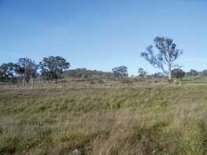

---
## Page 16

ACT Strategic Bushfire Management Plan – Version 3 2014
The fire season in the ACT corresponds with the summer months, where high temperatures, low relative humidity and 
low rainfall work together to create elevated fire danger conditions. The seasonal potential for bushfires varies with rainfall, 
temperature and their influences on biomass growth and fuel moisture content. Using long-term records to establish 
the average FFDI and identify maximum FFDI recorded for that month, Figure 5 identifies the fire season from October 
to March, with the potential to extend from September to April. The maximum FFDI (in red) shows the extreme bushfire 
conditions that the ACT can face.
Figure 5 – Average monthly FFDI (Average maximum DF) and maximum FFDI (Maximum monthly DF)
(Canberra Airport – synoptic data)
  
Figure 5, termed a ‘wind ray’ also uses records from Canberra Airport to show that the majority of high FFDI days will 
come from the north and west. Although this supports an increased focus on fire management on the western urban edge 
of Canberra, and reflects the historic impact of bushfire on the urban area of the ACT, the data also demonstrates high 
FFDI may occur from any direction and will be considered.
Figure 6 – Canberra Airport wind ray – top 500 FFDI days at 3 pm 
(Synoptic data with Bureau of Meteorology derived DF)
	
  
How a bushfire behaves under elevated conditions is not fully described by the factors from which Fire Danger Indices are 
derived. Although these indices are important in communicating risk more broadly, significant research in recent years has 
focused on the affects of atmospheric instability in creating and driving severe fire events, such as experienced in 2003 in 
the ACT. Other interactions of the weather and landscape, such as Foehn winds, thermal belts and the channelling of fires 
in mountainous areas across the prevailing wind conditions significantly affect fire behaviour, and are discussed in the case 
study ‘High country fire weather’.
12

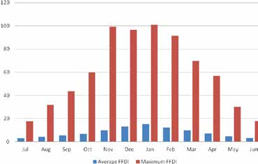

---
## Page 17

Part 1: Background to fire management in the Australian Capital Territory
Case study: High country fire weather
During the campaign fires 2003 in the high country, little was known within the bushfire community about the 
weather. Firefighters were often surprised by weather doing things differently to what it does in the lowlands.
It was clear that we had to improve our understanding of fire weather in the high country. 
The first step was the installation of an Automatic Weather Station on Mt Ginini. For the first time this gave us an 
official record of just how different the weather processes were above 1500m elevation.
Next, research funded by the Bushfire Cooperative Research Centre allowed the deployment of a grid of portable 
automatic weather stations across the rugged ranges in the west of the ACT to undertake research. This allowed 
the identification of significant patterns in winds as they blow across ridgelines. These patterns have a major 
influence on how fires spread. It is now known that when the prevailing winds exceed a threshold (between 
25 and 30 km/hr), the surface winds on the downwind side of the ridges reverse, changing the dynamics of 
spreading wildfires.
Additional research identified events where the air over the high country becomes much drier than it is elsewhere. 
This mostly happens between midnight and sunrise, and explains the reports from fire crews overnight of 
increased fire behaviour. Knowing that high fire danger may occur in the early morning also changes the way 
that fire risk is assessed in the high country. The work also confirmed the occurrence of foehn winds in eastern 
Australia, and showed that these can cause rapidly and localised deterioration of fire weather and fire crew safety. 
Foehn winds, which are warm dry, winds that occur in the lee of mountain ranges create locally greater fire danger 
downwind of major ridgelines.
These, and other weather patterns, allow better results from fire risk models in the ACT and from the fire 
behaviour models used to guide suppression operations.
A foen wind driven bushfire in Namadgi National Park, 19 May 2004.
13

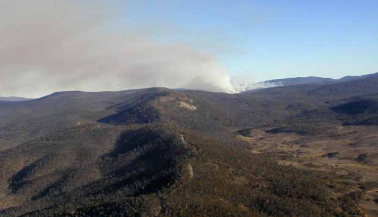

---
## Page 18

ACT Strategic Bushfire Management Plan – Version 3 2014
Bushfires and the natural environment
Bushfires are an integral component of the landscape of south‑eastern Australia, and the SBMP takes account of the 
values of the unique natural environment within and surrounding the city of Canberra. As shown in Figure 7 non urban 
areas, including their component plant and animal species, have been given a value status and are considered assets. The 
ACT Nature Conservation Act 1980 is the instrument for the protection and conservation of native plants and animals and 
for the reservation of areas for this purpose.
The SBMP takes into account the role that fire management practices play in the continued survival of important 
ecological communities in the ACT. The SBMP and the regional fire management plans that are derived from it provide the 
framework to implement strategies to maintain these critical ecological communities – in particular, those that are listed as 
endangered both in the ACT and nationally – and meet bushfire management needs.
The supporting document SBMP – Fire and the environment SBMP v3, on the ACT ESA website, outlines specific 
principles that have been developed to underpin the RFMPs and the planned treatments, such as burning, grazing and 
slashing that will be implemented on Government managed land. Version 3 complements and builds on its predecessor’s 
(i.e. SBMP – Fire and the Environment SBMP v2) to include information on fire regimes and the impacts of fire on 
vegetation, fauna, and soil characteristics and components. (e.g. invertebrates and fungi)
Bushfire Risk assessment
The risk assessment of natural hazards in the ACT5, establishes bushfire with the highest possible rating of ‘Extreme’, 
reflecting the likelihood and potentially significant impacts of this hazard on life, property and the environment.
The supporting information to this plan provides modelling and analysis of the probability of bushfires starting and 
spreading in the ACT, based upon historical records of the fire climate and the modelling of bushfire fuels and behaviour 
characteristics.
Bushfire risk analysis in the SBMP considers the likelihood of a bushfire starting, how the bushfire will spread through 
the landscape, and the consequence or impact on assets. Assets are defined as physical items that have a monetary 
or non‑monetary value. Potentially affected assets can be broadly grouped as human life, property, business and social 
infrastructure, critical infrastructure, agricultural production, biodiversity including threatened species and communities, 
cultural heritage, and water catchments (see Figure 7).
Asset groups and their elements are listed in Schedule 1. Detailed consideration of the impact of fire on these assets, as 
well as the risk analysis, is in the supporting information to the SBMP.
Figure 7 – Assets at risk from bushfire, northwest Canberra
5	
ACT Territory‑Wide Risk Assessment, ACT 2012
14

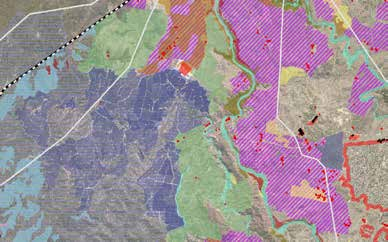

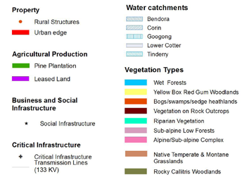

---
## Page 19

Part 1: Background to fire management in the Australian Capital Territory
Future risks 
Future changes that may increase the risk of bushfire, such as climate, population and land‑use changes, must also be 
considered.
Temperatures across Australia are now, on average, almost one degree Celsius warmer than they were in 1910, with most 
of the warming occurring since 19506. Climate change has seen Australia experiencing more hot weather and extreme 
heat, and fewer extreme cool conditions. There has been an increase in extreme fire weather and extreme bushfires 
across south‑eastern Australia. In the future, evidence indicates that the number of extreme fire days will continue to 
increase in line with climate projections. 
The future behaviour of a single bushfire is difficult to project, because many factors influence the nature of a fire and 
its effect. There is strong evidence for increased temperature due to climate change, which may increase the frequency 
of days of high fire danger. This will be exacerbated by global climate systems, such as El Niño events. Climate change 
modelling indicates that the most significant changes will be in southeastern Australia, where Australia’s worst bushfires 
have already occurred.
Since 2001, Australia has experienced a growing number of extreme bushfires which includes the 2003 ACT fires7. This 
is a strong indicator of changes in fire weather, notably atmospheric instability as previously discussed. In addition to the 
risk these fires present to public safety, they can also have major impacts on biodiversity and catchment management. 
A continuation of these trends may require a significant re‑appraisal of the assumptions underlying current bushfire 
management.
As the population grows, plans for additional housing need to consider the balance between greenfield development 
(new residential estates) and urban intensification in existing metropolitan areas. The growth of new estates to the west 
and north of the city may increase risk of exposure to bushfire; however these areas also provide the opportunity to 
develop new suburbs with a comprehensive and integrated range of bushfire protection measures.
The ACT’s continuing growth and projected changes in demographics also present future risk. Knowledge of 
demographics, including population growth, age distribution and where potentially vulnerable people live will be important 
in developing future strategies.
The delivery of services associated with emergency management, particularly provision of information and warnings during 
emergencies and emergency response, continues to change based on the response to the hazards we face and the 
capacity of society as a whole to respond. Agencies across Australia continue to promote greater community resilience, 
or capacity, to withstand and recover from major incidents8. The balance between service delivery by government, and 
personal, community and business resilience remains a significant challenge for the future.
Future changes present a challenge for emergency services. As represented in Figure 8 the combined impacts of climate 
change, population change, land‑use planning along with community expectations increase the ACT’s bushfire risk profile. 
Future risks are considered and addressed through this Plan. For example, effective land use planning and design will limit 
the proximity of some vulnerable groups to the risk of bushfires by restricting special purpose developments in Bushfire 
Prone Areas. (See Part 2, Chapter 11). 
6	
 CSIRO and BoM (2012) State of the Climate 2012
7	
 McRae and Sharples (2014)
8	
 COAG – the National Strategy for Disaster Resilience, 2011
15

---
## Page 20

ACT Strategic Bushfire Management Plan – Version 3 2014
Figure 8 – Representation of the cumulative increase in exposure from future risk
Note: The graph is to illustrate the cumulative effect of increases in exposure over time of separate risk drivers and does not purport to quantify this 
change – none the less, the relative changes in elevated fire danger days are derived from published data, as are demographic changes in the ACT. 
Case Study: Pyrotornadogenesis 	 	
	
 	
A still from a video of the fire tornado 
passing Mt Arawang on 18 January 2003. 
Goal posts in Kambah Playing Fields 
are in the foreground. The video, taken 
by Tom Bates, may be viewed at http://
esa.act.gov.au/emergency‑management/
fire‑tornado‑video/
During the 2003 wildfires, a number of reports came in of vortices, or 
fire whirls, among the fires. This is not unusual. What was different was 
the report of a tornado on 18 January as the fire approached Weston 
Creek.
Aerial observers flew over the area and recorded damage patterns 
in pine and eucalypt forests these indicated that a tornado may have 
occurred. Eye‑witness accounts, photographs and videos from 
members of the public provided the world’s first account of a true fire 
tornado. Details were published in a science journal and the event 
gained worldwide attention.9
In extreme wildfires, a large area of terrain is alight at any one time. 
The smoke plume, or convection column, above the burning ground 
has not mixed with surrounding air at the point where the moisture in 
it condenses at the cloud base. The large amount of additional heat 
released by this condensation may, in the right circumstances, create a 
fire thunderstorm (or pyrocumulonimbus cloud).
These severe meteorological phenomena may produce all the features 
of normal thunderstorms – rain, which largely evaporates before reaching the ground; hail, which may be black; 
lightning, which may start new fires; downburst winds; and tornadoes, which may create damaging winds of more 
than 250 km/hour.
We now know that when a fire and the atmosphere become ‘coupled’, the fire may not be the greatest danger on 
the landscape. Many homes were damaged or destroyed during the 2003 fire storm event.
9
9	
McRae, R., Sharples, J., Wilkes, S&Walker, A.(2012). An Australian pyro-tornadogenesis event. Natural Hazards, 65,1801-1811
16

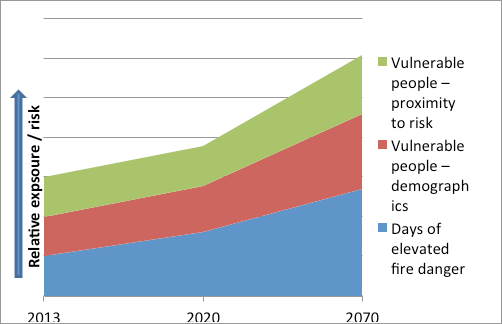

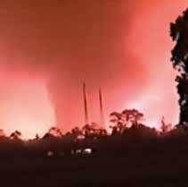

---
## Page 21

Part 1: Background to fire management in the Australian Capital Territory
4.	 Fire management planning in the Australian Capital  
	
Territory 
Fire management in the ACT needs to encompass a complex, community‑wide, multi‑tenure and multiagency set of 
planning and policy arrangements. A clear hierarchy of strategic, operational and tactical plans and maps provide structure 
to this complexity. 
Plans of management 
The SBMP must consider other plans prepared for the land uses of the ACT, including the plans of management for public 
lands prepared by the custodian of that land under the Planning and Development Act 2007. Fire mitigation strategies in 
this plan aim to be consistent with those strategies in plans of management for nature conservation areas.
Regional fire management plans 
The SBMP RFMPs to provide a link between the strategies of this plan and the more detailed bushfire operational plans 
(BOPs). RFMPs detail the five‑year program (2014–19) of work for fuel reduction, access and infrastructure in the ACT. 
Extensive community consultation occurs in the development of these plans recognising the significant contribution 
members of the community and community service organisations can make in relation to specific areas or issues. RFMPs 
for 2019–24 will be prepared during the life of the SBMP.
Annual and 5 Year targets of the area (hectares) to be treated by fuel management (prescribed burning, slashing, grazing 
and physical removal) as well as the distance (km) of access works (maintenance, upgrade and construction) are 
determined under these plans for government managed lands.
The Commissioner is responsible for approval of RFMPs. They will be reviewed as required to reflect changes which may 
include unplanned bushfires, which may provide strategic advantages or changes to the location or extent of assets – for 
example, the development of new estates.
Bushfire operational plans 
BOPs detail the specific timing, type and location of fuel‑reduction, access and infrastructure activities proposed to 
be undertaken in the ACT. Under the Emergencies Act 2004, BOPs are required from ACT Government managers of 
unleased Territory Land and rural land managers in the Bushfire Abatement Zone. Plans developed for rural leases under 
the ACT RFS Farm Firewise program meet the requirements for a BOP. Other land and property managers as identified 
at Schedule 2 of the SBMP may also be required to prepare a BOP where they manage land or facilities in Bushfire Prone 
Areas. 
The Commissioner is also responsible for approval of BOPs and will review, and if required amend, the list at Schedule 2.
Bushfire Management Standards 
The ACT Bushfire Management Standards detail the measurable outcomes required under the current and ongoing 
management policies and procedures detailed in Part 2 of this plan. This document, which includes standards for matters 
such as fuel management and fire trail access, supports the Fire Services, land managers, developers and the general 
community in achieving effective results in reducing bushfire risk.
Bushfire survival plans 
The Bushfire Survival Plan is the principal document for residents in Bushfire Prone Areas in Canberra to prepare 
themselves, their families and their properties against the threat of bushfire.
Although these plans are not mandated in the same way as BOPs, the ACT ESA consider the completion of this plan by 
residents at risk of bushfires as of the highest importance, and will support the community to undertake this responsibility. 
17

---
## Page 22

ACT Strategic Bushfire Management Plan – Version 3 2014
Figure 9 – Relationship between the different fire management plans 
Response and coordination plans
The ACT ESA including the Fire Services, as well as other emergency services and support agencies, also have doctrine 
and operational procedures, and internal policy documents to guide preparedness and response arrangements in the 
ACT. These include the Emergency Plan (2014) and its sub plans, Commissioner’s guidelines, standard operational 
procedures, and memorandums of understanding between government and nongovernment agencies and the Fire 
Services.
Mapping of areas of bushfire management
Three maps have been developed to help describe and prioritise bushfire management in the ACT: Bushfire Prone Area 
(BPAs), Fire Management Zones and the Bushfire Abatement Zone (BAZ). A hierarchy of the three map sets is shown in 
Figure 10. 
These maps are all designed to be viewed via the internet and are available at the ACTMAPi website which may be 
accessed via the ESA website, www.esa.act.gov.au. Members of the community who are unable access maps at this site 
can contact the ACT ESA directly to obtain this information.
Figure 10 – Relationship between the different fire management maps 
   Identifying those areas at 
risk from Bushfires in the ACT
   For prioritising fuel management 
and access activities to address risk 
Specific protection for the urban edge 
        through land use planning  
Bushfire Prone Areas
Fire Management 
Zones
Bushfire 
Abatement 
zone
                                            
18

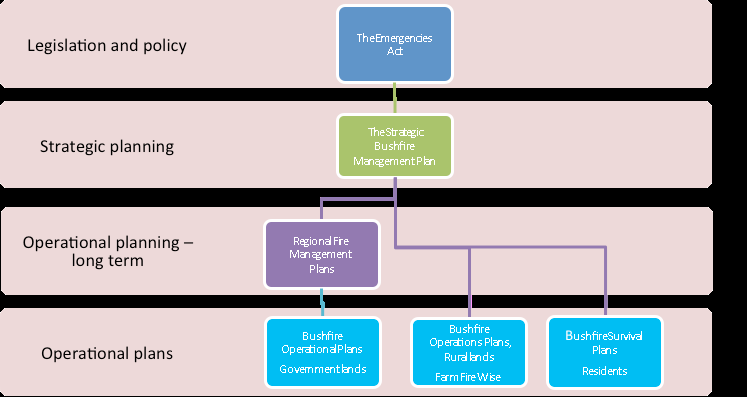

---
## Page 23

Part 1: Background to fire management in the Australian Capital Territory
Bushfire Prone Areas 
The BPA is a risk‑based map that depicts the area of the ACT that has been assessed as being at high risk for life and 
property due to bushfires. Canberra’s built‑up areas that are adjacent to forest and grassland are defined as BPAs, as is 
the ACT’s entire rural area (Figure 11). 
Identifying the at‑risk areas on the BPA map has two principle purposes:
•	
areas of BPA require assessment to determine mandatory construction standards for buildings under the Australian 
Standard (AS) 3959 – Construction of buildings in bushfire prone areas. Concurrent with the development of the 
SBMP, the ACT Government is considering arrangements to extend BPAs (for the purposes of applying the Building 
Code of Australia which references AS 3959) to include part of the built‑up area of Canberra.10
•	
it provides the means by which people in the community can assess their personal level of risk and provide the basis 
for targeted community education and awareness campaigns for bushfires. Part 2, Chapter 9 provides specific 
information and advice for people who live in designated Bushfire Prone Areas11.
The BPA map will continue to be reviewed and refined to reflect changes in land use and tenure, as improved vegetation 
mapping becomes available and to address local and site specific issues as required. The BPA will be approved by the 
Commissioner.
Figure 11 – Bushfire Prone Areas (in red) – Cook and Aranda. 
This map is designed to be viewed via the internet and is available at the ACTMAPi via the ACT ESA website, www.esa.act.gov.au. 
Fire Management Zones 
Fire Management Zones are used to strategically allocate areas of the BPA, which allow fuel management and access 
activities to be prioritised. The location and alignment of these zones reflect the risk of bushfires starting and spreading, 
and impacting on life, property and other assets. 
The zones established in this framework include Asset Protection Zones, Strategic Firefighting Advantage Zones, 
Landscape Fire Management Zones and Agricultural Fire Management Zones (see Figure 12 for an example). Detailed 
descriptions of these zones are in the supporting information to the SBMP.
The ACT Bushfire Management Standards establish the process by which the widths of Asset Protection Zones are 
determined and applied, and details the standard that applies to the process. Fire Management Zoning maps will be 
reviewed as required to reflect significant changes, which may include unplanned bushfires or changes to the location or 
extent of assets. The Commissioner is responsible for approving these maps.
10	
BPA is already declared over the Rural Areas of the ACT for these purposes.
11	
Under SBMP Version 2, ‘Ember zones’ were defined that provided this component of the function of BPAs. BPAs now replace this component 	
	
and Ember Zones are no longer defined
19

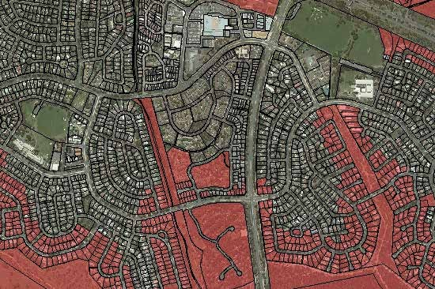

---
## Page 24

ACT Strategic Bushfire Management Plan – Version 3 2014
Figure 12 – Hall Village Fire Management Zones, with the photo showing the Inner APZ
Bushfire Abatement Zone
The Bushfire Abatement Zone surrounds Canberra and extends west towards the Murrumbidgee River. It is a subset of 
the BPA, and was developed to identify rural areas where specific measures are required to reduce risk to life and property 
in the built‑up area of Canberra. These measures include land‑use constraints, planning requirements for land managers 
(both public and private) and pre‑incident planning for bushfires. 
The BAZ will be reviewed as required to reflect changes in land use and tenure, and will be approved by the 
Commissioner.
Cross border arrangements
The ACT ESA will actively work with fire and emergency services agencies in NSW to develop bushfire management 
strategies that are aligned and to acknowledge the level of bushfire risk within each jurisdiction.
Agreements
Formal arrangements are in place between ACT and NSW agencies to provide for integrated and efficient cross border 
response arrangements, incident management liaison, common communications, training, shared resources and mutual 
support. These include:
•	
a Memorandum of Understanding (MOU) with the NSW Rural Fire Service
•	
Interstate Assistance Agreement with NSW Fire & Rescue
•	
MOU with NSW Office of Environment and Heritage – National Parks and Wildlife 
These arrangements will be reviewed over the period of this plan
Meeting forums	
The Cross Border Emergency Services and Disaster Recovery Working Group is the primary high level forum between 
ACT and NSW emergency services, and includes representation by the Commissioner, the ACT Chief Minister, Treasury 
and Economic Development Directorate (CMTEDD) and NSW Premier’s Department.
Reporting to the above group, the ACT – NSW cross‑border fire group will continue to be the forum for the coordination 
and integration of operational arrangements as well as fuel management planning and reporting.
The ACT ESA will support NSW RFS fire management planning through continued involvement in regional Bushfire 
Management Committees.
  
20

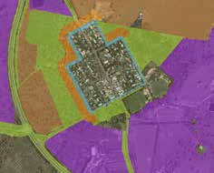

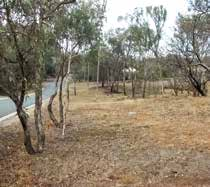

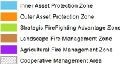

---
## Page 25

Part 1: Background to fire management in the Australian Capital Territory
5.	 Implementation, compliance and accountability of  
	
bushfire management in the Australian Capital 	 
	
Territory
Implementation
The SBMP will be implemented through the management procedures and the specific actions identified for each strategy 
in Part 2. 
Where actions are identified for the period of the SBMP, implementation actions will include:
•	
specify clear and measurable outcomes
•	
allocate responsibility for achieving outcomes
•	
identify the timing required to start or complete specific actions, and to undertake periodic review
The framework for the SBMP Implementation Plan is at Schedule 3. This will form the primary means of reporting against 
this Plan. Governance and oversight of the Implementation Plan will be through the ACT ESA SBMP Implementation 
Working Group.
Compliance
The Emergencies Act 2004 allows for inspectors to be appointed by the Chief Officers of the Fire Services. 
The powers of inspectors as well as offence provisions are set out in sections 103–110 of the Emergencies Act 2004. 
Inspectors may enter land or premises to audit against the SBMP or bushfire operational plans, or if they believe there is 
a danger to life or property presented by bushfire fuels. Specific matters to be audited for compliance are set out in the 
SBMP.
Governance and Accountability
Assessing implementation complements the requirements for accountability and reporting against the stated outcomes of 
the SBMP. Three tiers of reporting and accountability will be applied:
•	
the ESA SBMP Implementation Working Group, chaired by the Commissioner, is the principal forum within ACT 
Government by which the Commissioner, in consultation with the ACT Bushfire Council will “monitor the scope and 
effectiveness of the Plan” consistent with Section 72(5) of the Emergencies Act 2004. It includes senior representation 
from all ACT government agencies with responsibilities under the SBMP. The Group will report against the actions 
identified at Schedule Three. 
•	
agency reporting under Section 85 of the Emergencies Act 2004 will also be prepared. Agencies will give an account 
in their annual report of the operations of the Agency in relation to the SBMP and any BOP approved under the Plan.
•	
the ACT Bushfire Council provides independent oversight of bushfire management consistent with its role in advising 
the Minister for Police and Emergency Services under section 130 of the Emergencies Act 2004, as well as the 
operational terms of reference of the Council. It provides advice to the Minister on matters relating to bushfire 
management which may include the level of preparedness, fuel management and access, and the response capability 
of Fire Services. This advice will be prepared annually and be provided to the Minister before the start of the bushfire 
season for that year.
•	
key performance indicators and strategic indicators are used by government to help the community understand the 
level and quality of service that they receive. A number of performance indicators have been developed, which are 
reported against in the relevant Agency Annual Report.
21

---
## Page 26

ACT Strategic Bushfire Management Plan – Version 3 2014
6.	 Statement of resources needed to meet the objectives 
	
of the Plan.
This SBMP describes the complementary objectives and strategies to mitigate the risk posed by bushfire, which 
will be undertaken by the ESA in close collaboration with other ACT Agencies. The implementation of the Plan 
requires the application of a wide range of resources including personnel, equipment and facilities over the life of 
the plan.
A statement of resources has been identified to meet the objectives of the plan. It is based on the 12 objectives of the 
SBMP. 
The resources identified to meet the objectives of the Plan will vary over the life of the Plan:
•	
strategies and actions will be implemented at different times to most efficiently use resources over the period 2014–19
•	
resources required to implement actions will vary on an annual basis reflecting seasonal and operational priorities and 
may also change over the longer period, for example to reflect changes in the risk profile of the ACT.
•	
other matters, such as the staged land release for development, delivery of capital works and infrastructure (e.g. 
vehicle replacement) means the availability of resources needs to be flexible.
•	
workforce management and volunteer recruitment and retention will result in the personnel numbers varying from year 
to year.
The time and resources to implement the objectives of this Plan is allocated across ACT ESA staff and volunteers, 
ACT RFS staff and volunteers, ACT F&R staff and volunteers, TAMSD and EPD staff, often undertaking multiple roles, 
which may not all be related to bushfire management.
The resources required to meet the objectives of this Plan are as follows:
Personnel
Table 2 – Firefighter capability as at 30 June 2014
Type of agency/workforce
Number of available personnel
ACT RFS Career firefighters and support 
14
ACT F&R Career firefighters
343
TAMSD Parks Brigade
160
ACTRFS Volunteers
530
ACT F&R Community Fire Unit Volunteers
1,091
Mapping and Planning Services (MAPS) Volunteers
67
Additional Capability is provided by the other emergency services (ACT SES and ACT Ambulance Service), ESA support 
areas (Fleet, logistics and workshop) as well as ACT government agencies for support and coordination.
The ACTESA, TAMSD and EPD have committed officers to:
•	
develop and implement bushfire planning documents, including the SBMP, RFMPs, BOPs, mapping and data 
management. 
•	
support landholders to develop fire management plans through the Farm Firewise program
•	
assess and provide advice for new urban development, and land use planning.
•	
develop the central roads geo‑database to provide for consolidated information across governments.
•	
attend local and national meeting forums for liaison with other jurisdictions.
•	
participate in the National Arson Reduction Strategy. 
22

---
## Page 27

Part 1: Background to fire management in the Australian Capital Territory
•	
work collaboratively with AFAC, within specialist user groups and forums.
•	
participate in the Bushfire and Natural Hazards Cooperative Research Centre (BNHCRC) and other research.
Firefighter training is delivered through dedicated training officers (career and volunteer) developing, coordinating and 
delivering training within the ACT RFS, ACT F&R, and TAMSD. These areas are supported by the ESA managing the 
Registered Training Organisation status.
Volunteer management officers are allocated to develop and implement programs for the recruitment and retention of 
volunteers.
ESA Education and Awareness programs implemented through:
•	
education officers within the ESA and the Fire Services.
•	
specific programs e.g. RFS Open Day, CFU Saturday, Fetes and Exhibitions.
•	
implemented targeted education and awareness programs to “at risk” individuals.
•	
local community‑level engagement through ACT RFS and ACT F&R volunteer and career firefighters.
•	
community groups, including Volunteering ACT to support local and targeted education and awareness programs in 
BPAs.
•	
ACT Government Media Officers through the Public Information Coordination Centre (PICC) at ESA HQ.
Officers are allocated to coordinate exercises and maintain incident management facilities.
TAMSD and EPD coordinate and implement the activities identified in Bushfire Operations Plans. 
Fire Service’s inspectors undertake auditing and assessment to ensure compliance with ACT Bushfire Management 
Standards.
ESA, TAMSD and EPD have established and participate in an interstate Burnt Area Assessment Team (BAAT) for rapid 
assessment of possible ecological impacts immediately post a fire event.
The ESA has in place a Chaplain, Employee Assistance Program, Critical Incident Stress Management and Peer Support 
Programs for affected firefighters and ESA staff.
Equipment and Facilities
ACT F&R and ACT RFS Fire Stations
The ESA maintains 252 vehicles for firefighting as at 30 June 2014 which includes: 
•	
ACT RFS and ACT F&R Command Units
•	
Heavy and Medium Tankers
•	
Light Units (tankers) CAFS Tankers
•	
Urban Pumpers 
•	
ancillary support trailers and equipment 
Table 3 – List of vehicles as at 30 June 2014
Type of vehicle
Quantity available
ACT RFS Tankers and Support Vehicles 
61
ACT RFS Light Units
44
ACT RFS Support Trailers 
18
ACT RFS Command/Support vehicles
7
ACT F&R Pumpers, Tankers & Support Vehicles
33
ACT F&R ‘Platforms on Demand’
13
23

---
## Page 28

ACT Strategic Bushfire Management Plan – Version 3 2014
Type of vehicle
Quantity available
ACT F&R Support Trailers and CFUs
60
ACT F&R Command/Support vehicles
16
TAMSD also provide two large tankers, three dedicated light units, a number of slip‑on units and 10 Command vehicles.
This equipment also supports the implementation of prescribed burns.
A medium helicopter and a light helicopter is available for fire suppression and fire detection and aircraft for aerial ignition 
and monitoring of prescribed burns.
TAMSD provide access to contracted Heavy Plant equipment specifically for fire related activities (one Grader & two 
Bulldozers on standby). 
Four Fire Towers which are staffed under elevated fire danger conditions. 
An emergency ‘000’ Communications Centre which includes computer aided dispatch and communications equipment.
Mobile data terminals have been installed in firefighting appliances to allow real time information on vehicle location and 
resources.
Incident Management facilities, the PICC and the Emergency Coordination Centre (ECC) provide whole of government 
coordination facilities and infrastructure at ACT ESA Headquarters Fairbairn with backup sites at Hume and Curtin. 
Other Resources
Public information and warnings through:
•	
 ESA Website, Social Media, along with traditional broadcast media
•	
access to emergency warning systems (e.g. Emergency Alert).
•	
the Community Communication and Information Plan which establishes arrangements and policy framework for public 
information during emergencies.
•	
MOU arrangements with local media.
The ESA Strategic Asset Management Plan outlines the strategic replacement program for vehicles and equipment.
The ACT Elevated Fire Danger Plan sets out the policy and procedures of the ESA, the Fire Services and ACT government 
agencies for preparing for elevated fire danger conditions.
The ECC Operations Plan establishes policy and procedures of ECC operations including commitments of liaison officers 
and support staff for all ACT Government Directorates as well as external agencies as appropriate
The ACT Recovery Plan is in place. This Plan will include four separate parts covering community, economic, infrastructure 
and environmental recovery. Resources to deliver recovery arrangements are dependent on the scale and extent of the 
emergency.
TAMSD & ESA contribute financially to the BNHCRC and Arson Prevention Materials and the ESA/AFP Arson Prevention 
MOU & Strategy is in place.
24

---
## Page 29

Part 2: 
Objectives and strategies for bushfire 
management in the Australian Capital Territory
25

---
## Page 30

ACT Strategic Bushfire Management Plan – Version 3 2014
1.	 A reduction in bushfire ignitions
Programs will be implemented to reduce the number of unplanned ignitions, targeting systemic and 
human‑caused factors of deliberately lit bushfires (arson) and the careless use of fire.
Bushfires start from natural or human causes. The most common natural cause of bushfires in the ACT is lightning and, 
historically, the largest areas burned are attributed to lightning ignitions. 
The majority of fire ignitions in the ACT are caused by arson (the deliberate lighting of bushfires with intent and malice), 
carelessness (e.g. dumping, escaped campfires or burning‑off without a permit) or accidents (e.g. fires spreading from 
vehicle accidents or sparks from machinery). Human‑caused bushfires, most of which occur in or near the built‑up area of 
Canberra, are preventable.
The increasing population and expansion of Canberra has been accompanied by an increase in the overall number of 
bushfires in the ACT in and around the built up area. The role of rural landholders in reducing bushfire ignition by actively 
managing for agricultural production is important, with far less ignitions in these areas than in areas of public land. Ignition 
frequency decreases with the distance from the urban edge, knowing this will allow for more targeted ignition strategies.
ACT Policing have the responsibility for investigating arson related bushfires, or investigation for the ACT Coroner 
where there has been significant impacts from a bushfire. They are supported by the ACT RFS and ACT F&R who have 
specialists trained to investigate the cause of bushfires. The ACT ESA and ACT Policing are part of the national work plan 
to ‘Reduce Bushfire Arson in Australia’12 which provides for greater cooperation between fire services, police agencies, 
social services and the criminal justice system to take a preventative approach to address bushfire arson (See the case 
study Arson Reduction Program).
The 2009 Victorian Bushfires Royal Commission included a number of specific recommendations relating to the risk 
of ignitions associated with electricity infrastructure and supply. The ACT Government and ActewAGL considered the 
recommendations to determine the level of risk in the ACT and any necessary actions that should be taken. Although 
a number of the matters raised in the Royal Commission had already been addressed in the ACT or were not relevant, 
specific issues relating to the inspection and management of vegetation around powerlines are relevant. The ACT ESA, the 
Territory and Municipal Services Directorate (TAMSD) and the Environment and Planning Directorate (EPD) will work with 
ActewAGL to clarify arrangements and improve practices and standards. 
Case study: Lightning ignition research	 	
 
A lightning ignition on the Clear Range in March 1998 
which made a short run up to the ridgetop pushed by 
north-westerly winds.
A major concern for the ACT is lightning ignitions, especially in 
the ranges to the west. Because little was known about where 
on the landscape these tend to occur, a study was undertaken. 
Using data on ACT lightning fires and the ACT landscape, a 
numerical predictive model was developed and published.13 
Using this model, it was found that specific parts of the 
landscape were much more prone to lightning fires. The 
findings have been successfully applied in other areas of 
Australia.
Despite common perceptions, these fires start on mid‑ and 
upper slopes, not on ridgetops. These areas are among 
the hardest on which to manage fuel hazard, but most 
lightning fires make short uphill runs and then ease off on the downwind side of the ridge. This knowledge 
allows appropriate response strategies to be used for fuel management, fire detection and response. After dry 
lightning storms, knowledge of susceptible parts of the landscape allows more effective use of aerial resources for 
detecting fires.
13
12	
Australian Government Attorney‑General’s Department 2009
13	
McRae, R.H.D. (1992). Prediction of Areas prone to lighting Ignition. Int. J. Woldland Fire 2(3) 123-130
26

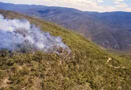

---
## Page 31

Part 2: Objectives and strategies for bushfire management in the Australian Capital Territory
Management policies
Ignition reduction activities will address the higher numbers of fires in and around the suburbs of Canberra that may 
immediately threaten life and property.
Targeted awareness and education programs will help the community to understand its legal obligations and social 
responsibilities in relation to bushfire ignitions, reducing preventable ignitions and improving early detection.
A smaller number of fires further away from the urban area have the potential to become much larger and may threaten 
rural homes and assets as well as the suburbs of Canberra. Rapid detection using fire towers, lightning detection systems, 
aerial observation as well as community notification will enable rapid response by firefighters. (See case study: lightning 
ignition research)
Statutory powers will be used to control the use of fire and activities known to cause bushfires. These powers will:
•	
regulate the use of fire by introducing seasonal restrictions (i.e. during the bushfire season).
•	
regulate the use of machinery, considering the level of fire danger.
•	
declare days of total fire ban in the ACT to limit ignitions, or when local or regional conditions may require increased 
levels of vigilance. 
Specific actions 2014–19
The following actions will be undertaken: 
•	
as required, and in conjunction with ACT Policing, the arson intervention program will be activated to address specific 
arson related situations
•	
the MOU for arson investigation between the ACT ESA and ACT Policing will be maintained
Arrangements will be clarified in relation to vegetation management near power infrastructure. This will include:
•	
the regulatory framework and responsibility of agencies and individuals to undertake works to reduce risk
•	
standards for vegetation clearance zones in proximity to power infrastructure, as well as the management of 
vegetation outside these zones that may also have an impact on power infrastructure (e.g. falling trees)
The provision of information and advice in relation to private power infrastructure on leased land in the rural areas of the 
ACT.
27

---
## Page 32

ACT Strategic Bushfire Management Plan – Version 3 2014
Case study: Arson reduction program	
	
 
Suspicious fires make up a high percentage of fire cause in the ACT, in line with many other jurisdictions 
across Australia.
The ACT Rural Fire Service and ACT Fire & Rescue have specialist, trained bushfire investigators who are 
deployed with ACT Police to investigate the cause of bushfires. Through cooperative arrangements, information 
on fire events and specific fire event intelligence is exchanged, fire scenes are examined for evidence, and the 
public is engaged through Crime Stoppers to provide information to detect and prosecute offenders.
This approach aligns with the Australian Government Attorney‑General’s Department initiative to adopt a 
consistent approach to bushfire arson prevention and is based around the methodologies identified in the newly 
developed Wildfire Arson Investigation Management Course. This course, provided at a national level to police 
and fire service investigators across Australia and New Zealand, was developed as an initiative of the ACT Rural 
Fire Service.
Fire ground investigation will aim to recreate the fire, identifying the point of ignition and direction of travel.
28

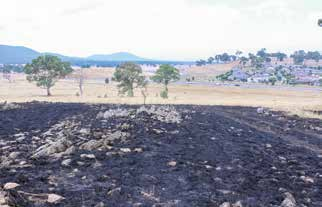

---
## Page 33

Part 2: Objectives and strategies for bushfire management in the Australian Capital Territory
2.	 Effective firefighting operations by skilled and  
	
motivated personnel
The ACT Government will support a responsive bushfire fighting capability with sufficient numbers of skilled and 
motivated personnel to respond to bushfires.
The capability of the ACT Fire Services to extinguish bushfires centres on skilled and motivated personnel being available. 
The necessary equipment and resources for people to support this capability are discussed in Part 2 Section 3.
The structure of the ACT ESA provides for an integrated capability to respond to bushfires by the ACT F&R and the ACT 
RFS. In 2012, the Commissioner published Emergencies (Concept of operations for bush and grass fires in the Australian 
Capital Territory) Commissioner’s Guidelines 2012 (the Concept of Operations), by which the policy framework to identify 
this capability and systems of work to deliver it is achieved.
The ACT’s firefighting capability relies on the maintenance of both volunteer members and career firefighting personnel 
from the ACT RFS, ACT F&R and the ACT Territory and Municipal Services Directorate (TAMSD) – Parks and Conservation 
Service.
The source of this capability not only reflects different agencies and services in which people operate, but also the 
difference within and between the groups. For example, the roles of ACT RFS Volunteers who respond to bushfires across 
the ACT is different from the role of ACT F&R Community Fire Unit (CFU) volunteers in undertaking community‑based 
property protection. They are both different again from the roles of ACT F&R career firefighters who have this function, 
both bushfire and non–bushfire related.
Management policies 
The Emergencies (Concept of operations for bush and grass fires in the Australian Capital Territory) Commissioner’s 
Guidelines 2012 is the basis by which the ACT ESA and the Fire Services defines the integrated fire fighting capability of 
the ACT.
To optimise and maintain this capability, management needs to:
•	
acknowledge that volunteer work requires commitment in terms of response and training, which is compounded by 
the fact that volunteers have other work, family and social commitments
•	
deliver training and assessment, and establish consistent standards of competency across the ESA That will lead to 
better integration and response to bushfires
•	
define career pathways and opportunities for staff with the Fire Services or Parks and Conservation as ‘employers of 
choice’
•	
Identify gaps in capability (if any), and options to address those gaps
Investment in firefighter development will ensure that firefighters’ skills continue to progress. Training will be ongoing and 
delivered based on the operational requirements of the Fire Services to meet or exceed national training and qualification 
standards, and currency and competency requirements where they exist.
Sharing of firefighting capability between jurisdictions will be undertaken as an important component of the ACT’s capacity 
to manage significant bushfire events.
29

---
## Page 34

ACT Strategic Bushfire Management Plan – Version 3 2014
Specific actions 2014–19
The following actions will be undertaken:
•	
a Strategic Bushfire Capability Framework will be developed to assist planning for firefighting operations and to 
support programs for capacity enhancement 
•	
as a minimum the capability to operate a full incident management team (IMT) for the first two shifts of any campaign 
response will be established and will fill all key functional leadership roles
•	
support of programs that proactively maintain health, fitness and wellbeing of firefighters will be implemented to 
maintain capability
Programs for the recruitment and retention of volunteers will include:
•	
building partnerships with employers to assist volunteers to be able to participate in response activities, particularly 
campaign fires
•	
 arrangements to undertake a survey of volunteers departing from the Fire Services to identify the strengths and 
weaknesses of programs
•	
building diversity within the ACT Fire Services
Case study: ACT Fire & Rescue Community Fire Units	 	
 
Community Fire Units were established following the bushfires of 2003. Since 2004, a total of 50 CFU’s with over 
1000 volunteers have been established using a risk analysis methodology in areas of high risk on the ACT urban 
interface. CFU’s are available to be activated to bushfire events and to support prescribed burning operations and 
other emergency events, such as flooding. 
CFUs make significant contribution to the local community. Vulnerable people in the community have been 
included in emergency planning and CFU volunteers are proactive in disseminating alerts, warnings and 
educational material and are often the first point of contact for the local area during emergencies. CFU volunteers 
do more than educate, prepare and protect their neighbourhood during the fire season. They regularly organise 
social gatherings in local parks, and have established or renewed communication between neighbours. 
CFUs engage with their local fire station and the operational crews and regularl participation in training, drills and 
other activities is encouraged to build a healthy understanding of each other’s role and responsibilities.
CFU members undertaking training.
30

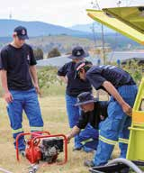

---
## Page 35

Part 2: Objectives and strategies for bushfire management in the Australian Capital Territory
Case study: Remote area firefighting teams
Both the McLeod and Coronial inquiries into the 2003 Canberra bushfires made recommendations to improve 
the capacity to respond to bushfires in remote areas. Consequently the Strategic Bushfire Management Plan 
version 2 included an action to increase the capability to respond to remote‑area fires. Since 2003, the ACT RFS 
have implemented a number of strategies to increase the capability to respond to such fires. These include:
•	
establishing, equipping and training Volunteer Brigade and Parks Brigade teams of firefighters to respond to 
remote area fires (Remote Area Fire Teams)
•	
having dedicated helicopters with the ability to deploy and support Remote Area Fire Teams to respond to 
fires
•	
expanding the network of helipads in the remote areas of the ACT
Together these strategies have significantly increased the capacity of the ACT to respond to remote‑area fires, 
increasing the chance that fires ignited in the ACT will be suppressed before they can grow. As a result of these 
strategies, numerous remote fires have been detected and suppressed during the 2009–14 period, and have 
been contained to a combined total of less than 40 hectares.
Crew members awaiting retrieval. 
Observing a hollow tree alight on the fireline.
31

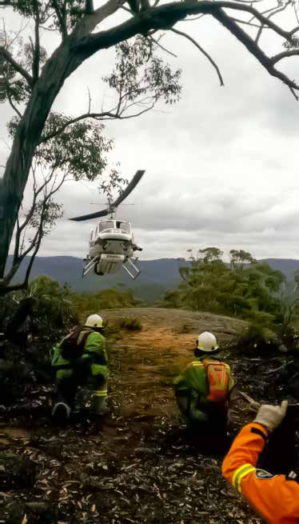

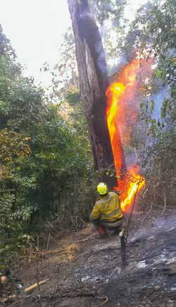

---
## Page 36

ACT Strategic Bushfire Management Plan – Version 3 2014
3.	 Effective firefighting operations with the necessary  
	
equipment and resources 
The ACT Government will ensure an adequate supply of equipment and resources, supported by clear principles 
and systems of work to support operations, so that firefighters can respond to bushfires safely and effectively.
The capacity of the ACT to respond to bushfires consists of having the necessary numbers of skilled and motivated 
personnel, the systems of work to support them, and the necessary equipment and resources for those people to 
exercise their function.
The resource profiles of the Fire Services are matched to the functions of each service. The ACT RFS mainly has access 
to bushfire fighting appliances and other major plant and equipment, and the ACT F&R resources, which also include 
bushfire and urban fire fighting appliances, complement the ACT RFS in suppression and mitigation of bushfires. 
Management policies
A Strategic Asset Management Plan has been prepared to define the ongoing management requirements for fleet and 
capital equipment for bushfire fighting. This includes defining the type, location and service allocation of equipment and 
schedules for replacement. Backup stores and services for firefighting are maintained and requirements reviewed annually.
In addition to a range of Heavy, Medium and Light bushfire fighting appliances, the ESA provides for access to specialist 
equipment that will enable rapid and effective response to bushfires. This includes:
•	
dedicated Plant (bulldozers and graders) for rapid response
•	
Heavy Plant equipment that are available under ‘call when needed’ arrangements and/or by re‑tasking from other 
ACT Territory and Municipal Services Directorate activities at short notice
•	
personnel trained for remote area fire fighting operations from both Volunteer Brigades and the Parks Brigade
•	
Compressed Air Foam Systems (CAFS) for firefighting 
•	
structural fire fighting appliances and equipment
•	
aircraft capability, which will be a combination of contracted aircraft and aviation resources accessed on a ‘call when 
needed’ basis through the National Aerial Firefighting Centre (NAFC) and the New South Wales Rural Fire Service. It 
will include the infrastructure provided at the Hume Helibase for operations dispatch, coordination and operational 
safety systems to meet specific aviation requirements
•	
mobile data terminals and data links to allow real time information on vehicle location and resources
•	
early detection capability, comprising the network of four fire towers, which provide aerial capacity for observations 
and information provided from weather services
•	
annual operational plans for the Fire Services to detail specific bushfire preparedness and response arrangements, 
including those matters identified above
Incident control centres and coordination facilities are established and maintained. These facilities may be pre‑emptively 
activated and staffed based on the level of bushfire risk, to enable immediate operation if required. 
The ACT has access to a territory‑wide radio network, the Territory Radio Network (TRN) which covers the majority 
of the ACT. The TRN has the capability to be linked with other response agencies, both within and outside the ACT. 
Communications arrangements are to be reviewed and updated annually in bushfire preparedness plans. A review to 
identify requirements for upgrade and enhancement of the TRN is under way.
The provision of incident support functions by the ACT State Emergency Service and ACT Ambulance Service, as well as 
business units of the ACT ESA (including the support for staging, logistics and incident coordination) remains critical for 
effective and integrated responses.
Geographic information systems will enable bushfire‑specific maps to be constructed. Information will be available in 
print and electronic form, and can be modified during firefighting operations (see the case study, the Common Operating 
Picture). Where appropriate, information should be portable and readily available to incident controllers and fire ground 
commanders.
32

---
## Page 37

Part 2: Objectives and strategies for bushfire management in the Australian Capital Territory
Specific actions 2014–19
The following actions will be implemented:
•	
a Strategic Bushfire Capability Framework will be developed to assist planning for firefighting operations and to 
support programs for capacity enhancement 
•	
replacement of equipment and resources will be ongoing and consistent with the ACT ESA Strategic Asset 
Management Plan
•	
develop strategies for Remote Area Fire Fighting arrangements, including pre‑planning, capability and resources
•	
aircraft capability and support infrastructure will be maintained through NAFC and in liaison with NSW RFS. 
•	
in conjunction with other jurisdictions, the ACT will continue to develop and exercise technical capabilities to predict 
bushfire behaviour and spread, supported as required by technical specialists in fire behaviour modelling.
•	
annual exercises will be undertaken to test facilities (unless they have been sufficiently activated and exercised in 
actual incident response).
•	
presuppression plans will be prepared and distributed to provide necessary information to undertake initial fire attacks. 
Plans will be reviewed and updated as required. 
•	
further strategies will be developed to enhance the capability of real‑time visualisation and delivery of information 
between ESA HQ and fire crews, including complex information and data from a range of internal and external 
sources.
Case study: Hume Helibase
As a result of recommendations from the McLeod and Coronial inquires into the 2003 fires, the ACT Government 
enhanced the aerial suppression capability of the ACT by contracting light and medium helicopters over the 
summer months. To support this capability, a dedicated helicopter base was constructed in 2011 within the Hume 
precinct, next to the existing Southcare Helibase. 
The new facility consists of a hangar, operational area and separate crew facilities, including bedrooms to allow 
flight crews to rest between missions. The hangar can house up to three helicopters of various sizes, and an 
additional ten helicopters can be housed on the base.
Because of its advantageous location and the excellent facility it provides, the base has been used as a regional 
helibase for southeastern New South Wales (NSW), hosting numerous aircraft that have been pre‑positioned due 
to forecast fire danger and to support major fires in surrounding NSW.
Hume Helibase to the right, with Southcare Helibase on the left.
33

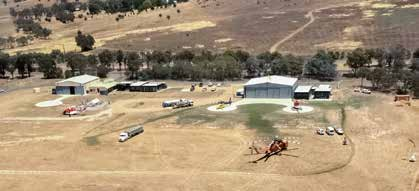

---
## Page 38

ACT Strategic Bushfire Management Plan – Version 3 2014
Case study: The Common Operating Picture
With advancements in mobile computing abilities and faster mobile data communications, the ACT Emergency 
Services Agency (ESA) has been able to embark on several technology solutions to assist the mobile workforce.
An example of such work is the state‑of‑the‑art ESA Common Operating Picture (COP), developed in‑house 
by the ESA Spatial Services section. Situational awareness of on‑ground commanders has been enhanced by 
overlaying real‑time, dynamic data layers of emergency vehicle fleet locations, detailed incident information and 
weather observations into a live Google Map. 
This capability can be deployed in the field and uses wherever possible off-the-shelf technology. This internal ESA 
system is available to frontline ESA personnel depending on their role in managing incidents.
The COP entry page for mobile devices.
The COP, showing location 
of firefighting vehicles and 
incidents.
34

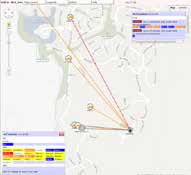

---
## Page 39

Part 2: Objectives and strategies for bushfire management in the Australian Capital Territory
4.	 Extinguish bushfires when they occur
A rapid, decisive and coordinated response will provide the best opportunity to control bushfires in the shortest 
possible time and in a safe manner.
The ACT Government will ensure that the Territory is sufficiently prepared to reduce the effect of bushfire on human life 
and property. The level of risk will vary from year to year and there is a need for a flexible and year‑round capability that 
can expand under conditions of elevated fire danger.
The ACT landscape and weather can interact to create extreme bushfire conditions, which may impact on the urban edge 
and rural areas of the ACT. These extreme bushfires cause the majority of damage and there are limits to how much of 
the risk presented by these fire can be reduced. Rapid assessment of the risk presented by bushfires, warnings to the 
community and if required the relocation of people at risk will be the priority for managing risk in these circumstances.
The Concept of Operations is the document that establishes the principles for responding to bush and grass fires, 
supporting the community in their response and coordinating the full resources of government.
Response
The Concept of Operations establishes the arrangements by which the ACT ESA and the Fire Services will undertake a 
coordinated and integrated approach to bushfire response. These include the following: 
•	
first response to all bush and grass fires in the ACT will be by the nearest available and most appropriate resource, 
irrespective of jurisdiction or service
The concept of unified command applies, meaning that all attending services contribute to the process of:
•	
determining the overall incident objectives and selection of strategies
•	
ensuring that joint planning for tactical activities will be accomplished
•	
ensuring that integrated tactical operations are conducted
•	
making maximum use of all assigned resources
•	
a control structure for managing bushfire incidents will be established and resources will be scaled up appropriately, 
applying the Australasian Inter‑service Incident Management System (AIIMS)
•	
through memorandums of understanding and mutual aid agreements the ACT will support and, in turn, be supported 
by neighbouring jurisdictions
Support to the community
The Concept of Operations establishes the importance of providing the necessary information, advice and warnings to the 
community to enable immediate response and appropriate actions by individuals when bushfires occur. This includes:
•	
the responsibility of the incident controller to release information;
•	
the capacity to activate the PICC to support the incident controllers function in providing information, advice and 
warnings to the community.
Whole of government capability
The Concept of Operations identifies integration across the government as critical for the efficient and comprehensive 
delivery of resources during bushfire response. Recent experience in both the ACT and elsewhere has identified the 
impacts of emergencies, including bushfires require involvement and engagement from all levels of government, in both 
the response and recovery phases of an incident. 
The ACT Elevated Fire Danger Plan (2012) sets out how the ACT Government will prepare during forecast periods 
of elevated fire danger. This plan provides for a coordinated, whole of ACT Government approach to elevated fire 
danger conditions in the ACT, ensuring effective liaison and information sharing as well as establishing the roles and 
responsibilities of organisations involved during these conditions.
35

---
## Page 40

ACT Strategic Bushfire Management Plan – Version 3 2014
Specific roles and functions which are identified in the ACT Emergency Plan (2014) also ensures that government 
agencies understand their role and are able to be used in support of incident response, depending on the scale and 
complexity of the incident(s) and potential consequences. These roles and functions include:
•	
activation of the Emergency Coordination Centre (ECC), which will include officers from all areas of government to 
support response and recovery
•	
the engagement of the Security and Emergency Management Senior Officials Group and Cabinet to ensure strategic 
coordination and information sharing
•	
the necessary arrangements to activate specific functions, including the appointment of an Emergency Controller and 
the declaration of States of Alert or Emergency
Management policies
The protection of human life will take highest priority at all times during bushfire response. Further priorities will be set for 
reducing bushfire impacts on property and the environment as appropriate to the situation.
The Emergencies Act 2004 identifies that the Chief Officer of ACT F&R is responsible for fire response in built‑up areas 
and the Chief Officer of the ACT RFS is responsible for fire response in rural areas.
The Incident Controller will provide information and advice on response to the incident within the ACT ESA, to government 
agencies and the ACT Government as required. This advice may be through a Chief Officer of a Fire Service or the 
Commissioner.
The ACT – NSW cross‑border fire group will continue to be the forum for the coordination and integration of operational 
arrangements, including incident communications planning, operational management facilities, cooperative aviation 
protocols, cooperative incident management training activities and rapid aerial response programs. Roles and functions 
identified in the ACT Emergency Plan (2014) may be activated depending on the scale and complexity of the incident(s) 
and potential consequences.
Specific actions 2014–19
The following actions will be implemented:
•	
messages and warnings for bushfire incidents will be reviewed, with consideration of lessons learned and latest 
research as well as targeting ‘at risk’ communities and individuals
•	
communication methods used during emergencies via the ACT ESA website (and other electronic means) will be 
further developed to utilise the use of live streaming of media and information
•	
there will be ongoing liaison with the ACT local media to train journalists in basic bushfire awareness as well as the 
provision of refresher training and training in familiarity with the media facilities at the ACT ESA Headquarters
•	
the ACT Elevated Fire Danger Plan (2012) will be reviewed to reflect lessons learned and changes in the strategic and 
operational environment
•	
procedure for the implementation and training of AIIMS Version 4 across all agencies will be developed to support the 
ACT’s preparedness for bushfire and other emergencies
36

---
## Page 41

Part 2: Objectives and strategies for bushfire management in the Australian Capital Territory
Case study: The SPOT
The single point of truth (SPOT) is part process and part technology. The SPOT process is a streamlined 
channelling of all information during an emergency to disseminate emergency alerts, updates and warnings 
to multiple platforms, including the ESA website, twitter, Facebook, RSS and Geo RSS feeds, personal email 
accounts and SMS distribution groups. 
This allows each emergency alert, update and warning to be distributed at the same time, within seconds 
to multiple audiences such as the general public, Canberra Connect call centre, ministers and senior ACT 
Government executives. The SPOT app, developed internally by the ESA, has gained national and international 
interest from emergency services and was awarded the overall top national prize in the Resilient Australian Awards 
in December 2012.
The ESA website is a key component of the SPOT. This site was developed using open‑source software, and 
features all emergency alerts, updates and warnings on the homepage, as well as a live incidents feed, a fire 
danger meter and a range of preparedness information and advice. The site has recorded more than 2 million 
unique visits and more than 4.3 million page views since it went live in September 2011.
Spikes have been recorded during major emergency situations, with 150 000 unique visits in less than 24 
hours during the elevated fire danger conditions in January 2013. In the context of the ACT’s population of 
approximately 370 000 people, this represents an outstanding success, delivering the message of a shared 
responsibility for bushfires in the ACT.
37

---
## Page 42

ACT Strategic Bushfire Management Plan – Version 3 2014
5.	 Planned fire management on rural lands
With the support of the ACT Government, rural land managers will undertake a planned, whole‑of‑property 
approach to reduce the risk of bushfire to their business and surrounding areas.
There are approximately 170 rural leases involved in a range of enterprises in the ACT. Agricultural production in the ACT 
includes broad acre grazing, cropping and intensive horticulture, such as olives, truffle production and vineyards. Other 
rural enterprises include tourism, agistment for horses and small businesses.
To the north and west of Canberra, rural leases separate the city and urban nature reserves from the rugged and heavily 
forested areas of the Brindabella Ranges. Although fuel reduction and access is undertaken in these areas, the likelihood 
of fires spreading remains high relative to rural lands, largely due to relative difficulties in extinguishing fires in these areas. 
Bushfire impacts have the potential to affect rural enterprises significantly. This impact extends well beyond business, with 
many rural enterprises being a place of living and connection with the land, as well as a workplace.
Rural landholders in the ACT, like urban residents, have a duty to take reasonable care to prevent the spread of a fire from 
their property. Most rural landholders have a high level of awareness of the risks of ignition associated with machinery, 
equipment and infrastructure, particularly during elevated fire danger conditions. Likewise, there are long practised fuel 
management techniques, such as plough breaks along fence lines and targeted grazing that are important in preventing 
the spread of bushfires.
This plan recognises that primary production practices reduce fuel loads, improve access and occupy the land, and 
therefore that leasehold management is an important, and intrinsic, component of reducing bushfire risk in the ACT.
The Bushfire Abatement Zone (BAZ) is established with consideration of the risk of ignition and fire spreading to the urban 
edge. All land in this zone, which includes government managed land as well as 74 Rural leases, will be subject to more 
intensive planning and management to maximise its value as a fire abatement zone. 
The time for physical recovery following bushfires on rural lands may extend from the short to medium term, where loss of 
infrastructure (fencing, structures) and fodder may render businesses unviable for many months, or even longer bushfires 
occur in years of drought. In the longer term, stocking and breeding programs, pasture improvement, intensive horticulture 
and plantation forestry may take many years to recover.
Through the development of property‑level fire management plans under the Farm Firewise program, the legislative 
requirements for a bushfire operational plan (BOP) under the Emergencies Act 2004 will be met
Management policies
Rural landholders should undertake a planned, whole‑of‑property approach to reduce the risk of bushfire to their business 
and surrounding areas. In addition to considering the risk of fires starting and spreading, actions should:
•	
complement activities undertaken on adjacent rural or government‑managed lands
•	
consider safety, environmental and legal issues, and long‑term sustainability – with safety as a priority
•	
consider recovery from bushfires 
Under the SBMP, rural landholders inside the BAZ are required to produce a BOP, which is subject to approval by the 
Commissioner, and needs to be reviewed every five years. Auditing and assessment of these BOPs will be undertaken as 
required to ensure compliance with standards.
Property‑level fire management plans developed under the ACT RFS’s Farm Firewise program will meet the requirements 
for BOPs (see Case study The Farm Firewise program). 
The requirement to identify reasonable measures for managing bushfire risk as well as any fire management requirements 
under Land Management Agreements would also be included in these fire management plans. The application of targeted 
agricultural production practices (e.g. grazing, slashing and mowing) can be effective in reducing bushfire risk on rural 
lands 
Further principles relating to fire management zoning at the rural–urban edge are discussed in Part 2 Chapter 11.
38

---
## Page 43

Part 2: Objectives and strategies for bushfire management in the Australian Capital Territory
Specific actions 2014–19
The following action will be undertaken:
•	
rural landholders inside the BAZ are required to produce a BOP, which is subject to approval by the Commissioner, 
and needs to be reviewed every five years
•	
the ACT Government will support landholders to develop fire management plans through the Farm Firewise program. 
The priority for supporting the development of these plans (to meet BOP requirements) will be on rural leases within 
the BAZ
Case study: The Farm Firewise program
The Farm Fire Wise program provides rural landholders with the tools to help them prepare a comprehensive 
property fire management plan. This plan enables rural landholders to meet their legislative requirements and also 
serves to improve prevention and preparation actions, as well as response and recovery capabilities. Proposed 
prevention activities and seasonal management actions, discussed during property visits with Rural Fire Service 
staff, are detailed on a large‑scale property map to assist in scheduling pre–fire season actions. The map identifies 
property assets, firefighting access and priority activities, such as intensive grazing or slashing around assets or 
boundaries. The large‑scale map includes a table of practical actions that the landholder takes as the fire danger 
rating increases, and if fire is present or imminent. 
Farm Firewise.
39

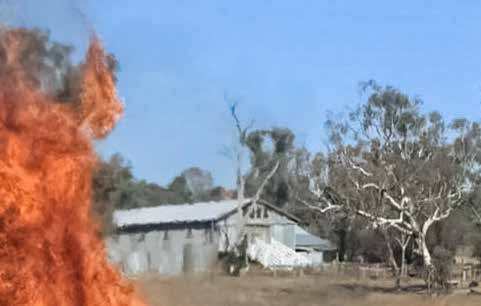

---
## Page 44

ACT Strategic Bushfire Management Plan – Version 3 2014
6.	 Broad area bushfire fuel reduction across the natural  
	
and rural landscape of the ACT 
Broad area fuel reduction practices will be used to establish and maintain a range (or mosaic) of differing fuel 
loads across the broader natural and rural landscape of the ACT, to assist in suppressing bushfires and reducing 
the impact of bushfires on life and property and the environment.
In Australia since the 1950s, changes in policy towards land management as well as technological changes in bushfire 
fighting have resulted in the majority of naturally occurring fires being extinguished while they remain small, instead of 
these continuing to burn at low intensity and low rate of spread until they are extinguished by natural circumstances (e.g. 
rain events, low fuel loads in previously burnt areas, wet riparian corridors or sub‑alpine grasslands) 
Natural bushfire cycles have been replaced with much larger, less frequent and more intense bushfires (see Part 1, 
Chapter 3 ). This may result in significantly increased fuel loads in some areas and a more homogenous landscape, both 
in terms of fuel load (which may include dense regeneration) and ecosystem function, and may ultimately threaten the 
diversity of communities and increase the risk of intense fires in regenerating landscapes.
Over 2009–14, the Strategic Bushfire Management Plan version 2 saw the reintroduction of landscape‑level planned 
burning in the ACT (see Case study Prescribed burning in Namadgi National Park). This ongoing program has the aim 
to create a range (or mosaic) of ‘bushfire fuel ages’ across the wider natural and rural landscape. This ‘bushfire fuel age’ 
derives from the time since the last bushfire in a vegetation community, and correlates to the bushfire fuel load and the 
hazard it presents. It recognises that the bushfire fuel load will accumulate and increase in these vegetation communities 
over time, although at different rates. The outcomes of having this range of fuel ages are to assist in bushfire suppression 
as well as reinforce the existing firefighting advantages and complement sound principles for ecosystem management.
This program addressed the recommendations of the McLeod inquiry14 and Coroner Doogan’s inquiry15 into the 2003 
Canberra bushfires, and is at the forefront of landscape fire management practice nationally. 
The practical implementation of planned burning (also known as prescribed burning or hazard‑reduction burning) focuses 
on establishing Strategic Firefighting Advantage Zones (SFAZs). These zones have the objective of reducing the intensity 
and spread of fires across large landscape units, which will contribute to the success of firefighting under moderate 
weather conditions. In addition to assisting to suppress bushfire, these fuel reduced areas will reduce the impacts of 
unplanned fire on catchment values (water yield and quality) by reducing the size and intensity of fire in these areas. 
The zones should be located to enhance natural advantages for suppression (such as slope) that will assist firefighting 
operations. However, it should be noted that under elevated fire danger conditions, the advantage resulting from planned 
fire will be reduced.
Broad area fuel reduction takes into account the dynamic nature of natural ecosystems, and requires clear objectives and 
an adaptive approach to fire management. Fire managers will use the best available knowledge to identify appropriate 
fire management practices, including the desirable fire regimes (which considers the frequency of bushfires) to promote 
ecological values. 
Because of the differing fire and nonfire‑related management objectives, a range of treatment strategies will be applied to 
establish SFAZs:
•	
applying broad‑area fuel‑reduction burning, aiming to reduce fuel across multiple landscape elements
•	
managing green breaks in forested areas. (An example of this is provided in the case study describing the Corin 
Dam‑Stockyard Spur green break)
•	
targeted broad‑area grazing
•	
slashing of rural and arterial roads, easements or boundary trails
•	
identifying naturally occurring areas of vegetation with inherent fuel loads consistent with SFAZ standards
14	
Inquiry into the Operational Response to the January 2003 Bushfires.
15	
ACT Coroner’s Court 2003 Bushfire Inquiry.
40

---
## Page 45

Part 2: Objectives and strategies for bushfire management in the Australian Capital Territory
Management policies
Planned fire will be used as the principal management tool to reduce bushfire fuel levels, thereby establishing and 
maintaining a mosaic of fuel loads at a landscape level. This will reduce the impact of bushfire on life and property in the 
rural and urban areas of the ACT as well as impacts on water catchment and environmental values in the ACT’s National 
Parks and Nature Reserves.
Location and timing of fuel reduction activities in SFAZs over the 2014‑2019 are identified in RFMPs. 
Implementing broad‑area fuel reduction present risks, such as the potential for planned fire to escape containment lines or 
burn at a higher intensity than prescribed. In undertaking fuel‑reduction activities, these risks will be considered against the 
known and more widespread consequences of uncontrolled bushfires under elevated fire danger conditions.
Where appropriate, planned fire will be also used to maintain or improve ecosystem health and resilience, recognising that 
such fires frequently have two‑fold effects in achieving biodiversity benefits and reduction of fire fuel.
Factors that will be considered in implementing broad‑area fuel reduction activities include fire fighter and public safety, 
forecast weather conditions and the potential air quality and smoke impacts of the activities. In water catchments, specific 
consideration will be given to the impacts on water supply and water quality.
Fuel reduction in SFAZs will aim to complement ecological requirements and guidelines established by the ACT EPD. 
Specific factors taken into consideration include timing, location, and the type and intensity of fuel‑reduction activities. 
The location of SFAZs will be dynamic over time, rather than in fixed locations. This will ensure:
•	
That strategic areas of low fuels are maintained in the landscape, without the need for repeatedly burning the 
same area.
•	
Maintaining a fuel age mosaic across the majority of the landscape in the longer term. 
Through the ACT–NSW cross‑border fire group, the ACT will work with NSW to implement integrated cross‑border fuel 
management strategies on public and private land, through surrounding regional bushfire risk management plans (for 
private land) and fire management strategies for the Brindabella National Park and Brindabella State Conservation Area.
Standards relating to these treatments of SFAZs are identified in the ACT Bushfire Management Standards.
Specific actions 2014–19
The following actions will be undertaken:
•	
land managers will prepare BOPs consistent with the RFMPs that detail fuel management works in SFAZs to meet the 
standards in ACT Bushfire Management Standards
•	
BOP Fuel management treatment in SFAZs will be audited and assessed to ensure compliance with ACT Bushfire 
Management Standards
•	
to ensure long term objectives RFMPs are achieved and to support adaptive management, the implementation of 
landscape scale fuel management treatments will be reported against on a cumulative basis that details the area 
treated, fuel hazard assessment, vegetation type and any other matters as appropriate 
•	
the location and timing of fuel‑reduction activities in SFAZs for the period 2019–24 will be developed 
•	
relationships between vegetation communities in the ACT and the proposed, long term fuel age distributions for 
these communities will be quantified with the intention to optimise landscape‑level objectives that balance fuel age 
distributions and ecosystem function
41

---
## Page 46

ACT Strategic Bushfire Management Plan – Version 3 2014
Case study: Corin Dam and Stockyard Spur Greenbreak
The 2003 Canberra fires burned all of the Cotter Catchment in a single event that, in combination with a 
significant rainfall event shortly after the fires, had a major impact on Canberra’s water supply. Reducing the 
chance of the whole Cotter Catchment burning in a single wildfire event was identified as a priority in the Strategic 
Bushfire Management Plan (SBMP) version 2. 
Constructing a new road in the Stockyard Spur area was originally seen as the preferred strategy for reducing 
the chances of fires that were burning in the Bendora Dam subcatchment from spreading to the Corin Dam 
subcatchment. However, an environmental impact statement prepared for the construction of this road identified 
that, if constructed, the road would have a significant environmental and social impact.
Upgrading an existing informal walking track in the area was identified as an alternative. This walking track, along 
with an adjacent 5‑metre‑wide zone in which shrubs were removed, was constructed in 2012 by ACT Territory 
and Municipal Services Directorate staff. 
In 2013, this walking track was subsequently used as a control line for a prescribed burn that created a 
fuel‑reduced area separating the Bendora Dam and Corin Dam subcatchments. In this way, the combination of 
upgrading the walking track and the subsequent prescribed burn can provide control lines for future suppression 
and back‑burning operations and reduce the chance of both the Bendora Dam and Corin Dam subcatchments 
burning in a single bushfire event. This strategy is also important to help protect Canberra’s water supply from 
bushfires.
Prescribed burn lit off Stockyard Spur walking track with 
Corin Dam on the left.
Prescribed burn lit off Stockyard Spur walking track.
42

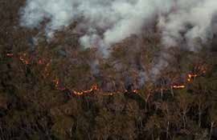

---
## Page 47

Part 2: Objectives and strategies for bushfire management in the Australian Capital Territory
Case study: Prescribed burning in Namadgi National Park
The 2003 Canberra fires burned all of the Cotter Catchment in a single event that, in combination with a 
significant rainfall event shortly after the fires, had a major impact on Canberra’s water supply. Reducing the 
chance of the whole Cotter Catchment burning in a single wildfire event was identified as a priority in the Strategic 
Bushfire Management Plan (SBMP) version 2. 
Constructing a new road in the Stockyard Spur area was originally seen as the preferred strategy for reducing 
the chances of fires that were burning in the Bendora Dam subcatchment from spreading to the Corin Dam 
subcatchment. However, an environmental impact statement prepared for the construction of this road identified 
that, if constructed, the road would have a significant environmental and social impact.
Upgrading an existing informal walking track in the area was identified as an alternative. This walking track, along 
with an adjacent 5‑metre‑wide zone in which shrubs were removed, was constructed in 2012 by ACT Territory 
and Municipal Services Directorate staff. 
In 2013, this walking track was subsequently used as a control line for a prescribed burn that created a 
fuel‑reduced area separating the Bendora Dam and Corin Dam subcatchments. In this way, the combination of 
upgrading the walking track and the subsequent prescribed burn can provide control lines for future suppression 
and back‑burning operations and reduce the chance of both the Bendora Dam and Corin Dam subcatchments 
burning in a single bushfire event. This strategy is also important to help protect Canberra’s water supply from 
bushfires.
Prescribed burn on the Smoker Trail burning towards Corin Dam.
43

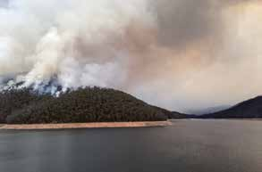

---
## Page 48

ACT Strategic Bushfire Management Plan – Version 3 2014
7.	 Access for vehicles and firefighters to undertake  
	
bushfire fighting and fuel reduction
Government and private land managers will work together to ensure the network of fire trails and helipads 
to provide access to fires that will allow more effective bushfire fighting and fuel reduction operations to be 
undertaken.
Fire access is the network of public roads, rural trails and fire trails on government managed land and constructed 
helipads that support fire management activities. Identifying and maintaining good fire access is an integral element of fire 
management because: 
•	
ground and aerial access allows for a faster initial attack, which could lead to shorter suppression times
•	
ground access is critical to provide opportunities to contain bushfires by establishing strategic breaks and 
fuel‑reduced areas
•	
ground access also provides opportunities for increased readiness by deploying suppression forces in strategic 
locations
•	
well‑planned ground access has the potential to reduce environmental and economic impacts, and reduce the 
recovery requirements of potentially higher impact track construction during unplanned fires
Versions 1 and 2 of the SBMP established the basis of the fire access network. They also included significant upgrade 
and construction works in Namadgi National Park and Bullen Range, as well as ongoing maintenance and upgrade in and 
around Canberra (see the case study ‘Mt Franklin Road upgrade’).
Ongoing maintenance of the fire trail network remains critical, and needs to be responsive to bushfires as well as other 
events, such as severe storms and localised flooding, which have significantly damaged access trails in the past. However, 
additional construction and upgrades may be required as new developments are planned, and these will be considered as 
part of the development approval process.
Figure 13 – Fire trail along an Asset Protection Zone at Tuggeranong Hill
Management policies
Government land managers will prepare Regional Fire Management Plans which detail works to be carried out on fire 
management access networks on their land that include:
•	
fire trail maintenance
•	
fire trail upgrades
•	
fire trail construction
All new fire trails and aerial access points will only be constructed where they provide a clear strategic benefit, and the 
financial and environmental costs of construction and maintenance do not outweigh the benefits for fire management.
Given the proximity of people and property to the urban edge, a relatively high density of good‑quality fire trail access will 
be provided in these areas for safe and fast initial attack of fires and fuel management. A complementary, well designed 
sealed public road network in these areas, consisting of ‘edge roads’ and providing for access and egress for firefighter 
and residents is also necessary. (See Part 2 Chapter 11 Integrated measures for bushfire protection at the urban edge)
Generally, access for agricultural purposes will provide effective access for fire management and a moderate density of 
farm trails in rural areas will provide for a rapid initial attack. 
44

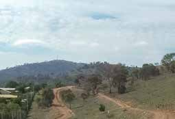

---
## Page 49

Part 2: Objectives and strategies for bushfire management in the Australian Capital Territory
Requirements for ground access along the urban interface, in rural areas and across nature conservation areas in the ACT 
will differ according to risk and fire suppression requirements. Where staged development occurs, temporary perimeter 
roads will be required as part of the subdivision design.
The ACT Bushfire Management Standards identify standards and classification for fire trails, public roads, rural fire trails 
and aerial access in the ACT.
Specific actions 2014–19
The following actions will be implemented:
•	
in BOPs, government land managers will identify works to be carried out on fire management access networks on 
their land, including fire trail maintenance and upgrades, and construction 
•	
BOP Access management works will be audited and assessed to ensure compliance with ACT Bushfire Management 
Standards
To ensure long term objectives for RFMPs are being achieved, the implementation of access management treatments will 
be reported in two parts: 
•	
against the timeframe of the BOP
•	
cumulative against the longer term actions identified in RFMPs
•	
the ACT Trails Strategy 2014–2024 will fully integrate the requirements of the strategies and guiding principles of the 
SBMP
•	
The development of a fire trails register in the central geo‑database will be completed to provide for consolidated 
information across governments. The maps outlining the fire trial access network will be made available on the 
ACT Government public mapping website, ACTMAPi16.
Case study: Mt Franklin Road upgrade
The Strategic Bushfire Management Plan version 1 recognised Mt Franklin Road, which runs along the western 
border of the ACT, as a strategic firefighting and access road, and proposed that this road be upgraded to allow 
larger vehicles to pass. Mt Franklin Road passes through a number of areas of high environmental sensitivity, 
including habitat for the endangered Corroboree frog and sphagnum bogs.
 The ACT Territory and Municipal Services Directorate began the plan for upgrading the road in 2005. This 
included preparing the required environmental impact statement and development application for the sections of 
the road in the ACT, and a review of environmental factors for the sections of the road in New South Wales. These 
documents identified a wide range of strategies to reduce the environmental impacts of the upgrade activities.
The majority of the work to upgrade Mt Franklin Road was completed by 2012. In 2013, the upgraded section 
allowed a bulldozer on a float to reach and suppress a fire in the Ginini Wetlands area. The fire was posing a 
significant threat to the internationally recognised wetlands. 
Stockyard Creek crossing on the upgraded section of  
Mt Franklin Road.
16	
www.actmapi.act.gov.au/home.html
45

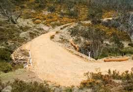

---
## Page 50

ACT Strategic Bushfire Management Plan – Version 3 2014
8.	 Adaptive management to provide continuous  
	
improvement in bushfire management
The ACT Government will commit to bushfire research and analysis and maintaining the flexibility to modify 
programs to reduce current and future risk based on sound modelling, monitoring, evaluation and lessons 
learned.
The ACT landscape and weather can interact to create extreme bushfire conditions, which may impact on the urban 
edge and rural areas of the ACT. These extreme bushfires cause the majority of damage and there are limits to how much 
the risk presented by these fires can be reduced. In this context, it is important that risk management strategies are 
continuously improved through ongoing research, analysis and adaptive management. Adaptive management recognises 
that management actions should be undertaken, even though many uncertainties remain because of a lack of knowledge. 
Adaptive management requires:
•	
clear objectives based on current knowledge, review of the outcomes of actions, and a commitment to change or 
refine management actions
•	
 monitoring of management actions to establish whether intended outcomes are achieved, or if changes to strategies 
and actions are required. The approach may include experiments or targeted research to determine the best method 
to be adopted
Investment in ongoing research programs is a critical element of adaptive management. To improve, the ACT Government 
must review, monitor and research its past, current and future strategies for fire management to identify gaps, changes 
and better practice (see Figure 14).
The ACT works closely with research institutions in Australia and overseas, and continues to contribute resources and 
capability to support the national bushfire research undertaken through the Bureau of Meteorology, Geosciences Australia 
and the university sector in the ACT and NSW. The ACT is also closely involved in the research program of the BNHCRC 
and is a partner in the AFAC which collaborates and shares information with fire agencies.
Monitoring this plan is not limited to institutional research. Community service organisations are able to provide an ongoing 
contribution to monitor and evaluate the impact of this plan. It is important that the ACT Government establishes and 
maintains the necessary links with these organisations as part of its adaptive management approach to fire management 
in the ACT.
Figure 14 – The adaptive management cycle
The principles and application of adaptive management applies to all elements of bushfire management, from ecological 
monitoring of the effects of fuel management, to the ways in which firefighters respond to and manage bushfires, and how 
well the government and community recover from events. All of the strategies in this plan incorporate elements of adaptive 
management in their delivery.
46

---
## Page 51

Part 2: Objectives and strategies for bushfire management in the Australian Capital Territory
Adaptation is also the cornerstone of the ACT’s strategy for responding to the risk of a changing climate to improve 
resilience in our community and infrastructure. The ACT Government has established disaster and emergency 
management as one of six priority sectors for the implementation of priority actions. The ACT climate change adaptation 
strategy will provide the basis for an integrated, whole‑of‑government approach to adaptation policies and plans.
Management policies
The impact and effects of the SBMP will be monitored and reviewed to adapt and adjust strategies as required, and to 
form the basis of reporting to the government and the community.
The ACT will support coordinated bushfire research to inform and adapt programs for fire management in the ACT. There 
will be continued support for research from which cohesive, evidence‑based policies and strategies can be developed. 
Specific actions 2014–19
The following actions will be undertaken: 
•	
opportunistic research into fire behaviour, firefighting methods and firefighter performance may be undertaken when 
fires occur in the ACT. The findings may support:
--
the review of RFMPs and operational procedures
--
opportunistic training and education for firefighters to link practical experience with training theory
•	
research and monitoring will be undertaken to target:
--
efficacy of mitigation measures, such as maintaining unburnt buffers along riparian zones and aiming for 
low‑intensity and patchy burning within the prescribed burn perimeter
--
the relationship between fire history, fauna diversity and abundance, and habitat structure in a range of vegetation 
communities
--
water quality impacts of large scale planned fires and those within close proximity to potable water reservoirs
--
spring burning regimes in selected forested areas to reintroduce seasonality in fire regimes that are currently only 
burned in the autumn months (See Part 2 Chapter 6)
--
ridge‑top burning (See Part 2 Chapter 6)
•	
Fuel Hazard Assessment in the ACT will be undertaken and should include sharing of Fuel Hazard Assessment with 
NSW land and fire managers, recognising the impact on the ACT from bushfires originating in New South Wales 
(NSW) and the risk that bushfires from the ACT present to NSW. An annual report detailing Fuel Hazard in the ACT will 
be prepared based on the assessment. (See Part 1 Chapter 3 and the case study Fuel Hazard Assessment Program)
•	
ACT agencies will consult community service organisations where specific information and advice in relation to 
proposed activities may be available
•	
there will be ongoing monitoring of critical global climate systems and patterns (eg Southern Oscillation Index) that 
may significantly affect bushfire management strategies over the life of this plan. As appropriate, strategies (including 
resources requirements) for community awareness, fuel management, capability and response may be modified
•	
the changing bushfire climate in the ACT and region will be better understood through analysis of the outputs of the 
NSW/ACT Regional Climate Modelling (NARCliM)
47

---
## Page 52

ACT Strategic Bushfire Management Plan – Version 3 2014
Case study: Fuel Hazard Assessment Program
Since 2005, the ACT Territory and Municipal Services Directorate TAMSD has assessed overall fuel hazard at 
more than 500 locations around the ACT each year (see figure below). 
The results of the Fuel Hazard Assessment Program will be used to develop fuel hazard accumulation models for 
long-term risk assessment and to determine planned fire regimes in the associated RFMPs.
Every year, fuel hazard assessments are used to validate, adapt and modify RFMPs by establishing whether 
burns are still required (if fuels have accumulated as expected), and to identify locations where the zone-specific 
standards in the Strategic Bushfire Management Plan are not being achieved. They are also used to identify 
locations for fuel management treatments in TAMS’s annual bushfire operations plans.
The illustrations show the results of this assessment, identifying where the overall fuel hazard is projected to 
increase to very high and extreme levels in the absence of any fuel reduction, as well as showing those areas, 
such as native grassland, that will always remain a low to moderate hazard. It should be noted that some of the 
fuels shown (e.g. rural grassland areas) will vary significantly from year to year, where as other fuels (e.g. forest 
fuel) will increase over a longer period.
Although there will be significant variation within these classifications, the Fuel Hazard Assessment Program 
illustrates adaptive management in practice – driving fuel-reduction outcomes that optimise the use of resources 
to reduce bushfire risk.
Overall Fuel Hazard – 2014.
Overall Fuel Hazard – 2019 with no fuel 
management.
Fuel Hazard Rating 
48

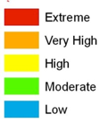

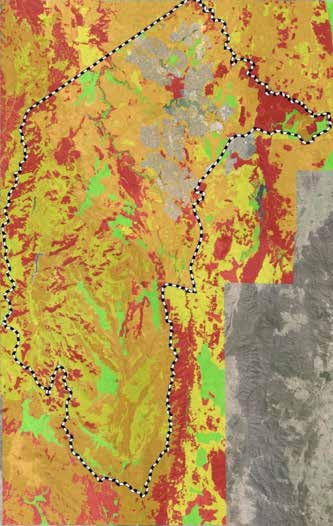

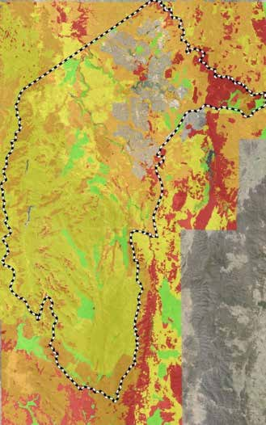

---
## Page 53

Part 2: Objectives and strategies for bushfire management in the Australian Capital Territory
9.	 A community that is prepared for bushfires 
Having a community that is prepared for bushfires is a shared responsibility. 
The ACT Community is asked to increase its knowledge of bushfire risk and to take actions, as individuals and 
groups, to minimise the risk they face from bushfires. In partnership, the ACT Government will support at‑risk 
individuals and the community at large to help them understand this risk and be better prepared to make 
informed and timely decisions when bushfires occur.
Building on previous bushfire preparedness campaigns, the ACT Government will continue to provide information to the 
community about bushfire risk, and how individuals and households can prepare for them. These programs will be built 
on, responding to ‘lessons learned’, research and the changing nature of the people and places of the ACT.
The community at risk
Education and awareness programs in the ACT emphasise shared responsibility, whereby strong partnership and action 
between the ACT Government and the community is needed to maintain the momentum and priority for these programs. 
Those in the community that do understand their part in this are often best placed to assess and manage their own 
exposure to risk, and are able to make informed and timely decisions on how they respond to bushfire events.
People who have difficulty in understanding or undertaking the full suite of actions necessary to manage their risk 
exposure may include the very young or very old, people with physical disabilities or culturally or linguistically diverse 
members of the community. Because of their personal circumstances these people will be at a disadvantage when it 
comes to preparing for or defending their properties and may require special attention and support in the event of a 
bushfire emergency.
Through a lack of knowledge, experience or choice there are people in the community who are not aware of the risks 
they are exposed to. Despite the efforts of government and the community to educate and inform, some individuals with 
little bushfire awareness may, at short notice be confronted with making critical decisions that will affect their safety and 
wellbeing.
Australian fire services have learned that the people who are most likely to be harmed during extreme bushfire events are 
those who live in bushfire prone areas, are vulnerable due to their personal circumstances and who make critical decisions 
at the last moment. 
Fire agencies have continued to develop a better understanding of how to engage all parts of the community over to meet 
their different needs:
•	
collaboration between the Fire Services and community services organisations (both government and 
non‑government) is necessary to develop programs to assist people in understanding and addressing risk
•	
agencies must be flexible and responsive to these varying levels of capacity, understanding and commitment in the 
community 
•	
agencies must use all the tools at their disposal to support the community in setting their priorities and in making the 
important decisions that will affect their safety and wellbeing before, during and after bushfires
Key messages
The decisions and actions community members take when bushfires occur are critical to their safety. Fires can threaten 
suddenly and without warning and community members should be prepared to act. The ACT continues to implement the 
arrangements established in the National Framework for Scaled Bushfire Advice and Warnings to the Community (2009), 
and will issue bushfire alerts to the public about a bushfire once it has started and taken hold.
49

---
## Page 54

ACT Strategic Bushfire Management Plan – Version 3 2014
Table 4 – Bushfire alert levels and key messages
Bushfire alert level
Key mssage
Advice
A fire has started. There is no immediate danger.
Watch and act
There is a heightened level of threat. Conditions are changing and you need to start taking action now 
to protect yourself and your family.
Emergency warning
An Emergency Warning is the highest level of Bushfire Alert. You may be in danger and need to take 
action immediately. Any delays now will put your life at risk.
Management policies
The community’s responsibility
The ACT community should increase its knowledge of bushfires and take personal actions to minimise the risk and 
consequences of bushfire events. Bushfire Prone Areas provide the basis for residents to evaluate their level of vulnerability 
to bushfire, both personally, for assets and things they value.
The Bushfire Survival Plan template (see Figure 15) is the cornerstone public document for community members to take 
personal responsibility to manage the risk to themselves, their families and the things they value. This plan will assist 
community members to: 
•	
prepare themselves and their family for how they will respond to bushfire incidents when they occur or threaten to 
occur
•	
prepare their properties to reduce the effects of bushfires
•	
understand the necessary resources and equipment for responding to a bushfire
•	
understand the fire danger rating system
•	
understand the need for insurance coverage against the risk of bushfires, and the type of coverage necessary.
The community should know the messages that will be provided during bushfire situations, and understand what they 
mean well before the bushfire season commences. Community members should be aware of the following points:
•	
Always remain alert and seek information. Fires can threaten suddenly and people should not rely on a single source 
of information before you start acting to protect themselves and their property
•	
Don’t rely on a warning. There may also be situations where there is no time for any warnings to be issued at all
•	
Some fires start and spread so quickly that the three levels of Alerts (See Table 3) may not be provided in a 
consecutive order – an Emergency Warning may be issued first 
•	
Bushfire Alerts are issued using the ACT ESA website, Twitter, Facebook, local radio and television, or telephone via 
the Canberra Connect Call Centre or Emergency Alert
•	
An Emergency Warning is the highest level of Bushfire Alert. It may be accompanied by a siren sound (Standard 
Emergency Warning Signal or SEWS) before the message.
•	
It may not be possible for the Fire Services to provide protection to individual community members at all times, and 
people must be prepared to make decisions and act without the support of emergency services 
•	
Even structures that are built to meet Australian Standards and have occupiers who are well prepared are unlikely to 
be defendable under catastrophic conditions
•	
It is likely that many residents will find themselves in Bushfire Prone Areas from time to time and, even if they do not 
live in these areas, they should be aware of the risks in these areas
The government’s responsibility
The ACT ESA will maintain responsibility and oversight of bushfire education and awareness programs in the ACT.
A comprehensive and integrated community education and awareness program will be achieved through the combined 
efforts of the fire and emergency services and their members, other government agencies and the broader community. 
50

---
## Page 55

Part 2: Objectives and strategies for bushfire management in the Australian Capital Territory
Engagement with the community will rely on multiple elements, including broadcast media, web‑based information, social 
media and face‑to‑face engagement via community events and local engagement. 
‘Face‑to‑face’ engagement and discussion at the local community level such as ACT F&R CFU volunteer area, suburb or 
ACT RFS brigade area – will be the priority for educating and informing people at risk. ACT RFS and ACT F&R volunteer 
and career firefighters are the foundation of local, community‑level engagement. Public information provided during 
emergencies will be tailored to address at‑risk people who have not considered their risk before a bushfire event. 
There will be collaboration with the ACT local media as a key partner in delivering community education and awareness of 
bushfires.
Education and awareness programs will include general information and advice for all residents and visitors to the ACT, 
recognising that people may be at risk due to circumstances and location during bushfire events.
Figure 15 – The Bushfire Survival Plan
Specific actions 2014–19
The following actions will be undertaken:
•	
through ACT F&R Community Fire Units and ACT RFS Volunteer Brigades, a program of face to face community 
engagement will be developed to provide education and awareness to community members in the BPA
•	
government agencies and community groups, including Volunteering ACT, will be used to support local and targeted 
education and awareness programs in BPAs where opportunities for local engagement through emergency services 
volunteer groups is not available 
•	
tailored outreach and engagement programs will be developed to target at‑risk groups and individuals in the 
community in BPAs in conjunction with the Community Services Directorate and third‑party support providers
•	
people should consider their ability to contribute to their community through voluntary service by becoming a member 
of an RFS Rural Fire Brigade, F&R Community Fire Unit, or a member of another volunteer service or organisation
•	
exercising of operational arrangements, responsibilities and delegations for the provision of information, warnings and 
directions to the public in the event of bushfires will be undertaken
•	
the ACT Government will work with the local media in delivering community education and awareness of bushfires
•	
Bushfire Survival Plan templates will be reviewed to reflect lessons learned, research findings and changes in the 
operational environment. A mobile device application will also be developed to assist the community in completing a 
Bushfire Survival Plan
•	
the community education awareness programs will be modified as required to reflect seasonal climate variations that 
may change the community’s bushfire risk and the level of exposure to those at risk
•	
formal agreements between the ACT ESA and local ACT media outlets will be maintained as components of the ACT 
ESA’s capacity to use the reach of the broadcast media to the community
51

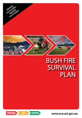

---
## Page 56

ACT Strategic Bushfire Management Plan – Version 3 2014
10.	Effective land‑use policy and planning that reduces  
	
bushfire risk
The assessment and mitigation of bushfire risk through effective land‑use policy and planning will be undertaken 
to reduce the exposure of the built environment and the natural environment to bushfire.
In the ACT, the Planning and Development Act 2007 establishes the ACT Planning and Land Authority with the function 
of preparing and administering the Territory Plan. The Territory Plan determines land‑use policies for the ACT and allows 
for areas to be set aside for specific purposes. It includes criteria for determining when the preparation of planning 
documents, such as development applications and environmental impact statements, is required. Consistent with the 
provisions of the Planning and Development Act 2007 and the Territory Plan, there is a hierarchical approach to planning 
in the ACT from the broad district level, which tapers to site‑specific development applications for subdivision and 
development.
Through this Plan, land‑use planning in the ACT will consider bushfire risk at all levels of planning particularly those areas 
susceptible to bushfires and those areas proposed for urban development. 
Types of land management
Unleased Territory Land 
Unleased Territory Land in the ACT is used for various purposes and contributes to the character of the ACT. The 
objectives of unleased Territory Land management include nature conservation, recreation, education, community use, 
protection of catchment and utility infrastructure and provision of amenity. The majority of the land is managed by the 
TAMSD.
Leased Territory management
Lands leased in the ACT vary widely. Some lands are large in size (e.g. many rural leases) and are occupied by rural 
landholders with experience and competence in bushfire and land management. Other lands are in the hands of 
smallholders (e.g. owners of suburban blocks) who may not necessarily have experience in bushfire issues. 
The practical and behavioural differences between different groups of individual leaseholders are taken into account in 
considering bushfire education and awareness programs as well as land‑use planning. 
National Land 
The SBMP does not apply to National Land in the ACT; however, it places high value on collaborative fire management 
with National Land managers (e.g. Department of Defence lands, CSIRO, the National Botanic Gardens).
Management policies 
The ACT ESA and the Fire Services are the principal agencies responsible for providing strategic advice to government 
agencies and developers about bushfire risk, and the necessary policies and measures for effective risk mitigation. 
This advice encompasses input into relevant planning documents, such as plans of management under the Planning and 
Development Act 2007 and plans for endangered communities and species under the Nature Conservation Act 1980. 
Bushfire risk assessment will be undertaken as part of the initial concept and strategic planning stages of new 
developments to identify the necessary mitigation measures. Considerations will identify: 
•	
any competing objectives for public safety, including the primacy of human life, with land development, nature 
conservation, catchment and utility infrastructure protection or any other matters
•	
limits and constraints on developable areas of new estates, including requirements for Asset Protection Zones and 
environmental requirements
•	
the initial and ongoing investment required by government and the community associated with bushfire protection or 
other measures
Further detail on the range of mitigation measures in undertaken under Part 2 Chapter 11
Specific land uses that increase bushfire risk may not be permitted in the Bushfire Abatement Zone – for example, a new 
commercial plantation establishment adjacent to the urban edge. 
52

---
## Page 57

Part 2: Objectives and strategies for bushfire management in the Australian Capital Territory
ACT Government agencies will work together in planning fire management strategies, including fuel reduction and access 
works identified in the RFMPs, to ensure that the different plans under the Nature Conservation Act 1980 and the SBMP 
can operate in an integrated and effective manner while recognising approved adjacent land uses and impacts.
ACT Government agencies will work together to ensure that cross‑government planning and approvals processes for 
fire management activities under RFMPs and bushfire operational plans are identified in a timely manner to minimise 
constraints in their implementation. 
ACT Government agencies will work with National Land managers in the ACT (including the National Capital Authority and 
Department of Defence) to ensure strategies and actions for mitigation of bushfire risk are integrated and consistent with 
the strategies of the SBMP.
Specific actions 2014–19
The following actions will be undertaken: 
•	
advice will be provided in relation to development applications, variations to the Territory Plan, structure plans and 
other strategic planning documents where there may be a bushfire risk. This will include advice on appropriate use 
when considering strategic land‑use decisions
•	
the holding of annual planning forums between agencies will be the means to identify and highlight future planning 
requirements and potential constraints. Specific focus will be on capital works and other major activities that may 
trigger significant environmental assessment
•	
specific advice to detail bushfire risk and the necessary mitigation strategies for the Molongolo Valley and 
Murrumbidgee River Corridor will be provided to inform strategic planning documents including structure plans and 
plans of management for these areas
•	
recommendations concerning land use and fire management will be developed for previous plantation areas 
within and surrounding the Lower Cotter Catchment. Recommendations will determine the cost‑effectiveness and 
risk‑reduction issues associated with the options developed, which may include commercial plantation operations. 
Outcomes of this review will inform the development of the Plan of Management for the Lower Cotter Catchment
•	
a bushfire management planning framework for National Land that aligns with this plan will be prepared
•	
advice will be provided to National Land Managers in relation to bushfire risk, with a specific focus on high‑risk areas, 
including facilities where constraints on bushfire response and fuel reduction may increase risk to life and property 
53

---
## Page 58

ACT Strategic Bushfire Management Plan – Version 3 2014
11.	Integrated measures for bushfire protection at the  
	
urban edge 
A range of measures will be used to achieve integrated bushfire risk reduction on the urban edge, including 
development planning, physical works (for example edge roads around new suburbs and fuel reduction in Asset 
Protection Zones) community education and inspection.
The highest risk from bushfire to the community of the ACT occurs where the bushland and grassland of the rural area 
meets the built‑up, suburban area of Canberra (the ‘urban edge’). The increased risk is caused by the proximity of 
population to the bushfire hazard. 
Unlike other jurisdictions in Australia, the land‑use policy in the ACT has resulted in an urban edge where the rural area 
immediately transitions to suburban areas, without significant semi‑rural development of small rural blocks. Although this 
confers an advantage to fire management planning in many respects, it also concentrates a significant number of people 
in an exposed, bushfire‑prone area that is more than 500km long. Under the previous SBMP, the ACT Government 
achieved a high level of urban edge protection in new suburbs as well as fuel management works along existing edges.
However, as the ACT continues to grow, particularly to the west and north of Canberra (e.g. the Molongolo development), 
bushfire protection standards need to remain relevant to the changes in the risk profile as well as provide flexibility in 
how adequate protection can be achieved. In some areas the risk of bushfire may increase however the opportunity to 
develop new suburbs with a comprehensive and integrated range of bushfire protection measures is also created, with the 
potential outcome of lower residual risk than in older, established suburbs. 
Table 5 illustrates the elements of the integrated approach, and the extent to which the elements can be influenced 
and implemented in the ACT in new or existing areas. In general terms, an optimal level of protection from bushfires is 
achieved through the combined application of all of these measures. 
Table 5 – Ability to apply integrated measures for protection at the urban edge
Elements providing integrated 
protection at the bushland-urban 
interface
Ability to apply 
measures to 
existing suburbs
Ability to apply 
measures to 
new estate 
development
‘Hierarchy of control’
Non‑permissible or restricted 
development
Limited
P
Avoid/eliminate
Design and layout
X
P
Design and substitution
Access, edge roads
X
P
Design and substitution
Asset Protection Zones
Limited
P
Design and substitution
Construction standards 
Limited
P
Engineering controls – long term
Water supply and utilities
Limited
P
Engineering controls – long term
Urban Landscaping 
P
P
Engineering controls – temporary
Emergency management and 
evacuation planning 
P
P
Administration and organisation
Targeted education and awareness 
P
P
Administration and organisation
P = able to apply or modify; X = not able to apply or modify
Note: A ‘hierarchy of control’ is an approach to managing risks and is used to illustrate the sequence of options to approach the control of hazards.
Table 5 shows the importance of effective planning to ensure the elements of design, access and infrastructure are identified and established during 
planning and development of new estates. This provides for fully integrated measures and optimal outcomes in terms of controlling the risk of bushfires 
– recognising that these most effective measures cannot be achieved once a suburb is built.
54

---
## Page 59

Part 2: Objectives and strategies for bushfire management in the Australian Capital Territory
Management policies 
Risk assessment 
The ACT ESA remains the principal agency responsible for providing strategic advice to government agencies and 
developers about bushfire risk. The ACT ESA is also the referral authority for independent site‑specific risk assessment for 
new estate developments.
Design and layout (new estate developments)
The design and layout of subdivisions and developments can reduce the vulnerability of dwellings and residents from the 
impact of a bushfire. Appropriate design will greatly assist with bushfire prevention and suppression operations. 
Bushfire protection features will be identified and integrated during the initial stages of subdivision and development design 
to minimise the impact of a bushfire (see Part 2 Chapter 10). Bushfire Prone Areas for new development will be identified 
at this stage to establish the necessary construction standards that will be required in these areas
Access (new estate developments)
Sealed edge roads at suitable standards for urban firefighting appliances will be identified within the Asset Protection 
Zones (APZs) to provide safe operational access for emergency services and residents who are seeking to evacuate. A 
sealed edge road will be the default standard for new estate developments however limited variations may be agreed to 
by the ACT ESA (see Figure 16).
Internal roads and laneways will be assessed to determine if they provide access for emergency services and safe egress 
for members of the community away from the interface areas. 
Applicable access standards, including for internal public roads, edge roads and fire trails for new estate developments 
are in the ACT Bushfire Management Standards. 
Figure 16 – A sealed edge road, Forde
Water supply and other services (new estates and large infill developments)
Infrastructure – specifically, water supplies – will need to meet the requirements for effective firefighting operations. This 
includes a main water supply of specified capacity around the outer perimeter of new estate developments, as well as 
hydrants and hardstands. Other infrastructure, such as power and telecommunications, should also consider bushfire risk.
Applicable standards for water supply and other services are in the ACT Bushfire Management Standards.
55

---
## Page 60

ACT Strategic Bushfire Management Plan – Version 3 2014
Special fire protection development (new estate developments, infill 
developments and existing areas)
Developments that will concentrate members of the community at high risk from bushfire in declared BPAs are not 
permissible. They may, however be approved by the ACT ESA in limited circumstances with special conditions. Termed 
‘Special Fire Protection Developments’, these include:
•	
schools
•	
hospitals
•	
nursing homes, aged care facilities and retirement villages
•	
childcare centres
•	
motels and tourist accommodation
•	
other areas as determined by the ACT ESA
(Also see ‘Emergency management and evacuation planning’ below)	
Building Standards to reduce Bushfire risk 
Applying building construction standards will mitigate bushfire risk in designated BPAs by reducing the likelihood of 
property loss and, importantly, providing a critical level of protection to people who may shelter in these structures during 
the passage of bushfires under extreme conditions.
Concurrent to the development of this SBMP, the ACT Government will work towards extending formal declaration of 
BPAs to include part of the built‑up area of Canberra. This extension is for the purpose of allowing Australian Standard 
(AS) 3959 – Construction of building in bushfire prone areas to be applicable to structures in these areas during the 
building approval stage17. Under AS 3959 five levels of building construction are identified based on the assessed level of 
bushfire behaviour that a property will be subject to – the ‘Bushfire Attack Level’ (BAL). 
In BPAs, it is proposed:
•	
That new residences or existing residences being significantly renovated or properties being knocked down and 
rebuilt will be required to be assessed under AS 3959 to determine standards for bushfire construction. A minimum 
standard of construction under AS3959 will be required to be undertaken to the lowest level of BAL, BAL 12.5.
•	
That in designing the layout of new developments, no leases for residential development will be permitted in the 2 
highest BAL levels (BAL – Flame Zone and BAL 40). The width of the Inner APZs may need to be increased above the 
minimum to address requirements for BPAs.
It is not intended to apply these standards retrospectively to existing properties (unless they are being significantly 
renovated or properties are being knocked down and rebuilt). The full details relating to assessment, implementation 
and compliance with these requirements will be provided. In developing these details, the ACT Government will closely 
consider the approach taken by other jurisdictions.
Figure 17 – Inner Asset Protection Zone in an established area – Aranda Bushland
17	
Bushfire Prone Areas are already declared across the rural areas of the ACT.
56

---
## Page 61

Part 2: Objectives and strategies for bushfire management in the Australian Capital Territory
Asset Protection Zones 
Asset Protection Zones (APZs) provide bushfire risk mitigation in the urban area by reducing the impacts of embers, 
radiant heat and flames on people and property. APZs also provide areas that provide access for firefighters and allow 
them and residents to evacuate if required.
 In establishing APZs, the primacy of protecting life is the highest priority for management.
APZs will be of variable width and will include an Inner APZ that is intensively managed to reduce fuel, and may include 
a less intensively managed Outer APZ. Standards for APZs, including widths of these zones are in the ACT Bushfire 
Management Standards. The location and size of the APZ are subject to approval by the ACT ESA. 
Fuel‑reduction activities in APZs for 2014–19 will be identified in Regional Fire Management Plans and bushfire operational 
plans that are approved by the Commissioner. These areas will be audited and assessed to ensure compliance with 
standards.
Mowing, slashing and planned fire (prescribed burning or hazard reduction burning) are the principle means for 
undertaking fuel management in APZs. In addition to identifying the timing, location and intensity of treatments, fire fighter 
and public safety, forecast weather conditions, potential air quality and smoke impacts will be considered in preparing for 
planned fire activities in APZs.
APZs in established areas
Land managers will continue to apply the APZ fuel management standards in established areas to reduce bushfire fuel 
loads, noting that many established areas of Canberra did not require any bushfire management measures at the time of 
development. 
Some established suburbs will have conflict between fire protection requirements for APZs, adjacent natural assets where 
they include part of an APZ or other management values (e.g. primary production or financial requirements). The ACT 
Government has a commitment to conserving natural assets in particular the protection of listed species and communities 
is a requirement of government land management agencies in these adjacent areas.
Where management conflicts cannot be resolved, for statutory or other reasons, the matters will be referred to the 
Emergency Services Commissioner for further consideration. Specific provision exists in Sections 81 and 82 of the 
Emergencies Act 2004 for the Minister for Police and Emergency Services or the Commissioner to give direction to land 
managers in relation to bushfire management requirements, depending on the land classification.
The Case Study relating to fuel management at Cooleman Ridge describes some of the recently undertaken works to 
make fuel management more effective and efficient in an existing urban area.
APZs in new estate development
For new estate developments, APZs will be identified in the strategic and estate development planning process and will 
include consideration of the matters identified under Part 2 Chapter 10. As a standard approach, intensively managed 
Inner APZs will be identified within the footprint of the developable area. 
Outer APZs will be used on adjacent lands (e.g. nature reserves, rural leases, National Land or public open spaces) and 
outside the developable area of new developments where the adjacent land manager is able to meet the fuel management 
requirements for an Outer APZ and not limited by:
•	
operational constraints (e.g. access, slope and ground condition)
•	
conflict with sustainable management regimes in high conservation value ecological assets
•	
financial resources available to implement activities
•	
other constraints on management of that land 
Where an Outer APZ is not identified for a new development, increased widths of Inner APZs, and higher standards of 
construction and infrastructure area may be required.
57

---
## Page 62

ACT Strategic Bushfire Management Plan – Version 3 2014
Urban Landscaping (all areas)
Urban residents have a responsibility to manage the risk of fire on their properties, and the risk of it impacting on 
neighbouring properties. In BPA, residents should assess the extent of vegetation and other flammable material on their 
property. This may be done while developing a Bushfire Survival Plan. 
New urban plantings and management of existing plantings on government managed lands in BPAs will consider bushfire 
risk management in determining the location, species, density, extent and ongoing maintenance of plantings. Existing 
guidelines will be applied to assist in the selection and layout of plantings. Guidelines to assist in plant selection and 
vegetation management in private residences is required.
Private and government land may be inspected for the safety of individual and surrounding properties that are at 
significant risk. 
Emergency management and evacuation planning (all areas)
The design and layout of the majority of suburbs in Canberra provide for effective access for emergency evacuation. 
Routes of relatively short distance and generally having multiple access points will allow residents in urban Bushfire 
Prone Areas (BPA) to move to safer, non‑BPAs. As such, the provision of refuge areas (other than residences) for people 
to shelter from bushfire is generally not applied in urban Canberra. Residents in BPA, as well as at risk members of the 
community should consider their actions as part of preparing their Bushfire Survival Plan.
Suitable emergency and evacuation arrangements are required for occupants of special fire protection developments 
where they exist in BPAs and applicable standards for evacuation planning are detailed in the ACT Bushfire Management 
Standards. 
Targeted education and awareness
Chapter 10 addresses strategies for targeted education and awareness.
Specific actions 2014–19
The following Actions will be implemented:
•	
land managers will prepare BOPs consistent with the RFMPs that detail Fuel Management works in APZs to meet the 
standards in the ACT Bushfire Management Standards
•	
BOP Fuel Management and Access works in APZs works will be audited and assessed to ensure compliance with 
ACT Bushfire Management Standards
To ensure long term objectives for RFMPs are being achieved, the implementation of APZ fuel management treatments will 
be reported in two parts: 
•	
against the timeframe of the BOP
•	
cumulative against the longer term actions identified in RFMPs
The ACT Bushfire Management Standards will be subject to revision and review. The following matters will be addressed 
as a priority:
•	
materials and information for government agencies, developers and the community to understand the implications of 
the adoption of BPAs and what they will be required to do
•	
Information and advice to improve the built environment will be consistent with AS3959 to encourage residents to 
work towards compliance with appropriate standards, noting that partial measures do not in themselves achieve 
compliance with these standards
•	
specific arrangement for ‘Special Fire Protection Developments’ in BPA including guidelines regarding approval of 
these developments in limited circumstances 
•	
standards for management of urban fuels in BPAs 
•	
standards for utility services in urban and rural areas, including the provision of reticulated water supply firefighting
•	
the determination of APZ standards and widths.Targeted awareness programs will be implemented for residents in 
BPAs to assist them in appropriate fire management of household gardens and associated structures to prevent the 
spread of fire impacting on their properties or their neighbour’s properties. These programs will be supplemented with 
information materials
58

---
## Page 63

Part 2: Objectives and strategies for bushfire management in the Australian Capital Territory
•	
where appropriate, standards in BPAs will be enforced to ensure vegetation management on private property does 
not present significant threat to life and property
•	
aged care facilities, schools, hospitals, childcare centres and other establishments should have the necessary plans in 
place for managing emergencies, including evacuation during bushfire emergencies. These requirements will apply to 
both the government and the nongovernment sectors
Case study: Cooleman Ridge prescribed burns and physical removal works
The 2003 Canberra fires burned across Cooleman Ridge and into the suburb of Chapman, burning many 
houses. At the time of the fires, steep slopes and rocky ground made it impossible to achieve Strategic Bushfire 
Management Plan (SBMP) fuel standards in the area by the preferred method of slashing. Instead annual burning 
was undertaken, which was made difficult by a lack of control lines. Also burning could usually only be undertaken 
in mid‑summer when grasses in the area had dried enough to burn. These difficulties meant that the required 
burning was often not done.
In 2007, the area underwent major earthworks (by removing rocks, filling holes and reducing slopes) to make 
it suitable for slashing and create control lines for burning. Now SBMP fuel standards are met in this area by a 
combination of slashing and small areas of burning in areas surrounded by good control lines, which means that 
people and property in this area are more protected than before the 2003 fires.
Cooleman Ridge Inner Asset Protection Zone.
59

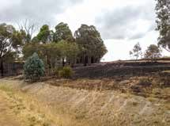

---
## Page 64

ACT Strategic Bushfire Management Plan – Version 3 2014
12.	The community and government recover from the  
	
effects of bushfires
Recovery from bushfires will commence while operations are under way and may be required to continue for a 
long period following the cessation of response operations. It will encompass actions to address the personal, 
broader social, economic and environmental impacts of bushfires.
Recovery is an integral component of bushfire management, and will be considered before, during and after bushfires. 
There is a strong community expectation that governments should deliver effective recovery services – an expectation 
which is a result of significant disaster events in Australia and internationally. 
Recovery from significant bushfires requires a whole‑of‑government response, which has led to the development of plans 
and processes that support the government’s provision of these services. These plans include:
•	
the ACT Recovery Plan (2014) details the arrangements for the coordination of recovery efforts provided by ACT 
Government and other agencies in respect of community, economic, infrastructure and environmental elements 
before, during, and after significant emergencies in the Australian Capital Territory. It includes arrangements for 
establishing a Recovery Taskforce and appointing a Recovery Coordinator where required
•	
the ACT Community Recovery Plan (2007)18 is a functional plan of the ACT Recovery Plan (2014) and details the 
provision of recovery services to the community. This plan provides for the coordination and delivery of programs and 
services to assist the recovery of affected communities and individuals, including firefighting personnel and support 
staff
•	
the ACT Economic Recovery Sub‑Plan provides for recovery services targeted towards the recovery of business 
activity within the ACT
•	
the ACT Environmental Recovery Sub‑Plan provides for the recovery services aimed at the restoration of healthy, 
diverse, and resilient ecological systems. These activities will be undertaken on a priority basis through long‑term 
restoration of the natural environment 
•	
since 2009, multidisciplinary teams, through rapid, post‑fire assessments, have identified which measures should be 
undertaken immediately, and which actions aid recovery over a longer timeframe
•	
the ACT Infrastructure Recovery Sub‑Plan provides the framework for a coordinated response to, and recovery from, 
emergencies involving severe damage or disruption to ACT infrastructure
18	
 www.dhcs.act.gov.au
60

---
## Page 65

Part 2: Objectives and strategies for bushfire management in the Australian Capital Territory
Management policies
Recovery from significant bushfires requires a whole of government response that will commence when a bushfire starts. 
The incident controller is responsible for ensuring recovery planning is initiated.
Recovery processes are fully integrated in the ACT’s emergency coordination structures to ensure a transition from 
response‑focused operations to those of recovery.
Recovery activities should aim to be community led, and the government and non government organisations (NGOs) 
should provide support and coordination.
When the impact of a disaster is likely to require a coordinated recovery effort to repair damage, restore services and 
support the community in its recovery, a recovery taskforce may be established under the ACT Emergency Plan (2014). 
This will include appointing an ACT Recovery Coordinator. The role of the taskforce is to plan and coordinate long‑term 
recovery across all areas of government, and to consider the needs of the affected community.
The role of NGOs is important in providing recovery services to the community. Recovery services that are provided by 
government and NGOs will aim to understand the needs of affected communities, and apply a range of techniques to 
enable all members of the community to be supported.
The recovery phase will continue until the community is restored to a point of normal activity, and where all social, 
economic, infrastructure and/or environmental issues identified have been resolved. The recovery taskforce will plan for 
the transition of formal recovery arrangements to standard government arrangements, which may include an appropriate 
public information strategy. 
Specific actions for 2014–19
The following actions will be undertaken:
•	
dependent on the scale and extent of the emergency, bushfire‑affected communities will receive targeted support 
to assist them to rebuild in a way that strengthens the community capacity to respond to future emergencies, and 
enhances social, economic and environmental values where possible 
•	
recovery plans will be activated as appropriate. Specific considerations include the following: 
--
If there are significant bushfire consequences on rural and other business enterprises, government agencies will 
work with rural landholders and industry bodies to enhance distribution of recovery information and support, 
which may include assistance to rural landholders
--
Immediate support arrangements and assistance measures will be coordinated for those affected by bushfires. 
Work within the community, by community organisations and other agencies, will ensure that the recovery is 
coordinated and targeted to address different needs of individuals or groups
--
When firefighting has been prolonged, or there have been associated traumatic experiences (such as ‘near 
misses’, injury or death), an opportunity for critical incident stress debriefing will be provided
--
Rapid assessment of the risks posed in landscapes following high‑intensity bushfires will be undertaken to 
minimise further threat to life and property, infrastructure and the environment
--
Lessons learnt through the recovery process are captured and made available to managers of future recovery 
processes
61

---
## Page 66

ACT Strategic Bushfire Management Plan – Version 3 2014
Case study: Burned Area Assessment Teams
In January 2013, the Australian Capital Territory – New South Wales Burned Area Assessment Team (BAAT) was 
deployed to the Wambelong fire in the Warrumbungles National Park. The fire burned more than 56,000 hectares, 
including 22,104 hectares in the park. As a result 53 houses were lost and a range of built and natural assets 
were impacted. This was the first deployment of the BAAT team which included: spatial analysts, a flooding and 
erosion specialist, flora and fauna ecologists, an asset manager and a local cultural heritage specialist. 
The team worked with regional staff to compile a report that identified potential risks across the park, which 
centered on:
•	
public safety arising from hazardous trees and damaged infrastructure
•	
infrastructure damage arising from increased post‑fire erosion
•	
post‑fire grazing pressures on threatened species and communities 
•	
soil movement and stream sedimentation arising from large debris flows
•	
retaining iconic Indigenous assets in the post‑fire environment
The first deployment of the BAAT team was highly successful and provided regional land managers with a list 
of potential risks and defined priority tasks for post‑fire rehabilitation works. Both jurisdictions will continue to 
support the program.
Warrumbungles National Park following the January 2013 fire – Site of 
the BAAT deployment (Photo: Margaret Kitchin).
62

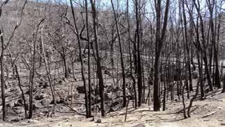

---
## Page 67

Part 3: 
Schedules to the Strategic Bushfire 
Management Plan
63

---
## Page 68

ACT Strategic Bushfire Management Plan – Version 3 2014
Schedule 1 – Assets which are at risk from the impact of 
bushfires
The following information lists the types of public and private assets which are at risk from bushfires. In recognition of the 
large number of these assets, as well as privacy and commercial concerns, detailed lists of the assets are held on internal 
ACT ESA spatial databases, and can be accessed for planning and operational purposes. (Subject to privacy, commercial 
in confidence and security constraints).
Property
All properties (urban and rural) identified in the Bushfire Prone Areas (BPAs) of the ACT.
Critical and social infrastructure
Critical and social infrastructure refers to the physical facilities, supply chains, information technology, communication 
networks and utilities that we rely on in our daily lives. Assigning precise consequences to critical infrastructure is difficult 
and extremely varied; as each category may impact on another (e.g. a power outage may affect communications).
Facilities that occur in BPAs of the ACT include:
•	
electrical: substations and power distribution hardware (power lines, transmission lines)
•	
solar generation
•	
gas: gas lines, distribution stations 
•	
Water and sewerage: dams, mains, pumping stations, water treatment plants , valves, reservoirs, mains water, sewer 
vents and wastewater treatment plants
•	
communications: communication towers and telephone 
•	
transport: Canberra airport and major road links
•	
health: hospitals 
•	
schooling and educational facilities: preschool, primary, secondary and tertiary institutions
•	
community: homes, supported housing and aged care facilities 
•	
supply: supermarkets and petrol stations
•	
emergency services: police, fire and rescue, ambulance and State Emergency Service (SES) stations.
Business – services and industry	
Small and medium sized businesses may be significantly impacted by bushfires.
Business – agricultural production
The ACT is home to agricultural production enterprises operated by rural landholders, as well as by the ACT Government. 
These include:
•	
broad‑acre grazing by sheep and cattle
•	
small cropping
•	
intensively managed grazing by sheep, cattle and horses
•	
intensive horticulture, including olives, truffle production and vineyards
•	
plantation forestry
The infrastructure (e.g. fencing, irrigation and utilities) to support these activities, along with the vegetation (e.g. improved 
and natural pasture, crops and plantations) may all be affected by unplanned bushfires
64

---
## Page 69

Part 3: Schedules to the Strategic Bushfire Management Plan
Water catchments
Consistent with the objects of the Water Resources Act (2007), the ACT water catchments are considered critical assets. 
High intensity, unplanned bushfires over a significant area of the ACT’s water catchments presents the most significant risk 
to these catchments in terms of water quality and quantity.
Biodiversity and threatened species and communities
The supporting documents SBMP; Fire and the Environment SBMP v3 and SBMP – Fire and the Environment SBMP v2 
provide details on environment assets in the ACT at risk from bushfires. These details include listing of threatened species 
and community that may be affected by fire, both planned and unplanned. 
Cultural heritage
Under the Heritage Act 2004, the ACT Heritage Council is responsible for keeping a register of heritage places and objects 
in the ACT, which is available to emergency services for planning and operational purposes.
ACT Heritage have worked closely with TAMSD to develop management procedures for Bushfire Operations Manuals, 
The manuals identify assets and outline management recommendations for heritage places and objects. 
Information to the public on identification of Aboriginal cultural heritage is available to assist volunteers, members of the 
public and land managers involved in fire management and can be accessed through www.environment.act.gov.au.
65

---
## Page 70

ACT Strategic Bushfire Management Plan – Version 3 2014
Schedule 2 – List of agencies and entities required to 
prepare bushfire operations plans
The following agencies or entities are required to have an approved bushfire operational plan (BOP) for 2014–15. 
Where consistent with the Section 78 (5) of the Emergencies Act 2004, plans previously approved for the years identified 
in this schedule are acceptable.
This schedule will be revised annually and updated as appropriate. The ACT ESA will notify agencies and entities their 
requirement to provide a BOP and where appropriate, will identify the specific locations or areas for which BOPs are 
required.
ACT Government agencies
Required by the managers of an area of unleased territory land or land occupied by the Territory for lands in designated 
Bushfire Prone Areas:
•	
Territory and Municipal Services Directorate 
•	
Health Directorate
•	
Economic Development Directorate
•	
Community Services Directorate
•	
Education and Training Directorate
Rural leaseholders
Required by the rural land managers (rural leaseholders) in the designated Bushfire Abatement Zone.
Other entities
Required by the managers of an area of unleased territory land or land occupied by the ACT for lands in designated 
Bushfire Prone Areas:
•	
ACTEW AGL
•	
ACTEW Water
66

---
## Page 71

Part 3: Schedules to the Strategic Bushfire Management Plan
Schedule 3 – SBMP Version 3 implementation Plan
The ESA SBMP Implementation Working Group, chaired by the Commissioner, is the principal forum within ACT Government 
by which information and advice in relation to implementation of the SBMP is provided, analysed and reported against. It 
includes senior representation from all agencies with responsibilities under the SBMP. 
This implementation plan forms the basis of reports against the SBMP Version 3. The Implementation Working Group will 
determine the priority and responsibility for implementing actions.
Chapter 1 – Background to fire management in the ACT
Table 6 – Fire Management Planning in the ACT
Actions 
Priority
Responsibility 
Status 
Comment
BOPs are required from ACT Government land managers, 
rural land managers in the Bushfire Abatement Zone), as 
well as other land and property managers as identified at 
Schedule Two of the SBMP
The Commissioner will review and, if required, amend the 
list in Schedule Two annually
The Commissioner is responsible for approval of the ACT 
Bushfire Management Standards. They will be reviewed as 
required to reflect significant changes
The Bushfire Prone Area map will continue to reviewed 
and refined to reflect changes in land use and tenure, as 
improved vegetation mapping becomes available and to 
address local and site specific issues as required. Changes 
will be approved by the Commissioner
Fire Management Zoning maps will be reviewed as 
required to reflect significant changes, which may include 
unplanned bushfires or changes to the location or extent 
of assets. The Commissioner is responsible for approval of 
these maps.
The BAZ will be reviewed as required to reflect changes 
in land use and tenure, and will be approved by the 
Commissioner.
Formal arrangements are in place between ACT and NSW 
agencies to provide for integrated and efficient cross 
border response arrangements. These arrangements will 
be reviewed over the period of this plan.
The ACT ESA will support NSW RFS fire management 
planning through continued involvement in regional 
Bushfire Management Committees.
67

---
## Page 72

ACT Strategic Bushfire Management Plan – Version 3 2014
Part 2 – Objectives, Strategies and Actions
Table 7 – A reduction in bushfire ignitions
Actions 
Priority
Responsibility
Status 
Comment
As required, and in conjunction with ACT Policing 
the arson intervention program will be activated to 
address specific arson related situations.
The MOU for arson investigation between the ACT 
ESA and ACT Policing will be maintained.
Arrangements will be clarified in relation to 
vegetation management to reduce risk from 
bushfires in the immediate vicinity of power 
infrastructure. This will include:
• the regulatory framework and responsibility of 
agencies and individuals to undertake works to 
reduce risk
• standards for vegetation clearance zones in 
proximity to power infrastructure, as well as 
the management of vegetation outside these 
zones that may also have an impact on power 
infrastructure (e.g. falling trees)
• the provision of information and advice in 
relation to private power infrastructure on leased 
land in the rural areas of the ACT 
 
Table 8 – Effective firefighting operations by skilled and motivated personnel bushfires
Actions 
Priority
Responsibility
Status 
Comment
A ‘Strategic Bushfire Capability Framework’ will 
be developed to assist planning for firefighting 
operations and to support programs for capacity 
enhancement. 
As a minimum, the capability to operate a full 
incident management team (IMT) for the first two 
shifts of any campaign response will be established 
and will fill all key functional leadership roles.
Support of programs that proactively maintain 
health, fitness and wellbeing of firefighters will be 
implemented to maintain capability.
Programs for the recruitment and retention of 
volunteers will be reviewed to include:
• building partnerships with employers to assist 
volunteers to be able to participate in response 
activities, particularly campaign fires
• arrangements to undertake a survey of 
volunteers departing from the Fire Services 
to identify the strengths and weaknesses of 
programs
• building diversity within the ACT Fire Services
68

---
## Page 73

Part 3: Schedules to the Strategic Bushfire Management Plan
Table 9 – Effective firefighting operations with the necessary equipment and resources
Actions 
Priority
Responsibility
Status 
Comment
A Strategic Bushfire Capability Framework will 
be developed to assist planning for firefighting 
operations and to support programs for capacity 
enhancement. 
Replacement of equipment and resources will be 
ongoing and consistent with the ACT ESA Strategic 
Asset Management Plan.
Develop strategies for Remote Areas Fire Fighting 
arrangement, including pre planning, capability and 
resources. 
Aircraft capability and support infrastructure will be 
maintained through NAFC and in liaison with NSW 
RFS.
In conjunction with other jurisdictions, the ACT will 
continue to develop and exercise al capabilities to 
predict bushfire behaviour and spread, supported 
as required by technical specialists in fire behaviour 
modelling.
Annual exercises will be undertaken to test facilities 
(unless they have been sufficiently activated and 
exercised in actual incident response).
Presuppression plans will be prepared and 
distributed to provide necessary information to 
undertake initial fire attacks. Plans will be reviewed 
and updated as required. 
Further strategies will be developed to enhance 
the capability of real‑time visualisation and delivery 
of information between ESA HQ and fire crews, 
including complex information and data from a 
range of internal and external sources.
69

---
## Page 74

ACT Strategic Bushfire Management Plan – Version 3 2014
Table 10 – Extinguish bushfires when they occur
Actions 
Priority
Responsibility
Status 
Comment
Messages and warnings for bushfire incidents will 
be reviewed , with consideration of lessons learned 
and latest research as well as targeting ‘at risk’ 
communities and individuals.
Communication methods used during emergencies 
via the ACT ESA website (and other electronic 
means) will be further developed to utilise the use 
of live streaming of media and information.
Ongoing liaison with the ACT local media to train 
journalist in basic bushfire awareness as well as the 
provision of refresher training and provide training 
and familiarity with the media facilities at the ACT 
ESA Headquarters.
The ACT Elevated Fire Danger Plan will be reviewed 
to reflect lessons learned and changes in the 
strategic and operational environment.
Procedure for the implementation and training 
of AIIMS Version 4 across all agencies will be 
developed to support the ACT’s preparedness for 
bushfire and other emergencies.
Table 11 – Planned fire management on rural lands
Actions 
Priority
Responsibility
Status 
Comment
Rural landholders inside the BAZ are required to 
produce a BOP, which is subject to approval by the 
Commissioner, and needs to be reviewed every five 
years. 
The ACT Government will support landholders 
to develop fire management plans through the 
Farm Firewise program. The priority for supporting 
the development of these plans (to meet BOP 
requirements) will be on rural leases within the BAZ.
70

---
## Page 75

Part 3: Schedules to the Strategic Bushfire Management Plan
Table 12 – Broad-area bushfire fuel reduction across the natural and rural landscape of the ACT
Actions 
Priority
Responsibility
Status 
Comment
Land managers will prepare BOPs consistent with 
the RFMPs that detail fuel management works 
in SFAZs to meet the standards in ACT Bushfire 
Management Standards.
BOP Fuel management treatment in SFAZs will be 
audited and assessed to ensure compliance with 
the ACT Bushfire Management Standards.
The long term fuel management objectives for 
SFAZs in RFMPs and information to support 
adaptive management, will be reported on a 
cumulative basis that details the area treated fuel 
hazard assessment, vegetation type, intensity and 
seasonality and any other matters as appropriate. 
The location and timing of fuel‑reduction activities 
in SFAZs for 2019–24 will be developed. 
Relationships between vegetation communities 
in the ACT and the proposed, long term fuel 
age distributions for these communities will be 
quantified with the intention will be to optimise 
landscape‑level objectives that balance fuel age 
distributions and ecosystem function.
71

---
## Page 76

ACT Strategic Bushfire Management Plan – Version 3 2014
Table 13 – Access for vehicles and firefighters to undertake bushfire fighting and fuel reduction
Actions 
Priority
Responsibility
Status 
Comment
In BOPs, government land managers will identify 
works to be carried out on fire management 
access networks on their land, including fire trail 
maintenance and upgrades, and construction. 
BOP Access management works will be audited 
and assessed to ensure compliance with ACT 
Bushfire Management Standards.
To ensure long term objectives for RFMPs are 
being achieved, the implementation of access 
management treatments will be reported in two 
parts: 
• against the timeframe of the BOP
• cumulative against the longer term actions 
identified in RFMPs
The ACT Trails Strategy 2014–2024 will fully 
integrate the requirements of the strategies and 
guiding principles of the SBMP. 
The development of a fire trails register in the 
central geo‑database will be completed to provide 
for consolidated information across governments. 
The maps outlining the fire trial access network will 
be made available on the ACT Government public 
mapping website, ACTMAPi.
Table 14 – Adaptive management to provide continuous improvement in bushfire management
Actions 
Priority
Responsibility
Status 
Comment
Opportunistic Research into fire behaviour, 
firefighting methods and firefighter performance 
may be undertaken when fire occur in the ACT. The 
findings may support:
• the review of regional fire management plans 
(RFMPs) and operational procedures
• opportunistic training and education for 
firefighters to link practical experience with 
training theory
72

---
## Page 77

Part 3: Schedules to the Strategic Bushfire Management Plan
Actions 
Priority
Responsibility
Status 
Comment
Research and monitoring will be undertaken to 
target:
• efficacy of mitigation measures, such as 
maintaining unburnt buffers along riparian zones 
and aiming for low‑intensity and patchy burning 
within the prescribed burn perimeter
• the relationship between fire history, fauna 
diversity and abundance, and habitat structure in 
a range of vegetation communities
• water quality impacts of large scale planned 
fires and those within close proximity to potable 
water reservoirs
• spring burning regimes in selected forested 
areas to reintroduce seasonality in fire regimes 
that are currently only burned in the autumn 
months
• ridge‑top burning
Fuel Hazard Assessment in the ACT will be 
undertaken and should include sharing of Fuel 
Hazard Assessment with NSW land and fire 
managers, recognising the impact on the ACT from 
bushfires originating in New South Wales (NSW) 
and the risk that bushfires from the ACT present to 
NSW. An annual report detailing Fuel Hazard in the 
ACT will be prepared based on the assessment. 
ACT agencies will consult community service 
organisations where specific information and advice 
in relation to proposed activities may be available.
There will be ongoing monitoring of critical global 
climate systems and patterns (eg Southern 
Oscillation Index) that may significantly affect 
bushfire management strategies over the life of 
this plan. As appropriate, strategies (including 
resources requirements) for community awareness, 
fuel management, capability and response may be 
modified.
The changing bushfire climate in the ACT and 
region will be better understood through analysis 
of the outputs of the NSW/ACT Regional Climate 
Modelling (NARCliM).
73

---
## Page 78

ACT Strategic Bushfire Management Plan – Version 3 2014
Table 14 – A community that is prepared for bushfires
Actions 
Priority
Responsibility
Status 
Comment
Through ACT F&R Community Fire Units and ACT 
RFS Volunteer Brigades, a program of face to 
face community engagement will be developed to 
provide education and awareness to community 
members in the BPA.
Government agencies and community groups, 
including Volunteering ACT, will be used to support 
local and targeted education and awareness 
programs in BPAs where opportunities for local 
engagement through emergency services volunteer 
groups is not available. 
Tailored outreach and engagement programs will be 
developed to target at‑risk groups and individuals 
in the community in BPAs in conjunction with the 
Community Services Directorate and third‑party 
support providers.
People should consider their ability to contribute 
to their community through voluntary service by 
becoming a member of a RFS Rural Fire Brigade, 
F&R Community Fire Unit, or a member of another 
volunteer service or organisation.
Exercising of operational arrangements, 
responsibilities and delegations for the provision of 
information, warnings and directions to the public in 
the event of bushfires will be undertaken.
The ACT Government will work with the ACT local 
media in delivering community education and 
awareness of bushfires. 
Bushfire Survival Plan templates will be reviewed 
to reflect lessons learned, research findings and 
changes in the operational environment. A mobile 
device application will also be developed to assist 
the community in completing a Bushfire Survival 
Plan. 
The community education awareness programs 
will be modified ad required to reflect seasonal 
climate variations that may change the community’s 
bushfire risk and the level of exposure to those at 
risk.
Formal agreements between the ACT ESA and 
local ACT media outlets will be maintained as 
components of the ACT ESA’s capacity to use the 
reach of the broadcast media to the community.
74

---
## Page 79

Part 3: Schedules to the Strategic Bushfire Management Plan
Table 15 – Effective land‑use policy and planning that reduces bushfire risk
Actions 
Priority
Responsibility
Status 
Comment
Advice will be provided in relation to development 
applications, variations to the Territory Plan, 
structure plans and other strategic planning 
documents where there may be a bushfire risk. 
This will include advice on appropriate use when 
considering strategic land‑use decisions.
The holding of annual planning forums between 
agencies will be the means to identify and highlight 
future planning requirements and potential 
constraints. Specific focus will be on capital 
works and other major activities that may trigger 
significant environmental assessment.
Specific advice to detail bushfire risk and the 
necessary mitigation strategies for the Molongolo 
Valley and Murrumbidgee River Corridor will be 
provided to inform strategic planning documents 
including structure plans and plans of management 
for these areas.
Recommendations concerning land use and 
fire management will be developed for previous 
plantation areas within and surrounding the 
Lower Cotter Catchment. Recommendations will 
determine the cost‑effectiveness and risk‑reduction 
issues associated with the options developed, 
which may include commercial plantation 
operations as a means of land management in 
some areas. Outcomes of this review will inform the 
development of the Plan of Management for the 
Lower Cotter Catchment.
A bushfire management planning framework for 
National Land that aligns with this plan will be 
prepared.
Advice will be provided to National Land Managers 
in relation to bushfire risk, with a specific focus 
on high‑risk areas, including facilities where 
constraints on bushfire response and fuel reduction 
may increase risk to life and property. 
75

---
## Page 80

ACT Strategic Bushfire Management Plan – Version 3 2014
Table 16 – Integrated measures for bushfire protection at the urban edge
Actions 
Priority
Responsibility
Status 
Comment
Land managers will prepare BOPs consistent with 
the RFMPs that detail Fuel Management works in 
APZs to meet the standards in the ACT Bushfire 
Management Standards.
BOP Fuel Management and Access works in APZs 
works will be audited and assessed to ensure 
compliance with ACT Bushfire Management 
Standards.
To ensure long term objectives for RFMPs are 
being achieved, the implementation of APZ fuel 
management treatments will be reported in two 
parts: 
• against the timeframe of the BOP
• cumulative against the longer term actions 
identified in RFMPs
The ACT Bushfire Management Standards will 
be subject to ongoing revision and review. The 
following matters will be addressed as a priority:
• materials and information for government 
agencies, developers and the community to 
understand the implications of the adoption of 
BPAs and what they will be required to do
• information and advice to improve the built 
environment will be consistent with AS3959 
to encourage residents to work towards 
compliance with appropriate standards, noting 
that partial measures do not in themselves 
achieve compliance with these standards.
• specific arrangement for ‘Special Fire Protection 
Developments’ in BPA including guidelines 
regarding approval of these developments in 
limited circumstances
• standards for management of urban fuels in 
BPAs
• standards for utility services in urban and rural 
areas, including the provision of reticulated water 
supply firefighting
• the determination of APZ standards and widths
Targeted awareness programs will be implemented 
for residents in BPAs to assist them in appropriate 
fire management of household gardens and 
associated structures to prevent the spread of fire 
impacting on their properties or their neighbour’s 
properties. These programs will be supplemented 
with information materials.
Where appropriate, standards in BPAs will be 
enforced to ensure vegetation management on 
private property does not present significant threat 
to life and property.
76

---
## Page 81

Part 3: Schedules to the Strategic Bushfire Management Plan
Actions 
Priority
Responsibility
Status 
Comment
Aged care facilities, schools, hospitals, childcare 
centres and other establishments should have 
the necessary plans in place for managing 
emergencies, including evacuation during bushfire 
emergencies. These requirements will apply to both 
the government and the nongovernment sectors.
Table 17 – The Community and government recover from the effects of bushfires
Actions 
Priority
Responsibility
Status 
Comment
Bushfire‑affected communities will receive targeted 
support to assist them to rebuild in a way that 
strengthens the community capacity to respond to 
future emergencies, and enhances social, economic 
and environmental values where possible. 
Recovery plans will be activated as appropriate. 
Specific considerations include the following: 
• if there are significant bushfire consequences on 
rural and other business enterprises, government 
agencies will work with rural landholders and 
industry bodies to enhance distribution of 
recovery information and support, which may 
include assistance to rural landholders
• immediate support arrangements and assistance 
measures will be coordinated for those affected 
by bushfires. Work within the community, by 
community organisations and other agencies, 
will ensure that the recovery is coordinated and 
targeted to address different needs of individuals 
or groups
• when firefighting has been prolonged, or there 
have been associated traumatic experiences 
(such as ‘near misses’, injury or death), an 
opportunity for critical incident stress debriefing 
will be provided
• rapid assessment of the risks posed in 
landscapes following high‑intensity bushfires will 
be undertaken to minimise further threat to life 
and property, infrastructure and the environment
Lessons learnt through the recovery process are 
captured and made available to managers of future 
recovery processes.
77

---
## Page 82

ACT Strategic Bushfire Management Plan – Version 3 2014
Glossary
Term
Description
ACT Emergency Services Agency
A business unit of the ACT Justice and Community Safety Directorate 
charged with providing emergency services to the Canberra 
community.
ACT Community Services Directorate
This directorate brings together responsibilities for public and 
community housing services and policy, disability services, policy and 
planning and concessions.
ACT Chief Minister, Treasury and Economic 
Development Directorate
In relation to bushfire management, this directorate aligns and 
coordinates land release and development, property management 
and major projects within the ACT. It includes the Land Development 
Agency, whose core business is developing and selling land on behalf 
of the ACT Government.
ACT Environment and Planning Directorate
This directorate undertakes environmental policy, research and 
protection, sustainability policy, heritage, transport planning and nature 
conservation. It includes the ACT Planning and Land Authority, which 
is the ACT Government’s statutory agency responsible for planning for 
the future growth of Canberra.
ACT Fire & Rescue
One of four services that make up the ACT Emergency Services 
Agency, which has the main function to protect and preserve life, 
property and the environment from fire in built up areas of the ACT
ACT Justice and Community Safety Directorate
The directorate that provides a range of justice, legal, regulatory and 
community safety functions. 
ACT Rural Fire Service
One of four services that make up the ACT Emergency Services 
Agency, which has the main function to protect and preserve life, 
property and the environment from fire in rural areas of the ACT.
ACT Territory and Municipal Services Directorate
This directorate delivers a wide range of municipal services, including, 
mowing open space, as well as managing urban open space, nature 
reserves, public forests and national parks.
ACTEW Water
Water and sewerage service provider for the ACT.
ActewAGL 
Gas and electricity service provider for the ACT.
Agricultural Fire  
Management Zones
Areas of rural leasehold and agisted lands where bushfire mitigation 
is undertaken less intensely, and in accordance with rural production 
objectives. The zones take account of the range of rural production 
activities practised in the ACT will generally result in the reduction of 
bushfire risk.
Asset Protection Zone
A zone that ensures a separation between the bushland and habitable 
dwellings or other defined assets.
Australasian Inter‑service Incident Management 
Systems
The nationally recognised system of incident management for the 
nation’s fire and emergency service agencies.
Biodiversity
The variety of plant and animal life in the world or in a particular 
habitat, a high level of which is usually considered to be important and 
desirable.
78

---
## Page 83

Term
Description
Bushfire Abatement Zone
A discrete zone category, distinct from other Fire Management Zones 
as described in this plan. The location of the Bushfire Abatement 
Zone has been developed to identify areas where specific measures 
to reduce risk to life and property to the built‑up area of Canberra are 
required. 
Bushfire operational plan
A plan that details the specific timing, type and location of 
fuel‑reduction, access and infrastructure activities proposed to be 
undertaken in the ACT.
Bushfire Prone Areas
Defines the area of the ACT assessed as presenting a high bushfire 
risk to life and property from bushfires.
Community fire unit
A volunteer team of residents who are trained for property protection, 
operating as part of ACT Fire & Rescue.
Fire danger rating
A fire control management system that integrates the effects of 
selected fire danger factors into one or more qualitative or numerical 
indices, from which ease of ignition, probable fire behaviour and 
difficulty of suppression may be estimated.
Fire Management Zones
Areas on government‑managed lands where fuel management is 
applied to reduce bushfire fuels, recognising that no planned fire will 
be applied in some areas.
Fire management zoning
Mapping that strategically allocates land in the ACT to zones where 
measurable fuel management treatments are applied.
Fire regime
The pattern, frequency and intensity of the bushfires that prevail in an 
area. It is an integral part of fire ecology, and essential for renewal for 
certain types of ecosystems.
Fire Services
The ACT Rural Fire Service and ACT Fire & Rescue.
Hazard
A hazard relates to a physical property, or a situation, with the 
potential to cause the death of or harm to a person, or damage 
property or the environment.
Incident controller
The individual with overall responsibility for the management of an 
incident.
Incident Control Centre
 A location for the incident management team and specialist support 
as necessary to manage the overall incident and to support the 
functions of the incident controller.
Incident management team
Personnel that manage an incident according to a set of priorities and 
objectives.
Inner Asset Protection Zones
Strips of land, of variable width, immediately adjacent to vulnerable 
assets, where fuel hazard is to be reduced to comparatively low levels. 
May be complemented by an Outer Asset Protection Zone.
Landscape Fire  
Management Zones
Areas on government‑managed lands where planned fire is applied 
for ecological and catchment requirements, recognising that in some 
communities, no planned fire will be applied.
79

---
## Page 84

ACT Strategic Bushfire Management Plan – Version 3 2014
Term
Description
Outer Asset Protection Zones
Strips of land adjacent to some Inner Asset Protection Zones, where 
fuel hazard is to be reduced to comparatively low levels to further 
reduce bushfire intensity and the risk of ember attack to adjacent 
houses and assets.
Parks and Conservation Service
The Parks and Conservation Service is a branch within the Parks and 
City Services division (part of the ACT Territory and Municipal Services 
Directorate), and is responsible for planning and management of 
parks, reserves and rural lands.
Regional fire management plans
These plans provide a link between the strategy of this Strategic 
Bushfire Management Plan and the more detailed annual bushfire 
operational plans.
Strategic Firefighting  
Advantage Zones
Corridors established to break up major fire runs in instances where 
conditions permit. These zones are strategically located to slow the 
spread of unplanned fires and reduce fire intensity and spotting.
Abbreviations and acronyms
ACT	
	
Australian Capital Territory
ACT F&R	
	
ACT Fire & Rescue
ACT RFS	
	
ACT Rural Fire Service
AFAC	
	
Australasian Fire and Emergency Services Authorities Council
APZ	
	
Asset Protection Zone
BAZ	
	
Bushfire Abatement Zone
BNHCRC	
	
Bushfire and Natural Hazards Cooperative Research Centre
BOP	
	
Bushfire operational plan
BPA	
	
Bushfire Prone Areas
CFU	
	
Community Fire Unit
CMTEDD	
	
Chief Minister, Treasury and Economic Development Directorate
Commissioner	 	
ACT Emergency Services Commissioner
ESA	
	
ACT Emergency Services Agency
EPD	
	
ACT Environment and Planning Directorate
FDI	
	
Fire Danger Index
Fire Services	
	
ACT Fire & Rescue and ACT Rural Fire Service
FFDI	
	
Forest Fire Danger Index
GFDI	
	
Grassland Fire Danger Index
NSW	
	
New South Wales
PICC	
	
Public Information Coordination Centre
RFMP	
	
Regional fire management plan
SBMP	
	
Strategic Bushfire Management Plan
SFAZ	
	
Strategic Firefighting Advantage Zone
TAMSD	
	
ACT Territory and Municipal Services Directorate
80

