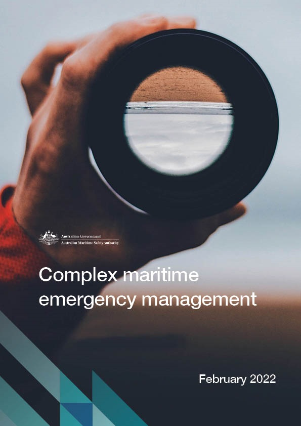
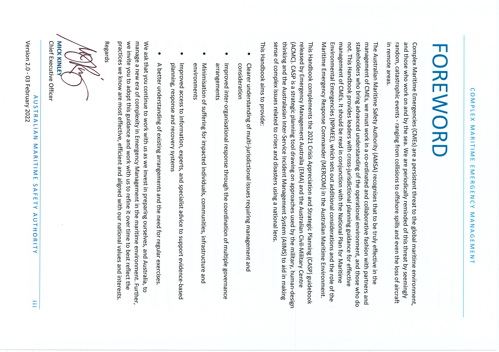
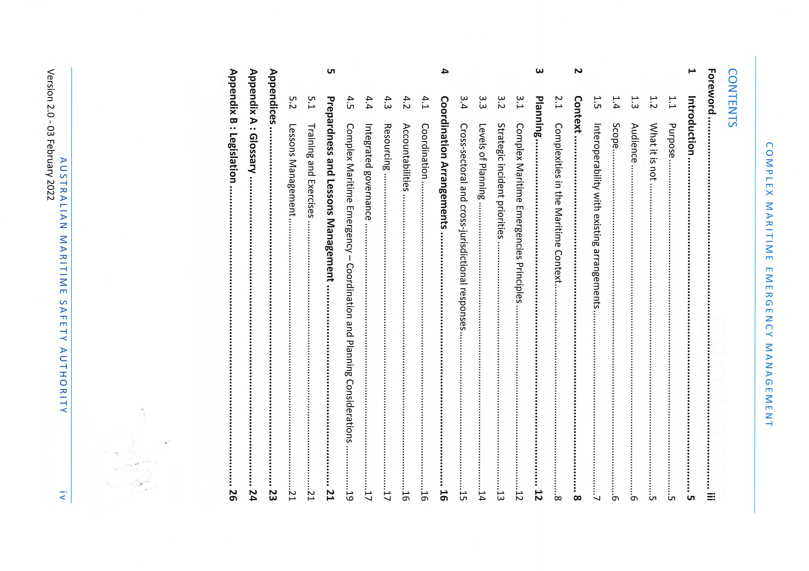
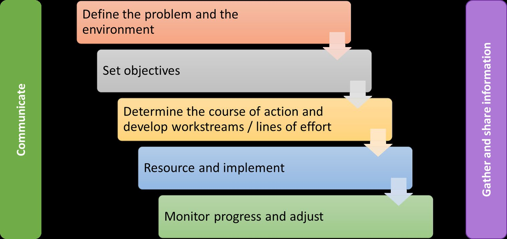
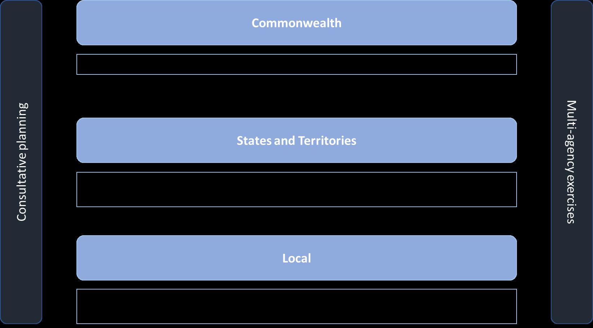
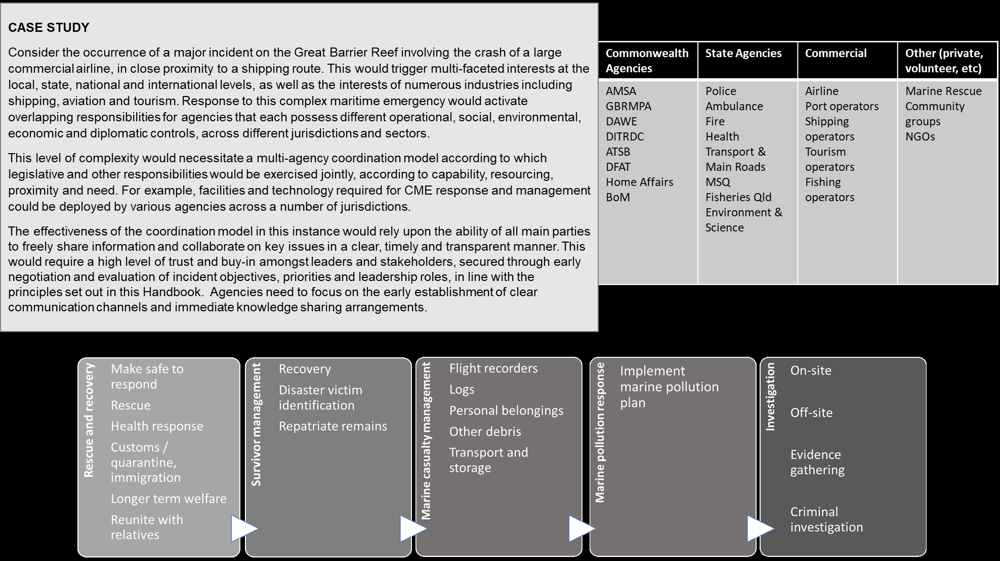
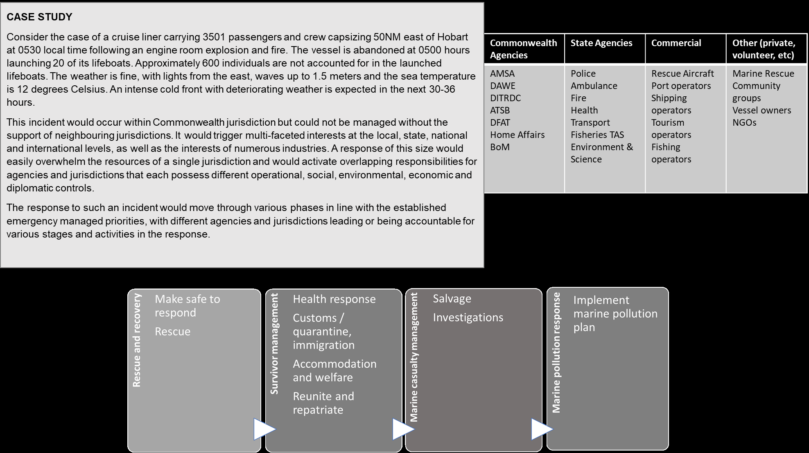

# Complex Maritime Emergencies Handbook (v2.0 (3 February 2022))

> **Source**: AMSA
> **URL**: https://www.amsa.gov.au/sites/default/files/complex-maritime-emergencies-handbook-v2.0-03-feb-2022-foreword-signed-by-ceo.pdf
> **Licence**: Crown / publisher copyright; practitioner reference
> **Retrieved**: 2026-05-07T23:47:21Z
> **SHA-256**: `af065dbc91a475c2c78a9787e9997c9def0ea6221420d7bd94cf317dd24f51a6`
> *Converted from PDF to Markdown format.*

---
## Page 1

---
## Page 2

COMPLEX MARITIME 
EMERGENCY MANAGEMENT  
 
Planning Handbook for the Australian Emergency Management and Maritime Sectors 
Version 2.0 03 Feb 2022 
Australian Maritime Safety Authority

---
## Page 3

C O M P L E X  M A R I T I M E  E M E R G E N C Y  M A N A G E M E N T  
 
A U S T R A L I A N  M A R I T I M E  S A F E T Y  A U T H O R I T Y  
i i  
Version 2.0 - 03 February 2022 
DOCUMENT CONTROL 
 
Version 
Date 
Owner 
Updates 
V1.0 
24 Apr 21 
AMSA 
Initial version published on AMSA website 
V2.0 
03 Feb 22 
AMSA 
Second version provided to AMSA Publishing for 
publishing

---
## Page 4

---
## Page 5

---
## Page 6

C O M P L E X  M A R I T I M E  E M E R G E N C Y  M A N A G E M E N T  
 
A U S T R A L I A N  M A R I T I M E  S A F E T Y  A U T H O R I T Y  
5  
Version 2.0 - 03 February 2022 
1 INTRODUCTION 
1.1 
PURPOSE 
Australia has an extensive maritime domain extending to 200 nautical miles from our coastline and 
shares maritime boundaries with Indonesia, Timor-Leste, Papua New Guinea, and other nations. The 
Australian Search & Rescue Region (ASRR) covers one-tenth of the surface of the world. Within the 
entirety of Australia’s maritime jurisdictions, responsibilities for emergency management are shared 
between the states, the Northern Territory and the Commonwealth Governments.  
The purpose of this Complex Maritime Emergency Management Handbook (this Handbook) is to 
provide planning guidance and context for users across jurisdictions towards establishing an agreed,  
structured and coordinated response to a Complex Maritime Emergency (CME). Specifically, it seeks 
to address complex emergencies that encompass multiple jurisdictions, sectors and/or hazards and 
that present a significant threat to Australian communities, critical infrastructure, economies and 
the environment. This Handbook should be utlisited in conjunction with the Crisis Appreciation and 
Strategic Planning (CASP) Guidebook processes and products that enable emergency management 
practitioners to make sense of complex situations. 
This Handbook: 
• 
acknowledges existing maritime and emergency management arrangements across 
jurisdictions, which may be called upon to support the management of a CME 
• 
recognises that the initiating agency or jurisdiction may not have ultimate control for the 
duration of a CME and that a flexible coordinated approach is required 
• 
provides guidance to develop suitable mechanisms for ensuring there are agreed 
coordination arrangements in place for incident and resource management 
• 
more accurately describes the complex interaction between state and Commonwealth 
jurisdictions. 
1.2 
WHAT IT IS NOT 
This Handbook is not an assessment mechanism by which jurisdictions will be held to account.  
Rather, it outlines a collaborative planning approach to ensure the obligations and capabilities 
required to respond to CMEs are understood across agencies and jurisdictions.  It provides guidance 
that may be useful to jurisdictions to consider as they build their capability and prepare for 
management of CMEs. 
This Handbook does not replace any existing emergency management plans or arrangements, 
however should be read in conjunction with relative extant maritime emergency plans in both the 
jurisdictional and national context.  The focus of this Handbook is to ensure agencies and 
jurisdictions work collaboratively to understand, assess, and build capabilities needed to manage a 
CME.

---
## Page 7

C O M P L E X  M A R I T I M E  E M E R G E N C Y  M A N A G E M E N T  
 
A U S T R A L I A N  M A R I T I M E  S A F E T Y  A U T H O R I T Y  
6  
Version 2.0 - 03 February 2022 
1.3 
AUDIENCE 
The audience for this Handbook is:  
• 
Executives and managers of governments, industry, responders, operators and impacted 
stakeholders 
• 
Executive crisis teams and emergency planners in immediate response agencies 
• 
Planning and emergency management entities in each jurisdiction responsible for regulating 
safety and operations at sea 
• 
Control agencies for search and rescue (SAR), i.e. Police, Coast Guards, Australian Defence 
Force (ADF) and the Australian Maritime Safety Authority (AMSA) 
• 
Control agencies for other classes of maritime emergencies, e.g. oil and hazardous and 
noxious subtsances incidents, maritime casualties 
• 
External entities including shipping companies, aviation companies, and the media. 
1.4 
SCOPE 
1.4.1 
COMPLEX MARITIME EMERGENCIES 
CMEs are large-scale and multi-faceted events that exceed the resources of a single jurisdiction and 
pose distinct threats to community safety, the economy, and the environment. CMEs may include a 
range of incidents resulting from the operation of vessels or aircraft within maritime geographies, 
such as: 
• 
Cruise ship capsizing and evacuation 
• 
Maritime casualty grounding in sensitive environmental areas 
• 
Multi-vessel incidents 
• 
Hazardous or noxious substance major incident 
• 
Tanker, container or bulk carrier vessel fire. 
CMEs have variables not present in land-based disaster response arrangements. This Handbook is 
designed to provide emergency managers with context and planning guidance in the event they 
have an obligation for response actions.   
Classification as a CME requires one or more of the following characteristics: 
• 
Potential for significant delays and difficulties in responding to critical situations 
• 
The incident contains multiple hazards, e.g. a mass rescue event from a cruise ship and a 
major oil spill (in which case the National Plan for Maritime Enviromental Emergencies 
should be referenced) 
• 
The incident is large-scale, where the consequences and required resource allocation occurs 
across multiple jurisdictions

---
## Page 8

C O M P L E X  M A R I T I M E  E M E R G E N C Y  M A N A G E M E N T  
 
A U S T R A L I A N  M A R I T I M E  S A F E T Y  A U T H O R I T Y  
7  
Version 2.0 - 03 February 2022 
• 
Where there may be uncertainty as to the coordination arrangements for a maritime  
emergency  
• 
The event is likely to have catastrophic consequences to life, infrastructure, the economy, 
the environment or other operational impacts 
• 
The response to the event causes significant conflicting priorities for resource allocation. 
1.4.2 
GEOGRAPHIC SCOPE 
This Handbook addresses incidents occurring within Australia’s maritime domain, including: 
• 
State coastal waters (extending to three nautical miles from the baseline) 
• 
The Commonwealth marine domain, extending to the Exclusive Econominc Zone (EEZ) and 
Australia’s Search and Rescue Region (ASRR). 
This Handbook also addresses incidents that may occur outside Australia’s maritime domain in 
international waters, but that impact Australian interests. This may include: 
• 
Incidents involving Australian assets or vessels 
• 
Incidents occurring on the High Seas, that may impact upon Australia’s maritime domain 
• 
Incidents occurring in neighbouring countries’ jurisdictions that require transboundary 
coordination. 
1.4.3 
EXCLUSIONS 
The following incident types are considered out of scope for this Handbook: 
• 
Terrorism or security related incidents should be managed in accordance with the National 
Counter-Terrorism Plan 
• 
Offshore petroleum industry incidents should be managed in accordance with the Offshore 
Petroleum Incident Coordination Framework 
• 
Military incidents in the maritime context should be managed in accordance with 
established Department of Defence protocols. 
1.5 
INTEROPERABILITY WITH EXISTING ARRANGEMENTS 
CMEs are coordinated under complementary joined-up arrangements. This Handbook acknowledges 
and promotes consistency with those extant arrangements to enable an orderly transition should it 
be determined that those arrangements are not delivering desired outcomes in timely fashion.  
In particular, responses to CMEs should be pre-planned for utilisng the CASP process and products. 
This will idenfity key strategic issues and capabiltiy requirements as well as second, third and fourth 
order consequences. 
Jurisdictional planning for CMEs should acknowledge relevant legislation and emergency 
management arrangements and align proposed response and recovery structures with the same. 
Appendix B contains a non-exhastive list of relevant legislation.

---
## Page 9

C O M P L E X  M A R I T I M E  E M E R G E N C Y  M A N A G E M E N T  
 
A U S T R A L I A N  M A R I T I M E  S A F E T Y  A U T H O R I T Y  
8  
Version 2.0 - 03 February 2022 
2 CONTEXT 
There has been a shift in the maritime risk profile driven by increasing dependency on global 
shipping and increasing congestion of shipping chokepoints.  As a result there has been a change in 
the type, scale and subsequently, management of major maritime incidents1. Global trends and 
expectations include:  
• 
A decrease in tolerance of environmental and societal impacts as a result of maritime 
incidents, placing pressure on immediate and effective government-led responses 
• 
Domestic and international regulation of the maritime sector has increased, amplifying the 
legal, jurisdictional and administrative complexity during a response2 
• 
Cyber security threats are increasing and are creating a new dimension of strategic threats 
to vessel operations, such as remote takeover of large vessels 
• 
Growth in Australian imports, including consumer goods, has increased demand for 
throughput at Australian ports3 4 
• 
The emergence of autonomous vessels 
• 
Alternative fuels such as Very Low Sulphur Fuel Oils and Hydrogen  
• 
Technological advances and innovation, driving safety improvements and increased 
concentration of risk – such as dependence on satellite infrastructure 
• 
New vessel designs are larger to minimise fixed operating costs and deliver economies of 
scale. This has increased the exposure of the maritime sector to the cost of wreckages, 
storm debris, recoveries, environmental sensitivities and liabilities.  
AMSA is a primary stakeholder in the management of CMEs taking place in this changing landscape. 
Considering these recent experiences and trends, AMSA identified a need to further develop and 
refresh national arrangements for managing CMEs and acknowledges the importance of developing 
this alongside key partners and stakeholders. 
2.1 
COMPLEXITIES IN THE MARITIME CONTEXT 
There is a wide-ranging scope of international and national legislative instruments and authorities 
that already work to both enable and constrain response activities. Decision makers should be aware 
 
1 Det Norske Veritas – Germanischer Lloyd Report (2020) – Oil & Risk Projections 
2 Harris, P. (2019). Climate Change and Ocean Governance: Politics and Policy for Threatened Seas. Cambridge, 
UK: Cambridge University Press. 
3 Australian Maritime Safety Authority. (2019-20). Annual Report. Canberra, ACT: Australian Government. 
4 Caldwell, J. P. (2020). Rail, Air and Sea Freight Forwarding in Australia: AUSTRALIA INDUSTRY (ANZSIC) 
REPORT I5292B. IBISWorld.

---
## Page 10

C O M P L E X  M A R I T I M E  E M E R G E N C Y  M A N A G E M E N T  
 
A U S T R A L I A N  M A R I T I M E  S A F E T Y  A U T H O R I T Y  
9  
Version 2.0 - 03 February 2022 
of sector-specific legislative provisions that prohibit or enable certain activities. When considered in 
tandem, various laws and regulations will cover a wide range of issues, which may include: 
 
 
 
 
 
 
 
 
 
 
 
 
 
 
 
 
2.1.1 
INSURANCE 
Insurance creates a complication with regards to recovery due to its potential to misalign with 
government intent and the effect of unclear liabilities. There is also the added complexity of the 
common requirement to leverage highly specialised resources only available to commercial 
operators.  
There are multiple types of insurance in the maritime industry, and each insurer will want to be kept 
informed of the response so they can justify or fight the costs of the response. They include: 
• 
Hull and Machinery Insurance: for the vessel and the equipment onboard 
• 
Protection and Indemnity Club Insurance: for third-party risks unrelated to hull and machinery 
such as loss of cargo, pollution, wreck removal and salvage  
• 
Marine Cargo Insurance: for protection against the loss or damage of cargo due to accident or 
delay in delivery. 
2.1.2 
OWNERSHIP, REGISTRATION, CLASSIFICATION SOCIETIES AND FOREIGN NATIONALS 
Foreign going vessels have complex ownership, registration and crewing issues that will cross 
multiple international jurisdictions. Take for example the number of stakeholders who would be 
interested in a fictional container vessel incident. The owner, from Greece, the flag state 
Ownership and 
scope of powers 
Transfer of powers 
Insurances 
Interface with vessel 
personnel, government 
agencies and geographically 
distributed specialist resources 
Legal right to operate in 
specific geographic areas 
Workplace regulations

---
## Page 11

C O M P L E X  M A R I T I M E  E M E R G E N C Y  M A N A G E M E N T  
 
A U S T R A L I A N  M A R I T I M E  S A F E T Y  A U T H O R I T Y  
1 0  
Version 2.0 - 03 February 2022 
(registration) is Panama, the classification soceity is from the United Kingdom, the crew are from 
four different nations, and the owners of the containers and their contents are all stakeholders. Each 
would be interested in the response and required resources. This is in additon to the salvors and the 
insurers. 
2.1.3 
SALVAGE  
Maritime salvage is a complex and specialist area of international law. The principle of the law is that 
any person who helps recover another peron’s ship or cargo in peril at sea is entilted to a reward 
commensurate with the value of the property recovered. There must be specific conditions met for 
this law to apply and it is governed by various conventions and procedures.  
While AMSA and state and territory government agencies can direct actions to prevent enviromental 
emergencies, salvage is a commerical matter and should be entered into by the vessel in peril and 
the salvor. Salvage today is a highly specialised industry and there is limited large vessel salvage 
capacity or expertise within Australia.  
Even if a salvor has been appointed there will still be a requirement for government agencies to 
interact and manage components of the CME. 
2.1.4 
LEGISLATION AND LEGAL CONSIDERATIONS 
Leaders and coordinators of CMEs work in a unique and complex legislative environment, and within 
Commonwealth and State/Territory emergency management frameworks. Leaders should clearly 
identify the regulatory pressures related to the situation, determining the required stakeholders to 
exercise governmental authority (where required) and the appropriate governing structures. During 
a CME, agencies and structures are likely to be operating concurrently, and potentially in conflict. 
Even where concurrent laws are consistent, legal outcomes will manifest differently depending on 
their interaction with various factors such as location, time and type of event, as well as vessel 
characteristics including its type or class, flag, origin and destination. 
In the event of a CME, participating agencies should collaborate to identify the relevant conventions, 
legislation and regulations and their impacts on the operating environment. Specifically, they should 
consider the legislative responsibilities of government organisations in relation to each other, as well 
as the legal obligations applying to private entities participating in CME response.  To assist with 
planning, Sources of Law and Types of Relevant Legisation are located in Appendix B. 
FIGURE 1: KEY QUESTIONS TO BE CONSIDERED BY EMERGENCY MANAGERS IN A COMPLEX MARITIME EMERGENCY 
 
CMEs are governed by existing local, state, national and international arrangements – including 
arrangements for maritime, mass casualty and search and rescue incidents. Notwithstanding this 
policy diversity, CMEs reframe the role of the Commonwealth as one of having primary jurisdictional 
and legislative responsibilities for CMEs. 
Additional guidance on determing the lead agengy and supporting agencies for responding to a CME 
can be found in the following documents: 
What are the powers 
applicable in this event? 
 
Who can exercise  
these powers? 
 
What restrictions and 
requirements is the 
response subject to?

---
## Page 12

C O M P L E X  M A R I T I M E  E M E R G E N C Y  M A N A G E M E N T  
 
A U S T R A L I A N  M A R I T I M E  S A F E T Y  A U T H O R I T Y  
1 1  
Version 2.0 - 03 February 2022 
• 
Australian Government Crisis Management Framework5 
• 
Guide to Australian Maritime Security Arrangements6. 
 
 
 
5 https://www.pmc.gov.au/resource-centre/national-security/australian-government-crisis-management-
framework 
 
6 https://www.abf.gov.au/what-we-do-subsite/files/gamsa-2020.pdf

---
## Page 13

C O M P L E X  M A R I T I M E  E M E R G E N C Y  M A N A G E M E N T  
 
A U S T R A L I A N  M A R I T I M E  S A F E T Y  A U T H O R I T Y  
1 2  
Version 2.0 - 03 February 2022 
3 PLANNING 
Planning for CMEs should be organised around Australia’s prevention, preparedness, response and 
recovery (PPRR) approach. PPRR provides a methodology for thinking and planning comprehensively 
across the emergency management cycle rather than just paying attention to one element of the 
process. 
Given the complex nature of maritime emergencies, each stage of planning should consider the size, 
volatility and potential consequences inherent to the maritime environment.  Plans should be agile, 
scalable and adaptable. 
3.1 
Complex Maritime Emergencies Principles 
This Handbook should not replace extant disaster and emergency response arrangements or 
responsibilities. CMEs should be planned for and managed utilising extant Commonwealth and state 
response and recovery systems and funding arrangements. Nevertheless, a series of consistent 
principles are necessary to promote uniform CME management, and to ensure a clear understanding 
and delineation of state and Commonwealth accountability. 
Below are a series of principles that should complement existing arrangements to coordinate 
maritime emergencies. They collectively recognise the unpredictable nature of maritime incidents, 
the complex interplay between relevant stakeholders and the degree of harm that can eventuate 
when maritime emergencies are not adequately managed. These five principles are: 
1. Planning to enhance existing arrangements, enable adaptive responses and address 
stakeholder interests, capabilities and limitations 
2. Collaboration and knowledge-sharing 
3. Leaders should span beyond traditional boundaries and be willing to operate in concurrent 
and connected domains of activity 
4. The control of CMEs is likely to be distributed, as consequences are realised concurrently in 
an ambiguous operating environments 
5. Emergency management should take into account the legal and liability challenges inherent 
in CMEs. 
These principles build on and complement those outlined in the Australian Disaster Preparedness 
Framework:  
• 
All hazards 
• 
Borderless 
• 
Globally linked, locally enabled 
• 
Simple 
• 
Agile and scalable  
• 
Adaptable

---
## Page 14

C O M P L E X  M A R I T I M E  E M E R G E N C Y  M A N A G E M E N T  
 
A U S T R A L I A N  M A R I T I M E  S A F E T Y  A U T H O R I T Y  
1 3  
Version 2.0 - 03 February 2022 
• 
Outcomes based 
• 
Timely. 
The harmonisation of the principles mentioned above should guide the implementation of planning 
for CMEs. Principles must be elevated into practical ideals that should be implemented by public and 
private stakeholders alike in line with the CASP methodoloy and agency specific operational and 
tactical procedures. 
FIGURE 2: EXAMPLE RESPONSE AND RECOVERY MODEL BASED ON CME PRINCIPLES 
 
 
3.2 
STRATEGIC INCIDENT PRIORITIES 
This Handbook seeks to align stakeholder priorities in responding to CMEs. Standard emergency 
management principles of the primacy of life and protection of critical infrastructure, property and 
the environment remain valid for the management of CMEs and should inform the allocation of 
resources. As in normal emergency practice, priorities will differ between scenarios. However, in the 
CME context, it is more likely that these priorities will need to be managed concurrently, rather than 
linearly. Priorities may also need to be considered in a national context, rather than within individual 
jurisdictions. 
Consistent with national guidance7, the agreed response priorities are as follows: 
1. Protection of human life 
2. Minimising harm and injury to people, including those with special needs and the CME 
responders 
3. Provision of essential humanitarian requirements that protect people’s dignity and keep 
them safe 
 
7 Department of Home Affairs Guidance Note ‘National Resource Prioritisation’.

---
## Page 15

C O M P L E X  M A R I T I M E  E M E R G E N C Y  M A N A G E M E N T  
 
A U S T R A L I A N  M A R I T I M E  S A F E T Y  A U T H O R I T Y  
1 4  
Version 2.0 - 03 February 2022 
4. Protecting or re-establishing communication networks to ensure the provision of 
information, warnings, emergency service communications, with and for affected 
communities 
5. Protection of critical/essential infrastructure that, if damaged or destroyed, would have 
significant consequences on the community, jurisdiction or nation 
6. Protection of primary places of residence 
7. Protection of assets that support livelihoods, the economy and community financial 
sustainability 
8. Protection of cultural and environmental values. 
3.2.1 
CRISIS APPRECIATION AND STRATEGIC PLANNING  
The Australian Civil Military Centre (ACMC) and Emergency Management Australia (EMA) are 
promoting the use of a Crisis Appreciation and Strategic Planning (CASP) methodology. CASP is a 
strategic planning tool to assist in making sense of complex issues related to crises and disasters 
using a national lens.  It draws on approaches used by the military, human-design thinking and the 
Australasian Inter-Service Incident Management System (AIIMS) employing a structured and 
systematic methodology to analyse complex scenarios in providing unified response. 
The CASP8 guidebook will assist agency and jurisdiction planners in determining strategic response 
critical factors, areas of operations, interest and consequence, lines of effort, courses of action and 
responsibilities and should be used in conjnuction with this Handbook. CMEs should be pre-planned 
for with the CASP process and products. This will idenfity key strategic issues and capabiltiy 
requirements. 
Agencies should still utilise existing process and procedures for operational and tactical planning. 
3.3 
LEVELS OF PLANNING 
Different levels of government have varying levels of responsibility and engagement in planning for a 
CME. These are reflective of governments’ legislated responsibilities, organisational arrangements 
(including lines of reporting) and in recognition of their capacity and context to the event.  
• 
Local Level: As the closest authority to the event, local organisations play a fundamental role 
in planning for CMEs. Local incident control authorities are frequently the first on the scene, 
due to the proximity of resources to the incident. Local authorities are also familiar with the 
environmental specificities of the area and are often responsible for regulating access to the 
maritime environment through port or land vantages. 
• 
State/ Territory Level: The jurisdictions have primary responsibility for protecting life, 
property and environment within their boundaries. All jurisdictions, except for the ACT, have 
established largely volunteer-staffed maritime rescue and coast guard organisations.  
• 
Federal Level: Several Commonwealth Government departments have responsibilities in 
planning for CME coordination, with the primary responsibility vesting with the statutory 
 
8 https://www.homeaffairs.gov.au/about-us/our-portfolios/emergency-management/resources

---
## Page 16

C O M P L E X  M A R I T I M E  E M E R G E N C Y  M A N A G E M E N T  
 
A U S T R A L I A N  M A R I T I M E  S A F E T Y  A U T H O R I T Y  
1 5  
Version 2.0 - 03 February 2022 
body AMSA9 in Commonwealth Waters. Emergency Management Australia has a whole of 
Government coordination function, and the Department of Foreign Affiars and Trade will 
lead international engagement. Defence can also provide significant resource capability.  
In addition to levels of government planning, it is recommended that the various private sector 
stakeholders involved in CME management undertake appropriate and proportionate levels of 
planning. This includes port owners and operators, vessel owners, maritime service organisations 
and partners of government capabilities (such as Government owned or controlled enterprises, or 
outsourced service providers). The private and public sector should communicate planning strategies 
in order to align their preparations and understanding of scope of responsibility. 
Figure 3 below provides a non-exhasutive list of government and private stakeholders who could be 
involved with the planning and response of a CME. 
FIGURE 3: PLANNING AND RESPONSE STAKEHOLDERS IN A CME 
 
3.4 
CROSS-SECTORAL AND CROSS-JURISDICTIONAL RESPONSES 
As noted in the definition of a CME, the maritime environment poses several additional challenges 
to mainstream emergency management, including cross-sectoral and cross-jurisdictional events. 
• 
Cross-sectoral: A CME may require coordinated response across health, maritime, aviation 
and environmental or other sectors. The broad scope of industries engaged while providing 
specialist skills and resources, poses difficulties due to; differences in communication, 
regulatory powers and restrictions, the potential for resourcing discrepancies and competing 
governance structures. 
• 
Cross-jurisdictional: The maritime environment increases the likelihood of emergencies that 
cross jurisdictional boundaries. The United Nations Convention on the Law of the Sea 
(UNCLOS) was entered into force for Australia in 1994 and outlines key aspects of 
international law at sea. These notions of sovereignty and jurisdiction in the maritime 
context are complex but, may result in more than one international jurisdiction being 
involved. 
 
9 Established under the Australian Maritime Safety Authority Act 1990. As a corporate Commonwealth entity, 
AMSA is also subject to the Public Governance, Performance and Accountability Act 2013.

---
## Page 17

C O M P L E X  M A R I T I M E  E M E R G E N C Y  M A N A G E M E N T  
 
A U S T R A L I A N  M A R I T I M E  S A F E T Y  A U T H O R I T Y  
1 6  
Version 2.0 - 03 February 2022 
4 COORDINATION 
ARRANGEMENTS 
Coordination involves the bringing together of organisations and elements to ensure an effective 
response to CMEs. This Handbook acknowledges it is unlikely the authorities, resources and 
expertise required to manage a CME will reside within a single jurisdiction or sector. The effective 
management of a CME would therefore require the coordination and integration of multiple 
organisations and agencies, across jurisdictional and sectoral boundaries.  
4.1 
COORDINATION 
The Commonwealth, states and Northern Territory have existing coordination arrangements which 
should continue to apply where one jurisidiction is limited in the abiltiy to exercise authority over all 
aspects of the response.  
This Handbook does not seek to provide a definitive joint coordination model for CMEs.  Rather, 
coordination efforts should be underpinned by mutually agreed upon command principles that can 
be tailored to the legal, environmental and political contexts of each jurisdiction. The desired 
outcome is a flexible model to satisfy the needs and expectations of internal and external parties. 
During the developmet of this Handbook, and in consultation with stakeholders, a broad consensus 
was reached around a Joint Co-ordination Framework characterised by: 
- 
Multi-jurisdictional, agency and sectorial support 
- 
Identifying common purposes 
- 
Managing resources through practical allocation and distribution mechanisms 
 
These themes would contribute toward a coordinated approach to the application of powers, 
authorities and resources with due regard for shifting strategic, operational and tactical realities of 
actors and jurisdictions. This holistic approach to coordination can provide clarity around what 
stakeholders can expect from themselves and each other in the CME management process. 
4.2 
ACCOUNTABILITIES 
The location of the incident will determine the initial lead response agency. For incidents that occur 
within coastal (state) waters the relevant state agency will be the lead responder. Coastal waters are 
a belt of water that extends three nautical miles seaward from the territorial sea baseline. For 
incidents beyond the three nautical mile limit out to the Australian Search and Rescue Region 
(ASRR), AMSA will be the initial Commonealth response agency. Further information on Australia’s 
maritime boundaries can be found at the Geoscience Australia website10. 
As the incident evolves additional agencies will have accountabiltites to lead response activites 
resulting in decentralised incident management. The geographical and legal boundaries of the 
 
10 https://www.ga.gov.au/scientific-topics/marine/jurisdiction/maritime-boundary-definitions

---
## Page 18

C O M P L E X  M A R I T I M E  E M E R G E N C Y  M A N A G E M E N T  
 
A U S T R A L I A N  M A R I T I M E  S A F E T Y  A U T H O R I T Y  
1 7  
Version 2.0 - 03 February 2022 
jurisdictions mean that degrees of accountability across agencies will vary, and may change as CMEs 
evolve, i.e. the relevent Health department will be the lead for the management of human casualties 
once they are ashore. This Handbook suggests that stakeholders employ mechanisms that enable 
them to quickly identify which authorities are accountable upon the occurance of a CME.  
4.3 
RESOURCING 
All levels of government and private entities have shared interests and responsibilities for resourcing 
responses to CMEs. It is unlikely that a single stakeholder will have the resourcing availability to 
address all aspects of planning, response and recovery. A decentralised approach should instead be 
adopted so that the resourcing burden is shared. This should involve engaging the best suited parties 
with regard to proximity, capabilities and resource capacity. 
Co-ordination of structured and spontaneous resources is a key consideration of parties engaged in 
CME management. Resources requiring coordination may include: 
• 
Financial resources 
• 
Infrastructure and physical assets 
• 
Offers of assistance (including aid and international capability assistance) 
• 
Philanthropic resources (including funding and volunteers from NGOs, charities and 
corporations). 
The swift response time required for a CME means that the resources immediately at hand may not 
be adequate. A flexible coordination model will streamline the most suitable resources towards the 
agency best situated to immediately respond to the given scenario. This will assist in achieving 
resource efficiency and a coordinated approach. 
To better understand the capabilities and resources available at local, state and Commonwealth 
levels, stakeholders should invest in exercising coordination and resourcing in the CME context. This 
should be done in line with existing organisational structures, plans and arrangements. 
4.4 
INTEGRATED GOVERNANCE 
This Handbook proposes an integrated governance model is developed to respond to CMEs, which 
aims to strategically align the separate internal governance structures of the many stakeholders. 
While this approach is not prescriptive, it is intended to provide key personnel with guidance on how 
to successfully coordinate multiple governance arrangements.  
The integrated governance model consists of four key concepts:  
• 
Communication: Good communication between the multiple stakeholders is essential to an 
integrated governance framework. The agreed approach may include establishing 
communication methods with varying combinations of interested stakeholders. These 
methods may be formal or informal, and either temporary or permanent. They may exist 
with or without a central point of authority, and with regard for preferred channels given 
the diversity of stakeholders. 
• 
Coordination: Coordination in all aspects of the PPRR approach, with a focus on the 
development of pre-prepared plans. This has the effect of aligning outcomes so that, in the

---
## Page 19

C O M P L E X  M A R I T I M E  E M E R G E N C Y  M A N A G E M E N T  
 
A U S T R A L I A N  M A R I T I M E  S A F E T Y  A U T H O R I T Y  
1 8  
Version 2.0 - 03 February 2022 
instance where evolving situations blur lines of responsibility, engaged stakeholders are 
united in striving for a defined goal. 
• 
Collaboration: A collaborative approach to governance is essential to an integrated 
governance model. The consideration that all participating entities are equal partners that 
support the separate authorising environment(s) of each entity to flourish in a collaborative 
manner. It is recommended that each participating entity expressly agree to this notion, 
whether as part of the terms of reference, a code of conduct, or otherwise.  
• 
Integration: Cohesion of the internal governance structures of the various stakeholders, 
working to provide good oversight and to achieve a common goal. This effect of integration 
is the streamlining of resources and mutual understanding of governance principles and 
outcomes. 
As may be evident, each of these concepts should be applied with flexibility, including the ability to 
adapt and respond to evolving events and information. 
Integrated governance for CMEs should provide across agencies: 
1. Transparency and information sharing 
2. Effective issue resolution and decision making 
3. Defined reporting lines 
4. Agreed notification and escalation pathways 
5. Avenues for stakeholder engagement 
6. Clearly defined objectives 
7. Established workstreams / lines of effort 
8. Standardised communications.

---
## Page 20

C O M P L E X  M A R I T I M E  E M E R G E N C Y  M A N A G E M E N T  
 
A U S T R A L I A N  M A R I T I M E  S A F E T Y  A U T H O R I T Y  
1 9  
Version 2.0 - 03 February 2022 
4.5 
Complex Maritime Emergency – Coordination and Planning Considerations 
CASE STUDY 1

---
## Page 21

C O M P L E X  M A R I T I M E  E M E R G E N C Y  M A N A G E M E N T  
 
A U S T R A L I A N  M A R I T I M E  S A F E T Y  A U T H O R I T Y  
2 0  
Version 2.0 - 03 February 2022 
 
CASE STUDY 2

---
## Page 22

C O M P L E X  M A R I T I M E  E M E R G E N C Y  M A N A G E M E N T  
 
A U S T R A L I A N  M A R I T I M E  S A F E T Y  A U T H O R I T Y  
2 1  
Version 2.0 - 03 February 2022 
5 PREPARDNESS AND 
LESSONS MANAGEMENT 
Capabilities for the management of emergencies are maintained through Commonwealth, state and 
local governments and are supported by a diverse network of non-government agencies, private 
providers and community organisations. Together stakeholders provide a range of expertise, 
experience and resources that form the capability to plan for, respond to and recover from CMEs.  
This capabiliity must be maintained and built upon as maritime emergencies become for complex. 
5.1 
TRAINING AND EXERCISES  
Each jurisdiction is responsible for ensuring their personnel are adequately trained and equipped to 
deliver an effective and timely response to their legislated emergency management responsibilities. 
AMSA can work collaboratively with jurisdictions to build capability for managing CME events 
through an agreed training and exercise program.  
A schedule for the rehearsal of CMEs will be developed and shared nationally. To ensure they are 
adequately prepared, all jurisdictions and stakeholders should develop and maintain their own plans 
and complementary exercise programs. 
The following principles should be considered in developing exercises and workshops for CME 
decision-makers and responders: 
• 
Workshops to explore the wider issues of complex emergency events including the cross-
sectoral and cross-jurisdictional responses 
• 
Exercises should seek to cultivate the leadership, capability, relationships and operational 
rhythm required to effectively manage a CME 
• 
Exercises should act as a mechanism to test and validate planning arrangements on an 
ongoing basis, in line with the principle of continuous improvement 
• 
Exercises should prepare responders for the possibility of multi-jurisdictional, cross-sectoral, 
international and multi-disciplinary engagement, with the corresponding requirement of 
resource and responsibility sharing 
5.2 
LESSONS MANAGEMENT  
Lessons management provides opportunity to maintain and continuously improve the effectiveness 
of plans and capabilities.  It ensures that preparedness is regularly measured, reviewed and 
evaluated against past performance and future needs.  It provides a mechanism to continually build 
capability, maturity and allows stakeholders to adapt to changing requirements.   
The sharing of lessons analysis is critical in building joint capability. This stakeholder-wide visibility 
should encourage evaluations that are underpinned by a better-practice approach. Lessons

---
## Page 23

C O M P L E X  M A R I T I M E  E M E R G E N C Y  M A N A G E M E N T  
 
A U S T R A L I A N  M A R I T I M E  S A F E T Y  A U T H O R I T Y  
2 2  
Version 2.0 - 03 February 2022 
management can facilitate learning and improvement resulting in more efficient and effective 
practices, improve safety and improving the capture and mobilisaiton of knowledge.  
In the context of CMEs it is important to have a real time lessons capability enabling lessons 
identified to be learnt during the operation. 
AMSA utilises the OILL lessons management process. OILL stands for: 
• 
Observations a record of a noteworthy fact or occurrence that someone has heard, seen, 
noticed or experienced as an opportunity for improvement or an example of good practice 
• 
Insights A deduction drawn from the evidence collected (observations), which needs to be 
further considered. Insights occur when there are multiple observations which are similarly 
themed. Insights can be positive or negative, and can contribute to reinforcing positive 
behaviour or changing practices.  An insight defines the issue, not the solution. 
• 
Lessons Identified a conclusion with a determined root cause based on the analysis of one 
or more insights and a viable course of action that can either sustain a positive action or 
address an area for improvement. 
• 
Lessons Learned A lesson is only learned once the approved change is implemented and 
embedded in the organisation. Depending on the changes required, it may take several 
years for the change to be institutionalised across the organisation.

---
## Page 24

C O M P L E X  M A R I T I M E  E M E R G E N C Y  M A N A G E M E N T  
 
A U S T R A L I A N  M A R I T I M E  S A F E T Y  A U T H O R I T Y  
2 3  
Version 2.0 - 03 February 2022 
APPENDICES 
Appendix A : Glossary ..................................................................................................... 24 
Appendix B : Legislation.................................................................................................. 26

---
## Page 25

C O M P L E X  M A R I T I M E  E M E R G E N C Y  M A N A G E M E N T  
 
A U S T R A L I A N  M A R I T I M E  S A F E T Y  A U T H O R I T Y  
2 4  
Version 2.0 - 03 February 2022 
Appendix A: Glossary 
 
Arrangements 
A high-level, scalable overview of how states and territories address 
the risks and impacts of hazards through a collaborative approach 
to the prevention of, preparedness for, response to and recovery 
from emergencies. 
Built Environment 
“Those human-made assets that underpin the functioning of a 
community.” (Community Recovery Handbook, 2018: 92)  
Capability 
Capability is the collective ability and power to deliver and sustain 
an effect within a specific context and timeframe. 
Collaboration 
Individuals and / or organisations working together to achieve a 
common goal or purpose. 
Complex Maritime 
Emergency 
A complex maritime emergency is an occurrence that: 
• 
contains multiple hazards 
• 
crosses multiple jurisdictions 
• 
beyond the mandate and capacity of a single agency or 
organisation. 
Law of the Sea 
The law of the sea is a body of customs, treaties, and international 
agreements by which governments maintain order, productivity, 
and peaceful relations on the sea. The key instrument is the 1982 
Law of the Sea Convention (National Ocean Service). 
National Plan 
National Plan means the National Plan for Maritime Environmental 
Emergencies, and all policy, guidance and advisory documents 
produced and published in support. 
Planning 
The collective and collaborative efforts by which agreements are 
reached and documented between people and organisations to 
meet their communities' emergency management needs. It is a 
sequence of steps which allows emergency management planning 
to take place. 
Port 
An area of water, or land and water (including any buildings 
installations or equipment situated in or on that land or water) 
intended for use either wholly or partly in connection with the 
movement, loading, unloading, maintenance or provisioning of 
vessels and includes:  
(a) areas of water, between the land of the port and the open 
waters outside the port, intended for use by vessels to gain access 
to loading, unloading or other land-based facilities; and  
(b) areas of open water intended for anchoring or otherwise holding 
vessels before they enter areas of water described in paragraph (a); 
and  
(c) areas of open water between the areas of water described in 
paragraphs (a) and (b). 
Resilience 
The ability of a system, community or society exposed to hazards to 
resist, absorb, accommodate, adapt to, transform and recover from 
the effects of a hazard in a timely and efficient manner, including 
through the preservation and restoration of its essential basic 
structures and functions through risk management.

---
## Page 26

C O M P L E X  M A R I T I M E  E M E R G E N C Y  M A N A G E M E N T  
 
A U S T R A L I A N  M A R I T I M E  S A F E T Y  A U T H O R I T Y  
2 5  
Version 2.0 - 03 February 2022 
Severe to Catastrophic 
Disasters 
A disaster that may be beyond our current arrangements, thinking, 
experience and imagination, that may overwhelm our technical, 
social systems and resources, degrading or disabling governance 
structures including strategic and operational decision-making 
functions.

---
## Page 27

C O M P L E X  M A R I T I M E  E M E R G E N C Y  M A N A G E M E N T  
 
A U S T R A L I A N  M A R I T I M E  S A F E T Y  A U T H O R I T Y  
2 6  
Version 2.0 - 03 February 2022 
Appendix B: Legislation 
To assist with understanding the scope of legal influences in this environment see the below two tables. Table 1: Sources of Law, provides the 
sources of law, the function and examples relevent to the CME context. Table 2: Types Of Legislation Relevant to A Complex Maritime Emergency: 
summarises the types of legislation potentially relevant to the management of a Complex Maritime Emergency. 
TABLE 1: SOURCES OF LAW 
LAW AND 
CONVENTIONS 
AFFECT 
FUNCTION 
EXAMPLES 
INTERNATIONAL  
Australia is bound by various legal and moral 
obligations under international laws and 
conventions. International laws are likely to 
affect responders’ powers to direct, detain, 
board, and scuttle a vessel under certain 
circumstances. For example, Government 
vessels used in non-commercial service are 
entitled to sovereign immunity under 
International Law. The recovery of costs may 
also be affected by International Law, 
depending on the incident, which may affect 
the availability of response mechanisms. 
Broadly, the functions of 
International Law include: 
• 
Creating maritime obligations 
and liabilities to aid the 
prevention of and recovery 
from CMEs 
• 
Empowering States to act 
within and beyond their 
territory boundaries to 
respond to CMEs 
• 
Enshrining sovereign rights of 
vessels 
 
• 
International Convention on Oil Pollution 
Preparedness, Response and Cooperation, 
1990  
• 
Protocol on Preparedness, Response and 
Cooperation to Pollution Incidents by 
Hazardous and Noxious Substances, 2000 
(OPRCHNS Protocol) 
• 
International Convention for the Prevention of 
Pollution from Ships (MARPOL) 
• 
United Nations Convention on the Law of the 
Sea, 1982 
• 
International Convention Relating to 
Intervention on the High Seas in Cases of Oil 
Pollution Casualties, 1969  
• 
Protocol Relating to Intervention on the High 
Seas in Cases of Pollution by Substances Other 
Than Oil, 1973 
• 
Convention for the Safety of Life at Sea 
(SOLAS)

---
## Page 28

C O M P L E X  M A R I T I M E  E M E R G E N C Y  M A N A G E M E N T  
 
A U S T R A L I A N  M A R I T I M E  S A F E T Y  A U T H O R I T Y  
2 7  
Version 2.0 - 03 February 2022 
LAW AND 
CONVENTIONS 
AFFECT 
FUNCTION 
EXAMPLES 
COMMONWEALTH 
Australian law at the Federal level may have 
externally-facing implications related to 
border, trade and immigration law. 
Commonwealth Law may also dictate legal 
areas such as work health and safety and 
criminality. Additionally, procedural and 
administrative guidance may be provided at 
the commonwealth level. 
Amongst other functions, 
Commonwealth Laws: 
• 
Establish AMSA and other 
agencies 
• 
Incorporate international law 
into domestic legislation 
• 
Provide for intervention 
powers in Australia’s 
economic exclusion zone, 
internal waters, and territorial 
sea 
• 
Provide for the administration 
and enforcement of 
Australian laws in maritime 
areas 
• 
Australian Maritime Safety Authority Act 1990 
• 
Protection of the Sea (Powers of Intervention) 
Act 1981 
• 
Navigation Act 2012 
• 
Maritime Powers Act 2013 
 
STATE / TERRITORY 
Areas of law that intersect with the maritime 
context at the state level may include health 
and coronial law, as well as criminal and other 
investigative functions. 
• 
Provide for State Hazard Plans 
operating concurrently with 
the AMSA National Plan 
• 
Enforce maritime rights and 
liabilities on State coastlines 
• 
Regulate maritime safety 
 
• 
Marine (Drug, Alcohol and Pollution Control) 
Act 1988 (Vic) 
• 
Western Australian Marine Act 1982 (WA) 
• 
Emergency Management Act 2005 (WA) 
• 
State Emergency and Rescue Management 
Act 1989 (NSW) 
• 
Emergency Management Act 2004 (SA) 
• 
Transport Operations (Marine Pollution) Act 
1995 (Qld) 
• 
Maritime Safety Queensland Act 2002 (Qld) 
• 
Marine and Safety Authority Act 1997 (Tas)

---
## Page 29

C O M P L E X  M A R I T I M E  E M E R G E N C Y  M A N A G E M E N T  
 
A U S T R A L I A N  M A R I T I M E  S A F E T Y  A U T H O R I T Y  
2 8  
Version 2.0 - 03 February 2022 
TABLE 2: TYPES OF LEGISLATION RELEVANT TO A COMPLEX MARITIME EMERGENCY 
TOPIC 
THEMATIC CONSIDERATIONS (NON-EXHAUSTIVE LIST) 
RESPONSIBLE AGENCIES 
Aviation Specific  
Damage caused by Aircraft 
Air transport security and safety 
Air accidents acts 
Carrier liability 
CASA, ATSB, Air Services 
Criminal  
Transnational crime 
Criminal cause of disaster 
Peripheral criminal activity 
Accident investigation 
Crimes at sea 
AFP, ACIC, ABF (limited), State/Territory Police 
Communications  
Undersea cables 
Infrastructure supporting national and industrial 
communications 
ACMA, State/Territory communication authorities 
Dangerous Goods  
Carriage / storage / use 
Disposal / clean-up / reporting 
Exclusion zone / safety / response 
AMSA, AFP, State/Territory Police & bomb disposal, 
State/Territory work safety organisation HAZMAT & Fire 
authorities 
Defence and National 
Security  
Counter Terrorism 
National Security, Foreign interference and sabotage 
Attacks on Australia’s defence systems 
Attacks on critical infrastructure 
ASIO, ASIS, AFP, State/Territory Police, Australian Defence 
Force, ABF, ASD, Home Affairs and Attorney Generals 
Department 
Emergency Management 
and Services  
Formation, management and powers of Emergency 
Management agencies 
Services, functions and limitations 
HAZMAT & Fire, volunteer agencies, State/Territory 
emergency services, Emergency management authorities 
and coordination staff 
Environmental  
Environmental impact, cleanup and recovery 
Special or sensitive areas and organisations 
Widllife 
AMSA, EPA, NOPSEMA, State/ Territory Environmental 
Authorities, HAZMAT, State/ Territory Maritime Authorities

---
## Page 30

C O M P L E X  M A R I T I M E  E M E R G E N C Y  M A N A G E M E N T  
 
A U S T R A L I A N  M A R I T I M E  S A F E T Y  A U T H O R I T Y  
2 9  
Version 2.0 - 03 February 2022 
TOPIC 
THEMATIC CONSIDERATIONS (NON-EXHAUSTIVE LIST) 
RESPONSIBLE AGENCIES 
Exploration, Drilling and 
Natural Resources 
Offshore windfarms, tidal 
and novel energy 
generation  
Offshore energy and natural resources platforms 
The vessels / aircraft supporting them. 
Critical infrastructure 
NOPSEMA, AMSA, Energy authorities (Federal, State and 
Territory) 
Fisheries  
Fisheries 
Fishing Vessels 
Licencing 
Offshore aggregating devices 
Nets 
AFMA, State/Territory fishing authorities, State/Territory 
maritime authorities 
Immigration  
Entry and exit of individuals from Australian borders  
Detention / processing / location restriction and control  
Immigration, ABF, Home Affairs, ASIO, AFP 
Insurance  
Insurances and cost recovery  
Protection and Indemnity Clubs (P&I)  
General average declaration and total loss 
AMSA, State/Territory maritime authorities, legal areas of 
agencies involved 
Customs, Duties and 
Taxation  
Taxes 
Transnational boundary costs if foreign source of voyage 
ABF, ATO 
Marine  
Marine Powers – criminal 
Marine Powers – other 
Navigation and controlling powers 
Intervention powers (MERCOM) 
State/Territory waters versus federal / EEZ / Search and 
rescue regions 
AMSA, ABF, AFP, State maritime authorities, Fisheries 
Quarantine and controlled 
substances  
Biological materials 
Controlled substances 
Reporting, removal, clean-up 
Quarantine of people, infection and disease control 
AQIS, AFP, ABF, State/ Territory police

---
## Page 31

C O M P L E X  M A R I T I M E  E M E R G E N C Y  M A N A G E M E N T  
 
A U S T R A L I A N  M A R I T I M E  S A F E T Y  A U T H O R I T Y  
3 0  
Version 2.0 - 03 February 2022 
TOPIC 
THEMATIC CONSIDERATIONS (NON-EXHAUSTIVE LIST) 
RESPONSIBLE AGENCIES 
Ports  
Delay, control, closure and use 
Costs and cost recovery 
Special port powers 
Transport planning and contingency use 
Channel management authorities 
Port Authorities, Maritime Safety Authorities, Channel 
Authorities, Harbour Masters and other controlling 
authorities, AMSA, ABF 
Shipping Specific  
Cargoes - storage and handling 
Owner, master, operator, insurer obligations 
Domestic commercial vessels 
AMSA, ABF, AFP, State/Territory maritime authorities 
Transport  
Safety 
Security 
Critical infrastructure and State/Territory transport plans 
Contingency planning 
ATSB, AMSA, Department of Transport – Federal, State and 
Territory and State/Territory transport authorities, 
State/Territory maritime authorities 
Workplace Health & 
Safety (WHS)  
WHS investigation 
Reporting  
State/Territory WHS organisations

