# National Land Search Operations Manual (February 2017)

> **Source**: AMSA
> **URL**: https://natsar.amsa.gov.au/documents/Land-Operations/NationalLandSearchOperationsManual_Feb2017.pdf
> **Licence**: Crown / publisher copyright; practitioner reference
> **Retrieved**: 2026-05-07T23:47:38Z
> **SHA-256**: `a6c0e5afa20ad9a1e4a1e8579d80165ddd6132f7515f41d4e60fe9745d2bdcc6`
> **Archived copy**: Internet Archive Wayback Machine — `https://web.archive.org/web/20200309052310id_/https://natsar.amsa.gov.au/documents/Land-Operations/NationalLandSearchOperationsManual_Feb2017.pdf`
> *(Live publisher URL no longer resolves; this archived snapshot was used for ingest. Cite the publisher URL above.)*
> *Converted from PDF to Markdown format.*

---
## Page 1

 
 
2017 
Feb

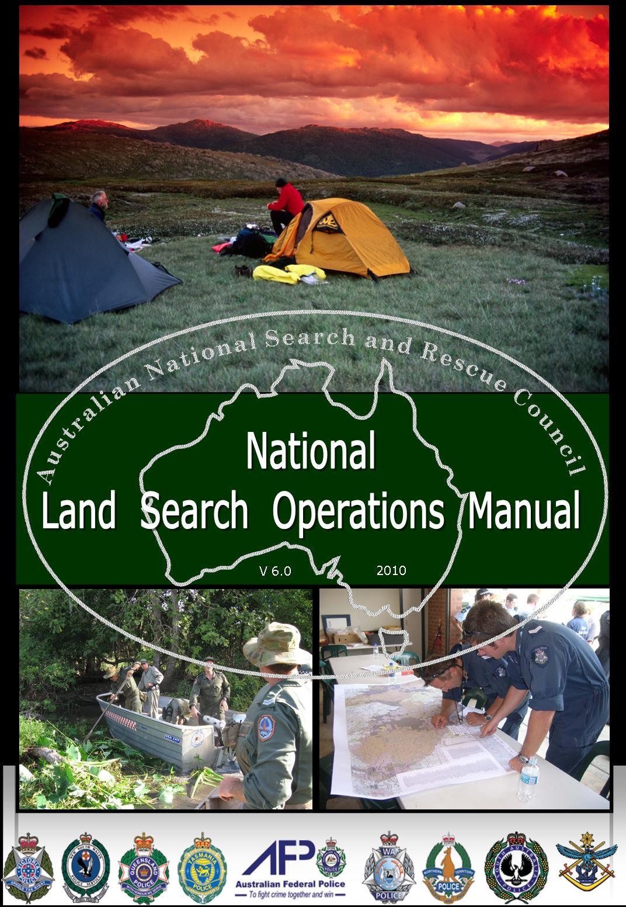

---
## Page 2

National Land Search Operations Manual 
Version Feb 2017 
2
TABLE OF CONTENTS 
 
 
CHAPTER ONE - SEARCH AND RESCUE SYSTEM ................................................................. 16 
PART A - ORGANISATION AND COORDINATION – THE NATIONAL SAR PLAN ............................... 16 
1.01. 
AIM:......................................................................................................................................... 16 
1.02. 
GLOBAL SAR ORGANISATION AND ARRANGEMENTS ............................................................ 16 
1.06. 
NATIONAL AND REGIONAL SAR SYSTEM ORGANISATION ..................................................... 16 
1.10. 
AUSTRALIAN MARITIME SAFETY AUTHORITY (AMSA) ........................................................ 16 
1.17. 
AUSTRALIAN DEFENCE FORCE – MILITARY SAR:.................................................................. 18 
1.20. 
NAVY....................................................................................................................................... 18 
1.21. 
ARMY ...................................................................................................................................... 18 
1.22. 
AIR FORCE ............................................................................................................................... 18 
1.23. 
COMMANDER NORTHERN COMMAND (COMNORCOM) ....................................................... 18 
1.24. 
AIR SERVICES AUSTRALIA ...................................................................................................... 18 
1.28. 
OTHER COMMONWEALTH AGENCIES/AUTHORITIES .............................................................. 19 
1.29. 
BUREAU OF METEOROLOGY ................................................................................................... 19 
1.30. 
EMERGENCY MANAGEMENT AUSTRALIA (EMA) ................................................................... 19 
1.32. 
MARITIME BORDER COMMAND .............................................................................................. 19 
1.34. 
AUSTRALIAN COMMUNICATIONS AND MEDIA AUTHORITY ................................................... 19 
1.35. 
AUSTRALIAN TRANSPORT SAFETY BUREAU (ATSB) ............................................................. 19 
1.36. 
CIVIL AVIATION SAFETY AUTHORITY (CASA) ...................................................................... 19 
1.38. 
VOLUNTEER ORGANISATIONS ................................................................................................. 19 
1.39. 
COMMERCIAL AND PRIVATE ORGANISATIONS ....................................................................... 19 
1.44. 
SAR COORDINATION – OVERVIEW ......................................................................................... 20 
1.47. 
DETERMINATION OF SAR AUTHORITY RESPONSIBLE FOR OVERALL COORDINATION ........... 20 
1.49. 
INITIAL RESPONSE ................................................................................................................... 20 
1.50. 
SAR AUTHORITY BEST PLACED TO COORDINATE ................................................................... 20 
1.55. 
EFFECTIVE CONSULTATION AND COORDINATION ................................................................... 21 
1.57. 
COORDINATION OF POLICE LAND SEARCH ............................................................................. 21 
1.58. 
COOPERATION WITH FOREIGN COORDINATION CENTRES ...................................................... 21 
1.63. 
PROVISION FOR ENTRY OF FOREIGN AIRCRAFT DURING SAR OPERATIONS ........................... 21 
1.64. 
REQUESTS FOR ASSISTANCE FROM FOREIGN RCC’S .............................................................. 22 
1.65. 
ALERTING POST: ..................................................................................................................... 22 
1.66. 
TRANSFER OF COORDINATION – REASONS FOR TRANSFER OF COORDINATION ...................... 22 
1.72. 
TRANSFERRING OVERALL COORDINATION: ........................................................................... 22 
1.77. 
ACCEPTING COORDINATION FOR A COMPONENT OF THE SAR EVENT FROM ANOTHER SAR 
AUTHORITY: .......................................................................................................................................... 23 
1.78. 
GUIDANCE IN SUPPORT OF TRANSFERRING COORDINATION OF A COMPONENT OF A SAR 
OPERATION ............................................................................................................................................ 23 
1.80. 
TRANSFER OF COORDINATION AFTER SUSPENSION OF SAR ACTION ...................................... 24 
1.87. 
AMSA ASSISTANCE TO OTHER SAR AUTHORITIES ............................................................... 24 
1.88. 
PROVISION OF SUBJECT MATTER EXPERTISE AND ADVICE .................................................... 24

---
## Page 3

National Land Search Operations Manual 
Version Feb 2017 
3
1.89. 
AVIATION CAPABILITY: .......................................................................................................... 25 
1.94. 
RESPONSIBILITIES AS AIR SEARCH COORDINATOR ................................................................ 25 
1.97. 
CIVIL REQUESTS FOR MILITARY ASSISTANCE - LOCALISED EMERGENCY ASSISTANCE TO 
SAVE LIFE ............................................................................................................................................. 26 
1.99. 
ALL OTHER REQUESTS FOR DEFENCE ASSISTANCE ............................................................... 26 
1.102. MILITARY REQUESTS FOR CIVIL ASSISTANCE ........................................................................ 26 
PART B - MANAGEMENT AND SUPPORT - SAR MANAGEMENT ........................................................ 26 
1.104. OVERVIEW ............................................................................................................................... 26 
1.107. SAR AUTHORITY .................................................................................................................... 26 
1.109. JRCC STAFF ............................................................................................................................ 27 
1.111. SEARCH HEADQUARTERS (SH) ............................................................................................... 27 
1.114. INITIAL ACTIONS ..................................................................................................................... 28 
1.115. FIELD SEARCH HEADQUARTERS (FSH) .................................................................................. 28 
1.116. ASSEMBLY AREA .................................................................................................................... 28 
1.117. BRIEFING AREA ....................................................................................................................... 28 
1.118. STAGING AREA ........................................................................................................................ 28 
1.120. SUPPORT BASE ........................................................................................................................ 29 
1.121. OPERATIONS—STAFF AND DUTIES ......................................................................................... 29 
1.122. SEARCH HEADQUARTERS – LOCATION AND COMMAND ........................................................ 29 
1.123. COMMANDERS RESPONSIBILITIES ........................................................................................... 29 
1.125. SAR OFFICER .......................................................................................................................... 30 
1.126. SARO QUALIFICATIONS ......................................................................................................... 30 
1.128. SAR MISSION COORDINATOR ................................................................................................. 30 
1.129. SMC RESPONSIBILITY: ............................................................................................................ 30 
1.132. ASSISTANT SAR MISSION COORDINATOR (A/SMC) .............................................................. 31 
1.133. A/SMC QUALIFICATIONS: ...................................................................................................... 32 
1.134. A/SMC AUTHORITY ................................................................................................................ 32 
1.135. A/SMC RESPONSIBILITIES AND DUTIES ................................................................................. 32 
1.136. ALLOCATOR ............................................................................................................................ 32 
1.137. RECORDER ............................................................................................................................... 32 
1.138. BRIEFING OFFICER .................................................................................................................. 32 
1.139. INTELLIGENCE OFFICER .......................................................................................................... 32 
1.140. RESCUE PLANNER ................................................................................................................... 32 
1.141. LIAISON OFFICER .................................................................................................................... 32 
1.142. ON SCENE COORDINATOR ....................................................................................................... 32 
1.143. ADF LIAISON OFFICER ........................................................................................................... 33 
1.145. SEARCH TEAM LEADERS ......................................................................................................... 33 
1.146. DELEGATION ........................................................................................................................... 34 
1.147. SUPPORT BASE ........................................................................................................................ 34 
1.149. SUPPORT BASE SUPERVISOR ................................................................................................... 34 
1.152. INFORMATION ......................................................................................................................... 34 
1.153. INFORMATION CLASSIFICATION .............................................................................................. 34 
1.157. SEARCH AND RESCUE RESOURCES:- OVERVIEW .................................................................... 36 
1.163. PERSONNEL ............................................................................................................................. 36 
1.167. DROPMASTERS, DISPATCHERS AND OBSERVERS .................................................................... 36 
1.175. RESCUE PREPARATION ............................................................................................................ 37 
1.176. PUBLIC RELATIONS ................................................................................................................. 37 
1.178. OPERATIONS INVOLVING TWO OR MORE SAR AUTHORITIES ................................................. 37

---
## Page 4

National Land Search Operations Manual 
Version Feb 2017 
4
1.180. PUBLIC RELATIONS OFFICERS OR MEDIA OFFICERS (PRO/MO’S) ......................................... 38 
1.182. PRESS RELEASES ..................................................................................................................... 38 
1.189. REQUESTING PUBLIC ASSISTANCE .......................................................................................... 39 
1.190. LIAISON WITH RELATIVES ....................................................................................................... 39 
1.191. NOTIFICATION OF NEXT OF KIN ............................................................................................. 39 
1.196. CASUALTIES ............................................................................................................................ 40 
CHAPTER TWO - COMMUNICATIONS ...................................................................................... 41 
2.01. 
SEARCH COMMUNICATIONS AND RADIO EMPLOYMENT ........................................................ 41 
2.02. 
COMMUNICATIONS .................................................................................................................. 41 
2.03. 
COMMUNICATIONS OFFICER ................................................................................................... 41 
2.05. 
COMMUNICATIONS REQUIREMENTS ....................................................................................... 41 
2.06. 
HEADQUARTERS REQUIREMENTS ........................................................................................... 41 
2.07. 
TELEPHONE/RADIO ................................................................................................................. 41 
2.08. 
REAR NET ................................................................................................................................ 41 
2.10. 
FORWARD NET ........................................................................................................................ 42 
2.14. 
FREQUENCIES .......................................................................................................................... 42 
2.15. 
RADIOS IN GENERAL ............................................................................................................... 42 
2.18. 
GROUND TO AIR COMMUNICATIONS ...................................................................................... 43 
2.20. 
PROCEDURES AND PRACTICES ................................................................................................ 43 
2.21. 
OTHER METHODS OF COMMUNICATIONS ................................................................................ 43 
2.23. 
SUMMARY ............................................................................................................................... 43 
CHAPTER THREE – AWARENESS AND INITIAL ACTION ................................................... 44 
3.01. 
AWARENESS AND NOTIFICATION ............................................................................................ 44 
3.03. 
GENERAL CONSIDERATIONS FOR THE SMC ............................................................................ 44 
3.05. 
SAR STAGES ........................................................................................................................... 44 
3.07. 
LAND SAR STAGES EXPLAINED .............................................................................................. 45 
3.08. 
LAND SAR INCIDENT .............................................................................................................. 45 
3.09. 
EMERGENCY PHASES .............................................................................................................. 45 
3.11. 
UNCERTAINTY PHASE ............................................................................................................. 45 
3.14. 
ALERT PHASE .......................................................................................................................... 46 
3.16. 
DISTRESS PHASE ..................................................................................................................... 46 
3.18. 
ORGANISATION ....................................................................................................................... 46 
3.19. 
RESPONSIBILITY ...................................................................................................................... 46 
3.25. 
EVALUATION OF REPORTS ...................................................................................................... 47 
3.28. 
SAR INCIDENT INFORMATION ................................................................................................ 47 
3.29. 
INFORMATION GATHERING ..................................................................................................... 47 
3.33. 
THE INFORMATION STAGES .................................................................................................... 47 
3.34. 
INFORMATION GATHERING ASPECTS ....................................................................................... 48 
3.35. 
TYPE OF INFORMATION ........................................................................................................... 48 
3.36. 
AVAILABILITY AND ACCESS OF INFORMATION ....................................................................... 49 
3.37. 
SOURCES OF INFORMATION..................................................................................................... 49 
3.38. 
EVALUATING INFORMATION ................................................................................................... 50 
3.41. 
SEARCH INFORMATION PHASES .............................................................................................. 50

---
## Page 5

National Land Search Operations Manual 
Version Feb 2017 
5
3.42. 
EXTENDED SEARCHES ............................................................................................................. 51 
3.43. 
NOTIFICATION TO STATES OF FOREIGN PERSONS IN DISTRESS .............................................. 51 
3.44. 
RECORDING OF EVENTS .......................................................................................................... 51 
3.52. 
URGENCY OF RESPONSE .......................................................................................................... 52 
3.59. 
GENERAL TIME FACTORS ........................................................................................................ 52 
3.61. 
DAYLIGHT FACTOR ................................................................................................................. 52 
3.62. 
NIGHT FACTOR ........................................................................................................................ 52 
3.64. 
WEATHER FACTORS ................................................................................................................ 53 
3.69. 
WEATHER REPORTS BY SURVIVORS ....................................................................................... 53 
3.71. 
URBAN ENVIRONMENT ........................................................................................................... 53 
3.72. 
URBAN SEARCH STRATEGIES .................................................................................................. 54 
3.73. 
URBAN SEARCH - MAJOR COMPLEX ....................................................................................... 54 
3.74. 
URBAN SEARCH AREA SEGMENTATION ................................................................................. 54 
3.75. 
URBAN ENVIRONMENT - RECONNAISSANCE SEARCH ............................................................ 54 
3.76. 
URBAN ENVIRONMENT -GENERAL SEARCH ........................................................................... 54 
3.77. 
URBAN ENVIRONMENT - BUILDING/CONTACT SEARCH ......................................................... 54 
3.79. 
URBAN ENVIRONMENT, CONCLUSION .................................................................................... 54 
3.80. 
FORENSIC SEARCH .................................................................................................................. 55 
3.81. 
CAVES AND MINES .................................................................................................................. 55 
3.82. 
AVAILABLE SEARCH ASSET FACTORS .................................................................................... 55 
3.87. 
SURVIVAL EQUIPMENT FACTORS ............................................................................................ 55 
3.89. 
RISKS V GAIN FACTORS .......................................................................................................... 55 
3.93. 
RESOURCES ............................................................................................................................. 56 
3.95. 
HUMAN RESOURCES ............................................................................................................... 56 
3.97. 
HUMAN TRACKERS ................................................................................................................. 56 
3.100. PHYSICAL RESOURCES ............................................................................................................ 57 
3.101. AIRCRAFT ................................................................................................................................ 57 
3.102. FIXED WING AIRCRAFT ........................................................................................................... 57 
3.103. ROTARY WING AIRCRAFT ....................................................................................................... 57 
3.104. HELICOPTERS, ADVANTAGES .................................................................................................. 57 
3.105. HELICOPTER, DISADVANTAGES .............................................................................................. 57 
3.106. AIRCRAFT SAFETY .................................................................................................................. 58 
3.108. HELICOPTER LOADING ............................................................................................................ 59 
3.112. HELICOPTER LANDING ZONES ................................................................................................ 59 
3.116. ALLOCATION OF AERIAL SEARCH AREAS ............................................................................... 60 
3.118. ALL TERRAIN VEHICLES ......................................................................................................... 61 
3.122. MOTOR CYCLES ...................................................................................................................... 61 
3.123. METHOD OF OPERATION ......................................................................................................... 61 
3.124. LIMITATIONS ........................................................................................................................... 61 
3.125. SEARCHING ON MOTOR BIKES ................................................................................................ 62 
3.129. TRACKING CONDITIONS .......................................................................................................... 62 
3.132. FACTORS AFFECTING A SUCCESSFUL DOG SEARCH ................................................................. 62 
3.133. FACTORS AFFECTING AN UNSUCCESSFUL DOG SEARCH .......................................................... 63 
3.134. HORSES ................................................................................................................................... 63 
3.138. HORSES: ADVANTAGES ........................................................................................................... 63 
3.139. HORSES, DISADVANTAGES ...................................................................................................... 63 
3.140. DAMS, BILLABONGS AND STILL WATER SEARCHING ............................................................... 64 
3.142. FLOWING WATER ..................................................................................................................... 64

---
## Page 6

National Land Search Operations Manual 
Version Feb 2017 
6
3.144. BOATS ..................................................................................................................................... 64 
3.145. DIVERS .................................................................................................................................... 64 
3.146. DIVERS, ADVANTAGES ............................................................................................................ 64 
3.147. DIVERS, DISADVANTAGES ...................................................................................................... 64 
3.148. VOLUNTEERS ........................................................................................................................... 65 
CHAPTER FOUR - SEARCH PLANNING AND ASSESSMENT ............................................... 66 
4.04. 
CONDUCTING AN APPRECIATION ............................................................................................ 66 
4.05. 
DEFINITION ............................................................................................................................. 66 
4.06. 
SEQUENCE ............................................................................................................................... 66 
4.07. 
PHASES .................................................................................................................................... 66 
4.08. 
AIM .......................................................................................................................................... 66 
4.09. 
LIMITATIONS ........................................................................................................................... 66 
4.10. 
WRITTEN STATEMENT............................................................................................................. 67 
4.11. 
FACTORS ................................................................................................................................. 67 
4.12. 
EXAMINATION ......................................................................................................................... 67 
4.13. 
EXAMPLE ................................................................................................................................. 67 
4.15. 
COURSES OPEN ....................................................................................................................... 67 
4.17. 
PLAN ........................................................................................................................................ 68 
4.19. 
PLANNING PRINCIPLES ............................................................................................................ 68 
4.20. 
KEEP IT SIMPLE ....................................................................................................................... 68 
4.21. 
RELATE TO THE AIM................................................................................................................ 68 
4.22. 
LOGICAL DEDUCTIONS ............................................................................................................ 68 
4.24. 
SEARCH PLANNING ................................................................................................................. 68 
4.28. 
SCENARIO-BASED ASSESSMENT .............................................................................................. 69 
4.30 
SPECIFY ITEM SOUGHT ............................................................................................................ 69 
4.31. 
CONFIRM LAST LOCATION ....................................................................................................... 69 
4.32. 
ESTABLISH CIRCUMSTANCES OF DISAPPEARANCE .................................................................. 69 
4.33. 
NOTE FACTORS INFLUENCING DISCOVERY .............................................................................. 69 
4.34. 
ANALYSE POSSIBLE STRATEGIES............................................................................................. 69 
4.35. 
RAISE SEARCH STRATEGIES..................................................................................................... 69 
4.36. 
IDENTIFY PRIORITY SEARCH .................................................................................................... 69 
4.37. 
ONGOING REASSESSMENT ....................................................................................................... 70 
4.41. 
SEARCH URGENCY .................................................................................................................. 70 
4.43. 
TERRAIN FACTORS .................................................................................................................. 70 
4.47. 
RAINFOREST ENVIRONMENT ................................................................................................... 71 
4.50. 
RAINFOREST CONSIDERATIONS .............................................................................................. 71 
4.51. 
RAINFOREST BEHAVIOURAL CHARACTERISTICS..................................................................... 73 
4.52. 
RAINFOREST RESOURCES CONSIDERATIONS ........................................................................... 73 
4.53. 
ALPINE ENVIRONMENT ............................................................................................................ 73 
4.57. 
ALPINE CONSIDERATIONS ....................................................................................................... 74 
4.58. 
ALPINE BEHAVIOURAL CHARACTERISTICS ............................................................................. 74 
4.60. 
ALPINE RESOURCES CONSIDERATIONS ................................................................................... 75 
4.61. 
ARID ENVIRONMENT ............................................................................................................... 75 
4.63. 
ARID ENVIRONMENT CONSIDERATIONS ................................................................................. 75 
4.68. 
ARID ENVIRONMENT BEHAVIOURAL CHARACTERISTICS ....................................................... 76

---
## Page 7

National Land Search Operations Manual 
Version Feb 2017 
7
4.69. 
ARID ENVIRONMENT RESOURCE CONSIDERATIONS ............................................................... 76 
4.70. 
MOUNTAIN ENVIRONMENT ..................................................................................................... 76 
4.71. 
MOUNTAIN CONSIDERATIONS: ACCESS .................................................................................. 77 
4.72. 
COMMUNICATIONS .................................................................................................................. 77 
4.73. 
CONTAINMENT ........................................................................................................................ 77 
4.74. 
TFFS ....................................................................................................................................... 77 
4.75. 
LPB ......................................................................................................................................... 77 
4.76. 
VERTICAL RESCUE .................................................................................................................. 77 
4.77. 
TRAINING ................................................................................................................................ 78 
4.78. 
MOUNTAIN ENVIRONMENT SEARCH STRATEGIES .................................................................. 78 
4.84. 
DANGEROUS ANIMALS ............................................................................................................ 78 
4.85. 
SALTWATER CROCODILES ....................................................................................................... 78 
4.87. 
SNAKES ................................................................................................................................... 79 
4.90. 
SPIDERS ................................................................................................................................... 79 
4.91. 
SCORPIONS, CENTIPEDES AND MILLIPEDES ............................................................................ 79 
4.92. 
TELEPHONE TRIANGULATION ................................................................................................. 79 
4.93. 
ESTIMATING THE MISSING PERSON LOCATION ...................................................................... 80 
4.94. 
THEORETICAL .......................................................................................................................... 81 
4.95. 
NAISMITH’S RULE ................................................................................................................... 82 
4.97. 
STATISTICAL METHOD: LOST PERSON BEHAVIOUR ............................................................... 82 
4.98. 
GENERAL CATEGORIES OF LOST PERSONS .............................................................................. 83 
4.101. SPECIFIC FACTORS OF LPB THAT MAY AFFECT SEARCH PLANNING:  STATE OF HEALTH ....... 83 
4.102. PAST EXPERIENCES ................................................................................................................. 83 
4.103. PHYSIOLOGICAL EFFECTS OF THE ENVIRONMENT ................................................................... 83 
4.105. BIOLOGICAL CYCLES .............................................................................................................. 84 
4.106. BEHAVIOUR WHILE LOST: ....................................................................................................... 84 
4.116. SUBJECTIVE METHOD ............................................................................................................. 86 
4.115. DEDUCTIVE METHOD .............................................................................................................. 88 
4.128. SEARCH AREA SEGMENTATION .............................................................................................. 95 
4.132. SPECIAL SEARCHES – ABDUCTIONS/HOMICIDES .................................................................... 95 
4.133. REPORTING OF MISSING CHILDREN ........................................................................................ 96 
4.134. GUIDELINES ............................................................................................................................. 96 
4.135. DISTANCE RELATIONSHIPS ...................................................................................................... 96 
4.136. WHERE TO LOOK ..................................................................................................................... 97 
4.137. MASS CASUALTY SAR INCIDENTS: CAUSAL FACTORS .......................................................... 97 
4.138. USAR ...................................................................................................................................... 98 
4.139. COORDINATION ....................................................................................................................... 99 
4.140. INITIAL ACTIONS ..................................................................................................................... 99 
4.141. WORKING UNDER OR WITHIN A MIR ...................................................................................... 99 
4.142. MIR LIAISON OFFICER .......................................................................................................... 100 
4.143. FIELD SEARCH HEADQUARTERS ........................................................................................... 100 
4.144. SEARCH STRATEGIES ............................................................................................................. 101 
4.145. SEARCH PROBLEMS ............................................................................................................... 102 
4.146. SEARCH AREA DELINEATION ................................................................................................. 102 
4.147. TASKING SHEETS ................................................................................................................... 105 
4.148. BRIEFINGS ............................................................................................................................. 105 
4.149. RECORD KEEPING ................................................................................................................. 106 
4.150. ELECTRONIC RECORDING OF SEARCH ................................................................................... 106

---
## Page 8

National Land Search Operations Manual 
Version Feb 2017 
8
4.151. SUMMARY ............................................................................................................................. 107 
CHAPTER FIVE - SEARCH TECHNIQUES AND OPERATIONS (LAND) ........................... 108 
5.05. 
LAND ASSETS ........................................................................................................................ 108 
5.11. 
MARINE ASSETS .................................................................................................................... 109 
5.16. 
AIR ASSETS ........................................................................................................................... 109 
5.34. 
SEARCH PLANNING ............................................................................................................... 111 
5.37. 
LAND SAR STRATEGIES ........................................................................................................ 111 
5.43. 
IMMEDIATE RESPONSE .......................................................................................................... 112 
5.46. 
FAST SEARCH ........................................................................................................................ 112 
5.47. 
FAST SEARCH TECHNIQUES ................................................................................................... 112 
5.48. 
FAST SEARCH CONSIDERATIONS ........................................................................................... 113 
5.49. 
RECONNAISSANCE SEARCH ................................................................................................... 113 
5.50. 
RECONNAISSANCE SEARCH, CONTAINMENT ........................................................................ 113 
5.51. 
COMPOSITION OF RECONNAISSANCE TEAMS ......................................................................... 113 
5.52. 
TASK OF RECONNAISSANCE TEAMS ...................................................................................... 113 
5.54. 
RECONNAISSANCE TEAM BRIEFING ...................................................................................... 113 
5.55. 
GENERAL SEARCH ................................................................................................................. 113 
5.56. 
COMPOSITION OF TEAMS FOR GENERAL SEARCH .................................................................. 113 
5.57. 
GENERAL SEARCH METHOD ................................................................................................. 113 
5.60. 
CONTACT SEARCH................................................................................................................. 114 
5.61. 
COMPOSITION OF CONTACT SEARCH TEAMS ........................................................................ 114 
5.62. 
TASKS OF CONTACT SEARCH TEAMS .................................................................................... 114 
5.63. 
CONTACT SEARCH, SPECIAL CONSIDERATIONS ................................................................... 114 
5.67. 
CALCULATED SEARCH AREA ................................................................................................ 114 
5.69. 
SEARCH AREA COVERAGE .................................................................................................... 115 
5.73. 
TARGET TYPE ........................................................................................................................ 115 
5.74. 
METEOROLOGICAL VISIBILITY ............................................................................................. 115 
5.75. 
TYPE OF TERRAIN/ CONDITIONS ............................................................................................ 116 
5.77. 
SEARCH SPEED ...................................................................................................................... 116 
5.80. 
CLOUD COVER AND SUN LIGHT ............................................................................................. 116 
5.82. 
FIRST AND LAST SEARCH LIGHT ............................................................................................ 116 
5.89. 
VISUAL HORIZON .................................................................................................................. 117 
5.91. 
AREA SWEPT ......................................................................................................................... 118 
5.93. 
ACCURACY OF NAVIGATION BY SEARCH TEAMS .................................................................. 119 
5.94. 
NIGHT SEARCHING ................................................................................................................ 119 
5.96. 
SEARCH PATTERNS................................................................................................................ 120 
5.97. 
SAFETY OF THE SEARCH UNITS ............................................................................................. 120 
5.104. SEARCH PATTERNS................................................................................................................ 121 
5.109. GLOBAL POSITIONING SYSTEMS (GPS) ................................................................................ 121 
5.110. COMMON SEARCH PATTERNS ............................................................................................... 122 
5.111. INDIAN FILE........................................................................................................................... 122 
5.113.     POINT AND FLANK ................................................................................................................ 123 
5.114.     BARRIER ................................................................................................................................ 124 
5.116.     PURPOSEFUL MEANDERING .................................................................................................. 124 
5.117.     SQUARE ................................................................................................................................. 125

---
## Page 9

National Land Search Operations Manual 
Version Feb 2017 
9
5.118.     PARALLEL SWEEP (SINGLE TEAM ......................................................................................... 126 
5.120      CREEPING LINE AHEAD ......................................................................................................... 128 
5.121.     CONTOUR .............................................................................................................................. 129 
5.122.     EXPANDING SQUARE ............................................................................................................. 129 
5.123.  VEHICLE SEARCH PATTERNS ................................................................................................ 130 
5.124. VISIBILITY ............................................................................................................................. 130 
5.126. URBAN SEARCH PATTERNS ................................................................................................... 131 
5.131. SEARCH PATTERN CONCLUSION ........................................................................................... 133 
5.135. CLUE RECOGNITION AND INTERPRETATION .......................................................................... 133 
5.136. GENERAL PRINCIPLES ........................................................................................................... 133 
5.138. SUBJECT OR CLUE GENERATOR ............................................................................................ 134 
5.139. CLUES TO BE SOUGHT ........................................................................................................... 134 
5.140. CATEGORIES OF CLUES ......................................................................................................... 134 
5.141. SEARCH AREA ....................................................................................................................... 134 
5.137. SEARCHERS OR CLUE SEEKERS ............................................................................................. 134 
5.138. PROBABILITY OF DETECTION ................................................................................................ 134 
5.139. TIME SEQUENCE .................................................................................................................... 134 
5.140. CALCULATION OF SEARCH TIME........................................................................................... 134 
5.143. INVESTIGATION TIME ............................................................................................................ 135 
5.147. BRIEFINGS ............................................................................................................................. 135 
5.149. PREPARATION ........................................................................................................................ 135 
5.150. PRESENTATION ...................................................................................................................... 135 
5.151. VENUE ................................................................................................................................... 135 
5.152. LIGHTING .............................................................................................................................. 135 
5.153. WEATHER PROTECTION ........................................................................................................ 135 
5.154. BRIEFING AIDS ...................................................................................................................... 135 
5.155. CONDUCT .............................................................................................................................. 136 
5.156. SEQUENCE ............................................................................................................................. 136 
5.157. ORDERS ................................................................................................................................. 136 
5.158. ORDERS MUST ....................................................................................................................... 136 
5.159. LAYOUT OF ORDERS ............................................................................................................. 137 
5.160. SITUATION (WHAT HAS HAPPENED ....................................................................................... 137 
5.161. MISSION (WHAT THE TASK IS ................................................................................................ 137 
5.162. EXECUTION (HOW THE TASK IS TO BE ACCOMPLISHED) ....................................................... 137 
5.163. ADMINISTRATION AND LOGISTICS ........................................................................................ 138 
5.164. COMMAND AND COMMUNICATIONS ..................................................................................... 138 
5.165. ISSUING ORDERS .................................................................................................................... 139 
5.166. SYNCHRONISATION OF WATCHES.......................................................................................... 139 
5.167. QUESTIONS FROM THE TEAMS ............................................................................................... 139 
5.168. QUESTIONS TO THE TEAMS .................................................................................................... 139 
5.169. CODE WORD .......................................................................................................................... 139 
5.170. ACTION ON LOCATING THE MISSING PERSON(S) ................................................................... 139 
5.173. MATTSON CONSENSUS .......................................................................................................... 140

---
## Page 10

National Land Search Operations Manual 
Version Feb 2017 
10
CHAPTER SIX – RESCUE PLANNING AND OPERATIONS .................................................. 142 
6.07. 
PREPARATION ........................................................................................................................ 142 
6.09. 
MEDICAL ASSISTANCE .......................................................................................................... 142 
6.10. 
FIRST AID .............................................................................................................................. 142 
6.11. 
LAND RESCUE FOR MISSING PERSONS, CRASHED AIRCRAFT OR VEHICLES ........................... 142 
6.25. 
ACCIDENTS AND INJURIES TO RESCUE PERSONNEL ............................................................... 144 
6.26. 
AVOIDANCE OF DANGER ....................................................................................................... 144 
6.31. 
HEALTH HAZARDS - AIRCRAFT ACCIDENTS........................................................................... 144 
6.37. 
USE OF AIRCRAFT FOR RESCUE ............................................................................................. 145 
6.39. 
USE OF HELICOPTERS FOR RESCUE ........................................................................................ 145 
6.47. 
USE OF TOP COVER AIRCRAFT WITH RESCUE AND MEDEVAC HELICOPTERS ..................... 146 
6.51. 
SUPPLY DROPPING AND DELIVERY OF SURVIVAL EQUIPMENT .............................................. 146 
6.53. 
CIVIL SAR EQUIPMENT ......................................................................................................... 146 
6.58. 
SUPPLY DROP FROM AIRCRAFT OVER LAND .......................................................................... 147 
6.59. 
TRAINING SAFETY ................................................................................................................. 147 
CHAPTER SEVEN – CONCLUSION OF SAR OPERATIONS ................................................. 148 
7.01. 
GENERAL ............................................................................................................................... 148 
7.04. 
CONCLUSION OF A SUCCESSFUL SAR ACTION ...................................................................... 148 
7.05. 
SUSPENSION OF A SEARCH WHEN THE TARGET IS NOT FOUND .............................................. 148 
7.15 
REOPENING A SUSPENDED SEARCH ....................................................................................... 149 
7.16. 
RECORDS AND REPORTS ........................................................................................................ 150 
7.19. 
INCIDENT DEBRIEFS ............................................................................................................... 150 
7.28. 
CONDUCTING THE DEBRIEF .................................................................................................. 151 
7.32. 
CASE STUDIES ....................................................................................................................... 151 
7.35. 
PERFORMANCE IMPROVEMENT ............................................................................................. 152 
CHAPTER EIGHT – TRAINING & EXERCISES ....................................................................... 153 
8.01. 
GENERAL ............................................................................................................................... 153 
8.02. 
PROFESSIONALISM ................................................................................................................ 153 
8.04. 
WHO TO TRAIN ...................................................................................................................... 153 
8.05. 
REQUIREMENT FOR TRAINING ............................................................................................... 153 
8.08. 
PUBLIC SAFETY TRAINING PACKAGE ................................................................................... 153 
8.10 
NATIONAL SEARCH AND RESCUE SCHOOL ........................................................................... 153 
8.14. 
STATE/TERRITORY SAR AUTHORITY TRAINING .................................................................. 154 
8.18. 
SEARCH AND RESCUE EXERCISES ......................................................................................... 154 
8.23. 
TRAINING OF SAR UNITS ...................................................................................................... 155 
8.25. 
FIRST AID TRAINING ............................................................................................................. 155 
8.26. 
DROPMASTER AND DISPATCHERS ......................................................................................... 155 
8.29. 
AIR OBSERVER TRAINING ..................................................................................................... 155 
8.30. 
TEAM SKILLS......................................................................................................................... 155 
8.31. 
INDIVIDUAL SKILLS ............................................................................................................... 155 
8.32. 
MAP READING & NAVIGATION ............................................................................................. 155

---
## Page 11

National Land Search Operations Manual 
Version Feb 2017 
11
8.33. 
RADIO OPERATING PROCEDURES ......................................................................................... 155 
8.34. 
FIRST AID .............................................................................................................................. 155 
8.35. 
FIELDCRAFT .......................................................................................................................... 156 
8.36. 
OBSERVATION ....................................................................................................................... 156 
8.37. 
OBSERVATION SKILLS-DAY .................................................................................................. 156 
8.38. 
OBSERVATION SKILLS – NIGHT ............................................................................................ 156 
8.39. 
SEARCH TECHNIQUES ........................................................................................................... 157 
8.40. 
TEAM SKILLS......................................................................................................................... 157 
8.41. 
SEARCHERS ........................................................................................................................... 157 
8.42. 
SEARCH TEAM LEADERS ....................................................................................................... 157 
8.43. 
DESIRABLE QUALITIES .......................................................................................................... 157 
8.45. 
SKILLS ................................................................................................................................... 158 
CHAPTER NINE - MEDICAL FACTORS ................................................................................... 159 
9.1. 
TIME FRAME FOR SURVIVAL (TFFS) .................................................................................... 159 
9.2. 
SURVIVOR STRESS FACTORS ................................................................................................. 159 
9.8. 
SURVIVAL ENVIRONMENT FACTORS..................................................................................... 159 
9.12. 
HYPOTHERMIA ...................................................................................................................... 160 
9.14. 
WATER HYPOTHERMIA ......................................................................................................... 160 
9.22. 
WIND HYPOTHERMIA ............................................................................................................ 161 
9.28. 
WIND CHILL .......................................................................................................................... 161 
9.30. 
HYPOTHERMIA ...................................................................................................................... 162 
9.31. 
HYPOTHERMIA SURVIVABILITY ............................................................................................ 162 
9.32. 
WET-CHILL SURVIVABILITY ................................................................................................. 163 
9.33. 
WATER IMMERSION .............................................................................................................. 163 
9.34. 
EFFECTS OF ALCOHOL........................................................................................................... 163 
9.35. 
HYPERTHERMIA, HEAT STRESS AND DEHYDRATION ............................................................ 163 
9.38. 
HEAT EXHAUSTION ............................................................................................................... 164 
9.39. 
HEAT STROKE ........................................................................................................................ 164 
9.42. 
HYPERTHERMIA .................................................................................................................... 165 
9.43. 
DEHYDRATION ...................................................................................................................... 166 
9.44. 
PERIOD OF MOBILITY (POM) ................................................................................................ 166 
9.45. 
SEARCH AREA TIME SCALE .................................................................................................. 167 
9.46. 
EXAMPLE ............................................................................................................................... 167 
APPENDIX A: AUSTRALIAN STATES AND LAND SEARCH AREAS ................................. 168 
APPENDIX B: NATIONAL SEARCH AND RESCUE (SAR) RESPONSIBILITIES AND 
FUNCTIONS ..................................................................................................................................... 169 
APPENDIX C: INTER-GOVERNMENTAL AGREEMENT (IGA) ON NATIONAL SEARCH 
AND RESCUE RESPONSE ARRANGEMENTS ......................................................................... 170 
APPENDIX D: INFORMATION EXCHANGE REQUIREMENTS – TRANSFER OF 
COORDINATION ............................................................................................................................ 181

---
## Page 12

National Land Search Operations Manual 
Version Feb 2017 
12
APPENDIX E: SEARCH URGENCY ASSESSMENT ................................................................. 184 
APPENDIX F: MISSING PERSON QUESTIONNAIRE ............................................................. 185 
MISSING PERSON QUESTIONNAIRE .................................................................................................. 185 
APPENDIX G: OBJECT QUESTIONNAIRE ............................................................................... 186 
OBJECT QUESTIONNAIRE .................................................................................................................. 186 
APPENDIX H: LAND SAR CHECKLIST .................................................................................... 187 
LAND SAR CHECKLIST ..................................................................................................................... 187 
APPENDIX I: LOST PERSON BEHAVIOUR .............................................................................. 191 
APPENDIX J: LAND SEARCH PLANNING TABLES ............................................................... 205 
SEARCH AREA QUICK REFERENCE .................................................................................................. 205 
AIR SEARCH PLANNING TABLE ........................................................................................................ 206 
APPENDIX K: ADDITIONS TO NAISMITH’S RULE ........................................................................... 207 
APPENDIX L: PROBABILITY OF DETECTION (LAND) ........................................................ 208 
CAVEAT 208 
AREA OF SEARCH ................................................................................................................................ 208 
COVERAGE FACTOR (C) ...................................................................................................................... 208 
PROBABILITY OF DETECTION (POD) .................................................................................................. 209 
CUMULATIVE POD FOR LAND SEARCH ........................................................................................... 212 
APPENDIX M: MATTSON CONSENSUS .................................................................................... 213 
APPENDIX N: LAND SEARCH ORGANISATION CHART ..................................................... 214 
APPENDIX O: HEADQUARTERS LAYOUT .............................................................................. 215 
APPENDIX P: SEARCH COMMUNICATIONS NET ................................................................ 216 
APPENDIX Q .................................................................................................................................... 217 
CLUE RECOGNITION .......................................................................................................................... 217 
GENERAL PRINCIPLES ....................................................................................................................... 217

---
## Page 13

National Land Search Operations Manual 
Version Feb 2017 
13
TRACKING SKILLS ............................................................................................................................. 217 
TRAIL SIGNS ....................................................................................................................................... 217 
SIGHT .................................................................................................................................................. 218 
APPENDIX R: TASK SHEET......................................................................................................... 219 
APPENDIX S: WHITEBOARDS .................................................................................................... 220 
APPENDIX T: SEARCH FOR SKELETAL REMAINS.............................................................. 221 
APPENDIX U: SUICIDE CHECKLIST ........................................................................................ 223 
APPENDIX V: NATIONAL OPERATIONAL PROCEDURE FOR TRANSFER OF 
COORDINATION FOR LAND SAR INCIDENTS ...................................................................... 225 
GUIDELINES FOR PROCEDURE .......................................................................................................... 226 
STATE / TERRITORY SAR AUTHORITY POINTS OF CONTACT ........................................................ 227

---
## Page 14

National Land Search Operations Manual 
Version Feb 2017 
14
NATIONAL LAND SEARCH OPERATIONS MANUAL 
The purpose of this manual is to provide a comprehensive reference source for those 
Authorities that have the responsibility for conducting land search and rescue operations within 
Australia. 
This   manual   has   been   developed   by   a   National   Working   Party   representative o f    
Police, State/Territory Emergency Services, the Australian Defence Force and the Australian 
Maritime Safety Authority and written by Senior Sergeant Jim Whitehead, Queensland Police 
Service. The working party was initiated and sponsored by the Australian Maritime Safety 
Authority. 
Proposed changes to this document should be forwarded to the National Search and Rescue 
Manual 
Amendment Committee, Australian Maritime Safety Authority, at the address shown below. 
 
CONTENTS 
Glossary 
Chapter 1 
Search and Rescue System 
Chapter 2 
Communications 
Chapter 3 
Awareness and Initial Action (Initial considerations & Resources)  
Chapter 4 
Planning and Evaluation (Search strategy, considerations, environment)  
Chapter 5 
Techniques and Operations (Methods, Techniques, Patterns, Briefings)  
Chapter 6 
Rescue 
Chapter 7 
Conclusion 
Chapter 8 
Training 
Chapter 9 
Medical Factors (TFFS, Survival Calculations) 
Appendix A 
Map of Australia identifying States/Territories 
Appendix B 
 SAR Responsibilities Table  
Appendix C 
Inter‐governmental Agreement  
Appendix D 
Transfer Form 
Appendix E 
Search Urgency Form  
Appendix F 
 Missing Person Questionnaire  
Appendix G 
Object Questionnaire  
Appendix H 
Land SAR Checklist 
Appendix I 
Lost Person Behaviour 
Appendix J 
Land SAR Planning Tables  
Appendix K 
Additions to Naismith’s Rule  
Appendix L 
Probability of Detection  
Appendix M 
Mattson Consensus Worksheet  
Appendix N 
Organisational Chart 
Appendix O 
Field Search Headquarters Layout 
Appendix P 
Communications Net 
Appendix Q 
Clue Recognition 
Appendix R 
Task Sheet 
Appendix S  
Whiteboards 
Appendix T 
Search for Skeletal Remains 
Appendix U 
Suicide Checklist 
Appendix V 
National Operational Procedure for Transfer of Coordination for Land SAR Incidents

---
## Page 15

National Land Search Operations Manual 
Version Feb 2017 
15
Glossary 
 
A  
 
Area 
ADF  
 
Australian Defence Force 
AMSA   
Australian Maritime Safety Authority 
A/SMC   
Assistant Search and Rescue Mission Coordinator 
ATSB   
Australian Transport Safety Bureau 
C  
 
Coverage 
DACC   
Defence Aid to the Civil Community 
ERD  
 
Emergency Response Division (Part of AMSA) 
FLIR  
 
Forward Looking Infra Red Radar 
FSH  
 
Field Search Headquarters 
Ft  
 
Feet 
GPS  
 
Global Positioning System 
ICAO   
International Civil Aviation Organisation 
IMO  
 
International Maritime Organisation 
IPP  
 
Initial Planning Point 
JOSS  
 
Joint Operations Support Staff 
Km 
 
Kilometre (1000 metres) 
Kph  
 
Kilometres per hour 
LKP  
 
Last Known Position 
LO  
 
Liaison Officer 
LPB 
 
Lost Person Behaviour 
MHz  
 
Mega Hertz 
MP  
 
Missing Person 
NOK  
 
Next of Kin 
PLS  
 
Position Last Seen 
PLB  
 
Personal Locating Beacon 
POD  
 
Probability of Detection 
POM   
Period of Mobility 
PPE  
 
Personal Protective Equipment 
RCC  
 
Rescue Coordination Centre 
ROW   
Rest of the World 
S  
 
Track Spacing 
SAR  
 
Search and Rescue 
SES  
 
State Emergency Service 
SH  
 
Search Headquarters 
SITREP  
Situation Report 
SMC  
 
Search and Rescue Mission Coordinator 
SOP  
 
Standard Operating Procedure 
SRR  
 
Search and Rescue Region 
T  
 
Time 
TFFS 
 
Time Frame for Survival 
TL  
 
Team Leader 
USAR   
Urban Search and Rescue (Collapsed buildings) 
V  
 
Velocity 
W  
 
Corrected Sweep Width 
Wu  
 
Uncorrected Sweep Width

---
## Page 16

National Land Search Operations Manual 
Version Feb 2017 
16
Chapter One - Search and Rescue System  
 
Part A - Organisation and Coordination – The National SAR Plan 
1.01. 
Aim: To locate and save the lives of missing persons and to locate missing objects.  
1.02. 
Global SAR Organisation and Arrangements: The International Civil Aviation Organization 
(ICAO) and the International Maritime Organization (IMO) coordinate, on a global basis, 
member States’ efforts to provide search and rescue (SAR) services. Briefly, the goal of 
ICAO and IMO is to provide an effective worldwide system, so that wherever people sail or 
fly, SAR services will be available if needed. The overall approach a State takes in 
establishing, providing and improving SAR services is affected by the fact that these efforts 
are an integral part of a global SAR system.  
1.03. 
Search and rescue services are defined as the performance of distress monitoring, 
communication, coordination and search and rescue functions, including provision of 
medical advice, initial medical assistance, and medical evacuation, through the use of 
public and private resources including cooperating aircraft, vessels and other craft and 
installations.  
1.04. 
In providing assistance to persons in distress and to survivors of SAR incidents, member 
States shall do so regardless of the nationality or status of such person or the 
circumstances in which that person is found. 
1.05. 
Under this global approach, Australia has taken responsibility for the coordination of SAR 
in the Australian Search and Rescue Region (SRR).  JRCC in Canberra is the Rescue 
Coordination Centre (RCC) responsible for the SRR. There are no designated rescue sub-
centres (RSC) within the Australian SRR. 
1.06. 
National and Regional SAR System Organisation: Australia, by being party to the Safety of 
Life at Sea (SOLAS) Convention, the International Convention on Maritime Search and 
Rescue, and the Convention on International Civil Aviation, has accepted the obligation to 
provide aeronautical, maritime and land SAR coordination and services for its territories, 
territorial seas, and the high seas within its SRR.  
1.07. 
Australia, in acceding to the International Convention on Maritime Search and Rescue, 
1979, noted that the implementation of the treaty throughout Australia would be effected 
by the Commonwealth, State and Territory authorities having regard to their respective 
constitutional powers and arrangements concerning the exercise of their legislative, 
executive and judicial powers.  The responsibilities of the authorities are set out in the 
relevant following paragraphs 
1.07. 
Australia has established a national SAR organisation that involves Commonwealth, State 
and Territory authorities and organisations: The Australian Maritime Safety Authority and 
the Australian Defence Force at the Commonwealth level; and the relevant police service 
or force at the State and Territory level, are the relevant SAR Authorities within Australia. 
1.08. 
The Inter-Governmental Agreement (IGA) on National Search and Rescue Response 
Arrangements signed by the responsible Commonwealth, State and Territory Ministers is 
at Appendix C.  In accordance with the IGA Commonwealth and State and Territory search 
and rescue authorities shall each provide, without charge unless otherwise agreed, such 
assistance or facilities as reasonably may be requested by the authority with overall 
coordination.  A SAR authority that hires or requisitions privately owned facilities for a SAR 
operation shall, unless otherwise agreed, bear any costs of hiring or payment of 
compensation for such requisitioning. 
1.09. 
Chapter 1 Part A “Organisation and Coordination – The National SAR Plan” of the National 
Search and Rescue Manual constitutes the National Search and Rescue Plan for Australia. 
1.10. 
Australian Maritime Safety Authority (AMSA):  In accordance with Annex 12 of the 
Convention of International Civil Aviation, the Commonwealth Government, through the

---
## Page 17

National Land Search Operations Manual 
Version Feb 2017 
17
Australian Maritime safety Authority (AMSA), accepts responsibility for the provision of 
Search and Rescue Services for civil registered aircraft in Australia’s SRR.  The meaning of 
civil registered is taken to include those aircraft on the VH register managed by the Civil 
Aviation Safety Authority (CASA) and on the Recreational Aviation Australia (RAA) register 
which the RAA manages on behalf of the CASA.  The responsibilities for the coordination of 
Aviation SAR response is exercised by JRCC on behalf of AMSA. 
1.11. 
The Commonwealth Government through AMSA, in accordance with the Safety of Life at 
Sea (SOLAS) Convention and the International Convention on Maritime Search and Rescue, 
accepts responsibility for the coordination of maritime SAR for all classes of ships other 
than those for which the States/territories and the ADF are responsible.  These 
responsibilities are exercised through JRCC on behalf of AMSA. 
1.12. 
JRCC is staffed continuously and is responsible for: 
a. 
coordinating SAR in respect of civil registered aircraft; 
b. 
coordinating maritime SAR for all classes of ships other than those for which the 
States/Territories and ADF are responsible; 
c. 
managing the Australian Mission Control Centre (AUMCC) for the Cospas-Sarsat 
distress beacon locating system; 
d. 
operation of the Australian Ship reporting System (AUSREP) 
e. 
promulgation of Maritime Safety Information (MSI); 
f. 
provision of information on maritime activities such as oil pollution, offshore mineral 
exploration and dumping at sea. 
g. 
Providing assistance to other Australian SAR agencies to fulfil their obligations; and 
h. 
Providing assistance to other Australian emergency- response authorities to enable 
them to meet their obligations in regard to SAR. 
1.13. 
State and Territory Governments:  Police are the SAR Authorities in each State and 
territory.  The Australian Federal Police is the SAR Authority for the Australian Capital 
Territory, the Jervis Bay territory and other populated Commonwealth territories. 
1.14. 
State and Territory Police Services/Forces are responsible for coordinating SAR in respect 
of: 
a. 
(i) persons on or from vessels at sea (Jointly with JRCC); 
 
(ii) unregistered aircraft including ultra-lights, para-gliders and gyrocopters; 
 
(iii) persons missing in a land or coastal environment; 
 
(iv) Land vehicles; 
 
(v). Persons and vessels on inland waterways; 
 
(vi). All non military vessels in ports and 
 
(vii) Registered beacons 
b. 
coordinating land searches for: 
 
 
(i). missing registered civil  and RA-Aus aircraft in support of AMSA 
 
 
(ii). Manned space vehicles 
 
 
(iii). Identified and unidentified distress beacon alerts in a land environment. 
1.16. 
Whilst the Police are the responsible authority for land SAR they can be assisted by: 
a. 
State Emergency Services:  The SES will provide man power and equipment to 
enable SAR operations to be carried out.  The level of experience and equipment 
available will vary between States and individual SES Units.  A SMC should be 
familiar with their local SES Units and their capabilities. 
b. 
Other Volunteer Groups. 
c. 
RCC: While JRCC is predominantly concerned with marine and air SAR incidents 
they can be approached to: 
1. 
provide assistance to other Australian SAR agencies to fulfil their 
obligations particularly with the coordination of multiple air assets; and

---
## Page 18

National Land Search Operations Manual 
Version Feb 2017 
18
2. 
providing assistance to other Australian emergency-response authorities 
to meet their obligations in regard to SAR. 
d. 
Australian Defence Force: Under the current DACC arrangements the ADF can be 
approached to provide assistance, under certain circumstances, to the police in 
SAR operations. 
1.17. 
Australian Defence Force – Military SAR: The Commonwealth Government, through the 
Australian Defence Force (ADF), is responsible for the provision of SAR for all ADF and 
visiting military ships, aircraft and personnel when undertaking operations and exercises. 
This responsibility is exercised through Chief of Joint Operations (CJOPS) located at 
Headquarters Joint Operations Command (HQJOC) unless by mutual agreement, is 
transferred to the “best placed” SAR Authority. 
1.18. 
Headquarters Joint Operations Command (HQJOC) is responsible for managing and 
coordinating all of the ADF’s operations on behalf of Deputy Chief Joint Operations 
(DCJOPS). HQJOC is RCC’s principal point of contact with Defence on SAR matters. The 
following arrangements apply in the Australian SRR.  
1.19. 
DCJOPS is responsible to the Chief of the Defence Force (CDF) for the conduct of all ADF 
Operations. DCJOPS exercises this responsibility through his Headquarters (HQJOC). If a 
SAR for a unit assigned to an ADF operation is required, the appropriate Headquarters 
(Maritime, Land or Air) normally remains responsible as the SAR Authority and coordinates 
the SAR. HQJOC will remain involved as a conduit for information flow to Government and 
civil SAR Authorities. If an ADF person or asset is not conducting activities in support of an 
ADF operation, then the following arrangements apply.  
1.20. 
Navy: Navy is the SAR authority for ADF and visiting military ships, submarines and ship-
borne aircraft.  The Maritime Commander exercises that responsibility on behalf of the 
Chief of Navy. 
1.21. 
Army: Army is the SAR Authority for ADF and visiting military forces in a land environment. 
The Land Commander exercises that responsibility on behalf of the Chief of Army.   
1.22. 
Air Force: Air Force is the SAR authority for all ADF (including all Army and land based Navy 
helicopters) and visiting military aircraft, other than ship-borne aircraft.  The Air 
Commander exercises that responsibility on behalf of the Chief of Air Force. 
1.23. 
Commander Northern Command (COMNORCOM): When military SAR occurs within 
Commander Northern Command’s (COMNORCOM) area of responsibility, COMNORCOM is 
usually appointed in command of the SASR incident and Headquarters NORCOM is 
designated as the SAR Mission Coordinator (SMC).  Appropriate military forces are 
allocated to COMNORCOM by the respective Headquarters (Maritime, Air or Land) so that 
COMNORCOM can conduct the SAR.  The relevant single service headquarters (FSH, LSH or 
AOC) remains the SAR authority.  There may be occasions when Maritime, Land and Air 
Headquarters choose to retain SAR operations command and SMC responsibilities. 
1.24. 
Air Services Australia: All Air Traffic Services (ATS) units, as a function of their alerting 
service responsibilities, have a responsibility for the declaration of SAR phases for aircraft, 
to classify the severity of emergencies and alert JRCC. 
1.25. 
In addition, all ATS units are required to act as intermediaries between persons reporting 
an aircraft in need of assistance and JRCC. 
1.26. 
ATS units are responsible for providing in-flight emergency response (IFER) services.  ATS 
units are required to refer incidents likely to culminate in a forced landing, ditching or 
crash to JRCC at the earliest opportunity. 
1.27. 
The extent that their traffic responsibilities allow, ATS units are required to provide 
communications between the search aircraft and the responsible SAR Authority.  This 
normally involves the relay of requests, instructions and information between the 
responsible JRCC and aircraft.

---
## Page 19

National Land Search Operations Manual 
Version Feb 2017 
19
1.28. 
Other Commonwealth Agencies/Authorities: A number of Commonwealth organisations 
have a special interest in emergency operations; they provide helpful ancillary services, or 
have SAR facilities that may be of assistance in special cases.  
1.29. 
Bureau of Meteorology: Provides routine or special weather forecasts, wind history and a 
description of past and present weather reports  
1.30. 
Emergency Management Australia (EMA): The Commonwealth Government, through 
Emergency management Australia (EMA), is responsible for coordinating any 
Commonwealth assistance to States/Territories following natural or technological 
disasters.  The National Emergency Operations Centre (NEOC) in Canberra exercises this 
responsibility. 
1.31. 
State/Territory Governments have constitutional responsibility, within their borders, for 
coordinating and planning for the response to natural or technological disasters and civil 
emergencies.  When the total resources (Government, community and commercial) of an 
affected State/Territory cannot reasonably cope with the needs of the situation, the 
State/Territory Government can seek assistance from the Commonwealth Government 
through EMA. 
1.32. 
Maritime Border Command:  Maritime Border Command (MBC) is a joint ADF and 
Australian Customs agency that coordinates and manages the Australian Civil Surveillance 
Program and may provide assets to assist during SAR incidents. 
1.33. 
In accordance with IMO directive MSC/Circ. 1073, MBC is the Australian Security Forces 
Authority (SFA) with responsibility for providing the response to acts of violence against 
ships. 
1.34. 
Australian Communications and Media Authority:  The Australian Communications and 
Media Authority (ACMA) regulate the use of radio frequencies and may assist with 
direction finding services.  ACMA also issues and maintains a database of maritime call 
sign allocations to Australian holders of maritime radio licences. 
1.35. 
Australian Transport Safety Bureau (ATSB): The ATSB is responsible for investigating 
accidents and incidents involving certain transport services in Australia. Australian SAR 
Authorities may have responsibility for notifying ATSB of accidents or incidents. ATSB can 
provide SAR Authorities with information about the location of past aircraft crash sites, 
which can be useful in identifying wreckage located during search actions.  
1.36. 
Civil Aviation Safety Authority (CASA): CASA sets aviation safety regulatory standards 
affecting the civil aviation industry.  CASA can provide advice on aircraft and pilot 
performance, safety matters and maintain the Aircraft Register. 
1.37. 
CASA through the Office of Airspace regulation (OAR) is responsible for the declaration of 
restricted or Danger Areas during SAR operations when appropriate. 
1.38. 
Volunteer Organisations: Volunteer rescue organisations are located throughout the 
country and their focus is primarily one of promoting safety and carrying out local rescues. 
The State or Territory Police Service/Force retains overall coordination and control of 
operations conducted by the volunteer organisations during land search and rescue 
operations.  
1.39. 
Commercial and Private Organisations: There are certain commercial and private 
organisations that are capable of providing assistance during land SAR incidents. 
1.40. 
Some of these organisations have facilities that are immediately suitable for use as SAR 
units, such as the government or community provided rescue helicopters; others have 
facilities that have been adapted by way of providing them with extra equipment or 
training.  
1.41. 
Civil units considered suitable for the provision of land SAR services are described as Search 
and Rescue Units (SRU’s). These units are trained in search and rescue techniques and 
include groups such as the SES, Federated Mountain Rescue (FMR) and other state 
equivalents.  These groups will provide search teams as appropriate.

---
## Page 20

National Land Search Operations Manual 
Version Feb 2017 
20
1.42. 
Aircraft and marine craft in transit may be able to assist in cases of distress within their area 
of operations.  Commercial towing and salvage companies may provide vessels to take 
over towing or salvage of a vessel that is no longer in immediate danger.  The owner or 
agent of the disabled vessel usually makes arrangements for these services.  SAR units 
should not interfere with this form of private enterprise providing the commercial facilities 
are capable of completing the operation safely. 
1.43. 
Other organisations that might volunteer to assist in a land SAR operation include general 
aviation operators, oil and mine companies, fishing companies, aero clubs and mission 
stations.  
1.44. 
SAR Coordination – Overview:  There are two levels of SAR response in Australia: 
a. 
The Commonwealth level through AMSA (JRCC and the ADF); and 
b. 
The State/Territory level through the Police 
1.45. 
Volunteer organisations work in close liaison with State/Territory Police and the Police 
retain overall coordination of these organisations within their jurisdiction. 
1.46. 
It is common for a number of SAR authorities to contribute to one SAR operation.  
Therefore it is vital that one SAR authority is responsible for the overall coordination of the 
SAR operation and the other authorities involved will cooperate to produce the best 
response possible within available resources. 
1.47. 
Determination of SAR Authority responsible for Overall Coordination:  The fundamental 
aim of a SAR System is to provide assistance to persons in distress.  To achieve this aim the 
SAR System has to locate, support and rescue persons in distress in the shortest possible 
time.  The success of the SAR response therefore depends on the speed with which the 
SAR situation is evaluated and the SAR operation is planned and carried out. 
1.48. 
To ensure the SAR response is successful there are certain principles of SAR coordination 
that must be observed. 
1.49. 
Initial Response:  The first SAR Authority to become aware of a SAR incident is obliged to 
respond until overall coordination can be transferred to the SAR Authority best placed to 
coordinate. 
1.50. 
SAR Authority best placed to coordinate:  Normally the SAR Authority best placed to be 
overall coordinator of a SAR incident will be the SAR Authority identified in Appendix B as 
responsible for the target type. 
1.51. 
Note: Appendix B represents the table of National Search and Rescue responsibilities and 
functions, where the table: 
 
identifies the divisions of responsibilities between SAR Authorities; and 
 
identifies the functional breakdown that SAR Authorities perform by, for or on 
behalf of the overall coordinating SAR Authority.  
However, it can be determined after consultation that another SAR Authority (other than 
the one specified in Appendix B) is best placed to coordinate. In this instance, overall 
responsibility for coordination may be transferred by mutual agreement.  
The circumstances may include better communications, closer proximity to the search 
area, better access to sources of intelligence, expertise in specialised areas or more readily 
available facilities.  For example, JRCC is normally best placed to coordinate wide area air 
searches and coordinate search and rescue operations at sea at long range.  These 
operations may also involve requests for ADF assistance.  Police Forces are normally best 
placed to coordinate local ground searches or inshore boat searches. 
1.52. 
A SAR Authority may not be better placed if it is already engaged in responding to another 
SAR incident/s or it does not have sufficient resources to be able to coordinate effectively.

---
## Page 21

National Land Search Operations Manual 
Version Feb 2017 
21
1.53. 
The SAR Authority with overall coordination may request assistance from another SAR 
Authority.  In such circumstances the Overall Coordinator may delegate to another SAR 
Authority responsibility for a specific part of the SAR operation. 
1.54. 
From time to time, a SAR operation may be commenced independent of a SAR Authority.  
Once a SAR Authority is alerted to the incident it is their responsibility to coordinate the 
activities of the responding assets in order that the integrity of the search is maintained. 
1.55. 
Effective consultation and coordination:  In order to ensure the successful prosecution of a 
SAR incident involving more than one SAR Authority, the SMC with overall coordination 
shall initiate consultation with all participating SAR Authorities at the commencement of 
the incident.  The SMC should conduct frequent reviews of the progress of the incident 
and produce a SITREP at regular intervals.  This should not preclude all participants 
offering advice and suggestions. 
1.56. 
All SAR Authorities have specialised knowledge within their specific area of expertise and 
operation, therefore the SMC should consult with other authorities to establish what 
assistance is available. 
1.57. 
Coordination of Police Land Search:  A transfer of responsibility between SAR authorities 
may be effected either by the initiating SAR authority inviting another SAR authority to 
take over or by another SAR authority offering to take over. As Police always retain 
responsibility for land SAR incidents, transfer will only be possible between Police 
Services/Forces for incidents that occur on State Borders.  Police cannot transfer 
responsibility for land SAR incidents to JRCC.  Land SAR Incidents involving military 
personnel may be able to be transferred to the ADF under certain circumstances.  
However, JRCC may provide support on request in accordance with the procedures stated 
below in “AMSA Assistance to other SAR Authorities.” 
1.58. 
Cooperation with Foreign Coordination Centres:  When the area of SAR operations is near 
or straddles the boundaries between international SRR’s JRCC is to be informed and will 
take overall coordination, except for SAR involving military forces as previously discussed.  
JRCC will liaise with neighbouring foreign RCC’s in accordance with the relevant 
International SAR Arrangements.  In general, the following procedures reflect the SAR 
Arrangements in place. 
1.59. 
When the position of a party in distress is known, the responsibility for initiation of SAR 
action will be that of the international JRCC in whose SRR the party is located. 
1.60. 
The International JRCC to assume responsibility for conduct of a SAR action when the 
distressed craft’s position is unknown shall be the JRCC responsible for: 
a. 
the SRR in which the craft was operating according to its latest reported position; or 
b. 
the SRR to which the craft was proceeding if the last reported position was at the 
boundary of two SRR’s; or 
c. 
the SRR to which the craft was destined if it was not equipped with suitable two-way 
radio communication equipment or not under obligation to maintain radio 
communication. 
1.61. 
If, after a SAR action has been initiated, it is determined that the area of probability lies 
across the boundaries of two or more adjoining SRR’s, the initiating JRCC shall normally 
remain the responsible SAR Authority. 
1.62. 
Alternatively, where search areas are extensive, it may be agreed that JRCC coordinates 
search efforts in the Australian SRR and the adjacent international JRCC coordinates search 
efforts in the foreign SRR.  Should this be considered the preferable strategy, JRCC may 
initiate the proposal to its foreign counterpart. 
1.63. 
Provision for entry of foreign aircraft during SAR Operations:  JRCC shall take responsibility 
for organising the entry into and departure from the Australian region of foreign aircraft 
engaged in SAR operations.  If another SAR Authority becomes aware of a foreign aircraft

---
## Page 22

National Land Search Operations Manual 
Version Feb 2017 
22
being tasked to conduct SAR operations in the Australian region, they should inform JRCC 
immediately who will organise approvals and diplomatic clearances as necessary. 
1.64. 
Requests for Assistance from Foreign RCC’s:  JRCC or the department of Foreign Affairs and 
Trade (DFAT) may receive requests from foreign RCC’s for Australian assistance in SAR 
operations.  If requests are received via DFAT, JRCC shall immediately establish 
communications with the JRCC responsible for the area to establish and arrange any 
assistance that may be required. 
1.65. 
Alerting Post:  Any SAR Authority may receive a distress alert as an Alerting Post, making 
them responsible for onward distribution to the responsible SAR Authority. In this 
instance, the receiving SAR Authority will consult with the responsible SAR Authority as 
per Appendix B at the earliest opportunity to reach an agreement about the best placed 
SAR Authority to assume overall coordination. For land SAR incidents, determination of 
best placed will take into consideration the protocol outlined in the Land SAR Coordination 
Procedure (Appendix V), in addition to Appendix B. 
1.66. 
Transfer of Coordination – Reasons for transfer of coordination:  The SAR Authority with 
overall coordination should evaluate all available information and intelligence and make 
an initial assessment of the probable search area and assets required.  If the required 
response is assessed as being beyond the capacity of the Authority then that authority 
should request assistance at an early stage.  Delaying requests for assistance, may lead to 
reduced chances of survival and/or significant increase in the size of the search area. 
1.67. 
Overall coordination responsibility may be transferred from one SAR Authority to another 
within Australia’s SRR in the following circumstances: 
1.68. 
Where a SAR Authority has activated a SAR operation in response to a distress or other 
emergency situation that is found to be outside their responsibility. 
1.69. 
For example, a SAR operation is mounted by JRCC in response to a distress beacon 
activation that is, after investigation, found to be a land environment incident or a 
pleasure craft/fishing vessel in distress.  In such case JRCC, depending on the operational 
circumstances of the SAR response, may transfer overall coordination of the SAR operation 
to the responsible State/Territory Police. 
1.70. 
When an JRCC is fully committed, overall coordination of a further incident in that region 
may be transferred to an adjacent RCC: 
a. 
Whenever more accurate knowledge of the distressed craft’s position or movements 
comes to hand. 
b. 
When it becomes apparent that a SAR authority other than the one initiating the 
action is more favourably placed to assume responsibility. 
c. 
Where a SAR operation is beyond the State/Territories capabilities.  This might 
include situations where vessels that come under the jurisdiction of a State/Territory 
are well to sea or along a remote part of the Australian coastline and beyond the 
capabilities of the SAR facilities available to the State/Territory. 
d. 
Where the circumstances of the SAR operation requires the implementation of the 
State or Territory disaster plan or the declaration of a State or Territory Emergency.  
For example, an aircraft incident where there are many fatalities and/or injured.  In 
these cases, once appropriate State/Territory resources are on site, the appropriate 
State/Territory authority will assume overall coordination of the operation. 
1.71. 
For a major search where JRCC has assumed overall coordination from a State/Territory 
SAR Authority and the air search has been completed but local land and inshore 
operations may continue, overall coordination may be transferred back to the appropriate 
State/territory. 
1.72. 
Transferring Overall Coordination:  Any transfer of responsibility of overall coordination 
for a SAR operation between SAR Authorities will be by mutual agreement.  Following a

---
## Page 23

National Land Search Operations Manual 
Version Feb 2017 
23
transfer of overall coordination, the initial authority will continue to provide support as it 
is able within the capabilities. 
1.73. 
A transfer of coordination responsibility between SAR Authorities may be effected at any 
time by a SAR Authority requesting another SAR Authority to assume overall coordination 
(or by another SAR Authority offering to take coordination) in accordance with Appendix 
B. In these instances: 
a. 
Consultation shall take place between the SMC’s of both SAR Authorities 
concerned and verbal agreement reached on which SAR Authority is best placed to 
continue to coordinate the incident and the reasons for accepting coordination. 
b. 
Transfer of coordination will formally occur at the time verbal agreement is made 
by the appropriately qualified person(s) who is authorised to accept coordination.  
c. 
Full details of all relevant information and actions taken by the initiating SAR 
Authority shall then be passed in accordance with the information exchange 
requirements outlined in Appendix D, Information Exchange requirements – 
Transfer of Coordination. 
1.74. 
In assuming coordination for the SAR incident, it is essential that the accepting SMC is 
aware that SAR assistance from the (current) Coordinating SAR Authority may not be 
available depending on the reasons for the transfer of overall coordination.  
1.75. 
Where a SAR Authority accepts overall coordination of an incident, the SMC shall ensure 
that full responsibility for the incident is accepted, in which case: 
a. 
The accepting SMC shall ensure that all aspects, including air and surface search, 
are coordinated by their authority. 
b. 
If an aspect of the search (e.g. air search) is to be supported by, or remain with 
another SAR Authority, then the terms of the assistance shall be made clear and 
that Authority shall be required to report progress and keep the SMC with overall 
coordination informed as to developments. 
1.76. 
On completion of the SAR incident, it might be determined appropriate to transfer the 
event back to the original coordinating SAR Authority.  
1.77. 
Accepting coordination for a component of the SAR event from another SAR Authority:  
Where an Authority decides to accept coordination for a component of an event (e.g. air 
search) from another SAR Authority, the accepting SMC shall ensure that responsibility for 
specific functions (e.g. air search) is accepted, in which case: 
c. 
Transfer of coordination will formally occur at the time verbal agreement is made 
by the appropriately qualified person(s) who is authorised to accept coordination. 
d. 
The accepting SMC shall operate within the terms of the agreed responsibility and 
report progress to the SAR Authority with overall coordination; and 
e. 
Conduct the specific functions in accordance with accepted standards, procedures 
and practices.  
1.78. 
Guidance in support of transferring coordination of a component of a SAR operation:  
Where the overall coordinator needs or requires another cooperating SAR Authority to 
take responsibility for a component of a SAR event or a specific activity in the SAR event 
the Cooperating Authority must be provided with: 
a. 
clear objectives, scope and scale of the delegated responsibility and service 
required, 
b. 
full briefing on the SAR event to the extent that it will affect the service to be 
provided; 
c. 
conditions and constraints on use of assets; 
d. 
time requirements and constraints; 
e. 
tactical intelligence, information and data as it becomes available that may 
affect the progress of the support service provided. 
1.79. 
The Cooperating Authority must:

---
## Page 24

National Land Search Operations Manual 
Version Feb 2017 
24
a. 
accept, or reject the proposed delegation.  If the action is other than to accept 
the delegation, then the Coordinating Authority must be informed of the 
operational reasons; 
b. 
operate within the terms of reference for the supporting service; 
c. 
inform the Coordinating Authority of any circumstances, if they arise where the 
specified service cannot be provided or needs to be varied, together with 
reasons; 
d. 
exchange with the Coordinating Authority, tactical intelligence, information and 
data as it becomes available that may affect the progress of the SAR event; and 
e. 
report progress of the support activity to the Coordinating Authority. 
1.80. 
Transfer of coordination after suspension of SAR action: When a SAR action is suspended, 
the authority with overall coordination at the time shall inform all authorities, units and 
facilities that have been activated and/or alerted.  
1.81. 
If, at the time of suspension, the search is under the overall coordination of the Authority 
responsible for the target type, as identified in Appendix B; overall coordination shall not 
be transferred to another SAR authority. Rather, the Police, and other SAR agencies, 
should be informed that search has been suspended pending the availability of further 
intelligence. The Police may then instigate further Police (non SAR) actions as appropriate.  
1.82. 
Where a search is suspended for a target that another SAR authority has responsibility for 
under the terms of Appendix B, SAR coordination shall be transferred to that authority. 
The expectation would be that if further intelligence is received that indicates the search 
should be re-commenced, the SAR authority that has functional responsibility will consider 
its capability to coordinate the search at that time and either retain coordination, seek 
assistance or transfer coordination. Also, it may be necessary for that authority to fulfil 
their coronial or missing person responsibilities.  
1.83. 
On occasions, after the suspension of a search, it may be necessary for State/Territory 
Police to continue to search for bodies or aircraft/vessel wreckage. In such cases JRCC 
may:  
a.  
provide briefings on flight path prior to disappearance, crash point, area searched 
and related intelligence;  
b.  
review intelligence to assist search;  
c.  
source aircraft for transport or search purposes;  
d.  
brief search crews on (a) above; and  
e.  
provide drift information.  
1.84. 
JRCC will not fund air or surface assets for the search for bodies or aircraft/vessel wreckage 
once the search has been suspended.  
1.85. 
Should any other organisation, eg. the operating company, wish to continue an 
independent search, the SAR Authority with overall coordination should ascertain whether 
there is any new intelligence that indicates that the search should be continued. If there is:  
a.  
new intelligence then this should be evaluated and, if considered valid, the search 
should be continued/re-initiated;  
b. 
no new intelligence then the Police/JRCC may assist the requesting organisation with:  
c.  
briefings on MP behaviour and intentions, LKP, area searched and related 
intelligence. 
1.86. 
JRCC will neither fund nor provide air or surface assets for continuation of the search unless 
the request is supported by new intelligence. 
1.87. 
AMSA Assistance to Other SAR Authorities: Australian SAR authorities may, and should not 
hesitate to seek assistance from JRCC during a SAR operation. Where resources are 
available, JRCC can deliver a range of services as follows.  
1.88. 
Provision of Subject Matter Expertise and Advice: JRCC personnel are experienced SAR 
operators who can offer advice on the prosecution of a SAR operation. The JRCC has a

---
## Page 25

National Land Search Operations Manual 
Version Feb 2017 
25
range of SAR planning, prediction and management tools, including drift calculations that 
can be utilised at any stage of the search.  
1.89. 
Aviation Capability: Where significant aviation assets beyond reasonable normal capacity 
of the State/Territory are required to contribute to a SAR response plan, JRCC Australia 
can assist with aviation capability by providing three levels of aviation assistance; 
a. 
Identification of suitable aviation SAR assets to conduct a search and pass details 
to the requesting authority. 
b. 
Identification and briefing of suitable aviation SAR assets. 
c. 
Identification, briefing and tasking of suitable aviation SAR assets.  
1.90. 
If assistance a) or b) is requested, then JRCC Australia will provide the relevant information 
to the coordinating SAR Authority to assist in further developing the SAR response plan. 
1.91. 
If assistance c) is requested, JRCC Australia will task the asset but will still remain in a 
supporting role to the coordinating SAR Authority.  
1.92. 
All subsequent activities that are related to monitoring progress of the air search, reaction 
to intelligence and re-allocation of aircraft to modified search allocations would remain 
with the coordinating SAR Authority 
1.93. 
The cost of coordinating and responding to a search and rescue incident will be borne by 
the tasking SAR Authority unless otherwise agreed.  
1.94. 
Responsibilities as Air Search Coordinator: The coordination of a police land-based search 
cannot be transferred to JRCC. On request, JRCC Australia can take responsibility for a 
wide scale air search in support of a SAR operation under the overall coordination of 
another SAR Authority. The following procedures will apply:  
a. 
The search area will be determined by mutual agreement between the 
coordinating SAR Authority and JRCC Australia;  
b. 
When additional intelligence is received that may entail changes to the search 
area, the revised search area will be determined by mutual agreement between 
the coordinating SAR Authority and JRCC Australia;  
c. 
JRCC Australia will conduct the complete air search including aircraft identification, 
briefing, tasking and de-briefing, air asset performance monitoring and 
intelligence analysis;  
d. 
All aircraft tasking details will be provided to the coordinating SAR Authority;  
e. 
The coordinating SAR Authority and JRCC Australia will exchange and consider 
search area information and intelligence to ensure that coordination of the event 
is effectively achieved;  
f. 
When the air search has been completed and there is high confidence that if the 
target was in the search area it would have been found, and appropriate 
consideration for the probability of survival has occurred, the air search will be 
suspended pending the availability of new intelligence; and  
g. 
Requests to extend or continue the air search must be supported by the presence 
of new intelligence. If the air search is continued for other reasons, the costs of 
that continuation will be borne by the coordinating SAR Authority and not JRCC 
Australia.  
1.95. 
AMSA will pay all the costs for the air search unless (g) is applicable. 
1.96. 
Requests for assistance from the JRCC Australia will be made in accordance with the 
information exchange requirements outlined in Appendix D.

---
## Page 26

National Land Search Operations Manual 
Version Feb 2017 
26
1.97. 
Civil Requests for Military Assistance - Localised Emergency Assistance to Save Life: In 
localised emergency situations when immediate action is necessary to save human life, the 
RCC/local SAR Authority may request assistance directly from the commander of an ADF 
unit on scene or in the area. In these circumstances ADF commanders are authorised to 
provide assistance from within their unit’s resources to civil agencies. Searches for persons 
in a land environment are categorised as Defence Assistance to the Civil Community 
(DACC) Category 1 or 2.  
1.98. 
Whenever this action is taken the SMC shall advise JRCC as soon as possible, and the 
commander of the ADF unit will advise their superior Headquarters as soon as possible. 
JRCC is to follow up with a courtesy call to the appropriate single service operational 
headquarters and HQJOC.  
1.99. 
All Other Requests for Defence Assistance: In other than the circumstances described 
above, civilian SAR Authorities/SMC are to pass requests for ADF assistance to JRCC who 
will liaise with Headquarters Joint Operations Command (HQJOC). Once a military asset 
has been assigned, further contact can be with the Service concerned. JRCC will contact 
the appropriate military unit to discuss with the mission commander/crew an appropriate 
search tasking for the asset. 
1.100. 
The preferred means for passing requests from JRCC to the ADF for SAR assistance is via 
high precedence DISCON messaging. A second copy will also be sent by facsimile as a 
backup. Requests are to include as much detail as possible about the search target, where 
assets are required, how long assets are likely to be required, what other search assets are 
in the area, who is the coordinating SAR Authority, what logistic support can be provided 
to the ADF and the relevant points of contact.  
1.101. 
Any verbal request will be followed by a hard copy message.  
1.102. 
Military Requests for Civil Assistance: In localised emergency situations when immediate 
action is necessary to save human life, ADF authorities will liaise directly with local State or 
Territory Police for the provision of civil support to ADF SAR operations.  
1.103. 
In other than immediate, life threatening circumstances, the ADF will pass requests for civil 
SAR assistance in support of military SAR operations to JRCC for on forwarding to the 
appropriate civilian SAR Authorities/SMC and the facilitation of the provision of support. 
 
 
Part B - Management and Support - SAR Management 
 
1.104. 
Overview: There are three levels of management within the Australian SAR system. 
a. 
Overall management of SAR responsibilities by SAR Authorities; 
b. 
Management of individual SAR incidents by SAR mission coordinators (SMC’s); and 
c. 
Direction of SAR activities at an incident by On-Scene Coordinators (OSC) specifically 
designated by the SMC. 
1.105. 
This section outlines, in general terms, the management and coordination actions required 
when a decision is made to implement procedures in prosecuting a land SAR.  
1.106. 
Once it is decided to proceed with the action, plans should be enacted for the 
commencement of search activity with a minimum of delay. Coincident with progressing 
search activity, is the development of a rescue plan and obtaining and deploying rescue 
resources to minimise time between survivors' location and their recovery to a place of 
safety.  
1.107. 
SAR Authority: The State or Territory Police shall ensure that a land SAR operation can be 
promptly initiated and prosecuted with the efficient use of available SAR resources, until 
rescue has been completed or until chance of success is no longer a reasonable possibility.  
1.108. 
SAR Authorities have the overall responsibility for establishing, staffing, equipping and 
managing the SAR system, including providing appropriate legal and funding support,

---
## Page 27

National Land Search Operations Manual 
Version Feb 2017 
27
establishing Field Search Headquarters (FSH’s), providing or arranging for SAR assets, 
coordinating SAR training and developing SAR policies, as listed at Appendix B.  SAR 
Authorities will focus upon resources to conduct SAR operations for which they are the 
Responsible Authority (Appendix B). The SAR Authority, where applicable, shall: 
a. 
establish a Field Search Headquarters (FSH’s) to coordinate all participating search 
and rescue assets and facilities;  
b.  
ensure that the FSH conforms to the SAR procedures contained in this manual or 
local SOPs and manuals;  
c.  
establish close liaison and formulate agreements with other authorities and 
organisations having SAR potential;  
d.  
establish liaison with SAR authorities of adjacent areas to ensure mutual cooperation 
and coordination in combined operations;  
e.  
ensure that a comprehensive and current SAR plan is prepared and distributed;  
f.  
establish and supervise communication facilities and assign SAR frequencies from 
those authorised to assets designated for SAR tasks;  
g.  
establish communications with adjoining SAR Authorities and appropriate 
organisations to ensure two-way alerting and dissemination of SAR information;  
h.  
ensure immediate action is taken to provide assistance, advising the appropriate SAR 
authorities and passing all information received concerning the distress incident and 
any action taken;  
i.  
ensure that the Next of Kin (NOK) of any land party in need of assistance has been 
advised of initial actions taken, and they are kept informed of all pertinent 
developments;  
j.  
designate an SMC for a specific SAR incident;  
k.  
ensure that each incident is prosecuted until assistance is no longer necessary, rescue 
has been completed or chance of success is no longer a reasonable possibility;  
l.  
ensure that if the scope of the operation exceeds the local capacity to plan and 
execute the operation, the FSH shall seek advice and assistance from their State SAR 
Coordinator for the provision of assets and/or personnel from other areas. 
m.  
maintain and preserve adequate records; and  
n.  
develop new and improved techniques and procedures. 
1.109. 
JRCC Staff: JRCC staff perform duties in the prosecution of search and rescue events’.  In 
addition they have responsibility for maintaining the JRCC in a continuous state of 
preparedness.  JRCC staff shall consist of personnel who are experienced and/or training in 
SAR operations.  When a period of heavy activity is anticipated or during major SAR 
incidents, the regular staff may be supplemented as required. 
1.110. 
Authorities and agencies that may be involved in providing services to an JRCC in the event 
of an incident e.g. JRCC, State and Territory Police, Air Services Australia, ADF, Bureau of 
meteorology (BOM) and ACMA are to be alerted as early as practicable so that staffing can 
be managed. 
1.111. 
Search Headquarters (SH): This is set up by the Search Commander (Normally a 
Commissioned Officer) who is responsible for co-ordinating the overall search effort. It will 
normally be at an existing Police Station or Police Headquarters, whichever is appropriate. 
1.112. 
Search Headquarters provides effective support to the Field Search Headquarters.  
1.113. 
All pre-search information is evaluated by the SMC at a convenient location prior to 
instituting a search.  This location may vary from the home of the SMC when the initial call 
comes through to a police station if the SMC is already on duty.  During this stage, there is 
a danger that rumours and false information may produce an over-reaction and cause 
organisations and individual volunteers to enter the search area and disturb clues. It is 
suggested that the minimum number of searchers, consistent with effectiveness and 
safety, is most likely to lead to success in a land search and rescue operation.

---
## Page 28

National Land Search Operations Manual 
Version Feb 2017 
28
1.114. 
Initial Actions: When the Search Commander has made the decision to mount a search, 
based on the information and advice supplied by the SMC, and a Field Search 
Headquarters and Support Base have been deployed to the search area, there are positive 
actions that should be initiated, as follows: 
a. 
Set up road blocks to contain the search area and to restrict unauthorised 
movement into the search area. 
b. 
Set up an Information/Media Centre to answer enquiries; and keep the public 
informed through regular media releases. 
c. 
Alert the organisations and individuals whose assistance may be required in the 
search. A pre-planned call-out procedure should achieve this. As a management 
technique, it is recommended that organisations who form part of the search and 
rescue resource and who are identified as unlikely to be called-out, be informed of 
the operation to maintain the enthusiasm of that organisation. 
d. 
Despatch personnel and equipment resources to the Support Base, as and when the 
Field Search Controller requests them. 
1.115. 
Field Search Headquarters (FSH): This should be established by the SMC in or near the 
search area, as it is from here that search Teams will be briefed and controlled during the 
operation.  When selecting a location for a FSH the SMC shall consider:  
a. 
Communications. 
b. 
Vehicle access and provision of restricting access to public 
c. 
Weather conditions 
d. 
Electricity or alternatives. 
e. 
Amenities or alternatives. 
f. 
Assembly area 
g. 
Briefing Area 
h. 
Staging Area 
i. 
Shelter 
j. 
Welfare Area 
k. 
geographical limitations;  
l. 
aerodrome or landing area suitability and proximity to the search area;  
m. 
apron capacity;  
n. 
refuelling capabilities;  
o. 
maintenance and logistical support;  
p. 
SAR crew briefing facilities; and  
r. 
availability of accommodation in the vicinity..  
1.116. 
Assembly Area: This is a dedicated area near the Field Search Headquarters where all 
volunteer and search personnel muster prior to briefings and tasking.  It ensures that 
personnel can be located when required and also that the actual headquarters is not 
inundated with curious personnel trying to see what is going on.   
1.117. 
Briefing Area: At the appropriate time personnel move from the Assembly area to the 
Briefing area where the SMC or delegate will provide a briefing.  This area needs to be 
large enough for all personnel to see the SMC but small enough that all can hear.  It should 
be away from distractions and outside noises, and be sufficiently lit for night time 
activities.  It should have provision for the display of maps and/or white boards for other 
information. There are two schools of thought on briefings, the first is to only brief the 
team leaders, who will in turn brief their individual teams.  The second method is to 
provide the briefing to all searchers and then a more detailed briefing to the team leaders.  
The second method ensures that all searchers are in the loop and gives them ownership in 
the mission. 
1.118. 
Staging Area: From the Briefing area personnel will move to the Staging area.  At this 
location personnel will be checked for PPE, water, food and any other equipment

---
## Page 29

National Land Search Operations Manual 
Version Feb 2017 
29
considered necessary.  This ensures that each team has the necessary equipment to carry 
out their allotted tasks.  The checking will be carried out by senior members of the teams, 
ie SES Local Controllers.  The teams then leave this area to carry out their tasks. 
1.119. 
Upon return teams will go to the staging area where all equipment will be checked and 
refurbished if necessary.  They will then proceed to the Briefing area where the SMC or 
delegate will debrief the team.  The teams then move to the Assembly area for food, 
water and rest until retasked. 
1.120. 
Support Base: This is not part of, but an essential adjunct to Field Search Headquarters, to 
ensure that operations in the field receive adequate personnel, administrative and logistic 
support. It is an area where all resources can be marshalled, organised and brought to a 
state of readiness against the field search requirements. As there will be considerable 
movement of personnel, vehicles and equipment, it should not be located in the search 
area, but should be as close as possible to Field Search Headquarters. 
1.121. 
Operations—Staff and duties: During operations, all headquarters must be run on 
methodical and systematic lines. In principle, staff should be kept to a minimum and 
procedures kept simple and easily understood. The following paragraphs deal only with 
the main requirements, the responsibilities and the staff duties which have to be carried 
out at the various areas. 
1.122. 
Search Headquarters – Location and Command: Search Headquarters will normally be 
located in an existing Police Station or Headquarters and the senior Police Officer will be 
the Search Commander. 
1.123. 
Commanders Responsibilities: Responsibilities include overall planning, organising, 
assembling resources, directions and controlling personnel and equipment.  In reality most 
of these duties will be delegated to the SMC.  The Commander shall command the overall 
search and ensure: 
a. 
deployment of the Field Search Headquarters and appointment of the SMC; 
b. 
all organisations that may be required to assist are alerted; 
c. 
forward planning to obtain the requisites of the search; 
d. 
organisation of transport as required; 
e. 
that appropriate ambulance/medical services are alerted; 
f. 
preparation of a comprehensive communications plan to cover the whole operation; 
g. 
deployment of personnel and equipment to the Support Base, upon the request of 
the Field Search Controller; 
h. 
appointment of a Media Liaison Officer and setting up of an Information/ 
 
Media Centre; and 
i. 
setting up of an Assembly Area if required. 
1.124. 
To enable the Search Commander to meet these responsibilities and to consult with 
representatives of other organisations, Search Headquarters could be organised as 
follows: 
 
a. 
Operations Room—In this room, information of an operational nature is received, 
collated and displayed, and orders issued for the deployment of Services, and 
consequently, a room of adequate size should be provided to accommodate the 
Operations Staff. An Operations Room should have a large scale map covering the 
whole of its area as well as smaller maps of the search area. On the maps will be 
plotted information as it arrives. It will also require a resources board and message 
files and log. 
b. 
Communications Centre—To accommodate communications equipment and to 
provide facilities for the reception, despatch, filing and logging of messages, it is 
desirable there should be separate rooms or divisions for radio, telephone and

---
## Page 30

National Land Search Operations Manual 
Version Feb 2017 
30
maintenance. The master register for incoming and outgoing messages is 
maintained in this section. 
c. 
Information/Media Centre—Wherever a Search Headquarters is established, there 
will be numerous people seeking and providing information and making enquiries. 
To cope with this, it will be expedient to establish an Information Centre, clearly 
marked but some distance from the Headquarters to which such enquiries would be 
directed. The Media Liaison Officer is responsible for briefing the media. 
1.125. 
SAR Officer: Each SAR operation is carried out under the coordination of a SAR Officer 
(SARO) designated for the purpose by the appropriate State or Territory Police. The role of 
the SARO may vary between State or Territory Police Services depending on their 
command arrangements. They must understand the extent of their authority and 
responsibility and must be capable of taking immediate and adequate action, basing their 
decisions on knowledge, logic and good judgement.  
1.126. 
SARO Qualifications: The SARO must have completed appropriate SAR training and must 
review and maintain proficiency as per the organisational procedures. The SARO must be 
capable of performing all SAR functions required by their respective Police Service.  
1.127. 
To fulfil the foregoing requirements, the SARO must have a good knowledge of the 
communications available, the geographical features of the region, and the capabilities 
and limitations of SAR assets. The SMC must use initiative and be inquisitive in the search 
for information, cross-checking the sources in doubtful cases.  
1.128. 
SAR Mission Coordinator: The SAR Mission Coordinator (SMC) is the person coordinating a 
SAR incident, who is suitably qualified to undertake the coordination role (this will vary 
between State/Territories).  
1.129. 
SMC Responsibility: The SMC is responsible for ensuring that the following duties are 
carried out depending on the land SAR incident and local circumstances:  
a. 
Obtaining and evaluating all information pertaining to the incident, including 
emergency equipment carried by the person, vehicle or craft in distress. 
b. 
Classify the SAR incident into the appropriate emergency phase (Uncertainty, 
Alert/Urgency or Distress) 
c. 
Alerting appropriate SAR assets and SAR organisations that may be of assistance 
during the incident. 
d. 
In consultation with other SAR Authorities, confirming which authority will exercise 
overall coordination in accordance with Appendix B. 
e. 
Conducting a risk assessment. 
f. 
Dispatching SRU’s immediately, if situation warrants. 
g.  
Conducting initial communications checks.  If unsuccessful, making an extended 
communications search to obtain additional information on the incident, personnel 
involved and equipment carried by the vessel, aircraft or party in distress. 
h. 
Calculating the search area.  Preparing optimum plans and promulgating attainable 
plans. 
i. 
Obtaining past/present/forecast weather, drift information and oceanographic 
conditions if applicable. 
j. 
Providing for SAR crew briefing, dispatching of appropriate SRU’s, or other assets. 
k. 
Organising logistical support for all SAR assets including fuel, food and 
accommodation, through to the completion of the incident. 
l. 
Making arrangements for appropriate communications. 
m. 
Maintaining a continuous, chronological plot showing, for example sighting and 
hearing rep[orts, DF bearings, air plot, radar plot, fixes, reports of debris, areas 
searched or not searched and other intelligence. 
n. 
Maintaining a continuous, chronological record or log of the search effort, including 
actions taken in relation to intelligence, SRU’s employed, sorties, hours

---
## Page 31

National Land Search Operations Manual 
Version Feb 2017 
31
flown/underway, sightings, leads, results obtained, message traffic, briefing notes, 
telephone calls, daily evaluation of progress and probability of detection. 
o. 
Initiating maritime distress broadcasts or maritime information broadcasts and 
initiating the alerting of enroute aircraft.  Consideration should be given to arranging 
for announcements to be made over radio and TV networks. 
p. 
Arranging communication schedules when and if needed. 
q. 
requesting additional SAR assets, as required. 
r. 
Exercising overall coordination of SAR assets. 
s. 
Maintaining liaison with the next of kin, owner, agent or management of the missing 
craft or persons. 
t. 
Keeping all authorities involved fully advised of SAR incident progress with timely 
and regular situation reports (SITREP’s).  SITREP’s should be sent in a numbered 
sequence. 
u. 
making recommendations in relation to the continuation or suspension of searches. 
v. 
Issuing news media releases on the progress of incidents in accordance with the 
local SAR organisational procedures and policies. 
w. 
Providing debriefs of SRU’s, cancel alerts, release SAR assets and organisations 
involved, and issuing the final SITREP to all concerned. 
x. 
Acting as required to cope with unique, unusual or changing circumstances of the 
emergency. 
1.130. 
Where a SAR Authority has overall coordination of a SAR operation, the SMC shall give 
particular attention to the following matters as relevant to the search: 
a. 
In conjunction with the meteorological office, keeping a watch on weather 
conditions in the probability area, routes used by SAR units in transit to and from the 
search area and at aerodromes used as bases or alternate aerodromes for search 
aircraft. 
b. 
Coordination of search aircraft in the light of operational conditions by diverting or 
recalling aircraft or reassigning search areas as conditions dictate. 
c. 
Planning so as to minimise conflict between search aircraft in adjoining areas. 
d. 
Attending to logistical requirements, in particular, accommodation, fuel, availability 
of relief crews and observers and all necessary ground facilities at aerodromes to be 
used by SAR units. 
e. 
Coordination of the use of maritime resources and facilities and efficient distribution 
of message traffic regarding sea state and weather conditions which may affect 
marine craft engaged in search activities. 
f. 
Provision of regular information to those agencies responsible for land search units 
about actual and forecast weather conditions which may affect their operations. 
g. 
Ensure that all search units are kept informed about actions and development 
affecting their operations. 
h. 
Make effective use of personnel from other SAR Authorities, medical agencies, 
public relations, company representatives and maritime authorities. 
i. 
Keeping other authorities, which have been given coordination of search assets, 
informed of overall search progress and strategy. 
1.131. 
The SMC may have access to other SAR qualified personnel. Some functions may be shared 
where there are insufficient numbers of staff to allocate individual tasks to a staff 
member. The following roles are listed for completeness.  
1.132. 
Assistant SAR Mission Coordinator (A/SMC) As the title implies, the A/SMC assists, and is 
subordinate to, the SMC assigned to a particular SAR mission. The term is used by some 
Australian jurisdictions to describe officers with SAR qualifications that allow them to 
provide significant support to the SMC.

---
## Page 32

National Land Search Operations Manual 
Version Feb 2017 
32
1.133. 
A/SMC Qualifications: Officers performing A/SMC duties should, as a rule, hold SARO 
qualifications, but requirements vary within the structure of the SAR organisation. 
Generally, the title A/SMC refers to the person assisting the SMC. 
1.134. 
A/SMC Authority: The A/SMC is under the direct supervision of the SMC and therefore has 
the full operational authority of the SMC when carrying out specific duties assigned.  
1.135. 
A/SMC Responsibilities and Duties: The A/SMC is responsible for routine documentation, 
allocation of SRU’s and presentation of the search plan under the direction of the SMC. 
Each State and Territory Police Service/Force will recognise specific duties applicable to 
the A/SMC function. 
1.136. 
Allocator: An Allocator is responsible to the SMC for the determination of a probability 
area, allocation of appropriate surface or air search units to specific areas, and when 
required brief and debrief search crews.  
1.137. 
Recorder: A Recorder, if required, shall maintain an accurate and up–to–date chronological 
record of the SAR action, together with other necessary records, messages and details of 
telephone calls and radio logs.  
1.138. 
Briefing Officer:  A briefing Officer shall be responsible for briefing and debriefing search 
units. 
1.139. 
Intelligence Officer: An Intelligence Officer shall be responsible for:  
a. 
liaison with the Bureau of Meteorology for the supply of forecasts and periodic 
updates of weather information;  
b. 
plotting, assessing and filing of sighting and hearing reports;  
c. 
interrogating witnesses and assessing other reports;  
d. 
obtaining data about the missing persons and/or vehicles;  
e. 
obtaining logistical data relating to the search area;  
f. 
supervising the personnel employed in gathering intelligence.  
g. 
The Intelligence Officer shall immediately advise the SMC of any information that is 
considered to be significant.  
1.140. 
Rescue Planner: A Rescue Planner shall be responsible for devising and coordinating a 
rescue plan. The rescue plan shall include the pre–positioning of supplies for an airdrop to 
survivors and the positioning of suitable rescue facilities at appropriate locations.  
1.141. 
Liaison Officer: Liaison Officers or advisors from other authorities/interested parties, when 
required, may be sought from or provided by JRCC, the aircraft operator, police, military 
authorities etc. and shall liaise between the JRCC and their parent organisation on matters 
of their specialisation.  The use of liaison officers in encouraged during SAR operations that 
may become protracted. 
1.142. 
On Scene Coordinator:  When a number of SAR assets are working together on the same 
SAR mission in the same location, there may be advantage if one unit is assigned th 
coordinate the activities of all participating assets.  The SMC will designate this role to an 
On Scene Coordinator (OSC) who may be the person in charge of a ship or aircraft 
participating in the search or someone at another nearby facility in a position to handle 
OSC duties.  The OSC should be the most capable person available, taking into 
consideration SAR training, communications capabilities of the asset, and the length of 
time that the asset the OSC is aboard can stay in the search area.  Frequent changes in the 
OSC should be avoided.  Duties that the SMC may assign to the OSC, depending on needs 
and qualifications include: 
a. 
Assuming operational coordination of all SAR facilities on scene 
b. 
receiving the search action plan from the SMC 
c. 
Modify the search action plan based on prevailing environmental conditions and 
keeping the SMC advised of any changed to the plan (in consultation with the SMC 
when  practicable) 
d. 
Providing relevant information to the other SAR assets.

---
## Page 33

National Land Search Operations Manual 
Version Feb 2017 
33
e. 
Implementing the search and rescue plan where required. 
f. 
Monitoring the performance of other assets participating in the search; 
g. 
developing and implementing the rescue plan (when needed) 
h. 
Providing regular SITREP’s to the SMC. 
1.143. 
ADF Liaison Officer: A Liaison Officer may be required in situations such as: 
a. 
The ADF were the SAR Authority in a land SAR incident involving an ADF member 
and the relevant Police Service/Force were providing assistance. 
b. 
The State or Territory Police were the SAR Authority and had requested ADF 
resources under a DACC request. 
1.144. 
The Liaison Officer in both instances would provide a communications conduit between 
both SAR Authorities and would also be available to provide assistance where necessary. 
1.145. 
Search Team Leaders: During land search operations search teams will be allocated 
particular search areas.  This will normally be done on a one team per area basis but on 
occasions there may be a requirement for several teams to unit for something such as an 
extended line search. The TL should be the most capable person within that team.  Each 
Team Leader will be responsible to the SMC for the following:  
a.  
Prior to the Search: 
(1) 
On arrival at the Field Search Headquarters, the Team Leader should report to 
the SMC and register the team. Registration must include providing a list of 
names for all team members. 
(2) 
Ensure that team equipment is checked and any additional or specialised 
equipment is obtained. This task may be delegated. 
(3) 
Ensure that the team is fed prior to commencing the search if this is 
appropriate. A suggested check list for the Team Leader’s duties is shown as 
Annex B to this chapter. 
b.  
During the Search: 
(1) 
Note all information of value including: 
(a) 
features on the ground which are not marked on maps; 
(b) 
locations of possible helipads; 
(c) 
road conditions and access; and 
(d) 
names of all persons encountered. 
(2) 
Meet all radio schedules. 
(3) 
Control the rate of advance of the team. 
(4) 
Control the direction of the team. 
(5) 
Preserve tracks or signs believed to be made by the missing person. 
(6) 
Maintain liaison with other teams in adjacent search areas. 
(7) 
Rest the team at appropriate times and rotate special tasks or heavy loads 
amongst team members. 
(8) 
Notify the SMC immediately the missing person, object, or important clues are 
found.  
(9) 
coordinate the team effort with those in adjacent areas to ensure that the 
search is completed to the adjoining boundary and with any other specialist 
search group which may be operating in the area, such as dogs or horses. 
c.  
At the Completion of the Search—At this point there are a number of duties which 
must be performed. These include the following: 
(1) 
Check-in all team members and assess their physical condition. 
(2) 
Close down the radio. 
(3) 
Check team equipment. 
(4) 
Organise food and drink as necessary. 
(5) 
Conduct a thorough debrief of the team and retain the team in the assigned 
area pending further tasks.

---
## Page 34

National Land Search Operations Manual 
Version Feb 2017 
34
(6) 
Provide the SMC with a report on the completed tasks. 
(7) 
Where further search tasks are allocated, obtain the necessary information 
and brief the team and make necessary preparations to carry out such tasks. 
(8) 
Where no further tasks are assigned, advise the team of the return 
arrangements and timings. 
(9) 
Delegate team tasks for return to the home base. 
1.146. 
Delegation: The list of duties for Team Leaders is extensive and need not be carried out by 
the Team Leader personally. These tasks may be delegated to permit concurrent actions. 
Delegation however, does not remove the responsibility from the Team Leader to ensure 
that these duties are completed. 
1.147. 
Support Base: The support base should not be located in the search area but should be as 
close to the Field Search Headquarters as possible. If the Field Search Headquarters is 
located outside the search area, then the Support Base may be collocated. Ideally it should 
have buildings to accommodate Headquarters, stores and welfare facilities, hard standing 
for vehicles and working space. It is the point of entry into and out of the search area, and 
as such has a vital role to play. 
1.148. 
It should be clearly understood that it is NOT a rallying point for all those who may wish to 
help; this can only lead to chaos. Its role is entirely operational, and should only involve 
such personnel and equipment resources as the SMC requires. 
1.149. 
Support Base Supervisor: This person is responsible for: 
a. 
maintaining close contact with Field Search Headquarters and Search Headquarters 
at all times; 
b. 
controlling movement in and out of the search area; 
c. 
recording the names and addresses of all those taking part in the search, as well as 
details of search teams; 
d. 
recording the issue and return of all equipment; 
e. 
welfare, including food and water, clothing, rest areas etc., for all personnel in the 
field; 
f. 
first aid and sick bay facilities; and 
g. 
despatching fully equipped Search Teams and resources to the SMC when 
requested; 
1.150. 
Operations at the Support Base will be complex, and to ensure its smooth and efficient 
running, the following will be necessary: 
a. 
Support base procedures will require maintenance of the same sort of logs, maps 
and message filing systems as at Field Search Headquarters. A copying machine 
could be useful for extra copies of maps etc. 
b. 
The maintenance of a resources recording system is of particular importance. 
c. 
Records of issues and return of stores and equipment. 
d. 
Records of all personnel taking part in the search as directed by SMC. 
e. 
Reliable communications between the Field Search Headquarters and Search 
Headquarters. 
1.151. 
The Support Base Supervisor needs to be an experienced organiser and requires sufficient 
trained staff to undertake the functions of this area. 
1.152. 
Information: Information is an essential requirement in any operation. 
1.153. 
Information Classification: For search operations, information may be broadly classified as 
follows: 
a. 
Pre-Search Information—As much information as possible must be obtained prior to 
initiating a search operation. This should include: 
(1) Relevant information regarding the missing person(s) or object. 
(2) Weather conditions: 
(a) at the time the person was reported missing;

---
## Page 35

National Land Search Operations Manual 
Version Feb 2017 
35
(b) present weather conditions; and 
(c) forecast weather conditions. 
(3) Information regarding the area to be searched including the relevant maps. 
(4) Personnel and resources available. 
b. 
Search Operational Information—Based on the pre-search information, a 
preliminary assessment of the search task can be made. Once the search operation 
has commenced, reliable and accurate information is required from the search 
teams. Various methods may be used to obtain this information; search teams may 
be instructed to send reports at specified times or they may be required to report 
only when they have significant information to pass on. Regardless of the method 
decided upon by the SMC, it is vital that all search Team Leaders are briefed in detail 
on the particular method and their responsibility for providing search operational 
information. 
1.154. 
After consideration how best to exercise control over SAR assets in remote sectors of a SAR 
of where communications, administrative or political factors impact on operational 
efficiency, a SMC may recommend to management to establish a FSH close to the incident.  
The responsibilities of the OIC of a FSH throughout a particular SAR action shall be 
delegated by the SMC and may include: 
a. 
briefing and debriefing members of search teams during a land search operation 
b. 
briefing and debriefing search crews operating aircraft from an aerodrome close to 
the search area. 
c. 
Establishment of a base for helicopter operations, not at an aerodrome. 
d. 
Coordinating, as required, the provision of safety, survival and SAR equipment to 
participating SAR aircraft and helicopter. 
e. 
Collation of intelligence information and provision of logistical support. 
f. 
Liaison between JRCC, police and emergency services. 
g. 
Supervising the allocation of observers, and ensuring they obtain adequate rest; 
h. 
Making arrangements for food, accommodation and transport for search crews and 
observers when required. 
Notes: 
1. 
Where an aerodrome is to be used for a FSH, the aerodrome operator/owner 
should be consulted prior to the final decision being made to establish an FSH at the 
location. 
1.155. 
In considering the establishment of a FSH, the Search Commander/SMC shall consider 
communications requirements and existing facilities including terrestrial networks, 
satellite communication links, mobile phones, facsimile machines and facilities available 
through other agencies eg. JRCC, Police, Defence assets and State/Territory Emergency 
Services. 
1.156. 
When selecting a location for a FSH the Search Commander/SMC shall consider: 
a. 
navigation aids; 
b. 
geographical limitations; 
c. 
aerodrome or landing area suitable and proximity to the search area; 
d. 
apron capacity; 
e. 
refuelling capabilities; 
f. 
maintenance and logistics support; 
g. 
SAR crew briefing facilities;  
h. 
Availability of accommodation in the vicinity; 
i. 
Vehicle access and parking space; 
j. 
Logistical availability; 
k. 
Location to SAR site; 
l. 
Electricity/running water/welfare/toilet facilities;

---
## Page 36

National Land Search Operations Manual 
Version Feb 2017 
36
m. 
Weather shelter; and  
n. 
Radio/telephone/communication reception 
1.157. 
Search and Rescue Resources:- Overview: Search and Rescue within the Australian SRR is 
based on the use of aircraft, marine craft and land facilities which are normally used for 
other purposes but which can be made available to form part of the SAR effort.  
1.158. 
Each State or Territory Police Service/Force shall be responsible for developing and 
maintaining a facility register.  This register will contain the details of all resources that 
may be able to assist in the prosecution of a land SAR incident.  These details may include: 
a. 
24 hour contact details 
b. 
Type of personnel/asset (12 SES, 1 Bell 412 Helicopter etc) 
c. 
Capabilities of asset (Land Search, Vertical Rescue, Dogs, Diving etc) 
d. 
Availability of asset (24/7, after hours etc) 
e. 
Any costs involved 
f. 
Any lead time required. 
g. 
Any restrictions 
1.159. 
The SMC shall arrange for the provision of suitable search units. The terms SAR unit or SAR 
facility are used to describe one or more types of land and/or air-based facility.  
1.160. 
Some of these facilities are immediately suitable for SAR use; others have been adapted by 
way of providing them with extra equipment or training. A number of units considered 
suitable for the provision of SAR services have been designated as specialised SAR units 
with trained personnel and are described as Search and Rescue Units (SRU’s).  
1.161. 
Every endeavour should be made to obtain sufficient search assets to search the 
determined area at a satisfactory coverage factor in the shortest possible time. However 
certain factors, such as inclement weather or darkness, may make an optimum air search 
impractical and the use of surface assets should be considered. Search by land facilities 
alone is usually impractical for large search areas but it can be conducted in most weather 
conditions and can provide complete coverage of a confined area that cannot be 
thoroughly searched from the air. Land parties are also critical in operations where the 
search is carried out from the air and rescue by land facilities.  
1.162. 
Identification and deployment of rescue units shall commence at the time of the initial SAR 
response and a review of requirements shall continue through the action. 
1.163. 
Personnel: While a SAR unit will conduct a SAR operation under the general direction of the 
SMC, the person in charge of the unit will retain the responsibility for carrying out the 
operation assigned to it.  
1.164. 
Ideally, the best personnel to use in search operations are those who have bushcraft, 
search technique skills and knowledge. Unfortunately, the number of persons with these 
skills is limited; therefore it may be necessary to supplement search teams with 
inexperienced personnel. 
1.165. 
Medical personnel should be alerted in a timely manner if it is anticipated that they may be 
required.  
1.166. 
SAR Authorities should ensure that regular training is undertaken by SRU’s in their 
jurisdictions.  
1.167. 
Dropmasters, Dispatchers and Observers: Many members of the State Emergency Service 
are trained as Dropmasters, Dispatchers and Observers.  Each SMC should be aware of 
what skills the SES possess as they may be required during a SAR incident.  
1.168. 
Dropmasters, dispatchers and observers are an integral part of the SAR team and its 
effective operation.  
1.169. 
Dropmasters will be required if an aerial delivery of stores is to be made to survivors. The 
dropmaster shall be responsible for the preparation of the equipment for delivery and for 
briefing the drop team and aircrew on dropping techniques. During the drop mission, the 
dropmaster will take charge of the aircraft cabin and control the dropping operation.

---
## Page 37

National Land Search Operations Manual 
Version Feb 2017 
37
Dispatchers should be available to assist the Dropmaster in the delivery of supplies when 
required.  
1.170. 
Whenever possible, trained Observer Leaders and Observers shall be used in all search 
aircraft. Where it is inevitable that some untrained Observers must be used, the SMC shall 
make every effort to have at least one trained Observer Leader or Observer in each search 
aircraft.  
1.171. 
Sufficient Observers should be assigned to large aircraft to enable the Observer Leader to 
arrange relief periods. Ideally, search sorties should be approximately of two hours 
duration.  
1.172. 
An Observer Leader allocated to an aircraft shall attend the briefing with the pilot or obtain 
a copy of the briefing, and will then be responsible for briefing Observers allocated to that 
aircraft. Observer Leaders may be issued with binoculars where available.  
1.173. 
Should a prolonged search be foreseen, Observer Leaders and Observers should be 
rostered to avoid fatigue. If there are insufficient Observers available locally, additional 
Observers should be obtained and taken to the area.  
1.174. 
It is an SMC responsibility, either directly or by delegation from the SAR Authority, to make 
reasonable provision for and to monitor the welfare of Observers. This includes the 
provision of refreshments, accommodation and rest breaks. Local SES assets and aero 
clubs, especially those from which a number of search aircraft may be deployed, may be of 
assistance in this regard and should be invited to cooperate in making appropriate 
arrangements.  
1.175. 
Rescue Preparation: Planning for rescue shall commence at the time of the initial SAR 
response and continue throughout the action. Plans shall be appropriately updated, as the 
circumstances require.  For further considerations in rescue planning refer to Chapter 6  
1.176. 
Public Relations: Search and Rescue operations for missing persons, particularly children 
and the elderly, generate considerable publicity. By virtue of its nature, a FSHQ is a source 
of news and this is especially true during SAR incidents. The public should be informed 
during SAR operations, within the limits of confidentiality, of SAR actions. The potential 
benefits of early release of information include:  
a. 
additional information from the public, leading to more effective use of SR resources;  
b. 
fewer time-consuming requests from the news media; and  
c. 
reduction in inaccurate public speculation about the SAR mission. 
1.177. 
FSH staff should be governed by their parent authority’s public relations procedures when 
dealing with the media. It is important that a relationship between the media and an FSH 
is established such that:  
a. 
the media's legitimate interest in an incident of concern and the public's “right to 
know” is respected;  
b. 
information reaching the public is factual and as complete as possible;  
c. 
the operational functioning of an FSHQ is not prejudiced; and  
d. 
benefit is derived from publicity of an incident and from media broadcasts for 
information made at the request of SAR staff.  
1.178. 
Operations involving two or more SAR Authorities: To avoid confusion in public 
information it is essential that the overall coordinating authority responsible for the 
particular SAR action make any news release.  
1.179. 
The following guidelines are recommended for releasing information on operations 
involving vessels, aircraft or other facilities during joint operations: 
a. 
Inquiries from the public made to one authority concerning the activities of another 
authority shall be directed or referred to the authority in overall coordination of the 
incident.

---
## Page 38

National Land Search Operations Manual 
Version Feb 2017 
38
b. 
Where the ADF is the SAR Authority, the ADF is responsible for issuing information to 
the public. The ADF is to be consulted before any information is released to the 
public/media.  
c. 
Where ADF assets are involved in supporting a civil SAR, information on the activities 
of those ADF units is not to be released to the public/media without Defence 
approval. The appropriate authority to consult in Defence is the Public Relations 
Officer at HQJOC, MHQ, LHQ or HQAC as appropriate.  
1.180. 
Public Relations Officers or Media Officers (PRO/MO’s): SAR Authorities usually have a 
designated PRO/MO. The PRO/MO, or the officer nominated, should have knowledge of 
search and rescue and the techniques of disseminating information to the public.  
1.181. 
The authority of the PRO/MO will be covered by organisational policies and procedures. 
The commercial distribution of news is highly competitive and therefore news releases 
must be impartial. Specifically, the PRO/MO will perform the following duties:  
a. 
receive briefings from the SMC, FSH personnel, SITREP’s, SAR log and interviews with 
rescued personnel if available;  
b. 
make proper and full use of existing news media such as press, radio, television and 
wire services to disseminate information;  
c. 
establish liaison with media sources early in the mission in order to prevent the SMC 
from being flooded with requests for information as the mission progresses;  
d. 
keep well informed on the procedures and techniques being used in the search and 
in which stage the SAR system is functioning at any particular time; and  
e. 
process and review for news-worthiness all photographs taken of mission activities.  
1.182. 
Press Releases: The early release of information will frequently aid in preventing time-
consuming requests from news media concerning the operation. In cases where extensive 
searches are being conducted release of information to the public may bring important 
leads to the SMC.  
1.183. 
News releases should be written following the time-proved format of who, what, where, 
when, why and how. In drafting a release all six of these items should be covered in 
paragraph one. Subsequent paragraphs can provide additional detailed information 
concerning one or more of these questions. By drafting releases in this fashion the news 
media will be able to chop portions of the release in order to meet their space 
requirements without damaging the overall story. The release of names can be a sensitive 
issue and organisational policies and procedures should be established in accordance with 
privacy guidelines.  
1.184. 
A good news release will be well written, factual and newsworthy. It should not contain 
personal opinion, judgements, elaboration, colouring or any classified material. Asking the 
following questions may test news-worthiness:  
a. 
Is story still timely?  
b. 
Are the people involved known?  
c. 
Is the story unusual?  
d. 
Is locality within the range of the news media’s interest?  
e. 
Does the story have general interest?  
f. 
Has the story a personal or human-interest appeal to many people?  
1.185. 
SAR officers shall not disclose to the media:  
a. 
the names of any crew or other missing persons;  
b. 
any personal judgments pertaining to any persons involved in the incident;  
c. 
any comments on the judgment, experience or training of persons involved in the 
incident;  
d. 
degrading opinions on the conduct of the SAR operation or personalities involved;  
e. 
personal opinions and theories;  
f. 
names of those associated with the search;

---
## Page 39

National Land Search Operations Manual 
Version Feb 2017 
39
g. 
names of persons who have given information relating to the incident.  
1.186. 
SAR Officers comment on behalf of other SAR Authorities or organisations.  
1.187. 
Media releases may include the following information:  
a. 
reason for the SAR operation, eg. Missing person, report of impending crash landing; 
weather situation; beacon activation  
b. 
number of missing persons  
c. 
area being searched  
d. 
number and types of assets engaged in the search;  
e. 
arrangements for the search;  
f. 
details of other authorities participating in the search; and/or  
g. 
reinforce the positive aspects relating to safety and survival.  
1.188. 
As the operation progresses, releases should be made periodically to keep the public 
updated on the progress that is being made. A final release should be made when the case 
is concluded. This release should summarise the activities conducted during the operation, 
giving full particulars on the efforts expended to locate and rescue the distressed persons. 
The final release should be a complete summary of the incident and detail:  
a. 
Number of search teams, SES, Number of personnel being used. 
b. 
the number of aircraft missions, total hours flown and use of vessels;  
c. 
auxiliary land or coastal search, if applicable; 
d. 
the reasons for termination;  
e. 
any other information relevant to the incident that should be made public.  
1.189. 
Requesting Public Assistance: The SMC may enlist the news media to access information 
from the general public. In sparsely populated areas, information from the general public 
may be sought through the media, requesting members of the public to contact the Crime-
stoppers or the local District Headquarters. A telephone number should be included as 
part of the release.  
1.190. 
Liaison with Relatives: Information that may significantly affect the conduct of a search 
may be obtained from relatives and friends of missing persons. Information relating to the 
personal history and possible courses of action taken by the missing persons should be 
collected by officers trained in investigation methods and competent to describe the 
current and proposed search plan in a reassuring manner.  
1.191. 
Notification of Next Of Kin: The SMC should be aware of the concerns of the relatives of 
the missing persons. During a search, it is recommended that one staff member should 
maintain regular contact with the relatives to provide information and outline plans. If 
appropriate, relatives should be encouraged to visit the JRCC to enable them to see the 
search effort. Next of kin/relatives should be advised at an early stage of any SAR 
operation, to ensure where possible that the timing of associated media releases) does 
not cause them undue concern.  
1.192. 
Where available, police liaison officers should be utilised to give initial advice to relatives 
and particularly when providing advice that a death or deaths have occurred.  It is 
preferable that this information can be passed personally rather than by telephone, so as 
to ensure that appropriate support services are provided. 
1.193. 
In any event, before a search is suspended or terminated SAR management should ensure 
that the next of kin are consulted as far as possible. They should be fully briefed on the 
complete search effort, conditions in the search area, and the reasons for proposing the 
termination of the search. Relatives are more able to accept the SMC’s decision to 
suspend or conclude search operations if they are privy to the processes.  
1.194. 
Whenever foreign nationals are the subjects of a search and rescue action, the Department 
of Foreign Affairs and Trade should be informed.  
1.195. 
The ADF is the sole authority for releasing any information to next of kin of ADF members.

---
## Page 40

National Land Search Operations Manual 
Version Feb 2017 
40
1.196. 
Casualties: State Police will be responsible for the releasing the names of civilian casualties. 
The names of military casualties of a SAR Incident are only to be released by the ADF or 
the appropriate national authority for visiting military units.  
1.197. 
The names and addresses of survivors shall not be released until a positive check and 
identification has been accomplished. Generally, survivor information should not be 
released prior to the release of casualty information, although circumstances may dictate 
some departure from this procedure. Survivors shall be encouraged to contact their own 
families as soon as possible and all reasonable assistance towards accomplishing this shall 
be provided. Controlling the dissemination of information by survivors is difficult and 
requires tactful briefing. Whenever possible the PRO should brief survivors on what 
information may be released. Information on survivors who are ADF members or members 
of foreign military units is only to be released by the ADF or the appropriate national 
military authority.

---
## Page 41

National Land Search Operations Manual 
Version Feb 2017 
41
 
Chapter Two - Communications 
2.01. 
Search Communications and Radio Employment: The communications system is the means 
by which control is maintained and therefore any system should be: 
a. efficient; 
b. reliable; and 
c. self-sustaining. 
2.02. 
Communications: Sound communications, involving not only the use of telephones and 
radio, but as many alternative systems as possible, must be pre-planned and implemented. 
Basic requirements are: 
a. between Search Headquarters, Field Search Headquarters and Support Base; 
b. between Search Headquarters and Assembly Area (if set up); 
c. between Field Search Headquarters, Search Teams and Sub- Headquarters if necessary; 
and 
d. between Field Search Headquarters and Support Base. 
2.03. 
Communications Officer: It is the task of the Communications Officer to ensure that as far as 
practicable, the SMC’s actions and decisions are never restricted through lack of 
communications. 
2.04. 
Although Communications Officers need not be technicians, they must understand the 
broad characteristics, capabilities and limitations of the various means of communications 
that may be employed. Good communications do not just happen—they must be planned. 
2.05. 
Communications Requirements: The possible variations in requirements are almost 
unlimited but can be broadly classified as: 
a. 
headquarters; 
b. 
rear net; and 
c. 
forward net. 
2.06. 
Headquarters Requirements: The Search Headquarters may be the nearest Police Station or 
building which already has telephone facilities and good access. If this is not available, 
consideration must be given to the following aspects in choosing the site for Search 
Headquarters: 
a. 
A house or building with telephone, light and power already connected. 
b. 
site satisfactory for radio, which is elevated and clear of possible sources of electrical or 
other interference. The Communications Officer would normally choose this site 
provided it was compatible with the other operational factors mentioned. 
c. 
Good access for both vehicles and people to provide for possible use of messengers. 
2.07. 
Telephone/Radio: If a telephone is available, maximum use should be made of this facility, 
but a back up radio system may be necessary. If distances are short, field telephones are an 
efficient alternative. Messengers could be used if no other method was available. 
2.08. 
Rear Net: This may involve communications from Search Headquarters to: 
a. 
Field Search Headquarters; 
b. 
Support Base; 
c. 
Assembly Area (if established); 
d. 
statutory authorities; 
e. 
government instrumentalities; and 
f. 
voluntary organisations. 
2.09. 
Communications here would most likely be by telephone. If the search appeared to be 
escalating into a lengthy operation, consideration could be given to the provision of direct 
telephone lines by liaising with the service provider. However, cost is likely to be incurred 
therefore expenditure approval should be obtained before installation.

---
## Page 42

National Land Search Operations Manual 
Version Feb 2017 
42
2.10. 
Forward Net: This can be defined as the communications required from Field Search 
Headquarters to the searchers in the field and these requirements can vary considerably. 
The most likely configuration would be from Field Search Headquarters to: 
a. 
Support Base 
b. 
search teams; and 
c. 
sub-headquarters if employed. 
2.11. 
The principle here is to use whatever communication systems are available, but generally 
the forward net would depend on radio. Satisfactory communications can be quickly 
established provided the Communications Officer is aware of the SMC’s operational 
requirements relating to quantity, range, and the terrain over which they will be required to 
operate. If the operators understand the basic characteristics and limitations of the sets in 
use, and normal radio net discipline is maintained, reliable communications will be achieved. 
2.12. 
A sample of the search communications net diagram is shown as Annex O to this Chapter. 
2.13. 
There are certain terminologies used when discussing radios, and the SMC should be aware 
of these and what they mean. All radio transmitters emit electromagnetic waves on a 
particular frequency and it is this frequency of operation along with the power output of the 
set which governs its operational characteristics. 
2.14. 
Frequencies: The most common methods of radio communications are listed below: 
a. HF (High Frequency)—HF operates in the band 3 to 30 MHZ. In addition to ground 
waves, sky wave operation is possible which vastly increases the range. This type of 
transmission relies on ‘bouncing’ radio waves from a layer of ionised gases 150 km 
above the earth’s surface and back down to ground. Considerable distances can be 
achieved using HF. However, the system tends to be noisy and requires large aerial 
installations and some degree of expertise to operate. It would normally be used only as 
a rear link back to a search headquarters; 
b. VHF (Very High Frequency)—VHF operates in the band 30–300 MHZ. This type of 
transmission is commonly used by mobile radio fleets and gives reliable 
communications over a distance of 20–30 km. It is primarily ‘line of sight’ transmissions. 
This means that hills or major obstacles may impede reliable communications and the 
base site should always be as high as possible. Some difficulty may be experienced at 
times by searchers losing communications. If this happens, operators should be aware 
that a small change in location or moving to a high point may assist in regaining contact. 
This applies equally to UHF; and 
c. UHF (Ultra High Frequency)—UHF operates in the band 300– 3000 MHZ. This method is 
strictly ‘line of sight’ and in flat or open terrain, to increase its range, it requires 
repeater stations on some high point to relay messages and therefore requires some 
degree of technical expertise to install. 
2.15. 
Radios in General: Modern two-way radios are generally of a robust construction but must 
be treated with care. They should not be dropped, immersed in water or left out in the rain, 
and ancillary items such as microphones and aerials should be handled carefully. 
2.16. 
Attention must be given to the state of the batteries in portable sets and spare batteries 
should always be available. Batteries should not be left in sets which will not be used for any 
length of time. It is recognised that most radio failures are caused by a lack of care and 
knowledge on the part of operators, rather than deficiencies within the sets themselves.  
2.17. 
During search operations it is likely that situations will arise where radio communications are 
less than 100% effective.  Teams should be briefed as to their actions in case of a loss of 
communications.  These actions may include backtracking to their last point of 
communication, problem solving, using other forms of communication, relaying through 
other stations,  non use of Distress Devices – ‘no news is good news’, or carrying on with an 
assigned task – ‘be at this spot at this time’.

---
## Page 43

National Land Search Operations Manual 
Version Feb 2017 
43
2.18. 
Ground to Air Communications: Aircraft operate on aviation transport group frequencies 
allocated by Australian Communications Authority and can be contacted through the airport 
control tower, but radios are available which can contact aircraft on a special frequency. 
Prior arrangement with the aircraft pilot is necessary to work on this channel as the aircraft 
normally listens out on tower frequencies.  
2.19. 
Another alternative is to place on board the aircraft a portable radio on the same frequency 
as is being used by the search teams. 
2.20. 
Procedures and Practices: To achieve efficiency, standard radio procedure should be used. 
Although two- way conversations will be needed, messages should be written. It may also be 
necessary to refer to past actions or decisions and this makes necessary the keeping of a 
written record. Search Team Leaders should carry a note book to record messages. 
2.21. 
Other methods of Communications: Other methods of communicating, which can be used 
but require some degree of planning are: 
a. 
Control of Contact or Close Search—Whistles, loud hailers, simple voice orders. (To 
contact both single and multiple teams).  
b. 
Location of Search Teams or Finds—Smoke, light (fire), signalling mirrors. 
c. 
Recall signals—Whistles, sirens, gun shots, pyrotechnic rockets. 
d. 
The General Public—Commercial radio stations for supplying information and 
instructions to the public. 
e. 
Mobile Communications—For relay points. 
f. 
Field Signals—Searchers may be required to use field hand signals or audible sounds to 
communicate within or between teams. Recognised audible signals are: 
1. one short blast at irregular intervals—searchers looking for a missing person and as 
an acknowledgment of a distress signal; 
2. three short blasts together, regularly spaced—distress signal; and 
3. four short blasts together, regularly spaced—which is recall signal. 
2.22. 
Short blasts are regarded as sounds audible for one second. Where organisations use 
audible signals for other purposes, three blasts must be avoided. 
2.23. 
Summary: The success of a search will largely depend on good planning and adequate 
control in the field. This is based on the SMC having a free hand to deal with field operations, 
at the same time receiving maximum support from the Search Commander. 
2.24. 
Under no circumstances should unofficial searchers be allowed in the search area, and any 
person disobeying instructions should be withdrawn immediately.

---
## Page 44

National Land Search Operations Manual 
Version Feb 2017 
44
Chapter Three – Awareness and Initial Action. 
 
3.01. 
Awareness and Notification: When the SAR system first becomes aware of an actual or 
potential emergency, the information collected and the initial action taken are often critical 
to successful SAR operations. It must be assumed that in each incident there are survivors 
who will need assistance and whose chances of survival are reduced by the passage of time. 
The success of a SAR operation depends on the speed with which the operation is planned 
and carried out. Information must be gathered and evaluated to determine the nature of the 
distress, the appropriate emergency phase, and what action should be taken. Prompt receipt 
of all available information by the SMC is necessary for thorough evaluation, immediate 
decision on the best course of action and a timely activation of SAR assets to make it 
possible to:  
a. locate, support and rescue persons in distress in the shortest possible time; and  
b. use any contribution survivors may still be able to make towards their own rescue while 
they are still capable of doing so.  
3.02. 
Experience has shown that the chances for survival of injured persons decrease by as much 
as 80% during the first 24 hours, and those for uninjured persons diminish rapidly after the 
first three days. Following an accident, even uninjured persons who are apparently able-
bodied and capable of rational thought are often unable to accomplish simple tasks and are 
known to have hindered, delayed or even prevented their own rescue. 
3.03. 
General Considerations for the SMC: SMC duties can be demanding. The gathering of 
information, evaluation of this information and initiation of action all require concentrated 
effort on many details. The SMC will find the various forms, checklists, worksheets, tables 
and graphs provided in the appendices to be very helpful. The following paragraphs provide 
some general guidance for the early stages of a SAR operation, including information 
gathering and preparation for the possible need to plan searches. SMCs should also refer to 
Chapter 5, for guidance.  
3.04. 
Several factors will influence the extent and manner of an initial SAR response. In general 
these are the:  
a. extent and reliability of information about the location of the missing persons 
b. availability of aircraft, and land parties for searching;  
c. actual and forecast weather conditions;  
d. times of daylight/darkness;  
e. nature of terrain;  
f. availability of survival supplies and supply dropping teams.  
g. Time delay in notification.  
3.05. 
SAR Stages: The response to a SAR incident usually proceeds through a sequence of five 
stages. These stages are groups of activities typically performed by the SAR system in 
responding to a SAR incident from the time the system becomes aware of the incident until 
its response to the incident is concluded. The response to a particular SAR incident may not 
require the performance of every stage. For some incidents, the activities of one stage may 
overlap the activities of another stage such that the portions of two or more stages are 
being performed simultaneously.  
3.06. 
In the previous LSOM the stages of SAR were defined as Alert, Standby, Callout, Action and 
Stand-Down. This National Land Search and Rescue Manual will use the National SAR 
Manual 5 stage approach as shown below.

---
## Page 45

National Land Search Operations Manual 
Version Feb 2017 
45
 
3.07. 
Land SAR Stages explained: 
a. 
Awareness: This is the stage when it is believed a search is pending and requires an 
increased level of preparedness.  This may include knowledge by any person or agency 
in the SAR system that an emergency situation exists or may exist.  
b. 
Initial Action: The stage when preliminary action is taken to alert SAR assets and 
obtain more information. The stage may include evaluation and classification of the 
information, alerting of SAR assets, communication checks and, in urgent situations, 
immediate performance of appropriate activities from other stages.  
c. 
Planning: This is the stage where the executive command to mount an operation 
whereby all personnel and resources requested are required to deploy.  The 
development of operational plans including plans for search, rescue and final delivery 
of survivors to medical facilities or other places of safety as appropriate are done 
during this stage.  
d. 
Operations: This is the stage during which the search and/or rescue operation is 
conducted, including dispatching SAR assets to the scene, conducting searches, 
rescuing survivors, providing necessary emergency care for survivors and delivering 
casualties to medical facilities.   
e. 
Conclusion: The stage when the SMC declares that the search is concluded, personnel 
are recalled, debriefed and released. All documentation required for the SAR is 
completed. 
3.08. 
Land SAR Incident: A land SAR incident is considered imminent or actual when:  
a. 
a request for assistance is received;  
b. 
a vehicle or person is reported overdue;  
c. 
it is apparent that a vehicle or person is in distress;  
d. 
a PLB has been activated; and/or  
e. 
a MEDEVAC is required. 
3.09. 
Emergency Phases: Emergency phases are based on the level of concern for the safety of 
persons/vehicles. Upon initial notification the notified SAR authority classifies the SAR 
incident as being in one of the three emergency phases:  
a. 
Uncertainty Phase (INCERFA);  
b. 
Alert Phase (ALERFA); or  
c. 
Distress Phase (DETRESFA).  
3.10. 
The emergency phase may be reclassified by the SMC as the situation develops. The current 
emergency phase should be used in all communications about the SAR incident as a means 
of informing all interested parties of the current level of concern for the safety of persons 
which may be in need of assistance.  
3.11. 
Uncertainty Phase: The uncertainty phase is assigned any time doubt exists as to the safety 
of a person because of knowledge of possible difficulties, or because of lack of information 
concerning progress or position. The keyword is DOUBT.  
3.12. 
An Uncertainty Phase is said to exist when there is knowledge of a situation that may need 
to be monitored, or to have more information gathered, but that does not require 
dispatching of resources. When there is doubt about the safety of persons, the situation 
should be investigated and information gathered.  
3.13. 
For missing persons, an Uncertainty Phase is declared where the persons have:  
a. 
been reported overdue at the intended destination;  
b. 
failed to make an expected position safety report; or

---
## Page 46

National Land Search Operations Manual 
Version Feb 2017 
46
c. 
there has been no immediate request for assistance received but the possibility 
exists that a situation could escalate. 
3.14. 
Alert Phase: The alert phase is assigned any time apprehension exists for the safety of a 
person because of definite information that serious difficulty exists which does not amount 
to a distress or because of a continued lack of information concerning progress or position. 
The key word is APPREHENSION. 
3.15. 
An Alert Phase exists when persons are having some difficulty and may need assistance, but 
are not in immediate danger. Apprehension is usually associated with the Alert Phase, but 
there is no known threat requiring immediate action. SRU’s may be dispatched or other SAR 
assets diverted to provide assistance if it is believed that conditions might worsen or that 
SAR assets might not be available or able to provide assistance if conditions did worsen at a 
later time. For overdue persons, the Alert Phase is considered when there is a continued lack 
of information concerning the progress or position of the persons. SAR resources should 
begin or continue communications searches, and the dispatch of SRU’s to investigate high-
probability locations or overfly the persons intended route should be considered. Aircraft 
passing through areas where the concerned persons might be located should be asked to 
maintain a sharp lookout, report all sightings and render assistance if needed. An Alert Phase 
is declared when:  
a. 
following the Uncertainty Phase, subsequent attempts to establish communication 
with the missing persons have failed or inquiries to other relevant sources have 
failed to reveal any news;  
3.16. 
Distress Phase: The distress phase is assigned whenever immediate assistance is required by 
a person threatened by grave or imminent danger or because of continued lack or 
information concerning progress or position. The key words are GRAVE OR IMMINENT 
DANGER and IMMEDIATE ASSISTANCE.  
3.17. 
The Distress Phase exists when there is reasonable certainty that persons are in imminent 
danger and require immediate assistance. For overdue persons, a distress exists when 
communications searches and other forms of investigation have not succeeded in locating 
the persons. If there is sufficient concern for the safety of the persons to justify search 
operations, the incident should be classified as being in the Distress Phase.  
3.18. 
Organisation: In conducting a search, it is important that it be properly organised and well 
controlled. Time spent in assessing the situation (pre-search information) and organising the 
search will never be wasted. In fact, a search should not be launched before all the 
information has been assessed. 
3.19. 
Responsibility: All organisations which may be involved in a land search operation must 
recognise that the overall authority and control rests with the police. 
3.20. 
The senior Police officer (Search Commander), whilst retaining control over the whole 
operation, may delegate authority for field search operations to another person; however 
this would depend on local circumstances. If a SMC is appointed, it must be clearly 
understood by everyone that the appointee is responsible for the conduct of the search and 
will henceforth be known as the SMC. 
3.21. 
Each organisation involved in the search retains its own command function after being 
tasked by the SMC. 
3.22. 
When a SAR authority becomes aware of a possible SAR incident the SAR system is 
activated. The information is assessed and coordination is assumed or passed to the 
appropriate SAR authority for coordination.  
3.23. 
Members of the public are encouraged to report any abnormal occurrence they have 
witnessed or heard about. Notification of an event may reach the SMC from any source 
including a member of the public, telephone, radio or police information.

---
## Page 47

National Land Search Operations Manual 
Version Feb 2017 
47
3.24. 
For almost all emergency situations, action can be started as soon as the nature and general 
position of the emergency is known. Additional information, which might be helpful to the 
resolution of the incident, should be obtained after the initial action has been taken. 
Communications should be maintained with the person reporting an emergency situation 
and they should be kept advised of the action being taken.  
3.25. 
Evaluation of Reports: All reports relating to a SAR operation must be carefully evaluated to 
determine their validity, the urgency for action and the extent of the response.  
3.26. 
While evaluation of reports might be difficult and time-consuming, decisions must be made 
and action taken as quickly as possible. If confirmation of uncertain information cannot be 
obtained without undue delay, the SMC should act on a doubtful message rather than wait 
for verification.  
3.27. 
The evaluation of reports on overdue or missing persons should take account of:  
a. 
Communication delays: In some areas of Australia, communication delays may 
prevent timely reporting. This should be kept in mind when evaluating the 
significance of a report in order to prevent unnecessary activation of the SAR system 
while ensuring that the SAR response is appropriate should the circumstance be 
real;  
b. 
Weather conditions: Adverse weather may contribute to communication delays or 
deviations from planned routes; and  
c.  
Habits of the individual: Some individuals, including hikers, are known to react or 
may have been briefed to react in a certain manner in certain circumstances. 
Knowledge of these habits/company procedures may provide guidance in the 
evaluation of an incident and the subsequent planning and execution of search 
operations.  
3.28. 
SAR Incident Information: The following information, or as much as possible, should be 
obtained from the individual reporting the actual or potential emergency situation or 
incident. As many of the items should be obtained as circumstances permit.  
3.29. 
Information Gathering: Success or failure of any operation will depend on the availability of 
information. This information needs to be: 
a. 
accurate; 
b. 
current; and 
c. 
relevant. 
3.30. 
In many search operations, the time factor is critical, so there is a need to commence the 
search as soon as the situation allows. 
3.31. 
All search operations present special problems in that there will be an essential conflict 
between the urgency imposed by the situation, and the initial delay caused by the need to 
gather and evaluate as much information as possible. 
3.32. 
An understanding of the information gathering process must be a primary qualification for 
the Search Commander and SMC. 
3.33. 
The Information Stages: The information process is divided into four stages: 
a. 
Collection—Information related to the search should be collected in the shortest 
possible time and often comes from unlikely sources. 
Information required may relate to the: 
(1) 
missing person(s); 
(2) 
missing object(s); 
(3) 
environment; 
(4) 
terrain/topography; and 
(5) 
weather.

---
## Page 48

National Land Search Operations Manual 
Version Feb 2017 
48
b. 
Collation—Once the information has been obtained, it needs to be sorted into 
categories which relate to the problem. Where possible, this information should be 
displayed so it is readily available to the search command/control elements. In this 
way, the task of evaluating the information is made easier and will make decision-
making simpler. 
c. 
Evaluation—Within this mass of information, there will be sections that are 
irrelevant, unreliable or dated. It becomes necessary to evaluate all information and 
discard all that is inappropriate, and make decisions accordingly. 
d. 
Dissemination—The command/control elements need to pass on specific 
information to searchers in the field, to relay information to relevant authorities, 
and to pass information to the family of the person and to the media. This 
information needs to be current, accurate and relevant so that confidence is 
maintained.  
3.34. 
Information gathering aspects: There are three main aspects of information-gathering: 
a. 
type of information required; 
b. 
availability of and access to information; and 
c. 
evaluation of information acquired. 
3.35. 
Type of Information:  
1. 
Missing person. As much information as possible regarding the person(s)needs to be 
obtained. This should include but not be limited to: 
a. 
personal details (Name, DOB, address, telephone numbers, employment, social 
status, married, family troubles, happiness); 
b. 
physical features  (Description, fitness, ability, past history); 
c. 
state of health (physical and mental); 
d. 
medication  (taken, carried or left behind) (what are the effects of this?); 
e. 
dress  (Wearing now and what taken? Is it suitable for the conditions?); 
f.  
Food/water (Any? Sufficient? Will last how long?); 
g. 
Handedness, (Left or right); 
h. 
any means of transport  (Where is it? Public transport?); 
i. 
time last seen  (Intentions, intended routes, previous routes?); and 
j. 
any other information considered relevant. 
Such information may well dictate the urgency of the search. If, for example, the 
person has a history of going missing, it may suggest a policy of wait and see. Sample 
forms which may assist in obtaining relevant information are included as Annexes E, 
F and G to this Manual. 
2. 
Objects: When conducting a search for an object such as aircraft, boat, vehicle, or 
 
any other article, it will be necessary to gain a complete description of the object. 
 
This should include: 
a. 
description; 
b. 
make; 
c. 
model; 
d. 
colour; 
e. 
size; 
f. 
weight; 
g. 
registration number; 
h. 
markings; and 
i. 
safety aspects/danger. 
Where an object is unlikely to be readily identifiable, the requirement for detail is 
increased. If possible, a model, photograph, or drawing should be obtained. 
Particular emphasis should be on safety factors if the object is likely to offer a hazard

---
## Page 49

National Land Search Operations Manual 
Version Feb 2017 
49
to the finder. An example would be the hazards associated with modern aircraft. A 
sample Object Questionnaire is included as Annex G to this Manual. 
3. 
Weather: It is of vital importance to gain knowledge of weather conditions that have 
or are likely to prevail in the area of search prior to, during and in the immediate 
future. In extremes, this will indicate the possible time frame for the missing 
person’s survival. 
4. 
Area of Search: The success of an operation will depend to a large extent upon 
accurate prior knowledge of the area/locality to be covered. It will be necessary to 
have knowledge of:  
a. 
general topography; 
b. 
known problem areas; 
c. 
terrain; 
d. 
foliage/ground cover; and 
e. 
check/rendezvous points. 
It is desirable therefore, that a field reconnaissance be carried out as early as 
possible. 
5. 
Resources. The resources for the search operation will be those made immediately 
available by the responding organisations and may be supplemented by those 
obtained by the Commander. These resources are basically in two groups: 
a. 
Personnel. Information should include: 
i. 
number available; 
ii. 
experienced/inexperienced; 
iii. 
capability and response considerations 
iv. 
time available; and 
v. 
special requirements (eg. mountain rescue). 
b. 
Equipment. This may include: 
i. 
vehicles; 
ii. 
aircraft; 
iii. 
radios; 
iv. 
maps; and 
v. 
special equipment. 
With regard to resources, the appropriate allocation may determine the success of 
the operation, whilst it should be recognised that the quality of resources, both 
personnel and equipment, may decrease with time. 
3.36. 
Availability and access of information: Having detailed the type of information required, 
there are three factors to consider: 
a. 
Where may the information be obtained? 
b. 
How may the information be accessed? (eg. medical records). 
c. 
How much is enough? 
3.37. 
Sources of Information:  
1. 
About Missing Persons: Sources of quality information may include: 
a. 
family; 
b. 
friends; 
c. 
school; 
d. 
employer; 
e. 
family doctor; 
f. 
last known contact; 
g. 
hospitals/medical centres; and 
h. 
public transport companies. 
2. 
About Objects: Information sources may include the: 
a. 
owner;

---
## Page 50

National Land Search Operations Manual 
Version Feb 2017 
50
b. 
operator; 
c. 
manufacturer; and 
d. 
industry. 
3. 
About the Weather: Sources may include: 
a. 
Bureau of Meteorology; 
b. 
local knowledge; 
c. 
local records; and 
d. 
experience. 
4. 
About the Area: Sources may include: 
a. 
maps (topographic, parish, forestry); 
b. 
sketches; 
c. 
local knowledge; 
d. 
aerial photographs; and 
e. 
reconnaissance. 
4. 
About Resources: Sources may include: 
a. 
police; 
b. 
emergency services; 
c. 
bushwalking club; 
d. 
Defence services; 
e. 
general aviation; 
f. 
community facilities/organisations; and 
g. 
media. 
3.38. 
Evaluating Information: The Search Commander/Field Search Controller must consider the 
traits and personality of the missing person, together with the merit of all available 
information, to predict the person’s possible movement, or to reduce the area of 
probability.   
3.39. 
Because total required information will not be available prior to commencing a search, 
information-gathering and evaluation will be continuous throughout an operation. 
3.40. 
On evaluating the information the search commander will need to make some judgment of 
the urgency or severity of the situation.  He will need to decide whether to take any action 
of not.  A useful aid in coming to this decision is the Search Urgency Form, located at 
Appendix E. 
3.41. 
Search Information Phases: The phases for gathering search information include the 
 
following: 
a. 
Pre-Search Phase (Collection, collation, evaluation)—In the period between raising 
the alarm and the actual beginning of the search, as much relevant information as 
possible needs to be acquired and evaluated. The assessment of information is 
described in Chapter 5 and this may determine that an alarm has been raised 
prematurely and the search should be delayed or cancelled, or it may reinforce the 
sense of urgency due to factors such as: 
(1) 
missing person’s physical or mental condition; 
(2) 
weather conditions; or 
(3) 
terrain in the area. 
b. 
Briefing Phase (Dissemination)—The decision to mount a search has been made and 
search teams are being prepared to commence the operation. Team Leaders are 
required to attend a briefing at which orders will be given regarding the conduct of 
the search. Details that need to be covered are: 
(1) 
information relevant to the missing person; 
(2) 
the area to be searched; 
(3) 
the recommended search pattern; 
(4) 
the command and communications system; and

---
## Page 51

National Land Search Operations Manual 
Version Feb 2017 
51
(5) 
any special instructions (the method for producing orders and conducting 
briefings is described in Chapter 6). 
All this information must be clearly and fully understood by the participants. The 
omission of a single item of information may lead to an unsuccessful search 
conclusion. 
c. 
Search Operations Phase—In the conduct of the operation, the search teams must 
constantly seek and provide further relevant information. This may be provided in 
the form of: 
(1) 
location of physical clues; 
(2) 
information from persons in the area; 
(3) 
interpretation of topographical factors; and 
(4) 
general experience. 
All such information needs to be evaluated and passed to the Field Search 
Headquarters. Field information acquired by this means may dictate the future 
course of the search. A sample Team Situation Report is shown as Annex B to this 
Chapter. 
d. 
Debriefing Phase (Collection, collation, evaluation, dissemination)—As search teams 
return to the Field Search Headquarters, Team Leaders/ teams need to be debriefed. 
Care needs to be taken that all relevant information is gathered and then re-
evaluated as the situation develops. 
This information will then be distributed to teams still in the field or before new 
teams are deployed. 
3.42. 
Extended searches: When a search extends over a long period, the briefing, search 
operations and debriefing phases will operate as a cycle. As search teams return and have 
been debriefed, the information obtained will be evaluated and become part of the briefing 
of the next teams to be deployed. This cycle will continue until the end of the search. 
3.43. 
Notification to States of Foreign Persons in Distress: If a foreign national is subject to a 
Distress Phase, that is found not to be a false alarm or is involved in an accident or a foreign 
national is killed or injured in a SAR related incident, the relevant foreign State is to be 
notified through the Department of Foreign Affairs and Trade (DFAT). SMC advice should be 
directed to the DFAT Communications Duty Officer or the Desk Officer for the State 
concerned.  
3.44. 
Recording of Events: The SMC shall maintain records for each incident in which all 
information should be recorded as it is received, either in full or by reference to other 
permanent records such as forms, maps, etc. Details of all phases notified to the SMC and all 
information relating to action initiated by the SMC shall be recorded in chronological order.  
3.45. 
Where information is contained in other records, (messages, forms etc.), these shall be held 
in such a way that reference to them may be easily made throughout the operation. All hard 
copy information shall be retained for filing.  
3.46. 
Each day's search activity shall be plotted. The total search area shall be subdivided into 
sections assigned to each SAR unit showing individual search patterns and other relevant 
details. A plot shall be kept of areas searched as well as those not searched.  
3.47. 
Records may be kept of the actual hours of operation of search craft, showing individual 
transit times and times engaged in search and/or rescue activity. These records may be used 
for assessment of financial claims received from operators.  
3.48. 
Records shall be kept of names of all volunteers used in SAR operations on assets tasked by 
the SMC usually in the form of a manifest.  
3.49. 
When a search has been terminated without locating a missing person all records, maps etc 
shall be retained and be accessible to SAR staff to allow easy resumption of search activity 
should further intelligence be received.

---
## Page 52

National Land Search Operations Manual 
Version Feb 2017 
52
3.50. 
Records relating to search and rescue operations, including air searches, on behalf of other 
organisations shall be retained.  
3.51. 
Records should be retained for coroner’s court/civil proceedings and for the possible access 
of other authorities.  
3.52. 
Urgency of Response: Evaluating incidents to determine the urgency and the extent of 
required SAR response, or the termination of response is a function requiring information, 
judgement and experience. In emergency situations requiring immediate assistance, the 
action taken must be accomplished quickly and positively. Where uncertainty exists, 
evaluation is usually more difficult and time consuming because of the many factors 
involved.  
3.53. 
Perhaps the most difficult task the SMC undertakes is the evaluation of these factors. They 
usually become apparent between the time the incident is reported and the execution of the 
search. This is a time when speed and reliability will be most important, however it is also a 
time when incident reports may be incomplete or confused.  
3.54. 
The most serious SAR limitation is time. When persons are injured or are subjected to 
adverse climatic conditions, the chances of survival decrease rapidly. Time limitation also 
may be dictated by the number of hours left for a daylight search, although the SMC should 
not arbitrarily rule out night search, especially in unpopulated areas and over flat terrain or 
deserts.  
3.55. 
The facilities available to conduct a search may be limited by lack of available personnel and 
search assets. The SMC must be aware of availability of SAR facilities within their region.  
3.56. 
Terrain and weather conditions can affect all areas in SAR planning and operations. Search 
visibility, aircraft limitations, search effectiveness, safety of flight and time available to 
complete the search are some of the factors that will affect search capability.  
3.57. 
Whenever practicable, pertinent data should be plotted on a map to aid in evaluating 
related factors.  
3.58. 
Normally the SMC determines the urgency and extent of SAR services required for an 
incident. A rapid but systematic approach is essential since prompt response to emergency 
incidents is the essence of the SAR system.  
3.59. 
General Time Factors: The probability of finding survivors and their chances of survival 
diminish with each minute after an incident occurs. Prompt positive action is required so 
that no life will be lost or jeopardized through wasted or misdirected effort. Individual 
incidents will vary with local conditions such as terrain, climatic conditions, ability and 
endurance of survivors, emergency equipment available and SAR units available to the SAR 
system.  
3.60. 
In the case of seriously injured survivors or survivors in a hostile environment, the reaction 
time of the SAR system must be measured in minutes. Critically injured survivors of any 
accident usually die within the first 24 hours if not given emergency medical care.  
3.61. 
Daylight Factor: For survivors not equipped with any type of detection aids daylight visual 
search is usually the only search method available to the SMC. If darkness were approaching 
this would be another limiting factor for the SMC to consider.  
3.62. 
Night Factor: If it is known or suspected that the survivors have detection aids such as 
pyrotechnic flares or other night signalling devices or can display other lights, night searches 
should always be conducted. Night searches, visual and electronic are particularly effective 
over sparsely populated areas, flat terrain and deserts.  
3.63. 
Night aural and visual search should be considered. Modern electronic detection methods 
may be effective in locating targets. The capability of these devices should be discussed with 
the operators of the equipment.

---
## Page 53

National Land Search Operations Manual 
Version Feb 2017 
53
3.64. 
Weather Factors: It is of vital importance to gain knowledge of weather conditions that have 
or are likely to prevail in the area of search prior to, during and in the immediate future. In 
extremes, this will indicate the possible time frame for the missing person’s survival.  
Adverse weather prevailing in or approaching an area where survivors are located may also 
limit the time available to conduct a SAR operation. Not only are survivors of an incident 
more difficult to detect under adverse weather conditions, but also SAR units themselves 
operate at lower efficiency due to conditions and higher stresses on the search personnel.  
3.65. 
Accurate knowledge of weather conditions and the prudent judgment based on it will 
enhance the likelihood of a successful mission. Knowledge of the prevailing weather 
conditions will also play an important role in the safety of the search units.  
3.66. 
If weather will not allow for a search operation to be mounted without endangering 
additional lives, the search effort should be deferred. If weather is currently good but 
forecast to deteriorate in a short time, more rapid action is required and detailed planning 
may suffer due to the time available. If weather is good and forecast to remain so, more 
extensive planning may be accomplished.  
3.67. 
Wind, visibility and cloud cover influences both the search spacing of ground personnel and 
sweep width of any aircraft used. Therefore, the better the weather information, the more 
realistic will be the derived sweep widths. Maintaining accurate search patterns is difficult in 
adverse weather. Aerial units are particularly vulnerable. For this reason the patterns 
selected should allow for more precise navigational accuracy.  
3.68. 
Safety may sometimes be prejudiced by actual weather conditions, which must, therefore, 
be monitored continuously by the SMC. Low cloud base and restricted visibility are 
particularly hazardous during searches that cover large areas where many aircraft are 
employed. Should air search be conducted under adverse weather conditions that 
deteriorate below the required flight conditions, then air search may have to be suspended.  
3.69. 
Weather Reports by Survivors: Occasionally missions will occur during which radio or 
mobile telephone contact can be established with survivors who do not know their exact 
position. If survivors can report sufficient weather information, the SMC and meteorological 
personnel may be able to develop an approximation of the survivor’s position by fitting the 
survivor’s weather into the current synoptic picture.  
3.70. 
The following weather information should be requested immediately, and on a scheduled 
basis thereafter, if possible:  
a.  
percentage of cloud cover;  
b.  
estimated height of clouds;  
c.  
type of description of cloud;  
d.  
estimated surface wind velocity;  
e.  
winds aloft direction, if discernible by cloud movement;  
f.  
prevailing weather phenomena such as snow, rain, fog, sea state, etc.;  
g.  
the times of sudden changes in wind or weather such as rapid clearing, quick 
deterioration, sudden changes in wind direction, noticeable change in temperature, 
blowing dust or any other condition that might indicate frontal passage;  
h.  
outside air temperature;  
i.  
pressure reading of barometer or altitude reading of altimeter set for 1013 HPA;  
j.  
pressure trends from altimeter or barometer; and  
k.  
observed times of sunset and/or sunrise.  
3.71. 
Urban Environment: Land searches in urban areas are often required. The general strategy 
employed for urban search is similar to that of the rural or ‘bush’ search, but the problems 
encountered are different. Urban search problems include: 
a. 
greater number of places of concealment;

---
## Page 54

National Land Search Operations Manual 
Version Feb 2017 
54
b. 
complicated search areas; 
c. 
greater number of property owners; and 
d. 
distinguishing between the missing person and the local population. It is vital to have a 
good description and preferably, a current photograph of the missing person or object. 
3.72. 
Urban Search Strategies: Urban search and rescue should not be confused with USAR which 
is the locating and rescuing of persons trapped inside fallen buildings such as in an 
earthquake.  This task normally falls to the respective Fire and Rescue Authorities. Urban 
land searches will usually progress through the stages of: 
a. reconnaissance; 
b. general search; and 
c. building/contact search. 
 
Though the stages are similar to that of a rural search, variations to some of the methods 
and techniques are required. 
3.73. 
Urban Search - Major Complex: In the case of a major complex, eg a large hospital, each of 
these stages would be included within the boundaries of the complex. If the lost person is 
not found, then a new search area surrounding the complex is determined. 
3.74. 
Urban Search Area Segmentation: The same segmentation principles apply as for rural 
search operations.  Boundaries will generally be defined by artificial features, such as roads, 
drainage channels, railway lines and major complexes (industry, commerce, government). 
Some natural features which may form boundaries include rivers, shorelines and nature 
strips.  Where roads are used as boundaries between search segments, the boundary would 
normally follow the centre line of the road. 
3.75. 
Urban Environment - Reconnaissance Search: The reconnaissance stage requires small 
search teams to carry out a quick check of specific areas of high probability within the area 
of possibility.  Areas which should be checked during the reconnaissance stage: 
a. Locations that are familiar to the lost person, eg current or previous residence, the 
home of friends and family, church, hotel, even if assurances are given that these areas 
have been checked. 
b. Hazardous areas eg construction sites, quarries, rooms/buildings that are rarely used 
(locked or unlocked). 
3.76. 
Urban Environment -General Search: A general search stage is carried out in an area of 
probability, checking for signs or indications of the missing person.  A check of such places as 
public buildings eg public toilets, railway station and other shelters, such as store and plant 
rooms or a large building, large culverts and beneath bridges, should be carried out. A 
special check of hazardous areas, including railway tracks, banks of rivers, lakes, swimming 
pools, drains, dams and construction sites where the missing person could be trapped or 
injured, should be made. 
3.77. 
Urban Environment - Building/Contact Search: Building search as it implies, requires the 
systematic searching of each and every corridor, room and possible place of concealment 
within a building. Several buildings may be contained within one property, therefore 
requiring a systematic search of the property surrounding the buildings. Always gain 
permission to search property or seek police assistance.  Building searches in large 
complexes, such as a hospital or shopping centre, present a different problem. Divide these 
buildings into sectors by wings or, in the case of a multi-story building, by floors. Appoint a 
separate team leader for each of these sectors and, where possible, have a member of the 
staff who occupy the building (with knowledge of the building) accompany the team leader. 
3.78. 
The team leader must progressively report those areas searched and list those areas not 
searched, ensure that they are searched, later. 
3.79. 
Urban Environment, Conclusion: Don’t be misled by thoughts or statements such as ‘there 
wouldn’t be anyone in there’, or information like ‘I’ve already searched that building’. If you

---
## Page 55

National Land Search Operations Manual 
Version Feb 2017 
55
have the responsibility to search an area, then you make sure that you or those for whom 
you are responsible cover the whole area. 
3.80. 
Forensic Search: The Police may request assistance with searching for forensic evidence. A 
high level of skill and motivation is required as searchers may be required to spend long, 
sometimes tedious, hours scanning small areas for any evidence such as: 
a. 
human teeth 
b. 
spent bullet casings 
c. 
hair  
d. 
jewellery 
e. 
clothing, shoes or the remains of same 
f. 
weapons.  
 
The method employed will usually be a reconnaissance style search: 
a. 
Members stand shoulder to shoulder 
b. 
The ground is intensively scanned in front of each footfall 
c. 
The search progresses foot step by foot step, or on hands and knees 
d. 
All the principles for preserving clues are applied  
e. 
Some times material is brought to the searchers to sift through 
3.81. 
Caves and Mines: Enthusiasts are now delving deeper and further underground into 
increasingly more difficult areas of caves or abandoned mines.  Caves and older mines pose 
many problems to both the caver and potential rescuers, including narrow constrictions, 
vertical shafts, water at varying levels, risk of collapse and rock falls, bad air and almost 
complete darkness.  Search and rescue in these environments should only be undertaken by 
trained specialists.  There are several spelunking groups in the southern states and most of 
the underground mines have mine rescue specialists that could be called upon in an 
emergency. 
3.82. 
Available Search Asset Factors: During the prosecution of any SAR mission the SMC will 
have assets at their disposal whose primary mission is not SAR but who have SAR 
capabilities.  
3.83. 
It is of primary importance that the SMC fully understands the limitations of all facilities 
available in their region if they are to be effectively used. The number, types, equipment and 
experience of available search units will limit the courses of action available to the SMC.  
3.84. 
In addition there may be instances when all available crews are either committed to other 
operations, in the case of flight crews or have expended their maximum authorised crew 
duty time.  
3.85. 
Some time is usually required for suitable search units to arrive on-scene, with this time 
delay being factored into any search planning.  
3.86. 
The search units’ navigation capability will influence the areas to which it can be assigned, 
since accurate navigation in search areas is essential for effective coverage.  
3.87. 
Survival Equipment Factors: The amount and type of survival and signalling equipment 
available to the survivor will influence not only the urgency of the SAR system’s response, 
but also the methods and procedures employed in various SAR stages.  
3.88. 
The SMC may concurrently conduct an aerial search and a ground search. The SMC must use 
their common sense, good judgment and background experience to evaluate the 
appropriate response for taking advantage of the survivor’s capability to signal and survive.  
3.89. 
Risks v Gain Factors: SAR facilities are responsible for taking whatever action they can to 
save life at any time and place where their facilities are available and can be effectively used. 
Nevertheless, there may be a point beyond which SAR services are not expected and cannot

---
## Page 56

National Land Search Operations Manual 
Version Feb 2017 
56
be justified. Known and inherent risk must be carefully weighed against the mission’s 
chances for success and the gains to be realised.  
3.90. 
SAR personnel and equipment shall not be placed at risk, nor the mission attempted, unless 
lives are known to be at stake and the chances for saving lives are within the capability of 
the personnel and equipment available.  
3.91. 
All reasonable action shall be taken to locate distressed personnel, determine their status 
and bring about their rescue. Prolonged SAR operations after all probability of survival has 
been exhausted are uneconomical and not warranted. The decision to conduct such 
operations must be based on probability of detection.  
3.92. 
Studies have shown that the period within 12 to 24 hours of a distress incident is the most 
critical for recovery of survivors. The best chance of successful recovery occurs during this 
time period. Within 48 hours, chances are still good, but after that time the chance of 
successful recovery decreases rapidly. 
3.93. 
Resources: While there are a wide range of resources are available throughout Australia to 
assist the SMC is conducting a SAR mission, not every resource will be available in every 
location for each search.  A SMC should ensure that they keep and up to date register of 
available resources within their SAR area, including telephone numbers and alternatives, 
man power and equipment, capabilities, travel times and other information. 
3.94. 
Resources must be assessed in terms of capability, availability and durability. Such resources 
are: 
a.  
human; and 
b.  
physical resources. 
3.95. 
Human Resources: Human resources should be categories as trained and untrained. Trained 
searchers must be proficient and effective in skills such as: 
a.  
leadership; 
b.  
working as team members; and 
c.  
use of map and compass, bushcraft, communications, first-aid, skiing, etc. have an 
understanding of the organisational functions supporting the operation. 
3.96. 
It is preferable to use trained teams who are experienced in working together. This however, 
is not always possible. If untrained searchers are to be used, they must be under the control 
of a trained and experienced leader. People with specialist skills should be utilized within 
their area of expertise. The tasks allocated to teams need to be within the capacity of those 
teams. This includes their area of search, terrain, conditions and functions.  
3.97. 
Human Trackers: The art of tracking a person through bush is fast vanishing; however, it 
should not be overlooked as a means of finding a missing person. In parts of Australia, there 
are indigenous people who have maintained this art and there are others who have 
developed these skills. 
3.98. 
If a suitable tracker is available, consideration should be given to their use as valuable time 
can be saved by going directly to the missing person rather than conducting a slow 
methodical search. This does not mean that if a tracker is available, there is no need for 
search teams. 
3.99. 
Trackers are not infallible and tracking over rocky ground or through swamps may not be 
possible. Where the tracker has lost the trail or cannot proceed, the search team takes over 
until the trail is relocated. The tracker and the search team can and must work in harmony, 
but the team must ensure that they do not obliterate the trail which the tracker is following.  
Trackers use visual tracking techniques, the requirements for which are good eyesight, 
memory, practical intelligence, fitness and an understanding of nature.

---
## Page 57

National Land Search Operations Manual 
Version Feb 2017 
57
3.100. Physical resources: Physical resources available to each area will be many and varied, each 
having a special function. Therefore, each should be employed accordingly. Such resources 
include: 
a.  
aircraft; 
b.  
vehicles; 
c.  
horses; 
d.  
dogs; and 
e.  
boats. 
3.101. Aircraft: There are aircraft available to suit specific circumstances. Provided weather 
prevailing in the area is suitable, aircraft can cover an area quickly and economically, thus 
relieving the problem initially of utilizing ground teams. Aircraft are particularly useful in the 
reconnaissance stage. 
3.102. Fixed Wing Aircraft:  
a.  
This should preferably be of high-wing monoplane construction, with a low stalling 
speed, economical fuel usage and an air dropping capability. This will allow good 
visibility from the aircraft and a viable time period over the search area. 
b.  
Refuelling points should be as close to the search area as possible. 
c.  
Observers should be trained and rotated regularly. 
d.  
In protracted flying operations, consideration must be given to the limitations of 
flying hours for the pilot(s). 
3.103. Rotary Wing Aircraft: Rotary wing aircraft, due to their ability to hover and fly slowly are a 
very valuable land SAR asset.  Helicopters are also the most common form of rescue 
platform.  Most helicopters used in land SAR are equipped with a winch, nite Sun for 
illumination and FLIR.  They also have telephones, a variety of radio communications, GPS 
and can normally land near the search area.  Each state has SOP’s regarding the use of 
helicopters in searches. 
3.104. Helicopters, advantages:  Some of the advantages of using a helicopter are: 
a. 
Large open areas can be searched with relative speed. 
b. 
Water areas can be searched in most weathers when a surface search may be 
dangerous. 
c. 
The size of the area covered may reduce the necessity of other resources. 
d. 
Good observation capability. 
e. 
Can give the SMC an overall appreciation of the search area. 
f. 
Routes can be identified. 
g. 
Hazards to searchers can be identified. 
h. 
Rooftops of buildings can be searched without risk. 
i. 
Night search can be aided by the Nite Sun. 
j. 
May enhance public perception of the search. 
k. 
Assist in the coordination of ground resources. 
l. 
Have the capacity to hover over and land in remote locations. 
m. 
If the aircraft is fitted with a hoist (winch), placement or extrication of individuals 
may be accomplished without landing. In protracted flying operations, consideration 
must be given to the limitation of flying hours for the pilot(s). 
3.105. Helicopter, Disadvantages: Some of the disadvantages include: 
a. 
Effectiveness is governed by the weather. 
b. 
Restricted visibility by forest canopy, buildings etc. 
c. 
Restricted flight times 
d. 
Requirement for fuel in the more remote areas. 
e. 
FLIR unable to penetrate forest canopy. 
f. 
Weight-v-flight time; too many people on-board searching reduces flight time

---
## Page 58

National Land Search Operations Manual 
Version Feb 2017 
58
3.106. Aircraft Safety: All aircraft are potentially dangerous, so approach only on indication from 
the pilot that it is safe to do so. Be aware of rotors/propellers. 
3.107. Because of their mode of operation, helicopters present specific safety problems: 
a.  
Wherever possible, passengers are to be loaded or unloaded with the rotors 
stopped. 
b.  
When stopping the rotor is impractical, passengers shall approach or depart the 
aircraft within an arc of 60 degrees either side of the nose centre line remaining in 
full view of the pilot and only with the pilot’s approval. 
 
 
 
c.  
To gain approval, position yourself in view of the pilot and clear of the rotor, indicate 
with a thumbs up signal held to the side of the body, and await a return thumbs up 
signal from the pilot. 
d.  
When approaching or departing the aircraft with rotors turning, be conscious of the 
rotors’ downwash and secure articles such as caps, hats, or other light items so they 
will not be sucked up into the rotor system or blown away. 
e.  
Under no circumstances are persons to approach from or depart to the rear of the 
aircraft or pass behind it in the vicinity of the tail rotor. 
f.  
Where the helicopter has landed on sloping ground, the hazard of approaching or 
departing up or down the slope, into or away from the helicopter, must be fully 
understood. 
 
Approach from side 
of helicopter after 
getting a visual 
acknowledgement 
from pilot. 
Danger Area 
Danger Area 
Helicopter Safety

---
## Page 59

National Land Search Operations Manual 
Version Feb 2017 
59
 
 
g.  
Keep long objects, poles, rods, radio antennas etc. parallel to the ground while 
beneath the rotor arc of the helicopter. 
h.  
Observe the path of the rotor and keep well clear of it. In gusty conditions, the main 
rotor blades will flap closer to the ground as they slow down. If the helicopter is 
being shut down, be particularly careful until the rotor blades have completely 
stopped turning  
3.108. Helicopter Loading: To ensure minimum turn-round time and maximum use of the aircraft: 
a.  
ensure all stores or personnel are in position prior to the aircraft landing; 
b.  
brief personnel on the relevant safety aspects and check individuals for hats, caps, 
other loose items; 
c.  
if stores are bulky or heavy, have a work party on hand to load the stores. Brief 
these personnel on the relevant safety factors; and 
d.  
employ a system of loading and unloading which ensures that what is needed first is 
loaded last. 
3.109. Only those directly involved in the helicopter operation should be in the immediate vicinity 
of the aircraft. All other persons should be kept away. It is good practice to ensure that the 
immediate area surrounding the helicopter is properly secured. 
3.110. The downdraft created by the aircraft rotor will propel dirt, small stones, grass, leaf particles 
and other items with great velocity and may cause severe or permanent eye damage. This is 
especially noticeable during landing and lift off. 
3.111. Persons operating around the immediate vicinity of the aircraft should be equipped with 
protective goggles. All other persons should turn away from the aircraft and cover their eyes 
with a hand or hat to minimise any possibility of eye injury. Ear protection should also be 
considered. 
3.112. Helicopter Landing Zones: The dimensions illustrated will accommodate all helicopters likely 
to be used in search and rescue operations. For small helicopters, a smaller area may be 
possible however; the pilot will determine the requirements. 
3.113. The area indicated as 10 metres square needs to be cleared to ground level. The area of 
approximately of 40 metres square should be cleared to a height of 0.5 metre, with a 
corresponding clearing out to whatever distance is deemed necessary by observation or 
instruction by the pilot. 
 
Always approach from 
the down hill side 
Helicopter Safety

---
## Page 60

National Land Search Operations Manual 
Version Feb 2017 
60
        
 
 
3.114. Approaches need to be clear of all high tension wires, telephone wires, and preferably fence 
wires. The angle of approach and departure should have an elevation of approximately 15 
degrees.  
3.115. All grass cuttings, branches and logs should be removed well away from the immediate 
landing zone. When the aircraft is functioning in an operational environment, the maximum 
slope of ground deemed safe is a gradient of 1:8. 
 
 
 
3.116. Allocation of Aerial Search Areas: Aircraft should be allocated specific areas of search, with 
regard to the type and operation method of the particular aircraft concerned. This will 
ensure the area is covered fully. The pattern of search should be in accordance with the 
tasking. 
Helicopter Landing Areas 
Minimum of 40 
metres in both 
directions.
Helicopter Landing Areas  
Emergency 
Service vehicles 
with beacons 
activated (NO 
STROBE 
LIGHTS) 
45º angle 
Wind direction 
Landing 
direction 
Area to be free of 
obstructions, power 
wires, trees etc. 
Head light beams

---
## Page 61

National Land Search Operations Manual 
Version Feb 2017 
61
3.117. Thick cover will restrict to some extent or, in some circumstances, prevent visibility entirely. 
However, overflights may still gain vital information and may attract the attention of the 
missing persons, and they may be able to move to an area of visibility and attract the 
attention of the aircraft observer. 
3.118. All Terrain Vehicles: A wide variety of all-terrain vehicles are available which may prove 
useful in 
a  
search operation. They could include: 
a.  
motor cycles; 
b.  
mountain bicycles; 
c.  
four-wheel drive vehicles; 
d.  
tracked vehicles; 
e.  
oversnow mobiles; and 
f.  
quad bikes. 
3.119. The use of vehicles in search operations follows the same principles as searches on foot in 
that: 
a.  
visual contact must be maintained between vehicles; 
b.  
all ground between searching vehicles must be seen; and 
c.  
the vehicle team is usually controlled from the centre. 
3.120. Considerations for the use of vehicles are: 
a.  
speed of search; 
b.  
the added advantage of height which allows an observer to look down on the 
terrain; 
c.  
the noise of vehicles may attract attention of the missing person but conversely may 
drown out calls for help. Stop the vehicle, turn off the motor and listen; 
d.  
by placing an observer in the rear of a vehicle, a different perspective of the terrain 
can be searched; 
e.  
vehicle searches are not as detailed and small items may be missed; 
f.  
because the driver is concentrating on driving, each vehicle should have a number of 
observers each searching a given arc, which requires additional personnel; 
g.  
vehicles require considerable logistic support; and 
h.  
vehicles should be self-sufficient in terms of equipment appropriate for the 
conditions, rations and water, first-aid kit, repair kit, fuel, oil and spare parts. 
3.121. From these considerations, it is obvious that vehicle searches are useful for general searches 
in open country. They are not suitable for detailed searches or operations in close or heavily-
vegetated terrain except for transport, reconnaissance and perimeter searches over open 
ground or formed tracks. 
3.122. Motor Cycles: An off-road cycle is a robust, flexible piece of machinery. This vehicle can 
traverse a wide variety of terrain. The rider must be fully self-sufficient in terms of clothing 
and equipment appropriate for the prevailing conditions, rations and water, first-aid kit, 
repair kit, fuel, oil and spare parts. Competent riders can travel at a walking pace or cover 
ground quickly depending on the situation. 
3.123. Method of Operation: Ideally, bikes should travel in pairs, with one rider equipped with a 
radio. However, depending on the terrain, multiple bikes are functional. Even with the 
motor at idle, there is no guarantee calling may be heard, especially if shouts are feeble, or 
at a distance. Motor cycles should travel at a slow speed. At regular intervals the rider 
should stop, turn off the engine, call out and listen. 
3.124. Limitations: The use of motor cycles in search operations imposes certain limitations which 
must be considered: 
a.  
The overall vision distance of the rider may be reduced when sitting on the machine. 
b.  
Distraction from searching when concentrating on manoeuvring the motor cycle 
over difficult terrain.

---
## Page 62

National Land Search Operations Manual 
Version Feb 2017 
62
c. 
Inability to communicate by radio whilst mobile. 
d.  
Difficulty with navigation whilst mobile. 
3.125. Searching on Motor Bikes: The search area should be contained within fence lines, or roads 
to act as boundaries.  An initial reconnaissance of the perimeter may indicate if the ground is 
suitable to employ motor cycles, or whether the subject may still be within the bounded 
area. Once it has been determined to search a specific location, the motor cycles can then 
traverse the area in a systematic manner. 
3.126. Dogs:  A well trained dog and handler can be an effective aid to the search, provided that 
they are used correctly. To obtain the maximum value from dogs, it is essential to have an 
understanding of the conditions best suited for their employment.   
3.127. Dogs, like other animals, are subject to outside influences which have a direct bearing on 
their behaviour. Therefore, the performance of any dog, no matter how highly trained is not 
constant and it cannot be expected to work effectively under every type of condition. This is 
often not fully appreciated and instances have occurred where the use of dogs has been 
refused, simply because the person responsible for the search was ignorant of the 
capabilities and limitations of this resource. 
3.128. The effectiveness of the dog is directly proportional to the capability of the handler. The 
most commonly available dog for search purposes in a general purpose dog, normally used 
by police services throughout the country.  These dogs have the ability to detect persons and 
property where discarded or concealed.   
3.129. Tracking Conditions: They utilise two forms of scenting, the track and free search and are 
ideal for locating missing persons.  The ability of a dog to track depends entirely upon its 
sense of smell. All matter gives off scent to some degree. It consists of minute particles 
which tend to fall to the ground at varying distances from the source. The combination of all 
these scents makes up a scent picture which the dog follows.  Composite scents consist of 
natural and artificial scent. This picture varies with the individual, depending on race, diet 
and habits. Added body odour is the scent given off by the wearers clothes, hair oil and 
toothpaste, equipment, footwear and those released by the brushing and breaking of 
vegetation and the crushing of small insects. The ability of the dog to follow a track depends 
on the distribution, quantity and age of a scent. It is therefore critical to ensure, where 
possible, that the search area is not contaminated unnecessarily prior to the arrival of the 
dog team. 
3.130. The dogs are able to track persons over a variety of terrain and will also be able to locate 
items possibly discarded by the missing person.  The LKP is the best place for a dog to 
commence searching.  The scene should be left undisturbed to give the dog the greatest 
opportunity of finding the missing persons scent.  If the exact LKP is not known the dog will 
search the area for the strongest scent and will follow this.  In ideal situations a good dog 
will be able to track a person up to two hours after they have walked over a field or grassy 
area, and about ½ hour after they have crossed a concrete or hard surface.  Strong wind, 
rain or heat will affect the dog’s ability to track.  It must be emphasised that the area should 
not be contaminated by other searchers for a dog to perform at its best.  Dogs do tire 
quickly. 
3.131. Cadaver dogs can be useful when searching for a deceased person.  They are trained to 
detect the scent of humans buried in the earth or even those thrown into shallow lakes or 
ponds. 
3.132. Factors affecting a successful dog search: The following will affect the success of a search: 
a.  
Time—This is of prime importance. A fresh scent is easier for a dog to track. 
b.  
Vegetation—High undergrowth restricts the dissemination of scent. 
c.  
Time of Day—Night and early morning is best as evaporation is less rapid. 
d.  
Personal Hygiene—A person, because of circumstances or carelessness, who is 
unclean gives off a greater amount of body odour.

---
## Page 63

National Land Search Operations Manual 
Version Feb 2017 
63
e.  
Food and Equipment—Obviously strong smelling foodstuffs eaten by the missing 
person increases the scent picture, eg. curry powder or spicy food. 
f.  
Running—A person running gives off more scent than a person walking. 
g.  
Start Point—Most tracker dogs do not need a piece of clothing belonging to the 
missing person to enable them to find and follow a scent, but if available, this should 
be preserved. 
h.  
Weather—A mild overcast day favours tracking as it limits evaporation of scent. 
3.133. Factors affecting an unsuccessful dog search: The following factors adversely limit the dog’s 
effectiveness: 
a.  
Temperature—High (dry) temperature will quickly reduce the scent due to 
evaporation. 
b.  
Wind—A strong wind rapidly disperses the scent. 
c.  
Ground Surface—Dry, bare ground, adversely affects tracking. 
d.  
Manure—Heavily manured land may disguise the scent. 
e.  
Water—Substantial running water courses can be an obstacle for tracking dogs. 
f.  
Scene Contamination—Searchers and vehicles will contaminate the area by leaving 
a fresh scent or lifting the scent with the tyres. 
3.134. Horses:  Horses have long been a part of search and rescue, although they are being 
supplanted by mechanical vehicles.  The largest advantage of horses are the height of the 
rider, at over 2.5 metres, they have a much better view than a ground searcher.  The visual 
horizon of the rider is almost doubled, as is the capacity to look over or down into thick 
cover. There is the added advantage of almost completely eliminating noise factors. Horses 
can cover the ground at a faster rate than a team of foot searchers, which may be a 
consideration for a FAST or reconnaissance search.  An advantage over driven or ridden 
machines is that a horse can guide itself leaving the rider free to actually search. 
3.135. The horses and riders employed should be fit and capable of handling the terrain and 
weather conditions. That way, the horse can make its own way along, and the rider can scan 
the area fully. This will not be the case with a skittish horse, where the rider will spend most 
of the time controlling the animal and not seeing much at all. 
3.136. The employment of mounted search teams has a great deal to offer in those areas where 
competent riders and suitable mounts are available and the terrain suits their employment. 
Horses require a large amount of water so this should be taken into account in the planning 
phase. 
3.137. Horse mounted searches are not suitable for searching in detail because the observer is high 
from the ground and mounting and dismounting to look under bushes, in holes and 
depressions slows progress. 
3.138. Horses: Advantages: Some advantages of using a horse are: 
a. 
Ability to cover large wide open areas quickly. 
b. 
Can cope with long distances before needing to rest. 
c. 
Height advantage can complement an urban search. 
d. 
Speed can be an asset. 
e. 
Mounted searchers enhance the public perceptions of a search. 
3.139. Horses, Disadvantages: Some disadvantages of using horses are: 
a. 
Height restricts closer examination of clues without dismounting. 
b. 
Normally minimal numbers available, unless in the more outback areas. 
c. 
May destroy clues with hooves. 
d. 
Leave excrement in search area. 
e. 
Darkness may restrict their ability. 
f. 
Yarding, feeding and watering 
g. 
Horseshoes and associated tools and equipment.

---
## Page 64

National Land Search Operations Manual 
Version Feb 2017 
64
3.140. Dams, billabongs and still water searching: Searchers should pay particular attention to 
shore lines and banks of rivers and streams in an effort to locate clues (footprints etc.) and 
avoid contamination of the scene.  It is not always necessary to search in the water for 
missing persons.  If a MP has been missing for several days or more a noticeable greasiness 
or stain will be visible on the surface of the water (Adiposity).  This will be similar to an oil 
slick (with the rainbow effects) and is made up of adipocerous material (brown or grey waxy 
material) as the body decays underwater.  Colder and deeper water retards decay but does 
not stop the flow of this substance.  There may also be a distinct odour of decay in the 
vicinity of the water.  This smell is released from the small bubbles that float to the surface 
as a body decomposes and produces gas underwater.  It may be profitable to utilise a 
cadaver dog to search the perimeter of waterways, even if there is no detectable smell, as 
their noses are far keener than a human. 
3.141. Check for signs that cattle are drinking from the water hole.  Cattle will not drink from water 
where a body or animal is decaying unless there is no alternative. 
3.142. Flowing water: Missing persons deceased in flowing water present a difficult challenge to 
determine their location.  In tidal rivers and creeks a deceased may be as little as 30 metres 
from where they entered the water, to as much as 500 metres.  This is due to the tides 
moving the body in and out as they flow.  The effect of the tides is a little like leeway in a 
marine environment.  The amount of movement is a percentage of the tide and is mostly 
applicable on the body when it is between the surface and the bottom.  Once on the bottom 
a body will move back and forth within a short distance, often creating small eddies and 
hollows in the bed if it is soft enough.  Bodies will often also become snagged in tree roots, 
fallen branches and rock outcrops. 
3.143. Where possible do not use grappling hooks or similar devices when searching for submerged 
bodies.  Have searchers wade through the water if it is shallow enough, using hands and feet 
to search the bottom or using divers if the water is deeper.  These methods will cause less 
damage to a deceased person and will not dislodge them if they are snagged on a 
submerged object. 
3.144. Boats: Where searches are conducted near waterways, such as large dams, lakes or rivers, it 
may be desirable to use small boats to search along banks and shorelines. In very shallow 
water or in swamp country, it may be more suitable to use canoes.  Teams and equipment 
may often be transported to and from tasks by boat rather than by vehicle or on foot. 
3.145. Divers: Police divers can be utilised during a SAR mission to search and eliminate water 
areas within a search area.  These could include rivers, streams, canals, locks, lakes, wharfs, 
culverts, reservoirs, sewers, storm drains, storage tanks, cesspools and other confined 
spaces where breathing apparatus should be worn.  Only professional police divers should 
be used in s SAR situation.  Divers are trained in underwater searching and use similar 
techniques to ground searching.  The SMC will need to identify the area to be searched, 
while the Dive Supervisor will determine the actual search strategy.  Divers can use 
equipment such as ROV, sonar and side /radial scanning. 
3.146. Divers, Advantages: Some advantages of using divers are: 
a. 
Advice is always available 
b. 
Areas can be searched within current WH&S constraints. 
c. 
Specialist experience gives reassurance as to thoroughness of the search. 
d. 
Photographs can be taken of objects or people in situ underwater. 
e. 
Searching can be done at night. 
f. 
Confined spaces can be searched. 
g. 
Relatively cost affective. 
3.147. Divers, Disadvantages: Some of the disadvantages of using divers are: 
a. 
Weather can restrict their ability to dive. 
b. 
Police divers are limited to specific depths (Varies between states)

---
## Page 65

National Land Search Operations Manual 
Version Feb 2017 
65
c. 
Time constraints, (The deeper the dive the less time available to search) 
3.148. Volunteers: It is rare that a search, especially one involving a small child or elderly person, 
will not attract a number of volunteers that are not part of a recognised search organisation.  
Often family members will also volunteer to be part of a search team.  If the event has 
received some media airtime the number of volunteers will increase.  The problem faced by 
the SMC is how to deal with the sudden influx of volunteers.  These persons pose difficulties 
for a number of reasons, the unknown quantity of their experiences and discipline, their 
clothing and suitability for the task, their fitness state and their reasons for wanting to 
search. 
3.149. If a volunteer is not suitably clothed and equipped they must not be allowed to participate in 
the search, for their own sake.  Those volunteers that are suitably equipped and appear fit 
enough for the task may be divided and placed into the SES search teams where they can be 
supervised.  Volunteers are never to be placed in a team of their own.  Rules vary from state 
to state, but it is generally required that all volunteers sign on with the SES prior to being 
deployed.  The SMC needs to be cognisant of placing family members within search teams, 
as there is the possibility of the target person being located deceased.  The traumatic affects 
of a family member being in such a team need to be considered, more so if there is a 
possibility that the missing person may have met with a fall or other disfiguring death.  The 
SMC should consider appointing a liaison member to remain with the family during the 
search.

---
## Page 66

National Land Search Operations Manual 
Version Feb 2017 
66
 
Chapter Four - Search Planning and Assessment 
 
4.01. 
It is important for the SMC to make an assessment of the facts of the situation relating to 
the missing person, as soon as possible after receiving significant information. These 
assessments may prevent any of the following errors being made: 
a.  
A search operation too slowly implemented due to a poor appreciation of the 
missing person’s life and death situation. 
b.  
A search operation which is terminated prematurely because it is falsely assumed 
that the missing person could not have survived. 
c.  
A search operation which is conducted in too small or large a search area because of 
a lack of knowledge related to the missing person’s mobility. 
4.02. 
While there will be many similarities in individual searches, each search will present its own 
peculiar problems. 
4.03. 
Unless each search is considered in detail and likely problems identified, the result could be: 
a.  
loss of life; 
b.  
an ineffective search; 
c.  
an aggravation of the situation; 
d.  
bad publicity; 
e.  
a loss of community credibility for the searchers; 
f.  
a loss of organisation or individual morale; and 
g.  
any combination of the above. 
4.04. 
Conducting an Appreciation: Before any search is conducted, the situation must be 
examined to determine: 
a.  
what has/or may have happened; 
b.  
what has/or needs to be done; 
c.  
what problems might be present or occur as the search develops; 
d.  
how these problems might be overcome; and 
e.  
how the operation is going to be conducted. 
This process is called ‘conducting an appreciation’ and can range from ‘a quick think’ of a 
few seconds to a deliberate consideration taking hours of work. 
4.05. 
Definition: An appreciation is an examination of all factors present in any situation which, in 
turn, will suggest possible courses of action. 
4.06. 
Sequence: No matter what the situation, the sequence of conducting an appreciation for 
any search should always be the same. This will ensure no point is overlooked. 
4.07. 
Phases: The phases in conducting an appreciation are: 
a.  
determine the aim; 
b.  
examine the relevant factors; 
c.  
determine the courses open; 
d.  
select the best course of action; and 
e.  
formulate the plan. 
4.08. 
Aim: By correctly defining the aim, the problem will be identified and what is to be achieved 
will be stated. The aim must be: 
a. clear; 
b. concise; and 
c. achievable. 
The aim should be one short, concise sentence and should start with a positive action 
statement (eg. ‘To locate the missing person’). 
4.09. 
Limitations: Sometimes there may be problems that will place limitations on the aim. If the 
missing person is a child or has a medical problem requiring urgent attention, the search will

---
## Page 67

National Land Search Operations Manual 
Version Feb 2017 
67
have to be an immediate continuous search until found or called off. In a case such as this, 
the aim will have to be modified to take account of the limitation, eg. ‘To locate the missing 
person within a specified time’. 
4.10. 
Written Statement: The aim should be written down and constantly referred to as the 
appreciation is developed. 
4.11. 
Factors: Factors are pieces of information which can affect the plan and can dictate the 
urgency of response. Not all factors will be relevant and some will have a greater effect on 
the plan than others. 
4.12. 
Examination: Only a careful examination of each factor will decide which is relevant, and 
establish the importance of the relevant factors to the plan. In examining each factor, it will 
be possible to make deductions which may have a bearing on the search. To do this, ask the 
question ‘so what?’ of each factor and answer until a logical conclusion is reached. 
4.13. 
Example: To determine the timetable necessary to enable the Field Search Headquarters to 
be operational by 0600 hours. 
a.  
Factor: It takes 90 minutes to get the headquarters operational once on site. 
 
So what? 
 
Will have to be on site not later than 0430 hours. 
b.  
Factor: It will take 45 minutes to travel to the headquarters site. 
 
So what? 
 
Will have to depart base area not later than 0345 hours. 
c.  
Factor: It will take 15 minutes to load stores prior to departure from base. 
 
So what? 
 
Loading must commence not later than 0330 hours. 
d.  
Factor: The Equipment Officer will require 30 minutes to prepare and check 
equipment prior to loading. 
 
So what? 
The Equipment Officer is to commence task not later than 0300 hours. 
4.14. 
Using this process to examine each factor, it is possible to determine the course of action 
necessary to achieve the aim. 
4.15. 
Courses Open: The courses open are all the possible solutions to the problem which have 
been found through an analysis of the factors. Whilst all of them might work, an analysis of 
each course will show their advantages and disadvantages. 
4.16. 
Example: In a search for a missing child from the point where the child was last seen: 
a.  
Course One—Using people already there as searchers: 
 
Advantages: 
 
 (1) The child may be found quickly. 
 
 (2) May not need to organise other searchers. 
 
Disadvantages: 
(1)  
The people on site are unlikely to have previous search experience which means 
they will be unable to start without basic instruction in search techniques. 
(2)  
Instructing these people will take time. 
(3)  
Because of inexperience, they may become lost or injured. 
(4)  
They may also destroy clues of value to trained searchers. 
b. Course Two—Await the arrival of trained searchers: 
 
Advantages: 
(1)  
They require no training before commencing the search. 
(2)  
They are less likely to become lost or injured. 
(3)  
The likelihood of finding clues of value is greater. 
 
Disadvantages: 
(1)  
It will take time to organise the call-out. 
(2)  
They will take time to travel to the site.

---
## Page 68

National Land Search Operations Manual 
Version Feb 2017 
68
4.17. 
Plan: From the examination of the courses open, it can be determined that while both 
courses have advantages and disadvantages, it may be more appropriate to await the arrival 
of trained searchers. 
4.18. 
From this selection, a plan to allow for the use of trained searchers can be formulated. 
4.19. 
Planning Principles: The principles which should be observed when formulating any plan 
are: 
a.  
keep it simple; 
b.  
ensure it relates directly to the aim; and 
c.  
ensure it is based on logical deductions. 
4.20. 
Keep it simple: The best plans are simple, easy to prepare and are usually flexible enough to 
adapt. Complicated plans are not only more difficult to prepare, but they may be difficult to 
change once activated. 
4.21. 
Relate to the Aim: If the plan does not relate to the aim, the aim will not be achieved and 
the operation may be a failure. 
4.22. 
Logical deductions: If the plan is based on logical deductions, the plan will generally work. 
4.23. 
It is essential that prior to taking any action and committing searchers to an operation, an 
appreciation is conducted identifying the most appropriate plan for the conduct of the 
operation. 
4.24. 
Search Planning: The wellbeing of survivors is critically dependent on their early location 
and support. It is vital that as soon as possible after becoming aware of an incident, the SMC 
quickly implements procedures for a rapid search of the most likely area of distress. In 
general, the initial SAR response requires ready application of simple procedures to quickly 
cover the most likely areas of distress. The search area described will be of rudimentary 
construction, eg. a circle, square or rectangle depending on the Lost Person Behaviour and 
other intelligence gathered on the MP. The area will be of sufficient size to cover all 
reasonable alternative tracks of the MP and will incorporate all areas highlighted by 
intelligence information. This strategy precedes the more complex calculations that will give 
rise to a more precise area which, failing the success of the reconnaissance search will form 
the basis for a formally planned and executed action at a later time. The stage one search 
may be undertaken in relatively short time and allow ready allocation and briefing of the few 
necessary resources. 
4.25. 
All of the basic land search theory concepts are described in this chapter. Practical examples 
are provided for each concept, showing how it may be applied to the search-planning 
problem. These examples require only basic mathematic skills and an understanding of the 
basic probability concepts encountered in everyday life. Although search planning may be 
perceived to be complex, each step is relatively simple. 
Note: It is essential when planning commences for search operations that rescue planning is 
commenced as outlined in Chapter Six. This is to occur as a concurrent action. Rescue 
planning forms an integral part of the Search Planning. 
4.26. 
Search planning involves the following steps: 
a.  
evaluating the situation, including the results of any previous searching; 
b.  
identifying the Last Known Position (LKP), Point Last Scene (PLS) of the MP and any 
error associated with that location; 
c.  
estimating the MP’ post LKP/PLS movements and any associated error of that 
estimate; 
d.  
using these results to estimate the most probable location or route of the MP and 
the uncertainty about that location; 
e.  
determining the best way to use the available search assets so the chances of finding 
the MP are maximized (optimal search effort allocation); 
f.  
defining search sub-areas and search patterns for assignment to specific search 
assets; and

---
## Page 69

National Land Search Operations Manual 
Version Feb 2017 
69
g.  
providing a search plan that includes a current description of the situation, search 
object description(s), specific search responsibilities to search assets, on-scene 
coordination instructions and search asset reporting requirements. 
4.27. 
These steps are repeated until either the MP/s’ are located or an evaluation of the situation 
shows that further searching would be futile. 
4.28. 
Scenario-based Assessment: Scenario-based searching assesses the reasons for the loss of 
an object or the disappearance of a person and can be used alone or in conjunction with an 
appreciation.  Consideration is given to all factors that may assist or impede the discovery of 
the missing person or object.  A search strategy is developed from this in the eight stage 
process as described below.  This method presents a better alternative to speculative 
searching as it is based on a full evaluation of all information available.  It also allows for the 
consideration of multiple scenarios and ensures that the most appropriate assets available 
are used.  If more than one scenario emerges, action must be prioritised according to the 
relevant merits of each scenario and the resources available. 
4.29. 
The eight stage process, SCENARIO, is a mnemonic designed to ensure that all of the 
objectives are achieved when searching for any type of object. 
S  
Specify person or item sought 
C 
Confirm last location 
E 
Establish circumstances of disappearance 
N 
Note factors influencing discovery 
A 
Analyse possible strategies 
R 
Raise search strategies 
I 
Identify priority search 
O 
Ongoing reassessment 
4.30 
Specify item sought: Ensure a full and detailed description of the person or item sought, 
including clothing.  This will enable recognition of any discards items of clothing or parts. 
4.31. 
Confirm last location:  The Last Known Position (LKP) should be used as the point to begin 
the initial search.  The LKP can be either the location when the target was seen by a credible 
witness or the location identified from clues or evidence.  If the target is responsive and self 
helping the LKP may change as cluse and evidence are located.  This may also identify a 
direction of travel. 
4.32. 
Establish circumstances of disappearance:  This is the examination of the disappearance to 
determine why and how it occurred.  All facts should be considered. 
4.33. 
Note factors influencing discovery:  It is important to keep the search area contained and 
free of extraneous distractions such as other members of the public.  Family of the target 
may also have a detrimental effect of the search.  Other factors that may hamper discovery 
are the terrain, weather, resources and the need to preserve clues if the search is running 
parallel with a criminal inquiry. 
4.34. 
Analyse possible strategies: What are the likely scenarios from the above information?  
What happened for the person to become missing? 
4.35. 
Raise search strategies:  A search strategy should be planned for the most likely scenario, 
based on resources available, search areas, containment and possible routes.  If one 
scenario stands out a search should be instigated immediately.  Searches of areas and routes 
must be achievable by the allocated resources within the allotted time. 
4.36. 
Identify priority search:  The above information will identify the priority search area.  This 
area may change as further information comes to hand.  As resources become available 
further scenarios can be searched.  Where resources are limited, the area of highest priority 
should be given preference.  The decision making process behind this needs to be recorded 
in the running log.

---
## Page 70

National Land Search Operations Manual 
Version Feb 2017 
70
4.37. 
Ongoing reassessment:  The whole process must de continually reassessed to ensure the 
appropriate use of available resources within the high priority scenario.  It is also prudent to 
seek the opinions of another SAR trained personnel in the form of a consensus.  
4.38. 
It is appropriate for the SMC to use as many SAR planning techniques as possible to cover all 
possible situations and eventualities. 
4.39. 
Searching is the most expensive, risky and complex aspect of the SAR system. Often it is also 
the only way survivors may be located and assisted. All information received about the 
incident must be carefully analysed and evaluated before a search is undertaken and at 
frequent intervals during its progress. In the early stages of a SAR incident, it is almost 
certain that the SMC will need to make some assumptions about the nature, time or place of 
the incident. It is very important that such assumptions be kept separate from the known 
facts. It is important to distinguish conclusions based on known facts from those based 
partially on assumptions and to record these in the SAR running log. It is also important to 
re-evaluate all assumptions regularly and as new information becomes available. Any 
assumption, which is allowed to go unquestioned for too long a period, begins to falsely 
assume the appearance of fact, and can compromise the search effort. 
4.40. 
Some of the clues that may indicate the MP’s location or situation include: 
a.  
their intentions; 
b.  
last known position; 
c.  
terrain and hazards; 
d.  
health, experience and physical capabilities; 
e.  
lost person behaviour; 
f.  
environmental conditions; and 
g.  
results of previous searching. 
4.41. 
Search Urgency: A Search Urgency Form will be completed as soon as possible to establish 
the seriousness of the incident to determine the appropriate response.  An example of this 
form is contained in Appendix E   
There are nine categories to be assessed: 
a. 
Number of MP’s in group, 
b. 
Age 
c. 
Medical conditions 
d. 
Physical condition 
e. 
Clothing 
f. 
Equipment 
g. 
Experience 
h. 
Weather 
i. 
Terrain and hazards 
4.42. 
Each of the eleven categories are individually assessed in line with information received.  
Each category is then assigned a number depending upon the situation.  (eg. Section 1 
relates to the number of missing persons.  If there is only one then a number 1 is assigned to 
that section; If there are two MP’s then a 2 is assigned etc.) After the completion of the 
assessment the assigned numbers are added to determine the overall seriousness of the 
incident.  The appropriate responses are: 
11-17 Immediate response 
18-33 Measured response 
34-42 Conduct further inquiries and revaluate the situation 
Also, if there is a number 1 assigned to any of the categories then an immediate response 
is required. 
4.43. 
Terrain Factors: Terrain may be a major factor in evaluating an incident. Terrain may dictate 
the type of search pattern required, and may limit the selection of search assets that can be 
used.

---
## Page 71

National Land Search Operations Manual 
Version Feb 2017 
71
4.44. 
Terrain may also limit the time available for search. For example low-level searches in 
mountain areas are normally limited to daylight only. Equipment, such as the type of hoist 
device used by available helicopters will also be influencing factors. Dense foliage may 
hamper both visual and electronic searches and require increased numbers of aircraft and 
closer search track spacing.  
4.45. 
Man-made additions to the terrain such as power-lines, towers and bridges must also be 
considered when planning search areas and the altitudes of search aircraft.  
4.46. 
The type of rescue team used after the distress site has been located is also dependent upon 
terrain. When there is doubt about survivors or the area is inaccessible, time is a factor. 
Should other help not be readily available, search teams may need to be winched into the 
search area.  Before deploying assets under these conditions, the ability for them to land, to 
be re-supplied and recovered must be considered.  
4.47. 
Rainforest environment: All rainforests have a crown cover of 80 per cent or more and so 
are classified as closed forest. Rainforest comprise a significant proportion of Australia’s 
closed forest, but only 2.6 per cent of the total area of native forests. 
4.48. 
Rainforest ground-covers are often sparse due to the low levels of light under the dense 
canopies. Understoreys are varied depending on the kind of rainforest. Some are 
characterised by vines or ferns. Mosses and other epiphytes are often a feature of 
rainforests. Vine forests are a kind of rainforest characterised by the presence of significant 
vines growing on the trees. They are largely confined to the tropics and sub-tropics. 
Rainforest with a significant cover of ferns and mosses are concentrated in the temperate 
zones and at high altitudes in the tropics. 
4.49. 
There are many types of rainforest, varying mainly with rainfall and latitude. Tropical and 
sub-tropical rainforests occur in northern and eastern Australia in the wetter, coastal areas 
as far south as New South Wales. Dry rainforests are a variation of tropical/sub-tropical 
rainforest that occur in pockets protected from frequent fire in sub-coastal and inland areas 
across northern and eastern Australia. Monsoon rainforests occur in northern and north-
western Australia in the seasonally dry coastal and sub-coastal regions. Temperate 
rainforests occur in eastern and south-eastern Australia; warm temperate rainforests in New 
South Wales and Victoria, and cool temperate rainforests in Victoria and Tasmania, with a 
few outliers in the high altitudes of New South Wales and Queensland. 
 
Distribution of rainforest in Australia 
4.50. 
Rainforest Considerations: The following considerations should be taken into account:

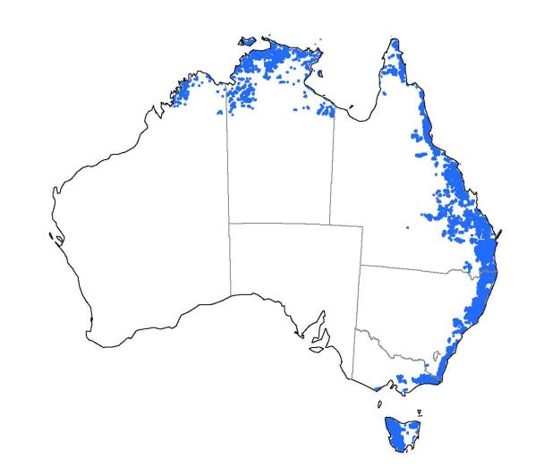

---
## Page 72

National Land Search Operations Manual 
Version Feb 2017 
72
a. 
Time frame for Survival (see medical considerations for SAR chapter 9).  In the rain 
forest environment it is critical that action is taken to consider time frame for 
survival.  Forests have widely varied weather conditions from tropical to temperate 
this will impact of the survival time.  The temperature variation within rain forests is 
much less than that of open plains.  Because of the canopy and its shielding ability 
rain forests are slower to heat up during the day and slower to cool down during the 
nights. This results in a narrower difference between night and day temperatures.  
Although they are rain forests, and grow primarily due to a higher incidence of rain, 
there is often a scarcity of surface water, except in those areas with running streams 
or rivers.  The ground is usually moist which has an effect of increasing the humidity 
of the atmosphere within the forests.  This moist ground will also contribute to 
accelerated core body temperature loss for someone lying on the ground for any 
length of time.  Wind can funnel through these forests, as a result of differences in 
temperature and air pressure from uneven heating of the canopy by the sun.  These 
winds, coupled with a high humidity, will contribute to greater wind chill than would 
normally be expected.  
b. 
Forests will have dense canopy covers which are often multi layered.  Dense canopy 
cover will cause problems with communications (SATPHONE) and navigation 
equipment (GPS). Secondary communication systems and navigation techniques will 
need to be employed.  Standard navigation techniques, such as identifying a distant 
object to align a search team on a particular bearing or counting of steps to 
determine distance, often fail due to the restricted visibility and hidden obstacles on 
the ground.  A search team leader will find it much harder to maintain a search line 
with more than a small team.  In these conditions it is better to have several smaller 
teams under the overall control of a senior search controller.  Compasses will be an 
essential item, although even the most ‘bush savvy’ person can easily become 
disorientated. 
c. 
Forest density will restrict visibility on the ground (long distance). In the denser 
areas of the rain forest visibility may be reduced to as little as 2-3 metres.  Rain, mist 
and fog can also restrict visibility for searchers.  Sparse ground cover is characteristic 
of rain forests, although this is often offset by a layer of leaf litter.  Depending on the 
forest and the frequency of natural events this leaf litter will vary in depth, up to as 
much as 50cm.  The leaf litter will hide or disguise potential hazards, such as rocky 
outcrops and gullies.  This will impede search efforts as well as increasing the degree 
of difficulty for ground teams. Toilet paper or other similar ‘forest friendly’ marking 
material will be a necessity to mark the boundaries of search areas as it will be 
extremely difficult to locate them using standard methods of grid references or GPS 
points. 
d. 
Canopy cover will also limit the effectiveness for aerial search – aircraft using 
Forward Looking Infrared will be unable to penetrate dense canopies with sensors. 
Thick canopy cover results in little natural light reaching the forest floor.  Outside 
overcast conditions will mean that visibility will be considerably reduced at ground 
level.  A combination of poor light and mist/fog will considerably reduce the 
probability of detection of a lost person.  It may be necessary for search teams to 
carry portable lights with them and may also limit the amount of search time 
available to the search coordinator. 
e. 
While rain forests are spectacular places to visit and sight see then can also have a 
detrimental psychological effect upon those who are lost in them.  The continuous 
low light levels, lack of direction, apparent never ending forest and dampness will 
contribute to depression and feelings of despair among lost persons.  These same 
conditions can also affect searchers, but often to a lesser extent.  Rain forest

---
## Page 73

National Land Search Operations Manual 
Version Feb 2017 
73
conditions can also cause our human primeval fear of the dark, which can result in a 
lost person moving aimlessly around in the forest seeking an escape.  There are very 
few large animals which will actively harm humans, the exception being the 
cassowary of northern Queensland, with rain forests, but there are many smaller 
animals that can cause an unreasonable level of fear in some humans.  These include 
leeches, ticks, spiders and the many nocturnal forest creatures. 
f. 
Good maps of rain forest areas are not common.  The standard practice of aerial 
cartography does not work well when the ground cannot be seen.  
g. 
Due to moist conditions it is often very difficult to light a fire, for either warmth or 
cooking.  Artificial means are almost always required, such as small gas cylinders or 
hexamine.  Unless the lost person is well trained in survival it is best to consider that 
there are no edible fruits or animals within the forest.  A large number of plant 
species are toxic as are the crayfish and eels of rain forest streams if eaten raw.  
4.51. 
Rainforest Behavioural characteristics: Be aware that lost person in rainforest conditions 
may exhibit any or all of the following: 
a. 
Failure to make shelter 
b. 
May be hidden in the buttress roots of many rain forest fig varieties. 
c. 
Discard their equipment 
d. 
Disorientated – walking any direction 
e. 
Tend to walk down hill (depending on level of experience – experienced walkers may 
 
try to access high areas to resolve their position) 
f. 
Following a path of least resistance 
g. 
Cold Temperate areas – may exhibit characteristics of Alpine areas 
4.52. 
Rainforest Resources considerations:  
a. 
Experienced Search Teams – with local knowledge and the ability to navigate within 
 
a featureless environment. 
b. 
National Park Rangers – or local rangers 
c. 
Police Mounted Units, Search and Rescue Mounted Units 
d. 
Aviation support – consider limitations. 
e. 
Tracker dogs, may be valuable first up but will otherwise be easily distracted by the 
 
many rain forest smells. 
f. 
Motorcycles/bicycles- search and rescue trained 
4.53. 
Alpine environment: Alpine areas relate to high mountainous areas which are subject to 
extreme environment changes involving rain, snow, hail and strong winds. 
 
Alpine Areas of Australia (dlsweb.rmit)

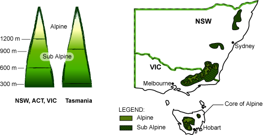

---
## Page 74

National Land Search Operations Manual 
Version Feb 2017 
74
4.54. 
Alpine search teams differ from normal ground search teams mainly due to the different 
weather, altitude and hazards they must face and the different variety equipment and skills 
they use to overcome and travel in these hazardous conditions.  
4.55. 
Due to these hazardous conditions an Alpine searcher should be a trained SAR member 
skilled in movement over snow & alpine survival skills able to move efficiently, skillfully and 
with safety in winter or sub winter conditions through terrain at low or high altitudes.  This 
member must be of a high fitness level, able to cope with the physical and mental demands 
required to move efficiently in this changing environment.  All alpine SAR members must 
able to work as a team member and prepared and equipped for overnight survival when 
necessary. 
4.56. 
These guidelines are intended to differentiate Alpine searchers from normal searchers to 
allow for the selection of teams to handle situations that are specific to their expertise and 
training.  
4.57. 
Alpine Considerations: The following considerations should be taken into account: 
a. 
Equipment – Alpine equipment is very specialized to deal with extreme 
temperatures and conditions.  All equipment should be suitable for the conditions 
and be checked by a team leader before entering an alpine environment.  Poor 
equipment can put searchers lives in danger. 
b. 
Alpine searchers – Due to extreme conditions and change environment only trained 
alpine searchers should be used in the field on an alpine search.  When entering 
remote areas a team should be no less than four members who are self-sufficient for 
overnight. 
c. 
Time frame for Survival (see medical considerations for SAR chapter?) In Alpine 
environment it is critical that immediate actions be taken to reduce the likely risk of 
exposure to hypothermia of the missing person/s.  
d. 
Medical training - Due to difficult access and remoteness of an alpine search, 
Paramedics or equivalent medical expertise in search teams or readily available to 
render assistance. 
e. 
Search techniques and search patterns – A search manager should utilize local 
knowledge of Alpine SAR members and/or ski patrol to assist in search tactics due to 
alpine mobility issues of search teams and lost persons. 
f. 
Restrictions in mobility of search teams and lost persons. Allow for greater time 
periods in the travel of distances. 
g. 
Makeup, search technique and search patterns used by searchers. 
h. 
Avalanche risks – A search manager should use only trained avalanche specialist in 
declaring search areas safe and when leading search teams in specialized searching 
using probes and avalanche receivers. 
4.58. 
Alpine Behavioural characteristics: Hypothermia is the lowering of a body’s core 
temperature. (see medical section) and is the most common condition missing persons will 
suffer from in an alpine environment.  A search manager and team leaders should be aware 
that lost person in alpine conditions may exhibit any or all of the following: 
a. 
Failure to make shelter 
b. 
Discard their equipment 
c. 
Disrobing of clothing 
d. 
Failure to respond to searchers 
e. 
Following a path of least resistance 
This should be considered when clothing or equipment is located by search teams. 
4.59. 
The majority of missing persons in alpine environments wear high visibility clothing and 
equipment.  Due to changing weather conditions they become disorientated, misjudge 
distances and become benighted.

---
## Page 75

National Land Search Operations Manual 
Version Feb 2017 
75
4.60. 
Alpine Resources considerations: 
a. 
Overland snow/all terrain vehicles 
b. 
Ski patrols 
c. 
Alpine horse riders and bush walkers from volunteer rescue agencies 
d. 
Aviation support  
e. 
Thermal imaging / night vision 
f. 
Avalanche specialists 
g. 
Mountain trained members in mountaineering, steep, snow and ice techniques 
h. 
GPS – carried by search teams 
i. 
Medical staff on standby. 
4.61. 
Arid Environment: Australia is the world’s driest inhabited continent.  Over 70% of the 
continent receives between 100mm and 350mm of rainfall per year, classifying it as semi-
arid or arid.  Desert regions are found mostly in central and western Australia, which makes 
up approximately 18% of the mainland.  All of Australia’s deserts are classed as subtropical 
deserts, given their location between the latitudes of 20 degrees and 30 degrees south of 
the Equator.  They are hot deserts, which means they have little rainfall and extreme 
temperatures, often reaching over 50°C.  Humidity averages at between 10 and 20 percent.  
Searing day time temperatures, cold nights and lack of water are just a few of the challenges 
facing travelers in the desert.  
 
Distribution of Deserts 
4.62. 
Desert surfaces are not always sandy; some consist of stones or ‘gibbers’ and have no sand 
at all.  Sandy deserts in Australia are The Simpson Desert, The Great Sandy Desert and the 
Great Victoria Desert. Stony deserts include The Gibson Desert, and the Sturt Stony Desert.  
4.63. 
Arid Environment Considerations: In desert conditions, because of the extremes of 
temperature, both hyperthermia and hypothermia can affect the missing person.  The 
amount of water carried and the methods which it is used by the missing person can have a 
critical effect on survival times. During the initial action stage an assessment of the target 
needs to be made in relation to their possible actions while the search is being conducted.  
Persons who are level headed and remain in a sheltered or shady location will survive for 
much longer periods than a person who is attempting to self-help by walking throughout the

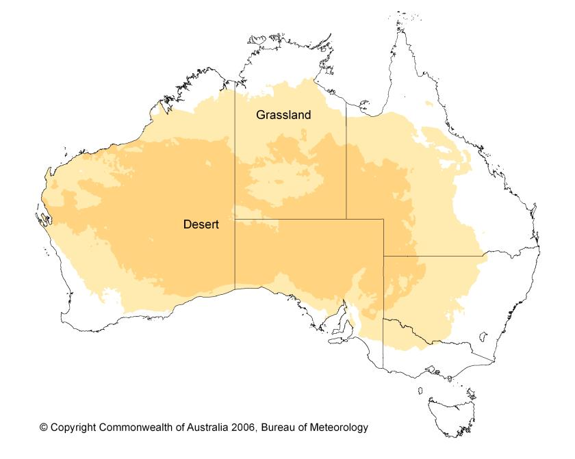

---
## Page 76

National Land Search Operations Manual 
Version Feb 2017 
76
day.  The general rule is for a target to remain with their vehicle if lost as it is far easier to 
find a larger object such as a vehicle than a smaller target such as a person. 
4.64. 
Historically most targets will spend a small percentage of time with their vehicle and then 
decide to walk off in search of help.  In areas that are familiar to the target this may be a 
successful strategy, but in most instances it results in death. 
4.65. 
It is unusual for the SMC to be the first person on the scene of a SAR incident.  Vital clues as 
to the direction, speed and condition of the target can be gathered from observations of 
their footprints or other markings in the immediate vicinity of a vehicle.  Consideration 
should be given by the SMC to brief all teams about the possible destruction of clues around 
vehicles.  When the target’s vehicle is located one team member should approach it from 
the hardest surface possible to ascertain if there are persons inside or if notes or other 
information has been left.  The area in the vicinity of the vehicle should then be thoroughly 
inspected for footprints and other marks and the direction in which they are going.  Further 
planning can then be made on the information obtained.  If there are no obvious signs left at 
the vehicle, then this would be used as a possible LKP with search planning concentrated on 
that point. 
4.66. 
In featureless country it is almost impossible to navigate accurately without extensive 
equipment.  A target will often aim to walk a straight path but in reality will wander.  The 
handedness of the target will provide a clue the direction of the wanderings.  Right handed 
persons will tend to walk in circles veering off to the left, with left handed persons going in 
right hand circles. 
4.67. 
Mental condition will also play a significant part in the survival of the target.  There are many 
stories of the explorers surviving tremendously difficult conditions without water for days.  
Historically this has been attributed to the harder living conditions and tougher life styles of 
those explorers.  With the increased pampering of people today the physical ability to 
survive in harsh desert conditions has diminished.  The mental state will have a large effect 
on a targets survival.  Those with a ‘no give up’ attitude may have better odds of survival 
that a person with no will power. 
4.68. 
Arid Environment Behavioural characteristics: Be aware that lost persons in arid conditions 
may exhibit any or all of the following: 
a. 
May shelter in or under their vehicle; 
b. 
May dig themselves in under the sand, if experienced; 
c. 
May discard their equipment; 
d. 
May become disorientated – walking any direction; 
e. 
May sleep by day and walk by night, if experienced; 
f. 
Following a path of least resistance; and 
g. 
May seek out river beds and ranges in search for water. 
4.69. 
Arid Environment Resource considerations: The following resource considerations should 
be made: 
a. the use of indigenous trackers or visual trackers; 
b. making air search a priority; 
c. the use of trail bikes and helicopters; 
d. use of helicopters for transport of searchers and logistics supplies; 
e. hardening experienced Search Teams to the environment; and 
f. 
the use of ground teams to recover the missing person once located, unless a helicopter 
has access. 
4.70. 
Mountain environment:  Although Australia is considered the flattest of the world’s 
continents it does contain some significant mountain areas with respect to SAR.  Whilst 
about 10% of the country may be considered mountainous due to the elevation, a much 
smaller proportion contains areas of high relief that create substantial SAR issues.  Due to 
the fact that many of Australia’s mountain areas are National or Wilderness Parks they are 
often in close proximity to many of Australia’s largest population centres.

---
## Page 77

National Land Search Operations Manual 
Version Feb 2017 
77
 
 
Mountain areas are highlighted in light shades. 
 
4.71. 
Mountain considerations: Access:  Many mountain areas are in wilderness or National 
parks.  As such access into these areas is often limited.  Resources in terms of searchers 
often have to trek great distances to reach their allotted search areas.  Air support may not 
be available due to weather conditions, terrain or vegetation.  Additional human resources 
may be needed to move equipment. 
4.72. 
Communications: Many of the mountain areas are not serviced by regular communication 
networks.  It is important to liaise with emergency services that may be able to provide 
additional portable sites to improve forward net coverage.  Even with additional radio 
communications, there will be no guarantee of continuous coverage.  It means that briefings 
and operational instructions to Team leaders must be absolutely and thoroughly conveyed. 
4.73. 
Containment: It is almost impossible to contain an area in mountainous terrain to keep the 
target within it.  The importance of continually monitoring trails, significant points, log books 
or known ‘trap points’ where persons could move through is essential. 
4.74. 
TFFS: In mountainous areas the targets are often adventurous, with activities such as bush 
walking, canyoning, trekking, rafting, abseiling and climbing.  Often the report of a missing 
person will not be received until the person is well overdue.  With many adventurous 
activities extending over many days, time becomes critical as injury or misadventure may 
well have occurred earlier in the activity.  Therefore the missing person or group may well be 
approaching their TFFS by the time emergency services are notified.  Search strategies that 
emphasise fast and reconnaissance methods are indicated. 
4.75. 
LPB: Persons who venture into mountainous areas are often motivated and aim to achieve a 
task.  Ascertaining as much data as possible regarding the MP will enable the SMC to 
determine the likely characteristics of the person.  Often these persons are trail orientated 
and will seek water and/or shelter if injured. 
4.76. 
Vertical Rescue: Where called to search areas of high relief for missing people it is advisable 
to ensure that emergency services with skills in Vertical Rescue are placed on Alert or called

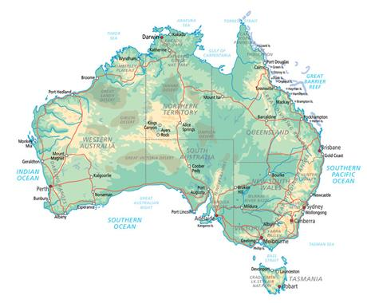

---
## Page 78

National Land Search Operations Manual 
Version Feb 2017 
78
to be part of the search so as not to delay the arrival of these trained operators should they 
be subsequently be needed. 
4.77. 
Training: High levels of fitness and resourcefulness are needed as Mountain search crews 
may well be deployed not only in difficult terrain but over protracted days without 
opportunity of relief in often poor or changeable weather.  Excellent navigation and map 
reading skills are required in any search team.  The ability to effectively use GPS technology 
should also be considered as a skill within each search team. 
4.78. 
Mountain Environment Search Strategies:  Contain any search area as quickly as possible.  
This can be done by using FAST and reconnaissance strategies in deploying teams to tracks, 
PLS, intended destination, lookouts, major camp grounds or known ‘trap points’ where a 
person or persons must pass through.  These would be the initial high probability areas. 
4.79. 
Many mountainous area and lookouts contain logbooks or visitors books.  It is imperative 
that these are checked as soon as possible in an effort to narrow down the search area. 
4.80. 
Set up a forward net communications as soon as possible. 
4.81. 
Postpone a general search strategy until there is clear evidence or a definite clue to the 
missing person’s whereabouts.  (eg. Found backpack, clothing, footprints etc.) Be flexible 
about search team sizes, eg. A team of 2 where communications is excellent across most of 
the area being searched, a team of 3 where communications is intermittent and a team of 4 
where communications is poor or marginal. 
4.82. 
A search team of 3 is a very flexible team size as this size can strike a good balance between 
raping movement and deployment and team security.  A team of 3 can search in a Single 
File, Track Sweep, Point and Flank and Purposeful Meandering. 
4.83. 
Use the ‘call and listen’ techniques.  Note that in calling from a ridgeline, the sound will not 
travel down the sides of a ridge or spur, sound will only travel out to the facing slopes.  It is 
important to therefore call out from opposite ridges into a valley. 
4.84. 
Dangerous animals:  Australia is known for its wildlife and every year thousands of locals 
and tourists gravitate to wildlife parks to view and hold our cuddly furry creatures.  It is not 
these that searchers need to worry about, it is the more unpleasant looking critters that 
cause the problems. 
4.85. 
Saltwater Crocodiles: The Australian Estuarine or Salt Water Crocodile is found across the 
entire north of Australia as per the below map.  They are the largest reptiles in the world 
growing up to 5-6 metres in length.  The Salt water name is a misnomer as they are quite 
happy in fresh water billabongs long distances from the coast.  They are very aggressive and 
territorial.  While their normal diet consists of wild pigs, water buffaloes, cattle and horses 
they will also eat the occasional human.  On average 1-2 people are devoured by crocodiles 
somewhere in Australia per year.

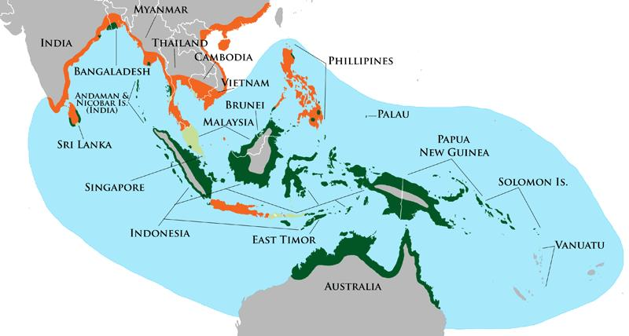

---
## Page 79

National Land Search Operations Manual 
Version Feb 2017 
79
 
4.86. 
When searching in areas known to be inhabited by crocodiles it is imperative that all 
members of a search team keep a very good look out.  It may be worthwhile having a 
member of the State/Territory Parks and Wildlife Service or Crocodile Management Team 
accompany any search team as they will be able to identify crocodile habitats and signs of 
recent crocodile activity.  A firearm may also be prudent in some circumstances, but only at 
the instruction of the SMC. 
4.87. 
Snakes:  Australia has a great many of the world’s most venomous snakes and apart from 
the colder reaches of the Tasmanian and mainland Alps they can be found just about 
everywhere.  Very few snakes are aggressive towards humans by nature but all will respond 
to being trodden on, poked and prodded.  Most will slither away from searchers long before 
they are spotted but occasionally a snake will be caught out in the open by an unsuspecting 
team member.  Common sense prevails in most situations.  Remain calm and still and let the 
snake leave the scene under its own steam.  Do not try to pick one up or hurry them along.  
In the heat of the moment it is difficult to identify the harmless from the dangerous.  Treat 
all snakes as being dangerous and remember that they are protected. 
4.88. 
If bitten by a snake remain calm.  Have another team member commence first aid in the 
form of a pressure immobilisation bandage and immobilise the area.  Seek medical 
assistance.  Do not wash the area as any residual venom may be able to be identified.  Most 
major hospitals carry anti-venom for snakes in their area.  Where possible identification 
should be made of the snake that caused the bite but do not attempt to apprehend the 
snake as another bite may result. 
4.89. 
Be aware of what snakes are likely to be encountered within a search area. 
4.90. 
Spiders: There are a wide range of venomous spiders scattered throughout the country, all 
of which do not actively stalk humans.  Most spider bites arise from the spider being 
disturbed.  Wearing gloves when searching undergrowth, under objects or back yards and 
stout footwear will prevent many potential spider bites.  If bitten by any spider seek medical 
attention as soon as possible.  Identification of the spider can assist with any medical 
treatment provided. 
4.91. 
Scorpions, Centipedes and Millipedes: As per spiders these creatures can be located 
throughout Australia.  While all of them are not poisonous they can all cause a very nasty 
sting.  Gloves and footwear will prevent most encounters from turning nasty. 
Tasmanian Devil, Dingoes, Foxes, Goannas, Monitors, Birds of Prey: While not dangers 
these animals have one SAR related characteristic, they all feed on dead or decaying 
animals, including humans.  If it is possible that a MP is deceased then there is a possibility 
that local animals have had the opportunity to devour some or all of the flesh and to scatter 
the bones.  This may be the case with a person missing in the outback or more remote areas.  
The SMC should be aware that this detail should be included in the briefings, for teams to 
also look for scattered human bones and remains. 
4.92. 
Telephone Triangulation: With most people now carrying mobile telephones the potential 
for telephone triangulation by the various telephone carriers can reduce SAR efforts 
dramatically.  During the information gathering stages it should be canvassed as to whether 
the MP has a mobile telephone with them.  Something as simple as making a telephone call, 
sending a text message or leaving a voice message may resolve a SAR incident.  If these 
methods do not produce results, contact with the service provided can often produce a 
location or direction from a mobile telephone tower.  The individual State/Territory methods 
in contacting service providers will differ, as will any charges that are made by these 
providers.  If the MP is in an urban area and their telephone is on, a triangulation can be 
reasonably successful within a small space of time.  A large number of mobile telephone 
towers in an area can produce a very defined search area, whereas a small number or only 
one tower will produce a much larger search area, such as a bearing and distance from a

---
## Page 80

National Land Search Operations Manual 
Version Feb 2017 
80
particular tower.  MP’s lost in rural, mountainous or remote areas may have little mobile 
reception, with an associated small chance of triangulation.  Mobile telephones with dead 
batteries will not be of much use.  A triangulation should be requested as part of the initial 
intelligence gathering. 
4.93. 
Estimating the Missing Person Location:  The search plan consists of two components: 
 
1.Reflex Tasking (Initial Search) 
 
 
2.Formal Land Search.  
 
The search response has been separated into two distinct actions; Reflex or Initial actions 
and a Formal Land Search.  The reflex action is exactly as it says, an instinctive search of 
those areas near the LKP or IPP where the MP could have met with trouble.  The formal 
search is one utilising the four search strategies as discussed further in this section. 
 
 
 
 
 
Reflex Tasking 
 
 
 
 
 
 
 
 
 
 
 
 
 
Bicycle method for Reflex Tasking 
 
 
 
Reflex tasking can be likened to a bicycle wheel with the hub situated on the LKP or IPP.  The 
spokes represent the various routes, tracks, trails or directions that could have been taken 
by the MP. The tyre represents the limit of the reflex search which is recommended at 300-
50m.  The reflectors represent places of high probability within this reflex area.  These could 
include huts, track junctions, hazards, lookouts, cliffs and water courses. The below diagram 
illustrates this concept. There are six identified possible routes, 3 tracks radiating from LKP 
and three water courses. Without any further intelligence each is as likely as the others. The 
circle around LKP is a 300-500m radius for the reflex search.  The green reflector is an area of 
high probability inside the reflex search area (Group of huts) while the red reflectors are 
high probability areas, track junctions, just outside the initial search. 
 
 
 
 
 
 
 
 
 
 
 
 
 
 
 
 
Hub = 300m radius around Last Known Position (LKP),  
Place Last Seen (PLS) and Initial Planning Position (IPP) 
Spokes = Possible routes or paths 
Tyre = Limit of initial search, LPB statistical boundary. 
Reflectors = Places of high probability, huts, hazards, track 
junctions.

---
## Page 81

National Land Search Operations Manual 
Version Feb 2017 
81
 
 
 
 
 
 
 
 
 
 
 
 
 
 
 
 
 
 
 
 
 
 
 
 
 
 
 
 
 
 
 
 
 
 
 
Reflex tasking example 
 
Formal Search 
 
There are four strategies in determining the formal search area in a land environment: 
a. 
Theoretical (How far could the MP have travelled in the time period) 
b. 
Statistical (Using Lost Person Behaviour, what is the statistical distance the MP could 
be located within) 
c. 
Subjective (Using the terrain to determine likely search areas) 
d. 
Deductive (Looking closely at the facts, clues and assumptions) 
Each of the methods are laid over each other to give a very accurate representation of the 
situation, and if done correctly will serve to reduce the search area to the highest probable 
locations. 
4.94. 
Theoretical: The first step in land search planning is to determine the limits of the area 
containing all possible MP locations. This is usually done by determining the maximum 
distance the MP’s could have travelled between the time of their last known position (LKP) 
and the known or assumed time the SAR incident occurred. By utilising Naismith’s Rule a 
general indication of the maximum distance that could be travelled by the MP will be 
obtained.  Using this as the radius a circle can then be drawn around the LKP, which will 
LKP (300m circle around LKP) 
Reflex or Initial Search Tasking 
Hub = 300m circle around LKP/IPP/MPP 
Spokes = Routes/tracks/trails/ridges emanating from hub that MP 
could have gone 
Rim = Confinement if needed 
Reflectors = High probability areas

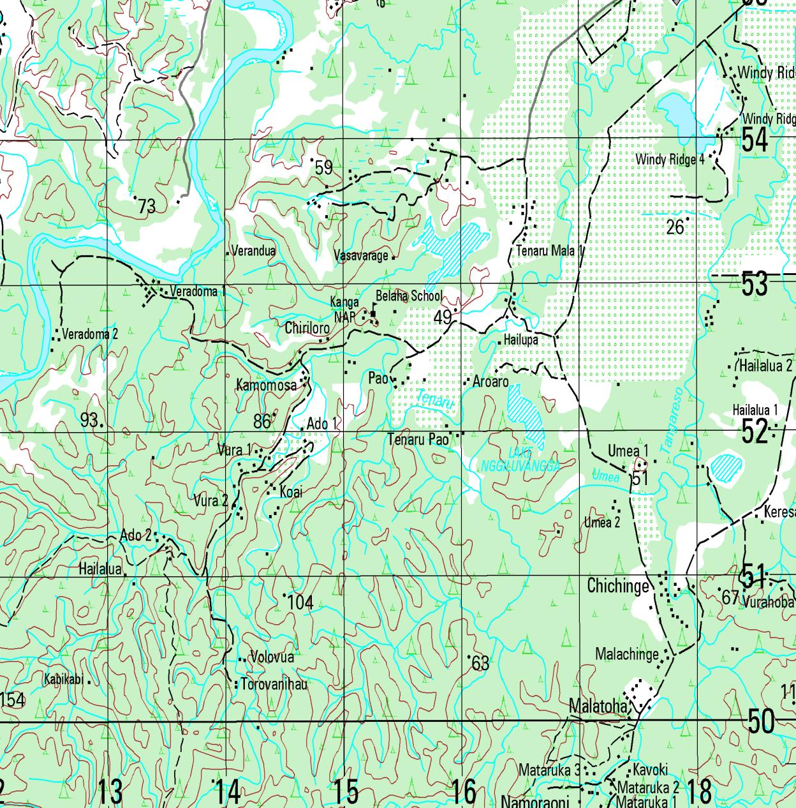

---
## Page 82

National Land Search Operations Manual 
Version Feb 2017 
82
indicate the maximum distance the MP will have walked from the LKP.  This method only 
works when it is known that the MP does not have access to other forms of transport. 
Knowing the extreme limits of possible locations allows the SMC to determine where to seek 
further information related to the MP’s and whether an incoming report might apply to the 
incident. However, systematic search of such a large area is normally not practical.  
4.95. 
Naismith’s Rule: In gauging the speed of travel, Naismith’s Rule describes the distance a 
person may travel per hour over flat terrain and was devised in 1892. 
5 km/hour  
 
Easy going over open country. 
3 km/hour  
 
Easy scrambling over rocky ground. 
1–1.5 km/hour  Difficult going through thick scrub, heavy sand or snow. 
Where a person is missing for extended periods or is likely to traverse hilly country, the 
possible search radius will need to be reduced due to fatigue and slower travel.  For each 
500 metres of ascent or 1000 metres of descent over the estimated distance travelled, 
reduced the possible search radius by the equivalent of one hour travel.  For every 5 hours 
the person is missing, reduce the possible search radius by the equivalent of one hour travel 
for fatigue.  The calculation for the possible distance travelled by the MP is relatively simple 
to perform.  Appendix J & K expands on Naismith’s Rule and provides further information. 
Example. A 6 year old MP has been missing 13 hours in the Lamington NP. The intended 
route suggests medium conditions or easy scrambling (3kph) with a 500m ascent and a 
500m descent.  
13hrs missing-  
1. 
Calculate any fatigue by dividing the time missing by 5 and ignore any remainders. 
 
(13÷5=2 3/5 = 2hrs)  13hrs – 2hrs = 11hrs 
2. 
Calculate any ascent.  500m = 1hr.  11hrs – 1hr = 10hrs  
3. 
Calculate any descent.  1000m = 1hr (500m = .5hrs)  10hrs - .5hr = 9.5hrs.  
4. 
Calculate distance travelled. 9.5hrs x 3kph = 28.5km 
 
 
 
 
 
 
 
 
 
Theoretical search area using Naismith’s Rule. 
 
4.96. 
This initial calculation provides the SMC with a possible distance that the MP could have 
travelled in the time since they were last seen.  It does not provide a direction or take into 
account any other factors, including age or behaviour, at this stage.  This area is much too 
large to search adequately, being approximately 2550km².  Being a theoretical distance it is 
highly probable that this distance would not be walked in a straight line but that the MP 
would wander somewhat and cover a shorter linear distance from LKP. 
4.97. 
Statistical Method: Lost Person Behaviour: This method relies on Lost Person Behaviour 
(LPB) to determine the distance that the MP may have travelled from the LKP.  By analysing 
the behaviour of past lost persons in similar situations, it may be possible to ‘predict’ what 
the subject now being sought might do, where he/she might go or where he/she might be.  
This concept is a search planning tool, dealing with generalities, and not absolutes.  Lost 
person behaviour studies provide the SMC with two important items: 
LKP
28.5km

---
## Page 83

National Land Search Operations Manual 
Version Feb 2017 
83
a. 
Behaviour traits of lost persons by category. 
b. 
Distances travelled by specific categories of lost person. 
4.98. 
General categories of Lost Persons:  The following are the commonly used categories of lost 
persons: 
a. Children 1 to 3 years 
b. Children 4 to 6 years 
c. Children 7 to 12 years 
d. Adolescent Youth 13 to 15 years 
e. Elderly- above 65 years. 
f. Mental Development Problems. 
g. Despondent 
h. Bushwalkers 
i. 
Dementia/Alzheimer’s  
Appendix I contains lost person behaviours in the above categories and provides statistical 
distances travelled by members of each group.  This will be useful in creating the linear 
graph as outlined below. 
4.99. 
Pertinent characteristics set each category apart.  Although each of the groups exhibit 
specific traits, there are always exceptions and good search strategy concentrates on the 
most likely.  The statistics provided further on relate to the activities of 80% of persons in 
each category.  Knowledge of the actions of the remaining 20% of persons in each category 
may be useful in planning for search containment.  Appendix I 
4.100. An Australian LPB study was conducted between 2000-2006, details of which are contained 
at site http://sarbayes.org/natsar.pdf  The statistics used in this manual are a 
combination of those developed in Australian, USA, Canada and the United Kingdom.  While 
these statistics will provide a solid base upon which to base a Statistical Search method 
there are some discrepancies when used for Australian subjects.  Studies to date have found 
that due to the more favourable climate in most of Australia and the more outdoor nature of 
Australians their behaviour when lost is somewhat different, in that they will often attempt 
to self-help more often.  Bearing this in mind, the international statistics can be used with 
confidence as one of a number of search planning methods.   
4.101. Specific factors of LPB that may affect search planning:  State of Health: The physical health 
of the lost person will have a direct impact on their ability to self-help and formulate rational 
decisions.  Recent illnesses, poor fitness, disease, lack of adequate nutrition and lack of sleep 
will restrict a person’s ability to cope with situations such as being lost in an unfamiliar 
environment.  Increased physical stress will result in fatigue and exhaustion setting in, 
reducing the ability to think clearly.  Good physical health may be an indication of an ability 
to withstand the rigors of being lost. 
4.102. Past Experiences: Studies have shown that persons who often challenge themselves in new 
ways or expand their comfort zones will be more adaptable to adverse situations, such as 
being lost.  Gathering evidence of past experiences will provide an insight as to the missing 
person’s ability to cope with challenging or stressful situations.  A person who rarely does or 
tries anything new is more likely to be helpless and a liability when lost. 
4.103. Physiological effects of the environment: While it is acknowledged that extremes of heat 
and cold will have a detrimental effect on a missing person, a combination of normal 
temperatures with rain and/or wind will quickly have adverse effects on a missing person.  
Wind and wet chill can quickly lower the core body temperature, and will cause a person to 
seek shelter which will limit their detectability by searchers. Hypothermia has been 
identified as a leading cause in death and accidents in the outdoors from a search and 
rescue perspective.  Persons suffering from either hypothermia or hyperthermia become 
irrational and lose the ability to help themselves.  Altitude exacerbates any effects of these 
debilitating conditions.

---
## Page 84

National Land Search Operations Manual 
Version Feb 2017 
84
4.104. Fear factors: An aspect that is often overlooked with respect to missing persons is general 
fear.  Fear can be categorised as five basic types; fear of being alone, fear of the dark, fear of 
animals, fear of suffering and fear of death. A SMC must take these fears into account when 
planning a SAR mission, not just from a lost person point of view but also from a searcher 
viewpoint.   
a. Fear of being alone: In Australia this could also be termed fear of the bush. While some 
people choose the isolation of the bush the average person finds it haunting.  The bush, 
and this term covers everything from the central deserts, coastal rain forests, snowy 
alps, eucalypt, brigalow and gidyea forests and northern swamps, is a very harsh and 
difficult place to survive adequately.  Most of the continent has very little surface water 
and native foods are difficult to safely identify. 
b. Fear of the dark: Most humans have a primeval fear of the dark.  This coupled with the 
noisy nocturnal activities of most native animals makes the bush darkness a stressful 
place to be.  Compounding this is the general loss of our most important sense, sight.  
Without being able to see objects in the darkness our imagination can often conjure up 
images that can cause the strongest to be afraid.  This sensation is not confined to lost 
persons, as it also has an effect on searchers.  Those searchers on the extremes of any 
line search will eventually creep closer to the centre because of this fear of the dark, 
hence a 100m wide search initially will eventually diminish to cover a much smaller area. 
It is amazing how a small amount of light, from a torch or fire, can alleviate this fear. 
c. Fear of animals: Although Australia has no known predatory animals that actively prey 
on humans there is an irrational fear of being in the bush alone.  Most native animals are 
nocturnal and their nightly activity can unnerve people and preclude a good night sleep. 
d. Fear of suffering: The spectre of survival can cause an often rational fear of suffering in 
lost persons.  Australia is an extremely harsh continent, not designed to support lost 
persons.  The possibility of dehydration, starvation, hypo- and hyperthermia, illness and 
injury are all real possibilities, and there are many examples of each throughout our 
history.  The thought of the lingering agony of each situation can create a very real fear 
among some lost persons. 
e. Fear of death: The fear of a lingering death can haunt many people, particularly when 
they consider the many things yet to do; leaving loved ones behind, tying up loose ends 
and the hereafter.  In some instances the fear of death can actually hasten it. 
4.105. Biological Cycles: These cycles have been recognised in the medical world for many years 
and do have some application to search and rescue.  Most humans go through a cycle of 
highs and lows which can vary from periods as short as a day to periods of months.  A person 
on a high cycle may see being lost as a challenge to be met head on.  These people will 
attempt to self-help and have a greater chance of survival in adverse conditions.  Conversely, 
a person on a low cycle may have little energy to assist themselves and may succumb to 
conditions more quickly. 
4.106. Behaviour while lost: The recognition of being lost occurs at different stages for people.  It 
may be the slow awareness that it is taking far longer to reach a destination than was 
calculated or the instant realisation that what was once familiar territory is now not. A lost 
person can go one of two ways; sit tight and quietly reflect the situation and work out a 
solution or to hasten their pace as the destination ‘could just be over the next hill’.  This 
second situation can then also go in two directions; the realisation that they are getting 
further into unknown territory and sit down to reflect the situation or to increase their pace 
and run to avoid the fear of the bush, which now appears to be closing in around them.  In 
other words they are panicking. 
4.107. Those persons who take the time to ponder may identify their location and self-help to 
safety.  If this is not possible they will often form a shelter and wait for rescue.

---
## Page 85

National Land Search Operations Manual 
Version Feb 2017 
85
4.108. Those who are compelled to continue in a blind rush often find themselves injured in 
locations often far removed from their original intended track and therefore take longer to 
locate and rescue.  It is worth considering that these people may often attempt to travel up 
hill to either locate a path or orientate themselves to their environment before fatigue, 
despair and/or depression takes over and they tend downwards on the path of least 
resistance.  These people will often take risks beyond their capability and as a result suffer 
more injuries than would normally be expected. 
4.109. In both the above circumstances shock will be suffered by the lost person.  This will manifest 
itself in many different ways depending on the person’s mental strength, from simply 
forgetting incidents that have occurred to failing to seek shelter from rain or snow. 
4.110. The trauma of being lost may also have the following effects on a lost person: 
a. 
Not seeking shelter.  Many persons do not make an adequate shelter nor build a fire 
for warmth.  With hypothermia and hyperthermia being very prevalent, particularly 
in desert, mountainous and urban areas, this is a vital necessity and will extend a 
person’s chances of survival. Survivor questioning has often elicited the assumption 
that it is not worth the effort of making a shelter even if it will limit heat loss and 
provide a measure of mental comfort. 
b. 
Many persons discard their equipment without thought for using it to survive. While 
it is true that most lost persons are not prepared for the conditions as they only 
expected to be out for a few hours, there have been many instances of people being 
extremely well prepared and failing to use the items that had with them, particularly 
tents and fire making apparatus.  Discarding clothing and backpacks is common and 
may be contributed to the shock of being lost. 
c. 
Many persons discard their clothing while wandering in the bush.  This may because 
of overheating in warm areas, but soon becomes regrettable as the sun sets and the 
temperature cools down.  While understandable in hotter areas it also happens 
during the early stages of hypothermia in colder areas.  The net benefit of discarding 
clothing is that the lost person succumbs sooner. 
d. 
Often with the shock of being lost is the sense of abandonment, the feeling that 
nobody is looking for them.  Throughout Australia a search mission will be 
commenced once the alarm has been raised by a concerned party.  If the SMC has 
an itinerary and LKP then the task of locating the MP is much easier.  If there is no 
itinerary, no LKP and the MP has not been seen for some time then the task is that 
much harder. 
e. 
Self-helping and responsiveness is a big factor in determining what type of search to 
opt for.  A MP wearing bright clothing and actively seeking assistance will be easily 
located when compared to a small child dressed in dark clothing hiding in the 
undergrowth for shelter.  Children are often taught ‘stranger danger’ and are 
reluctant to approach a stranger in these circumstances.  MP suffering shock or 
other mental issues may make no attempt to draw attention to themselves even if 
they see a searcher, motor vehicle or helicopter. 
f. 
Ignoring aids such as tracks, paths and fences is a common problem associated with 
MP’s suffering shock.  Common sense dictates that if a MP locates one of the above 
it will lead to a main road, gate or house where help can be obtained.  On many 
occasions a MP will cross a track, path or fence, often without realising it, only to be 
further lost in an area outside a high probability search area. 
4.111. Statistics: The Lost Person Behaviour statistics have been put into a tabular format showing 
the average distance at which a variety of person groups have been located in relation to 
LKP. The tables cover all of the statistics but is suggested that the statistics to 80% only be 
used as the remaining 20% of targets skew the figures as can be seen.

---
## Page 86

National Land Search Operations Manual 
Version Feb 2017 
86
4.112. Creating a linear percentage line as below will provide a visual representation of the 
distances that a MP could be located.  The table of figures for 1-3 year old children have 
been reproduced below.  This table shows that 10% of missing children in this group were 
located within approximately 110 metres of LKP.  It also shows that 80% of children in this 
age group were located within approximately 2.10km of LKP.  Using these figures a linear 
graph of the respective percentages can be shown in a form that more easily translates to 
map distances.  The SMC can place LKP over the position on a map and then draw circles of 
various sizes to represent the statistical distances travelled by children of that age group. 
 
% of 
MP’s  
10% 
20% 
30% 
40% 
50% 
60% 
70% 
80% 
95% 
Dis 
from 
LKP 
(KM) 
0.11 
0.25 
0.30 
0.42 
0.60 
1.15 
1.6 
2.10 
4.45 
Statistical distances travelled by Children 1-3 years (Contained in Appendix I) 
4.113. Using the LPB tables to produce a Linear Percentage line a SMC can observe that statistically 
80% of missing child between 1-3 years of age will, on average, be located within 2.10km of 
the LKP.  Using the statistical method the initial search for a child of that age will be a circle 
with a radius of 2.10km.  
4.114. Superimposing this search area over that of the Theoretical method will show a dramatic 
reduction in the probable search area. 
 
Theoretical Distance 
 
 
 
Statistical Distance 
 
 
 
 
 
 
Comparison of Theoretical and Statistical search areas 
4.115. The probable search area has been reduced from approximately 2550km² to approximately 
13.8km² based on the first two of the planning steps.  Using the theoretical method it is 
possible, although not likely, that the child has walked 28.5km from LKP in the 13 hours they 
have been report missing and this is portrayed in the yellow circle above.  LPB suggests that 
80% of all children of this age lost have been located within 2.10km of LKP, represented by 
the green circle.  The SMC must always be cognisant that there are 20% of children in the 
age group that were not located within that distance due to other circumstances. Continued 
intelligence gathering will assist in determining whether the MP fits into the 80% or 20% 
category.  While the statistical area is considerably smaller than the theoretical area it is still 
an extremely large area to search on foot. 
4.116. Subjective Method: The subjective method uses the terrain, boundaries, fences etc as a 
method of identifying a search area.  As most categories of targets tend to take the path of 
least resistance, ie. walk down hill, identifying the lay of the land will suggest funnels that 
will channel a target in a particular direction.  This method will differ from person to person. 
4.117. The reduction of the possible search area to the probable search area requires the 
evaluation of factors of the missing person that may reduce their distance travelled, and 
terrain features and their effects: 
a.  
Factors which may reduce the projected travel may include: 
(1)  
physical condition; 
LKP 
28.5km radius 
search area 
2.10km Radius 
search area

---
## Page 87

National Land Search Operations Manual 
Version Feb 2017 
87
(2)  
age and sex; 
(3)  
experience in the area and general outdoor ability; and 
(4)  
weather. 
b.  
Certain terrain features may also assist in reducing the search area to only a sector 
of the original circle of the possible search area. For example, features which cannot 
be crossed or only crossed with difficulty, (fast-flowing rivers, gorges, cliffs, 
shorelines or very dense scrub) can significantly limit the area which must be 
searched. The probable search area may only be a fraction of the possible search 
area when all these factors are applied. 
4.113. On the below map the search area has been identified by the circle.  The roads, tracks, creek 
and ridge lines have been identified and coloured for clarity.  These are all potential barriers 
for use in search planning and could be used to funnel a target to lower country.  They also 
reduce the initial size of the search area. The contours have been checked and the 
downward slopes identified with red arrows.  This may indicate possible directions that a 
missing person will travel.  Using this information it is now possible to contain a search area 
and divide it into smaller sub search areas for individual searching. 
4.114. Once the salient terrain features have been identified it is possible to locate ‘paths of least 
resistance’ or ‘funnel points’ within your search area.  The former are routes, normally 
downhill, that a lost person will subconsciously take while still mobile.  Image a lost person, 
tired, demoralised and unable to rationally make a decision, they will naturally gravitate 
downhill, taking a path that does not offer them any trouble.  This path may not be direct 
and will tend to wander, but always downhill.  In these circumstances a barrier search is a 
worthwhile consideration.  Funnel points are exactly as named, locations that tracks, gullies 
or ridges converge.  This has the effect of funnelling persons in a particular direction.  Re-
entrants are a good example of this.  A person lost in a re-entrant will often remain in it, 
following it downhill, being funnelled to another location.  Being able to identify these 
potential routs will assist is allocating areas to search teams. 
 
 
 
 
 
 
 
 
 
 
 
 
 
 
 
 
 
 
 
 
 
 
Identifying possible barriers in a search area. 
 
 
Ridge 
Track 
Creek

---
## Page 88

National Land Search Operations Manual 
Version Feb 2017 
88
Decision Points 
 
 
The above diagram shows what a decision point is.  Whether the MP is walking on formed 
tracks or wilderness they will come across a number of decision points that will require 
identifying and searching.  A decision point is a location where the MP could veer off course 
or lose the track or bearing entirely.  Track junctions are a classic example, with the MP 
going left instead of right due to a number of reasons such as poor map skills, darkness, 
inattention and/or fatigue.  Other decision points include water crossings, sharp bends in 
tracks or routes, contouring and elevation changes.  The result of poor decision making will 
leave the MP disorientated 
 
4.115. Deductive Method:  This method relies on the SMC looking at all the clues and information 
provided and making some deductions or assumptions on what the missing person was 
doing and where they may be.  If the MP was an avid photographer then locations for 
photography may identify areas for a FAST search, similarly if an MP is into abseiling then 
local abseiling locales will be worth searching. 
 
4.116. Where the direction of travel of the missing person is known or suspected from sighting, 
from intentions, or from clues found, the search area may be reduced. However, the missing 
person may have altered direction intentionally or may not be able to maintain a particular 
direction.  Deductive is not a method to use alone, it must always be corroborated with 
some other search intelligence. 
 
4.117. It is now possible to utilise all four search planning methods to determine a possible search 
area, or area of highest probability.  For example:  
Hike from Torovanihau to Tenaru Mala 1 
Decision Points

---
## Page 89

National Land Search Operations Manual 
Version Feb 2017 
89
Scenario 1: It is 0900hrs when the following information is received. A 78yo dementia sufferer has 
gone missing from her home at 30 Brisbane St, Mt Ommaney.  She has no history of going missing 
before.  She has lived at that address for over 30 years but due to illness does not know the address.  
She has no money or ID and was last seen at 0600hrs wearing a cotton night dress and no shoes inside 
her residence.  She is not a good walker but does not require any walking aides.  The weather is a 
typical winter day, wind 15kph S, 15°C and drizzle. 
 
 
LKP of missing person identified. 
 
 
 
4.118. The LKP of missing person is plotted on a suitable map. 
 
3 hours missing. 
4.119. It is now 1200hrs and the MP has been missing for 3 hours.  According to Naismith’s Rule, a 
person could walk about 5kph in suburban terrain; this rule does not differentiate between 
Person reported 
missing at 0900hrs 
It is now 1200.  MP 
missing for 3 hrs

---
## Page 90

National Land Search Operations Manual 
Version Feb 2017 
90
ages or ability.  A speed of 1.5kph is more reasonable for an MP of this age and condition. 
Therefore 3 hours x 1.5kph will give a theoretical distance of 4.5km.  Draw a circle with a 
radius of 4.5km around LKP and this will provide the theoretical search area for the MP.  
 
Theoretical Area plotted. 
 
 
Statistical Area plotted. 
 
4.120. Lost person behaviour for dementia or Alzheimer suffers suggests that 80% of MP in that 
category have been located within 3.2km of LKP.  Using this information draw a circle of 
radius 1.6km around LKP.  This has reduced our search area by a considerable amount, 
based on statistics of previous lost people.  It is necessary to keep in mind that this is only a 
statistical measurement and that of the studies there were 20% of MP’s who were located 
outside of this circle.  The SMC must devote a portion of their planning to this until 
intelligence suggests otherwise. 
 
 
LPB suggests 3.2km r in 80% 
of cases. (Statistical area) 
 
3hrs x 1.5kph = 4.5km r, 
(Theoretical Area)

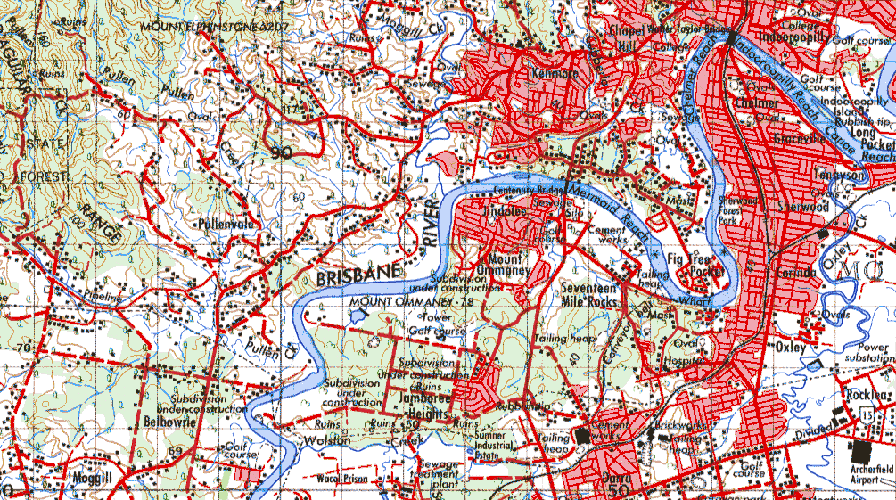

---
## Page 91

National Land Search Operations Manual 
Version Feb 2017 
91
 
Subjective search area plotted. 
4.121. Use the subjective method and look carefully within the 3.2km circle.  A number of defined 
boundaries can be seen and marked.  These will include the Brisbane River, a creek and the 
Western Motorway.  It is a reasonable assumption that a missing person will be contained 
within these boundaries.  They are considerable boundaries and clearly mark the area.  It has 
to be remembered that there will be a small percentage of MP’s that will pass through or 
over any boundaries. Using the above boundaries, it is now possible to reduce further the 
search area for our MP, in blue above. 
 
 
Deductive Search Area plotted. 
4.122. A deductive look at the map will show that there is a ridge, identified in red.  The land slopes 
downward toward the river on the west and north of this ridge.  An assumption is that an 
elderly MP who is experiencing walking difficulties will not walk uphill and will seek the path 
of least resistance, gradually going downhill towards the river.  This assumption should be 
accurately recorded within your log to justify your search plan. 
 
Motorway 
Creek 
River 
 
 
Ridge line 
The land slopes downhill from 
the ridge to the river

---
## Page 92

National Land Search Operations Manual 
Version Feb 2017 
92
 
Probable search area identified. 
4.123. The most probable search area for the MP is now a small area between the river and the 
ridge, as shown in green above.  Planning can now go ahead to commence a SAR mission. 
Scenario 2: 
 
4.124. A bushwalker has been report missing in the Gold Coast Hinterland.  She was last seen in the 
above saddle at 1200hrs after which she became separated from her group.  It is now 
1500hrs, with three hours having elapsed. 
Bushwalker last seen 
in saddle at 1200hrs.  
It is now 1500hrs.  
Version 2 2007 
Probable Search Area

---
## Page 93

National Land Search Operations Manual 
Version Feb 2017 
93
 
Theoretical area is entire map portion. 
4.125. A look at the map shows that the terrain is moderate sloping hills and has open sclerophyll 
vegetation. Naismith’s Rule suggests that a person can walk at 3kph in light wooded terrain, 
but again does not take into account age or fitness.  The MP has been missing for 3 hours 
and at 3kph, this gives a circle with a radius of 9km.  This area covers the entire area of the 
above map. 
4.126. Statistically, the lost person behaviour for hikers shows that 80% are normally located within 
5.64km of LKP.  After drawing a circle of 5.64km radius from LKP it can be seen that it still 
covers the entire section of the above map.  In the above instance this has not tightened the 
search area by much. 
 
 
Statistical area is also entire portion of map. 
 
Theoretical Search 
Area is entire portion 
of map 
5.64km LPB 
Search radius

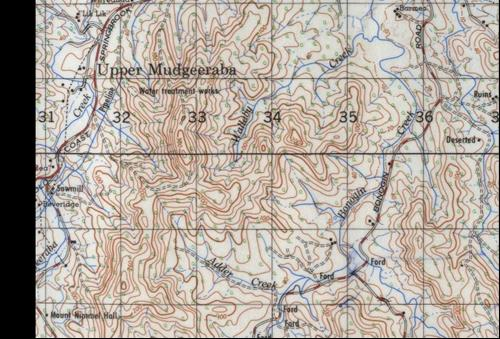

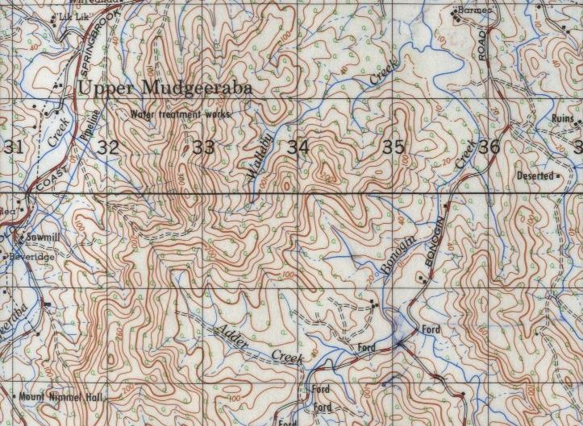

---
## Page 94

National Land Search Operations Manual 
Version Feb 2017 
94
 
Subjective features plotted. 
 
4.127. Looking subjectively at the map a number of natural and manmade boundaries can be 
identified, including the road, creek, ridge line, re-entrant and tracks.  Marking these will 
reveal an irregular shaped search area, shown in green above.  An inspection of the terrain 
has also identified that from the LKP the land slopes downward towards the creeks on both 
sides of the ridge.  An assumption could be made that a missing person would walk downhill 
towards a watercourse and then follow it to help.  An equally valid assumption could be that 
a missing person would seek higher ground to attempt to identify their location.  Which 
course the missing person will take will depend on their experience, ability to navigate, 
mental state and fitness.  Intelligence gathered during pre and ex comms may shed light on 
this assumption.  In either instance the area contained within the identified boundaries 
would be the area of highest probability. 
 
Probable search area plotted. 
 
 
Road
 
Creek
Track
Track
Ridge 
Re-entrant 
 
 
Probable 
search area

---
## Page 95

National Land Search Operations Manual 
Version Feb 2017 
95
4.128. Search Area Segmentation: It is now essential that the search area be segmented into task 
areas. These should be small enough for efficient coverage by a team in a reasonable time. 
Where segmentation results in more task areas than teams, it is necessary to prioritise the 
task areas. Where specialist skills are required to search an area, eg, mine shafts, sink holes 
or cliffs, these should be treated as specific task areas. Segmentation into task areas on a 
map may not easily translate into identifiable blocks on the ground. It may be necessary to 
modify task areas to suit the ground conditions. The boundaries of task areas should be 
readily-identifiable features such as: 
a.  
natural features (eg, rivers, creeks, ridges, re-entrants, spurs, tree and grass 
lines, and shorelines); and 
b.  
artificial features (eg, roads, tracks, power lines, water pipelines, fences, 
railway lines etc). 
4.129. Where readily-identifiable features are not available as task boundaries, use may be made of 
global positioning systems (GPS), compass bearings or markers.  
4.130. In some environments there will be no natural barriers within your possible search area.  
This often occurs in the inland areas of all states except Tasmania, where there are large 
tracts of open plains with no watercourses, hills or other obstacles, but can also happen in 
large rainforest areas or sclerophyll forests. In these cases it is not possible to reduce the 
search area by these means and it is necessary to look elsewhere for clues and assistance.   
 
Search area divided into smaller searchable areas. 
4.131. The intention of the MP can be a pointer to possible directions of travel.  The fall of the land 
may suggest natural funnels, which will draw a missing person.  Lost and tired persons tend 
to walk down hill, following the path of least resistance where possible.  Cattle and animal 
tracks will often be followed by lost persons. 
4.132. Special Searches – Abductions/Homicides: Overseas and Australian studies have revealed 
that approximately 1 of every 10 000 children reported missing are the victims of an 
abduction/homicide.  The SMC must be aware of this as his/her search may eventually be 
running parallel with a criminal investigation.  Time in both cases is crucial as studies show 
 
 
 
 
Search 
area 1 
Search area 2 
Search 
area 3
Search 
area 4 
FHQ

---
## Page 96

National Land Search Operations Manual 
Version Feb 2017 
96
that approximately 44% of victims have been killed with one hour of being abducted and 
91% within 24 hours of being taken. 
4.133. Reporting of Missing Children: The below table is an indication of the time frames between 
the child being noticed missing the when it is reported to authorities. (US Data 2003) 
 
 
When reported 
% of cases 
Immediately 
19% 
Within 1hr 
25% 
Within 2hrs 
40% 
Within 4.5hrs 
68% 
Within 24hrs 
86% 
> 24hrs 
99% 
 
4.134. Guidelines: The following are suggested guidelines to be considered in line with normal SAR 
procedures: 
a. 
Rule out that the child is lost or missing for other reasons. 
b. 
Rule out that the child has been taken by a parent from a custody dispute. 
c. 
Secure the child’s residence. 
d. 
74% of children abducted are killed within the first 3 hours.  Action must be taken 
immediately in a suspected abduction. 
e. 
Extensive canvass of immediate area to locate and identify ‘unknowing’ witnesses, 
people who have seen something but are unaware of its significance. 
4.135. Distance relationships:  
a. 
In 80% of instances of abduction the child was taken less than 500m from their LKP. 
b. 
In 47% of instances the murder scene was less than 500m from the abduction location. 
c. 
The site of the initial contact between the child and offender is the location with the 
greatest chance of having a witness. 
d. 
In 72% of instances the body location site was less than 60m from the murder scene. 
(US Data 2003) 
 
 
Distance from Initial contact site to Murder Site 
Distance 
Percentage 
60m 
31% 
400m 
47% 
2.4km 
57% 
19km 
82% 
US Data 2003 
e. 
In 49% of instances the body recovery site was deliberately selected prior to event.  
63% were greater than 2.4km from the victim’s home. (CATCHEM UK Data 2003) 
 
 
Distance body located from point of last 
sighting. 
Distance 
Percentage 
Within 800m 
91% 
Between 800m and 
1.6km 
6% 
Over 1.6km 
3% 
CATCHEM UK Data 2003

---
## Page 97

National Land Search Operations Manual 
Version Feb 2017 
97
 
 
 
Deposition of body outdoors.  No vehicle or 
transport used. 
Proximity of footpaths to Body Site 
0-45m 
98% 
45-91m 
2% 
Distance Body Found from place last seen. 
Within 800m 
91% 
800m – 1.6km 
6% 
Over 1.6km 
3% 
CATCHEM UK Data 2003 
 
 
Deposition of Body- Vehicle or transport used. 
Proximity of road/tracks affording vehicular 
access. 
0-45m 
80% 
45-91m 
9% 
91-136m 
3% 
Outdoors 
94% 
Within premises 
6% 
CATCHEM UK Data 2003 
 
4.136. Where to look: Local knowledge of the area is essential.  Locations to look in are: 
a. 
Vehicle rest areas and parking bays 
b. 
Debris piles. 
c. 
Dead end roads off main highways 
d. 
Overgrowth filled gullies or canyons 
e. 
Vacant allotments/ acreages 
f. 
Dumping sites 
g.  
Parks or natural areas 
h.  
Creeks, rivers or irrigation channels that are overgrown. 
4.137. Mass Casualty SAR Incidents: Causal factors: Throughout the world manmade or natural 
disasters regularly overwhelm small communities with the resulting loss of live and missing 
persons.  These causal factors include: 
i. 
Mud slides:  ‘A mass of mud and other earthy material that is falling or has fallen 
down a hillside or other slope.’  Mudslides are very common in the wetter parts of the 
world, northern South America, central Africa and south-east Asia as a result of large 
amounts of localised rain which causes a portion of surrounding hills to shift 
downwards, wiping out small villages and destroying communities. Statistical evidence 
suggests that most people caught in the mudslide will either self-recover and make it 
to safe ground or they will not.  There is very little evidence that people survive for any 
length of time in mudslides. Missing persons swept up in the mud will be taken some 
distance from where they began, possibly being pushed to the side of the mud flow or 
buried deep within the flow. 
ii. 
Tsunamis: A long sea wave caused by an earthquake or other underwater disturbance. 
Tsunamis are more common in the Pacific Ocean, primarily because this ocean is 
surrounded by moving tectonic plates. While not common, tsunamis are not all that

---
## Page 98

National Land Search Operations Manual 
Version Feb 2017 
98
rare and occur on a semi regular basis with little effect on the surrounding countries 
due to the distances involved and depth of the ocean.  In recent times they have 
involved several waves or walls of water surging inshore for distances up to ten and 
twelve kilometres depending on the topography of the ground.  The waves or wall of 
water may be only a few centimetres up to four and five metres in height.  The water 
gathers up all loose items in the way, and it is these that often cause the damage to 
structures and persons. The initial force of the water and the amount of debris are 
what prove fatal to people caught in the first or subsequent waves. Similar to mud, 
people swept up in the tsunami will often be taken some distance from where they 
first entered the water.  These people may be deposited far inland or carried back out 
to sea as the wave recedes.  In both instances survival would depend on their ability to 
get out of the way of the water.  Once trapped in the water chances of survival quickly 
fall.    
iii. 
Flash flooding: A sudden local flood of great volume and short duration.  Flash 
flooding is different to general flooding in which the community normally has some 
prior knowledge.  Flash flooding can occur as a result of a sudden downpour of rain in 
a localised area or as a result of heavy rainfall in another location flooding into a 
second area.  There is generally little prior knowledge or warning of a flash flood. 
General information suggests that those persons trapped in the flood waters have a 
limited chance of survival unless they manage to extricate themselves within the first 
few minutes.  The longer the period trapped in the water, the less likely they will 
survive due the buffeting and collision with water borne debris and other obstacles 
including vehicles, trees and ground fixtures. 
iv. 
Bush fires: A fire that occurs in the bush, started by lightning, burnoff or deliberately.  
Australia is plagued by bushfires, particularly during the hotter months of the year.  
They can be limited to a single property or cover vast tracts of land driven by 
favourable winds.  There is no large scale effective countermeasure against bushfires 
except burning off the ground fuel before the fire front.  Official advice for those 
facing a bushfire is to either leave the area or stay and defend their properties.  
Information and investigation into bushfires suggests that those persons that are 
caught and perish in the flames do so insitu and are not carried away as in floods. 
v. 
Earthquakes: A sudden and violent shaking of the ground, sometimes causing great 
destruction.  They are usually caused as a result of movement within the earth’s crust.  
Australia is situated approximately in the centre of our tectonic plate and is therefore 
spared major earthquakes, although as a nation we do suffer from smaller earth 
movements, which are not as severe as many other countries. 
vi. 
Avalanche: An avalanche is a sudden rapid flow of snow down a slope, occurring when 
either natural triggers or human activity causes a critical escalating transition from the 
slow equilibrium evolution of the snow pack. Typically occurring in mountainous 
terrain, an avalanche can mix air and water with the descending snow. Powerful 
avalanches have the capability to entrain ice, rocks, trees, and other material on the 
slope. In contrast to other natural events which can cause disasters, avalanches are 
not rare or random events and are endemic to any mountain range that accumulates a 
standing snow pack.  
vi. 
Subsidence: The gradual or swift caving in or sinking of an area of land. This is 
becoming a more common feature in areas where developments have been built over 
old coal mines. 
4.138. USAR: Urban search and rescue is the search for and recovery of survivors and deceased 
persons trapped within or under the rubble of collapsed buildings, tunnels or other 
structures.  This type of search is generally the province of the Fire Service within each

---
## Page 99

National Land Search Operations Manual 
Version Feb 2017 
99
State/Territory and as such will not be touched upon in this section.  SMC’s should bear in 
mind that these searches will often go hand in hand with normal SAR incidents. 
4.139. Coordination: It is imperative that a search and rescue mission be commenced at the 
earliest opportunity in order that any survivors are given the maximum chance of being 
located and recovered safely.  At the time it is determined that persons are missing as a 
result of a disaster a senior SAR Coordinator should be advised and called into the MIR or 
Operations Room.  This Coordinator will be responsible for initially assembling a team, 
recommended five SAR trained member minimum, to travel to the disaster area.  While 
there are normally SAR trained members spread throughout each State the major source of 
experienced members would be the Search and rescue Units/Water Police in the short term.  
These members can be deployed immediately and should be rotated and/or replaced on a 
roster system in conjunction with the Senior SAR Coordinator and other units.  Where 
required an Overarching SAR Supervisor should be appointed to provide advice, guidance 
and support in situations where more than one search location is required. 
4.140. Initial actions: The incidents described above can occur without any warning or with 
minimal warning. The science of disaster prediction is still in its infancy and authorities are 
always caught between issuing warnings too early and panicking the community or issuing 
warnings too late and not allowing the community to take proper preparations.  In many 
instances the trigger points for the issuing of warnings are very close to the actual 
occurrence of the event. 
i. 
Extent of the incident: The SMC should endeavour to determine the extent of the 
incident.  In many of the above disasters the actual area of destruction will be 
limited to a relatively small area.  Flooding and bushfires have the potential to cover 
large areas. 
ii. 
Population details prior to incident: In order to determine the number of missing 
persons within a particular area the SMC will need to obtain information as to the 
original population in that area.  This is inherently difficult as many families and 
persons are displaced from their homes and are either placed in shelters in other 
locations or with friends and relatives.  In the first instance the number of missing 
persons will always be high until detailed lists of survivors can be compiled by 
agencies such as Police, Community Services and the Salvation Army.  Although this 
information is vital in the planning for a SAR incident, don’t postpone the 
commencement of the SAR because this information is not immediately 
forthcoming. 
iii. 
Last known location of the MP’s: Where possible information of the last known 
point of each missing person should be obtained as a starting place for the planning 
of the SAR response.  Again this is very similar to the problem above in that this 
information may not be forthcoming until several days into the operation. 
iv. 
Lost Person Behaviour: There is no LPB that details the post distress actions of 
persons caught up in the above disasters.  Given sufficient warning for some of the 
disaster types, such as bushfires, persons have the choice of either fleeing the area 
for a safer location or staying and fighting. The actions of the other disaster types 
are so difficult to predict that general advice is to evacuate the area.  For those 
persons that remain behind and are caught up in the incident it is extremely difficult 
to predict where will be the best locations to commence a search.   
4.141. Working under or within a MIR: A MIR and/or PFCP will be set up in conjunction with a 
Local Government Disaster Centre.  The State Disaster Coordination Centre may also be 
activated if the initial incident warranted.  The SAR component of the incident is but one 
small role within a wider response and recovery operation. The most senior member 
assigned to the incident will be the Incident Commander and will therefore set the tone of 
the response and recovery.  The SAR system fits underneath but is separate to the MIR.

---
## Page 100

National Land Search Operations Manual 
Version Feb 2017 
100
Whilst he/she must follow the directions of the Incident Commander, the SMC is the 
member running the SAR response.  The SMC will be competing with other units and 
agencies for the limited resources available initially at any disaster incident.  The SES 
required to conduct searches will also be required to assist in disaster centres, other 
activities and generally assisting the surviving population.  Other assets such as helicopters, 
four wheel drive vehicles, boats, heavy machinery and ADF resources will be competed for. 
The SMC should prepare a detailed search plan, outlining the objectives and 
equipment/resources required to conduct the search phase. 
4.142. MIR Liaison Officer:  The SMC should consider, at the earliest opportunity, in having a 
Liaison officer appointed between the MIR and the SMC.  This member would work from 
within the MIR and be in a position to pass on details that would be useful in a SAR incident 
that may otherwise not be forwarded.  These details will include information obtained from 
a variety of sources such as detectives, traffic, SES, Local Government.  The type of 
information useful in a SAR incident will include: 
 
i. 
Last known location of missing persons 
 
ii. 
Clothing worn when last seen 
iii. 
Statements from people last seeing MP’s. 
iv. 
Other people with MP’s 
v. 
Other sightings of MP’s 
4.143. Field Search Headquarters:  The location of the FSH is normally determined by the SMC.   
a. 
Where possible it should be in or very near the search area.  This is to limit time 
travel, to allow the SMC to have very good situational awareness and allow ground 
to map accuracy.  As the area will have recently suffered destruction there may not 
be the normal facilities found at most FSH’s.  The SMC will need to source 
communications, tents, power, tables, maps etc (local SES can assist).  The ADF can 
also assist if a DACC request is made.  The FSH needs to be secured and away from 
the public eye.  Access should be limited to necessary SAR personnel.  A briefing 
area should be set up adjacent to the FSH, close to an assembly area.  Welfare, 
toilets, food, communications and stores will be within the immediate area.   
b. 
Each distinct search location should have a separate SMC to coordinate the SAR 
response.  If there are two or more distinct search locations then a senior SMC will 
need to be appointed to provide an overarching supervisory and coordinating role. 
c. 
Each SMC should be provided with a team of four SAR trained members: 
i. 
A/SMC: This member will provide day to day assistance to the SMC.  They 
will be responsible for putting into action the SMC’s plans and for providing 
an alternate opinion during the plan development stage to ensure that all 
contingencies are being covered. 
ii. 
Planner:  This member will be responsible for determining the search areas, 
plotting these onto the map on a daily basis or otherwise as determined by 
the SMC.  They are also responsible for the allocation of the search teams 
and completion of all area, speed, distance and time calculations in order to 
provide advice to the SMC. This member will also manage the task sheet 
distribution and collection. 
iii. 
Intelligence:  This member will be responsible to the SMC for the collection, 
collation, evaluation and dissemination of all information arriving at the FSH.  
They will filter and value add to any information obtained, check it against 
current and past tasks and where necessary forward the information to the 
Planner for assigning. This member will also manage the white board at FSH. 
iv. 
Administration and Logistics:  This member, working in conjunction with the 
A/SMC, Planner and Intelligence will source the necessary resources to 
enable the search to proceed.  They will also be responsible for re-supply of

---
## Page 101

National Land Search Operations Manual 
Version Feb 2017 
101
teams, rest and rotation of teams, food, welfare, fuel, travel arrangements 
and any other task assigned by the SMC. 
d. 
On a protracted search it would be necessary to rotate the entire FSH staff on a five 
day basis.  The Senior SAR Coordinator will be responsible for organising fresh teams 
to rotate through each FSH.  On the morning of day five the new team will arrive at 
the FSH, with each fresh member pairing off with the member they are replacing.  
Past experience suggests that a four hour handover will provide all the necessary 
information, thought processes, plans and current tasks to the oncoming team.  The 
original team can then depart for their home stations for rest and relaxation. 
e. 
A five member FSH will provide a professional response to a delicate and sensitive 
situation.  It will also provide the Incident Commander with the best possible chance 
of achieving a reasonable outcome. 
4.144. Search strategies: There are a number of steps to follow to ensure that the best possible 
search is conducted within the area of the disaster.  In most instances the SMC will be 
looking for deceased persons, more than likely hidden in the debris left behind after the 
incident. 
i. 
First search: Once the area of destruction has been identified and the initial danger 
has passed the first search can commence.  The aim of the first search is to clear all 
buildings, houses, shops, sheds, barns, vehicles and other potential places of 
entrapment.  The first search will be similar to a fast search, the aim of which is to 
ensure that all survivors are located and removed to a place of assistance.  While the 
best medical advice suggests that there would be very few survivors in most of the 
disaster types there are numerous instances where a survivor has been located days 
after the initial incident, often protected by the very debris that proves fatal for 
most persons.  Local SOP’s will deal with the actions to be taken in this event. 
ii. 
Second Search: The second search is a more thorough search of the areas covered 
by the first search and any other areas identified as requiring searching.  This search 
is more akin to a general search in which the searchers are going to make a more 
thorough search of each of the buildings and surrounding countryside within each 
search area.  This search will require a large number of searchers to ensure an 
adequate coverage of the search area.  In those areas inundated with mud, flash 
flooding, tsunamis, earthquake and subsidence there will be large amounts of debris 
piled up against any solid walls or barriers in the destruction area.  These debris 
fields will need to be thoroughly searched, to the extent that these debris walls will 
need to be pulled apart and sifted through.  In many instances the mud will 
eventually set as hard as concrete and will require heavy machinery to dismantle.  
During this stage it is very important that searchers sift through the debris as it is 
pulled apart to ensure that deceased persons are located. 
iii. 
Third Search: If necessary a third search may be conducted of all or a part of the 
search area.  This may be required due to weather or other circumstances that may 
have degraded earlier searches.  Unusual odours or debris piles not previously 
dismantled will need clearing before an area can be identified as clear.  
iv. 
Fourth and subsequent Search: A fourth and subsequent searches may need to be 
carried out in some areas of the search location due to a variety of factors including: 
a.  
Area still inundated with water 
b. 
Conditions are not conducive to conducting a thorough search 
c. 
Current conditions are considered unsafe, particularly where buildings are 
concerned. 
d. 
Continued ground tremors 
e. 
Continuing rain

---
## Page 102

National Land Search Operations Manual 
Version Feb 2017 
102
f. 
Insufficient resources, necessity for specialist crews, to complete search. 
4.145. Search problems: Unlike general SAR operations, searching in mass victim incidents will 
require different techniques.  There are a number of different situations that will need to be 
taken into account by the SMC: 
i. 
Shops, houses, flats and apartments: A full search will need to be conducted of the 
interior of all houses, flats and apartments that were affected by the incident.  This 
search should include all rooms, cupboards, wardrobes, hutches, fridges, washing 
machines, etc. Underneath all buildings will also need to be cleared.  Those buildings 
on stumps may not pose the problem of those buildings closer to the ground.  Flood 
water and mud can carry persons into and under buildings where they may become 
trapped.  (Before doing so, ensure buildings are determined structurally sound.) 
ii. 
Open areas, paddocks, parks and farmland: As a result of flooding and/or mud 
these open areas can be covered in either water, mud or a combination of both. 
Searching these areas is man power extensive and time consuming.  They must be 
covered slowly, with a visual horizon as close as 2m, and a slow walking pace.  Long 
metal poles will also assist in testing the mud for buried persons.  A searcher will 
notice the difference as they push a metal pole through the mud and into a 
deceased person. Searchers should also beware that there will be cattle, sheep and 
wildlife buried within the mud that will produce a similar smell and feel to a 
deceased person. 
iii. 
Creeks, waterways, gullies, drains etc: Flooding water and mud will generally take 
the path of least resistance, which normally will be creeks, gullies, waterways and 
drains.  The depth of water in these may require specialist Units to assist in 
searching, such as Divers.  The force of the water and mud will also push motor 
vehicles, household items and other debris into these waterways.  Each one of these 
items will need to be located and recovered from the water in order that they can 
be cleared as empty.  Animals such as horses, cattle and wildlife will also be found in 
the water.  As they could be masking human remains they will also need to be 
recovered and checked. 
iv. 
Mountainous areas: Mountainous areas pose a wide variety of problems for a SMC, 
in particular the necessity for searchers to have specialist skills in mountain climbing 
and/or snow searching. Avalanche victims have a very limited golden period 
requiring searchers to be deployed within minutes of the incident occurring. 
Transport to the incident site may be limited due to road and rail closures.  Rotary 
wing assets will be the best option. 
v. 
Fatigue: Although the search areas used in these situations will be smaller than in 
general SAR operations the intensive searching required will cause the searchers to 
succumb to fatigue quicker than usual.  Searching areas while wading through water 
and mud will also impact on the physical ability of searchers, limiting their useful 
capability and requiring regular rest and rotation. 
4.146. Search area delineation:  As in normal SAR operations the overall search area should be 
divided into sub search areas that are capable of being identified and then searched. The use 
of natural or man-made barriers or boundaries will ensure that each search area can be 
properly identified by its respective search team. The SMC has a range of options in which to 
delineate the search area depending upon the severity of the event.  Depending on the 
number of volunteers available each team should be assigned an area no larger than a 
normal town block per task.  This will provide sufficient work for a four hour period.  If teams 
are working in open fields an area of approximately ½km² would be sufficient per four hour 
period.  An expanding square or circular search from the point of origin or centre of the 
disaster will ensure that all areas are covered.  A creeping line search from one side of the

---
## Page 103

National Land Search Operations Manual 
Version Feb 2017 
103
search area to the other will also achieve the same result. The ultimate aim is to ensure that 
all areas within each search area are covered. 
 
 
                     Expanding Square Search. 
 
 
                        Creeping Line Search 
Obtaining plans from the local government of the area of the disaster will give the SMC an 
appreciation of the number and location of all houses, shops and other buildings within the 
search area.  Depending upon the time of year and location there may also be 
considerations of children in school, shopping malls full of shoppers or popular holiday 
destinations packed with weekend campers. 
The search can radiate from the central point 
of the disaster similar to an expanding square 
search. This search will require good access to 
the epicentre and good control over the 
search teams to ensure that they do not leave 
gaps in the search.  This can be done with 
small numbers of searchers in the initial 
phases but as the area gets larger more 
resources will be required. 
The search can also commence from one 
side of the incident location and sweep 
across the entire area in a creeping line 
fashion.  This will be very resource intensive 
and will possibly leave the worst hit areas of 
the location until half way through the 
search but may be useful if access to the 
worst hit areas is not possible in the short 
term.  This search can go in any direction 
depending upon the terrain and the incident 
path.

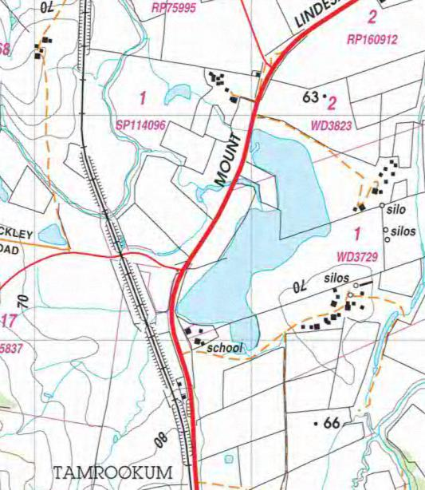

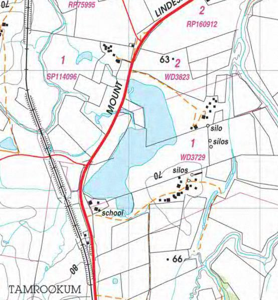

---
## Page 104

National Land Search Operations Manual 
Version Feb 2017 
104
Utilising the urban property plan below the SMC can allocate a block to each SES or other 
team for searching.  The briefing would be able to include the number of properties within 
the search area and the type of buildings likely to be encountered.  As each property is 
checked for survivors, deceased or other it can be marked of accordingly.  Those properties 
that cannot be searched for a particular reason (Unable to reach location, building 
structurally unsound etc) can then be easily be identified at a later stage for further 
investigation 
 
 
 
 
 
 
 
 
 
 
 
 
 
 
 
 
 
 
 
 
 
 
 
Each search area is coloured a 
different colour for each search 
team.  Blue Team has 15 
Properties to search in their 
block while the Orange Team has 
14.  The size of the blocks and 
number of individual properties 
will provide the SMC with an 
indication of the times involved.  
Upon return by the teams the 
master plan can be marked 
indicating what has happened.  
Both teams managed to search 
all their blocks apart from two 
properties each, marked in red.  
The black stars mark where 
deceased persons were located.  
The red properties will need to 
be search at a later time and 
A rural portion of land can be similarly divided up into 
property size search areas which can be easily tasked and 
then colour coded after a search.  Green are cleared 
properties.   
Red have not yet been checked for some reason.  
Orange areas need further searching, possibly a smell etc.   
Deceased are again indicated by a black star.

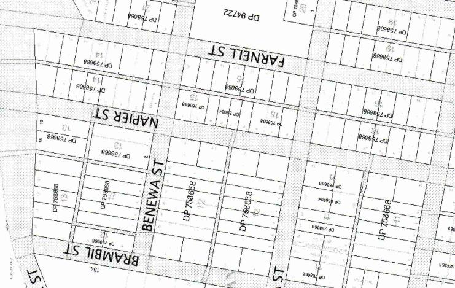

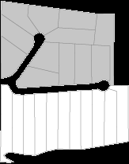

---
## Page 105

National Land Search Operations Manual 
Version Feb 2017 
105
4.147. Tasking sheets: Tasking sheets have been developed to ensure that all of the identified tasks 
within the search are properly undertaken and completed.  The SMC should ensure that 
each task is recorded in duplicate at least, providing one to the search team leader and 
keeping one at the FSH as reference.  As the task is completed the original can be signed off 
and filed.  At the conclusion of each day any uncompleted tasks can be identified and 
reassigned if necessary.  The task sheets will enable the SMC to provide a detailed summary 
of the searching on a daily basis.  Electronic mapping programs allow easy input of search 
areas as they are completed, again providing the SMC with an easily readable summary of 
the daily activities. They will also for the basis of a Coronial File, which will always follow a 
major disaster with loss of life.   
4.148. Briefings: Briefings to search teams and search team leaders are generally given in the 
SMEAC format.   
i. 
Situation: The situation will be a precise of the incident occurrence and subsequent 
events. 
ii. 
Mission:  The mission should be a short statement of intent.  Ie. To locate missing 
persons in the search area. 
iii. 
Execution: The execution section will be the most important part of the briefing as it 
will provide the search teams with the tools to perform their assigned tasks.  Each 
situation will be different and the methods of searching will be dependent on the 
terrain, disaster type, number of volunteers, weather and time frames.   
Execution Factors:  
1. 
Deceased persons: Deceased persons meet their demise in many different 
ways.  Bushfire victims may vary from no visible signs of burning to totally 
incinerated with no resemblance to a human.  The degree of destruction 
depends on the severity of the fire, location of person, speed of the fire 
and any actions the victim may have made to protect themselves.  Many 
bushfire victims succumb to asphyxiation as the fire consumes all the 
oxygen in the area.  Others will breathe in the superheated air and perish 
as a result of the complications of the internal burning.  Searchers must be 
made aware that their targets will range from an intact human to a small 
pile of dark ash. Flood and mudslide victims will normally retain their 
human shape, although due to the force of the water/mud it may be 
distorted and out of shape with broken bones and internal injuries.  These 
victims will not often be found on the surface.  They may be entombed 
within a metre or more of mud or mud and debris. The deceased may not 
be easily recognised as they are often coated with mud and blend into the 
background.  Those that are left uncovered after the waters recede will 
often discolour and darker quickly as decay and sunburn sets in. Victims 
from building collapse as a result of earthquake or subsidence are often 
distorted and misshapen due to the extreme weight suddenly falling on 
them. 
2. 
Searching for deceased is a combination of all senses as sight alone will 
not be enough.  The distinctive smell of decaying flesh may greet the 
searcher as they near a potential area.  Keeping an eye on the shape of the 
ground may unearth a buried victim.  Observing an area of darker ash in a 
human shape may identify a victim. Searchers may also use thin metal 
poles to prod into the ground, the change of pressure or sudden change of 
odour may suggest the location of a body underneath.  Thermal imaging 
cameras and ground radar can be used if available.  There is no record of 
any success to date.  Cadaver dogs may also be considered, although they 
work best when the deceased are about week old.

---
## Page 106

National Land Search Operations Manual 
Version Feb 2017 
106
3. 
Location of deceased:  Local SOP’s will determine the actions on location 
of deceased persons.  These should be included in the briefing to ensure 
photographs and examinations are made prior to recovery in case of foul 
play.  The location should be recorded by GPS or other accurate means to 
enable it to be plotted for the final report. Depending on the incident, a 
large number of animals will be located and will require the services of a 
doctor or forensic member to determine if they are human or otherwise. 
iv. 
Administration and Logistics: Re-supply, body bags, disinfectant, insect repellent, 
sun screen, fatigue, meals, water, transport, PPE are some of the items needed to be 
covered in this section. 
v. 
Command and Communications: This section is common for all SAR incidents. 
4.149. Record Keeping: As per all SAR incidents, detailed recorded must be kept for future 
reference.  The will include: 
i. 
SAR Log: A detailed chronological record of decisions and actions taken during the 
SAR incident.  With respect to disaster searches, all decisions with respect to 
deployments, asset allocation, briefings, debriefings should be recorded.  The log 
will also include such details as daily sunrise and sunset, weather conditions, 
topographic hazards, SAR teams and hand over notes. 
ii. 
Task sheets:  Should be completed in duplicate, original for the search team and 
duplicate for the FSH. The original sheets should be collected from the search teams 
as they return to FSH.  If the task has been completed it can be closed.  If the search 
team was unable to complete the task for whatever reason, the task can be 
reassigned at a later date. 
iii. 
Map overlays: Depending on the size of the search area and the number of search 
teams there may be a map overlay for morning and afternoon or for a single day.  
Each overlay should have the map number, date, time and SMC name in the top 
right corner.  The top left and bottom right should have two reference marks so that 
the overlay can be aligned with the map at a later date.  The actual areas designated 
and those searched can then be drawn in permanent marker on the overlay.  As the 
SAR develops successive overlays can be placed on top of each other to determine 
what areas have been missed and what need to be researched. 
iv. 
Radio log: This log will normally be maintained by the SES and will be a complete 
record of all radio traffic to and from FSH for the duration of the SAR operation. 
v. 
Briefing notes: A written copy of each daily briefing should be filed for future 
reference. 
4.150. Electronic recording of search: There are a number of electronic aids that can greatly assist 
the SMC in recording information and briefing up and down the chain of command.  One of 
the biggest problems associated with SAR is the accurate identification of areas searched.  At 
present this is done through a combination of map work and GPS usage.  Where available 
GPS data can be downloaded onto a mapping program to give an accurate picture of where 
search teams went.  This enables the SMC to know if the briefings were sufficient and if the 
directions were followed.  Other electronic devices such as ArcPad’s or similar instruments 
have the ability to provide mobile field mapping and data collection.  This information can 
then be sent via the mobile telephone system to a server for instant production on a FSH 
computer terminal.  Used in conjunction with a GPS and date stamp enabled digital camera, 
pictures can be taken of any object of interest and transmitted instantaneously to the FSH.  
This has the ability to allow the SMC to observe victims insitu, debris mounts and other 
points of interest while communicating with the search team.  These photos can then be 
saved against that location for future reference.

---
## Page 107

National Land Search Operations Manual 
Version Feb 2017 
107
This information instantly allows the SMC to identify each property as it is being searched, 
and what the property looks like in real time.  The Incident Commander could also view 
these details from their office without the need to visit the scene.  These electronic aides 
could also provide information to assist the Coroner during any subsequent inquest as any of 
the properties involved in the incident can be viewed, as can the initial location of motor 
vehicles, persons and buildings if necessary. 
4.151. Summary: It is important to consider all the factors described in this chapter, along with 
information obtained about the missing person(s) prior to planning the search.

---
## Page 108

National Land Search Operations Manual 
Version Feb 2017 
108
 
Chapter Five - Search Techniques and Operations (Land) 
 
5.01. 
Police authorities undertake the responsibility for coordination of land search and rescue. 
5.02. 
The previous chapter described how to determine the area where available search efforts 
should be deployed.  Once this area has been determined, a systematic search for the target 
should be planned.  Prior to a search operation commencing, the search planner should 
provide a detailed search action plan to all involved, specifying when, where and how 
individual search assets are to conduct their operations.  Coordination instructions, 
communications frequency assignments, reporting requirements, and any other details 
required for the safe, efficient and effective conduct of the search must also be included in 
the search action plan. 
5.03. 
The selection by the SMC of available SAR units to be used in SAR operations should take 
into account the following considerations: 
a. 
the need to reach the distress scene quickly; and 
b.  
suitability for at least one of the following operations: 
i.   
provision of assistance to prevent or lessen the severity of accidents; 
ii.  
conduct of a search, primarily by air but with the assistance of marine or 
land units as required; 
iii.  
carriage of supplies to the scene of an accident and, if necessary, delivery of 
supplies; or 
iv.  
execution of a rescue, (by marine and land units or by helicopters; and as 
required fixed wing aircraft to provide guidance to units or to relay 
communications). 
5.04. 
In coordinating a land search, the SMC, as guided by local procedures, will activate land, 
marine or air assets depending upon the situation. JRCCcan assist with advice on suitable 
aircraft for SAR operations. 
5.05. 
Land Assets: The SES or equivalent in each State or Territory will provide trained and 
disciplined teams of volunteer search personnel.  The training will vary depending on: 
a. 
the location of the SES Unit,  
b. 
type of terrain likely to be encountered by members of that unit (ie Victorian SES 
would have a snow capability while western Queensland and Western Australian 
Units would have a desert capability),  
c. 
number of staff available for training 
d. 
support provided by individual State and local governments, and  
e. 
necessity of the units for SAR incidents. 
5.06. 
With respect to SAR, SES members are trained in the following: 
a. 
basic land search techniques, 
b. 
Radio operation 
c. 
Log taking 
d. 
First aid 
e. 
Crime or suspicious scene preservation 
f. 
Vertical rescue 
g. 
Logistics 
h. 
Planning 
i. 
Flood boat operations 
5.07. 
Search by land facilities alone is usually impractical for large search areas but it can be 
conducted in most weather conditions and can provide complete coverage of a confined

---
## Page 109

National Land Search Operations Manual 
Version Feb 2017 
109
area that cannot be thoroughly searched from the air. Land parties are also critical in 
operations where the search is carried out from the air and rescue by land facilities. 
5.08. 
The need for coordination between land rescue units and search aircraft should be 
considered, and plans should cater for the need for two-way radio communication. There 
may also be a need in remote areas to keep land units supplied with fuel, water and food by 
means of airdrops. 
5.09. 
When the survivors are located, the SMC should liaise with the police commander with a 
view to expediting the return of survivors to a place of safety. Consideration should be given 
to aircraft relay and the use of suitable motor transport: ambulances, four-wheel drive 
vehicles, buses, etc. 
5.10. 
Specialist police and military land parties are equipped with material useful to the SAR role. 
It is desirable that land SAR units be equipped with basic navigation aids, two-way 
communication equipment, sufficient clothing, medical supplies and rations to reduce the 
need for air drops and specialist equipment appropriate to the unit’s particular role. 
5.11. 
Marine Assets: The water component of a land SAR incident might involve inland 
waterways, lakes, dams and coastal areas of the country. 
5.12. 
While most of the land SAR marine environment will be smooth water there are areas in 
Australia that have fast flowing white water, such as north Queensland and Tasmania.  The 
SES in most states have a flood boat capability which is also available as a SAR asset.  Flood 
boats are of shallow draft and made of metal to resist floating debris.  They are capable of 
getting close into the banks of creeks, rivers dams and other water areas to search sections 
not easily visible from the land side. 
5.13. 
White water rapids will require a different approach as they are not easily navigated by the 
larger flood boats.  Searching from smaller man powered craft or from landward may be 
necessary.   
5.14. 
As with aircraft, the discretion to use the boat is in the hands of the skipper.  Being of 
shallow draft and low freeboard they are not suitable for rough conditions or surf. 
5.15. 
Local Surf Lifesaving Units may have a capability to assist in searches in or near the shoreline 
of beaches.  In the more populated or tourist areas the Surf Life Saving Association will have 
water craft, suitable operators and a wealth of local knowledge. 
5.16. 
Air Assets: Many types of aircraft will be suitable as SAR Units with little or no modification. 
However, care should be taken to ensure that, even in an emergency, safety of flight is the 
primary consideration and should never be compromised. The normal operational and 
technical limitations of an aircraft, as well as the qualifications of the crew, should be 
carefully noted by the SMC. SMC’s must ensure they are cognisant of the factors relating to 
the aircraft and crew that may compromise the conduct of the SAR mission. 
5.17. 
Some specialist SRU’s that have undergone training from JRCCare organised in Tiers and can 
be fixed wing aircraft or helicopters. The tiers relate to the capabilities and training of the 
aircraft and crews. When chartering aircraft for use as SAR Units, the SMC shall, whenever 
practical and effective, select aircraft from trained SAR/Emergency operators including; 
a.  
Search and Rescue Units (SRU’s); 
b.  
Police and State Emergency Service aircraft. 
5.19. 
Advice on suitable aircraft can be obtained from JRCC 
5.20. 
If additional aircraft are required, call out could be made according to the following priority 
bearing in mind suitability, location and availability: 
a.  
domestic commercial aircraft, 
b.  
Coastwatch aircraft 
c.  
ADF aircraft 
d.  
scheduled Regular Public Transport (RPT) aircraft. 
e.  
private aircraft

---
## Page 110

National Land Search Operations Manual 
Version Feb 2017 
110
5.21. 
Private aircraft may be used when so situated as to more readily effect the saving of life, 
operated by crew having particularly valuable local knowledge of the area to be searched, or 
when no other commercial aircraft are available. 
5.22. 
As a general rule, slow aircraft or aircraft capable of reducing speed to 100 - 150 knots are 
most efficient for visual searches. Small and partially hidden targets are easily missed at 
higher speeds and faster aircraft may be subject to operational limitations making them 
unsuitable for low-level flights. Nevertheless, fast and/or highflying aircraft also play an 
important role in search operations, for instance when these aircraft carry out: 
a.  
an electronic (radio) search to home on distress signals; and 
b.  
an exploratory sweep of a large search area simultaneously with a search by a slower 
aircraft flying at lowers levels, a method that is particularly effective in flat and 
unobstructed areas. 
5.23. 
The suitability and efficiency of an aircraft for search, support and rescue operations will 
depend on which and how many of the following desirable features it possesses: 
a.  
Operational characteristics: 
i.  
safe low-speed and low-level flight capability, 
ii. 
 short take-off and landing (STOL) capability, 
iii.  
sufficient range to cover the area, with due regard to the location of 
redeployment bases, 
iv.  
manoeuvrability, especially for searches in mountainous areas, and 
v.  
payload capacity; 
b.  
Equipment: 
i.  
suitable navigation and instrument flying aids, 
ii. 
radio equipment capable or receiving and homing on emergency radio signals, 
and 
iii.  
adequate communications equipment;  
c.  
availability of good observation posts; 
d.  
suitability for the delivery of supplies, emergency equipment and personnel; and 
e.  
facilities for the treatment and carriage of survivors. 
5.24. 
The SMC shall select aircraft for use as SAR Units after consideration of the following factors: 
a.  
type of search necessary; 
b. 
 type of terrain; 
c.  
type of navigation involved; 
d.  
need for dropping supplies; 
e.  
disposition of aircraft with respect to search area; 
f.  
crew experience and familiarity with the area; 
g. 
weather conditions at and en route to search area; and 
h.  
rescue considerations. 
5.25. 
Aircraft not equipped with radios should not be used on SAR operations except as a last 
resort. 
5.26. 
Fast, high flying aircraft equipped with homing and/or direction–finding equipment that 
have the operational flexibility to descend to low level for final search are recommended for 
beacon monitoring. 
5.27. 
Seaplanes and amphibians are useful for search or for carrying supplies and personnel over 
water. Their use as rescue units or carriers of personnel is limited to operations in lakes and 
river areas, or sheltered waters and bays. Under favourable weather and sea conditions, 
suitable seaplanes may also be used for rescue operations in protected waters, eg. large 
lakes, bays, shore areas etc.  
5.28. 
Helicopters are particularly useful SAR units as their slow speed and ability to hover make 
them suitable for search as well as rescue operations, particularly where small targets are

---
## Page 111

National Land Search Operations Manual 
Version Feb 2017 
111
sought or close scrutiny of terrain is required. They also have the ability to land in a confined 
area and, in some instances, to operate from some vessels. 
5.29. 
Some helicopters are fitted with winches or are equipped for flight in instrument 
meteorological conditions (IMC) and at night giving them an added advantage for search and 
rescue response. Turbulence, gusting winds and icing are conditions that the SMC should 
consider when determining helicopters as appropriate SAR units. 
5.30. 
Where terrain and vegetation is such that a contour search is necessary, preference should 
be given to: 
a.  
helicopters, 
b.  
high-performance short take off and landing (STOL) aircraft, or 
c. 
light, manoeuvrable twin engine aircraft. 
5.31. 
Where possible, single engine aircraft should be restricted to areas where the terrain would 
permit forced landings. 
5.32. 
When possible, consideration should be given to engaging aircraft capable of carrying at 
least two Observers. 
5.33. 
Where possible, landing sites should be as close to the search area as possible. The landing 
area selected should be clear of loose articles that may be blown into the air by the rotor 
downwash. On beaches, it is best to use the water’s edge to form one side of the landing 
area. Communications should be established with the aircraft before its arrival and the pilot 
briefed on the landing site. If the pilot is unfamiliar with the location, a description of the 
area using large geographical features may need to be passed. If possible, a number of 
people should be deployed to secure the area before the aircraft arrives so that no one 
enters the landing area until the rotors of the aircraft have stopped or the pilot indicates 
that it is safe to do so. If the landing area is in a populated area, extreme care should be 
taken to ensure that no children run toward the aircraft once it has landed. When 
communicating with the aircraft it is important to inform the pilot of any obstacles in the 
immediate area. This is especially applicable to wire strung between trees and power lines 
as these types of obstacles are difficult to see from the air and present a danger to the safe 
operation of the aircraft. 
5.34. 
Search Planning: At a minimum, developing a search action plan consists of the following 
steps: 
a. 
selecting search assets and equipment to be used. 
b. 
assessing search conditions 
c. 
selecting search patterns to cover the search area as closely as practicable 
d. 
dividing the search area into appropriate sub-areas for assignment to individual 
search teams; and 
e. 
planning on-scene coordination 
Note: While marine search areas are calculated from well established tables, land search 
areas will be a combination of theoretical, statistical, subjective and deductive reasoning. 
5.35. 
Before committing resources to an intensive search, an evaluation should be made of the 
total search effort required and the contribution that may reasonably be expected from 
each search unit.  When assessing available search capacity, care must be taken not to over-
estimate either the time that a particular search team can spend in a search area or the 
capability of that team to remain effective over long periods of continuous searching. 
5.36. 
Failure to make a sound estimation of these factors may result in one or more of the search 
teams being unable to complete its allocated task and the efficiency of the entire effort 
being seriously compromised. 
5.37. 
Land SAR Strategies: Although specific search plans will vary with the circumstances, a 
system has evolved which can apply to most situations.  Land searching may be divided into 
four strategies: 
a. 
Fast Search

---
## Page 112

National Land Search Operations Manual 
Version Feb 2017 
112
b. 
Reconnaissance Search  
c. 
General Search  
d. 
Contact Search  
5.38. 
In land search it is not necessarily go through the strategies in order, the SMC has to apply 
the most appropriate search strategy in order to maximize the POD. 
5.39. 
Therefore, in the initial time of a search the SMC may employ a Fast strategy, as later 
resources arrive, a Reconnaissance strategy may be employed. As time goes by and a person 
approaches their TFFS and/ or the search area expands for whatever reason, the SMC may 
employ a General Strategy in a high probability search segment, other teams for further 
Reconnaissance or Fast strategies in other segments. The fact is, all strategies can be used at 
the same time in different search segments.  It is a Strategy that is applied to the search, 
NOT a stage that the search goes through. 
5.40. 
Often a search will progress from one predominant strategy to another. However, 
depending on urgency, TFFS and resources, etc, varying strategies may be employed 
simultaneously in differing search segments. 
5.41. 
With each of the four strategies there are associated search patterns that utilise the 
resources available to the best effect.  Further details are provided in the search pattern 
section. 
5.42. 
Approximately 70-80% of missing persons are located using the fast and reconnaissance 
strategies, therefore these two strategies should be the first considerations of the SMC 
when planning for a SAR. 
5.43. 
Immediate Response: The initial search will normally consist of: 
a. 
A visual search along, and also parallel to, the track of the missing target. (A fast or 
reconnaissance search) 
b. 
Actions to determine whether a signal from an emergency beacon has been 
detected. 
c. 
Formulation of a rescue plan 
d. 
Coordination with other resources and agencies as appropriate. 
5.44. 
The search may comprise: 
a. 
Developing a search area utilising a combination of theoretical, statistical, subjective 
and deductive reasoning 
b. 
Developing sub-search areas 
c. 
Allocating search teams 
d. 
searches utilising any one or a combination of the below search patterns. 
e. 
developing a rescue plan to return survivors to safety. 
f. 
Gathering intelligence relevant to the search 
5.45. 
The SMC should consider: 
a. 
Utilising the media if appropriate 
b. 
Tasking local resources where the urgency of the situation dictates. 
c. 
That a search and/or rescue may be required. 
d. 
The terrain, vegetation, weather, intentions of missing persons, ability of the search 
teams, search light available and resources available. 
e. 
That the coverage factor should generally not be less that 0.5; and 
f. 
The use of electronic or thermal imagery equipment. 
5.46. 
Fast Search: This method is best used when the search team arrives at the scene not long 
after the target has been reported missing.  There is an assumption that teams are looking 
for a responsive target.  This search provides an immediate SAR effort and requires minimal 
search planning to commence. 
5.47. 
Fast Search techniques: Teams are briefed to check the LKP and tracks or route intended by 
the target.  This is normally done by lightly burdened teams of faster searchers.  Track 
running, with regular stops for aural searching, is the standard technique.  Checks of

---
## Page 113

National Land Search Operations Manual 
Version Feb 2017 
113
perimeters or barriers, roads, track cutting, ridge running and obvious hazards or attractions 
can also be incorporated.   
5.48. 
Fast Search considerations: Teams used in this type should have some experience in clue 
and track detection and bush awareness.  While there is a high percentage change that this 
type of search will locate a missing target it will also assist in defining the search area and 
providing information to the SMC of areas that need not be searched. 
5.49. 
Reconnaissance Search: The main reason for the reconnaissance is to carry out a quick 
check of specific area of probability, and also to obtain essential information about the 
search area, both of which have a bearing on the future search plan.  Reconnaissance teams 
may also find the missing person or object.  A reconnaissance search can be conducted using 
ground teams, vehicles or aircraft.  A reconnaissance can be used, not only early in a search, 
but at any time to check on unconfirmed sightings or to re-check specific areas of 
probability. 
5.50. 
Reconnaissance Search, Containment: In any search, containment should be effected by 
cordoning the area where possible.  This may through identifying physical barriers around 
the search area, regular patrols of roadways or tracks or the placing of physical barriers such 
as ropes, bon fires or vehicles across likely exit points from the search area. 
5.51. 
Composition of reconnaissance teams: Since they must travel light and fast, these teams 
should be kept small; ideally four persons.  It is desirable that the leader or at least one 
member of the team have a good local knowledge of the task area and that all members are 
fit and capable. 
5.52. 
Task of reconnaissance teams: The area to be covered by these teams will concentrate on 
the area of highest probability.  This area may be further limited by the existence of natural 
barriers such as large rivers, cliffs, etc. 
5.53. 
Orders given to the reconnaissance team may include the following: 
a. 
Check of all hazards which may have trapped or caused injury to the missing persons 
such as waterfalls, cliffs and caves. 
b. 
Check tracks, huts, routes, sand-bars, waterways, waterholes, waterfalls and other 
likely areas for clues such as footprints, discarded items of clothing and equipment, 
food scrapes or wrappings. 
c. 
At regular intervals call out to a missing person and listen for a reply.  When vehicles 
are employed, the vehicle should be stopped and the engine turned off. 
d. 
Interview any person found in the search area and brief them on the situation.  
Record their names, addresses, car registrations and other details. 
e. 
Notify the Field Search Headquarters of any cluse found.  Do not disturb the clues, 
mark off the area as well as recording the time found and the name of the finder. 
5.54. 
Reconnaissance Team Briefing: The reconnaissance team must be supplied with as much 
relevant information as possible about the missing person.  Details of clothing, footwear, 
equipment or items carried, all of which if discarded by the missing person, could provide 
vital clues.  Often the importance of clues is only realised long after they have been 
dismissed as irrelevant. 
5.55. 
General Search: When the SMC is able to define a search area, a decision may be made to 
cover the area with a general search.  This is a general search of the area and may be used: 
a. 
early in a search operation where there is a high degree of urgency; and 
b. 
to reduce the search area in those situations where the search area is large. 
5.56. 
Composition of teams for general search: Teams should be kept small (4 to 6 persons) and 
as far as possible comprise persons of equal fitness and ability.  Larger teams can be utilised 
depending on the terrain. 
5.57. 
General Search Method: Having determined search areas, the method of searching a 
particular area must then be decided.  The term ‘general search’ does not imply an

---
## Page 114

National Land Search Operations Manual 
Version Feb 2017 
114
examination of every square metre, but rather a check for signs or indications of the missing 
person. 
5.58. 
A check of campsites and other sheltered areas, such as hollow logs or caves, may produce 
results.  A more detailed check of any natural hazards or areas where the missing person 
could be trapped or injured, should be made. 
5.59. 
For areas of high probability, a modified form of general search may be employed using the 
same strength in the teams, but designating smaller task areas, resulting in a closer coverage 
of the areas involved.  As for the reconnaissance search, the team should call out to a 
missing person at regular intervals and listen for a reply.  This may need to be considered 
against the lost person behaviour. 
5.60. 
Contact Search: The contact or line search can be used to saturate an area of high 
probability, although it is usually the concluding stage of a search operation.  A contact 
search involves searchers moving in a straight line through the area, evenly spaced and in 
sight of the adjacent searchers.  The spacing will depend on the density of the vegetation 
and the size of the target. 
5.61. 
Composition of Contact Search teams: There is a practical limit on the size of a contact 
search team under the control of a single leader.  This varies with conditions, but is normally 
8 to 12 persons.  The most experienced searchers should be at the ends and the centre of 
the search line. 
5.62. 
Tasks of Contact Search teams: The contact search team must search every possible refuge, 
since a missing person suffering in the bush is unlikely to remain in the open but will rather 
seek refuge in a sheltered place, out of the wind, wet or extreme heat.  These will include 
ditches, hollow logs, amongst large rocks and under small ground scrub.  All areas must be 
searched. 
5.63. 
Contact Search, Special Considerations: Searchers must look on both sides of obstacles and 
must continually look back as it is possible to completely by-pass an unconscious person 
lying behind an obstacle.  A high degree of concentration is required in contact searchers, so 
the team leader should ensure that the searchers do not talk excessively or let their 
concentration lapse. 
5.64. 
The contact search line must be kept straight.  This is very difficult because different sections 
of the line will encounter varying obstacles, eg thick scrub.  Some control must operate to 
ensure that faster searchers in clearer areas slow down and wait for those encountering 
difficulties.  The best method is for the Team leader to be positioned in the centre of the 
search line, preferably to the rear and call instructions to the flanks.  An area can be covered 
more effectively by a series of short sweeps, rather than a single long sweep. 
5.65. 
Spacing of the line is maintained from whichever flank is following the boundary or 
otherwise defined track.  The other flank indicates their progress by using markers.  It can be 
an advantage to use different coloured markers on each day of the search.  At the end of 
each sweep, the markers become a guide for the next sweep.  Markers should be placed in 
such a manner that they can be seen easily when returning in the opposite direction.  
Consideration should be given to using biodegradable marker material, such as toilet or 
tissue paper so that it will disintegrate shortly after a search if it is not retrieved. 
5.66. 
The contact search is continued sweep by sweep until the area is covered.  This is 
exhausting, time consuming and requires large numbers of searchers.  It is important that 
search teams, operating in the same area, maintain contact to ensure that mutual 
boundaries are properly searched. 
5.67. 
Calculated Search Area: This is a continuation of the immediate response, where the search 
area is expanded to cover the probability area calculated by reference to the targets 
location, targets intentions, estimated speed over the terrain, search area boundaries and 
hazards, and the target’s medical, physical and mental condition, modified by ongoing

---
## Page 115

National Land Search Operations Manual 
Version Feb 2017 
115
intelligence gathering.  This area may increase or decrease as further information comes to 
hand, which will incrementally increase the POD over the centre of the search area. 
5.68. 
The SMC should consider: 
a. 
the availability of search aircraft 
b. 
the availability of suitable ground assets 
c. 
logistical support for search teams 
d. 
location of Field Headquarters 
e. 
local weather conditions and expected forecasts. 
f. 
Continual intelligence gathering 
5.69. 
Search Area Coverage: Once the search area has been determined, systematic search for 
the target should be planned.  Factors such as the weather conditions, time available for the 
search, search assets available, size and dress of target, etc, should be taken into account.  
These factors are related but some are more important than others. In planning a search 
operation, the SMC should endeavour to meet the requirements of the more important 
factors while satisfying the requirements of the others as far as practicable. 
5.70. 
Search area coverage is the systematic search of a selected parcel of land to ensure the 
optimum probability of detecting the object being sought.  The factors affecting detection 
capability have been reduced to four inter-related expressions.  The terms and their symbols 
are: 
a. 
Area Swept (W) 
b. 
Probability of Detection (POD) 
c. 
Track Spacing (S) 
d. 
Coverage Factor (C) 
5.71. 
The number of searchers and search teams will be a factor in determining search area 
coverage.  More time will be required to search a large area thoroughly when there are 
limited numbers of search assets unless the distance between searchers and search teams is 
increased.  This is not desirable since it would reduce the probability of detecting the target.  
It may, therefore, be necessary to seek additional assets, either land or air, from other 
sources.  It is usually preferable to cover a search area from the beginning with an adequate 
number of search assets. 
5.72. 
When search assets are operating far from the Field Headquarters, consideration should be 
given to them being redeployed to an advance base so that more time will be available for 
the search and less time will be spent travelling to and from the search area. 
5.73. 
Target Type: The sweep width will depend on the type, size, colour and shape of the target, 
its colour contrast with the surrounding medium and whether or not the target is moving 
and responsive. Targets may vary from small children missing alone to a group of persons.  It 
may also include a person in an inland waterway. All targets should be sought from a 
direction in which they receive the best illumination, colour brightness or contrast. This will 
normally be with the sun behind the searcher. 
5.74. 
Meteorological Visibility: If visibility conditions are poor, a reduction in sweep width will be 
necessary, with the subsequent reduction in POD.  Other weather conditions that may affect 
a search effort include:  
a. 
Fog, snow, and rain will make visual searching difficult and will require very close 
spacing between searchers.  
b.  
Smog and haze may reduce the effectiveness of night signals; 
c.  
Low clouds may reduce the amount of contrast between the target and the 
surrounding medium;  
d.  
Precipitation reduces visibility; and 
e.  
Terrain and vegetation in the search area.

---
## Page 116

National Land Search Operations Manual 
Version Feb 2017 
116
5.75. 
Type of terrain/ conditions: The type of terrain to be searched obviously affects the ease 
with which the search target will be detected.  The more level the terrain the more effective 
will be the search. Not only can the searchers maintain a constant distance apart, there is 
less likelihood that undulations or irregularities on the terrain surface will hide the target. 
Thus flat deserts are easier to search than rolling hills, while rugged mountain areas are the 
most difficult. The more trees, vegetation, rock outcroppings and other surface irregularities 
that exist on land, the more difficult will be the search.  
5.76. 
Open flat areas with little vegetation produce fewer shadows to confuse the searcher while 
dense forests have a multitude of shadows that can cause confusion to searchers.  It is 
necessary for all searchers to be aware of the prevailing conditions and to modify their 
search techniques appropriately.  The use of all six visual signals; silhouette, shine, 
movement, shape, spacing and shadow; when searching will provide the greatest chance of 
success. 
5.77. 
Search speed: The speed of all land searching will be dependent upon the slowest team 
member, but in some instances a slower speed will benefit target location, particularly in 
denser vegetation or in areas with a large amount of ground cover.  A slower speed will 
enable team members to stop and search to their rear at regular intervals, thus looking 
behind ground objects. 
5.78. 
The effectiveness of a search team depends on the number of searchers available, their 
experience, alertness, physical condition, incentive and the suitability of the search pattern. 
The speed at which they search also has a direct relationship to the effectiveness of the 
team’s overall performance. 
5.79. 
If feedback from the search teams indicates that searchers were excessively fatigued, it may 
be prudent to use a correction figure for fatigue and reduce the sweep width by 10 percent 
in any POD calculations.  In the interests of Workplace health and safety if a team reported 
excessive fatigue the SMC should be considering removing them from the field and resting 
them. 
5.80. 
Cloud cover and sun light: The greater the amount of cloud cover, the less will be the 
ambient light in the search area. In a land situation this will reduce the amount of light with 
which to locate the target.  In open areas with little vegetation the effects will be small, but 
in denser rain forests the effects may be to reduce the available search times dramatically.  
5.81. 
Objects are seen at a greater distance when looking down-sun as opposed to up-sun 
particularly in early morning or late afternoon. With a clear sky and a bright sun, search 
conditions are at an optimum between mid-morning and mid-afternoon when the sun is 
high. Bright sunlight is especially detrimental when haze is present, due to the diffusion of 
light. Colour contrast is lost when looking up sun, with the result that small objects merge 
into a confused pattern of glaring light and shadow. Down-sun the glare is absent, haze is 
more transparent, and coloured objects show a marked contrast to their background. 
5.82. 
First and last search light: The 45-minute periods after sunrise and before sunset are 
considered unsuitable for daylight visual searching on account of the sun's low elevation and 
resulting lengthy shadows. 
5.83. 
These periods are therefore commonly discounted for visual searching at the planning stage, 
but may be used to move teams to and from their search areas, maximising the time 
available on scene.  There may be other factors arising that impact upon search planning 
thus indicating the relative suitability of visual search during some or all of these periods. 
5.84. 
Within proximity of the equator, where the apparent movement of the sun is at a greater 
angle to the earth's horizon and its rising and setting phases more rapid, these periods are 
less critical. 
5.85. 
Examples of local factors that may need to be considered in the context of available search 
light are:

---
## Page 117

National Land Search Operations Manual 
Version Feb 2017 
117
a.  
A search within a tropical rain forest may best be started at dawn in consideration of 
a likely deterioration in local weather conditions later in the day. 
b. 
A search of the western slopes of steep sided valleys may best be delayed until mid-
morning. 
c.  
A search of steep eastern slopes may best be abandoned earlier than 45 minutes 
before sunset. 
d. 
The search of desert areas may be suspended during the middle of the day as the 
sun will bleach out the environment and create mirages which will limit the 
effectiveness of any search. 
5.86. 
Time available to aircraft outside the periods suitable for visual search may be utilised in 
other ways, for example, beacon search, radar search or FLIR search. 
5.87. 
Searches begun early in the day, or extending late in the day have a reduced chance of 
success in wooded terrain due to the shadows cast by the trees and the oblique angle of the 
sun. These areas are preferably searched when the sun is higher in the sky. Likewise because 
of the sun, mountainsides may be better searched in the early or late in the day depending 
on the direction the particular slope faces. 
5.88. 
Unlike marine SAR there are no tables developed for land SAR.  The sweep width used in a 
land SAR will be entirely dependent upon the vegetation and terrain being searched.  The 
search horizon is the distance from the searcher where the chances of locating the target 
are zero.  In open vegetation this distance can be considerable, while in a rain forest it may 
only be a few metres.   
5.89. 
Visual Horizon: In order to determine how far apart each searcher should be it is necessary 
to measure the search horizon for a particular vegetation type.  This can be estimated from 
previous experience in this type of vegetation or can be determined through a more 
scientific method.   
                       
 
Search Horizon. 
 
5.90. 
Place an object of similar size and colour to the search target in the vegetation.  Starting at 
the target searchers will walk into the vegetation until a point is reached when the target is 
not visible.  Repeating this from several directions an average can be made of the distance 
measurements.  This then becomes the search horizon for that particular vegetation.  The 
searchers are then placed that distance from each other.  This is the equivalent to sweep 
width in a marine world.  The sweep width for an individual searcher will be the search 
horizon, spread evenly each side of the searcher.   
 
X m 
Distance from searcher 
0m 
100% 
Chance 
Visual Horizon 
The point where the chances of 
seeing the object becomes 
zero is the “Searcher Horizon”

---
## Page 118

National Land Search Operations Manual 
Version Feb 2017 
118
 
                     
 
Effective Sweep Width. 
 
5.91. 
Area Swept: The Area Swept (W) is the total combined sweep width of all searchers in a 
team multiplied by the distance searched; the area searched by the entire team.  Eg. If there 
are 10 searchers with a search horizon of 10 metres (0.01km) who have searched a distance 
of 2km then the total W for that team is 10 searchers x 0.01km x 2km = 0.2km².  All 
measurements should be in kilometres for the calculations to work. More in Appendix I. 
5.92. 
The zero detectability area of one searcher will meet that of the next searcher.  The Bell 
Curve indicates that the probability of locating a target outside the sweep width is equal to 
the probability of missing a target within the sweep width.  Aside from these calculations, 
the standard rule of thumb is that searchers should be able to see the ankles of the searcher 
next to them.  This ensures that the area between searchers is search twice, once by each 
searcher.  
 
 
 
Search Bell Curve. 
POD 
1 
0 
0.5 
 
  
Sweep 
width 
A 
A 
B 
B 
The number of missed detections (B) inside the effective area swept equals 
the number of detections (A) that occur outside the area swept. 
Visual Horizon 
0% 
Effective sweep Width 
Search Horizon 
½ search horizon 
½ search horizon 
100%

---
## Page 119

National Land Search Operations Manual 
Version Feb 2017 
119
 
5.93. 
Accuracy of navigation by Search teams: The navigational accuracy with which a search 
team is able to reach a search area and then execute the search pattern has an important 
bearing on the coverage of the area and the POD. Dead reckoning navigation alone generally 
produces poor results.  Map reading can be effective with the assistance of visual markers 
such as mountains, rivers and man made objects, but is very dependent on having good 
meteorological conditions. In areas where navigation aids are limited, search patterns 
should be selected so that greatest possible use is made of them.  The use of electronic 
navigation aids is becoming increasingly prevalent and while a valuable tool, the basics of 
old fashioned map reading can not be eliminated.  
 
5.94. 
Night Searching: Before deciding to search at night, there is a need to assess the urgency as 
well as the possibility of success against the risk to search team members.  Night searching is 
not a task for inexperienced searchers.  Some advantages and disadvantages are listed 
below: 
a. 
Advantages of Night Searching 
i 
Tracks and signs show up much better at night when illuminated by a 
torchlight.  The torchlight forces the searcher to concentrate on the small 
field of view given by the light beam.  The concentration assists with the 
detection of small clues. 
ii. 
Footprints and tracks are better preserved at night because they do not dry 
out as quickly and therefore maintain their shape and identity. 
iii. 
In hot weather, night travel is much less strenuous then day-time travel. 
iv. 
Human voices carry further at night. 
v. 
Torchlight and fires can be seen by missing persons and can act as an 
attractant technique. 
b. 
Disadvantages of Night Searching 
i. 
Possible risk to searchers 
ii. 
The missing person may be injured whilst attempting to move to, or away 
from searchers that are heard in the dark. 
iii. 
The possible accidental destruction of vital clues. 
iv. 
Missing vital clues 
v. 
Use of lights destroys searcher’s night vision.  On nights where there is a 
moon it is often beneficial to search without the use of torchlight.  Given 
sufficient time for eyes to adjust it is surprising how much can be seen at 
night.  Non use of a torch also allows eyes to be drawn to areas of colour 
difference which would otherwise have been missed outside the torch 
beam.  The use of a red covering over the torch can provide a reasonable 
combination of light to see by but sufficient darkness to notice small details 
in the bush. 
vi. 
Greater control problems for searchers. 
vii. 
The natural fear of the dark may cause greater apprehension in the missing 
person and searchers.  Do not disregard the fear of the dark.  The searchers 
at the end of a line search conducted at night can be greatly affected by this 
fear, to the extent that they gradually move towards the centre of the line.  
Their concentration is also very limited although their imagination often 
becomes heightened.  
5.95. 
Vehicle boundary patrols are recommended at night and should utilise calling and listening 
techniques. A high point lookout or aircraft should also be considered.

---
## Page 120

National Land Search Operations Manual 
Version Feb 2017 
120
5.96. 
Search Patterns: The selection of a search pattern is very important and should only be 
made after all factors have been considered. The search pattern selected should meet the 
following criteria: 
a. 
Suitability: It should permit the search to be completed within the time limits;  
b. 
Feasibility: It should be within the operational capability of the available search 
units; 
c. 
Acceptability: The expected result should be worth the estimated time and effort. 
5.97. 
Safety of the search units: Land search teams will not normally sustain injuries or damage if 
they run into each other, but the SMC must be aware of the terrain and any known or 
potential hazards that may make endanger the searchers.  Where possible only those teams 
capable of negotiating the hazards should be used in those areas. Eg. Only teams 
experienced in vertical rescue should attempt searching cliff lines.  Other hazards may 
include wildlife, bush fires, storms, loose or rocky ground, hidden caves or mines.  These 
hazards should form part of the team briefing prior to commencing a search. 
5.98. 
If using vehicles, motor cycles, quad bikes or other motorised units, specific attention needs 
to be paid to the disposition of units within search areas.  All vehicles should have their head 
lights on, regardless of the time of day.  They should also carry, on their front bumpers, flags 
or pennants on flexible poles that exceed the height of the vehicles to warn other vehicle 
whilst negotiating crests.  If flashing warning lights are fitted, they should also be activated.  
A team leader should be assigned to coordinate vehicle searching. 
5.99. 
It is common to utilise aircraft, both fixed and rotary wing, in land searches.  A single aircraft 
assigned to a single search area can easily be coordinated.  Multiple aircraft searching 
multiple areas can become a nightmare.  Civil Aviation Regulations specify separation and 
height distances for aircraft.  It is recommended that the aviation section of JRCCbe 
contacted to assist in the coordination of air searches involving multiple aerial assets.  This 
will relieve the SMC of the necessity of developing search areas, spacings, heights and 
briefings.  JRCCwill seek what areas need to be searched and all other relevant information 
and then develop suitable plans, including the issue of appropriate NOTAM’s.  These plans 
will be forwarded to the SMC for approval prior to being implemented.  EMD will brief each 
individual aircraft and collate the subsequent results.  Overall coordination of the land 
search will remain with the SMC. 
5.100. Searching in hazardous areas: Many different types of man made hazardous areas will be 
encountered by search teams in a wide variety of environments.  Country or rural searching 
will necessitate searchers entering sheds, barns, machinery spaces during a search.  Prior to 
entry the SMC should ascertain as much information as possible about the potential hazards 
to searchers.  Information may include poisonous chemicals that should not be touched 
without gloves, potential breathing hazards that require face masks.  Other dangers may 
include unprotected machines such as water pumps, grain augers, air compressors, all of 
which can cause severe injuries if clothing or limbs become trapped. 
5.101. Grain silos, feed bins and other containers that store large amounts of produce can be 
particularly dangerous and should only be searched by those who have operational 
experience with them. 
5.102. Within an urban environment building and construction sites present particular hazards to 
searchers.  With the increasing occurrence of dementia/Alzheimer sufferers wandering from 
their homes it is often necessary to search these sites.  Search team leaders should always 
approach the site foreman before entering onto a building or construction site.  The 
foreman can then assign a person to guide the searchers around the site and provide advice 
about dangerous areas such as crane operating areas, concrete pouring sites, welding and 
cutting areas, compressor and electrical areas..  On the larger construction site it may be 
necessary for searchers to undertake a quick orientation or induction to that work site.  It 
may also be a requirement that all searchers wear hard hats whilst on the work site.  While

---
## Page 121

National Land Search Operations Manual 
Version Feb 2017 
121
these sites need to be searched if they are within the search area unnecessary risks are not 
to be taken by searchers. 
5.103. If the search is being conducted at night or over the weekend/public holiday it will be 
necessary for the SMC to locate a site foreman prior to any searchers entering those 
particular areas. 
5.104. Search Patterns: The choice of search pattern is the prerogative of the SMC, who may elect 
to use only one pattern or several patterns simultaneously but in different areas. A series of 
search patterns may be used in sequence for the same area, e.g. indian file, track sweep. The 
following factors will influence the SMC’s selection of search pattern: 
a.  
The accuracy of the LKP; 
b.  
The size and shape of the search area; 
c.  
The number and type of SRUs available; 
d.  
On-scene weather; 
e.  
The distance to the search area; 
f.  
The availability of navigation aids in the search area; 
g.  
The size and detectability of the search object; 
h.  
The desired probability of detection; 
i.  
The limitations of time; and 
j.  
The terrain of the area where the search will be conducted. 
5.105. In order to achieve the greatest efficiency from search teams, it is necessary that each team 
be deployed to ensure the maximum terrain is covered in a sweep and all members are 
actively employed.  This particularly applies where team members are tired and may tend to 
follow the leader without attempting to search. 
5.106. The SMC will determine the search pattern that is required to search a particular area.  This 
will take into account the terrain to be searched, the target, number of searchers and 
capabilities of the search teams.   
5.107. The Team Leaders will be responsible for implementing the search pattern of the SMC.  The 
Team Leader will also be able to modify the SMC search plan if the situation on-scene 
changes or a more efficient pattern is available.  The Team Leader will communicate these 
changes to the SMC. 
5.108. The Team Leader will place individual members within the search pattern and allocate 
primary areas to be searched by each member.  While on the move, the Leader must ensure 
members maintain their position within the pattern and remain alert. 
5.109. Global Positioning Systems (GPS): The use of GPS for navigation has been increasing over 
the last decade as they have been reduced in both size and cost.  GPS are to be considered 
as another tool in the SMC’s arsenal.  While each search team should be able to navigate via 
a map and compass the issuing of a GPS to each team will provide a backup method of 
determining their exact location.  When training, emphasis needs to be placed on gaining 
navigations skills using the older methods and not relying on GPS or other systems.  The 
reasons for this are the bugbear for most modern technology, flat batteries.  A GPS with a 
flat battery is no more than a paper weight.  The GPS should be used as a method of 
confirmation rather than the primary navigation tool.  Where they do come into their own is 
providing an exact recording of the search areas undertaken by that particular team.  The 
search details can be down loaded onto a computer and overlaid on a map.  This will 
indicate precisely to the SMC what areas were searched and what areas remain.  This 
removes any doubt that a team leader may have in relation to their search.  A GPS will assist 
when searching in featureless terrain or when natural boundaries are not available to define 
a search area.  Spare batteries need to be carried by the search team.  Although all GPS’s 
provide similar basic information there is such a variety of operating procedures that 
training needs to be model or brand specific.  Where possible GPS’s of the same type should

---
## Page 122

National Land Search Operations Manual 
Version Feb 2017 
122
be carried by search teams in the same search, allowing for technical information to be 
passed from FHQ to teams easily. 
5.110. Common Search Patterns: Common search patterns which may be used to suit varying 
terrain and circumstances include the following: 
a. 
Single File 
b. 
Track Sweep 
c. 
Point and Flank 
d. 
Purposeful Meandering 
e. 
Parallel Sweep 
f. 
Creeping Line Ahead 
g. 
Square Search 
h. 
Contour Search 
i. 
Vehicles in Echelon 
 
 
5.111. Indian File: 
i. 
This pattern may be 
adopted 
when 
searching a foot 
track 
or 
narrow 
defile. 
ii. 
The team travels 
along the track, one 
behind the other, 
searching the track 
and its immediate 
surrounds, 
paying 
particular attention 
to the member’s 
primary 
arc 
of 
search.  Position 1 
will search ahead 
on the track and to 
approximately 45° 
to 
both 
sides.  
Positions 2 and 3 
will be searching 
each side of the track from 45° ahead to 45° behind.  Position 4 or the rear member 
will be searching the track, but stopping every ten metres to check behind all 
obstacles.  The Team Leader is not assigned a search sector but will check all areas 
as required. 
iii. 
The Leader is positioned where best control of the team can be affected, usually 
towards the middle of the team. 
iv. 
This search pattern can be used when searching for a person who is expected to be 
mobile. 
5.112.  Track Sweep: 
i. 
Where terrain and vegetation permit, a more efficient pattern for searching a track 
may be a track sweep. 
ii. 
In this pattern, the Leader is positioned on the track, with the team forming a line 
extending either side of the track.  This allows for searching an area out to the full 
span of the team. 
Axis of 
advance 
Single File 
Team Leader 
2 
 
1 
1
4 
3

---
## Page 123

National Land Search Operations Manual 
Version Feb 2017 
123
iii. 
The distance between team members will be greatly dependent on the thickness 
and type of terrain being searched.  Refer to earlier section for more details on 
separation distances. 
 
 
 
 
 
 
 
 
 
 
 
 
 
 
 
 
 
 
 
 
iv. 
This pattern can be used when the missing person is predicted to be mobile, but 
could also include persons who may sprain an ankle or fall injuring themselves.  
Missing persons have been known to sit or find shelter just off the edge of the track.  
Possessions, food wrappers and items of clothing may be discarded and tossed 
aside, landing a short distance from the track’s edge. 
 
 
5.113. Point and Flank: 
i. 
A common approach to following a track is with a three person team.  The three-
person team, comprised of a point person and two flankers, has several advantages.  
This is a method commonly used by armies throughout the world to locate targets, 
enemy or otherwise. 
ii.  
This pattern allows for consultation in difficult situations because three heads are 
better then one.  If a searcher can convince another searcher that they are seeing a 
sign, then the chances are that it is a sign that is being observed. 
iii. 
When training, this method builds confidence, reduces errors, and benefits 
searchers by allowing a verbal exchange of the details of what is being observed 
rather than just mutually looking at a clue or disturbance. 
iv. 
It allows for the rotation of the point person, who may be physically on their hands 
and knees on the ground searching for a sign.  Point is a tiring position, especially 
when signs are limited. 
v. 
The team can split up at track junctions, with team members going down each track 
for a short distance.  Any team member can call the team back together when they 
find a sign indicating the correct track. 
vi. 
This search pattern is not suitable in all terrain or conditions.  Three member teams 
may not always fit in with the current team structures in some organisations. 
 
 
Axis of advance 
Track Sweep 
TL

---
## Page 124

National Land Search Operations Manual 
Version Feb 2017 
124
 
 
 
 
 
 
 
 
 
 
 
 
 
 
 
 
 
 
 
 
 
 
 
5.114. Barrier: 
i. 
This type of search is set up between two search boundaries and is aimed at locating 
the missing person as they travel through a search area. 
ii. 
The boundaries need to of sufficient definition to funnel the missing person through, 
such as rivers or cliff lines. 
iii. 
The search team travels back and forth between the boundaries, keeping a lookout 
for the missing person. 
iv. 
This can be done with a small number of searchers or by vehicle if need be. 
 
 
 
 
 
 
 
 
 
 
 
 
 
 
 
 
5.116. Purposeful Meandering:  
i. 
This type of search can be used in most circumstances when the search area is 
defined. 
ii.  
The team is arranged in a line facing the direction of travel. 
   Point and Flank Search 
Axis of 
advance 
Overlapping 
cones of vision 
Barrier Search

---
## Page 125

National Land Search Operations Manual 
Version Feb 2017 
125
iii. 
Several members of the team have compasses and act as guides to the remainder of 
the team. 
iv. 
The Team leader remains at the rear to provide overall supervision. 
v. 
Each team member is free to wander or meander through the search area, to check 
out objects or sightings that catch their attention.  Some objects may be better seen 
from the side and so escape the attention of a searcher coming from the front. 
vi. 
Each searcher has a definite visual horizon, and as can be seen in the diagram there 
will be areas searched or scanned several times by different searchers and also that 
there will be areas that are not searched at all. 
 
 
 
 
5.117. Square: 
i. 
When searching on a restricted front such as a gorge, the square pattern may be 
adopted.  This will gain the maximum advantage from a team which can not be 
extended to a full span. 
ii. 
This pattern can also be adopted while conducting a Track Sweep Search when the 
terrain closes in on the ends of the search team.  Rather than bunching up the team 
members they can for formed into this pattern. 
iii. 
In this pattern, the Leader is positioned to best advantage, usually in the middle of 
the team.  The members are placed in pairs to the front and the rear sides of the 
Leaders position. 
iv. 
The two forward groups will search ahead and to 45° each side.  The two rear groups 
will search from 45° each side to 45° to the rear. 
 
 
 
 
Purposeful Meandering Search 
Axis of 
advance 
TL 
Compass Bearer 
Compass Bearer

---
## Page 126

National Land Search Operations Manual 
Version Feb 2017 
126
 
 
 
 
 
 
 
 
 
 
 
 
 
 
 
 
 
 
 
 
 
 
 
5.118. Parallel Sweep (Single Team): 
i. 
The parallel sweep pattern searches are used when the terrain and vegetation allow 
adequate control.  This formation is normally used in contact searches when 
thorough coverage of the ground is required. 
ii. 
It is used when the area to be covered can be done so in a single sweep. 
iii. 
The simplest method of conducting a search is generally by the parallel sweep where 
a team will move through the search area paralleling a feature, such as a fence or 
road, or moving on a determined compass bearing. 
iv. 
In this pattern, the members are positioned parallel to a start line with the Leader 
located at the rear middle of the team.  Under the direction of the Leader, the team 
sweeps forward from the start line until the area has been completely searched. 
v. 
Refer to section 5.89 for more details on determining the distance of separation 
between searchers. 
vi. 
The speed of this search is governed by that of the slowest searcher.  The Leader 
must ensure than all members proceed at the same pace, as this will ensure that 
there are no gaps left in the line and all areas are covered. 
vii. 
This search should only be used in areas where the terrain is of the same type, 
therefore allowing all team members to search at a similar pace.   
 
 
 
 
 
 
 
 
 
 
Parallel Sweep 
TL 
RO 
Axis of 
advance 
Right Boundary 
Left Boundary 
Square Search 
TL 
Two end members 
fall back as search 
area narrows, 
forming back row 
of square. 
Two end members 
fall back as search 
area narrows, 
forming back row of 
square. 
Axis of advance

---
## Page 127

National Land Search Operations Manual 
Version Feb 2017 
127
 
5.119. Parallel Sweep (Multiple Teams): 
i. 
Where a large open area is to be searched, it is possible to use multiple teams in an 
extended line. 
ii. 
When using multiple teams it is better to stagger the teams rather than combine all 
personnel into one large line.  
iii.  
The terrain and vegetation for all search teams across the line should be of similar 
type, allowing for all searchers to proceed at a similar pace.  If there are great 
disparities in terrain or vegetation type or thickness, consideration should be given 
to dividing the area into smaller areas of the same type. 
v. 
In the example shown below the left hand team with the boundary on the left 
begins the sweep. The left hand member keeps the boundary while the right hand 
member marks the right hand edge of the line.  After a suitable period of time, the 
second Team begins the advance, with the left hand member finding the marked 
boundary left by the previous team.  The right hand member of the second team 
marks the right hand edge of the second team’s line. After a suitable period, the 
third team begins the advance, and so on.  The search boundaries should be marked 
out with a biodegradable material such as toilet paper, used at regular intervals but 
close enough to be able to be easily seen by all searchers.  The paper can be dyed 
for use on different days. 
vi. 
If a team catches up to the team in front in the staggered formation, it will be 
necessary for that team to pause to enable the front team to advance further ahead. 
Do not allow the teams to combine into a single line as control is too difficult. 
vii. 
The search line leader controls the movement of the teams through individual Team 
Leaders. 
viii. 
To assist in control, the search line leader will generally need to have available a 
radio operator to transmit instructions directly to the Team Leaders. 
ix. 
The search line leader’s radio should be on a separate frequency to the search 
control net. 
 
 
 
 
 
 
 
 
 
 
 
 
 
 
 
 
 
 
 
 
 
 
 
 
Parallel Sweep (Multiple 
Groups)
TL 
RO 
Axis of 
advance
Right Boundary 
Left Boundary 
TL 
TL 
Left Boundary 
Left Boundary 
Right Boundary

---
## Page 128

National Land Search Operations Manual 
Version Feb 2017 
128
 
5.120 Creeping Line Ahead: 
i. 
Where team strength does not permit the searching of an area in a single sweep, the 
area may be searched in a series of sweeps known as the creeping line ahead search 
formation. 
ii. 
This method is particularly applicable in thick vegetation or rough terrain where 
control problems may preclude the use or employment of large teams. 
iii. 
To conduct this search, a start line and search boundaries are determined. 
iv. 
The team is placed in a parallel line along one of the boundaries, perpendicular to 
the line of advance. 
v. 
The leader is positioned toward the middle and behind the team. 
vi. 
The team members on the flanks are tasked with marking the limits of their search.  
The search boundaries should be marked out with a biodegradable material such as 
toilet paper, used at regular intervals but close enough to be able to be easily seen 
by all searchers.  The paper can be dyed for use on different days. 
vii. 
The team member acting as the marker will not be able to concentrate entirely on 
searching because of the distraction of tying the material to the tree. This needs to 
be allowed for in relation to the area covered and to the speed of advance. 
viii. 
Before beginning, a number of strips of toilet paper can be prepared, assisting the 
marker in carrying out the task. 
ix. 
The team searches the area from boundary to boundary in a series of sweeps, 
moving back and forth from the start line until the area has been searched. 
x. 
When redeploying for a return sweep, it is essential that the team leader maintains 
control and ensures that the changeover is conducted as smoothly as possible. 
xi. 
To ensure a smooth change, there are two suggested methods: 
Method One: 
a. 
The team on reaching the boundary halts and the member at the 
axis of advance (end of the line) marks the limit of search. 
b. 
The team then turns in the direction required and moves one team 
span past the marked limit thus maintaining their original position 
within the search line. 
c. 
The team then sweeps towards the opposite boundary. 
Creeping Line Ahead Search 
TL 
RO 
Axis of 
advance 
Boundary Marker 
Boundary Marker 
TL 
Boundary Marker

---
## Page 129

National Land Search Operations Manual 
Version Feb 2017 
129
 
Method Two: 
a. 
On reaching the boundary marking the limit of search and turning in 
the direction of the axis of advance. 
b. 
The member at the axis maintains position, the remainder of the 
team by-passes and forms up after one team span. 
c. 
The team then sweeps towards the opposite boundary. 
5.121. Contour: 
i. 
It is rare that an entire hill or mountain will be searched in one go.  It is more often 
that segments of slopes will need to be searched.  
ii. 
When searching hills, ridges or spurs, it is advisable to commence searching from the 
high ground. This allows searchers to observe the ground from height, rather than 
attempting to look up a slope.  There is often a road or track on a spur from which to 
commence a search. 
iii. 
Segment a hill, spur or slope into sections and search between the sections using 
boundary markers. 
iv. 
Safety is paramount as walking across slope is always more risky than walking down 
slope or up slope. 
v. 
When searching the face of a slope consider using either a creeping line ahead 
approach or a staggered line approach to minimize rocks and debris being moved 
down the slope to other searchers. 
vi. 
In any search of hilly or steep ground, control must be maintained and the speed of 
advance adjusted to suit the terrain and the capacity of the searchers. If this is not 
done, injuries, particularly to ankles and knees, may occur. 
 
 
 
 
 
 
 
 
 
 
 
 
 
 
 
 
 
 
 
5.122. Expanding Square: 
i. 
The purpose of this technique is to closely search an area of high probability. It is 
particularly useful for thorough coverage of small areas. This technique is suitable 
for a maximum of 15 searchers. 
ii. 
A person is required to mark the outer boundary and ensure that the correct 
boundary is being followed. 
iii. 
Another person is required to locate the inner boundary. This ensures an even 
movement of the search line from the inside edge. 
Searching a portion of hill

---
## Page 130

National Land Search Operations Manual 
Version Feb 2017 
130
iv. 
It is essential that the Team Leader directs the search from a central position behind 
the line. 
v. 
Method: Mark out a grid square of approximately 50 metres centred around the 
area where close searching is required by using compass bearings and toilet paper or 
similar. Next: 
a. 
search the inside of 
the grid with a 
contact search; 
b. 
set up a line from one 
of the outside 
corners of the grid 
and move around the 
grid in one direction; 
c. 
continue searching in 
this manner, 
spiralling out and 
around the grid 
square (it will 
gradually become 
circular); 
d. 
the line will become 
unmanageable with 
more than 15 
searchers; and 
e. 
in very thick bush, an 
expanding square 
search will take about 
3 hours to search an area 300 x 300 metres. 
5.123.  Vehicle Search Patterns: The search patterns discussed so far are suitable for searchers on 
foot or horseback and may be adapted for use with vehicles.  Vehicles can be a major asset 
to a search when they are used to patrol boundaries, firebreaks and tracks.  Where the land 
is open for long distances, particularly in the drier, more barren regions, vehicles can be 
sued to conduct sweeps across the land much the same as a foot team.   
5.124. Visibility: A problem with vehicles travelling in formation is the loss of visibility owing to 
dust. This will be particularly prevalent in dry or arid conditions. When driving vehicles in 
dusty conditions, it will be necessary for following vehicles to travel outside the dust cloud of 
preceding vehicles. 
5.125. Echelon Pattern:  
i. 
The most suitable method under these conditions will be to echelon to the right or 
left of the leading vehicle. The vehicles need to maintain a position just slightly in 
front of the dust cloud so as to have adequate vision and adjust their position to suit 
the circumstances. 
ii. 
If this method is adopted, the likelihood of vehicles colliding, striking obstacles or 
ditches, or becoming bogged is reduced. 
 
Expanding Square 
Search 
T

---
## Page 131

National Land Search Operations Manual 
Version Feb 2017 
131
 
 
v. 
The distance between the vehicles will depend on the terrain and the size of the 
object to be found.  A general rule of thumb is that the bottom of the tyres must be 
able to be seen on the next vehicle.  This will ensure that the vehicles are close 
enough to be able to see any missing person in between. 
vi. 
Searchers within the vehicle must be strategically placed to scan the ground.  At no 
time must any searcher be placed externally to the vehicle, eg on the roof rack or 
bull bar, while the vehicle is in motion.  Standing on the roof rack while using 
binoculars to scan the area is a valid technique while the ignition keys are removed 
from the ignition of that vehicle. 
v. 
Each vehicle should have at least four personnel.  The driver’s role is to only safely 
navigate the vehicle.  The passengers search where they are directed to by their 
team leader.  The front passenger will search forward and 45° to each side.  The rear 
passengers will search from 45° ahead to the rear on their respective sides. 
 
5.126. Urban Search Patterns: Searching in an urban area can present some difficulties when it 
comes to determining which search pattern is best.  Most of the above patterns are not 
suited to an urban environment and would present some safety hazards as members would 
be walking on roadways.   
 
5.127. Urban searching requires houses, yards, industrial areas and vacant allotments being 
searched and cleared.  To ensure each is done correctly and to ensure that all areas are 
covered they should be done systematically and methodically.

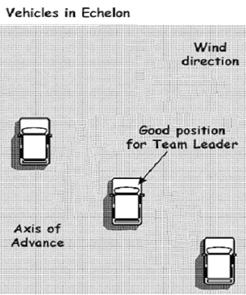

---
## Page 132

National Land Search Operations Manual 
Version Feb 2017 
132
5.128. When searching a house it is 
important to ensure that all 
persons are outside and that no 
one enters except the searchers.  
One searcher will remain at a 
doorway to limit entry.  A 
second searcher, or two, will 
enter the house and search all 
the rooms in a circular direction, 
starting with the rooms on the 
left.  Each individual room is 
then searched in a circular 
pattern, looking in, under and 
over every piece of furniture in 
the room. As a room is cleared 
the door should be closed 
indicating that it has been done.  
Once the house is cleared the 
doors should be closed or the 
owners allowed to return. 
 
 
 
 
 
 
 
 
 
 
 
 
 
5.129. A similar pattern is adopted when searching a yard, vacant block or industrial area. One 
searcher remains at the entry point to prevent other from entering.  One or more searchers 
clear the area in a circular pattern.  This will enable to entire area to be searched to a high 
probability and also ensures that no areas are left unsearched. 
 
5.130. As with the house search, it is necessary for every object of a size capable of hiding a person 
to be searched.  All buildings, sheds, outhouses and even dog kennels should be checked.  
Searchers should be instructed to look under objects, over then and in them.  They should 
also look behind at regular intervals to check the reverse sides of objects.  While adults may 
find it difficult to hide in a yard a child can quite easily located a small nook and fall asleep 
while searchers pass by unaware.  Where possible have a mixture of male and female 
searchers in teams, as their different search techniques will compliment each other. 
 
 
House Search

---
## Page 133

National Land Search Operations Manual 
Version Feb 2017 
133
 
5.131. Search Pattern Conclusion: The Team Leader is responsible for ensuring the team is 
employed to best effect, so the search pattern adopted must suit the circumstances.   
5.132. The leader should check team members at frequent intervals to ensure their safety and 
physical condition. 
5.133. When vehicle extrication of the missing person or the search team is contemplated, it is 
advisable for a team member to move to the road, track or identified rendezvous to: 
a. 
await the arrival of the vehicle; and 
b. 
then guide the vehicle to the site. 
5.134. When conducting a search, it is desirable to navigate by identifiable features rather than 
committing teams to navigate by compass. In areas where map and compass must be used, 
ensure that there are members within the team who are competent in their use. 
5.135. Clue recognition and Interpretation: A clue is a fact, an object, information or some type of 
evidence that helps to solve a mystery or problem. The purpose of seeking clues (gathering 
all the facts and information) is to assist in the reasoning of a problem and its ultimate 
solution. 
5.136. General Principles: The following principles apply: 
a.  
Clue seeking is an ongoing process that starts with planning, continues throughout a 
mission and doesn’t end until the debrief concludes. 
b.  
Clue seeking is a skill and must be practiced to develop a sense of what is the 
minimum information to work with. 
c.  
Avoid forming opinions and then gathering information to support that opinion. 
d.  
Don’t immediately form an opinion about the value of a clue. 
e.  
Gather information from everyone, as no one person can adequately gather all the 
facts. 
f.  
Assemble a complete profile of the missing subject and the situation, and let it offer 
direction. 
5.137. The theory of successful searching is dependent on clue detection and comprises five basic 
elements: 
House 
Garage 
Shed 
Yard Search

---
## Page 134

National Land Search Operations Manual 
Version Feb 2017 
134
a.  
Subject or clue generator. 
b.  
Clues or messages. 
c.  
Search area. 
d.  
Searcher or clue seeker. 
e.  
Time, as it relates to a sequence of events. 
5.138. Subject or Clue Generator: A lost person can become a prolific clue generator. The difficulty 
for searchers is separating these clues from those generated by other persons in the area. 
Strategic clues may suggest the period the person has been missing, their intent or 
destination. Tactical clues relate to clothing, equipment, footprints and discarded articles. 
5.139. Clues to be Sought: Searchers should try to locate clues that provide the following 
messages: 
a.  
The present location of the subject is ............ 
b.  
The previous location of the subject was ............ 
c.  
The destination or intent of the subject was ............ 
d.  
The subject was not here. 
5.140. Categories of Clues: The categories of clues that searchers should seek are as follows: 
a.  
Physical (eg, footprints, clothing, equipment or food wrappers). 
b.  
Recorded Information (eg, a trip plan or trail register). 
c.  
Witnesses—People who knew of the intent or destination, or people who have seen 
the subject, or other persons in the search area. 
d.  
Events (eg, flashing lights, smoke, fire, or noise such as a whistle). 
5.141. Search Area: Steps should be taken to contain the search area to reduce the amount of clues 
that may be generated. Where clues are found outside a designated search area, it may be 
necessary to extend the search area. 
5.137. Searchers or Clue Seekers: The Field Search Controller needs to deploy the searchers or clue 
seekers throughout the search area and in particular, the most probable areas. A strategy is 
required to ensure that all clues are assessed and pertinent clues are acted upon. 
5.138. Probability of Detection: Clue detection demands intelligence, concentration and 
determination on the part of the searcher. The loss of concentration and fatigue may inhibit 
clue detection. Therefore the SMC should employ a redundancy principle with the searchers 
to ensure that searchers can maintain their effectiveness. 
5.139. Time Sequence: Time as it relates to a sequence of events is very important. All clues found 
should be time-tagged by searchers to assist in the reconstruction of events. It is essential 
that a log be maintained at the FSH to record the time and locations that clues were located. 
5.140. Calculation of Search Time: When evaluating the search time available from search assets, 
certain factors must be taken into account, where applicable: 
a.  
total endurance of each SAR asset; 
b. 
transit time from FHQ or base to search area; 
c.  
necessary fuel reserves at final destination; 
d.  
first and last light at departure and destination  
e.  
weather conditions in the search area, and destination points, and any requirement 
for holding fuel or alternate aerodrome for aircraft. 
f.  
any other operational limitations; and 
5.141. In most cases, time in transit to the search area may be calculated using speed and the 
distance between the points of departure and destination and the mid-point of a search 
area. 
5.142. Operational factors may limit the search time available from a specific aircraft, examples 
being the time at which an aircraft will become available, distance from mandatory servicing 
facilities, and other commitments of the operator that may require the return of an aircraft 
at a particular time.

---
## Page 135

National Land Search Operations Manual 
Version Feb 2017 
135
5.143. Investigation Time: A search asset may sight objects that require investigation; therefore an 
allowance for the time taken to investigate must be made. The basic allowance is 15% of 
total time available in the search area, but the SMC may decide to increase this figure. The 
number of sightings investigated by previous search crews will influence any such decision. 
These, in turn, will be influenced by the nature of the terrain, the amount of flotsam on the 
sea etc. Over heavily timbered, mountainous terrain the allowance may need to be as high 
as 50% of total search time. 
5.144. When obtaining data about aircraft availability, special consideration should be given to the 
speed at which the aircraft will be flown whilst on search. In general, to provide for optimum 
scanning by observers, search aircraft should fly as slowly as possible. There are, however, 
other aspects to be considered, particularly the time available for search and the need to 
cover the area expeditiously. It may be beneficial to discuss these interacting considerations 
with operators. Some aircraft operate in excess of 120 KTS when on search; although this is 
less than optimum, logistic considerations may dictate the use of these speeds. 
5.145. Comparison of the search time required with that available will reveal whether the aircraft 
resources available are enough, too much or too little. 
5.146. At this point, a critical decision related to aircraft allocation may be made. The time required 
for search is directly related to track spacing; track spacing, in turn, is directly related to 
search height. It is feasible, therefore, that despite first indications that insufficient 
resources are to hand, timely coverage of the whole search area could be achieved by the 
available aircraft for the sake of a higher-than-optimum search height. 
5.147. Briefings: Briefing and debriefing is essential to the success of any search task.  It would be 
difficult to locate a person if those involved are not correctly briefed as to what they are 
looking for and where they should be looking.  It will also be difficult to identify and address 
issues that come to light if debriefing methods are ineffective.  Searchers must understand 
their role and how to deal with any finds and other issues. 
5.148. The two distinct parts to a briefing are: 
a. the preparation; and 
b. the conduct. 
5.149. Preparation: Experience has proven that the selection of the best possible venue and the 
use of suitable aids will enhance the value of the briefing. 
5.150. Presentation: The credibility of the briefing can be diminished if the briefing officer fails to 
project a professional approach. 
5.151. Venue: The selection and preparation of the best venue available is vital for the delivering of 
information and retaining attention.  Consideration should be given to: 
a.  
Large enough to accommodate all attendees comfortably. 
b.  
Open to authorised personnel only. 
c.  
Identified as a briefing area so that seating and display arrangements may be laid 
out in advance. This area may also function for media/public relations/briefings. 
d.  
Situated so there is minimum distraction by outside activities. 
5.152. Lighting: Adequate lighting needs to be provided so that all present can see displays clearly 
and can take notes. 
5.153. Weather Protection: Where possible, the briefing should be held in a covered location 
where protection from wind, rain or sun is provided. In field conditions, efforts should be 
made to ensure that the area is as protected as the circumstances allow. 
5.154. Briefing Aids: The following may be considered for use during a briefing: 
a.  
Maps—A map will be required to show Team Leaders their areas of responsibilities 
and their relationship to other teams and activities. These may range from a

---
## Page 136

National Land Search Operations Manual 
Version Feb 2017 
136
topographical map to a map scratched on the ground. In any case, do not clutter the 
map with unnecessary detail. If possible, copies of the map should be provided to 
Team Leaders for their own reference and their subsequent briefings of their teams. 
If maps are not provided, time needs to be allowed at the end of the briefing for 
Team Leaders to make copies of their relevant sections. 
b.  
Models: 
(1)  
Map models take a long time to prepare and are generally of little use. 
(2)  
A model figure similar in stature and dress to the missing person may be 
useful in some circumstances. 
c.  
Photographs—Attempt to obtain a recent photograph and circulate copies to 
searchers. If employing aerial photographs, ensure that those interpreting them are 
competent in their use. This style of photography may be very confusing to the 
uninitiated. 
d.  
Display/Chalk Boards—One of the most useful aids is the display/chalk board. If 
information is to be displayed using this system, ensure that it is kept out of sight 
until required. When the board is produced, ensure that it can be seen by 
everybody. To gain the most advantage from this medium, coloured chalks or pens 
should be used to highlight the display so as to make it as clear as possible. The 
briefing officer should explain clearly the information displayed. 
5.155. Conduct: Once having prepared the venue and aids, the briefing must be conducted in such 
a manner that the briefing officer controls the activity. 
5.156. Sequence: To ensure the briefing flows smoothly, observe this sequence: 
a.  
Introduction—The briefing officer should thank all for attending, and introduce 
him/herself. State his/her position and operational role. State the content of the 
briefing; 
b.  
Visibility—Ensure that all present can see the briefing officer, and any aids used; 
c.  
Notes—Ensure that everybody present has writing materials, and is prepared to 
take notes (writing materials should be on hand); 
d.  
Maps—Maps should be issued before the start of the briefing so that they may be 
marked or referred to as the briefing proceeds; 
e.  
Questions—Stipulate that there will be no questions or interruptions during the 
conduct of the briefing and that time will be made at the end for any questions. 
Regardless of circumstances, time must be allowed at the end for questions and 
answers; and 
f.  
Topography—Before the briefing, it is necessary to describe the area where the 
teams will be operating. Ensure that all present can identify this location and can 
orientate themselves to the ground. The briefing officer should then explain all 
features relevant to or likely to effect the plan, including: 
(1)  
the terrain in the area; 
(2)  
difficulties in travel; 
(3)  
possible hazards; and 
(4)  
any other similar related information. Control features, such as start and 
finish points and boundaries, should be highlighted. 
5.157. Orders: Operation orders are conveyed to those whose task it is to carry out the Search 
Commander/Field Search Controller’s requirement. Such orders need to be: 
a.  
correctly prepared; 
b.  
presented in a systematic way to ensure those receiving the orders understand their 
tasks; and 
c.  
re-examined as a result of information gained through debriefs. 
5.158. Orders must: 
a.  
be accurate;

---
## Page 137

National Land Search Operations Manual 
Version Feb 2017 
137
b.  
be brief but clear; 
c.  
contain all necessary information; 
d.  
be capable of being actioned; and 
e.  
be received in time to be acted upon. 
5.159. Layout of Orders: Orders need to follow a logical sequence to ensure all aspects of the plan 
are covered. To achieve this, orders are divided into five main headings of: 
a.  
Situation; 
b.  
Mission; 
c.  
Execution; 
d.  
Administration and logistics; and 
e.  
Command and communications. 
By employing the first letter of each heading, the catch-word SMEAC is derived. 
5.160. Situation (What has happened): This gives the background of events in sequence (what has 
happened what is happening) and gives general details of the teams that will be employed. 
This may include the following: 
a.  
Person/Object—Relevant details regarding the missing person or object. 
b.  
Topography—A general description of the search area using maps, sketches, air 
photographs, sand models etc. 
c.  
Other Search Teams Operating—The teams which share search boundaries with 
your area. Details include: 
(1)  
identification; and 
(2)  
other relevant information as applicable. 
d.  
Additional Resources—Those which need to be available for the operation are: 
(1)  
aircraft: fixed-wing and helicopters (if helicopters are available for support, 
give locations of known landing points in the search area); 
(2)  
vehicles; 
(3)  
dogs; 
(4)  
horses; and 
(5)  
trackers. 
e.  
Own Resources—This is particularly important when briefing search teams from 
other areas who are not familiar with your procedure. This should include names of 
key personnel, layout of headquarters, medical and welfare facilities etc. 
5.161. Mission (What the task is): The mission is a clear, concise statement of the task. It should 
begin with: ‘Our mission is to ..........................’. This statement should be only one sentence 
long and needs to be repeated so that teams are sure of their task. 
5.162. Execution (How the task is to be accomplished): This begins with an outline description of 
how the task is to be conducted, immediately followed by a detailed description of the roles 
and tasks of each team. To ensure that no relevant points are missed, these sub-headings 
should be used: 
a.  
General Outline—This is a short description of the overall conduct of the operation 
so all teams involved are aware of the broad picture; eg. ‘The search will be 
conducted in the areas shown and will involve six teams. Four teams will be 
employed in the initial search and two will be held in reserve. Should there be no 
result in this area, the search will be expanded’. 
b.  
Detailed Roles and Tasks—Each team will be given all the relevant instructions 
required so that the team may perform the allocated tasks: 
a  
Role—A general statement is required. eg. ‘Team One will be searching the 
area marked A on the map’. 
b  
Tasks—This should be used only where there is a requirement for a team to 
perform other tasks not described under its role; eg. ‘Team One, in addition

---
## Page 138

National Land Search Operations Manual 
Version Feb 2017 
138
to searching your allocated area, you will act as a radio relay between other 
search teams and this headquarters as required’. 
c.  
Method—It may be necessary to explain how the role will be performed; eg. ‘Team 
One, it is suggested that the creeping line ahead search method would prove 
suitable. Commence at the junction of the road and wire fence at (grid reference, 
and/or description), search to the north so as to finish at this point (grid reference 
and/or description). Pay particular attention to any heavy cover or heavily-grassed 
areas, make sure the boundaries of each sweep are clearly marked’. 
d.  
Boundaries—If boundaries are to be employed by search teams, they must either: 
a  
be clearly defined physical features (roads, fences, power lines); or 
b  
be marked by the teams as they progress. 
e.  
Special Equipment—This will apply to special items allocated to specific teams, 
(details of equipment common to all should be detailed under the administration 
and logistics heading). 
f.  
Co-ordinating Instructions—These are the details common to all teams by which the 
Field Search Controller maintains control of the operation: 
a  
All timings should be given in this block. If the operation is to proceed by 
phases or teams are to commence their tasks at differing times, this is 
where such timing should be specified. 
b  
Movement/Navigation Details: 
i  
to and from start/finish point; 
ii  
what routes will be employed; 
iii  
what method of transport will be employed (by foot, vehicle, 
aircraft, etc.); and 
iv  
any specialised transport arrangements such as helicopter, to 
include landing and pick up zones. 
g.  
Action If.....: 
a  
the operation is terminated before the planned finish time; 
b  
the person is found uninjured; 
c  
the person is found injured; 
d  
the person is found dead; 
e  
a team member becomes injured; or 
f  
a team member becomes lost. 
h.  
Medical Casualty Evacuation—This details the procedure to be adopted for both 
team members and the missing person(s). 
5.163. Administration and Logistics (What support will be provided and how):  The following 
should be considered under this heading:  
a.  
Food and Water—If a meal will be provided before commencement (where and 
when). If water is to be carried by participants, how long it will be required to last. 
b.  
Re-supply—If re-supply of food, water or equipment in the field is planned, what the 
arrangements will be. 
c.  
Dress and Equipment—Directed initially at the individual member, then for the 
team (team items include first aid kits, stretchers, maps, compasses or any other 
equipment to be carried within the team). 
5.164. Command and Communications (Who will be in control and how the communications will 
function): The following should be considered under this heading: 
a.  
Where the headquarters is located. 
b.  
Who is in charge of specific tasks and command structure. 
c.  
Communications: 
i  
radio net diagram; 
ii  
type of radio to be employed;

---
## Page 139

National Land Search Operations Manual 
Version Feb 2017 
139
iii  
primary and secondary frequencies; 
iv  
call signs; 
v  
radio net establishment times; 
vi  
situation reports/radio schedule times; 
vii  
code words (if situation requires); 
viii  
method of notifying the conclusion of, or change to operation; and 
ix  
synchronisation of watches. 
Other methods of communicating in the field apart from radios may be employed. No 
matter what system is selected, all details must be given to ensure the effective functioning 
of the system. 
5.165. Issuing orders: At the conclusion of a briefing, those persons required to be issued with 
orders should be directed to remain whilst others are released to continue with 
preparations. To ensure that orders are presented in a logical, detailed manner: 
a.  
utilise the SMEAC system; 
b.  
read from prepared, sequentially-numbered pages; 
c.  
present the orders at a speed which enables attendees to write down 
pertinent information; and 
d.  
repeat the mission and all grid references to ensure clarity. 
5.166. Synchronisation of watches: This should occur before taking questions. 
5.167. Questions from the teams: To maintain control, it should be indicated that questions will be 
taken after a nominated period, (eg. 5 minutes). Then, the briefing officer should ask each 
Team Leader in turn, if there are any questions and then provide the answers. 
5.168. Questions to the teams: Check that the briefing has been assimilated by directing questions 
to the Team Leaders about roles, tasks, boundaries, timings, call signs and other relevant 
information. The briefing officer should then indicate that the briefing has concluded and all 
participants may carry out their allotted tasks. Time should be allowed for Team Leaders to 
conduct a briefing of their team prior to commencing the search. 
5.169. Code Word: A code word, to be employed in the event that the person is found and believed 
to be dead, should be given.  This will notify the SMC immediately of the situation and 
should be followed by the location of the team.   
5.170. Action on locating the missing person(s): Prior to the deployment of search teams, the 
action to be taken in the event of a team locating the person must be defined and clearly 
understood by all searchers.  This action must form part of the briefing to search teams.   
 
The suggested action to be taken where a person is found dead is as follows: 
a. 
The searcher locating the missing person immediately informs the Team Leader 
who will make an assessment. 
b. 
In the event that the person is believed to be dead, the Team Leader will ensure 
minimal disturbance of the immediate scene by instructing all members of the 
team to remain clear of that person, to a distance of approximately 30 metres.  If 
possible the area should be marked off with tape or rope. 
c. 
Only the Team Leader and a First Aid Qualified person will approach the body to 
check for pulse and breathing.  It is essential that two people check the body to 
prevent mistakes. 
d. 
In the event the person is alive all medical assistance possible will be given.   
e. 
If the person is deceased, the finder and Team Leader will retrace their steps and 
maintain the cordon.  All deceased persons and their locations are to be treated as 
Crime Scenes until advised otherwise by an investigating police officer.

---
## Page 140

National Land Search Operations Manual 
Version Feb 2017 
140
f. 
As soon as practicable, the SMC and/or Field Headquarters should be informed 
using the assigned code word and arrangements made for the Police to attend 
that location. 
g. 
The team will maintain the security of the scene until relieved.  
5.171. It must be remembered that information transmitted through the radio network may be 
heard by many people including the media, relatives and friends of the missing person.  
Some of these people may already be in a distressed state and will be sensitive to any 
thoughtless comments on the condition of the missing person.  Therefore, it is important 
that all searchers use the designated code word and think before passing their assessment 
on any person’s condition through the radio network. 
5.172. It is also worth considering the use of a code word in the event that the missing person is 
found and is seriously injured. 
5.173. Mattson Consensus: Determining which segments to search when there are not enough 
resources to cover the entire search can be daunting for any SMC, especially when there is 
pressure to get the job done.  One aid that can spread the burden of this is the Mattson 
Consensus, although the ultimate responsibility will always rest with the SMC.  The search 
area is divided into smaller search segments with each being given a letter or number.  This 
letter or number is entered into the ‘Search area’ column of the table.  The SMC then 
chooses a number of trustworthy persons, such as the SES Controller, a knowledgeable local, 
Park ranger etc, who then look at the various search segments.  Each person independently 
determines the probability of the target being in each of the segments.  There is always one 
extra segment, called ‘The Rest of the World’ or ROW which covers everywhere outside the 
search area.   
5.174. Each of the people assign a number value to each segment with the highest value going the 
segment they believe the target has the greatest chance of being located in.  There is no 
total value for this exercise.  Adding across the table you arrive at the total for each of the 
search segments.  Working out the percentage you can see that area C has the highest with 
a consensus of a 0.23 chance that the target will be in that area, with area B coming in 
second at 0.19.  Area F and ROW are the least likely areas according to the consensus. 
5.175. The SMC can now allocate resources according to the priorities as in the consensus, or can 
ignore it and go their own way. 
 
 
 
 
 
 
 
 
 
 
 
 
 
 
Search areas given letter for Consensus. 
 
 
 
 
 
 
A 
B 
C 
D 
E 
F

---
## Page 141

National Land Search Operations Manual 
Version Feb 2017 
141
 
A 
B 
C 
D 
E 
F 
ROW 
Total 
points 
SMC 
10 
20 
20 
10 
20 
10 
5 
95 
A/SMC 
15 
20 
30 
10 
15 
10 
5 
105 
Local Cont 
20 
20 
25 
15 
20 
10 
5 
115 
Total 
per 
area 
45 
60 
75 
35 
55 
30 
15 
315 
Divided by 
total points 
45/315 60/315 75/315 35/315 55/315 30/315 15/315 315/315 
Percentage 
14% 
19% 
23% 
11% 
17% 
9% 
4% 
100% 
Consensus Worksheet

---
## Page 142

National Land Search Operations Manual 
Version Feb 2017 
142
Chapter Six – Rescue Planning and Operations  
 
 
6.01. 
General: The primary purpose of any SAR action is the speedy return to a place of safety of 
the survivors of a distress situation.  
6.02. 
When planning and conducting SAR operations the safety of the search party members is 
also paramount. Safety is an essential aspect of every search operation, and as such, all 
participants have a responsibility. It includes such factors as adequate and appropriate 
equipment and clothing, proper preparation of team members and skilled leadership. 
6.03. 
It is essential that from the start of any SAR action, the coordinating SAR Authority plans for 
the rescue of survivors and ensures that appropriate resources are alerted, briefed and 
positioned so that the rescue may take place with a minimum of delay after the location of 
the survivors.  
6.04. 
Without jeopardising the ultimate safety of survivors, foremost consideration shall be given 
to the potential impact on any medical condition of survivors by the method of recovery or 
the actions of unqualified persons.  
6.05. 
The method of rescue to be used shall be decided after consideration of all relevant factors 
including:  
a.  
action taken by locating team and the action that can be taken by other teams at the 
scene;  
b.  
location of the survivors;  
c.  
condition of survivors and medical considerations;  
e.  
environmental considerations;  
f.  
available SAR facilities and their state of readiness;  
g.  
effect of weather;  
h.  
time of day;  
i.  
any risks involved to SAR personnel at a scene e.g. dangerous goods, hazardous 
materials.  
6.06. 
To reduce delay, the SAR facilities that are likely to be used should be alerted and deployed 
to a suitable location while the search is still in progress.  
6.07. 
Preparation: It is the responsibility of the SMC to ensure that appropriate rescue resources 
are brought to a state of readiness and, as necessary, strategically positioned to be moved 
quickly into action immediately survivors are located.  
6.08. 
The SMC shall ensure that proper attention is given to the preparation and execution of the 
rescue effort.  
6.09. 
Medical assistance: It must be assumed that the survivors of an emergency will be in need 
of medical attention, and arrangements should be made to include medically qualified 
persons in the rescue team.  
6.10. 
First Aid: Although many crashed aircraft or vehicles are located by helicopter it is not 
always possible to lower a paramedic or doctor to the scene.  In other instances it will be a 
land search team who locates and arrives on scene first.  In either instance it is vital that all 
land search teams contain one or more persons with a good knowledge for first aid and have 
a well stocked first aid bag. First aid will most often be limited to immobilising broken bones, 
stemming blood loss and making the patient comfortable.  CPR will not be required if it has 
been some time since the incident, unless the MP or victims suffer a problem in the 
presence of the search team.  Although the actual first aid provided may be limited, the 
psychological value can not be underestimated. 
6.11. 
Land rescue for missing persons, crashed aircraft or vehicles: Although the location of the 
missing person, aircraft or vehicle may be known, it may be extremely difficult for a rescue 
team to reach it. Therefore the operation should be undertaken only after proper and 
complete planning.

---
## Page 143

National Land Search Operations Manual 
Version Feb 2017 
143
6.12. 
The rescue team should be taken to a locality as near as possible to the location by some 
means of rapid transport. If access to the site is possible, an aerial survey of the site may be 
made to determine the best route. The equipment carried should be carefully selected and 
arrangements made for supplies to be dropped should re-equipment be necessary.  
6.13. 
The SMC will determine equipment necessary for rescue teams, in consultation with rescue 
experts. A portable radio capable of communicating with other SAR Units should always be 
included in a rescue team’s equipment.  
6.14. 
In cases where all occupants of a crashed aircraft or vehicle are not immediately accounted 
for, the search for missing persons must be continued. In the meantime, activities for the 
rescue of the others should be started.  
6.15. 
Advice to police officers, other emergency services personnel and the public of the 
necessary actions to be taken in the event of a civilian aircraft crash in their area is obtained 
from the ATSB publication, Civil and Military Aircraft Accident Procedures for Police Officers 
and Emergency Personnel  
6.16. 
The rescue team should make a report to the SMC as soon as possible. The SMC will relay 
advice of the condition of persons and disposition of wreckage to other authorities as 
appropriate.  
6.17. 
Aircraft and vehicle wreckage should not be disturbed except to assist in the recovery of 
survivors. Not only may the wreckage pose dangers by way of toxic materials and fumes, but 
also the position of flight controls, the location of debris and other factors are important to 
the accident investigation.  
6.18. 
Survivors should be removed from the location and transported to receiving medical 
facilities by the most expeditious means. When selecting the method of transport, the SMC 
should consider:  
a.  
the condition of survivors;  
b.  
the capability of the rescue team(s) to reach the survivors in the shortest possible 
time;  
c.  
the medical training, qualifications and operational abilities of the rescue personnel;  
d.  
the rescue teams’ capability to transport survivors without aggravating injuries or 
producing new complications;  
e.  
the difficulties that may be encountered by rescue teams, e.g. provision of shelter;  
f.  
the need for food and water;  
g.  
the weather conditions; and  
h.  
methods of maintaining communication with the rescue team, either directly or 
indirectly.  
6.19. 
Evacuation of survivors will be relatively simple if they are located in an area where medical 
and rescue facilities are available locally and from where aerial, road or water transport is 
possible. However, if the distress site is in a difficult or inaccessible area, the evacuation will 
have to be made on foot to a place from where transport can be provided. This may require 
sufficient foliage to be cleared by the land party to allow helicopter operation into the site.  
6.20. 
If it is considered necessary to move survivors via an overland route the SMC is to be advised 
so that further assistance can be arranged.  
6.21. 
If it is decided to evacuate the survivors by air, the rescue team may provide advice of a 
suitable landing area for fixed wing aircraft or a landing or hovering site for a helicopter. If 
verbal communication is not possible, the land party should prepare the appropriate 
ground/air visual signals.  
6.22. 
ATSB and police should be given early notification of a crash for a decision for their 
attendance at the crash site.

---
## Page 144

National Land Search Operations Manual 
Version Feb 2017 
144
6.23. 
Next of kin should be kept fully informed through the appropriate liaison channel; normally 
the police  
6.24. 
Pending assumption of the responsibility by ATSB or relevant ADF authority, the SMC, 
through local police, shall endeavour to arrange security at the crash site to prevent 
interference with the wreckage or with marks made by the aircraft in landing. State and 
Territory police are responsible for securing the accident scene. Instructions for police 
officers and emergency services personnel can be found in the ATSB handbook: Civil and 
Military Aircraft Accident Procedures for Police Officers and Emergency Personnel  
6.25. 
Accidents and injuries to rescue personnel:  In the event of an accident or injury to rescue 
personnel (either on roads or in the field), it is the team leader’s responsibility to report the 
incident to the SMC, and to decide on the appropriate course of action. 
6.26. 
Avoidance of Danger: All members have a responsibility for safety.  In the event of a 
dangerous situation developing, all activity must cease until the problem is resolved. 
6.27. 
Personal injury from unsafe practices is a threat to searchers and may jeopardise the 
operation.  Training programs must include lectures and information on safety, hazardous 
situations and hazardous materials. 
6.28. 
Night search training should be carried out in safe areas, with checks made beforehand as to 
the extent of hazards in the training area. 
6.29. 
Operational Safety:  The team leader must keep a firm control of the team, ensuring: 
a. 
A written list is carried and frequent checks are made to confirm all personnel are 
accounted for. 
b. 
Members are aware of the search orders. 
c.  
All personnel are aware of field signals. 
d. 
members are observant and always maintain contact with their team. 
e. 
The capabilities and pace of all members is considered; and 
f. 
That appropriate care is taken, having regard to the prevailing conditions. 
6.30. 
In the interests of safety, all team members must obey orders given to them by the team 
leader. 
6.31. 
Health hazards - aircraft accidents: Movement in the vicinity of crash sites can be extremely 
hazardous for ground parties on account of toxic fumes, dangerous substances and 
explosives. Deaths have resulted from ground personnel breathing noxious air and 
contacting extremely poisonous substances in the proximity of wrecked aircraft.  
6.32. 
Personnel should refer to the ATSB handbook for more detailed procedures and precautions 
to be taken.  
6.33. 
To the extent that it can be governed, the SMC shall advise that permission should be 
secured from the appropriate ADF authority before members of the public or other agencies 
approach a crash site of a service aircraft.  
6.34. 
 Modern aircraft use composite materials for some of their structure, skin, and access 
panels. Significant health hazards exist at crash sites from the effects of crash damage and 
fire on composite materials. When burnt, released fibres and resins may be toxic through 
inhalation and/or skin and eye contact. Damaged composites may also produce needle-like 
edges that render handling hazardous. Carbon fibres are electrically conductive and may 
short-circuit nearby electrical equipment.  
6.35. 
Certain exotic metals (radioactive substances) can also be found in ADF aircraft types, which 
are also poisonous in their own right. The inhalation, ingestion or absorption of radioactive 
substances is hazardous, as low-level radiation will continue to be emitted inside the body, 
possibly resulting in damage to surrounding tissues and organs.  
6.36. 
ATSB and CASA officers and police shall be given reasonable access to SAR facilities and staff 
during salvage operations.

---
## Page 145

National Land Search Operations Manual 
Version Feb 2017 
145
6.37. 
Use of aircraft for rescue: When considering the use of aircraft to bring about the recovery 
of survivors, care must be taken to ensure that the rescue aircraft and crew are not exposed 
to inordinate danger  
6.38. 
Fixed wing aircraft should only be used to retrieve survivors when there is significant 
advantage over the use of surface transport and when there is a suitable aerodrome or 
landing area near the scene. Pilots shall be discouraged from attempting to land at other 
than prepared landing areas to pick up survivors. However, should this prove to be the best 
or only viable option, all available specialist advice concerning the operation shall be 
obtained. It may be possible to have a qualified person lowered or parachuted in to survey 
the area. Helicopters may be employed to shuttle survivors from a distress site to a suitable 
fixed-wing landing area.  
6.39. 
Use of helicopters for rescue: When available, helicopters should be considered for rescue 
work. While eminently suited to the task in many respects, helicopters do have specific 
limitations that may be summarised as:  
a.  
the adverse effects of turbulence;  
b.  
the need for a level, or near level, landing area;  
c.  
a requirement for a cleared landing area of specific dimensions to avoid rotor blade 
damage;  
d.  
a requirement for safe approach and take-off paths;  
e.  
potential for adverse effects on certain serious injuries;  
f.  
limited endurance;  
g.  
inability to hover with loads at high altitudes;  
h.  
limited accommodation.  
6.40. 
Helicopters can be used to rescue survivors by winching or by landing at a suitable location. 
Owing to their unique flying characteristics, helicopters should be considered for use as a 
rescue unit as a matter of course.  
6.41. 
They are particularly suitable for rescues at locations where surface units are unable to 
operate. At the same time, some helicopter evacuations may be hazardous, particularly in 
mountainous areas at high altitudes and over rough seas. Such evacuations should therefore 
only be carried out by specially qualified and experienced crews and then only in the event 
of serious injury or illness or when lack of other means of rescue might result in loss of life. It 
is important that any information on the condition of survivors is considered by specialists 
before committing to helicopter use.  
6.42. 
Operations by rescue teams may be hampered by the noise and rotor wash produced by 
helicopters. To avoid damage to rotor blades, the landing site should be cleared to a 
diameter specified by the pilot-in-command for each proposed operation.  
6.43. 
The helicopter's mass may be a factor limiting the number of survivors that may be taken 
aboard each trip. It may, therefore, be necessary to reduce weight by all possible means, e.g. 
removal of non-essential equipment, minimum fuel, use of advance bases with fuelling 
capabilities, etc.  
6.44. 
It must be ensured that the route followed by the helicopter as well as the location where 
the survivors are to disembark are known to the SMC.  
6.45. 
A medically qualified person, medical equipment and respiratory equipment, when 
available, should be carried on a helicopter recovery mission, at least on the first flight to the 
distress scene.  
6.46. 
Survivors may not know how to operate a strop. A two-person winch is preferred to a single 
winch. A double strop allows one rescuer to supervise while being winched down and up 
again with each survivor. Note: A helicopter should not be approached unless directed

---
## Page 146

National Land Search Operations Manual 
Version Feb 2017 
146
and/or escorted by a member of the helicopter’s crew. Helicopters may require approach 
from different aspects dependant on type.  
6.47. 
Use of top cover aircraft with rescue and MEDEVAC helicopters: The provision of a top 
cover aircraft should be considered during operations that may expose the helicopter to 
undue risk.  
6.48. 
The SMC is to discuss the requirement for a top cover aircraft with pilot in command of the 
helicopter. The decision to task a top cover aircraft can be made by the SMC alone or on 
request by the pilot in command.  
6.49. 
Circumstances that may require the provision of a top cover aircraft may include:  
a.  
helicopters operating over water. This will vary with the type of helicopter involved. If 
in doubt, consult with the crew.  
b.  
helicopters operating at or near the limit of their endurance  
c.  
helicopters operating in poor or marginal weather conditions  
d.  
helicopters operating at a rescue scene presenting special dangers, e.g. night.  
6.50. 
Aircraft tasked for top cover should be a SRU aircraft carrying suitable supply drop 
equipment. The primary tasks of the top cover aircraft will be to:  
a.  
provide navigation assistance to the helicopter to locate the target;  
b.  
provide communications assistance to the helicopter; and  
c.  
provide immediate assistance by way of supply drop should the helicopter ditch.  
6.51. 
Supply dropping and delivery of survival equipment: Situations will arise where the 
immediate recovery of survivors is not possible and arrangements will have to be made to 
deliver sustenance, medical and survival equipment. Such situations shall be anticipated and 
planned for by the SMC during the conduct of a search.  
6.52. 
Where possible delivery will be by way of helicopter or aircraft. An example of this would be 
a situation with seriously injured survivors who may need stabilising prior to being moved, 
or where persons are located in a remote area by a fixed wing aircraft and a helicopter or 
vehicle is some distance or time away.   
6.53. 
Civil SAR equipment: The inventory of Civil SAR Equipment suitable for land incidents 
provided by JRCCincludes:  
a.  
Target marking devices including See-Blitz strobe lights  
b.  
Heliboxes for the supply of sustenance, medical and survival equipment  
c.  
EPIRBs.  
d.  
Precision Aerial Delivery System (PADS) for the delivery of a single liferaft, storpedo 
or pump.  
e.  
Search and Rescue Communicators (SARCOM) emergency AM radios operating on 
the aviation band of 123.1MHz that are suitable for dropping in Heliboxes or 
storpedos.  
6.54. 
JRCCstaff are familiar with the type and disposition of Civil and ADF SAR equipment and its 
usage and can be contacted for advice. Detailed procedures and instructions relating to the 
operation and delivery of the equipment are incorporated in the Search and Rescue Manual 
for SAR Unit Pilots and Dropmasters that can be obtained from the SAR Resources and 
Training section of AMSA.  
6.55. 
Only suitably qualified, trained and equipped crews shall be tasked for supply dropping.  
6.56. 
Aircraft tasked for supply dropping will be suitable for the purpose. It is the aircraft 
operator’s responsibility to ensure the appropriate flight manual supplements / flight 
manual limitations and dispensations are held. Routinely such dispensations will be against:  
a.  
Civil Aviation Act Section 23 (Carriage of Dangerous Goods)

---
## Page 147

National Land Search Operations Manual 
Version Feb 2017 
147
b.  
Civil Aviation Regulations 175(3) (IFR Flight)  
c.  
Civil Aviation Orders 29.5 (Dropping of articles from aircraft)  
6.57. 
Specifically, dropping of articles from aircraft at night requires the approval of CASA (CAO 
29.5 paragraph 7).  
6.58. 
Supply drop from aircraft over land: Where it may take too long to get to survivors by land, 
stores and equipment can be dropped from civil or ADF aircraft. The main method of 
delivering supplies to survivors on land from aircraft is by Helibox or Storpedo that can 
contain food, water, blankets, radios and medical equipment. In situations where it is 
important to provide survivors with shelter, it may be appropriate to drop one or more 
liferafts. Where there is no suitable landing place close to the survivors, vital survival 
equipment, food and stores could be winched or dropped from a helicopter with great 
accuracy.  
6.59. 
Training Safety: It is desirable that all members be trained in essential skills and be 
physically capable of undertaking the activity.  Training must include all safety factors.  With 
experience, searchers will develop ‘safety sense’.  How they train is how they will perform.  
Breaches of safety must never be tolerated.

---
## Page 148

National Land Search Operations Manual 
Version Feb 2017 
148
 
Chapter Seven – Conclusion of SAR Operations  
 
7.01. 
General: SAR Operations enter the conclusion stage when:  
a.  
the target is located and the survivors are rescued;  
b.  
the emergency beacon has been located and the survivors rescued, or if there was 
no distress, the beacon has been turned off;  
c.  
information is received that the target is no longer in distress;  
d.  
all known persons on board the aircraft or vehicle are accounted for, or it has been 
determined that there is no longer a chance of survival; or  
e.  
the SAR Authority determines that further searching has no significant chance of 
succeeding and suspends the search.  
7.02. 
The authority to end a search rests with different levels within the SAR organisation, 
depending on the circumstances. In particular, the SAR Authority is responsible for deciding 
when to suspend an unsuccessful search where lives were known to be at risk.  
7.03. 
The SAR Authority may delegate to the SMC the authority to conclude the operation in all 
other circumstances (ie: when the SMC determines that the target is no longer in distress 
and in situations where an identified beacon has ceased transmitting). 
7.04. 
Conclusion of a successful SAR action: When the target of a search action has been located 
and the survivors removed to a place of safety, the SMC shall ensure:  
a.  
all people and organisations involved in the SAR action are stood down;  
b.  
all appropriate agencies are notified;  
c.  
next of kin are fully informed;  
d.  
arrangements are made for the recovery of dropped survival equipment eg rafts;  
e.  
the collection all maps, worksheets, notes, messages in chronological order and file 
on a SAR incident file; and  
f.  
that administrative and financial procedures are completed.  
7.05. 
Suspension of a search when the target is not found:  When it is determined that further 
search would be of no avail, the SMC shall consider recommending the suspension of the 
SAR operation. However, search action shall not be suspended nor the distress phase 
cancelled without the specific concurrence of the SAR Authority.  
7.06. 
The decision to suspend a search shall not be made until a thorough review of the search is 
conducted. The review will focus on the probability of there being survivors from the initial 
incident, the probability of survival after the incident, the probability that the survivors were 
in the search area, and the effectiveness of the search.  
7.07. 
The review should:  
a.  
examine search decisions to ensure that proper assumptions were made and that 
planning scenarios were reasonable;  
b.  
reconfirm the certainty of the LKP 
c.  
re-evaluate any significant clues and leads;  
d.  
confirm that all reasonable means of obtaining information about the target have 
been exhausted;  
e.  
review all intelligence material to ensure no information had been overlooked;  
f.  
examine the search plan to ensure that:  
i.  
assigned areas were searched;  
ii.  
the probability of detection was as high as desired; and

---
## Page 149

National Land Search Operations Manual 
Version Feb 2017 
149
iii.  
compensation was made for search degradation caused by weather, 
navigational, mechanical or other difficulties; and  
g.  
consider the survivability of the survivor/s taking into account:  
i.  
time elapsed since the incident;  
ii.  
environmental conditions;  
iii.  
age, experience and physical condition of (potential) survivors;  
iv.  
survival equipment available;  
v.  
studies or information relating to survival in similar circumstances; and  
h.  
consider the rescue plan to ensure that:  
i.  
best use was made of available resources;  
ii.  
contingency plans were sufficient to cater with unexpected developments; 
and  
iii.  
coordination with other agencies was effective in ensuring best treatment of 
survivors.  
7.08. 
Before an unsuccessful search is suspended, the SAR Authority shall make arrangements to 
ensure that the next of kin are fully briefed on the complete search effort, including 
conditions in the search area, other salient operational factors and the reasons for proposing 
the suspension of the search.  
7.09. 
Consideration may be given to notifying the decision to suspend search effort at least one 
day prior to suspension of operations allowing next of kin at least one more day of hope 
while giving them time to accept that the search cannot continue indefinitely. Accordingly, 
the SMC should maintain regular contact with the relatives during the conduct of the search, 
providing access to the FSH if practical and appropriate.  
7.10. 
In a case where foreign nationals are involved, liaison shall occur with the Department of 
Foreign Affairs and Trade.  
7.11. 
The reasons for suspending a search shall be clearly recorded.  
7.12. 
When a SAR action is discontinued or a search is suspended, the SMC shall inform all 
authorities, units and facilities that have been activated and/or alerted.  
7.13. 
On occasions, after the suspension of a search, it may be necessary for the Police or Defence 
to continue to search for bodies and/or aircraft/vessel wreckage. In such cases the SAR 
Authority that had responsibility for the coordination of the search and rescue operation 
may, where possible:  
a.  
provide briefings on the intentions/path of the person/vehicle/aircraft prior to 
disappearance, last known position, area searched and related intelligence;  
b.  
review intelligence to assist search;  
c.  
source aircraft for transport or search purposes 
7.14. 
Should any other organisation such as the family or operating company, wish to continue 
with or initiate an independent search, the SAR Authority that had responsibility for the 
coordination of the search and rescue operation should ascertain whether there is any new 
intelligence that provides grounds to resume or continue the search. Under the 
circumstances where there is new intelligence, it should be evaluated and if considered valid 
the search should be continued or resumed. Where there is no new intelligence, then the 
SAR Authority may assist the requesting organisation by:  
a.  
briefing the person/vehicle/aircraft’s path prior to disappearance, LKP/crash point, 
area searched and related intelligence;  
b.  
advising the possible location of suitable search aircraft 
7.15 
Reopening a suspended search: If significant new information or clues are developed, 
reopening of a suspended case should be considered. Reopening without good reason may 
lead to unwarranted use of resources, risk of injury to searchers, possible inability to 
respond to other emergencies, and false hopes among relatives.

---
## Page 150

National Land Search Operations Manual 
Version Feb 2017 
150
7.16. 
Records and reports: Records relating to search and rescue operations shall be retained for 
periods as required under the relevant legislation and regulation.  
7.17. 
When a search has been suspended without locating a missing person, vehicle, aircraft or 
their occupants, all records, charts etc. shall be retained and be accessible to SAR staff to 
allow easy resumption of search activity should further intelligence be received.  
7.18. 
Reports on SAR Actions shall be generated as required for Coroners Inquiries, Management 
purposes and for training requirements.  
7.19. 
Incident debriefs: Following an incident holding a debrief of agencies and groups involved 
should be considered. The purpose of incident debriefs is to establish opportunities for 
improvement in the operation of the national SAR system.  
7.20 
Incidents worthy of debrief may include those where:  
a.  
lives have been lost unexpectedly;  
b.  
large and complex searches have been conducted;  
c.  
multi agency involvement occurred; or  
d.  
where coordination, communication or response challenges were experienced 
during the incident.  
7.21. 
This list is not exhaustive and the conduct of a post incident, multi-agency debrief is at the 
discretion of the SAR Authority in overall coordination of the incident with mutual 
agreement of other SAR Authorities and agencies involved.  
7.22. 
Post incident debriefs should be used to;  
a.  
establish opportunities for improvement in the operation of the National SAR 
System; and  
b.  
ensure current policies and procedures are appropriate.  
7.23. 
The SAR Authority with overall coordination is to:  
a.  
decide the need for a debrief in consultation with other SAR participants;  
b.  
organize and host the debrief unless otherwise agreed by the participants;  
c.  
establish a venue that maximizes opportunity for participation in, and learning from, 
the debrief;  
d.  
capture and share the opportunities for improvement arising;  
e.  
initiate changes to the National SAR Manual as appropriate arising from the debrief; 
and  
f.  
include lessons learned from debriefs in their jurisdiction reports to the annual 
National SAR Council meeting.  
7.24. 
No matter how simple or complex the operation may be, it cannot be concluded until a 
debrief has been conducted. 
7.25. 
This is the primary method employed to assess the effectiveness of the plan, and for Team 
Leaders to assess their own conduct. 
7.26. 
Depending on the size of the activity and/or the number of participants, there may be 
different types of debriefings: 
a.  
At the end of each phase of the operation. This is to update information and revise 
plans for subsequent phases. 
b.  
By the leaders of individual teams to determine the effectiveness of their training 
and/or operating procedure and the conduct of their allotted tasks. 
c.  
A debrief by the Controller of everyone involved in the conduct of the operation 
prior to the conclusion. 
d.  
After the initial information has been analysed and the control element has had time 
to study all the records and data relevant to the activity. 
7.27. 
Provided the debrief is conducted correctly, many valuable lessons may be learnt which may 
be applied to the conduct of the immediate operation and may be incorporated into future 
plans and procedures. A poorly conducted debrief may not only fail to achieve its aim, but 
also have negative effect on those participating.

---
## Page 151

National Land Search Operations Manual 
Version Feb 2017 
151
7.28. 
Conducting the Debrief: The points discussed in briefing are just as relevant in debriefing. 
However, the debriefing officer needs to do the following: 
a.  
Control the debrief and not allow it to degenerate into a witch hunt. 
b.  
Stress that the aim of the debrief is to examine the operation to determine what 
went right, what went wrong, and why? 
c.  
Address specific questions, such as: 
(1)  
accuracy of maps, 
(2)  
terrain, 
(3)  
suitability of search method, 
(4)  
effectiveness of communication system, 
(5)  
resupply, and 
(6)  
any other related subjects. 
d.  
Identify good points and make special mention of them. People prefer to be praised 
rather than criticised. No matter how often it is stressed that the debrief is not a 
witch hunt, somebody will believe that they are being criticised, either personally or 
on behalf of the organisation they represent. Be aware that this will occur. 
e.  
Seek comments from the those being debriefed. Once the major points have been 
identified, ask for any comments. Maintain control by employing the same system as 
that used during the briefing. Stress that the information being sought is 
constructive criticism that will be employed to improve the conduct of operation in 
the future. 
f.  
Take written notes. Not only does this ensure that all points are recorded for future 
use, it will also allow those being debriefed to observe that a genuine effort has 
been made. Further comments may not be forthcoming unless it is noted that 
relevant points are recorded. 
g.  
Read out a summary of the points discussed to confirm that they have all been 
addressed. 
h.  
Issue confirmatory notes to all organisations detailing all points discussed and what 
actions need to be taken. 
7.29. 
Participation at debriefs may be restricted to particular SAR Authorities and agencies 
depending on the issues that are likely to arise and would be a decision for the SAR 
Authority with overall coordination for the incident.  
7.30. 
SAR Authorities that participate in the debrief will meet their own attendance costs, unless 
otherwise agreed by the participants.  
7.31. 
The debrief should include the opportunity for all significant parties involved in the incident 
to contribute and learn from it.  
7.32. 
Case studies: Case studies may be conducted at the direction of the SAR Authority. IAMSAR 
provides guidance on case studies as follows.  
7.33. 
Sometimes a SAR case has a surprise ending, as when the survivors are found by someone 
not involved in the search effort in a location outside the search area, or they are found, 
alive and well, in the search area after the search effort has been suspended. There are also 
occasions when there seems to have been an unusual number of problems in spite of the 
best efforts of the SAR personnel. Finally, there may be important and valuable lessons to 
learn from a SAR incident and the subsequent response of the SAR system that would be 
revealed only by a careful after-the-fact review.  
a.  
A SAR case study is an appropriate method for addressing those aspects of an incident 
that are of particular interest. Individual aspects of interest could include problems 
with communications, assumptions made, scenario development, search planning, or 
co-ordination. SAR case studies or incident reviews also provide opportunities to 
analyse survivor experiences and lifesaving equipment performance. Survival in hostile 
environments is affected by many variables, including the physical condition of the

---
## Page 152

National Land Search Operations Manual 
Version Feb 2017 
152
survivors, survivor actions, support provided by rescuers prior to rescue, and the 
effectiveness of safety or survival equipment. Knowing more about these factors can 
help the SAR system become more effective.  
b.  
When used to review and evaluate all aspects of a response to an incident, SAR case studies 
are one of the most valuable and effective tools for improving SAR system performance. 
Therefore, SAR case studies or reviews should be performed periodically even when no 
problems are apparent. There is almost always room for improvement, especially in large, 
complex cases. The most important outcome, however, is that early detection and correction 
of apparently small problems or potential problems will prevent them from growing into 
serious deficiencies later.  
7.34. 
To get a balanced view, more than one person should conduct SAR case studies; the case 
study team should include recognized experts in those aspects of the case being reviewed. 
To achieve maximum effectiveness, case studies should not assign blame, but rather, should 
make constructive suggestions for change where analysis shows that such change will 
improve future performance.  
7.35. 
Performance improvement: Constant improvement in the performance of the SAR system 
should be a clearly stated goal of SAR managers. One method to encourage performance 
improvement is to set up goals whose degree of attainment can be measured by key 
performance data. This data should be collected, analysed, and published on a routine basis 
so that individuals can see how the system as a whole is doing, and how their performance is 
contributing to the achievement of the established goals. Routine reports from the SMC’s to 
the SAR managers can be used for monitoring system performance and highlighting areas 
where improvement is possible through changes in policies, procedures, or resource 
allocation.

---
## Page 153

National Land Search Operations Manual 
Version Feb 2017 
153
 
Chapter Eight – Training & Exercises  
 
8.01. 
General: The importance of thorough training for all personnel employed on SAR missions 
cannot be over-emphasised. Failure of a single link in the often complex chain of action 
required in SAR missions can compromise the success of the operation, resulting in loss of 
lives that might otherwise have been saved. The purpose of training is to meet SAR system 
objectives by developing SAR specialists. Since considerable experience and judgement are 
needed to handle SAR situations, necessary skills require significant time to master. Training 
can be expensive but contributes to operational effectiveness. Quality of performance will 
match the quality of training.  
8.02. 
Professionalism: Consistency in training and sharing of information relating to search and 
rescue is promoted through the National Amendment and Training sub-committee and the 
National SAR Council. Standardisation to the prosecution of SAR Operations is encouraged 
through these forums.  
8.03. 
Efforts to ensure professionalism extend to career development for individuals who are 
assigned to undertake SAR duties. The aim is to ensure SAR officers are competent. In 
additions, agencies should consider making appointments of sufficient length to develop 
expertise and take advantage of SAR experience in subsequent appointment of officers.  
8.04. 
Who to train: All personnel involved in SAR Operation need to undertake SAR-specific 
training.  Specialist team training may also be required. Where there is a requirement for 
multi-agency response, teams should be exercised in such a manner that each team and 
each team member understands the role that they play in support of the incident.  
8.05. 
Requirement for training: Training is critical to performance and safety. The SAR system 
should save those in distress when it can, and also use training to reduce risks to its own 
valuable personnel and facilities. Training personnel in making sound risk assessment will 
help to ensure that these trained professionals and valuable facilities remain available for 
future operations.  
8.06. 
Search and rescue organisations are responsible for the establishment of training programs 
for SAR personnel to reach and maintain competence appropriate to their role.  
8.07. 
Training of SAR personnel should focus on both the practical and theoretical application of 
SAR and can include the following:  
a.  
Study of SAR procedures, techniques and equipment through lectures, 
demonstrations, films, SAR manuals and journals;  
b.  
Assisting in or observing actual operations; and  
c.  
Exercises in which personnel are trained to coordinate individual procedures and 
techniques, or operate specialised equipment, in an actual or simulated 
environment.  
8.08. 
Public Safety Training Package: The Public Safety Training Package has been developed 
though extensive consultation involving all Australian SAR authorities. The qualifications 
contained within the package are consistent with Australian Qualifications Framework (AQF) 
guidelines and are endorsed by the Australian National Training Authority (ANTA).  
8.09. 
The Public Safety Training Package provides units of competence and qualifications that 
identify core competency standards for personnel who are involved in SAR activities. Units 
of competence have been packaged and aligned to a specific qualification within the AQF to 
establish the qualification level and title.  
8.10 
National Search and Rescue School: The National SAR School, a Registered Training 
Organisation (RTO), is the training arm of JRCC.

---
## Page 154

National Land Search Operations Manual 
Version Feb 2017 
154
8.11.  The National Search and Rescue School provides specialist aviation and maritime search and 
rescue training to officers primarily in Australia's Rescue Coordination Centre (RCC). In 
addition, the School provides SAR training to Australian and International Defence Forces, 
Police personnel, and search and rescue staff in neighbouring countries.  
8.12. 
The National Search and Rescue School is the RTO and provides support for the Advanced 
Diploma of Public Safety (Police Search and Rescue Management) course held annually at 
the Australian Federal Police College, Canberra.  
8.13. 
Directing staff of the National Police Search and Rescue Managers Course, in addition to 
instructors from the National Search and Rescue School, are drawn from Australian police 
organisations. These officers are subject matter experts in land and marine search and 
rescue and are qualified in workplace training and assessment.  
8.14. 
State/Territory SAR Authority Training: In addition to participating in the National Police 
SAR Managers training program the State/Territory Police organisations in Australia conduct 
search and rescue specific training with personnel involved, or who may become involved, in 
SAR operations at a local level.  
8.15. 
This training involves principally land and coastal search and rescue operations employing 
their own personnel and personnel from other State/Territory organisations having a role in 
local search and rescue missions.  
8.16. 
Formal training in the Diploma of Public Safety (Police Search and Rescue Coordination) is 
conducted by a number of registered training organisations associated with the Australian 
Police Services.  
8.17. 
Ongoing training and the upkeep of SAR skills has been identified as a problem affecting all 
SAR Authorities.  Each authority is responsible for maintaining a program that ensures SAR 
skills and knowledge are kept at a high level.  It has been identified that merely coordinating 
SAR incidents does not constitute skills maintenance as coordinators slowly become 
complaisant and take short cuts.  Good results may be often due to luck rather than good 
planning.  Various Coroners’ Courts have identified many SAR incidents that have failed due 
to poor or non existent planning.  Regular training exercises and practical tests that 
encourage the use of correct methods should be undertaken on an annual or biannual basis. 
8.18. 
Search and Rescue Exercises: Each State/Territory Police Service should periodically take 
part in coordinated search and rescue exercises (SAREX). These SAREX’s should be designed 
to exercise the SAR system, in whole or part, and test such things as operational plans, 
communication procedures and facilities, individual staff performance, SAR unit 
performance and inter-organisation and/or international operations.  
8.19. 
It is equally important that personnel have a good knowledge of the duties and procedures 
of other units and person who may be involved in a SAR operation, particularly those with 
whom they will have direct contact. It is especially important that SMC’s be aware of the 
time, effort, and risk involved when requests are made to other units or organisations.  
8.20. 
Liaison visits between personnel likely to become involved together in SAR operations are 
encouraged. SMC’s and SAR personnel should visit other SAR units or RCC’s to become 
familiar with their facilities and capabilities and when possible take part in training exercises.  
8.21. 
The regular conduct of joint SAREX’s between SAR Authorities should form a part of any 
training program.  
8.22. 
Emergency Management Australia (EMA) has developed a handbook, Managing Exercises 
that should be used as a guide and to assist SAR personnel designing and conducting search 
and rescue exercises.

---
## Page 155

National Land Search Operations Manual 
Version Feb 2017 
155
8.23. 
Training of SAR Units: As the responsibility for land search, as defined in the National SAR 
Plan, is that of the State/Territory Police organisations, with assistance from members of the 
State and Territory Emergency Services, land SAR training is generally conducted by those 
organisations.  
8.24. 
Other SAR authorities that may become involved in a land SAR incident should ensure that 
their members are familiar with police arrangements for alerting and dispatching of rescue 
units. 
8.25. 
First Aid Training: All personnel involved in SAR need to be trained in basis first aid.  Each 
State/Territory has first aid training capabilities, via their State/Territory Ambulance 
Services, St John’s Ambulance or private providers.  While all personnel should have a basic 
first aid knowledge, at least one member of each search team should be qualified to a higher 
level of training, Senior First Aid or First Response First Aid.  Regular training needs to be 
carried out to instil confidence in the delivery of first aid in remote situations. 
8.26. 
Dropmaster and Dispatchers: The dispatch of survival stores and equipment from an aircraft 
to survivors on land or over water is an exacting task, which, if not performed well, can 
nullify or seriously delay the rescue effort and may endanger the aircraft.  
8.27. 
Supply dropping operations by civil aircraft should only be carried out by personnel trained 
in the preparation and delivery of droppable equipment in accordance with CASA 
regulations.  
8.28. 
Joint exercises involving all authorities who organise or participate in land rescue should be 
arranged on a periodic basis.  
8.29. 
Air Observer Training: Major SAR operations require a considerable number of observers 
who may be drawn from various organisations.  JRCChas published a comprehensive 
handbook for Observers that is available to all SAR Authorities from the SAR Resources and 
Training section of AMSA. Observer leaders, observer briefing check lists, aircraft observer 
instructions and observers on ships are discussed in detail at Chapter 5.  
8.30. 
Team Skills: Whilst the ability to ‘see’ in the bush is probably the most important skill for a 
member of a search team, there are a number of other skills in which the searcher must be 
trained if they are to operate successfully. In addition, individuals must train together to 
increase their effectiveness as a team. The Team Leader is responsible for continuous 
training of the team to ensure that they will be capable of searching effectively. Much of this 
training only comes with regular practise and cannot be gained in one annual search 
exercise. 
8.31. 
Individual Skills: Each search team member must receive training in: 
a.  
map reading and navigation; 
b.  
radio operating procedures; 
c.  
basic first aid; 
d.  
fieldcraft; 
e.  
observation; and 
f.  
search techniques. 
8.32. 
Map Reading & Navigation: Training is to be in accordance with the established map 
reading plans for each State/Territory. The standard map datum system to be used on all 
SAR incidents is World Geodetic Datum 1984 (WGD84) in line with other countries. 
8.33. 
Radio Operating Procedures: Training is to be in accordance with established standards 
within each State/Territory and the Australian Emergency Manual—Communications. 
8.34. 
First Aid: Adequate training in first aid is available through organisations such as the 
St. John Ambulance, Red Cross, or other recognised providers.

---
## Page 156

National Land Search Operations Manual 
Version Feb 2017 
156
 
8.35. 
Fieldcraft: Fieldcraft is a broad subject which is difficult to define in its entirety. It is a series 
of practical skills which can only be taught in the field. The aspects of fieldcraft which are 
important to the searcher are: 
a.  
searching ground by eye; 
b.  
judging distance; 
c.  
basic tracking; and 
d.  
living in the bush. 
8.36. 
Observation: Observation is the skill of looking for clues and may be required to be 
conducted by day or night. The principles of clue recognition and interpretation are shown 
as Annex Q to this Manual. 
8.37. 
Observation Skills-Day: The ability to ‘see’ rather than just look, may need to be taught 
when operating in the unfamiliar bush environment, and observing changes and noting 
details are skills which must be developed in most people. To understand why things are 
seen, it must be explained that several factors are involved which aid this process: 
a.  
Shape—regular shapes do not occur in nature. 
b.  
Shine—rarely do natural things shine. 
c.  
Shadow—unusual shadows will often reveal what may appear to be hidden. 
d.  
Movement—immediately attracts the eye. 
e.  
Colour—differences to the natural background are obvious to the trained eye. 
f.  
Spacing—regular spacing does not occur in nature. 
These factors are best demonstrated in a bush environment, and with a better 
understanding of them, the searcher will become a better observer. 
8.38. 
Observation Skills – Night: Due to the physical characteristics of the eye, if an observer looks 
directly at a small or dim object at night, it may not be seen. To optimise night vision objects 
should be observed ‘off centre’: 
a.  
Off Centre (Averted Vision): To achieve ‘off centre’ vision, the eye should be ‘aimed 
off’ from the object about a fist’s width at arms length. Only by experiment can the 
searcher find out which direction is most suitable for their aim off ie above, below or 
to one side of the object. It is important that the searcher resist the temptation to look 
directly at the object. 
b.  
Scanning: Scanning is the short, abrupt movement of the eye over or around an area 
of observation or an object that is being kept in view. It is used in conjunction with off 
centre vision in order to gain the maximum use of the eyes at night. Therefore, the 
observer should move their visual axis every 4–10 seconds. Night scanning differs from 
day-time scanning. Should the day-time technique of looking from left to right in 
overlapping parallel bands from near to far be used, then nothing would be seen. 
c.  
Staring: It is important to realise that when staring at a stationary light or prominent 
object in an otherwise black scene, the object may start moving. This happens because 
the eye has no bearing on which to check the exact position. This can be prevented by 
‘placing’ the object against something else such as a finger at arms length. 
d.  
Confidence: In order to gain confidence in the ability to see under low light levels, the 
correct use must be made of the eyes. Objects seen at night tend to be fuzzy and hazy 
around their extremities. Through practice, an observer must learn to recognise 
objects at night and how they differ from their day-time appearance. Once a searcher 
is familiar with the techniques of seeing at night, the confidence necessary for night 
operations will quickly follow. 
e.  
Protection of Night Vision: Any bright light will spoil night vision. It is important that 
the searcher instinctively closes, or covers one eye when faced with any light at night. 
In addition they should: 
(1)  
avoid looking at any bright light unnecessarily;

---
## Page 157

National Land Search Operations Manual 
Version Feb 2017 
157
(2)  
shield the eyes with their hand from flares, spotlights or headlights (by so doing 
it is possible to see objects moving beyond the lights and it also protects the 
night vision); 
(3)  
avoid waving torches about as not everybody will be quick enough to close their 
eyes in order to avoid being dazzled; 
(4)  
put one hand over the glass when using torches to map read, and use the fingers 
to limit both the area illuminated and the brightness of the light (keep one eye 
shut and the time spent on reading the map to a minimum); and 
(5)  
use of coloured filters on torches will assist in maintaining night vision although 
similar coloured markings on maps cannot be seen. 
8.39. 
Search Techniques: Training in search techniques is to be in accordance with Chapter 5 of 
this Manual. 
8.40. 
Team Skills: To ensure success, it is necessary to train as a team, even if all the individual 
training has been undertaken. 
8.41. 
Searchers: All persons involved in searches need specific skills, attributes, equipment and 
both physical and mental capabilities: 
a.  
Attitude—Must be psychologically prepared for both the rigours of the search 
operation and for the possibility of locating a seriously injured or deceased person. 
b.  
Personal Equipment—Each searcher must be self-sufficient in personal equipment. 
Such equipment should be capable of being carried on the person, in pockets or on a 
belt. The carriage of excess equipment should be avoided as searchers must remain 
highly mobile. 
Suggested items include: 
(1)  
clothing and footwear appropriate to the weather and the environment; 
(2)  
appropriate headgear; 
(3)  
filled water bottles; 
(4)  
pocket knife and whistle; 
(5)  
notebook and pen; 
(6)  
compass and map (if required); 
(7)  
snacks and nibbles; 
(8) s un cream, insect repellent etc; and 
(9)  
minor personal first aid items. 
c.  
Readiness—A readiness for the search including: 
(1)  
commitment to the task; 
(2)  
time commitment for the entire search rather than small segments of it; 
(3)  
discipline and teamwork; and 
(4)  
acceptance of hardships. 
d.  
Fitness—Searchers must be sufficiently fit to cope with the physical demands for the 
search activity. 
8.42. 
Search Team Leaders: The Search Team Leader is the vital link between the SMC and the 
search team. The leader must be highly trained and motivated with the experience and 
background knowledge which is necessary to successfully lead the team in the field. This can 
only be gained by constant training under realistic conditions. 
8.43. 
Desirable Qualities: Land searches involve people, therefore it is essential that the Team 
Leader has the knowledge, experience and personality to effectively lead and control the 
team. The leader must be an effective manager, must be aware of the capabilities of the 
team, have an understanding of each member’s limitations and have their general well being 
in mind. There is a need for adequate rest, food and shelter during operations and the Team 
Leader must ensure that this is provided.

---
## Page 158

National Land Search Operations Manual 
Version Feb 2017 
158
 
8.44. 
The attributes of a Team Leader include: 
a.  
leadership skills; 
b.  
dedication; 
c.  
knowledge; and 
d.  
flexibility. 
8.45. 
Skills: The main skills for a Team Leader are as follows: 
a.  
Orders—The ability to give clear, concise and detailed orders. 
b.  
Map Reading and Navigation—The ability to read a map and navigate in a variety of 
terrain. 
c.  
Use of Radios—Use a radio, pass messages and use the terrain to best effect. 
d.  
Casualty Handling—The Team Leader must have a sound knowledge of first aid and 
casualty handling procedures. 
e.  
Fieldcraft—Must be skilled in living, navigating and operating in the field. 
f.  
Search Techniques—Must be competent in the implementation of all appropriate 
search techniques.

---
## Page 159

National Land Search Operations Manual 
Version Feb 2017 
159
 
Chapter Nine - Medical Factors 
 
9.1. 
Time Frame For Survival (TFFS): The time-frame for survival is an assessment of the 
minimum and maximum period a missing person is likely to live. This assessment is 
subjective and contains numerous variables including the physical condition of the person, 
their age, general health, clothing, weather conditions, the ability to remain dry, and their 
consumption of food, water and alcohol. There are a number of medical conditions that go 
hand in hand with search and rescue missions.  These can be loosely divided into cold 
weather problems and hot weather problems.  We will touch briefly on both of these 
topics to give you, as a co-ordinator, a basic understanding and awareness. 
9.2. 
Survivor Stress Factors: Two basic assumptions are to be made concerning survivors of a 
distress incident:  
a.  
there are always survivors who require emergency medical care; and  
b.  
they are under a condition of great stress and experiencing shock.  
9.3. 
It may also be assumed that not even able-bodied, logical-thinking survivors will be able to 
help themselves.  
9.4. 
Records include numerous accounts where supposedly able-bodied, logical-thinking 
survivors failed to accomplish extremely simple tasks in a logical order, and thus hindered, 
delayed or even prevented their own rescue.  
9.5. 
This is due to shock that, following an accident, is often so great that even those of strong 
mind think and act illogically. All survivors will be in some degree of shock. Some may be 
calm and somewhat rational, some may be hysterical and in panic, while the remainder 
will be temporarily stunned and bewildered.  
9.6. 
This last group will generally have passive attitude and can be easily led during the first 24 
hours after the incident. As the shock wears off, most of them will develop active 
attitudes. Those that do not develop active attitudes will die unless rescued quickly.  
9.7. 
Individuals who observe an emergency situation and reporting it to the SAR system should 
also be considered as being under stress. Many times it will be necessary for SAR 
personnel to specifically request essential information from an individual reporting an 
emergency. This situation should be expected and SAR personnel should be prepared to 
cope with it. 
9.8. 
Survival Environment Factors: The environment in which the survivor is exposed is 
another factor that limits the time available to complete their rescue. In some cases, 
environment will be the most time critical of all. Climatic atlases are useful to evaluate 
probable climatic conditions in regions where few or no weather reporting facilities are 
available.  
9.9. 
The relation of survival time to water temperature, air temperature, humidity and wind 
velocity is not a simple one. These and other factors often exist in combination to 
complicate the problem of estimating life expectancy of survivors. Individuals will vary in 
their reaction to cold and heat stresses.  
9.10. 
Additional factors which will vary a survivor’s life expectancy include the type of clothing 
worn, the clothing’s wetness, the survivor’s activity during their exposure, initial body 
temperature, physical conditions, thirst, exhaustion, hunger, and various psychological 
stresses such as isolation, loneliness and remoteness, and the all-important individual will 
to live.  
9.11. 
The graphs contained in this chapter are provided to assist the SMC in determining the 
urgency required to remove survivors from the environment, and to assist in evaluating 
the practicality of terminating a search. These graphs are based upon case histories, field

---
## Page 160

National Land Search Operations Manual 
Version Feb 2017 
160
tests, laboratory experiments and analysis of all known data. However, the SMC must 
understand that some individuals will exceed the life expectancy or tolerance times 
indicated in these figures, and therefore should consider these figures as helpful 
guidelines rather than absolute controlling factors.  
9.12. 
Hypothermia: Hypothermia is the abnormal lowering of internal body temperature (heat 
loss) and results from exposure to the chilling effects of cold air, wind or water. Death 
from hypothermia may occur in both land survival and water survival situations. 
Hypothermia is the leading cause of death for dementia suffers located deceased after 
being reported missing.  
9.13. 
Internal body temperature is the critical factor in hypothermia. If the body temperature is 
depressed to only 35°C, most persons will survive. If the body temperature is depressed to 
approximately 33°C, most persons will return to useful activity. At about 32°C, the level of 
consciousness becomes clouded and unconsciousness occurs at 30°C. Only 30 percent 
would be expected to survive these temperatures. At body temperature depressions of 
26°C and below, the average individual will die, and ventricular fibrillation (heart attack) 
will usually occur as the final event. However in some cases individuals have survived with 
body temperatures as low as 17°C.  
9.14. 
Water Hypothermia: The body will cool when immersed in water having a temperature of 
less than 33°C. The warmest temperature that ocean water can be at any time of year is 
29°C. Approximately one-third of the earth’s oceans have water temperatures of 19°C or 
above.  Most dams and inland waterways have water at temperatures far less than that of 
the ocean. 
9.15. 
The rate of body heat loss increases as the temperature of air and water decreases. If a 
survivor is immersed in water, hypothermia will occur very rapidly due to the decreased 
insulating quality of wet clothing and the fact that water will displace the layer of still air 
that normally surrounds the body. Water allows a rate of heat exchange approximately 
twenty five times greater than that of air at the same temperature.  
9.16. 
In water temperatures above 21°C survival time depends solely upon the fatigue factor of 
the individual, some individuals having survived in excess of 80 hours at these 
temperatures.  
9.17. 
Between 15°C and 21°C an individual can survive up to 12 hours. At 15°C skin 
temperatures will decrease to near water temperature within 10 minutes of entry and 
shivering and discomfort is experienced immediately upon immersion. Dunking and 
submersion difficulties become increasingly distressful to the survivor.  
9.18. 
From 10°C to 15°C the survivor has a reasonably good chance if rescue is completed within 
6 hours. Faintness and disorientation occur at water temperatures of 10°C and below. 
Violent shivering and muscle cramps will be present almost from the time of entering the 
water and intense pain will be experienced in the hands and feet. This very painful 
experience will continue until numbness sets in.  
9.19. 
All skin temperatures decrease to that of the surrounding water temperature in about 10 
minutes. In the temperature range from 4°C to 10°C, only about 50 per cent of a group can 
be expected to survive longer than 1 hour. In water temperatures of 2°C and below the 
survivor suffers a severe shock and intense pain on entering the water. This shock in some 
instances may be fatal owing to loss of consciousness and subsequent drowning.  
9.20. 
Water survivors who die within 10 to 15 minutes after entry into frigid water apparently 
do not succumb because of reduced body temperature, but rather from the shock of rapid 
entry into cold water. Fifteen minutes is too short a time for the internal body 
temperature to fall to a fatal level, even though the outer skin temperatures are at the 
same temperature as the water. In addition, the temperatures of the hands and feet fall so 
rapidly that such immersions are frequently less painful than those in 4°C to 10°C water.  
9.21. 
Factors that slow the loss of body heat are:

---
## Page 161

National Land Search Operations Manual 
Version Feb 2017 
161
a. 
high body weight,  
b. 
heavy clothing,  
c. 
survival clothing,  
d. 
or the use of a huddling or other protective behaviour.  
Factors that make a person lose body heat faster are:  
a. 
low body weight,  
b. 
light clothing,  
c. 
or exercising (such as the situation where a survivors without lifejackets must swim 
to stay afloat).  
Specialised insulated protective clothing, such as immersion suits or wet suits, is capable 
of increasing survival time from 2 to 10 times the basic duration shown on the figure.  
9.22. 
Wind Hypothermia: Although the body will lose heat approximately twenty-five times 
slower in calm air than when immersed in water, the body heat loss will be accelerated 
with increasing wind velocities. This is an additional factor to consider for exposed 
survivors.  
9.23. 
Hypothermia can occur on land as well as at sea.  A human has a much greater chance of 
suffering hypothermia if immersed in the sea or other waterway.  The warmest sea water 
will get to is about 29°C, with a world wide average of 19°C. Temperature loss in water is 
about 25 times greater that in air of the same temperature.  Therefore immersion in the 
sea can drop body core temperatures very quickly. 
9.24. 
Hypothermia can happen during cold nights in desert country or anytime in the colder 
areas of the State.  It occurs when the body’s temperature falls below 35°C.  It is 
characterised by intense shivering, followed by loss of co-ordination, confusion and 
irrationality.  If it is not halted unconsciousness will follow and then death.  This can 
happen in a period as short as one hour.  Once the body’s core temperature falls to 28°C 
the heart will stop.  If a person is wet, ill or dehydrated it will lessen their chances of 
fighting off hypothermia.  Symptoms are shivering, poor co-ordination, decreasing levels 
of consciousness, slow and irregular pulse and numbness.  This is a medical emergency.  
To treat, remove from the cold, remove any wet clothing, move to a warm area if possible.  
Cover the victim with blankets and apply hot water bottles or pads.  Remember that the 
victim has lost body heat and will not be able to warm themselves so just covering them 
with a blanket will not do, you have to provide a source of warmth.  Warm slowly.  Seek 
urgent medical attention.  Do not allow the victim to relax as the sudden rush of cold 
blood from the extremities can cause the heart to stop.  This has happened during 
previous SAR missions when the victim has been located, relaxed and has gone into 
cardiac arrest. 
9.25. 
Assume that there are always survivors who require medical attention and that they are 
under great stress and shock until evidence suggests otherwise. 
9.26. 
Not even able bodied, logical-thinking persons can help themselves when suffering the 
effects of hypothermia and stress. 
9.27. 
Persons assessing a time frame for survival must recognise the limitations of such an 
assessment and not regard it as an arbitrary period for survival. The following subsections 
may assist in providing a guide to assist in search planning. 
9.28. 
Wind Chill: This is the sensation of cold felt by humans as a result of wind movement. This 
causes people to feel colder than the actual temperature, even in low wind conditions. 
The wind-chill diagram below is an adaptation of the work of Steadman and Dixon where 
the wind speed has been converted from metres per second to kilometres per hour, 
rounded up or down to the nearest 5 km.

---
## Page 162

National Land Search Operations Manual 
Version Feb 2017 
162
 
Wind Chill Table 
 
9.29. 
The dotted line is an example where the air temperature is -20°C and a wind speed of 
approximately 30 km/h. This produces an equivalent temperature of -32°C on exposed 
flesh. 
9.30. 
Hypothermia: Hypothermia is the condition experienced when the human body’s core 
temperature decreases from a ‘normal’ 37°C to less than 35°C. Hypothermia in a field 
environment can result from cold water immersion, exposure to cold wet conditions, or 
from a variety of medical conditions. As this is a life-threatening condition, the possibility 
of hypothermia will influence the time-frame for survival. As environmental conditions of 
rain, wind and snow worsen, the opportunity for body heat loss increases. This loss can be 
countered by insulation with clothing, both windproof and/or rainproof. As a rough guide, 
a person suffering from hypothermia when the temperature is 0°C may be expected to 
survive from as little as four hours up to ten or more days. 
 
Hypothermia Survivability Graph 
9.31. 
Hypothermia Survivability: The above graph which describes the range of days for fatal 
exposure or hypothermia survivability, in days, for a given temperature. The information

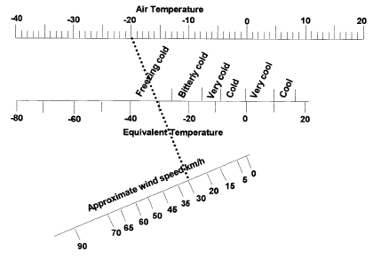

---
## Page 163

National Land Search Operations Manual 
Version Feb 2017 
163
calculated is a guide only and is based upon a healthy 25 year old male wearing the 
equivalent of normal clothing, including a jacket. 
9.32. 
Wet-Chill Survivability: The below graph which describes wet-chill survivability. Accidental 
hypothermia resulting from wet-chill is the most dangerous and commonly-fatal weather 
hazard. Essentially, wet-chill is the wetting of the missing person in cold and windy 
weather. The result is a significant decrease in that person’s ability to survive. 
 
Wet Chill Survivability Graph 
 
9.33. 
Water Immersion: Hypothermia induced by immersion in cold water has a more rapid 
onset. There is no ready answer to how long a person will survive as there are many 
factors involved including: 
(1)  
water temperature; 
(2)  
duration of immersion; 
(3)  
insulation (body fat and clothing worn); 
(4)  
level of activity; and 
(5)  
weather conditions (especially wind and wave action). 
The following chart is a guide to the survival time of a lean person in rough water and 
should not be regarded as arbitrary. For this reason, searchers must treat cold water areas 
such as streams, lakes and dams as significant danger to the missing person(s). 
 
Clothing Type 
Time to 
Incapacity (Body 
Core Temp 34°C) 
 
Time to 
Unconsciousness 
(Body Core Temp 
30°C) 
Time to Cardiac 
Arrest (Body Core 
Temp 25°C) 
 
Light Clothing 
0.4 Hrs 
0.8 Hrs 
1.3 Hrs 
4.8 mm Wet Suit 
1.6 Hrs 
3.2 Hrs 
4.9 Hrs 
Insulated 
Dry 
Clothing 
3.0 Hrs 
5.7 Hrs 
9.1 Hrs 
Water Immersion Table Based on Steinman and Kublis (1986) 
 
NB: The above times are not cumulative and are a guide only. An example of the variation 
in survival time between two persons in light clothing immersed in water at 6°C is that one 
could remain capacitated for 1.3 hours whilst the second could go into cardiac arrest in the 
same time. 
9.34. 
Effects of Alcohol: The consumption of alcohol can impact upon the time-frame for 
survival, both in hot and cold environments. Alcohol is likely to accelerate dehydration in 
hot climate and may lessen the ability to retain heat in cold areas. 
9.35. 
Hyperthermia, Heat Stress and Dehydration: Hyperthermia, heat stress and dehydration 
are dangers in hot climates, particularly in desert areas. The most severe form of heat

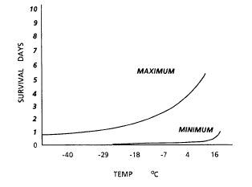

---
## Page 164

National Land Search Operations Manual 
Version Feb 2017 
164
stress is heatstroke, during which the body temperature rises due to the collapse of the 
temperature control mechanism of the body. If the body temperature rises above 42°C, 
the average person will die. Milder forms of heat stress are heat cramps and heat 
exhaustion. Another limiting factor both in hot climates and in survival situations at sea is 
dehydration. A person totally without water can die within a few hours (Western Qld 1999 
4 hrs from leaving vehicle to death), although some have survived for a week or more. 
9.36. 
The human body functions best at 38°C ± 2°C, although it will tolerate the core 
temperature dropping to 33°C or rising to 42°C with a good chance of full recovery.  
Between 32°C and 26°C body functions begin to shut down and unconsciousness usually 
follows.  Below 26°C the average individual will perish, although there have been many 
cases of persons surviving.  Temperatures above 43°C will prove fatal in most 
circumstances unless urgent medical assistance is sought. Death can occur in as short a 
period as four hours. 
9.37. 
The least serious, but still potentially dangerous, of the heat related problems are 
muscular cramps.  The exact cause is unknown but the onset of cramps can be rapid.  They 
mostly affect the larger muscles of the body, but can occur in any of the body’s muscles.  
Cramping is brought on by strenuous activity in warm or moderate temperature 
conditions and can be described as a bunching of shortening of the muscles causing what 
feels like a knot.  To alleviate cramps place the victim in a cool, comfortable place, provide 
cool water but do not give salt or salt tablets as a normal diet contains adequate salt for 
recovery.  The cramped muscles may be lightly stretched and massaged to hasten 
recovery.  Recovery is normally swift. 
9.38. 
Heat exhaustion:  Is the next most serious of the heat related illnesses.  It is brought on by 
long periods of activity in a hot environment.  This not only occurs with persons in arid 
areas but also to fire-fighter and factory workers working in confined spaces with high 
temperatures.  To maintain a constant body temperature in hot weather the body sweats, 
using the evaporation of body fluids from the skin to produce a cooling effect.  A side 
effect of this is the loss of vital body fluids which in turn decreases blood volume.  Blood 
temperature then rises resulting in an increased blood flow to the limbs to assist in 
cooling, reducing blood flow to the internal organs.  This lack of blood can cause shock and 
heat exhaustion.  If recognised early heat exhaustion can often be controlled and 
reversed.  If left undetected the body’s temperature will continue to rise and will result in 
changes in levels of consciousness.  Symptoms include dizziness and weakness, 
exhaustion, rapid and weak pulse, nausea, headache, skin that may feel cool and moist 
and look pale but progressing to hot and red.  First aid treatment of heat exhaustion is 
vital.  If conscious lay the victim down in a cool and shaded area with legs slightly elevated, 
remove or loosen tight clothing, give water in small quantities.  If vomiting or unable to 
drink seek urgent medical attention.  If the victim is unconscious place them in the 
recovery position in a cool and shaded area.  Check breathing, airway and circulation.  
Keep them cool and seek urgent medical attention. 
9.39. 
Heat stroke: Is the most serious of the heat related illnesses.  As the body’s fluid levels 
become low sweating stops.  As a result of this the body’s core temperature continues to 
rise.  The lack of blood to the vital organs necessitates that blood be brought from the 
limbs back to the core, thereby contributing to a further increase in body temperature.  At 
this stage the body is unable to cool itself and the temperature rises rapidly.  Vital organs 
then begin to fail; convulsions, unconsciousness and death soon result.  Symptoms of heat 
stroke include rapid, shallow breathing, a pulse that may be strong and rapid at first but 
deteriorating to weak and irregular, falling in and out of consciousness, hot, dry and red 
skin and a high body temperature. Treatment is similar to heat exhaustion.  Stop the 
victim from doing anything; at this stage they will have lost the ability to make rational 
decisions.  Place them in a cool area, lying down with the legs elevated.  Cool the body and

---
## Page 165

National Land Search Operations Manual 
Version Feb 2017 
165
given small quantities of cool water.  Seek urgent medical assistance. To cool the body 
remove any tight or restrictive clothing and any clothing soaked with perspiration.  Cover 
the skin with cool and wet items such as towels.  Fan the body to aid in evaporation and 
cooling.  Continue to do so until the body’s temperature falls to 38°C. 
9.40. 
In all cases rapid assessment of the situation and prompt first aid can mean the difference 
between life and death.  If you have any doubt about which stage a victim may be in then 
assume the worst and treat accordingly. 
9.41. 
Dehydration is the excessive loss of water from the body, this leads to an imbalance in the 
electrolytes.  As the body is composed mostly of water there needs to be equilibrium 
between water lost, as in sweat and urine, and water gained as in drinking and food.  If 
more water is lost than ingested then dehydration is the result.  Severe dehydration can 
end in death.  Small amounts of water or clear fluids can assist a person suffering 
dehydration but ultimately medical attention needs to be sought as fluids can be replaced 
more efficiently intravenously.  The body can only take in approximately 1.1 litres of liquid 
per hour via the stomach whereas intravenous fluids can be introduced at a much greater 
rate if necessary. 
9.42. 
Hyperthermia: Hyperthermia is the condition experienced when the human body’s core 
temperature increases from a ‘normal’ of 37°C to more than 39°C. If the missing person’s 
core temperature exceeds 42°C, the person might be expected to die. The below graphs 
provide a guide to expected desert survivability but should not be regarded as arbitrary.  
The old survival adage of 3 minutes without air, 3 days without water and 3 weeks without 
food should be remembered when referring to these graphs. 
 
 
 
 
 
 
 
S
U
R
V 
I 
V
A
L  
 
T 
I
M
E 
Approximate Desert Survival (Survivor Stationary) 
SHADE AIR TEMPERATURE CELSIUS 
33 
 
 
 
30 
 
 
 
 
 
25 
 
 
 
 
 
20 
 
 
 
 
 
15 
 
 
 
 
 
10 
 
 
10             16             21             27             32             38             43             49 
 
23 Litres of Water 
11 Litres 
5 Litres 
2 Litres 
0 Litres

---
## Page 166

National Land Search Operations Manual 
Version Feb 2017 
166
 
 
9.43. 
Dehydration: The rate of dehydration will vary with the temperature, movement of the 
missing person, their medical condition and other factors. As a guide, a person missing and 
who has access to only 2 litres of water may be expected to survive from as little as a few 
hours in extremely hot climates, to as much as 20 or more days in temperate climate. It 
should be remembered that alcohol is not a substitute for water and may accelerate 
dehydration.  
9.44. 
Period of Mobility (POM): The period of mobility or time to confinement since missing are 
used to assess the maximum distance a missing person could travel which will, in turn, 
dictate the size of the overall search area. An assessment of the period of mobility can be 
made by assuming a mobility period of 2/3 or 67% the missing person’s time frame for 
survival. 
 
 
 
Period  
to call 
help 
TFFS 
Period of Mobility 
Missing    Help     Start 
                                                 Confinement              POM                                                   Dead           
Period to implement 
confinement 
Search Area Time Scale 
S
U
R
V 
I 
V
A
L  
 
T 
I
M
E 
Desert Survival (Survivor night walking) 
SHADE AIR TEMPERATURE CELSIUS 
33 
 
 
 
30 
 
 
 
 
 
25 
 
 
 
 
 
20 
 
 
 
 
 
15 
 
 
 
 
 
10 
 
 
10             16             21             27             32             38             43             49 
 
23 Litres of Water 
11 Litres 
5 Litres 
2 Litres 
0 Litres

---
## Page 167

National Land Search Operations Manual 
Version Feb 2017 
167
9.45. 
Search Area Time Scale: The total search area time-scale may be plotted to give a clear 
picture of the situation and the time by which the missing person should be found, to 
ensure the greatest chance of survival. 
9.46. 
Example:  A person is missing in the alpine area of NSW.  The wind is 40kph from the 
south.  Air temperature is 0°C degrees and they are wearing nothing but underclothes.  
Using the wind chill table we can ascertain that the equivalent air temperature is going to 
be very cold, about -12°C.  Consultation with the hypothermia graph will give an 
approximate period of survival of between ¼ day (6hrs) and 4 ½ days.  If our missing 
person can find shelter and warmth he may survive to the 4 ½ day period.  If he remains 
out in the open with limited clothing he will perish in the 6 hours.  It now starts to rain, 
soaking our MP.  Consulting the Wet Chill Survival graph we can see that there will be a 
distinct shortening of the TFFS.  It is now between about 4 hours and 2 days, depending on 
what the MP is able to find by way of shelter and warmth.  The POM can be as short as 2 ½ 
hours to just over a day.  There is a definite amount of urgency required now.  The desert 
survival charts can be read in a similar way, but be aware these are for the northern 
hemisphere.  There are a number of recorded instances where persons have perished in 
the desert in as little as four hours without water.

---
## Page 168

National Land Search Operations Manual 
Version Feb 2017 
168
Appendix A: Australian States and Land Search Areas 
 
 
The Police Services in each State and Territory are responsible for Land Search and Rescue within the 
boundaries of their respective State or Territory, including any islands.  The ACT is also responsible 
for a small area of land at Jervis Bay, NSW. 
Statistics: 
State/Territory  
 
 
 
Population 
 
Size (km²) 
Australian Capital Territory: 
 
 
377 000 
 
2 452 
New South Wales 
 
 
 
6 782 000 
 
811 428 
Northern Territory 
 
 
 
249 000 
 
1 346 200 
Queensland 
 
 
 
 
4 100 000 
 
1 787 200 
South Australia  
 
 
 
1 532 000 
 
1 024 377 
Tasmania 
 
 
 
 
482 000 
 
67 800 
Victoria  
 
 
 
 
4 984 000 
 
227 600 
Western Australia 
 
 
 
1 987 000 
 
2 525 500 
Total 
 
 
 
 
 
21 000 000 
 
7 617 930

---
## Page 169

National Land Search Operations Manual 
Version Feb 2017 
169
Appendix B: National Search and Rescue (SAR) Responsibilities and Functions 
 
 
Table notes:  
i  
The first SAR Authority to become aware of a SAR incident is obliged to respond until overall coordination can be transferred to 
the ‘best placed’ SAR Authority in accordance with the provisions of the Intergovernmental Agreement on National Search and 
Rescue Arrangements 2012 and the principles set out in the National SAR Manual. 
ii  
Other than those for which the ADF is responsible. 
iii  
Responsibility for the rescue of persons from vessels at sea will be determined in accordance with the ‘best placed’ provisions 
of the IGA 2012 and the principles set out in the National SAR Manual. 
iv  
This includes incidents that are initially received by an Alerting Post via a distress alerting device, in accordance with Appendix  
v  
JRCC Australia involvement when requested to arrange for the provision of aircraft or accept coordination of air search in 
accordance with the principles set out in the National SAR Manual. 
vi  
JRCC Australia involvement when requested to arrange for the provision of aircraft or accept coordination of air search in 
accordance with the principles set out in the National SAR Manual. 
vi  
ADF involvement in search and rescue is arranged through HQJOC (Headquarters, Joint Operations Command) in accordance 
with the principles set out in the National SAR Manual. 
Division of Responsibility 
Function to be performed by, or on behalf of, the overall coordinating authority 
For land, sea and air 
SAR, in respect of: 
Responsible 
Authority (i) 
Provision and 
coordination of 
Air SAR units 
Provision and 
coordination of 
Land SAR units 
Provision and 
coordination 
of Marine 
SAR units 
Communication 
(other than 
air/surface) 
Air/Ground 
communication 
for land search 
and rescue 
Air/ship 
communication 
where direct 
communication
s not available 
International civil 
aircraft, manned space 
vehicles and aircraft on 
the Civil Aviation Safety 
Authority (CASA) and 
Recreational Aviation 
Australia (RA-Aus) 
Registers 
JRCC 
JRCC 
Police 
JRCC 
JRCC 
Air Services 
Australia 
Air Services 
Australia 
Persons on or from 
vessels at sea (ii) 
JRCC 
Police (iii) 
JRCC 
Police 
Police 
JRCC 
Police 
JRCC 
Police 
Police 
Air Services 
Australia 
Police 
Air Services 
Australia 
Persons, vehicles and 
objects on land, and 
persons, vessels and 
objects on inland 
waterways and in 
waters within limits of 
the ports of the relevant 
state/Territory (iv). 
Police 
Police JRCC(v) 
Police 
Police 
Police 
Police 
Air Services 
Australia 
Police 
Air Services 
Australia 
Aircraft not included in 
the CASA and RA-Aus 
registers including 
ultralights, para-gliders, 
hand gliders and 
gyrocopters 
Police 
JRCC 
Police (vi) 
Police 
Police 
JRCC 
Police 
Air Services 
Australia 
Police 
Air Services 
Australia 
Police 
Air Services 
Australia 
Australian Defence 
Force (ADF) and Foreign 
Military Personnel, 
Aircraft, Ships and 
Submarines 
ADF(vii) 
ADF 
ADF 
ADF 
ADF 
ADF 
ADF

---
## Page 170

National Land Search Operations Manual 
Version Feb 2017 
170
Appendix C: Inter-Governmental Agreement (IGA) on National Search and 
Rescue Response Arrangements 
 
This appendix contains a copy of the 2012 IGA applicable to the Australian National SAR Plan.

---
## Page 171

National Land Search Operations Manual 
Version Feb 2017 
171

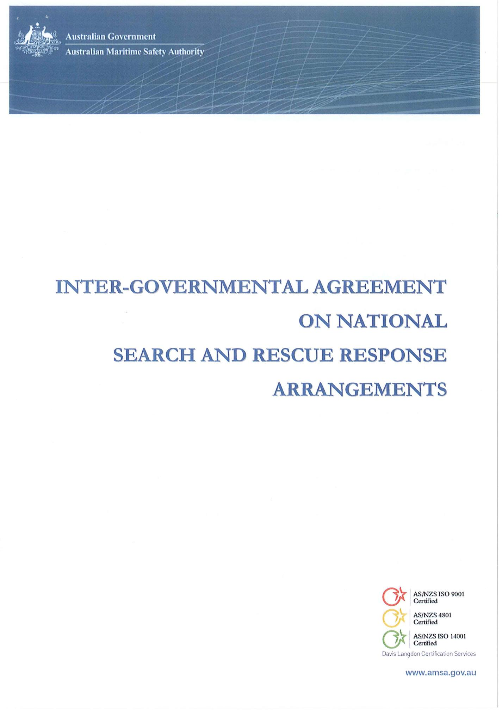

---
## Page 172

National Land Search Operations Manual 
Version Feb 2017 
172

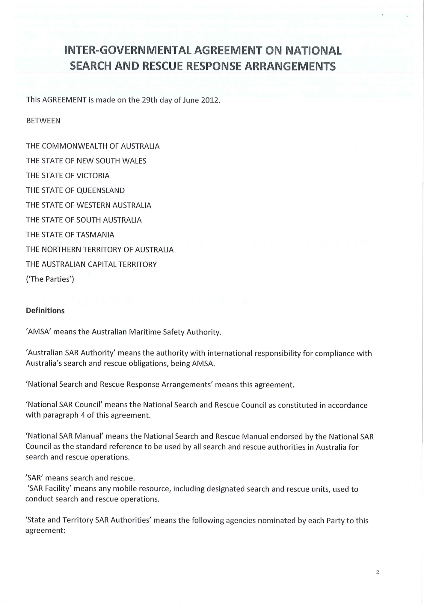

---
## Page 173

National Land Search Operations Manual 
Version Feb 2017 
173

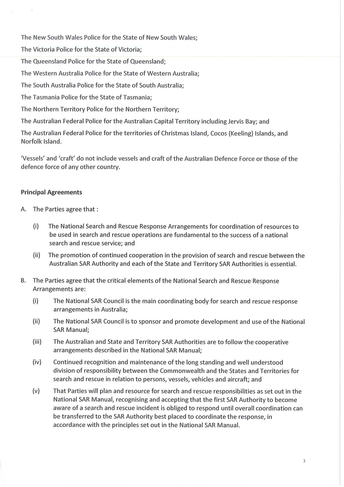

---
## Page 174

National Land Search Operations Manual 
Version Feb 2017 
174

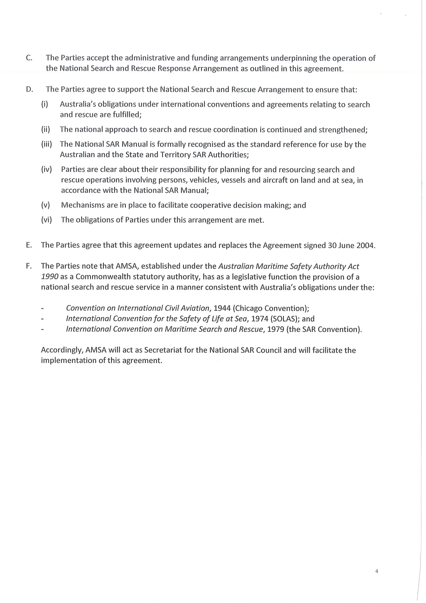

---
## Page 175

National Land Search Operations Manual 
Version Feb 2017 
175

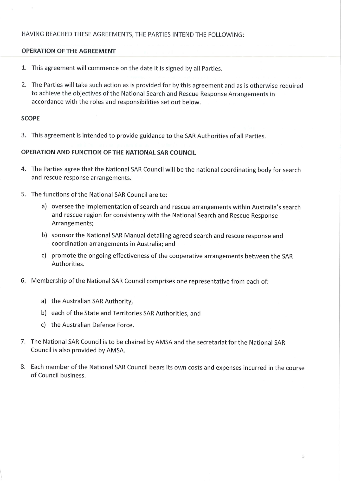

---
## Page 176

National Land Search Operations Manual 
Version Feb 2017 
176

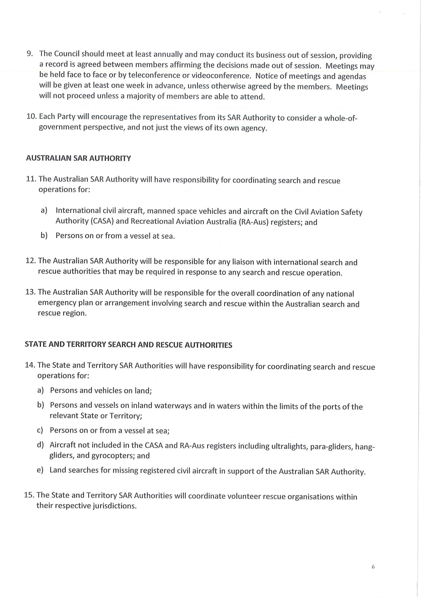

---
## Page 177

National Land Search Operations Manual 
Version Feb 2017 
177

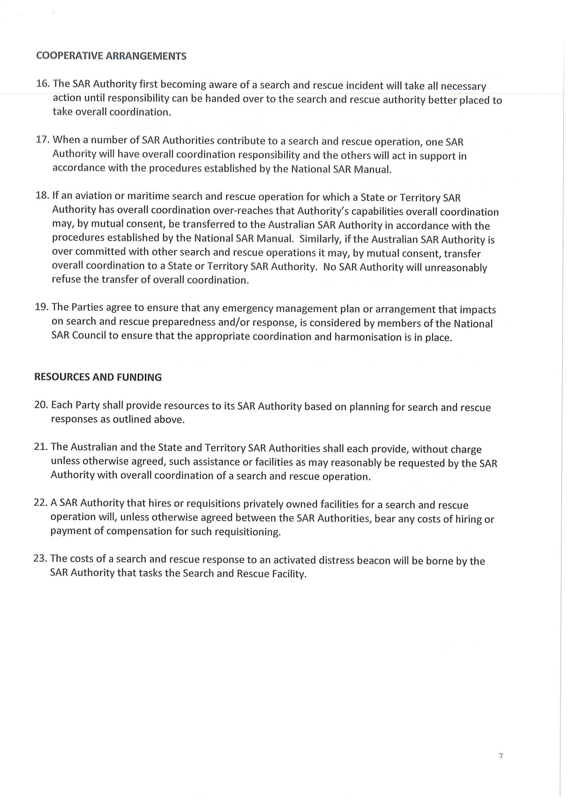

---
## Page 178

National Land Search Operations Manual 
Version Feb 2017 
178

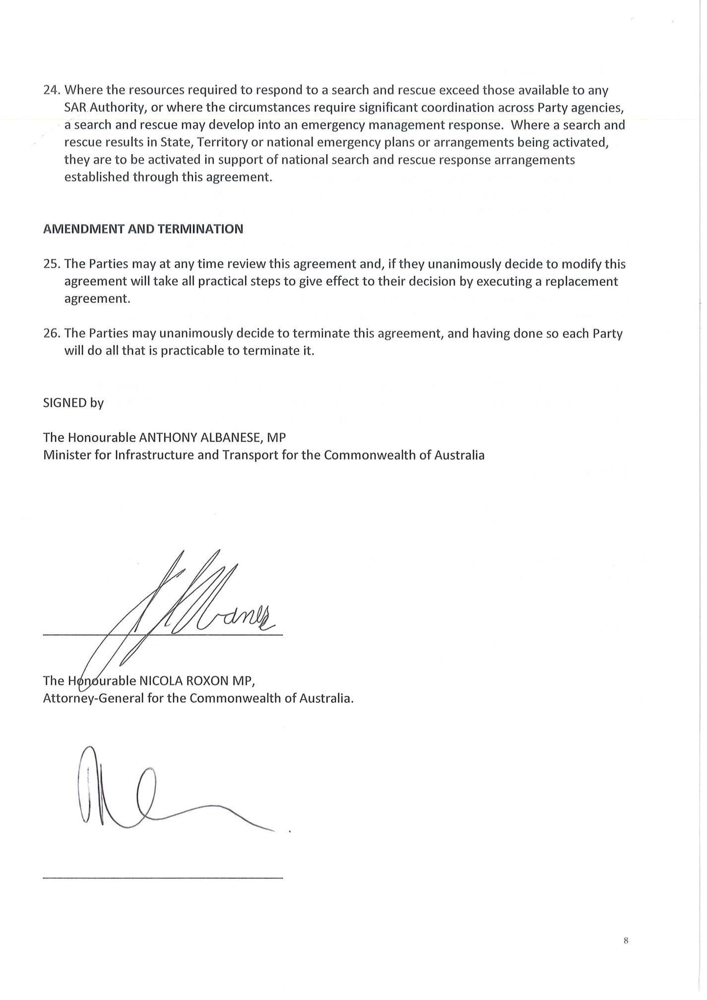

---
## Page 179

National Land Search Operations Manual 
Version Feb 2017 
179

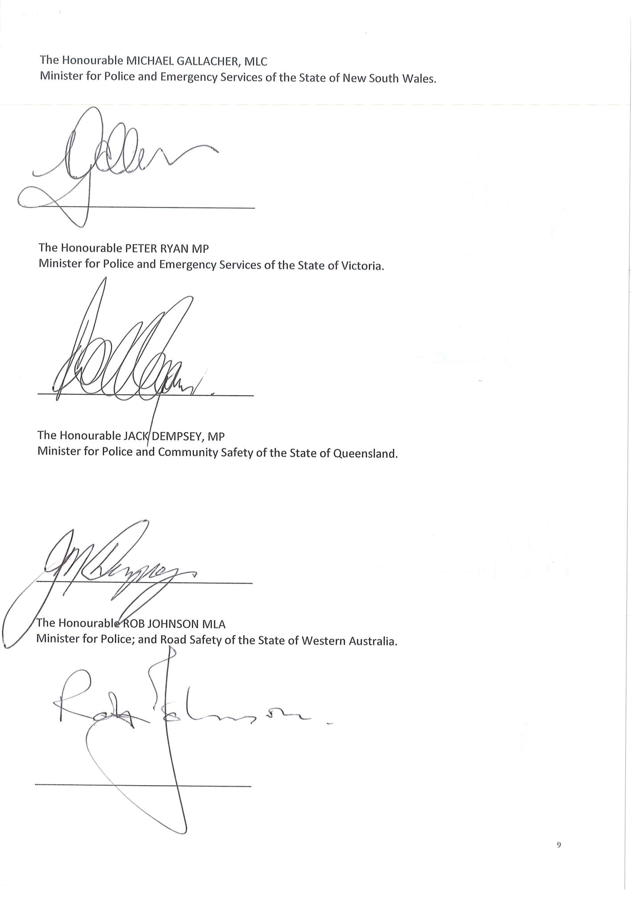

---
## Page 180

National Land Search Operations Manual 
Version Feb 2017 
180

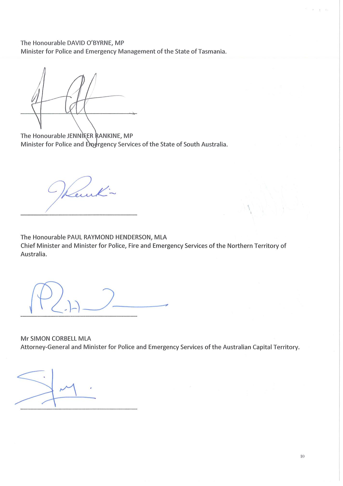

---
## Page 181

National Land Search Operations Manual 
Version Feb 2017 
181
Appendix D: Information exchange requirements – Transfer of Coordination 
 
Overview 
In accordance with section 1.2.30 and 1.2.35 of the manual, transfer of coordination is deemed to have 
taken place at the time verbal agreement is reached.  The transfer of coordination is to be recorded 
appropriately within each Authority’s incident management system. 
The transfer of coordination can involve overall coordination or specific sub components of the search 
activity e.g. Land\Air\Sea search coordination.  Transfer discussions will only be undertaken between 
appropriately authorised person(s) of respective SAR Authority’s.  
Noting that each SAR Authority has fit for purpose record keeping systems the following is to be used as a 
guide for information that shall be transferred electronically to another SAR agency as part of the transfer 
of coordination process. 
Item 
Comment 
Timestamp 
System generated Date\Time stamp 
Reference telephone call for time 
of verbal transfer 
Reference telephone call between SAR Authorities in which verbal 
transfer of coordination was agreed 
Incident Identifier and short 
description 
Authority Incident\CAD reference number, short title of incident and 
plain language description 
Coordination Transfer 
Details of coordination element to be transferred, possibilities 
include1: 
 
Overall Coordination 
 
Land Search 
 
Sea Search 
 
Air Search 
Current Situation  
Assessment of the current situation by the coordinating SAR authority 
Intelligence and Actions 
undertaken 
A summary of known information and actions completed 
Incident location 
Incident location details, at a minimum Latitude and Longitude 
(decimal degrees) are to be provided 
Additional positional formats can be provided, e.g.  Grid Reference, 
embedded GPS position 
Additional incident support 
requirements 
Additional incident support requirements as agreed between SAR 
authorities, examples could include forward command post support, 
next of kin liaison, radio broadcasts etc. 
                                                          
1 Delete those that are not applicable

---
## Page 182

National Land Search Operations Manual 
Version Feb 2017 
182
Supplementary Information 
Information pertaining to the craft e.g. beacon registration details, 
craft operator details and contacts, trip details 
D.1 Example; Transfer of Coordination information 
192359 UTC Jun 2015 
FM JRCC AUSTRALIA 
TO [State\Territory SPOC] 
INFO [As required] 
INCIDENT 2015/1234 - TRANSFER OF SEARCH AND RESCUE [OVERALL COORDINATION\AIR SEARCH\LAND 
SEARCH\SEA SEARCH] – PLB\SEND DEVICE LOCATED XXX 
Ref A. Telecon JRCC Australia \ [State\Territory SPOC] 192350 UTC JUN 2015 
Ref B. NATSARMAN xx.x 
1. COORDINATION TRANSFER 
IN ACCORDANCE WITH REF A, JRCC AUSTRALIA HEREBY FORMALLY REQUEST THE TRANSFER OF 
[OVERALL\AIR SEARCH\LAND SEARCH\SEA SEARCH, IN ACCORDANCE WITH PARAGRAPH 1.2.31 OF THE 
NATIONAL SEARCH AND RESCUE MANUAL, FOR THE SEARCH AND RESCUE ACTION FOR RESPONSE TO THE 
ACTIVATION OF A [DEVICE] ACTIVATED AT [DDHHMM UTC MMM YYYY]. 
2. CURRENT SITUATION: 
JRCC AUSTRALIA RECEIVED PLB DETECTION AT 19 2230UTC. THE JRCC HAS CONFIRMED THERE IS A PARTY 
OF FOUR PERSONS CANYOING IN X AREA AND THAT THEY REPORTED THEY WOULD ONLY ACTIVATE THE 
BEACON IN CASE OF A SERIOUS INJURY OR ACCIDENT. THE PARTY DEPARTED THIS MORNING, NO OTHER 
INFORMATION REGARDS SAFETY EQUIPMENT IS KNOWN. AIRCRAFT TRANSITING THE AREA HAVE BEEN 
REQUESTED TO REPORT ANY HEARING REPORTS IN THE AREA.  
3. INTELLIGENCE AND ACTIONS UNDERTAKEN: 
JRCC AUSTRALIA HAS CONTACTED THE REGISTERED BEACON OWNER EMERGENCY CONTACTS. THEY 
ADVISE THAT THE BEACON HAS BEEN LOANED TO X AND Y, THEY ARE CURRENTLY CANYONING IN THE X 
AREA WITH FOUR OTHER PERSONS.  THE FOLLOWING CONTACT\COMMUNICATION DEVICES ARE IN 
POSSESSION OF THE REGISTERED OWNERS.  
4. INCIDENT LOCATION: 
A. 
LATITUDE\LONGITUDE:   
39-14.5S 142-54.76E 
B. 
*GRID REFERENCE:  
 
54H 665062 5654661 UTM 
C. 
*EMBEDDED GPS POSITION:  
39-14.5S 142-54.7E 
* AS APPLICABLE 
5. ADDITIONAL INCIDENT SUPPORT REQUIREMENTS 
IN ACCORDANCE WITH REQUEST OF [STATE\TERRITORY SPOC] JRCC AUSTRALIA HAS TASKED [RESCUE 
431CHALLENGER 604 TIER 1 AIRCRAFT] ETA ON SCENE IS ADVISED AS 200112 UTCJUN 2015.

---
## Page 183

National Land Search Operations Manual 
Version Feb 2017 
183
6. SUPPLEMENTARY INFORMATION, BEACON REGISTRATION INFORMATION 
 
REGARDS, 
JRCC AUSTRALIA

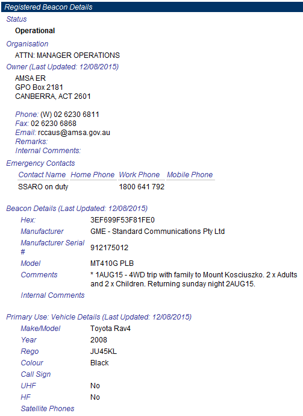

---
## Page 184

National Land Search Operations Manual 
Version Feb 2017 
184
Appendix E: Search Urgency Assessment 
 
Name of Incident: 
No: 
Date Completed: 
Time completed: 
Initials: 
Incident date: 
 
Number of subjects 
1 person 
1 
 
2 people or 3 or more –separated 
2 
3 people or more – together 
3 
Age 
Very young 
1 
 
Other 
2-4 
Very Old 
1 
Medical Condition 
Known illness or  requires medication 
1 
 
Suspected illness or injury 
2 
Healthy 
3 
Known fatality 
4 
Potential vision impairment 
1 
Intent 
Suicidal 
1 
 
No known intent 
3 
Absconder from facility 
4 
Cognitive Capacity 
Dementia / Alzheimer’s /Parkinson’s 
1 
 
Capacity of 16 year old or less 
1 
Diagnosed mental illness, depression or anxiety 
2 
No known capacity issues 
3 
Experience profile 
Not experienced, not familiar with area 
1 
 
Not experienced – familiar with area 
2 
Experienced – not familiar with area 
3 
Experienced – familiar with area 
4 
Physical Condition 
Unfit 
1 
 
Fit 
2 
Very fit 
3 
Clothing profile 
Inadequate/insufficient 
1 
 
Adequate 
2 
Very good 
3 
Equipment Profile 
Inadequate for activity/environment 
1 
 
Questionable 
2 
Adequate 
3 
Very Well equipped 
4 
Weather profile 
Existing Hazardous weather 
1 
 
Hazardous forecast (8 hours or less) 
2 
Hazardous forecast (more than 8 hours) 
3 
No hazardous weather forecast 
4 
Terrain and Hazards profile 
Known hazards 
1 
 
Difficult terrain 
2 
Few hazards 
3 
Easy terrain, no known hazards 
4 
 
 
11-17 Emergency Response        18-33 Measured response         34-42 Evaluate & Investigate 
Note: If any individual category above is rated as ONE (1), regardless of its total – the search could require an emergency 
response 
Remember: the lower the number the more urgent the response!!!

---
## Page 185

National Land Search Operations Manual 
Version Feb 2017 
185
Appendix F: Missing Person Questionnaire 
 
Missing Person Questionnaire 
Incident: 
Date: 
Time: 
Surname: 
Given names: 
Address: 
Telephone: 
Mobile: 
DOB: 
Ethnicity: 
Sex: 
NOK: 
Telephone: 
Hgt: 
 
Wgt: 
Bld: 
Eyes: 
Cmp: 
Beard: 
Scars: 
Hair: 
Lgth: 
Hiker Exp: 
 
Climber Exp: 
Swim Exp: 
Snow Exp: 
 
Military Exp: 
Camping Exp: 
First Aid Trn: 
 
Map/Compass Trn: 
Knowledge of area: 
Smoke: 
 
Drink: 
Fears: 
Lost before: 
Action then: 
Shirt: 
 
Jumper: 
Trousers: 
Jacket: 
Raingear: 
Hat: 
Shoes: 
 
Sole pattern: 
Scarf: 
Glasses: 
Watch: 
Jewellery: 
Other Clothing: 
 
Clothes for dog scent: 
Pack: 
 
Colour: 
Tent: 
Colour: 
Slp Bag: 
Colour: 
Water Bottle: 
 
Colour: 
Torch: 
Colour: 
Slp mat: 
Colour: 
Knife: 
 
Matches: 
Compass: 
Firearm: 
Fishing gear: 
Camera: 
Ropes: 
 
Climb Equ: 
Kayak: 
Radio AM: 
Radio CB: 
PLB: 
Map: 
 
 
Food: 
Name: 
 
Scale: 
Number: 
Vehicle Reg No: 
Make/Model: 
 
Colour: 
Medical History: 
Physical Problems: 
Psych Problems: 
 
Medication: 
 
Amount carried: 
Consequences: 
Doctor: 
Address: 
Telephone: 
Family Problems: (Financial, family) 
 
 
Request for Aid (Welfare) 
Person to notify if found ALIVE: 
 
Address: 
Telephone: 
Person to notify if found DEAD: 
 
Address: 
Telephone: 
Remarks: 
 
 
Name: 
Rank: 
Station:

---
## Page 186

National Land Search Operations Manual 
Version Feb 2017 
186
Appendix G: Object Questionnaire 
 
Object Questionnaire 
SAR Number: 
Date/Time: 
Description of Object: (If photo/drawing is available please attach) 
 
 
 
 
 
 
Make: 
Model: 
Reg/Serial No: 
 
Colour: 
Dimensions: 
Weight: 
 
Special Markings/Identifiers: 
 
 
 
 
Does this object pose any dangers to humans, animals or the environment?  If so describe in detail: 
 
 
 
 
Who can be contacted to provide expert advice? 
Name: 
Organisation: 
Telephone Number: 
Fax No: 
 
 
What action is to be taken by searchers if object found? 
 
 
 
 
Information provided by: 
Name: 
Organisation: 
Telephone Number: 
Fax No: 
 
 
Remarks: 
 
 
Name: 
Rank: 
Section/Station:

---
## Page 187

National Land Search Operations Manual 
Version Feb 2017 
187
Appendix H: Land SAR Checklist 
 
Land SAR Checklist 
Maintain chronological action log: (Who spoken to? Times, Dates) 
 
Missing person Questionnaire: 
 
Completed: 
 
Search Area: 
Terrain 
 
Hazards 
 
Communications 
 
Assessment of scenarios 
 
Availability of resources 
 
What’s been done to date 
 
Isolate/Contain area 
 
Local SAR Plan 
 
Weather (www.bom.com.au) 
At present 
 
Forecast 
 
Sunset/sunrise 
 
Potential hazardous weather 
 
Search Urgency 
Complete Search urgency Form 
 
Determine appropriate response 
 
Update briefing to Insp/Sen Sgt/Duty 
Officer 
 
Update RCC 
 
Advise Media Section 
 
Advise Coroner (If death) 
 
Advise SES and other resources 
 
 
 
Field Search Headquarters 
Set up Field Search Headquarters 
 
Suitable location 
 
Access 
 
Parking 
 
Transport 
 
Communications 
 
Facilities 
 
Equipment 
 
Missing Person Locations 
Confirm Initial Planning Point IPP 
 
Last Known Point LKP 
 
Point Last Seen PLS 
 
 
 
Lost Person behaviour LPB 
Establish distances 
 
Characteristics 
 
Likely search areas 
 
Medical considerations 
 
TFFS 
 
POM 
 
Mapping 
Suitable maps 
 
Mark IPP, LKP, PLS 
 
Areas searched 
 
Areas to be searched 
 
SITREPS: 
To local command 
 
SAR Command 
 
OIC 
 
Media 
 
NOK 
 
Other agencies 
 
Planning: 
Identify Operations Commander (Liaise 
with same) 
 
Identify SMC 
 
Search appreciation conducted 
 
Designate sub roles 
 
2IC 
 
Planning member 
 
Intelligence member 
 
Log keeper 
 
Communications member 
 
Logistics member

---
## Page 188

National Land Search Operations Manual 
Version Feb 2017 
188
Land SAR Checklist 
Consider Criminal Investigation Branch if 
suspicious 
 
NOK Liaison officer 
 
Establish White Board 
 
Establish Communications Plan 
 
Updated weather information 
 
Mapping/tasking 
 
Identify search areas (Manageable in 4-
6hrs) 
 
Consider Mattson Consensus 
 
Allocate Operational periods for future 
taskings 
 
Rescue Plan 
 
Allocate resources to teams 
 
Brief Search Personnel 
 
Team leader Briefings 
SMEAC 
 
Emphasise clues 
 
Calling method 
 
Description/clothing 
 
Search method 
 
SITREP requirements 
 
Questions? Understood 
 
Rescue Plan 
 
Actions on 
 
 
 
SITREPS: 
To local command 
 
SAR Command 
 
OIC 
 
Media 
 
NOK 
 
Other agencies 
 
Search patterns 
FAST Teams 
 
Static Teams (SES Light trailer) 
 
Road Blocks 
 
Patrols 
 
Track Traps 
 
Broad Sweeps 
 
Sound Sweeps 
 
Night Search 
 
Contact Search 
 
Line (Parallel) Search 
 
Records 
Action log 
 
Equipment issued log 
 
Radio log 
 
Search team records 
 
Personnel records- Attendances 
 
Intelligence Records 
 
Update Map/Chart/white boards 
 
Daily summary of personnel 
 
Debrief 
Thoroughness of search 
 
POD 
 
Mark searched areas on map 
 
Team leader to sign search record 
 
Clues 
 
Further areas to search 
 
Issues raised 
 
Download GPS information 
 
Manage welfare 
 
 
 
Future Issues 
Allocate time callout for more resources 
 
Search/rescue plans 
 
Evacuation plan 
 
Operational periods 
 
Change over of staff/SMC 
 
Equipment/fuel 
 
Conclusion of SAR Operations - 
At the conclusion of a SAR operation due to a target being located or the operation is suspended 
when a target is not located, the designated SMC should consider the following points and 
determine the correct course of action. 
Confirm information is accurate and target has been located 


---
## Page 189

National Land Search Operations Manual 
Version Feb 2017 
189
Land SAR Checklist 
Alert all SRU – Stand down units 
 
Sign in all members and document any injuries 
 
All appropriate agencies notified 
 
Sitrep to local command 
 
Log assets / resources 
Equipment repair & return 
 
NOK Notified 
Insure they are updated regularly. 
Appoint a liaison member 
Ensure active participation in process were possible 
Prepare NOK for suspension decision at least one day prior   
 
Consider bringing in coroner or coroner’s assistant  
 
Involve Police Investigators early - If M/P not located 
 
Consult Doctor – private and independent 
 
Media release 
Ensure you communicate correct message if SAR suspended. 
Seek advise from Police Media liaison unit 
Consider signs or pamphlets left in area – if target not located 
 
Debrief the MP – document / consider taping 
 
Review who has command – If SMC leaving area 
 
Hazards I.D eg. abandoned vessel – advised shipping 
 
Records collated and filed 
 
If target not located – Document reasons for suspension 
Document by - police statement or Specific suspension of SAR documentation 
Signed off by district officer or higher 
 
Administration / Financial procedures completed 
 
Conduct & organize debriefs – Hot & Full  
 
Ensure Debriefs documented – Action items identified   
Improvements, what went well, further investigation, encourage feedback 
Designate actions items to specific members 
Full debrief with relevant team leaders within 2 weeks of conclusion 
 
Safety issues after search. Driving whilst tired / alcohol 
 
Consider critical incident stress management issues 
 
Letters of thanks to outside agencies 
Certificates for good work 
 
Conduct review – conclusion or suspension of SAR operation 
By SMC and independent member 
Examine search plan 
Review planning scenarios 
Confirm initial planning point 
Evaluated all intelligence 
Examine all calculations 
Consult other experts – Police/medical/RCC 
Review TFFS with all available information 


---
## Page 190

National Land Search Operations Manual 
Version Feb 2017 
190
Land SAR Checklist 
Quality and effectiveness of search 
Consult doctor  - personnel and independent 
Coverage of all areas searched 
POD high as desired 
Can you justify what has been done or not done? 
Never assume anything – information must be confirmed 
Consider – 
Future Case study NATSAR 
Review NATSAR manual conclusion of SAR Operations Chapter 7 
Exercises in area 
Over flights by Helicopter  
 
CONCLUSION OR SUSPENSION - NOT TERMINATION 
 
Resources 
RCC 
 
Local Police 
 
Command Truck 
 
Dog Squad 
 
Mounted Unit 
 
Radio Techs 
 
Field Catering 
 
Media Unit 
 
Psychologist 
 
Forensic Unit 
 
Scenes of Crime Unit 
 
RCC 
 
DACC 
 
Ambulance 
 
SES 
 
Fire Service 
 
Cave/Mine rescue 
 
Salvation Army 
 
Surf Life saving 
 
Volunteer Marine Rescue 
 
Coast Guard 
 
Ski Patrol 
 
Customs 
 
BOM 
 
Harbour master

---
## Page 191

National Land Search Operations Manual 
Version Feb 2017 
191
 
Appendix I: Lost Person Behaviour 
 
Lost Person Behaviour (LPB) has been derived from many studies and statistics gathering from search and 
rescue groups in many countries of the world.  It has been found that certain categories of missing 
persons tend to have similar characteristics with respect to being lost.  These categories have been 
broken down into the following groups: 
a. 
Children 1-3 years of age 
b. 
Children 4-6 years of age 
c. 
Children 7-12 years of age 
d. 
Youths 13-15 years of age 
e. 
Despondents or Suicide  
f. 
Psychological Illness’ 
g. 
Developmental Problems 
h. 
Alzheimer’s and Dementia 
i. 
Hikers and Walkers 
j. 
Climbers 
k. 
Hunters 
 
Definitions: 
Children 1-3yrs: All children aged 1-3 years of age. 
Children 4-6yrs: Al children aged 4-6 years of age 
Children 7-12yrs: All children aged 7-12 years of age. 
Youths 13-15yrs: All teens aged 13-15 years of age. 
Despondent: A person feeling or showing signs of profound hopelessness, dejection, discouragement 
and/or gloom. This includes depression and people who have expressed the intent to commit suicide.  
Not all despondent’s are suicidal and similarly not all suicidal persons are despondent but they have 
similar characteristics and are therefore combined for SAR purposes. 
Psychological Illness: This category covers persons suffering from a wide range of mental disorders that 
medically would not be used together.  They include persons suffering from schizophrenia, paranoia, 
psychotic disorders and bipolar disorders. These disorders can be naturally occurring or artificially induced 
such as by substance abuse. This category does not include dementia. 
Developmental Problems: Also called Mental Retardation or Intellectual disability is a combination of 
below average intellectual functioning, impairments in daily life (communication, self-care, social skills, 
work, safety, health) and was onset prior to the age of 18 years.  This category also applies to persons 
suffering brain injuries after 18 years that exhibit the same symptoms.  
Dementia:  Dementia is the loss of memory, reason, judgement and language to such extent that it 
interferes with daily living.  Dementia includes AIDS and Alcohol related dementia, Alzheimer’s Disease, 
Down Syndrome, Early or Younger Onset Dementia, Fronto Temporal Lobar Degeneration, Vascular 
Dementia and Dementia with Lewy bodies. Dementia often results in severe disturbances in how a person 
perceives and interprets events, sights, and sounds around them. 
Hikers and Walkers: This category includes day walkers, members of bush walking clubs, hill/fell walkers, 
multi-day hikers, trekkers, orienteers and other persons who purposefully enter the bush for recreational 
walking purposes.  Mountaineers are included in the climbing category. 
Climbers: This category includes day climbers (single day outings, bouldering, rock and cliff climbers, 
traditional climbers and sport climbers) and mountaineers (those who attempt prominent peaks or alpine 
travel).

---
## Page 192

National Land Search Operations Manual 
Version Feb 2017 
192
Hunters: This category includes all forms of hunting (pigs, water buffalo, brumbies, game fowl, kangaroos, 
cattle) on land.  There is insufficient data for a further breakdown. 
 
These are the most common groups of missing persons likely to be the subject of a search in Australia. 
There have been numerous studies on missing person behaviour with the most recent being Robert 
Koester’s (ISRID) International Search and Rescue Incident database www.dbs-sar.com collating 
thousands of incidents, statistics and previous studies for an international database. This information is 
continually being analysed and updated with Koester currently dividing missing person statistics to eco 
regions around the world that will enable more defined distances of travel for particular areas such as 
Victoria, a temperate terrain, as opposed to Northern Territory a hot dry terrain.  The only specific 
Australian project on missing person behaviour was the SARBAYES project which was completed by 
Charles Twardy: http://sarbayes.org/natsar.pdf. The current Australian data base for the entry of LPB 
details is: http://goo.gl/OLZmW  
Overseas studies also look at other categories such as hunters, skiers and miscellaneous adults.  The three 
main LPB studies used for this manual have been taken from the UK, USA and Canada.  Although Australia 
has many links with the UK and the majority of our citizens have a British background we are a more 
mobile and active society more closely resembling Canada in our lost person behaviour.  These tables 
have been prepared as a guide only and are a compilation of studies in the above countries.  They 
represent the statistical properties and characteristics of missing persons and what could be expected of 
them when they are lost, but ultimately these are only probabilities, not certainties. 
This information can be used as the basis of search planning when no other information is available.  
Obtaining a good profile of the target person will assist the SMC in determining whether that 
person/group fits into the known behavioural patterns of the various categories studied.  If so then 
further planning can be carried out on the information contained within this section.  The SMC must 
always be aware that not everyone will adhere to these profiles.  As can be seen in the distances 
travelled, 80% are within a relatively small area while the last 20% of persons in each category tend to 
travel much greater distances.   
The studies show what the majority will do, there will always be someone outside the box who will do the 
opposite of what is expected.

---
## Page 193

National Land Search Operations Manual 
Version Feb 2017 
193
 
Children 1-3 years 
Characteristics: 1-3 year olds 
a. 
Have no concept of being lost. 
b. 
Navigational skills are non-existent 
c. 
Will wander aimlessly 
d. 
Will not often respond to commands or whistles. 
e. 
Will tend to find shelter, which increases their survivability. 
 
Tendencies: 
a. 
Will often seek out a place of shelter.  Thick bushes, tables, old vehicles or 
appliances, caves. 
b. 
Difficult to detect. 
c. 
Will rarely self-help or walk out. 
Strategies: 
a. 
Urgent response 
b. 
Confinement is a low priority. 
c. 
Passive techniques are not often successful. 
d. 
Dogs may be helpful if used quickly. 
e. 
Checks of places of highest probability to be made initially. 
f. 
Teams to run main tracks and trails.   
g. 
May require getting down onto hands and knees to identify other less obvious 
tracks. 
Where located statistically: 
 
a. 
Habitation 
 
 
25% 
 
b. 
Building/shelter 
             25% 
 
c. 
Open ground 
 
 
25% 
 
d. 
Fence line, hedge, wall              12% 
 
e. 
Water, water’s edge 
 
12% 
 
% of category 
10 
20 
30 
40 
50 
60 
70 
80 
95% 
Distance from LKP 
(KM) 
0.11 
0.25 
0.3 
0.42 
0.6 
1.15 
1.6 
2.10 
4.45

---
## Page 194

National Land Search Operations Manual 
Version Feb 2017 
194
Children 4-6 years 
Characteristics: 4-6 year olds 
a. 
Have an idea of being lost and will endeavour to return to home or to a 
familiar place. 
b. 
Will panic, which may cause them to become further lost. 
c. 
Explorations are usually one way, as a result of not comprehending to need to 
make a return journey. 
d. 
Will tend to remain on tracks or what they perceive as tracks.  Not always 
visible to taller adults. 
e. 
Are considerably more mobile than smaller children. 
f. 
May have been following an adult or animal prior to getting lost. 
 
Tendencies: 
a. Will often seek out a place of shelter.  Thick bushes, tables, old vehicles or 
appliances, caves. 
b. Difficult to detect. 
c. Will rarely self-help or walk out. 
Strategies: 
a. Urgent response 
b. Confinement is a low priority. 
c. Passive techniques are not often successful (Consider nicknames). 
d. Dogs may be helpful if used quickly. 
e. Checks of places of highest probability to be made initially. 
f. Teams to run main tracks and trails.   
g. May require getting down onto hands and knees to identify other less obvious 
tracks. 
Where located statistically: 
 
a. 
Habitation 
 
    28% 
 
b. 
Building/shelter 
    27% 
             c.          Road, linear                        19% 
 
d. 
Bush, scrub 
                 11% 
             e.          Open ground 
 
      8% 
 
f. 
Water, water’s edge             7% 
 
% of 
category 
10 
20 
30 
40 
50 
60 
70 
80 
95 
Distance from 
LKP (KM) 
0.1 
0.21 
0.48 
0.75 
0.95 
1.3 
1.68 
2.57 
5.47

---
## Page 195

National Land Search Operations Manual 
Version Feb 2017 
195
Children 7-12 years 
Characteristics:  
a. Have developing navigational skills. 
b. Are developing mental pictures of their environments, which are often inaccurate and 
highly distorted. 
c. Often become lost while attempting a short cut. 
d. Often become lost while ‘role playing’ or adventuring. 
e. Often become upset upon being lost and will act irrationally. 
f. May attempt to track run which can take them further from their LKP. 
g. Will act more rationally if with a friend or sibling. 
h. Will often attempt to self-help, not always successfully. 
 
Tendencies: 
a. Will mostly stay on tracks or trails. 
b. May seek out favourite places, hideouts etc, check with friends 
c. May seek out known landmarks, lookouts, high points, places they have been to in the 
past, lakes, ponds, areas where vegetation changes such as forest edges. 
 
Strategies: 
a. Urgent response 
b. Confinement is a high priority 
c. FAST and Reconnaissance teams to highest probability areas. 
d. Use dogs if available 
e. Passive techniques are not often successful. 
 
Where located statistically: 
 
a. 
Habitation 
 
 
28% 
 
b. 
Building/shelter 
             27% 
 
c. 
Road, Linear 
 
 
19% 
 
d. 
Forest/woods 
 
 
11% 
             e.          Open ground 
 
 
  8% 
 
f. 
Water, water’s edge 
 
  7% 
 
 
 
 
% of 
category 
10 
20 
30 
40 
50 
60 
70 
80 
95 
Distance from 
LKP (KM) 
0.23 
0.47 
0.85 
1.39 
1.98 
3.00 
4.05 
5.15 
10.2

---
## Page 196

National Land Search Operations Manual 
Version Feb 2017 
196
Youth 13-15 
Characteristics:  
a. 
Moderately developed navigational skills 
b. 
Often become lost as part of a group engaged in exploring. 
c. 
Don’t often travel far. 
d. 
Often respond to attractant techniques. 
e. 
Often seek familiar locations by direction sampling. 
f. 
Will act more responsibly as part of a group. 
g. 
Will often attempt to self-help. 
h. 
May panic if alone 
 
Tendencies: 
a. Will mostly stay on tracks or trails. 
b. May seek out favourite places, hideouts etc, check with friends 
c. May seek out known landmarks, lookouts, high points, places they have been to in the 
past, lakes, ponds, areas where vegetation changes such as forest edges 
 
Strategies: 
a. Urgent response 
b. Confinement is a low priority unless MP is alone 
c. FAST and Reconnaissance teams to highest probability areas. 
d. Use dogs if available 
e. Passive techniques are not often successful. 
 
Where located statistically: 
 
a. 
Habitation 
 
 
24% 
 
b. 
Stream/waterway 
 
22% 
             c.          Building/shelter  
             21% 
 
d. 
Forest/ woods                           11% 
 
e. 
Road, Track 
 
 
11% 
 
f. 
Forest edge or clearing              11% 
 
 
 
 
% of category 
10 
20 
30 
40 
50 
60 
70 
80 
95 
Distance from LKP 
(KM) 
0.5 
1.1 
1.47 
1.85 
2.2 
3.03 
3.79 
4.37 
14.43

---
## Page 197

National Land Search Operations Manual 
Version Feb 2017 
197
Despondent 
Characteristics: 
a. Don’t often travel far, but intent to be alone 
b. Often located a border of two types of terrain and/or vegetation boundary 
c. May head for a scenic location or well-known beauty spot. 
d. Locations are often well known to MP, check with family 
e. Rarely located in dense underbrush or trees. 
f. Rarely respond to call and whistles and may hide. 
g. Very high fatality rate 
h. Drugs and/or alcohol often involved. 
 
Tendencies: 
a. Go to high points or scenic locations. 
b. Well known or favourite places. 
c. Terrain interfaces 
d. Group 1- merely seeking to get out of sight. 
e. Group 2-will seek out a specific location, significant to their life.   
f. May travel further. 
 
Strategies: 
a. Investigation important 
b. Obtain a good subject profile from family and friends. 
c. Urgent response 
d. Thorough search of a small area 
e. Confinement is a low priority 
f. Passive techniques not successful 
Where located statistically: 
a. Habitation                                 26% 
b. Water/water’s edge                   24% 
c. Forest/woods                            16% 
d. No trace                                    13% 
e. Road                                         11% 
f. Forest edge/clearing                   9% 
 
% of category 
10 
20 
30 
40 
50 
60 
70 
80 
95 
Distance from LKP 
(KM) 
0.14 
0.33 
0.56 
0.87 
1.18 
1.76 
2.43 
3.22 
18.14 
 
 
A small percentage of all persons who go missing do so with the intent of committing suicide.  The reasons for this 
are beyond the scope of this document but a wide and varied. The SMC should consider whether the MP is 
genuinely at risk of taking their own lives and what strategy should be used.  Studies have shown that there is a 
strong link between depression and suicide.  The two strongest indicators that a depressed person may contemplate 
suicide are: 
a. 
They have left a suicide note indicating their intentions of taking their own lives. 
b. 
They have recently talked about taking their own lives.

---
## Page 198

National Land Search Operations Manual 
Version Feb 2017 
198
The SMC needs to obtain a detailed profile of the target person.  There is often something in their background that is 
either the cause or trigger for them to contemplate suicide.  Problems to look for are: 
 
Relationships 
 
Finances 
 
Sexual 
 
Employment 
 
Education 
 
Medical 
 
Mental health 
 
Addictions 
 
If someone who is suffering depression has indicated an intention to take their own life, and has one or more of the 
above triggers present, there is a high probability that the person poses a high risk of taking their own life.  The risk 
is normally low pre teens and increases during puberty and adolescence, reaching a peak in the mid twenties and 
remaining relatively constant until old age. 
 
Religious conviction may be an indicator of suicide intent.  Strongly Christian believers are less likely to commit 
suicide.  Those with no religious believes have a high tendency towards suicide.  In some religions, such as Judaism, 
Islamic, Hindu, Shinto, suicide is a valid way to depart earth. 
 
If there is a suicide note, the contents may provide important information regarding where and how the person 
intends to suicide.  It may provide specific information about a favourite or known location.  It may also indicate that 
they will not be found which may point out that they will be in a secluded or difficult to reach location.  The 
presence of a note does not automatically mean that the target has committed suicide as some people sue these 
notes for shock tactics to get attention or they change their minds and not follow through. 
 
Gender is very important in determining whether suicide is a possibility.  Men are three times more likely to take 
their own lives than women (ABS 2012).  Men, 18-45, are the greatest at risk.  Within the men group Aboriginal and 
Islander males are at a higher risk than average.  Hanging is the most popular method (51%), with poisoning by drugs 
(15%) and poisoning by other methods such as car exhaust (16%) following.  Jumping from high buildings, drowning, 
firearms etc account for the remainder.  Married men are less likely to commit suicide. 
 
Once a person has reached the decision to commit suicide they generally want to carry it out as soon as possible for 
the least amount of effort.  Access to the means to do so should be investigated by the SMC as this may determine 
how and where it may take place. 
 
There are many recorded instances where an adult has gone missing with their children.  The killing of the children 
prior to suicide is not uncommon. 
 
With the increased mobility of today’s young people it is often difficult to obtain sufficient details of a missing 
person because they have not established a close circle of friends.  Computer sites such as ‘You tube’, Face Book’ 
and ‘My space’ may provide details about a missing person and any intentions that they may have.

---
## Page 199

National Land Search Operations Manual 
Version Feb 2017 
199
Psychological Illness 
Characteristics: 
a. May be evasive and run or hide 
b. Often not respond to their name 
c. Rarely travel purposely to a target 
d. Medication or lack of it may be a problem. 
e. May be frightened of authority and of being found 
f. Can be aggressive 
g. Not actually lost in the normal sense. 
h. Difficult to predict behaviour 
 
Tendencies: 
a. Do not often penetrate forest or thick undergrowth 
b. Will seek shelter and seclusion 
c. May walk out when ready 
 
Strategies: 
a. Check all buildings and places of shelter/seclusion 
b. Check drains, streams and tracks. 
c. Obtain profile by talking to family, friends and medical experts. 
d. Dogs may be of use. 
e. Containment a priority 
f. Re-search areas and tracks 
g. On going search of buildings as target may return to areas already searched. 
 
Where located statistically: 
a. Road, Linear                 29% 
b. Habitation                     19% 
c. Building/shelter            14% 
d. Stream                           14% 
e. No trace                           9% 
f. Open ground                    9% 
 
% of category 
10 
20 
30 
40 
50 
60 
70 
80 
95 
Distance from LKP 
(KM) 
0.22 
0.45 
0.71 
0.98 
1.23 
2.25 
3.47 
4.7 
11.73

---
## Page 200

National Land Search Operations Manual 
Version Feb 2017 
200
Developmental Problems 
Characteristics: 
a. lack the concept of being lost 
b. Cross between young children and Alzheimer’s. 
c. Generally good survivability 
d. Do not often respond to names or other signals. 
e. May also have a physical impairment. 
f. Rarely travel to a specific target but will seek shelter 
g. Will often penetrate thick forest and undergrowth 
h. Will often run away and avoid searchers. 
 
Tendencies: 
a. Not route orientated. 
 
Strategies: 
a. High urgency 
b. Obtain profile from family 
c. Dogs may assist 
d. Detailed ground search 
e. Check streams and drains 
f. Re searching areas is important. 
g. Check buildings etc ongoing. 
 
Where located statistically:  
a. Building/shelter            40% 
b. Road, Linear                 30% 
c. Forest                            20% 
d. No trace                          6% 
e. Open ground                   4% 
 
% of category 
10 
20 
30 
40 
50 
60 
70 
80 
95 
Distance from LKP 
(KM) 
0.23 
0.46 
0.83 
1.34 
1.85 
2.88 
3.9 
5.02 
23.9

---
## Page 201

National Land Search Operations Manual 
Version Feb 2017 
201
Alzheimer’s/Dementia 
Characteristics: 
a. Poor short term memory but may remember things that happened many years ago, such 
as address while a child. 
b. Impaired ability to rationalise surroundings. 
c. Often last seen in their home or a nursing home. 
d. May have a previous history of wandering 
e. Other physical problems may exist (Limited mobility, poor sight or hearing) 
f. May be seeking a secluded location 
g. Will not attract attention or respond to calls. 
h. Possible not concept of being lost 
i. 
Will not often leave any clues apart from paradoxical undressing. 
j. 
Often succumbs to the environment (Hypothermia etc) 
k. 25% fatality rate if not located within first 24hrs 
l. 
Two types, walkers and non walkers 
Tendencies: 
a. Often located a short distance from a road or path. 
b. Will often attempt to travel to a place previously known to them. 
c. Will be stopped by fences, hedges etc. 
d. Will tend to walk on the path of least resistance, downhill, and not often uphill. 
e. Can be found in drains or streams due to the low levels. 
f. May remove items of clothing 
Strategies: 
a. High urgency 
b. Early containment is essential 
c. Use dogs or trackers 
d. Check all drains and low lying areas. 
e. Check all fences, hedges and private yards in vicinity 
f. Thorough search of the house, nursing home, and repeat every few hours. 
g. Search heavy bush 
h. Search previous home locations. 
Where located statistically: 
a. Habitation/ structure          35% 
b. Road                                   35% 
c. Water                                  10% 
d. Open ground                        6% 
e. No trace                               5% 
f. Forest                                   4% 
g. Clearing                               3% 
 
% of category 
10 
20 
30 
40 
50 
60 
70 
80 
95 
Distance from 
LKP (KM) 
0.19 
0.39 
0.64 
0.97 
1.28 
1.90 
2.53 
3.2 
10.32

---
## Page 202

National Land Search Operations Manual 
Version Feb 2017 
202
Hikers/Walkers 
Characteristics: 
a. Often track orientated but become disoriented if they miss their track junctions or it is 
overgrown and not easily found. 
b. Tend to travel further than other categories. 
c. At times poorly prepared or experienced for type of walk. 
d. Will often attempt to self-help by track running or seeking a high spot. 
e. May follow paths of least resistance, such as streams and forest boundaries. 
f. May panic and be irrational 
g. May look for shelter in poor weather, at nightfall or if injured. 
h. May seek higher ground to attempt a reorientation 
i. 
May seek higher ground to gain mobile telephone reception 
 
Tendencies: 
a. Stay on tracks 
b. Seek shelter 
c. Seek high ground 
 
Strategies: 
a. Containment 
b. FAST and Reconnaissance teams to high probability areas. 
c. Track searches. 
d. Obtain profile and route details 
e. Being clue aware. 
f. Be aware of the potentially large distances the MP could have walked. 
 
Where statistically located: 
a. Road, Linear                      48% 
b. Stream                               27% 
c. Building/shelter                10% 
d. Fence                                  4% 
e. Forest edge                         3% 
f. Forest                                 3% 
g. Open ground                      1% 
h. Water                                 1% 
 
% of category 
10 
20 
30 
40 
50 
60 
70 
80 
95 
Distance from LKP 
(KM) 
0.45 
0.92 
1.41 
1.99 
2.56 
3.15 
4.31 
5.76 
15.15

---
## Page 203

National Land Search Operations Manual 
Version Feb 2017 
203
Hunters 
Characteristics: 
a. Often game focused, which tends to contribute to their being lost. 
b. Will not often acknowledge that they are lost. 
c. Following targets often leads them to deadfall areas, boulder fields, underbrush or 
dense forest. 
d. Will go to great lengths to self-help. 
e. Will sometimes avoid searchers for fear of embarrassment. 
f. Often rely on GPS, radios and mobile phones. 
g. Usually mobile and responsive. 
h. Tend to travel at night and will follow linear features. 
i. 
Will take easy routes, ridge lines, cross country. 
j. 
Will make shelter and fire where possible. 
 
Tendencies: 
a. Will attempt to self help 
b. Seek shelter 
c. Seek high ground 
 
Strategies: 
a. Containment 
b. FAST and Reconnaissance teams to high probability areas. 
c. Use of attraction techniques. 
d. Check historical finds 
e. Air searches. 
f. Be aware of the potentially large distances the MP could have walked. 
 
Where statistically located: 
a. Road                       52% 
b. Forest                     10% 
c. Building/shelter       9% 
d. Stream                      9% 
e. Water                       8% 
f. Ridges                      6% 
g. Open ground            3% 
h. Rocks                       3% 
 
% of category 
25% 
50% 
75% 
100% 
Distance from 
LKP (KM) 
0.96 
2.09 
4.82 
17.2

---
## Page 204

National Land Search Operations Manual 
Version Feb 2017 
204
Climbers 
Characteristics: 
a. Will often travel considerable distances to reach climb site. 
b. Generally well equipped but beginners may attempt difficult climbs without 
adequate equipment. 
c. Often overdue because of over estimation of climbing ability (39%). 
d. May be caught out in bad weather (24%) 
e. Being lost is not common (17%). 
f. Being stuck because of weather is common. 
g. Trauma is often experienced (Rocks falling on them or others). 
h. Will often be lost going to and from the climb site. 
i. 
Some climbers are stranded by nightfall (12%) and can not go up or down. 
 
Tendencies: 
a. Will attempt to self help 
b. Seek shelter 
c. Seek high ground 
 
Strategies: 
a. Containment 
b. FAST and Reconnaissance teams to high probability areas and tracks. 
c. Use of attraction techniques. 
d. Snow/Avalanche search if necessary 
e. Thorough search of 25% zone 
f. Climbing location is the immediate area 
g. Check other climbs and routes in area. 
 
Where statistically located: 
a. Scrub                     40% 
b. Water                     27% 
c. Rocks                     27% 
d. Road                      20% 
e. Ridges                    18% 
g. Open ground           9% 
h. Stream                     9%  
i. Forest                       9% 
 
% of category 
25% 
50% 
75% 
100% 
Distance from LKP 
(KM) Day climber 
0.0 
0.3 
0.8 
1.8 
Mountaineer 
0.1 
1.0 
3.0 
10.5

---
## Page 205

National Land Search Operations Manual 
Version Feb 2017 
205
Appendix J: Land Search Planning Tables 
 
1. 
Select speed of Searcher: 
Search member speed kph 
5kph 
Consistent walking pace, undulating ground, light vegetation 
4kph 
Steady walking pace partly restrained by vegetation and topography 
3kph 
Walking pace restrained by vegetation and topography 
2kph 
Slow walking pace considerably restrained by vegetation and topography 
1kph 
Dead slow walk severely hampered by vegetation and topography 
 
2. 
Select search spacing (in kph): 
Searcher spacing 
50m (0.05km) 
Open grassland or pasture 
40m (0.04km) 
Open grassland interspersed with light shrubbery 
30m (0.03km) 
Open country with low lying scrub and light undergrowth 
20m (0.02km) 
Heavier scrub, medium undergrowth 
15m (0.015km) 
Heavy scrub, undergrowth to shoulder height 
10m (0.01km) 
Heavy shrub, dense undergrowth 
5m (0.005km) 
Ground visual between searchers 
2.5m (0.002km) 
Dense undergrowth, ground visual 
 
3. 
Then calculate: Velocity = Number of searchers x speed in kph. 
 
4. 
Then calculate  Area = Time x Velocity x Spacing  
 
A = T x V x S 
T = A ÷ (V x S) 
V = A ÷ (T x S) 
S = A ÷ (V x T) 
 
Eg: What area could I search with 20 personnel, at 5m spacing,  
walking at 2kph in 3 hours? 
A = T x V x S 
A = 3hrs x (20 x 2kph) x 0.005km 
A = 0.6km² 
Search Area Quick Reference. 
Eg At 1kph and 5m spacing = 0.005km²/searcher/hour 
Speed 
Area covered in km² at track spacing of: 
Kph 
2.5m 
5m 
10m 
15m 
20m 
30m 
40m 
50m 
1 
0.0025 
0.005 
0.01 
0.015 
0.02 
0.03 
0.04 
0.05 
2 
0.005 
0.01 
0.02 
0.03 
0.04 
0.06 
0.08 
0.1 
3 
0.0075 
0.015 
0.03 
0.045 
0.06 
0.09 
0.12 
0.15 
4 
0.01 
0.02 
0.04 
0.06 
0.08 
0.12 
0.16 
0.2 
5 
0.0125 
0.025 
0.05 
0.075 
0.1 
0.15 
0.2 
0.25 
 A 
T   V   S

---
## Page 206

National Land Search Operations Manual 
Version Feb 2017 
206
Air Search Planning Table 
Uncorrected Sweep width (Wu) for visual search OVER LAND.  ‘Wu’ is in kilometres for this table (Pilots 
will be able to convert back to NM if necessary). 
 
 
Human 
Vehicle 
Search Height 
(ft) 
0 
500 
1000 
1500 
2000 
0 
500 
1000 
1500 
2000 
Visability 
2km 
- 
0.75 
0.75 
- 
- 
0.93 
1.11 
1.3 
1.11 
0.93 
5km 
- 
0.75 
0.75 
- 
- 
1.3 
1.66 
2.78 
3.15 
3.7 
10km 
- 
0.75 
0.75 
- 
- 
1.66 
2.40 
2.78 
3.15 
3.7 
15km 
- 
0.93 
0.75 
- 
- 
1.66 
2.40 
2.78 
3.15 
3.7 
20km 
0.75 
1.11 
0.93 
0.75 
0.75 
1.66 
2.40 
2.78 
3.15 
3.7 
25km 
0.75 
1.11 
0.93 
0.75 
0.75 
1.66 
2.40 
2.78 
3.15 
3.7 
30km 
0.75 
1.11 
0.93 
0.75 
0.75 
1.66 
2.40 
2.78 
3.15 
3.7 
35km 
0.75 
1.11 
0.93 
0.75 
0.75 
1.66 
2.40 
2.78 
3.15 
3.7 
40km 
0.75 
1.11 
0.93 
0.75 
0.75 
1.66 
2.40 
2.78 
3.15 
3.7 
55km 
0.75 
1.11 
0.93 
0.75 
0.75 
1.66 
2.40 
2.78 
3.15 
3.7 
75km 
0.75 
1.11 
0.93 
0.75 
0.75 
1.66 
2.40 
2.78 
3.15 
3.7 
90km 
0.75 
1.11 
0.93 
0.75 
0.75 
1.66 
2.40 
2.78 
3.15 
3.7 
 
Vegetation Correction Factor (Ve) 
Vegetation 
Human 
Vehicle 
Less than 15%  (Open areas or scattered shrub)  
0.8 
1.0 
15% to 60%      (Medium scrub or forest) 
0.5 
0.7 
60% to 85%      (Dense scrub or forest) 
0.3 
0.4 
Over 85%          (Rain forest) 
0.1 
0.1 
 
Cloud cover correction factor:  Shadows cast by scattered and broken clouds are a distracting influence on observers.  
Compensate for this by rounding down the corrected sweep width when the sky is partially obscured. 
Eg. Target is a missing person, Vis = 20km, Search height is 1000ft, vegetation is 15-60% 
Corrected Sweep Width(W) = Wu x Ve 
W = 0.93 x 0.5 
W = 0.465km 
 
Most Common Applications: 
Land searching for 
1. 
Missing person in relatively open terrain =  
SEARCH HEIGHT 500ft 
(Farming country, desert areas) 
TRACK SPACING 500m 
2. 
Missing vehicle in relatively open terrain =  
SEARCH HEIGHT 2000ft 
 
 
 
 
 
 
TRACK SPACING 3km

---
## Page 207

National Land Search Operations Manual 
Version Feb 2017 
207
Appendix K: Additions to Naismith’s Rule 
 
Land Speed/Time Calculations 
Terrain 
Speed 
Per minute equivalent 
Road 
5kph 
100m each 1.2 minutes 
Track 
4kph 
100m each 1.5 minutes 
Trail 
3kph 
100m each 2.0 minutes 
Off Track 
2kph 
100m each 3.0 minutes 
Scrub 
1kph 
100m each 6.0 minutes 
Ascending: Add 1.2 minutes per 100m for overall time taken (Equivalent to 1hr every 500m ascent) 
Descending: Add 0.6 minutes per 100m for overall time taken (Equivalent to 1hr every 1000m 
descent) 
Fatigue 
2 hours add 10 minutes 
3 hours add 25 minutes 
4 hours add 40 minutes 
5 hours add 60 minutes 
 
In the past three decades much work has been devoted to modifying Naismith’s rule to meet modern conditions.  One such 
system is to utilise Naismith's Rule to calculate a time then apply Tranter’s Corrections when working out a possible search area. 
 
Time taken to climb 300m in 800m 
Indiv
idual 
fitne
ss in 
minu
tes 
Times taken in hours estimated using Naismith's Rule 
2 
3 
4 
5 
6 
7 
8 
9 
10 
12 
14 
16 
18 
20 
22 
24 
15 
very 
fit 
1 
1.5 
2 
2.25 
3.5 
4.5 
5.5 
6.8 
7.8 
10 
13 
14.5 
17 
19.5 
22 
24 
20 
1.25 
2.25 
3.25 
4.5 
5.5 
6.5 
7.75 
8.8 
10 
13 
15 
17.5 
20 
23 
  
  
25 
1.5 
3 
4.25 
5.5 
7 
8.5 
10 
12 
13 
15 
18 
  
  
  
  
  
30 
2 
3.5 
5 
6.75 
8.5 
10.5 
12.5 
15 
  
  
  
  
  
  
  
  
40 
2.75 
4.25 
5.75 
7.5 
9.5 
11.5 
  
  
  
  
  
  
  
  
  
  
50 
unfit 
3.25 
4.75 
6.5 
8.5 
  
  
  
  
Too much to be attempted 
Limit line 
 
The fitness level in the first column is the time it takes to climb 300m in 800m and can be determined through series of 
trials. 
The following corrections to Tranter’s Corrections should also be made for the following conditions: 
 
20kg load being carried 
Drop one fitness level 
Conditions underfoot 
Drop one level or more according to conditions 
Conditions overhead 
Drop one level for journey at night or if wind is 
blowing against you

---
## Page 208

National Land Search Operations Manual 
Version Feb 2017 
208
Appendix L: Probability of Detection (Land) 
 
Caveat: POD for land is a new concept within Australia.  It is more common in Canada, UK and New 
Zealand.  The theory behind this is based on the Marine POD.  The theory and mathematics is scientifically 
sound though has yet to be tested in a legal situation within Australia. 
 
Area of Search: Area of Search (S) is the actual area, in square kilometres, to be searched by a particular 
team.  The desired effective sweep width is a function of detection capability. The more difficult the 
target to detect, the closer the searchers should be. Decreasing the sweep width increases the POD, but 
at the expense of reducing the area searched in a given time. There is a limit to which S may be reduced 
due to the limits of search unit navigation ability and accuracy. The optimum sweep width is one which 
permits the maximum expectation of target detection in the available time, or is consistent with the 
economic employment of search units. Whenever possible the Area Searched (W) used should be equal to 
the Area of Search (S)  
Coverage Factor (C): The coverage for a land search is a relationship between Area Swept and the Area of 
Search. The relationship is termed Coverage Factor.   
Coverage Factor (C) =  Area Swept (W) 
 
 
 
Area of Search (S) 
The relationship between Area Swept and the Area of Search determines the Probability of Detection 
(POD).  The area swept is the actual area that was covered by the searchers, while the area of search is 
the area given to that team to search. Higher coverage factors indicate that a search has been thorough 
and offer a higher probability of target detection, however the higher POD is not proportional to the extra 
search effort required. Where possible the SMC should be aiming for a coverage factor of 1.  This means 
that the actual area searched will equal the area that had to be searched.  There will be many occasions 
when terrain, time limitations, large search area, or shortage of searchers will prevent this.  These 
situations will need an alternative approach that balances the factors of available search hours, size of 
area and C. 
 
                           
 
Area Swept. 
 
 
 
 
 
 
 
 
Search Horizon 
Area Swept (W) 
Sweep Width = Spacing ≠ Search Horizon 
Area actually searched

---
## Page 209

National Land Search Operations Manual 
Version Feb 2017 
209
A coverage factor of less than 0.5 may be unsatisfactory. 
Probability of Detection (POD): Probability of detection (POD) is the statistical measure of search 
detection performance. It is a function of Area Swept and the Area of Search and is also conditional 
meaning that search planners assume the search target is in the search area.  A definite POD exists for 
each scan made by a searcher. The probability that a contact will be made in a single scan of a point on 
the surface is called the instantaneous POD. The instantaneous POD, repeated by successive scans as the 
search unit moves along the track, develops the probability pattern of a given search. The POD is not 
uniform over the swept area. In general, it is highest near the searcher and decreases with distance from 
the searcher.  Although POD is based upon each searcher the end calculation will pertain to the entire 
team.  POD is a function of the coverage factor (C), which itself is derived from the relationship of Area 
Swept and the Area of Search.  Increasing search areas for second and subsequent searches of a particular 
location will have the effect of increasing the cumulative POD.  The application of this concept results in a 
progressive increase in the POD of a target in the most likely sector of the search area by repeatedly 
searching the original area within progressively larger areas, a part of each overlaying the original. This 
thus results in an aggregate POD after successive searches of part of a probability area.  It is not to be 
thought that early search effort should be restricted in anticipation of the benefits of the expanded search 
technique; these will take time to accrue, and time, in the rescue of survivors, is of the essence. Neither 
should a particular search be prolonged unnecessarily in similar anticipation.  The concept of expanded 
search does allow flexibility in search planning in as much as the desired quality of search, if unattainable 
on account of limitations in the availability of search units, may be attained by repeated effort, while 
ensuring that the most likely area is rapidly and repeatedly covered.  Utilising the land POD v Coverage 
Table below it can be seen that, when compared with marine SAR, there is only one search line which is to 
be used for all searches.  A Coverage Factor (C) of 1.0 will give a POD of approximately 63%, whereas a 
Coverage Factor (C) of 0.5 will give a POD of approximately 40%.  Some confusion may exist over this 
graph.  If the area swept and the area of search is the same, the Coverage Factor (C) will be 1 or 63%.  This 
is because there are always going to be gaps in where searchers search, refer to the Area Swept diagram 
on the previous page.  The yellow areas are those searched while the white areas in between are those 
that were missed.  In reality, a searcher has searched approximately 63% of the area assigned to them.  
The following example will make this clearer:  There are 2 hours to search an area of 1km².  There is a 
team of 10 personnel who will walk at 2kph with a space of 20 metres between searchers. (20m = 
0.02km).  All measurements need to be in the same terms, either metres or kilometres. 
Area Swept (A) = Time (T) x Velocity (V) x Spacing (S) 
i.e.  A = TVS 
A = 2hrs x (10 searchers x 2kph) x 0.02km 
A = 0.8km² 
 
Coverage: 
C = Area Swept ÷ Area of search 
 
C = 0.8km² ÷ 1.0km²  
C = 0.8 
 
This figure can now be used in a Land SAR POD Table as shown below.  Using the 0.8 on the bottom line 
we arrive at a coverage figure of 56%.  This is because land search is always a compromise between 
spacing and the ability to see objects on the ground.  It is almost impossible to achieve a 100% POD for 
any land SAR.

---
## Page 210

National Land Search Operations Manual 
Version Feb 2017 
210
 
 
 
 
 
 
 
 
 
 
 
 
Technically it is not possible to search an area greater than that assigned so how do you get a Coverage 
Factor (C) greater than 1?  If you have a 2km² area to search and have the following: 2 hours, 10 searchers 
walking at 2kph and spacing of 50m.   
Using the ATVS formula this will give a Coverage Factor (C) of 1 
A = 2hrs x 10 searchers x 2kph x 0.05km spacing = 2km² 
C = 2km² ÷ 2km² = 1 = 63% 
 
If I increase the number of searchers by 5, but utilise them in the same area: 
A = 2hrs x 15 searchers x 2kph x 0.05km spacing = 3km² 
C = 3km² ÷ 2km² = 1.5 = 78% 
Although the formula gives a larger area searched, in reality we have searched the original area to a 
greater extent, with the five extra searchers.  We can increase either the time allowed to search an area 
or the number of searchers to increase the C.  You can also increase the speed of the searchers or the 
spacing between them, which will also give an increased C by searching the same area more then once.  
(Twice the speed will double the area searched, or in our case, searching the same area twice, going up 
and back.  The same will apply if the spacing is increased.)  The Land Cumulative POD Table (At end of this 
appendix) shows that two searches with an initial C of 0.5 will combine to produce a total POD of 64%, 
which is equivalent to conducting one search with a C of 1.0.  It can also be seen that as more searches 
are conducted within that particular search area the POD slowly increases, as would be expected.  Two 
searches in a particular area can be worked directly off the Land Cumulative POD table with the first 
search POD being entered on the left and the second across the top.  For a third search the cumulative 
POD for the first two searches is entered into the left side of the table and the new search POD across the 
top.  Eg. Search 1 has a POD of 40%, search 2 has a POD of 50%.  A cumulative POD for these two searches 
is 70%.  Search 3 has a POD of 40%.  Using the 70% from the first two searches on the left of the table and 
the new POD of 40% across the pot a three search cumulative POD is 82%.  This process is continued for 
each subsequent search.  From the foregoing, it is apparent that for lengthy and repeated searches when 
searcher numbers are limited, a coverage factor of 0.5 offers a reasonable coverage of an expanded area 
resulting, over time, in a good POD.  Search of areas at a coverage factor less than 0.5 is not 
recommended.  Statistically, the target is more likely to be nearer the last known position than in the

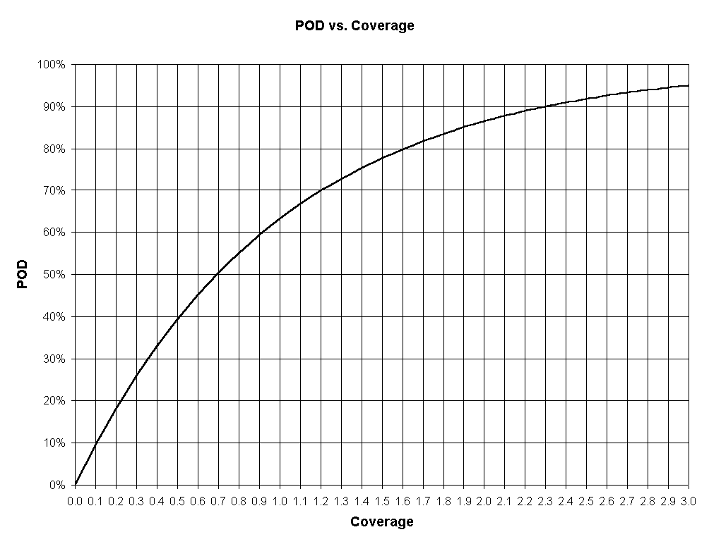

---
## Page 211

National Land Search Operations Manual 
Version Feb 2017 
211
extremities of the search area. Application of the expanded search concept ensures that the greatest 
search effort is concentrated over the most probable position of the target where the POD is highest. 
Clearly, the expanding search procedure is best suited to situations where the approximate position or, at 
least, the planned route of the target is known.  The projected value of the POD may be used by a SMC in 
determining the area of search. Use of POD may also be conveniently made in describing the results of a 
search, or part of a search, to interested persons not familiar with search planning techniques. Should the 
target not be located within the entire search area, the SMC must decide whether to continue searching 
it, recalculate the probability area using alternative data, or recommend the suspension of search effort.

---
## Page 212

National Land Search Operations Manual 
Version Feb 2017 
212
Cumulative POD for Land Search 
 
POD this search 
 
 
 
 
 
 
 
 
 
 
 
 
 
 
 
 
 
 
 
 
 
 
 
 
% 
5 
10 
15 
20 
25 
30 
35 
40 
45 
50 
55 
60 
65 
70 
75 
80 
85 
90 
95 
5 
10 
15 
19 
24 
29 
34 
38 
43 
48 
53 
57 
62 
67 
72 
76 
81 
86 
91 
95 
10 
15 
19 
24 
28 
33 
37 
42 
46 
51 
55 
60 
64 
69 
73 
78 
82 
87 
91 
96 
15 
19 
24 
28 
32 
36 
41 
45 
49 
53 
58 
62 
66 
70 
75 
79 
83 
87 
92 
96 
20 
24 
28 
32 
36 
40 
44 
48 
52 
56 
60 
64 
68 
72 
76 
80 
84 
88 
92 
96 
25 
29 
33 
36 
40 
44 
48 
51 
55 
59 
63 
66 
70 
74 
78 
81 
85 
89 
93 
96 
30 
34 
37 
41 
44 
48 
51 
55 
58 
62 
65 
69 
72 
76 
79 
83 
86 
90 
93 
97 
35 
38 
42 
45 
48 
51 
55 
58 
61 
64 
68 
71 
74 
77 
81 
84 
87 
90 
94 
97 
40 
43 
46 
49 
52 
55 
58 
61 
64 
67 
70 
73 
76 
79 
82 
85 
88 
91 
94 
97 
45 
48 
51 
53 
56 
59 
62 
64 
67 
70 
73 
75 
78 
81 
84 
86 
89 
92 
95 
97 
50 
53 
55 
58 
60 
63 
65 
68 
70 
73 
75 
78 
80 
83 
85 
88 
90 
93 
95 
98 
55 
57 
60 
62 
64 
66 
69 
71 
73 
75 
78 
80 
82 
84 
87 
89 
91 
93 
96 
98 
60 
62 
64 
66 
68 
70 
72 
74 
76 
78 
80 
82 
84 
86 
88 
90 
92 
94 
96 
98 
65 
67 
69 
70 
72 
74 
76 
77 
79 
81 
83 
84 
86 
88 
90 
91 
93 
95 
97 
98 
70 
72 
73 
75 
76 
78 
79 
81 
82 
84 
85 
87 
88 
90 
91 
93 
94 
96 
97 
99 
75 
76 
78 
79 
80 
81 
83 
84 
85 
86 
88 
89 
90 
91 
93 
94 
95 
96 
98 
99 
80 
81 
82 
83 
84 
85 
86 
87 
88 
89 
90 
91 
92 
93 
94 
95 
96 
97 
98 
99 
85 
86 
87 
87 
88 
89 
90 
90 
91 
92 
93 
93 
94 
95 
96 
96 
97 
98 
99 
99 
90 
91 
91 
92 
92 
93 
93 
94 
94 
95 
95 
96 
96 
97 
97 
98 
98 
99 
99 
99 
95 
96 
96 
96 
96 
96 
97 
97 
97 
97 
98 
98 
98 
98 
99 
99 
99 
99 
99 
99 
Previous POD

---
## Page 213

National Land Search Operations Manual 
Version Feb 2017 
213
Appendix M: Mattson Consensus 
 
Mattson Consensus Worksheet 
Search areas 
Area A 
Area B 
Area C 
Area D 
Area E 
ROW 
Subtotal 
Across 
(2) 
Name 1 
10 
12 
30 
10 
5 
2 
69 
Name 2 
  
  
  
  
  
  
  
Name 3 
  
  
  
  
  
  
  
Name 4 
  
  
  
  
  
  
  
Name 5 
  
  
  
  
  
  
  
  
  
  
  
  
  
  
  
Subtotal Down (1) 
10 
12 
30 
10 
5 
2 
69 
Consensus Weight (3).      
(1) ÷ (2) = weight 
10/69       
= 0.144 
12/69       
= 0.17 
30/69      
= 0.43 
10/69      
= 0.14 
5/69        
= 0.07 
2/69        
= 0.03 
  
Percentage                       
= (3) x 100 
15.00% 
17% 
43% 
15% 
7% 
3% 
100%

---
## Page 214

National Land Search Operations Manual 
Version Feb 2017 
214
Appendix N: Land Search Organisation Chart 
 
 
 
 
 
 
 
 
 
 
 
 
 
 
 
 
 
 
 
 
 
 
 
 
 
 
 
 
 
 
 
 
 
 
 
 
 
 
 
 
 
 
Search Teams 
Assembly 
Area 
Support Base 
Field Search 
Headquarters 
Search Headquarters 
Family 
Liaison 
Media 
Liaison 
Intelligence 
Operations 
Planning 
Admin & 
Logistics 
Other SAR 
Resources

---
## Page 215

National Land Search Operations Manual 
Version Feb 2017 
215
Appendix O: Headquarters Layout 
 
 
 
 
 
 
 
 
 
 
 
 
 
 
 
 
 
Communications 
Stores 
HQ 
Gate & Registration Point 
Assembly Area 
Toilets 
Welfare 
Briefing Area 
Waiting/Staging Area 
Road

---
## Page 216

National Land Search Operations Manual 
Version Feb 2017 
216
Appendix P: Search Communications Net 
 
 
 
 
 
 
 
 
 
 
 
 
 
FSH 
Support 
Base 
Team 1 
Team 2 
Team 3 
Team 4 
Team 5 
Search Headquarters 
Statutory Authorities 
Govt. 
Depts. 
Volunteers

---
## Page 217

National Land Search Operations Manual 
Version Feb 2017 
217
Appendix Q 
Clue Recognition 
A clue is a fact, an object, information or some type of evidence that helps to solve a mystery or 
problem.  The purpose of seeking clues (gathering all the facts and information) is to assist in the 
reasoning of a problem and its ultimate solution. 
 
General Principles: 
The following principles apply: 
 
Clue seeking is an ongoing process that starts with planning, continues throughout a mission 
and doesn’t end until the debrief concludes. 
 
Clue seeking is a skill and must be practices to develop a sense of what ais the minimum 
information to work with. 
 
Avoid forming opinions and then gathering information to support that opinion. 
 
Don’t immediately form an opinion about the value of a clue. 
 
Gather information from everyone, as no one person can adequately gather all the facts. 
 
Assemble a complete profile of the missing subject and the situation, and let it offer 
direction. 
 
Tracking Skills. 
The ability for searchers to recognise signs that are not obvious clues within their search area can 
dramatically reduce the duration of the search.  These signs may be quite obvious to some searchers 
but may go unseen by others.  Developing skills in reading signs of activity within the landscape can 
greatly benefit the searcher and enhance their observation skills. 
 
Trail signs. 
Once the size and shape of footprints is determined, another factor that can aid your search is 
terrain.  Look at the ground.  If no footprints are apparent, look for freshly overturned stones (darker 
on top than the others, maybe even moist looking). 
 
Look for broken twigs and tree branches.  They will usually break forward as a person pushes 
through unless deliberately snapped back to lay a false trail.  Fresh breaks will show up as 
unweathered timber, differently coloured to the rest of the tree.  The underside of the leaves will be 
duller or more brightly colourer as well, depending on the species. 
 
Through thick bush a lightness can be apparent when scrub is pushed aside, much like long grass 
that is flattened in the direction of travel. 
 
When footprints are found, gauge the weather that has occurred since the person went missing.  
The amount of dryness of the print can determine an approximate time the person passed that way.  
Other factors that should be considered are described below: 
 
If the weather was previously damp and windy, a predominantly dry print will indicate it has 
been in the open to the wind longer and has had time to dry out.

---
## Page 218

National Land Search Operations Manual 
Version Feb 2017 
218
 
If wetter weather had occurred but no real rain has fallen recently, the same print may have 
been there less long.  The heel will be the last area to dry.  If the heel is all dry, the person 
travelled that area a considerable longer time ago than if the print is partially damp. 
 
If heavy rain has fallen, most prints will appear to wash back into the soil and be little more 
than a depression.  Newer laid prints will be more defined. 
 
If it is at present drizzling/raining, fresh footprints may disturb the ground surface layer and 
produce dry sand. 
 
Scuff marks on the ground, which also kicks up rocks, scuff marks on rocks where someone has 
climbed, broken pieces of rotted wood are all indictors of someone, or something, having travelled 
that way. A lost person may sit down and rest regularly, so look for heel and seat marks where they 
may have sat down.  Think what you would do in their position and identify likely locations for rest. 
 
Flattened ground beneath trees or amongst the undergrowth can indicate a sleeping place, either of 
the missing person or fauna.  Animal droppings will normally indicate which, through a thorough 
search of the area might show footprints where a person has used an animal lair.  Personal items or 
human faeces may also be detected in these areas. 
 
Keep an eye out for signals that have been made by the missing person.  These include rock piles 
(sometimes a message may have been left within the layers of rocks), arrows or other marks left on 
the ground to indicate their direction of travel, flashes from mirrors, or items of clothing. 
 
When tracking, work as a pair if possible.  Work to either side of the track rather than directly on top 
of the person’s track.  With this method if you lose the trail you can backtrack and pick it up again 
and resume.  If you have trampled all over it, you will have destroyed the clues. 
 
When finding signs treat them the same as when finding search items.  Preserve them for analysis 
and report them. 
 
Like all other search aspects, tracking takes much practice to develop the skill.  The eye needs to be 
thoroughly trained, and then is used in conjunction with a knowledge of the bush. 
 
Sight 
 
Smoke from campfires (day) 
 
Light from campfires (night) 
 
Light from torches (night) 
 
Footprints 
 
Clothing 
 
Pieces of foam sleeping mat 
 
Trail register 
 
Disturbed foliage 
 
Witnesses 
 
Discardables such as lolly wrappers, drink or food cans, cigarette butts etc.

---
## Page 219

National Land Search Operations Manual 
Version Feb 2017 
219
Appendix R: Task Sheet 
 
 
 
 
 
 
 
 
 
 
 
Tasking Sheet 
 
 
 
 
 
 
 
 
 
 
 
 
 
 
 
 
 
 
Sheet 
No 
 
 
 
 
 
 
 
 
 
 
 
 
 
 
SAR No. 
 
 
 
 
 
 
Date: 
 
 
 
 
 
 
Location 
 
 
 
Missing Person/s: 
 
 
 
SARMC 
 
 
 
 
 
 
 
 
 
 
 
Team 
 
Leader 
 
 
 
 
 
No. in Team 
 
 
 
 
 
 
 
 
 
 
 
Search Area No. 
 
 
Description: 
 
 
 
Map: 
 
 
 
 
Time out: 
 
Time 
In: 
 
 
 
 
 
 
 
 
 
 
 
Area Searched 
Yes/No 
If No, what area remains to be searched 
 
 
 
 
 
 
 
 
 
 
POD % 
 
 
 
 
 
 
 
 
 
 
 
 
 
 
 
 
 
 
 
 
 
 
 
 
Signed by Team Leader

---
## Page 220

National Land Search Operations Manual 
Version Feb 2017 
220
Appendix S: Whiteboards 
 
Command Post Whiteboard 
Emergency Phase 
Mission: To locate target and remove 
to place of safety 
Administration & 
Logistics 
Command and 
Communications 
Situation 
Execution 
Tasking search resources 
Fuel: 
Food: 
Water: 
1st aid: 
Hospital: 
Accounts: 
Incident Commander: 
SMC: 
A/SMC: 
Nav: 
Time/date missing 
Asset 
Task 
Out 
In 
LKP: 
 
 
 
 
Radio Channel 
Primary: 
Secondary: 
TFFS: 
To Do: 
Contacts: 
Target details: 
Name: 
Address: 
Description: 
Features: 
Clothing: 
Equipment: 
Medical issues: 
Vehicle/vessel: 
Media update: 
Briefing time: 
Location: 
Command Briefing: 
Sitreps: 
QPrime: 
Photo: 
Media: 
Resources: 
Numbers: 
Organisations: 
On route: 
Weather (Wx) 
Sun rise/set 
NOK: 
Mud map 
Rescue Plan 
Time Lines 
Entire Whiteboard.

---
## Page 221

National Land Search Operations Manual 
Version Feb 2017 
221
Appendix T: Search for skeletal remains 
 
The search for human remains from crime involves a number of techniques depending on the stage 
of decomposition of the target. Searches may be for the following target types: 
 
Grave sites, deep or shallow: Searchers are looking for disturbances in the landscape, 
vegetation changes, dips or hollows, ground discolouration and cracking.  It is near 
impossible to dig a grave and return the scene to its original condition. An aerial search may 
uncover potential sites of ground and/or vegetation disturbance. Historically, once a victim 
is buried they are generally undisturbed until located by a search team, although there is 
evidence that shallow graves have been disturbed by wild and/or domestic animals. 
 
Disposal locations: Bodies may be quickly disposed of by criminals. Covered with sticks and 
branches, leave litter, rolled in carpet or other items, pushed into hollow items such as pipes 
and logs. There may be signs of darkened earth or dead vegetation caused by volatile fatty 
acids leeching from the body. 
 
Initial crime scene locations: The initial crime scene will provide forensic evidence and may 
be identified by signs of a struggle, broken branches, trampled grasses, ground disturbance, 
clothing, blood stains and/or other visible signs of a crime.  This may not necessarily be the 
location of the victim.  
 
Skeletal remains and bone dispersion: Searches conducted after lengthy periods may be 
looking for skeletal remains. The search for skeletal remains is dependent on a number of 
factors: 
o Length of time since initial incident:  Skeletisation periods can vary from 2-3 years 
for persons buried in deep graves, 6-12 months for those in shallow graves and 
much shorter periods for those left on the surface or loosely covered.  Cold weather 
will also slow the process of decomposition down but warm, moist weather can 
have the opposite effect.  Wildlife distribution in the area, insects, dogs, pigs, cats, 
birds and other carnivores will contribute to decomposition. 
o Method of disposal: Burial inhibits decomposition due to a number of factors, 
including limited oxygen, limited exposure to flies and animals and generally cooler 
temperatures. 
o Animal predation in area: Animals will hasten the decomposition of flesh, leaving the 
skeletal remains. Evidence shows that bone dispersion often results from animal 
activity.  There are some generalisations for bone dispersal: 
 
During the initial stages of decomposition the tendons and ligaments tend to 
hold a body together.  This limits animal activity to removing flesh. 
 
The body disarticulates from the outside in, with the limbs being the first to 
separate, allowing them to be moved by predatory animals. The skull will 
also separate from the vertebra and the neck vertebra from each other. 
 
The limbs may be taken as a whole, to be further disarticulated from other 
locations. 
 
The skull is one of the last items to be moved due to its size and the 
difficulty in grasping it with teeth. 
 
Bone dispersal is generally in an oval shape, with the body core being at the 
higher elevation focus of the oval.  The limbs and other bones are mostly 
located in a downhill direction. 
 
The oval shape is dependent on the terrain, with animals skirting rocky 
outcrops, thicker vegetation and waterways.  The bone dispersion will 
generally follow animal tracks. 
 
As limbs disarticulate the dispersal pattern will go from the larger bones, 
femur and humerus, to the medium bones of tibia, fibula, radius and ulna to

---
## Page 222

National Land Search Operations Manual 
Version Feb 2017 
222
the individual hand and foot bones.  The smaller bones are often difficult to 
recognise as bones so it is recommended that an osteologist be available on 
scene to assist with identification. 
 
The main section of the body will eventually collapse on itself with some of 
the smaller bones, such as ribs, being moved by animals. 
 
The length of the dispersal oval can be between 10 and 135m depending on 
the local animal population.  It is recommended that the latter be 
considered during the initial stages of the search. 
 
Bones can be discoloured by the environment and are often not the 
bleached white colour expected.  They can take on the hues of the local 
environment due to the leeching effect of rain and the natural tannins found 
in plant life.  The search briefing should be very clear on this point. 
 
The age of the victim will also impact on what bones remain to be found.  
The bones of children and teenagers will not have fully calcified leaving only 
misshapen slivers or portions of bone to be discovered. 
 
Any objects suspected of being a bone should be examined insitu, as the 
location of each bone can provide an indication of what position the victim 
was originally placed.  
 
Bone scattering 
Two search methods are recommended for skeletal searching: 
 
Single direction contact search.  All search members are lined up shoulder to shoulder and 
proceed at a set pace through the search area.  They should be armed with a pole with a 
hook to move vegetation and other ground debris.  Each member is responsible for their 
own search path.  The usual rules on locating an object will apply.  When a bone is located 
the searchers will commence a hands and knees search of the area at least 10 around the 
located bone.   
 
Search teams start at opposite ends of the search area, shoulder to shoulder and walk 
towards each other.  The teams pass and continue on to the end of the search area.  While 
this is more labour intensive it does allow the area to be search twice, from different 
directions at once, increasing to probability of detection to beyond what would be possible 
from two separate searches. 
The pre-search briefing must be comprehensive with respect to potential search objects, bone 
shape, colour and size, to ensure a thorough search is undertaken. Good investigative information is 
necessary to reduce the potential search area to a minimum as these type of searches are labour 
intensive, physically tiring and mentally straining. 
 
Downhill slope

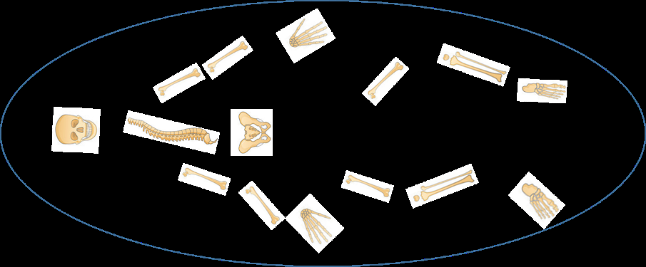

---
## Page 223

National Land Search Operations Manual 
Version Feb 2017 
223
Appendix U: Suicide Checklist 
 
Aid for Coordinators suspecting or considering suicide by the target 
Suicide Checklist 
Suicide note/intention 
Comment 
Reported missing 
Comment 
Is there a suicide note? 
  
Has the MP gone missing before? 
  
Where was the note located? 
  
Who reported the MP missing? 
  
What does the note contain? 
  
When were they reported missing? 
  
Has the MP talked about suicide? 
  
When was the MP last seen by the 
informant? 
  
Have they used a computer to access 
'Suicide' sites? 
  
What was the trigger point for reporting the 
MP missing? 
  
Have they acted out of character lately? 
  
Have there been any subsequent sightings of 
the MP? 
  
Previous Suicide attempts 
  
Circumstantial information 
  
Has the MP previously attempted 
suicide? 
  
What is the MP's occupation? 
  
If yes, how, when etc 
  
Are they any home/work problems? 
  
What was the location of these 
attempts? 
  
Have they recently been diagnosed with a 
serious/terminal illness? 
  
Mental Illness 
  
Are there any apparent triggers for suicide 
(Debt, Court, Illness, Sexual, Relationship)? 
  
Is the MP diagnosed with a mental 
illness? 
  
Family History 
  
If so, what is the nature 
  
Is there a history of suicide? 
  
What is their current mental state? 
  
If yes, what are the circumstances? 
  
Drugs/Medication 
  
Does the MP's disappearance coincide with a 
family event (Funeral, anniversary, 
wedding)? 
  
Is the MP taking any drugs/medication? 
  
Access to suicide methods 
  
What is the name and nature of these? 
  
Does the MP have ready access to suicide 
methods (Rope, water, high buildings, 
medication)?

---
## Page 224

National Land Search Operations Manual 
Version Feb 2017 
224
Are they social or prescription? 
  
Likely locations 
  
Were they taken prior to the 
disappearance? 
  
What are the MP's favourite locations? 
  
Was an excessive amount taken? 
  
If the MP walks, where do they go? 
  
Has the MP failed to take prescribed 
medication? 
  
What are the MP's hobbies? 
  
What affect will this have on the MP? 
  
What is the MP's daily routine? 
  
Could they have a stockpile of 
medication? 
  
Are there any significant places of residence 
in the past? 
  
Has the MP consumed alcohol prior to 
disappearing? 
  
Method of transport 
  
Residential circumstances 
  
Did the MP leave on foot? 
  
Is the MP in a stable residential situation? 
  
Did the MP leave by vehicle, if so what is the 
Reg, make, model and colour? 
  
Are they rural or urban? 
  
Did the MP use public transport? 
  
Does the MP live alone?

---
## Page 225

National Land Search Operations Manual 
Version Feb 2017 
225
Appendix V: National operational procedure for transfer of coordination for land SAR 
incidents 
Satellite Emergency 
Notification Device (SEND) alert
PLB/Land based 
beacon alert
Other
Alerting Post
(JRCC Australia)
1.0. Registered +
Position known
Awareness 
and Initial 
Action
Intelligence 
Gathering 
and 
Assessment
1.2.  JRCC Australia
obtains 
information about 
owner, contact and 
activity
1.1.  Position 
Known
(No search 
required)
3.1.  Position 
Unknown
(Search 
required) 
Search 
Planning and 
Evaluation
Rescue 
Planning 
Operations
1.5.  Task rescue 
assets as per plan
1.4.  Develop SAR 
Response Plan
2.0. Unregistered +
Position known
3.0. (Un)registered + 
Position Unknown
1.3.  Coordination 
transferred to 
State/Territory SAR 
POC
1.7.  Incident conclusion: Provide 
JRCC Australia with reason for 
alerting device activation 
1.6.  Monitor 
Response
Ongoing 
provision of 
information by 
JRCC Australia 
or State/
Territory SAR 
Authority as 
required
No
2.1.  Position 
Known
(No search 
required)
Incident 
Conclusion
1.4a.  Incident 
circumstances require 
AMSA assistance
e.g. remote
Yes
2.2.  JRCC Australia 
obtains additional 
information if 
available
3.2.  JRCC Australia 
responsible for 
coordination until 
position is 
confirmed
1.4b.  AMSA 
Aviation 
Assistance
A
C
B
3.3. Should 
coordination be 
transferred?
2.3. Does information 
indicate an aviation 
incident?
No
Yes
2.4.  JRCC Australia 
coordination
3.4.  JRCC Australia 
coordination
No
Yes

---
## Page 226

National Land Search Operations Manual 
Version Feb 2017 
226
Guidelines for procedure 
1.0 
 
The term ‘position known’ means that the position accuracy is nominally within 150 meters.  An appropriately 
trained response team should be able to localise the final beacon position on scene in line with respective 
procedures. 
1.3 
Transfer of coordination and information between JRCC Australia and State/Territory will occur with the agreed 
SAR point of contact in each jurisdiction, which already exists (attachment 1). 
Provision of transfer of coordination and incident information will occur both in writing and verbally: 
a) Written exchange – Written information will include, position information, beacon registration 
information if known, and any other relevant intelligence obtained.  
b) Verbal exchange – The recognised time of transfer of coordination will be when verbal agreement 
occurs.  
Example of this information is provided in Appendix D of the NATSAR Manual. The information exchange will 
occur almost simultaneously, normally with the written information provided first, followed by a telephone call. 
Other means of transferring information to the coordinating authority will be considered upon request. 
1.4 
A response will be planned by the respective jurisdiction in line with their procedures. 
1.4a 
 
When developing the SAR Response Plan, the coordinating SAR authority may determine that aviation 
assistance is required from JRCC Australia due to circumstances specific to that incident e.g. the location is in a 
particularly remote area. 
1.4b 
 
JRCC Australia can provide three types of aviation assistance: 
a. Identification of suitable aviation SAR assets  
b. Identification and briefing provided for suitable aviation SAR assets 
c. 
Identification, briefing and tasking of suitable aviation SAR assets.  
If assistance a) or b) is requested, then JRCC Australia will provide the relevant information to the coordinating 
authority to assist in further developing the SAR Response Plan. 
If assistance c) is requested, then JRCC Australia will task the asset but will still remain in a supporting role to the 
coordinating SAR Authority.  The intention is for the coordination SAR Authority to have direct communications 
with the aircraft responding to the incident where possible.  This is the best practice to ensure the SMC and the 
ground parties responding have real time and accurate information without delay.  It is understood that there 
may be some communications limitations especially outside of state contracted assets but the intention is to 
transition to this operational practice.  If this capability does not exist, JRCC Australia will provide a relay of 
relevant information as required. 
1.6 
The SMC of the coordinating SAR authority has responsibility to monitor the progress of the SAR Response Plan 
and will be provided with updates of ongoing information if obtained by JRCC Australia.  
1.7 
As international SPOC, JRCC Australia is required to provide incident reports to Cospas Sarsat as per our 
international agreement, including reason for activation and number of lives saved etc.  Upon incident 
conclusion, the coordinating SAR authority will forward this information to JRCC Australia. 
2.2 
 
If registration details are not available JRCC Australia will continue with inquiries to obtain additional 
information.  Unless it is determined that it is an aviation incident, coordination will be transferred to the 
appropriate State/Territory SAR Authority. 
3.2 
When the position is unknown, JRCC Australia will retain coordination and take appropriate action to confirm 
the position.  In accordance with the NATSAR Manual 1.2.29, JRCC Australia and the respective State/Territory 
SAR authority will have a discussion regarding the best placed SAR authority to take coordination, based on the 
incident circumstances.

---
## Page 227

National Land Search Operations Manual 
Version Feb 2017 
227
State / Territory SAR Authority Points of Contact  
State 
Contact  
NSW 
Sydney Police COM Centre Duty Operations Inspector (DOI) 
QLD 
Police SARMC for the district, backup Brisbane Police COM Centre Duty Sergeant 
NT 
Police COM Centre Darwin 
WA 
Police COM Centre Perth Duty Inspector, then as agreed for local Police contacts 
SA 
Police COM Centre Adelaide 
VIC 
Police RCC 
TAS 
Police Radio Dispatch Services (RDS) Centre, Tasmania Police COM Centre Hobart

