# National Plan for Maritime Environmental Emergencies (2020)

> **Source**: AMSA
> **URL**: https://www.amsa.gov.au/sites/default/files/national-plan-maritime-envrironmental-emergencies-2020.pdf
> **Licence**: Crown / publisher copyright; practitioner reference
> **Retrieved**: 2026-05-07T23:47:19Z
> **SHA-256**: `9ce9df7102c59ab31ecacc88c2c763035619d9487a4eb8a04dc966453826ffa8`
> *Converted from PDF to Markdown format.*

---
## Page 1

NATIONAL 
PLAN
for Maritime Environmental Emergencies
2020 edition

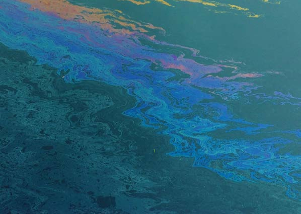

---
## Page 2

Copyright
The Australian Maritime Safety Authority 
encourages the dissemination and exchange 
of information provided in this publication.
Except as otherwise specified, all material 
presented in this publication is provided 
under Creative Commons Attribution 4.0 
International licence. 
This excludes:
• the Commonwealth Coat of Arms
• this department’s logo
• content supplied by third parties.
The Creative Commons Attribution 4.0 
International Licence is a standard form 
licence agreement that allows you to copy, 
distribute, transmit and adapt this publication 
provided that you attribute the work. 
The details of the version 4.0 of the licence 
are available on the Creative Commons 
website, as is the full legal code for that 
licence.
Attribution
AMSA’s preference is that you attribute this 
publication (and any material sourced from 
it) using the following wording: 
 
Source: Australian Maritime Safety Authority 
National Plan for Maritime Environmental 
Emergencies – 2020 edition
More information
For enquiries regarding copyright including 
requests to use material in a way that is 
beyond the scope of the terms of use that 
apply to it, please contact us through our 
website: www.amsa.gov.au
Disclaimer
Under no circumstance do these Guidelines 
replace individual, legal or technical 
advice rendered considering the individual 
circumstances of each case and situation. 
Under no circumstances shall AMSA be 
liable for any loss, damage, liability or 
expense incurred or suffered that is claimed 
to have resulted from the interpretation and 
the use of the information presented in these 
Guidelines.

---
## Page 3

NATIONAL PLAN 
for Maritime Environmental Emergencies
2020 edition

---
## Page 4

National Plan for Maritime Environmental Emergencies – 2020 edition
ii
Mission
To maintain a national integrated government and industry organisational framework 
capable of effective response to pollution incidents in the marine environment and to 
manage associated funding, equipment and training programs to support National Plan 
activities.
Authority
The National Plan for Maritime Environmental Emergencies (National Plan) implements 
Australia’s obligations under the International Convention Relating to Intervention on 
the High Seas in Cases of Oil Pollution Casualties, 1969; United Nations Convention on 
the Law of the Sea, 1982; the International Convention on Oil Pollution Preparedness, 
Response and Co-operation, 1990; and the Protocol on Preparedness, Response and 
Co-operation to Pollution Incidents by Hazardous and Noxious Substances, 2000 with 
respect to the management of maritime environmental emergencies.
The National Plan is to be maintained, amended and implemented by the National Plan 
Strategic Coordination Committee.
Implementation
The National Plan is hereby approved for implementation by the National Plan Strategic 
Coordination Committee.
Endorsed March 2014*
* Updated and approved for implementation by the National Plan Strategic Coordination Committee in 
December 2019, following an annual review. See section 2.3.

---
## Page 5

iii
National Plan for Maritime Environmental Emergencies – 2020 edition
Australia depends almost exclusively on shipping to transport its exports and imports 
and in terms of tonnage shipped Australia is the  largest bulk commodities exporter in 
the world. Australia’s growing offshore petroleum industry is also critical to the country’s 
energy security.
In response to the importance of these sectors to the country’s economic, environmental 
and social wellbeing, Australia is party to the United Nations Convention on the Law 
of the Sea, 1982 which establishes an obligation to protect and preserve the marine 
environment. The National Plan for Maritime Environmental Emergencies is one of the 
ways Australia meets its obligations.
The National Plan parallels similar documents dealing with other aspects of maritime 
emergency response such as search and rescue, saving of life at sea, and caring for 
survivors brought to shore.
In operation since 1973, the National Plan has been characterised by willing and 
effective cooperation between governments and industries, and has provided both timely 
and effective response to actual pollution incidents.
This document recognises the need to develop and maintain a shared responsibility; and 
the commitment of all stakeholders in order to continue to provide timely and effective 
response, including making available equipment and trained personnel as and when 
needed, both domestically and internationally.
Marine pollution plans prepared by all the Australian government jurisdictions, port 
corporations, industry and operators of offshore petroleum facilities underpin this 
National Plan. These plans provide detailed information to implement the provisions 
outlined in this document.
Chair
National Plan Strategic Coordination Committee
Foreword

---
## Page 6

National Plan for Maritime Environmental Emergencies – 2020 edition
iv
Authority	
ii
Implementation	
ii
Foreword	
iii
Acronyms	
vii
Glossary of terms	
ix
 Part one – Administrative arrangements	
  1
1.1 Purpose of the National Plan	
2
1.2 Principles of the National Plan	
2
1.3 Scope of the National Plan	
5
1.4 Structure	
7
 Part two – National Plan governance and management	
  9
2.1 Legal and administrative basis for the National Plan	
10
2.2 Governance	
18
2.3 Management of the National Plan	
20
2.4 Roles and responsibilities	
22
2.5 Strategic coordination of emergencies of national consequence	
23
2.6 International support	
26
 Part three – Prevention of marine pollution incidents	
 27
3.1 Scope of prevention	
28
3.2 Responsibility of the shipowner	
28
3.3 Maritime Emergency Response Commander	
29
3.4 Responsibilities of Australian governments	
29
3.5 Casualty Management System	
31
3.6 Emergency towage	
32
3.7 Place of refuge	
34
 Part four – Preparing for marine pollution incidents	
 35
4.1 Scope of preparedness	
36
4.2 Contingency planning	
36
4.3 Community awareness and engagement	
37
4.4 Capability development	
39
4.5 Training and development	
44
4.6 National Plan exercises	
45
4.7 Research and development	
46

---
## Page 7

v
National Plan for Maritime Environmental Emergencies – 2020 edition
Contents
 Part five – Responding to marine pollution incidents	
 47
5.1 Scope of response	
48
5.2 Incident Management System	
48
5.3 Response initiation	
51
5.4 Response escalation	
52
5.5 Assessment and decision support	
53
5.6 Oil spill response	
54
5.7 Hazardous and noxious substance response	
57
5.8 Health and safety	
59
5.9 Wildlife response	
59
5.10 Waste management	
59
5.11 Response termination	
60
5.12 Post incident response analysis	
60
 Part six – Recovering from marine pollution incidents	
 61
6.1 Scope of recovery	
62
6.2 Principles for recovery	
63
6.3 Recovery functions	
64
6.4 Recovery arrangements and the National Plan	
65
6.5 Impact assessment	
66
6.6 Communicating with the community	
66
 Part seven – Cost recovery	
67
7.1 Scope of cost recovery	
68
7.2 International maritime arrangements	
69
7.3 Domestic maritime arrangements	
69
7.4 Offshore petroleum sector arrangements	
70
Index	
71

---
## Page 8

National Plan for Maritime Environmental Emergencies – 2020 edition
vi

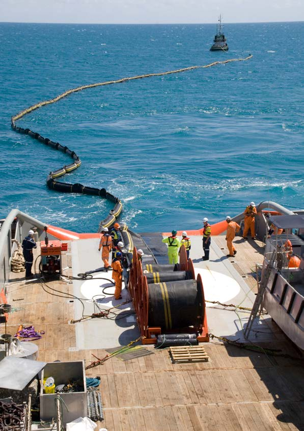

---
## Page 9

vii
National Plan for Maritime Environmental Emergencies – 2020 edition
AIIMS	
Australian Inter-Service Incident Management System
AIP	
Australian Institute of Petroleum
AMOSC	
Australian Marine Oil Spill Centre
AMSA	
Australian Maritime Safety Authority
ANP	
Timor-Leste National Petroleum Authority
AQF	
Australian Qualifications Framework
ARC Australia	
AMSA Response Centre
The Council	
Transport and Infrastructure Council 
EP	
Environment Plan
EEZ	
Exclusive Economic Zone
ES&T	
Environmental Scientific and Technical Network
ETC	
emergency towage capability
ETV	
emergency towage vessel
FWADC	
Fixed Wing Aerial Dispersant Capability
GBRMPA	
Great Barrier Reef Marine Park Authority
GRN	
Global Response Network
HNS	
hazardous and noxious substance
IC	
Incident Controller
ICS	
Incident Control (Command) System
IMO	
International Maritime Organization
IOPC Funds	
International Oil Pollution Compensation Funds
IPIECA	
International Petroleum Industry Environmental Conservation 
Association 
JPDA	
Timor Sea Joint Petroleum Development Area
MARPOL	
International Convention for the Prevention of Pollution from Ships
MAS	
Maritime Assistance Service
MCCU	
Maritime Casualty Control Unit
MERCOM	
Maritime Emergency Response Commander 
MOU	
memorandum/a of understanding
MPC	
Marine Pollution Controller
MSQ	
Maritime Safety Queensland
NOPSEMA	
National Offshore Petroleum Safety and Environmental Management 
Authority
NPSCC	
National Plan Strategic Coordination Committee
NPSIAF	
National Plan Strategic Industry Advisory Forum
Acronyms

---
## Page 10

National Plan for Maritime Environmental Emergencies – 2020 edition
viii
NRT	
National Response Team
NT	
Northern Territory
OPGGSA	
Offshore Petroleum and Greenhouse Gas Storage Act 2006
OPRC	
International Convention on Pollution Preparedness, Response and  
Co-operation, 1990
OPRC-HNS Protocol 	
Protocol on Preparedness, Response and Co-operation to Pollution 
Incidents by Hazardous and Noxious Substances, 2000
OSCA	
oil spill control agent
OSCP	
Oil Spill Contingency Plan
OSRL	
Oil Spill Response Limited
PACPLAN	
Pacific Islands Regional Marine Spill Contingency Plan 
P&I Club	
Protection and Indemnity Club
RTO	
Registered Training Organisation
SAR	
search and rescue
SMPC	
State Marine Pollution Coordinator
SOLAS	
Safety of Life at Sea - derived from the International Convention for 
the Safety of Life at Sea
SPREP	
South Pacific Regional Environment Programme
TISOC	
Transport and Infrastructure Senior Officials Committee
UNCLOS	
United Nations Convention on the Law of the Sea, 1982

---
## Page 11

ix
National Plan for Maritime Environmental Emergencies – 2020 edition
AMOSPlan is managed by the Australian Marine Oil Spill Centre (AMOSC) and outlines 
the cooperative arrangements for response to oil spills by Australian oil and associated 
industries.
Bunker means a heavy fuel oil, intermediate fuel oil, blended distillate or diesel used as a 
vessel’s fuel.
Coastal waters, in relation to a State or the Northern Territory, means the territorial sea to 
an outer limit of 3 nautical miles from Australia’s baselines and any waters that are on 
the landward side of the baselines, including waters not within the limits of the State or 
Northern Territory.
Chemical terminal means a chemical refinery and/or chemical storage/distribution facilities 
with access to a maritime facility, but not including the maritime facility.
Command means the internal direction of the members and resources of an agency in 
performance of the organisation’s roles and tasks. Command operates vertically within an 
organisation.
Commonwealth waters means all waters in the territorial sea and exclusive economic zone 
seaward of 3 nautical miles from Australia’s baselines.
Community means a group with a commonality of association and generally defined by 
location, shared experience or function.
Control means the overall direction of emergency management activities during an emergency 
situation. Authority for control is established in legislation or administratively and carries with 
it responsibility for tasking organisations in accordance with the needs of the situation.
Control Agency* means the agency or company assigned by legislation, administrative 
arrangements or within the relevant contingency plan, to control response activities to a 
maritime environmental emergency. The legislative or administrative mandate should be 
specified in the relevant contingency plan. The Control Agency will have responsibility for 
appointing the Incident Controller. This is the equivalent of Responsible Agency or Control 
Authority under AIIMS.
Coordination means the bringing together of organisations and other resources to support an 
emergency  management response.
Division means an organisational unit having responsibility for operations within a defined 
geographic area or with a functional responsibility.
Doctrine means an evidence-based collective of knowledge that has been structured and 
systematised to facilitate its application in practice, that is prepared for dissemination in a 
way appropriate for its intended audience, and that is constantly reviewed and updated as 
circumstances require.
Emergency means an event, actual or imminent, which endangers or threatens to endanger 
life, property or the environment, and which requires a significant and coordinated 
response. The term emergency and disaster are used interchangeably within the Australian 
Emergency Management Arrangements.
Glossary of terms
*  or Combat Agency

---
## Page 12

National Plan for Maritime Environmental Emergencies – 2020 edition
x
Environment means the complex of physical, chemical and biological agents and factors 
which may impact on a person or a community, and may also include social, physical and 
built elements, which surround and interact with a community.
First Strike means a prompt initial response to protect the environment that is intended to 
limit the effect of an incident until such time as other resources can be deployed in support. 
This capability may vary from location to location.
Global Response Network means the global coalition of oil spill responder organisations 
established to facilitate sharing of expertise and experience.
Habitat means the natural home or environment of an animal, plant or other organism.
Hazardous and noxious substance means any substance which, if introduced into the 
marine environment, is likely to create hazards to human health, to harm living resources 
and marine life, to damage amenities or to interfere with other legitimate uses of the sea.
Incident means an event, occurrence or set of circumstances that:
	
• 	has a definite spatial extent
	
• 	has a definite duration
	
• 	calls for human intervention
	
• 	has a set of concluding conditions that can be defined
	
• 	is or will be under the control of an Incident Controller appointed to make decisions to 
control and coordinate the approach, means and actions taken to resolve the incident.
Incident Controller means the individual responsible for the management of all incident 
control activities across an incident.
Incident Management Team is the group of incident management personnel comprised of 
the Incident Controller and personnel appointed by the Incident Controller to be responsible 
for the overall control of the response to an incident.
Industry, unless already specified or defined in a particular context, means a business or 
commercial group or sector, or other socially valuable activity, such as fisheries, tourism, 
infrastructure, transport, etc. and their representative groups.
Internal waters means those waters that fall within the constitutional boundaries of a State or 
Northern Territory. The waters which are capable of falling within these limits are described 
in s.14 of the Seas and Submerged Lands Act 1973 as ‘bays, gulfs, estuaries, rivers, 
creeks, inlets, ports or harbours which were, on 1 January 1901, within the limits of the 
States and remain within the limits of the States’.
Marine pollution refers to any occurrence or series of events with the same origin, including 
fire and explosion, which results or may result in discharge, release or emission of oil or 
a hazardous and noxious substance, which poses or may pose a threat to the marine 
environment, the coastline, animals or other resource, and which requires an emergency 
action or immediate response. Under the National Plan, marine pollution refers primarily 
to situations that may arise from shore based oil and chemical transfer facilities, shipping 
operations and/or the operation of an offshore petroleum facility.
Maritime casualty means a collision of vessels, stranding or other incident of navigation, 
or other occurrence on board a vessel or external to it resulting in material damage or 
imminent threat of material damage to a vessel or cargo.

---
## Page 13

xi
National Plan for Maritime Environmental Emergencies – 2020 edition
Maritime facility means a wharf or mooring at which a vessel can be tied up during the 
process of loading or unloading a cargo [or passengers]. A maritime berth may be a sole 
user berth [such as a dedicated berth for an oil refinery] or may be a multi-user berth [such 
as a berth that handles general cargo, or one that handles bulk liquids such as petroleum 
for more than one user of the berth (sometimes known as a common-user berth)].
National Plan means the National Plan for Maritime Environmental Emergencies, and all 
policy, guidance and advisory documents produced and published in support.
Offshore petroleum facility means a facility operating in accordance with the provisions of 
the Offshore Petroleum and Greenhouse Gas Storage Act 2006, or any relevant State/
Northern Territory legislation.
Offshore Petroleum Incident Coordination Framework outlines the governance 
arrangements for the Offshore Petroleum Incident Coordination Committee (OPICC), 
including its purpose, membership and the responsibilities of  member agencies. The 
OPICC is convened and chaired by the Department of Industry, Innovation and Science. 
The purpose of the OPICC is to effectively coordinate Australian Government efforts and 
resources, and communicate to the public and affected stakeholders all matters relevant to 
a significant offshore petroleum incident in Commonwealth waters.
Oil means hydrocarbons in any liquid form including crude oil, fuel oil, sludge, oil refuse, 
refined products and condensates. Also including dissolved or dispersed hydrocarbons, 
whether obtained from plants or animals, mineral deposits, or by synthesis.
Oil terminal means a petroleum refinery and/or petroleum storage/distribution facilities with 
access to a maritime facility, but not including the maritime facility.
Oil terminal operator means a company [or joint venture] that operates an oil terminal.
Petroleum includes oil and other substances extracted in the recovery of such substances, 
including LNG and LPG.
Place of refuge means a place where a ship in need of assistance can take action to enable 
it to stabilise its condition and reduce hazards to navigation, and to protect human life and 
the environment.
Port authority, depending on jurisdiction, may refer to a state agency, a state corporation or a 
private company.
Port is an area of water, or land and water (including any buildings installations or equipment 
situated in or on that land or water) intended for use either wholly or partly in connection 
with the movement, loading, unloading, maintenance or provisioning of vessels and 
includes:
	
(a) areas of water, between the land of the port and the open waters outside the port, 
intended for use by vessels to gain access to loading, unloading or other land-based 
facilities; and
	
(b) areas of open water intended for anchoring or otherwise holding vessels before they 
enter areas of water described in paragraph (a); and
	
(c) areas of open water between the areas of water described in paragraphs (a) and (b).
Protection of the Sea Levy is a statutory charge against ships, based on the ‘potential 
polluter pays’ principle, and is used to fund the National Plan for Maritime Environmental 
Emergencies. Funds are also used to meet clean-up costs which cannot be attributed to a 
known polluter.
Glossary of terms

---
## Page 14

National Plan for Maritime Environmental Emergencies – 2020 edition
xii
Responsible Agency – see Control Agency.
Responsible party means the entity that has been identified as owning or having the legal 
responsibility for the vessel or facility that caused the incident.
Section means the organisational level having responsibility for the key top level functions of 
incident management: planning, public information, logistics and operations.
State means, depending on context, one or more of the states of Australia.
Support Agency means an agency or company that provides essential services, personnel, 
material or advice in support of the Control Agency during the response to a maritime 
environmental emergency.
Terminal (see also oil terminal and chemical terminal)
TorresPlan is the marine oil spill contingency plan for the Torres Strait area and is a 
supplement to the Queensland Coastal Contingency Action Plan.
Unit means a small cell of people working within one of the sections undertaking a designated 
set of activities.
Vessel (and/or ship) has several meanings within Australian legislation and international 
conventions, but for the purpose of the National Plan means a vessel of any type 
whatsoever operating in the marine environment, and includes hydrofoil boats, air cushion 
vehicles, submersibles and floating craft of any type. Throughout this document the term 
vessel is preferred. Ship, ship owner and shipping are used where these make sense in 
context or arise from an official or formal source.

---
## Page 15

1
National Plan for Maritime Environmental Emergencies – 2020 edition
Part one
Administrative 
arrangements

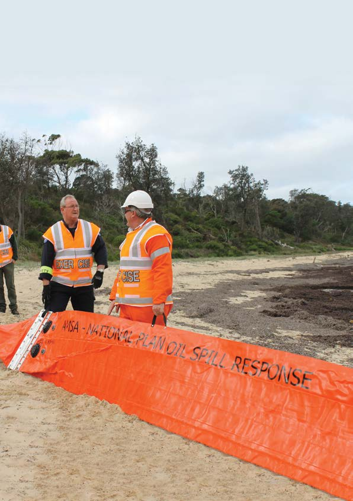

---
## Page 16

National Plan for Maritime Environmental Emergencies – 2020 edition
2
1.1 Purpose of the National Plan
The National Plan for Maritime Environmental Emergencies (National Plan) sets out national 
arrangements, policies and principles for the management of maritime environmental 
emergencies. It provides for a comprehensive response to maritime environmental emergencies 
regardless of how costs might be attributed or ultimately recovered1.
1.2 Principles of the National Plan
The National Plan is designed to meet the following principles as described at Table 1.
Table 1 – National Plan principles and management context
Principle
Management context
Protect the community, 
environment and maritime 
industries
The National Plan provides a single comprehensive and 
integrated response arrangement to minimise the impacts 
of marine pollution from vessels and oil spills from offshore 
petroleum facilities, as well as other environmental impacts 
arising from a maritime environmental emergency, upon the 
Australian community, environment, cultural and heritage 
resources, economy and infrastructure.
Give effect to relevant 
international conventions
The National Plan gives administrative effect to Australia’s 
emergency response obligations relating to the:
• International Convention on Oil Pollution Preparedness, 
Response and Co-operation, 1990 (OPRC)
• Protocol on Preparedness, Response and Co-operation to 
Pollution Incidents by Hazardous and Noxious Substances, 
2000 (OPRC-HNS Protocol)
• International Convention Relating to Intervention on the High 
Seas in Cases of Oil Pollution Casualties, 1969 (Intervention 
Convention), and
• Articles 198 and 221 of the United Nations Convention on the 
Law of the Sea, 1982 (UNCLOS).
Integrate with the 
Australian Emergency 
Management 
Arrangements
The Australian Emergency Management Arrangements 
describe how Australia addresses the risks and impacts 
of hazards through a collaborative approach between the 
Commonwealth, states and, Northern Territory and local 
governments; business and industry; and the community.
The National Plan forms an essential component of this 
integrated approach to disaster and emergency management 
by detailing arrangements across governments, industry and 
the community for the management of the specific threats from 
maritime environmental emergencies.

---
## Page 17

3
National Plan for Maritime Environmental Emergencies – 2020 edition
Principle
Management context
Provide a comprehensive 
management arrangement
The National Plan implements a comprehensive management 
arrangement through five core components:
• governance and policy to ensure accountability, risk 
assessment, engaging with stakeholders and providing clear 
strategic direction
• prevention of marine pollution through the delivery of a 
system for the management of maritime casualties
• preparedness for marine pollution incidents through a tiered 
approach to contingency planning, training and development 
of response personnel, and maintenance of response assets 
and services
• response to marine pollution incidents through the 
implementation of the National Plan arrangements
• recovery of the community and the environment from the 
impacts of marine pollution.
A doctrinal approach to all phases is applied to the extent 
possible. All stakeholders should develop and share their 
evidence, knowledge and experience, in a documented, 
structured and systematised manner.
This will facilitate practical application, and provide for review 
and revision, as circumstances require.
Provide a single integrated 
response arrangement
Consistent with the Council of Australian Governments 
National Disaster Resilience Statement, the National Plan 
recognises that the management of maritime environmental 
emergencies is the shared responsibility of all levels of 
government, industry and business, the non-government 
sector and the community.
The National Plan achieves this through:
• all parties fostering a cooperative relationship to ensure 
maritime environmental emergencies are managed in the 
interests of the Australian community
• all parties collaborating to declare Australia’s collective 
response capacity and capability (people, equipment, 
systems, process, scalability/levels)
• recognising the commitment of all stakeholders to 
collaboration across all levels of government, industry 
stakeholders and the community
• emphasising the development and maintenance of 
cooperative relationships, teamwork, consultative decision 
making and shared responsibilities
• all stakeholders committing to support the National Plan 
arrangements when an incident occurs, regardless of source 
or location.
Part one

---
## Page 18

National Plan for Maritime Environmental Emergencies – 2020 edition
4
Principle
Management context
Implement a risk 
management approach
The National Plan recognises that the starting point for 
reducing the impacts of maritime environmental emergencies 
lies in the understanding of the specific hazards and the 
social, environmental, cultural and heritage, infrastructure 
and economic vulnerabilities presented by these events. The 
National Plan is underpinned by formal risk assessment at the 
Commonwealth, state and Northern Territory (NT), regional, 
and local scale.
Implement the polluter 
pays principles
The National Plan is based on the polluter pays principle:
• preparedness is funded on the principle that the potential 
polluters pay, and in general, for oil and HNS risks arising:
–  from shipping, a levy applies to commercial shipping 
visiting Australian ports
–  from the offshore petroleum industry, titleholders fund 
arrangements to meet their specific risks
• response and recovery is funded on the basis of the polluter 
pays
–  for shipping, this is achieved through the implementation 
of relevant international conventions under the auspices of 
the International Maritime Organization (IMO)
–  for the offshore petroleum industry, this is achieved through 
the Offshore Petroleum and Greenhouse Gas Storage Act 
2006 (OPGGSA)
• agencies responding to and incurring costs in relation to 
ship sourced pollution incidents where the polluter is not 
identified, or costs are not recoverable, may be able to seek 
reimbursement of their costs from the Australian Maritime 
Safety Authority (AMSA) under the Protection of the Sea Levy1.
Provide for stakeholder 
engagement
The National Plan recognises that a broad range of 
stakeholders may be affected by a maritime environmental 
emergency and early engagement is important for 
preparedness, response and recovery. As such, the National 
Plan is underpinned by formal stakeholder engagement through 
the governance arrangements, community engagement and 
education programmes; and a recognition that contingency 
planning must include arrangements for the consideration of:
• traditional owners’ cultural and heritage issues
• post-European settlement heritage issues
• the protection of habitats
• the protection of fauna and flora
• issuing of warnings and notices, and
• community and industry input and feedback.

---
## Page 19

5
National Plan for Maritime Environmental Emergencies – 2020 edition
Part one
1.3 Scope of the National Plan
Maritime environmental emergencies
The National Plan applies to potential and actual pollution of the sea or harm to the marine 
environment by oil or hazardous and noxious substance, originating from:
•	 maritime casualties requiring salvage and intervention, emergency towage and requests 
for a place of refuge
•	 oil pollution or hazardous and noxious substance pollution incidents from vessels
•	 oil or hazardous and noxious substance pollution incidents from oil or chemical terminals 
(addressed by state and port plans)
•	 oil or hazardous and noxious substance pollution incidents from offshore petroleum 
activities
•	 marine pollution from unknown sources
•	 marine pollution from floating or sunken containers of hazardous materials
•	 debris originating from a maritime casualty, or
•	 physical damage caused by vessels.
The National Plan does not contain arrangements for the management of the following 
hazards associated with shipping and offshore petroleum facilities:
•	 ballast water and marine pests, or
•	 marine pollutants other than oil and hazardous and noxious substances.
The National Plan does not apply to threats to the marine environment resulting from pest 
species, climate change, marine debris and rubbish from sources other than a maritime 
casualty, or other natural or man-made occurrences. These are managed under other regimes 
and agreements.
While parties to the National Plan will respond to maritime environmental emergencies as 
outlined above, not all costs meet the criteria for reimbursement by either insurance2 or 
through the Protection of the Sea Levy.
2 Insurance in this case should be read to include all forms of insurance relating to shipping, offshore 
platforms, maritime facilities, domestic oil and chemical terminals, etc., as well as the applicable 
international maritime liability and compensation regimes.

---
## Page 20

National Plan for Maritime Environmental Emergencies – 2020 edition
6
Geographic scope
The geographical scope of the National Plan, as shown in Figure 1 is the Australian Exclusive 
Economic Zone (EEZ), offshore islands and territories and the high seas where the incident 
has the potential to impact upon Australian interests.
The National Plan also applies to internal and coastal waters (i.e. three nautical miles) for 
which the states and the Northern Territory have responsibility.
Unless otherwise stated, reference to the Commonwealth includes Australia’s external 
territories.
Figure 1 – Geographic scope of the National Plan

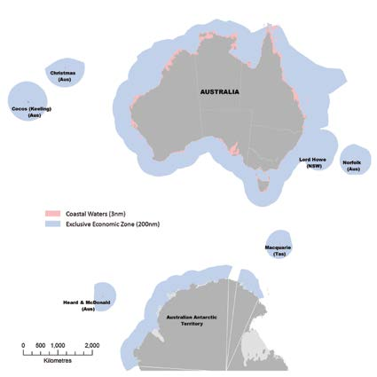

---
## Page 21

7
National Plan for Maritime Environmental Emergencies – 2020 edition
Part one
1.4	 Structure
Structure of this document
This document structure reflects the comprehensive approach to emergency management:
•	
Part two – Governance and management arrangements sets out the arrangements for 
the governance and strategic management of the National Plan
•	
Part three – Prevention of marine pollution incidents sets out the national 
arrangements to prevent the release of marine pollution from a vessel through the 
implementation of a strategy to manage maritime casualties
•	
Part four – Preparing for marine pollution incidents sets out the national arrangements 
that prepare National Plan stakeholders for marine pollution incidents
•	
Part five – Responding to marine pollution incidents sets out the national 
arrangements for responding to marine pollution incidents
•	
Part six – Recovering from marine pollution incidents sets out the arrangements for 
the recovery of responding agencies, the community and environment from a marine 
pollution incident; and
•	
Part seven – Cost recovery sets out the cost recovery arrangements under the National 
Plan.
Detail and support is provided by the National Plan policy, guidance and advisory documents 
referred to throughout the National Plan.

---
## Page 22

National Plan for Maritime Environmental Emergencies – 2020 edition
8
Supporting arrangements
The National Plan consists of a range of legal and administrative arrangements which are 
applied through a tiered management structure. Figure 2 depicts this structure.
At the highest level, international conventions and domestic legislation provide the legal 
context for the National Plan. This is underpinned by national policies and implemented 
through jurisdictional and local contingency plans.
Figure 2 – National Plan legal, administrative and planning framework
National Plan policies, guidance, and scientific, technical and operational advisories
AMSA Marine 
Casualty 
and Marine 
Pollution 
Response 
Arrangements
Offshore 
Petroleum 
Industry Oil 
Pollution 
emergency 
plans
External 
Territories 
contingency 
plan
Regional 
and Local 
contingency 
plans
Port, Oil and 
Chemical 
Industry 
terminal 
contingency 
plans
The National Plan for Maritime 
Environmental Emergencies
Australian Government Response Arrangements 
(Australian Government National Plan Committee)
State and Northern Territory 
Government Response 
Arrangements
National Plan Strategic Coordination 
Committee and the National Plan Strategic 
Industry Advisory Forum
International conventions and arrangements, and national legislation and regulations

---
## Page 23

9
National Plan for Maritime Environmental Emergencies – 2020 edition
Part two
National Plan 
governance and 
management

---
## Page 24

National Plan for Maritime Environmental Emergencies – 2020 edition
10
2.1	 Legal and administrative basis for the National Plan
The National Plan gives effect to a number of international conventions and agreements 
to which Australia is a party. The National Plan utilises a range of domestic legislation that 
provides government agencies with response powers and places preparedness and response 
obligations on various industry sectors. Recovery is a responsibility variously shared across 
industry, maritime agencies, other government entities and the affected communities.
Australian governments
The Commonwealth, states and Northern Territory have responsibilities for ensuring 
preparation and response to maritime environmental emergencies within their jurisdictions. 
The following issues should be addressed:
•	
ensure that the jurisdiction is prepared to manage the risks associated with maritime 
activities
•	
identify agencies or commercial operators with the responsibility to respond to maritime 
environmental emergencies, i.e. perform the role of the Control Agency
•	
 oversee strategic or regulatory aspects of response operations, including notification of 
adjoining jurisdictions
•	
 coordinate relevant agencies and stakeholders
•	
 engage the community
•	
 identify an authority to declare the completion of response operations
•	
 coordinate cost recovery on behalf of support agencies, and
•	
 institute legal proceedings where appropriate.

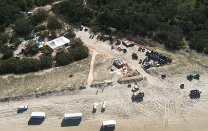

---
## Page 25

11
National Plan for Maritime Environmental Emergencies – 2020 edition
Part two
International conventions
The National Plan implements and is supported by a number of international conventions to which 
Australia is a party.
Table 2 – International conventions
International convention
Application to the National Plan
International Convention on 
Oil Pollution Preparedness, 
Response and Cooperation, 
1990
Protocol on Preparedness, 
Response and Cooperation 
to Pollution Incidents by 
Hazardous and Noxious 
Substances, 2000 (OPRC-
HNS Protocol)
Provide the basis for the National Plan by setting the 
context for:
• developing a national system for pollution response
• maintaining adequate capacity and resources to address 
oil and hazardous and noxious substances (HNS) 
incidents
• facilitating international cooperation and mutual assistance 
in preparing for and responding to major oil and HNS 
incidents, and
• notifying without delay all States [neighbouring countries] 
whose interests are affected or likely to be affected by an 
oil or HNS pollution incident.
International Convention for 
the Prevention of Pollution 
from Ships (MARPOL)
Provides ships’ construction and operational requirements 
to prevent pollution from ships. Requires ships greater than 
400 gross tonnes and above to have pollution emergency 
plans.
Provides for exemptions from discharge restrictions (and 
prosecution) where:
• a discharge is necessary to secure the safety of a ship or 
save a life at sea, or prevent a larger spill or
• it is necessary during a spill response to discharge 
oil or HNS or use dispersants to minimise the overall 
damage from pollution, and is approved by the relevant 
government.
United Nations Convention on 
the Law of the Sea, 1982
Article 221 provides general powers for parties to take and 
enforce measures beyond the territorial sea to protect their 
coastline or related interests from pollution or the threat 
of pollution following a maritime casualty or acts relating 
to such a casualty, which may reasonably be expected to 
result in major harmful consequences.
Article 198 provides that “when a State [neighbouring 
country] becomes aware of cases in which the marine 
environment is in imminent danger of being damaged … by 
pollution, it shall immediately notify other States it deems 
likely to be affected by such damage.”

---
## Page 26

National Plan for Maritime Environmental Emergencies – 2020 edition
12
International convention
Application to the National Plan
International Convention 
Relating to Intervention on 
the High Seas in Cases of Oil 
Pollution Casualties, 1969
Protocol Relating to Intervention 
on the High Seas in Cases of 
Pollution by Substances Other 
Than Oil, 1973
Provides general powers for parties to take measures 
on the high seas as may be necessary to prevent, 
mitigate or eliminate grave and imminent danger to their 
coastline or related interests from the threat of pollution 
by oil or hazardous and noxious substances following a 
maritime casualty or acts related to such a casualty, which 
may reasonably be expected to result in major harmful 
consequences.
International Convention on 
Civil Liability for Oil Pollution 
Damage, 1992
Provides for the recovery of pollution costs and payment of 
compensation from owners/operators of oil tankers.
International Convention 
on the Establishment of 
an International Fund for 
Compensation for Oil Pollution 
Damage, 1992
2003 Protocol to the 
International Convention 
on the Establishment of 
an International Fund for 
Compensation for Oil Pollution 
Damage, 1992
Provides for additional compensation and costs where the 
tanker owners’/operators’ liability limits are exceeded, using 
funds provided by the oil industry.
International Convention on 
Civil Liability for Bunker Oil 
Pollution Damage, 2001
Provides for the recovery of pollution costs and payment of 
compensation from owners/operators of all vessels using oil 
as bunker fuel and references the liability arrangements in 
the Convention on Limitation of Liability for Maritime Claims, 
1976 (LLMC) and its 1996 Protocol.
Protocol on Environmental 
Protection to the Antarctic 
Treaty 1991
The objective of the Protocol is to ensure the 
comprehensive protection of the Antarctic environment and 
associated ecosystems. The Antarctic includes all the area 
south of latitude 60
o south.
Annex IV to the Protocol relates to marine pollution, 
specifically prohibiting the discharge of oil, noxious liquid 
substances and garbage in the Antarctic Treaty area. Annex 
VI (not yet in force) of the Protocol relates to liability for 
environmental emergencies.

---
## Page 27

13
National Plan for Maritime Environmental Emergencies – 2020 edition
Part two
Table 3 lists legal instruments implemented by the Australian Government to give effect to 
key principles and arrangements agreed between the Commonwealth, states and Northern 
Territory.
Table 3 – Commonwealth legislation
Commonwealth legislation
Application to the National Plan
Australian Maritime Safety 
Authority Act 1990
Provides that a function of AMSA is to combat pollution in 
the marine environment.
Protection of the Sea 
(Prevention of Pollution from 
Ships) Act 1983
Provides exemptions for the discharge of materials in 
response to marine pollution incidents, including the 
application of dispersants.
Requires ships greater than 400 gross tonnes and above to 
have pollution emergency plans.
Provides for emergency discharges from ships.
Protection of the Sea (Civil 
Liability for Bunker Oil Pollution 
Damage) Act 2008
Places liability on shipowner for pollution damage caused 
by loss of bunker fuel.
Provides immunity from legal action for response personnel.
Protection of the Sea (Civil 
Liability) Act 1981
Places liability on shipowner for pollution damage caused 
by loss of persistent oil from an oil tanker.
Protection of the Sea (Oil 
Pollution Compensation Fund) 
Act 1993
Provides additional compensation for pollution damage 
caused by loss of persistent oil from an oil tanker.
Protection of the Sea (Powers 
of Intervention) Act 1981
Provides for intervention powers being exercised in 
Australia’s EEZ, Territorial Sea and internal waters.
Offshore Petroleum and 
Greenhouse Gas Storage Act 
2006
Sets out the requirements for the offshore petroleum 
exploration and production industry to have approved plans 
and maintain capability to respond to oil pollution incidents. 
Provides for the National Offshore Petroleum Safety and 
Environmental Management Authority (NOPSEMA) or the 
responsible Commonwealth Minister to issue directions to a 
titleholder. 
Under the polluter pays provision, if a titleholder has not 
fulfilled their responsibilities NOPSEMA or the responsible 
Commonwealth Minister may undertake these actions 
instead and recover the costs of doing so from the 
titleholder.

---
## Page 28

National Plan for Maritime Environmental Emergencies – 2020 edition
14
Commonwealth legislation
Application to the National Plan
Environment Protection and 
Biodiversity Conservation Act 
1999
Provides for the protection of the environment, especially 
those aspects of the environment that are “matters of national 
environmental significance”, including but not limited to, World 
Heritage Properties, Ramsar Wetlands, the Commonwealth 
Marine Area, and species listed under the Act.
The Act provides for the making of exemptions if in the 
national interest with the National Plan. Exemptions 
covering the provisions of Part 3 and 13 of the Act have 
been issued for activities undertaken by persons responding 
to maritime environmental emergencies in accordance 
with the National Plan. Emergency response activities in 
Australian Marine Parks must be carried out in accordance 
with a management plan. 
Offshore petroleum activities in Commonwealth waters 
undertaken in accordance with the Offshore Petroleum and 
Greenhouse Gas Act 2006 do not need to be referred for 
assessment under the EPBC Act, in accordance with the 
Minister for the Environment’s 2014 approval decision under 
Part 10 (strategic assessments).
Great Barrier Reef Marine 
Park Authority Act 1975
Provides for permission to use dispersants in the Marine 
Park, and notification to enter a zone in the Marine Park for 
the purpose of salvage
Antarctic Treaty (Environment 
Protection) Act 1980
Provides for the protection of the Antarctic environment, 
including requiring all activities in the Antarctic to undertake 
an environmental impact assessment and establishing 
specific permitting arrangements for impacts on native flora 
and fauna. The Act provides exceptions for activities done in 
an emergency, including to protect the environment.
When in force, Annex VI to the Protocol on Environmental 
Protection to the Antarctic Treaty will be implemented 
through this Act, including requirements for operators to 
undertake preventative measures and develop contingency 
plans in relation to environmental emergencies, and 
establish a liability regime for failing to respond to 
environmental emergencies in the Antarctic.
Fisheries Management Act 
1991
Provides regulatory and other mechanisms to support 
any necessary fisheries management decisions during a 
response
Maritime Powers Act 2013
Provides for the administration and enforcement of 
Australian laws in maritime areas, and for related purposes. 
The Act aims to give greater certainty to the maritime 
officers working in difficult conditions to protect Australia’s 
boarders and enforce Australian maritime laws.

---
## Page 29

15
National Plan for Maritime Environmental Emergencies – 2020 edition
Part two
Offshore petroleum regulation and spill response
Australia has established a comprehensive regulatory regime for the offshore petroleum 
industry for environmental management and oil spill response. The regime places the onus on 
the titleholder to manage marine pollution risks and requires that all petroleum activities have 
an Environment Plan (EP), including an Oil Pollution Emergency Plan (OPEP), accepted by 
the relevant regulator before that activity is able to commence.
The Offshore Petroleum and Greenhouse Gas Storage Act 2006 (OPGGSA) establishes 
NOPSEMA as the primary regulator for offshore petroleum activities in the Commonwealth 
marine area. The requirements for EPs and OPEPs are outlined in the Offshore Petroleum 
and Greenhouse Gas Storage (Environment) Regulations 2009.
An EP must identify the environmental risks of a petroleum activity, including those risks 
associated with any emergency or spill response, and demonstrate to the regulator that the 
impacts and risks from the activity have been reduced to as low as reasonably practicable 
(ALARP), and that any residual impacts and risk is of an acceptable level. There is an 
obligation on the offshore petroleum industry to undertake appropriate consultations in 
the course of managing their impacts and risks and demonstrate in the EP that those 
consultations have been undertaken.
Under the regime, each titleholder has a duty to establish, maintain and implement a marine 
pollution response capability, which may be in partnership with other parties. This response 
capability must be commensurate with the risks presented by the particular activity. Where the 
response activities rely on, or may affect relevant stakeholders, the titleholder is required to 
demonstrate appropriate consultation and that relevant agreements are in place.
•	
In particular, the OPGGSA and its associated regulations:
•	
sets out responsibilities of titleholders in relation to the operation of offshore exploration 
and production facilities, including oil spill notification procedures to both NOPSEMA and 
(potentially) affected states/NT
•	
 provides powers for NOPSEMA or the responsible Commonwealth Minister to direct 
titleholders to take actions in response to an incident
•	
 requires the titleholder to clean-up and monitor the impact of a spill
•	
 provides, should a titleholder fail to fulfil their obligations in the event of a spill, that 
NOPSEMA or the responsible Commonwealth minister may do any or all of the things the 
titleholder has failed to do.
•	
 requires that titleholders maintain financial assurance sufficient to demonstrate that they 
can meet the costs, expenses and liabilities associated with undertaking a petroleum 
activity.

---
## Page 30

National Plan for Maritime Environmental Emergencies – 2020 edition
16
•	
Comparable legislation and regulations exist for offshore petroleum activities in state 
and Northern Territory waters. Each state/Northern Territory establishes its own regulator 
and has specific oil spill response arrangements for offshore petroleum activities within 
its jurisdiction. Further detail on these arrangements can be found in the state/Northern 
Territory marine pollution contingency plans.
Other international and regional agreements
The National Plan provides a mechanism for Australia to enter into mutual aid arrangements 
with other countries impacted by maritime environmental emergencies, giving effect to 
Australia’s obligations under OPRC and the OPRC-HNS Protocol. Australia has entered into a 
number of international cooperation agreements which are described below.
Pacific Islands Regional Marine Spill Contingency Plan (PACPLAN) 
Australia is a party to the Convention for the Protection of the Natural Resources and 
Environment of the South Pacific Region, 1986 (SPREP Convention). The Convention 
includes a Protocol Concerning Co-operation in Combating Pollution Emergencies in the 
South Pacific Region, 1990 (SPREP Pollution Protocol). The protocol provides formally for 
cooperation when responding to marine spills.
Consistent with the SPREP Convention and Protocol, in 2000 SPREP member countries 
adopted the Pacific Islands Regional Marine Spill Contingency Plan, known as PACPLAN. 
This provides for cooperative regional responses to major marine  spills in the Pacific Island 
region, including linkages and mechanisms for accessing regional and supra- regional 
assistance.
One of the key mechanisms within PACPLAN is the provision for the 22 SPREP island 
members to seek assistance from the so-called SPREP Non-island Governments of Australia, 
France, New Zealand and the United States of America. Australia is listed as the primary 
source of assistance for Kiribati, Nauru, Papua New Guinea, Solomon Islands, Tuvalu and 
Vanuatu along with the other Non-island Governments, is a secondary source of assistance 
for all other island members.

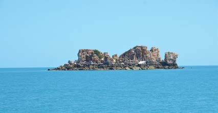

---
## Page 31

17
National Plan for Maritime Environmental Emergencies – 2020 edition
Part two
Maritime Arrangements in the Timor Sea
An area of the Timor Sea lying between Australia and Timor-Leste has historically been 
subject to overlapping territorial claims by Australia and Timor-Leste. This area contains 
substantial resources of petroleum and gas.
Maritime Boundary Treaty 2018
The ‘Treaty Between Australia and the Democratic Republic of Timor-Leste Establishing Their 
Maritime Boundaries in the Timor Sea’ (the Maritime Boundary Treaty) entered into force on 
30 August 2019. 
The Maritime Boundary Treaty establishes permanent maritime boundaries between Australia 
and Timor-Leste in the Timor Sea and a stable legal framework for resource development.
The Maritime Boundary Treaty also established a Special Regime Area (SRA) for the joint 
development, exploitation and management of the petroleum resources of the Greater Sunrise 
Fields for the benefit of both countries. The SRA includes a two-tier regulatory structure for 
the regulation and administration of the SRA consisting of a Designated Authority and a 
Governance Board. The Designated Authority acts on behalf of Australia and Timor-Leste 
and reports to the Governance Board, consisting of members appointed by Australia and 
Timor-Leste. Article 6(n) of Annex B to the Maritime Boundary Treaty specifically set out the 
responsibilities of the Designated Authority within the SRA, giving it powers and functions 
to issue regulations to protect the marine environment, monitor compliance, ensure there is 
a contingency plan for combating pollution from Petroleum Activities, and investigate safety 
and environmental incidents. The Designated Authority is also required to report to the 
Governance Board three times a year on safety, environment and well-integrity. It is expected 
that the contingency plan will resemble the arrangements currently in place for the Joint 
Petroleum Development Area.
The coordinates of the SRA are set out in Annex C of the Maritime Boundary Treaty: https://
dfat.gov.au/geo/timor-leste/Documents/treaty-maritime-arrangements-australia-timor-leste.pdf
Bilateral agreements
Australia has bilateral agreements in place on cooperation in preparedness and response with 
New Zealand, New Caledonia, Papua New Guinea, Indonesia and South Korea.

---
## Page 32

National Plan for Maritime Environmental Emergencies – 2020 edition
18
2.2	 Governance
The aim of National Plan governance is to ensure a coordinated, integrated and accountable 
system is in place to manage maritime environmental emergencies. This is achieved through:
•	
reporting to Australian Governments through the Transport and Infrastructure Council (the 
Council), under the Council of Australian Governments’ arrangements
•	
the establishment of the National Plan Strategic Coordination Committee (NPSCC) and 
the National Plan Strategic Industry Advisory Forum (NPSIAF) to set policy direction and 
oversee the implementation of the National Plan
•	
stakeholder engagement, in particular with the shipping, petroleum, chemical and port 
industries
•	
appropriate technical input to support decision making, and
•	
links to coordinated arrangements across the Commonwealth, states and Northern 
Territory.
Figure 3 depicts the National Plan governance structure. The operating principles for  
arrangements are detailed in the respective Terms of Reference for each group.
Transport and Infrastructure Council
The Council was established in December 2013 and brings together Commonwealth, 
state, Northern Territory and New Zealand Ministers with responsibility for transport and 
infrastructure issues, as well as the Australian Local Government Association.
The Council has responsibility for the National Plan for Maritime Environmental Emergencies.
The Council is advised by the Transport and Infrastructure Senior Officials Committee 
(TISOC) on National Plan matters.
 
 
Figure 3 – National Plan governance structure
Transport and Infrastructure Council
Transport and Infrastructure  
Senior Officials Committee
Commonwealth, state and 
Northern Territory Marine 
Pollution Committees and/
or Disaster Management 
Arrangements
National Plan  
Strategic Coordination 
Committee
National Plan 
Strategic Industry  
Advisory Forum

---
## Page 33

19
National Plan for Maritime Environmental Emergencies – 2020 edition
Part two
National Plan Strategic Coordination Committee
The National Plan Strategic Coordination Committee (NPSCC) is responsible for setting the 
broad policy direction of the National Plan, overseeing the implementation of the Plan and 
ensuring the effectiveness of the arrangements.
The NPSCC is comprised of senior Commonwealth, state and Northern Territory Government 
officials and reports to TISOC on the effectiveness of the National Plan. The Committee is 
chaired by a senior official from the Australian Government. The National Plan Strategic 
Industry Advisory Forum (NPSIAF) provides an observer to the NPSCC.
The committee can form Technical Groups to support its deliberations. The current Technical 
Group structure is described within the National Plan Governance Guideline.
National Plan Strategic Industry Advisory Forum
The National Plan Strategic Industry Advisory Forum (NPSIAF) is an independent industry-
focused body established to provide input to the NPSCC on the strategic direction of the 
National Plan.
The members of the NPSIAF are drawn from industry stakeholders with a direct interest in the 
operational arrangements of the National Plan, covering the commercial maritime sector, peak 
oil and chemical industry bodies, and professional bodies representing salvage and towage 
interests.
The Forum can form Technical Groups to support its deliberations.
Jurisdictional governance
Each jurisdiction establishes and maintains a coordination group to ensure effective whole 
of government decision making within the National Plan arrangements. These groups vary 
between jurisdiction from hazard specific committees to state disaster and emergency 
management committees.
Each jurisdiction produces its own contingency plans.

---
## Page 34

National Plan for Maritime Environmental Emergencies – 2020 edition
20
2.3 Management of the National Plan
The National Plan is managed by AMSA, which represents the Australian Government at the 
IMO in relation to Australia’s obligations under the OPRC Convention and the OPRC-HNS 
Protocol.
The functions of AMSA in this regard include:
•	
 maintaining the National Plan
•	
 maintaining Commonwealth contingency plans
•	
 managing the National Response Team, including training and development
•	
 providing a national response equipment capability
•	
 coordinating the national training programme
•	
 maintaining uniform standards and testing protocols for oil spill dispersants and other 
chemical response agents
•	
 managing research and development projects 
•	
 coordination and support of jurisdictions’ geospatial capability
•	
 management of trajectory modelling
•	
 managing the national emergency towage vessel and fixed-wing aerial dispersant 
contracts
•	
 providing secretariat services for National Plan committees and technical groups, and
•	
 undertaking international liaison as necessary.

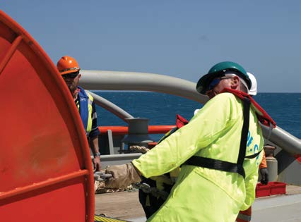

---
## Page 35

21
National Plan for Maritime Environmental Emergencies – 2020 edition
National Plan management arrangements
The National Plan sets out the agreed policy for the implementation of management 
arrangements for maritime environmental emergencies within Australia. The National Plan is 
underpinned by:
•	
policies – implementing documents for the strategic management of the National Plan, 
e.g. National Response Team Policy
•	
guidance – documents providing guidance for the application of specific response 
arrangements detailed within the National Plan, e.g. Activation of the Fixed Wing Aerial 
Dispersant Capability Guidance; and
•	
scientific, technical and operational advisories – advisory documents on specific technical 
issues, e.g. Volunteer Management Advisory.
Under the National Plan governance arrangements the NPSCC is responsible for the review 
and acceptance of these documents.
Monitoring and review
The NPSCC is responsible to ensure that the National Plan remains current and effective. 
The NPSCC may at any time decide to review the National Plan if it considers that significant 
change has occurred to the strategic context, including lessons learned from incidents and 
exercises.
On behalf of the NPSCC, AMSA will conduct an annual review, no later than 31 October each 
year for NPSCC’s consideration.
A National Plan Outlook Report will be prepared by NPSCC in five yearly intervals with the 
next report to be prepared by 30 November 2020. The Outlook report will determine the 
requirement for a formal National Plan review. If a review is required, the Outlook Report will 
identify the process for the review and an expected commencement date:
•	
the national risk profile
•	
whether international obligations under the OPRC Convention and the OPRC-HNS 
Protocol are being met
•	
the management effectiveness of the National Plan
•	
operational effectiveness, and capability/capacity reviews (for all spill sources). The policy 
outcomes of the Outlook Report could include:
•	
renewal of current National Plan arrangements
•	
minor amendments to arrangements
•	
a major review of arrangements.
Part two

---
## Page 36

National Plan for Maritime Environmental Emergencies – 2020 edition
22
2.4 Roles and responsibilities
Jurisdictional authorities
Agencies that have jurisdictional or legislative responsibilities for maritime environmental 
emergencies are obligated to work closely with the Control Agency to ensure that incident 
response actions are adequate. Such arrangements should be clearly identified in 
contingency plans.
Control Agency
A Control Agency is the agency or company assigned by legislation, administrative 
arrangement, or within the relevant contingency plan, to control response activities to a 
maritime environmental emergency. The jurisdiction governments will ensure that there is an 
appointed Control Agency for each of the hazards identified within their overall emergency 
management arrangements.
The Control Agency will have responsibility for appointing the Incident Controller to control the 
operational response to an incident.
The functions of the Control Agency include:
•	
developing, maintaining and exercising contingency plans and support arrangements  
(e.g. response assets, contracts, etc.) for the particular maritime environmental 
emergency for which they are responsible
•	
 reporting to government on the status of 
response preparedness
•	
 reporting to government on the progress of 
response operations, and
•	
 making recommendations to government on 
when the response is complete.
Where recovery is not a specific responsibility of 
a Control Agency, early liaison with organisations 
responsible for recovery should be a priority.
Support Agency
Support agencies are those that provide resources 
(i.e. material, personnel or services) or information 
to the incident management team during a 
response.
Support agencies and their responsibilities are 
listed in the relevant contingency plan.

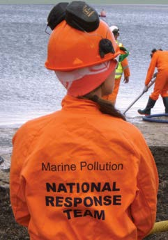

---
## Page 37

23
National Plan for Maritime Environmental Emergencies – 2020 edition
2.5 Strategic coordination of emergencies of national 
consequence
Major or catastrophic maritime environmental emergencies have the potential to significantly 
impact on the national interests of Australia and may require extraordinary strategic 
coordination across governments and stakeholders for their effective management. Such 
incidents will generally be of a large scale and require the coordination of national and 
international level interests, and may include circumstances where:
•	
 there is a significant threat to the community and/or environment
•	
 the incident impacts upon two or more Australian jurisdictions
•	
 the incident impacts across an international boundary
•	
 the incident exceeds the capability of the nominated Control Agency
•	
 there is significant national and international media attention impacting across the 
interests of multiple parties; or
•	
 NOPSEMA or the responsible Commonwealth minister, due to the titleholders’ failure to 
fulfil their spill response obligations, is required to act.
The National Plan provides for the coordination of stakeholders during major incidents through 
the application of four core concepts:
•	
 strategic leadership
•	
 coordination across Australian jurisdictions and sectors
•	
 coordination with international governments, and
•	
 processes for the orderly transfer of Control Agency responsibility.
The Australian Emergency Management Arrangements include Model Arrangements for 
Leadership During Emergencies of National Consequence for those circumstances not fully 
addressed by the National Plan.
Model Arrangements for Leadership During Emergencies of National 
Consequence
The Council of Australian Governments endorsed the Model Arrangements for Leadership 
During Emergencies of National Consequence (Model Arrangements) on 3 July 2008. 
These arrangements represent how Australian Governments work together to coordinate 
major incidents. The Model Arrangements have specific application to incidents that require 
coordination of national level policy, strategy and public messaging or inter-jurisdictional 
assistance, where such assistance and coordination is not addressed by existing 
arrangements.
It is intended that the National Plan be consistent with the Model Arrangements. Under the 
National Plan, the Model Arrangements will be applied where the coordination processes 
outlined within this section require additional support to manage coordination issues.
Part two

---
## Page 38

National Plan for Maritime Environmental Emergencies – 2020 edition
24
Strategic leadership
A nationally significant incident will create additional pressures on the Control Agency to manage 
the legitimate interests of the Commonwealth, state, NT, local and private sector stakeholders 
involved in the incident. Jurisdictions should appoint a senior government official to provide 
strategic leadership and coordination in support of the Control Agency. During an incident these 
officials are referred to in many jurisdictions as the State Marine Pollution Controller or State 
Marine Pollution Coordinator (SMPC).
In the context of a nationally significant incident the role of such a senior official may include:
•	
assisting the Control Agency(ies) with strategic communications, including:
	
– primary spokesperson for the multi-agency response
	
– primary point of contact for the briefing of government(s)
•	
providing the common operating picture and situational awareness at the strategic level
•	
strategic coordination, including:
	
– resolution of strategic multi-jurisdictional policy and legislative issues on behalf of the 
Control Agency
	
– ensuring collaboration between all parties and resolving multi-jurisdictional-agency 
conflicts
•	
facilitating national and international assistance through National Plan and Australian 
Emergency Management arrangements.
Photograph courtesy of Kelana Arshad

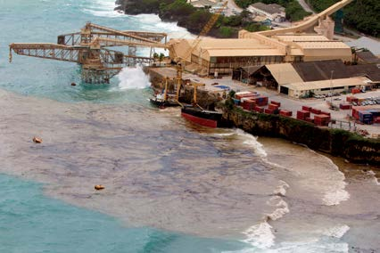

---
## Page 39

25
National Plan for Maritime Environmental Emergencies – 2020 edition
Part two
Cross jurisdictional coordination
Maritime environmental emergencies have the potential to impact upon the interests of two 
or more Australian jurisdictions, where both jurisdictions have a legitimate administrative and 
regulatory interest in the incident.
The National Plan addresses the complexities of such incidents through the Guidance on 
Coordination of Cross Border Incidents. This guidance provides for: 
•	
Establishment of agreed incident coordination arrangements; 
•	
Determination of a ‘lead’ Jurisdictional Authority and Control Agency across the entire 
incident response, (if appropriate); 
•	
Establishment of a Joint Strategic Coordination Group, if determination of a ‘lead’ Jurisdictional 
Authority and Control Agency across the entire incident response in not appropriate. 
International coordination
The Australian Government is party to a number of international conventions and agreements 
that include obligations to report, coordinate with, and provide assistance to other countries 
during a marine pollution incident. These conventions include UNCLOS and the OPRC 
Convention and its HNS Protocol are detailed above in Table 2.
These convention and agreement obligations rest with the Australian Government and cannot 
be delegated to another party. The National Plan includes a Guidance for Coordination of 
International Incidents Notification Arrangements, which includes arrangements for:
•	
assessment of incidents and notification arrangements
•	
engagement with the Department of Foreign Affairs and Trade and relevant diplomatic posts
•	
engagement with the Department of the Environment and Energy in relation to PACPLAN 
matters
•	
coordination of response operations across trans-national boundaries
•	
coordination of international assistance under PACPLAN and other MOU arrangements.
Change of Control Agency
The National Plan provides for the orderly escalation from local response operations to 
incidents requiring international assistance. For more detail see section 5.4.
There may be circumstance or factors as outlined above where there is a need to change the 
Control Agency responsible for managing the response.
The National Plan includes a Change of Control Agency Protocol Guidance, where such 
arrangements are not already part of disaster management or regulatory arrangements and 
includes processes for:
•	
approval from the relevant jurisdiction, or relevant regulator within that jurisdiction
•	
planning for the transfer of control

---
## Page 40

National Plan for Maritime Environmental Emergencies – 2020 edition
26
•	
implementing a transfer arrangement.
The Guidance provides for a jurisdiction to request that AMSA or another Control Agency 
assume operational control of an incident in exceptional circumstances.
2.6 International support
Support from national governments
The OPRC Convention and its HNS Protocol place an obligation on parties, subject to 
their capabilities and availability of relevant resources, to provide technical support and 
equipment for the purposes of responding to an incident, when the severity of such an 
incident so justifies, upon the request of any party affected or likely to be affected. AMSA has 
responsibility for making or receiving such requests in conjunction with other government 
agencies with an interest or responsibility. This will generally be undertaken through diplomatic 
channels and in accordance with any IMO guidance on international offers of assistance and 
any applicable bilateral or multi-lateral agreements.
Support from the Global Response Network
The Australian Marine Oil Spill Centre (AMOSC) based in Geelong, Victoria, on behalf of the 
Australian petroleum industry has established links with other national and international oil 
spill response organisations. AMOSC’s membership of the Global Response Network (GRN) 
allows knowledge and expertise to be accessed and shared with Australia from overseas if/
when the situation requires.
AMOSC, through the Australian Institute of Petroleum (AIP) also has membership of the 
International Petroleum Industry Environmental Conservation Association (IPIECA) and this 
enables industry access to this global oil and gas industry association for environmental 
and social issues. Through IPIECA, industry can access the knowledge and expertise of the 
petroleum industry’s international spill response personnel.
AMSA, through AMOSC, will coordinate activation of any of these international resources on 
behalf of the jurisdictions in the event of a maritime environmental emergency.
AMOSC can assist industry in accessing international resources for spills requiring 
international resourcing. AMOSC can also be accessed directly by any Responsible Party 
requiring AMOSC resources.

---
## Page 41

27
National Plan for Maritime Environmental Emergencies – 2020 edition
Part three
Prevention of 
marine pollution 
incidents

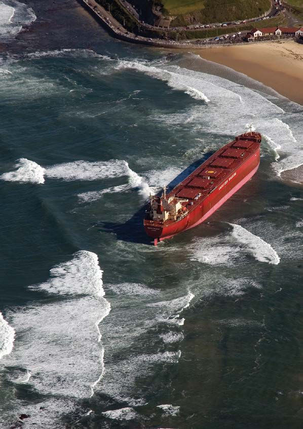

---
## Page 42

National Plan for Maritime Environmental Emergencies – 2020 edition
28
3.1 Scope of prevention
Prevention within the scope of the National Plan refers to those actions taken to prevent 
or minimise the release of marine pollution from a maritime casualty. The National Plan 
arrangements provide for:
•	
 clear assignment of responsibilities to the shipowner and governments
•	
 an incident management system
•	
 national emergency towage arrangements, and
•	
 national guidance for the assessment of requests for a place of refuge.
Arrangements for prevention of offshore petroleum incidents (i.e. outside of maritime 
casualties) are governed by the Offshore Petroleum and Greenhouse Gas Storage Act 2006 
(OPGGSA) and equivalent state/Northern Territory legislation (see section 2.1).
3.2 Responsibility of the shipowner
The shipowner and shipmaster are responsible for undertaking prompt and effective action to 
ensure the safety of their vessel and cargo, including the engagement of commercial assets 
where necessary and available. These actions include:
•	
the engagement of emergency towage services
•	
the engagement of salvage contractors, and
•	
effective communication to Australian governments on the actions being taken to manage 
the situation.

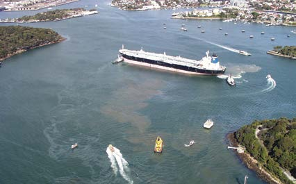

---
## Page 43

29
National Plan for Maritime Environmental Emergencies – 2020 edition
Part three
3.3 Maritime Emergency Response Commander
The Maritime Emergency Response Commander (MERCOM) is responsible for the 
management of emergency intervention issues in response to maritime casualty incidents 
where there is an actual or potential risk of significant pollution. Table 4 provides more detail.
The MERCOM is appointed by AMSA and is supported by statutory powers under the 
Protection of the Sea (Powers of Intervention) Act 1981.
The MERCOM will consider the reasonable views and stated positions of the relevant 
states, Northern Territory and stakeholders. These entities represent community views about 
economic, environmental, community and social interests that could be impacted by the 
MERCOM’s decisions. Decisions made by the MERCOM will be expeditiously communicated 
to all relevant stakeholder groups and fully documented.
3.4 Responsibilities of Australian governments
Australia is obligated under International Maritime Organization Resolutions A.949(23) and 
A.950(23) to provide a maritime assistance to:
•	
a ship involved in an incident (e.g. loss of cargo, accidental discharge over board) that 
does not impair its seakeeping capability but requires to be reported
•	
the ship, according to its master’s assessment, is in need of assistance but not in a 
distress situation that requires rescue of those involved, or
•	
the ship is found to be in a distress situation but those on board have already been 
rescued.
The IMO has been notified in accordance with IMO Resolution A.950(23) that the AMSA 
Response Centre (ARC), operated by AMSA, will be the contact point between ship masters 
and the Australian Government for MAS purposes.
The Commonwealth, state and Northern Territory governments will only assume control 
of a maritime casualty incident where the shipowner and/or shipmaster are failing in their 
responsibility to manage the maritime casualty effectively, in a timely manner or in the 
interests of protecting the community and the environment.
The jurisdictional governments have agreed the following responsibilities in relation to the 
response to maritime casualty incidents (Table 4 refers).

---
## Page 44

National Plan for Maritime Environmental Emergencies – 2020 edition
30
Table 4 – Responsibilities for maritime casualty incidents
Scenario
Responsibility / Accountability
All vessels within the Commonwealth’s area 
of jurisdiction (except in the Great Barrier 
Reef Marine Park)
AMSA is responsible for the management of 
the maritime casualty.
Within the coastal or 
internal waters of the 
states and Northern 
Territory
SOLAS vessels  
(i.e. vessels >500 
gross tonnes)
The state and Northern Territory governments 
are responsible for the management of the 
maritime casualty.
Non SOLAS vessels 
(i.e. vessels <500 
gross tonnes)
The state and Northern Territory governments 
are responsible for the management of the 
maritime casualty.
Within the Great 
Barrier Reef Marine 
Park
SOLAS vessels  
(i.e. vessels >500 
gross tonnes)
AMSA is responsible for the management of 
the maritime casualty with the direct support 
of Maritime Safety Queensland (MSQ) and 
the Great Barrier Reef Marine Park Authority 
(GBRMPA).
Non SOLAS vessels 
(i.e. vessels <500 
gross tonnes)
GBRMPA is responsible for the management 
of the maritime casualty.
Noting its maritime expertise, MSQ will, under 
agreement with the GBRMPA, manage higher 
risk marine casualties with the direct support 
of GBRMPA, and further support from AMSA, 
as required.
Any vessel within a 
port
The Commonwealth, state and Northern Territory governments are 
responsible for the management of the maritime casualty within their 
respective jurisdictions.
 
Notes relating specifically to Table 4
In all cases, the relevant jurisdiction (Commonwealth, state and Northern Territory governments) 
may request assistance from AMSA or that AMSA manage the incident on their behalf.
In all cases, where the MERCOM has assessed that there is a threat of significant pollution 
the MERCOM, will consider the reasonable views and stated positions of the relevant states, 
Northern Territory and stakeholders on emergency response actions, will have the responsibility 
and power to exercise final decision-making on behalf of the Australian Government for 
management of a maritime casualty. In doing so, the MERCOM will consider the reasonable 
views and stated positions of the relevant states, Northern Territory and stakeholders, as these 
entities represent community views about interests that could be impacted by the MERCOM’s 
decisions. Decisions made by the MERCOM will be expeditiously communicated to all relevant 
stakeholder groups and fully documented.
Within ports or involving vessels under the SOLAS size limits, the MERCOM will not respond to 
maritime casualties except where the MERCOM reasonably assesses, on a case by case basis, 
that there is a threat of, or actual, significant pollution and that adequate measures to deal the 
incident are not being taken.
The Intervention Convention does not apply to warships and, accordingly, the Protection of the 
Sea (Powers of Intervention) Act 1981 expressly does not authorise the taking of measures 
against a warship or other ship owned or operated by a foreign State and used, for the time 
being, only on government non commercial service.

---
## Page 45

31
National Plan for Maritime Environmental Emergencies – 2020 edition
3.5 Casualty Management System
Principles of maritime casualty response
The National Plan recognises that maritime casualties have specific characteristics that 
can affect the way the incident is managed. The incident management system for maritime 
casualties is based on the following principles:
•	
operational management of a maritime casualty rests with the commercial sector, i.e. 
towage and salvage contractors
•	
the system must be scalable and flexible to meet the demands of the incident
•	
the role of Australian governments is to oversee the actions of the shipowner/shipmaster 
and towage and salvage contractors
•	
the need to facilitate communication amongst key stakeholders in relation to appropriate 
action and situational information, and
•	
the requirement to provide for the separation of the maritime casualty and marine pollution 
response functions for significant incidents.
Maritime Casualty Control Unit
A Maritime Casualty Control Unit (MCCU) will be implemented for significant incidents where 
MERCOM has assumed control. This is consistent with the principles of the Australasian 
Inter-service Incident Management System (AIIMS) which provides for multiple incident 
management teams for incidents involving multiple hazards or impacts. The MCCU will:
•	
oversee and monitor actions taken in response to a maritime casualty
•	
review salvage and other relevant response plans
•	
provide a platform for key stakeholders to discuss and maintain situational information, and
•	
provide an avenue for informed government intervention when required.
Figure 4 depicts an indicative functional and organisational structure of a Maritime Casualty 
Control Unit.
 
Figure 4 – Operations group of a Maritime Casualty Control Unit
Incident Controller
Maritime Casualty Officer
Marine Pollution Liaison Officer
Environmental Advisor
Salvage / Emergency Towage Representative
Adjoining Jurisdiction Liaison Officer
Owner’s Representative
Harbour Master
Administrative Support
Part three

---
## Page 46

National Plan for Maritime Environmental Emergencies – 2020 edition
32
The processes for implementation and operation of the MCCU are detailed within the AMSA 
Maritime Casualty Management Guideline.
States and Northern Territory
The state and Northern Territory governments will specify the incident management 
arrangements for their jurisdictions and within their ports within the relevant contingency plan(s).
3.5 Emergency towage
The National Plan includes national arrangements for emergency towage capability (ETC) 
managed by AMSA, supported by jurisdiction arrangements to manage the risks within their 
respective jurisdictions.
National emergency towage capability
AMSA is responsible for the delivery of a national emergency towage capability within 
Australia’s eleven designated regions on the following basis (Figure 5 refers):
•	
Level 1 Capability – a dedicated emergency towage vessel (ETV) operating in Far North 
Queensland ETC region
•	
Level 2 Capability – contracted port towage within the other ten regions that is capable of 
undertaking open water towage operations
•	
Level 3 Capability – vessels of opportunity that can be directed or contracted at the time of 
an incident to assist or supplement the Level 1 or 2 capability.
 
Figure 5 – Emergency towage capability regions
The ETC can only be activated by AMSA. 
Requests for activation are made in 
accordance with internal AMSA procedures.

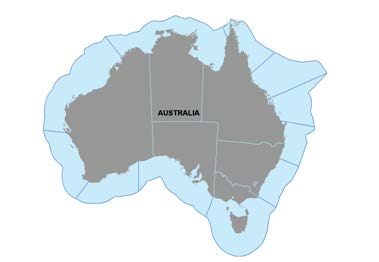

---
## Page 47

33
National Plan for Maritime Environmental Emergencies – 2020 edition
State and Northern Territory capability
The state and Northern Territory governments should ensure that there are adequate 
emergency towage arrangements within their jurisdiction to manage their local risks in support 
of the national capability. This capability should be detailed within their relevant contingency 
plans. This includes working with ports within their jurisdiction to:
•	
ensure there are no licensing, tendering or other processes that would preclude or hinder 
the effective use of harbour towage vessels as part of the national ETC
•	
include emergency towage clauses within harbour towage contracting or licensing 
arrangements
•	
cooperate with the release of emergency towage vessels as required in response to a 
maritime casualty, and
•	
include in port towage licensing or tendering arrangements and appropriate provisions 
for replacement harbour towage arrangements in the event that an ETV is required to 
respond to a maritime casualty.
Part three

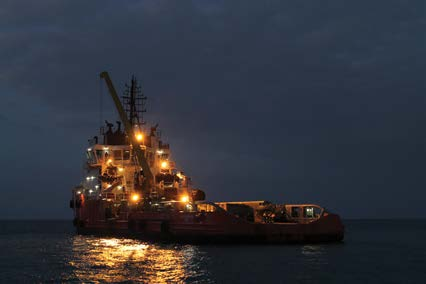

---
## Page 48

National Plan for Maritime Environmental Emergencies – 2020 edition
34
3.7 Place of refuge
A place of refuge is a place where a ship in need of assistance can take action to enable it to 
stabilise its condition (including the status of cargo), protect human life and the environment 
and reduce the hazards to navigation.
The National Maritime Places of Refuge Risk Assessment Guidance is an arrangement, 
agreed by the Commonwealth, state and Northern Territory governments, for the management 
of requests for, or circumstances that require, a place of refuge.
The guidance state that a place of refuge should be provided by an Australian maritime 
agency when necessary and appropriate to protect:
•	
 the safety of the ship’s crew, passengers and salvage crew
•	
 the safety of human life and health within the immediate vicinity of the distressed ship
•	
 ecological and cultural resources, and the marine, coastal and terrestrial environments
•	
 economic and socio-economic infrastructure, including sensitive installations, within the 
coastal zone and ports, and
•	
 the safety of the ship and its cargo.
The guidance, while optional, may be implemented within the relevant jurisdiction level 
contingency plans, and jurisdictions may choose (or not) to pre-designate or identify possible 
places of refuge.

---
## Page 49

35
National Plan for Maritime Environmental Emergencies – 2020 edition
Part four
Preparing for 
marine pollution 
incidents

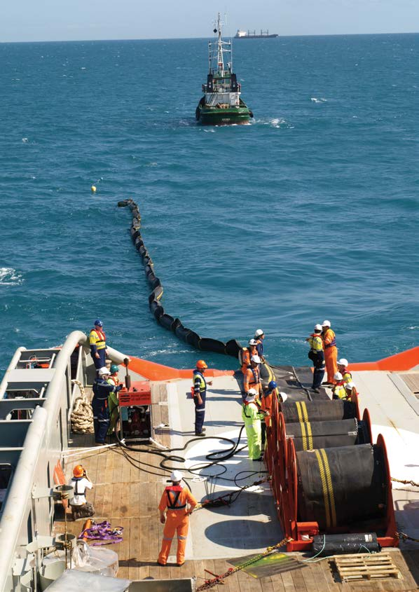

---
## Page 50

National Plan for Maritime Environmental Emergencies – 2020 edition
36
4.1 Scope of preparedness
Preparedness within the scope of the National Plan refers to those activities undertaken to 
plan and prepare for marine pollution incidents. Key components of preparedness include:
•	
contingency planning
•	
community awareness and engagement
•	
capability development
•	
training and development
•	
capacity building and national assurance
•	
exercises, testing and reviews, and
•	
research and development.
4.2 Contingency planning
The National Plan arrangements are underpinned by contingency planning at the national, 
state, Northern Territory, regional and local level. The Commonwealth, along with each 
state and the Northern Territory, has responsibility for establishing contingency planning 
requirements within their jurisdiction and for ensuring that those plans are current and 
effective. This will be consistent with the relevant administrative or legislative requirements for 
each jurisdiction.
Together, the contingency plans provide a cascade of response measures with initial actions 
at the local level, supported and/or overseen by regional and state/Northern Territory level 
resources and management, as needed.
Guidance on contingency planning is provided by AMSA for shipping incidents and NOPSEMA 
for offshore petroleum activities. States emergency management arrangements can also 
provide guidance or templates.

---
## Page 51

37
National Plan for Maritime Environmental Emergencies – 2020 edition
Part four
4.3 Community awareness and engagement
Community engagement (including education) is a core component of the National Plan 
arrangements.Effective engagement is essential to engendering public confidence in the 
National Plan at all levels.Within the context of maritime environmental emergencies, 
community engagement has the following objectives:
•	
educating and engaging with the community about the nature of the threat, the potential 
impacts resulting from maritime environmental emergencies and the operational 
constraints upon response actions
•	
 developing the community’s understanding of the National Plan arrangements at national, 
state/ Northern Territory and local levels, and
•	
 promoting the reporting of marine pollution incidents.
The National Plan assigns the following responsibilities in relation to engagement:
•	
AMSA is responsible for the development of a community education strategy in relation to 
the national maritime arrangements
•	
 Governments are responsible for the development of community education strategies in 
relation to their jurisdiction, and
•	
 Control Agencies should ensure that contingency plans have effective arrangements for 
community engagement during planning, response and recovery operations, including 
processes for social media monitoring, briefings and warnings.

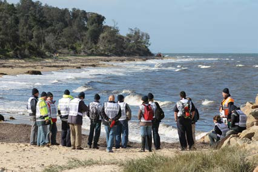

---
## Page 52

National Plan for Maritime Environmental Emergencies – 2020 edition
38
Volunteer management
The National Plan recognises that, similar to other types of events, during a maritime 
environmental emergency many people from the community may spontaneously volunteer 
assistance and support. Offers are likely from both organised volunteer groups as well as 
individual members of the public.
The social, community engagement and resource benefits of volunteer use within the 
response needs to be assessed against the administration, training, welfare and safety 
obligations of the Control Agency.
Jurisdictions may consider the use of volunteers. Arrangements may be included in respective 
contingency plans. Further information on volunteer management can also be found in the 
National Plan Volunteer Management Advisory document.

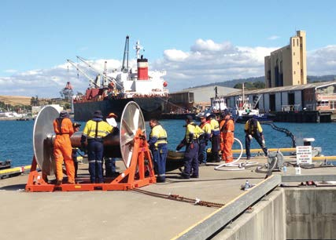

---
## Page 53

39
National Plan for Maritime Environmental Emergencies – 2020 edition
Part four
4.4 Capability development
Response personnel
National Response Team
The National Response Team (NRT) is comprised primarily of highly qualified, trained 
and experienced state/Northern Territory and maritime industry personnel ready and able 
to support pollution response operations around the country. The NRT is managed in 
cooperation with all jurisdictions, which nominate members to meet the needs of both incident 
management and operations.
The NRT is managed in accordance with the National Response Team Policy, approved by 
the National Plan Strategic Coordination Committee with activation of the NRT by AMSA.
State and Northern Territory response teams
The jurisdictions have response teams within their respective jurisdictions.
The arrangements for these response teams should be outlined within the state and Northern 
Territory contingency plans.
AMOSC Core Group
The petroleum industry ready response group is called the Core Group and operates under 
the AMOSPlan to support level 2 and level 3 oil spill responses. The Core Group includes 
three levels of response expertise: Incident Controller Advisors; Spill Managers; and Field 
Operators.
All of these are petroleum industry personnel working for AMOSC member companies. Each 
member company has a Core Group supervisor who is the primary point of contact for any 
Core Group matter.
The Core Group and the NRT operate together during a spill response and conduct regular 
joint training and exercises. While primarily focussed on petroleum industry spill response, the 
Core Group is also available to the National Plan to support other spill responses.
AMOSC members can activate the Core Group directly with AMOSC. All other National Plan 
stakeholders may request Core Group support through AMSA.

---
## Page 54

National Plan for Maritime Environmental Emergencies – 2020 edition
40
Response equipment
The National Plan applies a cascade response to the supply of response equipment, which 
is held nationally, regionally and locally. Under agreed arrangements, each jurisdiction is 
responsible for ensuring that there are sufficient stocks of equipment available to them within 
the cooperative arrangements, to address the risks within their area of responsibility.
National Plan strategic equipment stockpiles
AMSA maintains nine strategic equipment stockpiles of marine pollution response equipment 
around the Australian coastline. Stocks of dispersant are stored at these stockpiles as well 
as other key locations. The petroleum industry, through AMOSC, maintains stockpiles at four 
locations. Figure 6 shows the location of these stockpiles.
Figure 6 – Locations of national equipment stockpiles

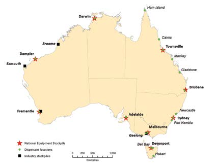

---
## Page 55

41
National Plan for Maritime Environmental Emergencies – 2020 edition
Part four
The location and composition of the AMSA national stockpiles is based on the following principles:
•	
 the purpose of the AMSA national stockpiles is to supplement the local and regional 
resources of the jurisdictions and industry
•	
 the establishment of an AMSA national stockpile in a given location does not reduce any 
requirement for jurisdictions and industry to maintain their own equipment stocks
•	
 the location of the national stockpiles is determined through assessment of risk and 
logistical considerations
•	
 all areas identified as high and very high risk will be capable of supply by road transport 
from a national stockpile within a maximum of 24 hours
•	
 each stockpile location will be able to be supplemented by road transport from a minimum 
of one other national stockpile within a maximum of 48 hours.
AMSA maintains an accessible database of its national equipment holdings that records 
current location and serviceability information.
Petroleum industry equipment stockpiles
The petroleum industry contributes to the National Plan via the AMOSPlan. AMOSC holds 
stockpiles of equipment and dispersant at various locations, with its largest stockpile at Geelong, 
Victoria.
Small equipment holdings are held by a number of companies and these are generally available 
to other AMOSC members through the mutual aid arrangements of the AMOSPlan. AMOSC 
also contributes to the National Plan through joint funding of the aerial dispersant capability and 
other preparedness and training services.
States and Northern Territory
The jurisdictions maintain sufficient stocks of response equipment to manage an oil spill incident 
within their jurisdiction based on their current risk assessment and oil spill contingency plan. The 
composition and location of these stockpiles should be based on an assessment of the risk for 
that jurisdiction.
The relevant jurisdiction contingency plans detail the arrangements for the deployment of these 
response resources.
Local – ports, oil and chemical terminals
The operators of ports, maritime facilities, oil and chemical terminals are normally a designated 
Control Agency and have a responsibility for maintaining appropriate equipment stocks 
commensurate with the risks posed by their operations, and access to sufficient trained personnel 
to effectively deploy that equipment. These control agencies should at a minimum maintain stocks 
of equipment or cooperative arrangements for the supply of such equipment, sufficient to maintain 
response operations until such time as other resources can be deployed in support. This is 
generally referred to as the first-strike capability and will vary from location to location.
Each jurisdiction is responsible for determining the capability required by a local control agency.

---
## Page 56

National Plan for Maritime Environmental Emergencies – 2020 edition
42
Offshore petroleum activities
The offshore petroleum sector has responsibilities to clean-up oil spills from their activities. 
This requires titleholders to have appropriate emergency response arrangements that 
guarantee access to response capability commensurate with the risks from their activities.
Offshore petroleum sector/AMSA memorandum of understanding
AMSA and a number of titleholders and/or operators of offshore petroleum facilities have 
entered into Memorandum of Understandings (MOUs) setting out their respective roles and 
responsibilities when responding to a marine pollution incident.
For marine pollution incidents from offshore petroleum facilities, requiring regional or national 
level support, AMSA will support the operator in the operator’s Control Agency role. AMSA 
will provide services and resources under its direct control, including technical and response 
advice, services, equipment, personnel and contractors. AMSA will also coordinate National 
Plan response equipment and resources, response and advisory services and personnel.
For all other marine pollution incidents in Commonwealth waters, including those from ships 
and offshore petroleum activities that are not related to offshore petroleum facilities, AMSA 
has Control Agency responsibility.
Fixed Wing Aerial Dispersant Capability
AMSA manages the Fixed Wing Aerial Dispersant Capability (FWADC) on behalf of National 
Plan stakeholders. The FWADC was developed in conjunction with and is jointly funded by 
AMOSC.
The FWADC maintains aircraft in strategic locations around the Australian coastline and 
provides airbase management and loading support arrangements.
The FWADC is activated by AMSA, on the request of the relevant state/Northern Territory 
Incident Controller or AMOSC, in accordance with the Activation of the Fixed Wing Aerial 
Dispersant Capability Guidance. Control Agencies implementing a fixed wing aerial dispersant 
operation should have regard to the Concept of Operations contained within the Guidance.

---
## Page 57

43
National Plan for Maritime Environmental Emergencies – 2020 edition
Part four
Oil spill control agents
Oil spill control agents (OSCAs) refer to products that are applied to floating or stranded oil 
to minimise their overall impact to the environment. Oil spill dispersants, loose sorbents and 
surface cleaners are examples of commonly used OSCAs.
The National Plan’s approach to the usage of oil spill control agents involves four key elements:
•	
acceptance for use within Australian waters in shipping pollution incidents in accordance 
with the National Plan Register of Oil Spill Control Agents for Maritime Response Use. 
Acceptance for activity specific use in offshore petroleum pollution incidents in accordance 
with an accepted environment plan for the activity3
•	
 logistics through National Plan and petroleum industry stockpiles, equipment and 
capability to use the OSCAs in a spill response
•	
 approval to use the OSCA in a specific response from the Incident Controller and any 
regulatory authorities. Individual contingency plans should detail the dispersant approval 
process, and
•	
 monitoring of the spill to determine the need to use the OSCA and of its effectiveness as 
part of response phase monitoring.
3 For further information see NOPSEMA/AMSA joint guidance on Australian dispersant acceptance processes
Photograph courtesy of Lovegreen Photography
Environmental, scientific and technical advice
Contingency plans should include arrangements for environmental, scientific and technical 
advice within the incident management team, including ensuring that both the advice and 
associated services are integrated across planning and response.
Preparedness requires the development and deployment of decision support tools (see 
section 5.5).

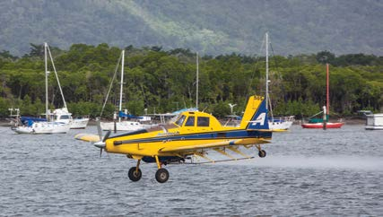

---
## Page 58

National Plan for Maritime Environmental Emergencies – 2020 edition
44
4.5 Training and development
The training and development of response personnel is a core component of the National Plan 
arrangements. The National Plan identifies three broad levels of training:
•	
 Level 1 – operator level personnel, i.e. those undertaking onsite clean-up operations. In a 
major incident this would also include supervisors appointed as site managers
•	
 Level 2 – middle management personnel responsible for managing the operational 
response, e.g. incident controllers, their deputies, technical advisers (environment, 
science, etc.), and Fire Brigade (hazardous materials) specialists
•	
 Level 3 – senior government and industry personnel responsible for high-level decision 
making in the management of oil or HNS spill incidents.
National training program
AMSA is responsible for the delivery of response management training (Level 2 and 3) for 
National Plan stakeholders. AMSA delivers base level training in incident management and 
specialised training in planning, operations, logistics and incident control. All courses are 
delivered under the AMSA Registered Training Organisation in line with the requirements of 
the Australian Qualifications Framework.
AMSA also supports the development of response personnel through the delivery of specialist 
annual workshops for Environment, Science and Technical (ES&T) Network, Incident 
Controllers and senior personnel.
State and Northern Territory training
The jurisdictions are responsible for their own Level 1 Training. This training may include 
courses on equipment operation and shoreline response, as well as the delivery of finance 
and administrative services. Other training programs such as oiled wildlife response, may be 
provided through relevant statutory agencies. Some States also provide higher level training.
Petroleum industry training
As part of the National Plan arrangements, AMOSC provides oil spill response training for the 
petroleum industry.
AMOSC has been accredited (through the Nautical Institute, UK) to conduct IMO OPRC 
training (Field Responder, Supervisor and On Scene Commander, and Senior Manager 
respectively) and delivers courses designed specifically on marine oil spill response and 
delivered for the petroleum industry. Apart from the core IMO training, AMOSC also conducts 
specialist courses such as aerial surveillance, oiled wildlife response and company-specific 
courses.

---
## Page 59

45
National Plan for Maritime Environmental Emergencies – 2020 edition
Part four
4.6 National Plan exercises
Exercises form a core component of the arrangements for preparedness under the National 
Plan. Effectively planned and conducted exercises enable agencies to evaluate contingency 
plans and operating procedures, develop key response personnel and reinforce the 
stakeholder engagement necessary to respond during incidents.
Each jurisdiction is responsible for ensuring that there is an effective exercise programme for 
their area of responsibility.
Conduct of exercises
National Plan exercises will be conducted consistent with the principles outlined in the 
Australian Emergency Management Handbooks prepared by the Commonwealth Attorney-
General’s Department.
National exercise
The national response capability will be exercised on an annual basis, with the exercise 
location changing each time. The national exercises will include Commonwealth, state and 
Northern Territory and petroleum industry representation in the planning and conduct of the 
exercise.

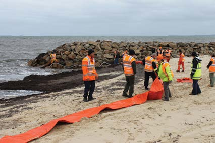

---
## Page 60

National Plan for Maritime Environmental Emergencies – 2020 edition
46
4.7 Research and development
The objective of research and development in the context of maritime environmental 
emergencies is to identify, analyse and apply knowledge and information to enable the 
continuous improvement of the national response arrangement. Research and development 
should be the foundation of the National Plan arrangements. All National Plan jurisdictions 
have a responsibility to identify, support and resource research and development priorities. 
Industry is also encouraged to actively contribute to spill response research and development 
activities.

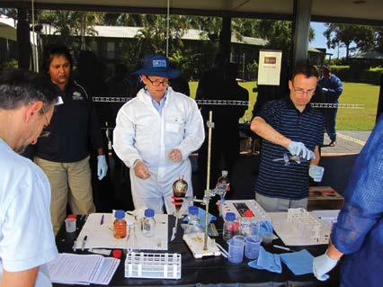

---
## Page 61

47
National Plan for Maritime Environmental Emergencies – 2020 edition
Part five
Responding to 
marine pollution 
incidents

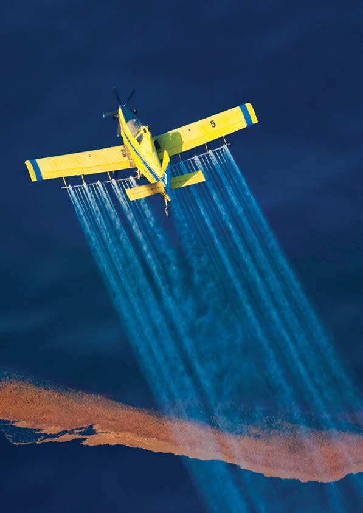

---
## Page 62

National Plan for Maritime Environmental Emergencies – 2020 edition
48
5.1 Scope of response
Response within the scope of the National Plan refers to the management of operations 
directed to coordinate and control a marine pollution incident. The aim of response operations 
is to minimise the impacts of marine pollution from vessels, maritime facilities and oil 
and chemical terminals, and offshore petroleum facilities upon the Australian community, 
environment, economy and infrastructure.
Arrangements for response are generally detailed within jurisdictional, regional and local 
contingency plans. The National Plan outlines those national arrangements that support these 
contingency plans.
5.2 Incident Management System
The Incident Management System implemented by the National Plan for the management 
of marine pollution incidents is consistent with the Australasian Inter-service Incident 
Management System (AIIMS). The system is designed to be adaptable to the individual 
circumstances of the incident or the particular agencies involved.
The Incident Management System4 for pollution response is based on the five fundamental 
principles of AIIMS:
•	
 flexibility – the system can be applied across the full spectrum of incidents and agencies
•	
 functional management – the response organisation should be structured in accordance 
with the actual work to be performed during the incident or different phases of the incident
•	
 management by objectives – the process whereby the Incident Controller sets desired 
outcomes for the incident for the purpose of ensuring all responders understand the 
direction being taken during the response
•	
 unity of command – the response organisation should work to one set of common 
objectives and each individual should report to only one supervisor, and
•	
 span of control – refers to the number of individuals or functions that can be 
successfully managed by one person.
4 Although the principles of AIIMS imply a generic organisational structure, a Control Agency will need to 
determine an applicable organisational structure for each incident. Therefore, a generic organisational 
structure has not been included.

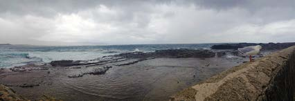

---
## Page 63

49
National Plan for Maritime Environmental Emergencies – 2020 edition
Part five
The National Plan Incident Management System Policy applies the AIIMS approach to a 
marine pollution response context. However, it is the responsibility of the Control Agency 
to determine how the system will be implemented within the relevant contingency plans. 
Control Agencies should however consider the following critical concepts when undertaking 
contingency planning:
•	
adaptability and scalability – the size and structure of the incident management team 
should reflect the complexity of the incident and change to reflect the various stages of 
response and recovery
•	
 uniform terminology – the Control Agency should consider the multi-agency aspect of 
significant marine pollution incidents and endeavour to maintain consistent terminology to 
minimise communications issues
•	
 a defined management structure – the management structure, and respective roles and 
responsibilities of individuals, should be defined in a way that can be clearly communicated 
and applied
•	
 common operating picture – ensuring the management system can produce a shared 
and consistent understanding of the incident and maintain situational awareness, and
•	
 clearly defined information flows – clear definition of reporting relationships and 
information flows between individuals and sections within the response organisation.
Incident classification
The National Plan recognises that the majority of incidents are managed locally. However, there is 
a need to ensure that as an incident increases in size and/or complexity, the management system 
can adapt to meet these additional demands. Consistent with international practice, the National 
Plan classifies incidents so as to provide direction on the potential consequence and impact of 
the incident and to provide guidance for agency readiness levels, incident notifications, response 
actions and potential response escalation.
The National Plan identifies three levels of incidents as follows:
•	
Level 1 Incidents are generally able to be resolved through the application of local or 
initial resources only (e.g. first-strike capacity)
•	
Level 2 Incidents are more complex in size, duration, resource management and risk and 
may require deployment of jurisdiction resources beyond the initial response
•	
Level 3 Incidents are generally characterised by a degree of complexity that requires the 
Incident Controller to delegate all incident management functions to focus on strategic 
leadership and response coordination and may be supported by national and international 
resources.
Consistent with AIIMS, the National Plan employs a scalable approach to incident 
classification, noting that simple thresholds pose the risk of arbitrary decisions.

---
## Page 64

National Plan for Maritime Environmental Emergencies – 2020 edition
50
Table 5 provides a non-exhaustive list of the general characteristics of each of the three 
levels. These characteristics can be used to develop criteria to be considered when evaluating 
the need  to escalate response arrangements. These criteria should be embedded within 
the relevant contingency plan or adapted to the specifics of an individual incident. Not all 
characteristics need to apply in all cases, or to all incidents.
 
Table 5 – Guidance for incident classification
Characteristic
Level 1
Level 2
Level 3
MANAGEMENT
Jurisdiction
Single jurisdiction
Multiple jurisdictions
Multiple jurisdictions, 
including international
Delegation
Incident Controller 
responsible for all 
functions
Some functions 
delegated or Sections 
created
All functions delegated 
and/or divisions created
Number of agencies
First-response agency
Routine multi-agency 
response
Agencies from across 
government and 
industry
Incident Action Plan
Simple/Outline
Outline
Detailed
Resources
Resourced from within 
one area
Requires intra-state 
resources
Requires national or 
international resources
TYPE OF INCIDENT
Type of response
First-strike
Escalated
Campaign
Duration
Single shift
Multiple shifts Days to 
weeks
Extended response 
Weeks to months
Hazards
Single hazard
Single hazard
Multiple hazards
RESOURCES AT RISK
Human
Potential for serious 
injuries
Potential for loss of life
Potential for multiple 
loss of life
Environment
Isolated impacts or 
with natural recovery 
expected within weeks
Significant impacts 
and recovery may take 
months. Remediation 
required
Significant area and 
recovery may take 
months. Remediation 
required
Wildlife
Individual fauna
Groups of fauna or 
threatened fauna
Large numbers of 
fauna
Economy
Business level 
disruption
Business failure
Disruption to a sector
Social
Reduced services
Ongoing reduced 
services
Reduced quality of life
Infrastructure
Short term failure
Medium term failure
Severe impairment
Public Affairs
Local and regional 
media coverage
National media 
coverage
International media 
coverage

---
## Page 65

51
National Plan for Maritime Environmental Emergencies – 2020 edition
Part five
5.3 Response initiation
The National Plan is a strategic standing arrangement and will be implemented in the event 
of a maritime environmental emergency. When a decision is made to respond to a maritime 
environmental emergency, response arrangements appropriate to the jurisdiction and incident 
type will be activated.
Contingency plans should detail the procedures for initiating a response to a marine pollution 
incident, including:
•	
 initiation triggers
•	
 required actions, and
•	
 responsibilities of key agencies and personnel.
Principles for response initiation
Timely initiation of a response is critical to achieving an effective outcome from an operation.  
A response should be initiated where there is a need to:
•	
 monitor the incident, potential or actual, and
•	
 implement measures to mitigate the impacts of the incident.
The National Plan recognises that pre-emptive or precautionary response operations may 
be necessary to ensure that the environmental or broader community interests are protected 
or where it is considered that the local resources may be insufficient to address a significant 
threat. The National Plan supports Control Agencies applying the principle of prudent over-
escalation when considering the initial response to an incident. This principle recognises 
that it is more effective to scale down an initial response than to scale up following an under-
reaction.
Accessing the National Plan’s supporting arrangements
The Control Agency can at any time access the National Plan’s supporting arrangements 
to assist with response operations. The resources of all National Plan and AMOSPlan 
stakeholders are available to support the Control Agency on request.
Access to the National Plan arrangements is via a formal request from the Control Agency to 
AMSA, initially verbally through the ARC, and then confirmed in writing.
AMSA will coordinate the resources of the National Plan in support of the Control Agency.

---
## Page 66

National Plan for Maritime Environmental Emergencies – 2020 edition
52
5.4 Response escalation
Incidents are dynamic and may change over time and space. During an incident there may 
be a need to upscale the response for a range of reasons. This is referred to as escalation 
and may involve increased support to a Control Agency or a change in Control Agency. At all 
levels (oil and chemical terminals, maritime facilities, ports, state/Northern Territory, offshore 
platform, etc.), contingency plans, inter-agency and inter-jurisdictional agreements, and 
incident action plans should document when and how response escalation should occur.
The National Plan implements a scalable approach to response management. This approach 
provides for the orderly progression from local response operations to incidents requiring 
international assistance.
Change of Control Agency is one form of response escalation. The National Plan includes 
a Change of Control Agency Protocol Guidance where such arrangements are not already 
part of existing disaster and emergency management or regulatory arrangements. Section 
2.5 outlines the circumstances for change of Control Agency during an emergency of national 
consequence.

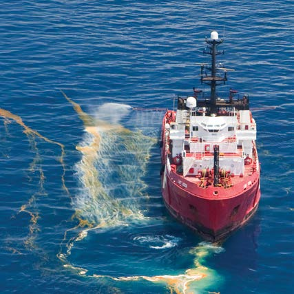

---
## Page 67

53
National Plan for Maritime Environmental Emergencies – 2020 edition
Part five
5.5 Assessment and decision support
Environmental, scientific and technical advice
Environmental, scientific and technical advice is essential to make informed and effective 
decisions regarding the establishment of response objectives and the selection of the most 
appropriate response strategies and tactics. This advice should be incorporated at all levels of 
incident management and may include:
•	
direct advice to the Incident Controller
•	
integration into the planning section to inform the development of the incident action plan, 
and
•	
support in the field to response operations.
AMSA on behalf of the National Plan and its stakeholders maintains numerous support tools 
for use in an incident. These tools, which are supplied by AMSA on the request of the Control 
Agency include:
•	
Trajectory Modelling that identifies speed of movement, weathering and spreading 
characteristics of the pollutant under the influence of prevailing currents and weather 
conditions. The modelling capability is activated by AMSA, on the direct request of the 
relevant Incident Controller or AMOSC, in accordance with the National Plan website.
•	
Response Phase Monitoring assesses the effectiveness of response strategies. 
Contingency plans should include arrangements for the implementation of response 
phase monitoring at the earliest stages of the response operation. The CSIRO Oil 
Spill Monitoring Handbook provides advice to Control Agencies on the scope and 
implementation of monitoring activities in support of response operations
•	
Geographic Information Systems are computer based mapping tools that identify 
threatened environmental and community resources, logistical information (roads, etc.) 
and any other information relevant to preparing and responding to marine pollution 
incidents. The jurisdictions are responsible for the maintenance of spatial information and 
manage access to their information.
•	
Memoranda of understanding and contracts exist with technical and scientific agencies 
to provide expert capability to support National Plan stakeholder needs.

---
## Page 68

National Plan for Maritime Environmental Emergencies – 2020 edition
54
5.6 Oil spill response
The National Plan arrangements support the implementation of a number of response 
strategies, including (but not restricted to):
•	
monitoring and assessment
•	
control and recovery
•	
application of oil spill control agents
•	
shoreline clean-up and remediation, and
•	
response to impacted or threatened wildlife.
The National Plan does not give priority to a single strategy, but acknowledges that a 
combination of strategies is required to effectively manage an oil pollution incident. The 
relevant contingency plan should set out the strategies to be employed in a response 
operation.
Control Agency
The Control Agency for an oil spill response is the government agency or company 
assigned by legislation, administrative arrangement or within the relevant contingency plan 
to control response activities to an oil spill. Table 6 provides a high level summary of the 
Control Agencies for oil spill incidents. While the Control Agency is responsible for control 
of response activities, including appointing the Incident Controller, the Control Agency may 
have arrangements in place for another government agency or company to provide oil spill 
response services during an emergency.

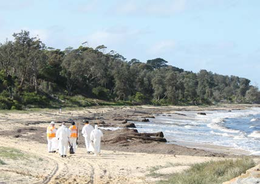

---
## Page 69

55
National Plan for Maritime Environmental Emergencies – 2020 edition
Part five
Table 6 – Control Agencies for oil pollution incidents
Area
------
source
Oil   
terminal or 
state govt 
agency
Sole-user 
maritime 
facility 
for oil 
terminal
Multi-user 
maritime 
facility
Port 
waters
State 
waters
Commonwealth waters
Shipping 
sourced 
spill
Offshore 
petroleum 
facility
First Strike 
/ Level 1
Oil terminal 
operator or 
state govt 
agency
Oil terminal 
operator
Maritime 
facility 
owner
Port 
authority
or
state govt 
agency
Offshore 
petroleum 
facility 
titleholder
or
state govt 
agency
AMSA
Titleholder
Levels 2 
and 3
Port 
authority or 
state govt 
agency
Port 
authority or 
state govt 
agency
Port 
authority or 
state govt 
agency
Great Barrier Reef Marine Park – for any spills the Control Agency is the Queensland Government
New South Wales – whilst a terminal operator is expected to respond to Level 1 incidents; the Port 
Authority or Roads and Maritime is the Control Agency for all incidents in State waters.
Torres Strait – for any spills into the area defined within TorresPlan the Control Agency is the 
Queensland Government.
External territories:
Australian Antarctic
• for any spills within station limits of the Australian Antarctic the Australian Antarctic Division 
(represented by the relevant Station Leader) is the Control Agency and Incident Controller for level 
1 and 2 responses.
• AMSA is the Control Agency outside Station waters and will appoint an Incident Controller to lead 
any response. AMSA will also act as the Control Agency for level 3 responses.
Norfolk Island 
• For any spills into Commonwealth waters around Norfolk Island, including into the Norfolk Island 
port area, the incident controller is appointed by AMSA. 
Christmas Island
• for any spills into Christmas Island ports areas the Harbour Master is the Incident Controller
• for any spills into Commonwealth waters around Christmas Island, the Incident Controller is 
appointed by AMSA.
Cocos (Keeling) Islands
• in accordance with its Service Delivery Agreement with the Commonwealth the WA Department of 
Transport will be appointed Incident Controller for Level 1 spills outside Port Waters.
• for Level 2 and 3 responses AMSA will act as Control Agency and Incident Controller.
*for further information on Roles and Responsibilities refer to associated Contingency Plan.
Notes relating to Table 6
To avoid uncertainty, a vessel at a Maritime Facility with a line ashore is subject to the relevant Control Agency 
arrangements indicated for a Maritime Facility and not the arrangements indicated for Port Waters.
In the case of controlled Naval waters, the local Naval authority will contain and clean up all spills that 
can be safely and effectively managed using available Naval equipment. The Harbour Master is to be 
informed at the first opportunity. Where there is doubt that local Naval resources are sufficient, the Naval 
authority will contact the Harbour Master immediately for assistance. Costs incurred by local authorities 
responding to oil spills from Naval assets shall be borne by the Royal Australian Navy.

---
## Page 70

National Plan for Maritime Environmental Emergencies – 2020 edition
56
Definitions – for Table 6 only
First strike means a prompt initial response to protect the environment that is intended to limit the 
effect of an incident until such time as other resources can be deployed in support. This capability 
may vary from location to location.
Oil terminal means a petroleum refinery and/or petroleum storage/distribution facilities with access 
to a maritime facility, but not including the maritime facility.
Maritime facility means a wharf or mooring at which a vessel can be tied up during the process of 
loading or unloading a cargo [or passengers]. A maritime berth may be a sole user berth [such as a 
dedicated berth for an oil refinery] or may be a multi-user berth [such as a berth that handles general 
cargo, or one that handles bulk liquids such as petroleum for more than one user of the berth 
(sometimes known as a common-user berth)].
Oil terminal operator means a company [or joint venture] that operates an oil terminal.
Port waters has the same meaning as in s.12 of the Maritime Transport and Offshore Facilities 
Security Act 2003 and includes:
	
a) areas of water, between the land of the port and the open waters outside the port, intended for 
use by ships to gain access to loading, unloading or other land-based facilities; and
	
b) areas of open water intended for anchoring or otherwise holding ships before they enter areas 
of water described in paragraph (a); and
	
c) areas of open water between the areas of water described in paragraphs (a) and (b).
Coordination of the national support arrangements
AMSA will coordinate the national arrangements in support of a Control Agency’s response 
operation. These arrangements include:
•	
	deployment of the National Plan Strategic Equipment Stockpiles
•	
	deployment of the Fixed Wing Aerial Dispersant Capability
•	
	deployment of AMSA and National Response Team personnel
•	
	providing support services including trajectory modelling, remote sensing and aerial 
surveillance; and
•	
	providing technical and other advice.
The national arrangements are detailed elsewhere within the National Plan and the activation 
arrangements are contained within the relevant guidance document.
Coordination of petroleum industry arrangements
The relevant petroleum company will coordinate all resources and contracts required to support 
their response to a marine spill from their vessel, oil terminal or offshore facility. The company will 
generally utilise their own resources in the first instance and AMOSPlan will be used to facilitate 
the provision of AMOSC resources and the provision of mutual aid from other industry members. 
Titleholders and other industry control agencies have access to National Plan resources through 
AMOSC; through AMSA under an offshore petroleum sector/AMSA MOU (see section 4.4, on 
page 46 or their jurisdictional authority).

---
## Page 71

57
National Plan for Maritime Environmental Emergencies – 2020 edition
Part five
5.7 Hazardous and noxious substance response
As Party to the OPRC-HNS Protocol, Australia has an obligation to prepare for, and respond 
to, a pollution incident by hazardous and noxious substances (see Table 2 on Page 19).  
However, as a result of the broad range of properties, behaviours, potential for health effects, 
environmental impacts and damage to a vessel from HNS, the response to these incidents 
requires skills, knowledge, experience and equipment, which are different to oil spill response. 
However, it should be noted that some oils may present similarly to HNS and need to be 
responded to accordingly. Where appropriate, National Plan tools and support services, such 
as chemical dispersion modelling, will be available to HNS responses.
The National Plan arrangements for HNS response is based on cooperation with the 
emergency services, in particular the hazardous materials response units within fire and 
rescue services.
Control Agency
The Control Agencies for HNS incidents are listed in Table 7. 
Table 7 – Control Agencies for HNS incidents
Chemical terminal
Port
Outside a port
Commonwealth
n/a
Port authority
AMSA
New South Wales
Port Authority or Fire 
and Rescue NSW
Roads and Maritime 
Services or the Port 
Authority of NSW
Roads and Maritime 
Services or the Port 
Authority of NSW
Northern Territory
Fire and Rescue 
Service
Port authority
Department of 
Transport
Queensland
Chemical terminal 
operator
Maritime Safety 
Queensland
Maritime Safety 
Queensland
South Australia
Metropolitan Fire 
Service
Port authority
Department of 
Planning, Transport 
and Infrastructure
Tasmania
Tasmania Fire Service
Tasmania Fire Service
Tasmania Fire Service
Victoria
Chemical terminal 
operator / Fire agencies
Fire agencies
Fire Agencies
Western Australia
Department of Fire and 
Emergency Services
Department of Fire and 
Emergency Services
Department of Fire and 
Emergency Services
Great Barrier Reef 
Marine Park
Chemical terminal 
operator
Maritime Safety 
Queensland
Maritime Safety 
Queensland
Indian Ocean Territories
n/a 
Harbour Master
AMSA
Norfolk Island
n/a 
Norfolk Island Regional 
Council 
AMSA

---
## Page 72

National Plan for Maritime Environmental Emergencies – 2020 edition
58
Levels of HNS response
The National Plan is based around three distinct levels of HNS Response:
•	
	advisory – the focus of the advisory service is to provide an assessment of the risks to health, 
immediate response advice and an assessment of the need for additional assistance to a 
vessel’s crew. AMSA maintains arrangements with relevant hazmat agencies for the provision 
of hazardous materials advice on a 24/7 basis. This service complements State and Northern 
Territory arrangements
•	
	shipboard response – the objective of a shipboard response capability is to provide rapid 
intervention in order to contain an incident to a vessel and prevent damage to the vessel or 
loss of material into the environment where possible
•	
	major incident response – in a very small number of situations, it may be beyond the 
capability of a shipboard response and the relevant Control Agency to contain the material 
to the vessel. In these situations, which may result in the loss of material into the marine 
environment, a full response under the National Plan will be launched similar to an oil spill.
Responsibilities
The states and Northern Territory are responsible for establishing arrangements for HNS response 
within their jurisdiction.
AMSA is responsible for the development and maintenance of HNS response capability within the 
Commonwealth’s jurisdiction. These arrangements are detailed within the Guideline on National 
Hazardous and Noxious Substance Response. AMSA will offer states/NT the opportunity to use 
Commonwealth arrangements on request.
For both Commonwealth and state/Northern Territory jurisdictions, the development of HNS 
response capability should be undertaken in consultation with all relevant agencies and industry, 
and should define relevant Control Agencies and address each response phase.

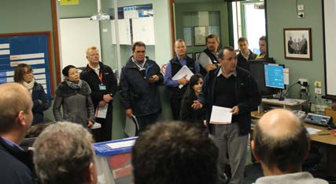

---
## Page 73

59
National Plan for Maritime Environmental Emergencies – 2020 edition
Part five
5.8 Health and safety
The safety of all people (responders and the 
community) in all activities is the highest priority. 
This includes training, exercising, procuring 
equipment or conducting an operational 
response activity under the National Plan.
In order to meet this principle, safety should 
be managed in accordance with a safety 
management system detailed within the 
relevant contingency plan.
5.9 Wildlife response
Each jurisdiction is responsible for ensuring 
that there are effective wildlife response 
arrangements within their jurisdiction. These 
arrangements should be detailed within the 
relevant contingency plans, including the 
identification of the lead agency for these 
operations. In line with support for other oil 
spill response contingency systems, the 
National Plan also provides support to state 
and Northern Territory wildlife response 
arrangements.
5.10 Waste management
Oil and HNS spills in the marine environment 
can result in the production of large quantities 
of waste that require temporary storage, 
transport, management and ultimately 
treatment and disposal.
Each jurisdiction has appropriate legislation 
detailing the requirements for the management 
and disposal of waste materials. Under the 
National Plan, wastes generated in a response 
are managed in accordance with that 
jurisdiction’s regime.

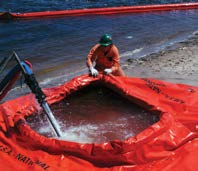

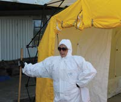

---
## Page 74

National Plan for Maritime Environmental Emergencies – 2020 edition
60
5.11 Response termination
The Control Agency is responsible for the decision to terminate response operations. This 
decision should be informed by advice from a range of stakeholders identified in relevant 
contingency plans, including the agency with jurisdictional authority.
Contingency plans should include processes for the termination of response operations. 
The Guidance for Response, Assessment and Termination of Cleaning for Oil Contaminated 
Foreshores offers direction to agencies and other stakeholders when considering response 
termination.
5.12 Post incident response analysis
Post incident analysis, incorporating a review and reporting on the operational response to 
a maritime environmental emergency assists with continuous improvement of both people 
and organisations. Key to this is engaging and sharing within and across organisations and 
jurisdictions.
Under the National Plan, each jurisdiction is responsible for reviewing and reporting to other 
National Plan stakeholders on their spill responses and exercises. In practice, post incident 
analysis is conducted in accordance with the Conduct of Post Event and Incident Analysis 
Guidance, which is consistent with the Lessons Management Handbooks published as part of 
the Australian Emergency Management Handbook Series.

---
## Page 75

61
National Plan for Maritime Environmental Emergencies – 2020 edition
Part six
Recovering from 
marine pollution 
incidents

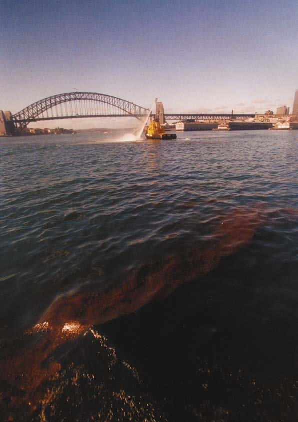

---
## Page 76

National Plan for Maritime Environmental Emergencies – 2020 edition
62
6.1 Scope of recovery
Recovery is part of emergency management, which includes the broader components of 
prevention, preparedness and response. Recovery is the coordinated process of supporting 
affected communities in the reconstruction of their built environment and the restoration of 
psychological, social, economic, built and natural environment wellbeing. Recovery activities 
generally commence during the response phase and often continue after response activities 
have concluded.
Recovery is characterised by a complex array of issues and involves a broad range of 
organisations and stakeholders. Recovery programmes and processes can have a lasting 
impact on the community and are often time consuming and costly in terms of financial and 
other resources.
Under the National Plan, recovery refers to three distinct processes:
•	
recovery of costs for organisations involved in response arrangements or communities 
that suffer loss resulting from pollution
•	
rehabilitation of the environment
•	
return of an affected socio-economic community to its pre-incident level of functioning.
In relation to recovery of costs for organisations involved in response arrangements, further 
information is provided in part seven.
In relation to environmental rehabilitation, recovery operations aim, as far as possible, to 
return the environment to its pre-incident condition or to a state that is considered to be an 
acceptable environmental outcome to jurisdictional authorities and key stakeholders.
The National Plan recognises the need to return an affected socio-economic community to 
its proper level of functioning, but acknowledges that jurisdictions already have established 
emergency arrangements to achieve this. These matters are addressed in more detail below.

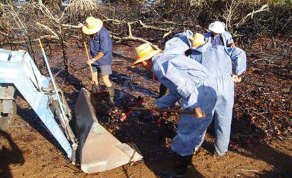

---
## Page 77

63
National Plan for Maritime Environmental Emergencies – 2020 edition
Part six
6.2 Principles for recovery
Disaster recovery is part of emergency management, which includes the broader components 
of prevention, preparedness and response. Planning for recovery is integral to emergency 
preparation and mitigation actions may often be initiated as part of recovery. 
The National Plan is underpinned by the National Principles for Disaster Recovery, which 
was endorsed by the Social Recovery Reference Group in February 2019. The relationship 
between the principles are equally critical to ensure effective recovery. The principles are: 
•	
Understand the context – successful recovery is based on understanding community 
context, with each community having its own history, values and dynamics: 
•	
 Recognise complexity – Successful recovery is responsive to the complex dynamic 
nature of both emergencies and the community; 
•	
 Using community-led approaches – Successful recovery is community-centred, 
responsible and flexible, engaging with community and supporting them to move forward; 
•	
 Coordinate all activities – Successful recovery requires planned, coordinated and 
adaptive approach, between community partner agencies, based on continuing 
assessment of impacts and needs. 
•	
 Communicate effectively – Successful recovery is built on effective communication 
between the affected community and other partners; and 
•	
 Recognise and build capacity – Successful recovery recognises, supports, and builds 
on individual, community and organisational capacity and resilience. 
Further information on the principals are on the Australian Institute for Disaster Resilience 
website; or at the following link:  https://knowledge.aidr.org.au/resources/national-principles-
disaster-recovery/

---
## Page 78

National Plan for Maritime Environmental Emergencies – 2020 edition
64
6.3 Recovery functions
Typically four functions need to be addressed in the context of maritime environmental 
emergencies – environmental, economic, social and infrastructure.
The degree to which these recovery functions need to be addressed will vary from incident to 
incident.
Table 8 provides guidance on the types of activities required to address each of these 
recovery functions.
Table 8 – Recovery function activities
Environmental
Economic
Social
Infrastructure
Assessing and 
documenting the 
impact of the incident 
on natural resources
Assessing and 
documenting 
the impact of the 
incident on the local, 
regional and national 
economy
Assessing and 
documenting the 
impact to cultural and 
heritage and other 
community resources
Assessing and 
documenting 
the impact to 
infrastructure and 
services
Rehabilitating 
impacted areas 
where possible and 
measuring recovery 
over time
Support agencies 
recovering response 
costs
Rehabilitating and 
conserving impacted 
cultural and heritage 
resources where 
possible
Rehabilitating or 
returning to service 
the impacted 
infrastructure,
e.g. damaged 
navigation aids and 
restoring production
Communicating 
to the public the 
impacts of the 
incident
Facilitating the 
recovery of losses 
incurred by business 
as a result of the 
incident
Restoring community 
services as soon
as possible, e.g. 
re- opening beaches 
and boat ramps
Prioritising 
the rebuilding 
of impacted 
infrastructure
Engaging with the 
community to assist 
with the assessment 
and rehabilitation 
processes
Assisting business 
to recover from the 
intangible impacts of
the incident, e.g. loss 
of confidence in the 
fishery or tourism 
sectors
Engaging with the 
community on the 
recovery process
Engaging with 
affected stakeholders 
on the recovery 
process

---
## Page 79

65
National Plan for Maritime Environmental Emergencies – 2020 edition
6.4 Recovery arrangements and the National Plan
In addition to the general recovery arrangements, described above, maritime environmental 
emergencies can encompass additional elements which should be considered when 
developing contingency plans and undertaking response operations.
Engagement with the responsible party
The response and recovery to maritime environmental emergencies is funded on the basis 
of the ‘polluter pays’ principle (see Table 1). For recovery, this means that all stakeholders 
should have clear and early engagement with the responsible party or their representative 
(e.g. insurer). The responsible party should be represented on recovery committees to enable 
a shared ownership of the recovery plan and its implementation.
Recovery planning
Recovery should be included as part of the contingency planning process, building on 
emergency risk management studies and resource atlases. Plans should identify recovery 
management structures, actions, roles and responsibilities, and be consistent with relevant 
state, Northern Territory and Commonwealth level plans. Recovery plans and the results of 
impact assessment form the basis for detailed recovery action plans prepared following a 
maritime environmental emergency.
Recovery committee
The Recovery Committee is the strategic decision-making body for the recovery. It is formed 
when an impact assessment indicates that a formal recovery operation will be required.
In most states/NT and the Commonwealth, recovery is managed in accordance with 
established emergency management arrangements.
Recovery coordinator
Recovery Coordinators may be appointed for a recovery operation. Recovery Coordinators 
are the public face of the recovery operation, providing leadership to the Recovery Committee 
and coordinating the recovery effort in accordance with agreed recovery plans.
Transition from a response focus to a recovery focus
Recovery begins at impact and recovery arrangements are established in parallel with 
the operational response. As the response activities wind down, there should be a formal 
transition to provide more focus on recovery and to achieve an effective hand-over between 
the two incident phases.
A recovery action plan is developed by the Recovery Committee (where established) following 
a maritime environmental emergency.
Part six

---
## Page 80

National Plan for Maritime Environmental Emergencies – 2020 edition
66
The Incident Controller prepares a response transition report, in consultation with the 
Recovery Coordinator, outlining:
•	
the emergency action plan in place at the time of transition, emphasising actions that are 
incomplete
•	
 resources allocated to the emergency response and their exit strategies
•	
 an assessment of the emergency, focussing on the environment and affected community
•	
 an impact summary, noting specifically any areas or situations with a potential to escalate the 
emergency
•	
 a forecast of the expected recovery outcomes; and
•	
 proposals for activities to be continued in the recovery phase.
The transition report should reassure the community that services are still available and must 
be supported by a coordinated public information strategy.
6.5 Impact assessment
An assessment of the extent of damage, impact on the community and environment and the 
potential need for a longer-term recovery process should take place as soon as practicable 
following the start of response operations.
The Incident Controller is responsible for initiating the recovery impact assessment, in 
conjunction with support agencies, local government and statutory authorities.
This should consider whether recovery can be managed locally in the short-term as part 
of the operational response, or requires more formal recovery arrangements, including the 
development of a Recovery Plan.
The relevant contingency plan should identify the agencies responsible for the conduct of 
impact assessment during both the response and recovery phases of the incident.
6.6 Communicating with the community
Recovery requires a strong focus on understanding the impacts of a maritime environmental 
emergency on people: their communities, livelihoods and environment. These include health 
and psychological wellbeing, and the local economy. Effective engagement with people and 
their community needs to be underpinned by a robust communications strategy. 
The strategy needs to ensure that people understand what is going on and how to report and 
receive information. The strategy should outline actions required and the means to obtain 
assistance and support. Engaging the local communities and harnessing their capabilities can 
contribute greatly to enhancing recovery.
Communication strategies need to be developed in a manner that is consistent with the 
emergency management arrangements and accepted communications protocols in the 
respective Commonwealth and states/NT jurisdictions. Community meetings and community 
updates are useful tools to maintain community support for the agencies leading and 
responding to both the response and the recovery from a maritime environmental emergency.

---
## Page 81

67
National Plan for Maritime Environmental Emergencies – 2020 edition
Part seven
Cost recovery

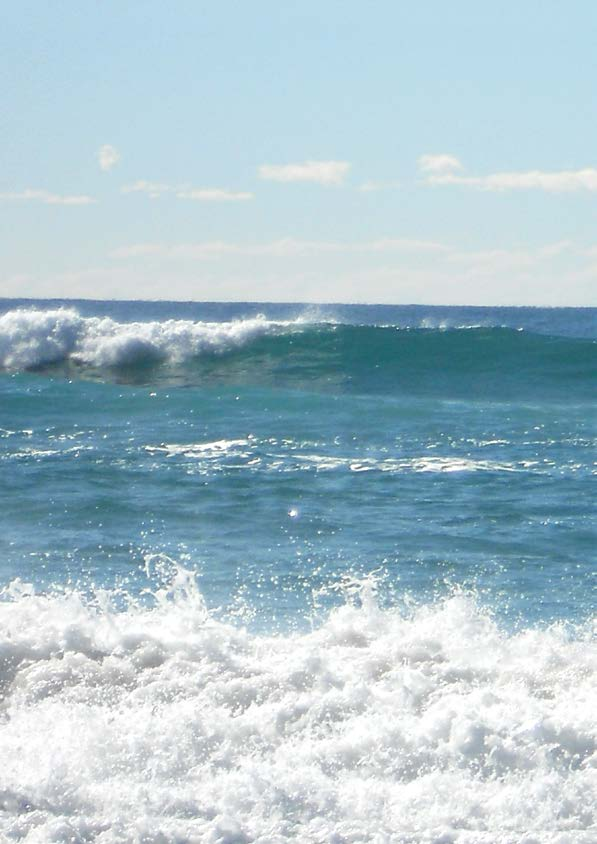

---
## Page 82

National Plan for Maritime Environmental Emergencies – 2020 edition
68
7.1 Scope of cost recovery
Funding arrangements to support the National Plan are based on the polluter pays principles.
Response and recovery is funded on the basis of the polluter pays. For shipping, this is 
achieved through the implementation of relevant international conventions under the auspices 
of the IMO. For the offshore petroleum industry, this is achieved through the OPGGSA. All 
agencies responding to and incurring costs in relation to ship sourced pollution incidents where 
the polluter is not identified, or costs are not recoverable, may be able to recover their costs from 
AMSA under the Protection of the Sea Levy5.
International arrangements provide guidance as to what are considered to be reasonable 
costs associated with the response to a maritime environmental emergency. Costs and 
expenditure for the purposes of the National Plan relate to reasonable measures taken to 
respond to maritime environmental emergencies such as responding to a casualty to prevent 
pollution, combating actual pollution by oil or chemical at sea, defending sensitive resources 
and/or cleaning shorelines and coastal installations. In general, costs will be considered 
‘reasonable’ if they result from actions that:
•	
 were undertaken on the basis of a technical appraisal of the incident
•	
 sought to enhance the natural processes of recovery
•	
 were not undertaken purely for public relations reasons.
The Control Agency is responsible for ensuring that there are arrangements, administrative 
or legislative, in place to enable support agencies to be reimbursed for the costs incurred in 
responding to an incident.
These costs are met by those responsible for the spill through various international and 
domestic arrangements. Generally, for Commonwealth/state/Northern Territory agencies, 
reimbursement is normally through international liability and compensation funds or 
shipowner’s liability insurers known as Protection & Indemnity Clubs (P&I Clubs). Where none 
of the conventions or domestic statutes provides for cost recovery, legal actions may need to 
be pursued.
5 The Claims Management Guidelines provides information on how Commonwealth, state and Northern 
Territory agencies may be able to seek reimbursement for costs from AMSA for responding to ship sourced 
pollution incidents.

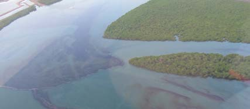

---
## Page 83

69
National Plan for Maritime Environmental Emergencies – 2020 edition
7.2 International maritime arrangements
International arrangements exist that generally ensure that the cost of combat and clean-up of 
spills originating from oil tankers and non-tankers can be recovered. These arrangements are 
set out in four international conventions to which Australia is a party:
•	
For oil tankers: 
–  the International Convention on Civil Liability for Oil Pollution Damage 1992 (the 1992 
Civil Liability Convention)
–  the International Convention on the Establishment of an International Fund for 
Compensation for Oil Pollution Damage 1992 (the 1992 Fund Convention)
–  the Protocol of 2003 to the International Convention on the Establishment of an 
International Fund for Compensation for Oil Pollution Damage 1992 (the 2003 
Supplementary Fund Protocol); and
•	
For non-tankers (i.e. all other vessels) 
– International Convention on Civil Liability for Bunker Oil Pollution Damage 2000 (the 
Bunkers Convention).
The ability to utilise cost recovery arrangements relies on the ability to identify the polluter and 
to prove that they have appropriate insurance cover. The only exception is where it can be 
demonstrated that a so-called ‘mystery’ spill originated from an oil tanker. In such circumstances 
the Fund Convention mentioned above may meet clean-up costs and compensation.
7.3 Domestic maritime arrangements
While the international conventions mentioned above have similar applications in terms of 
directly incurred costs of pollution response, the conventions are, in general, far broader 
in their scope and application than the National Plan arrangements. Types of claims that 
may be accepted under the international conventions that are not part of the National Plan 
arrangements include:
•	
consequential loss – loss of earnings suffered by the owners or users of property 
contaminated as a result of a spill, for example the loss of income by a fisher as a result of their 
nets being contaminated
•	
pure economic loss – loss of earnings sustained by persons whose property has not 
been polluted, for example a hotelier whose premises are closed due to a contaminated 
public beach
•	
damage to property, such as repair or cleaning of boats not involved in response activity, 
or cost of repairing roads or jetties damaged by clean-up operations.
Where Commonwealth/state/Northern Territory agencies are unable to recover costs that have 
been incurred in responding to pollution incidents in Australia or may have difficulty in meeting 
financial commitments while waiting for reimbursements from the shipowner/P&I Club, AMSA 
may reimburse the operational or response costs. For shipping incidents, the National Plan 
Strategic Coordination Committee has agreed to apply the Claims Management Guidelines.
Part seven

---
## Page 84

National Plan for Maritime Environmental Emergencies – 2020 edition
70
7.4 Offshore petroleum sector arrangements
The OPGGSA and Environment Regulations require that, prior to accepting an EP for an 
offshore petroleum activity, NOPSEMA must be reasonably satisfied that a titleholder has 
sufficient financial assurance to meet the costs, expenses and liabilities that may arise from a 
petroleum incident. Relevant credible costs and expenses and how titleholders can establish 
and maintain compliance with the financial assurance duty are detailed in the NOPSEMA 
Guideline – Financial assurance for petroleum titles.

---
## Page 85

71
National Plan for Maritime Environmental Emergencies – 2020 edition
ALARP.............................................................................15
AMOSC Core Group....................................................... 39
AMOSPlan................................................ix, 39, 41, 51, 56
Antarctic...............................................................12, 14, 55
Australasian Inter-service Incident  
Management System (AIIMS).......................vii, 31, 48, 49
Australian Emergency Management Arrangements........ 2
Australian Exclusive Economic Zone (EEZ).................... 6
Australian Institute of Petroleum (AIP)........................... 26
Australian Local Government Association..................... 18
Australian Marine Oil Spill Centre (AMOSC).............ix, 26
Australian Maritime Safety Authority Act........................ 13
Australian Qualifications Framework.............................. 44
Ballast water...................................................................... 5
Bunkers........................................................................... 69
Change of Control Agency.......................ix, 22, 25, 54, 68
Chemical terminal......................................ix, 5, 41, 48, 52
Christmas Island............................................................. 55
Claims Management Guideline...................................... 68
Coastal Waters..............................................................ix, 6
Command..........................................................................ix
Community........................................................... ix, 37, 66
Community engagement................................................ 37
Contingency planning..................................................... 36
Control Agency............................. 5, 29, 48, 56, 61, 62, 63
Convention for the Protection of the Natural Resources 
and Environment of the South Pacific Region  
(see also SPREP)........................................................... 16
Convention on Limitation of Liability for Maritime  
Claims..............................................................................12
Coordination......................................................... ix, 23, 56
Cost recovery........................................................7, 10, 68
Council of Australian Governments......................3, 18, 23
Doctrine.............................................................................ix
Emergencies of National Consequence......................... 23
Emergency........................................................................ix
Emergency towage.........................................5, 20, 28, 32
Environment Plan......................................................15, 43
Environment Protection and Biodiversity  
Conservation Act............................................................. 14
Environmental rehabilitation........................................... 62
Environmental, scientific and technical advice.........43, 53
Equipment stockpiles..........................................40, 41, 56
Exercises......................................................................... 45
External territories.......................................................6, 55
Fixed Wing Aerial Dispersant Capability  
(FWADC)...................................................................42, 56
Funding arrangements.................................................... 68
Geographic information systems.................................... 53
Global Response Network (GRN).............................. x, 26
Great Barrier Reef Marine Park Authority  
(GBRMPA)....................................................................... 30
Great Barrier Reef Marine Park Authority Act................ 14
Hazardous and noxious substance  
(HNS)........................................................... x, 5, 11, 12, 57
HNS response................................................................. 57
Incident........................................................................ x, 49
Incident classification...................................................... 49
Incident Controller..............................................................x
Incident Management System........................................ 48
Incident Management Team (IMT)....................... x, 22, 49
Infrastructure...............................................x, 2, 48, 50, 64
Internal waters....................................................................x
International Convention for the Prevention of  
Pollution from Ships (MARPOL)......................................11
International Convention on Oil Pollution Preparedness, 
Response and Co-operation (OPRC).............2,16, 20, 26
International Convention on the Establishment of an 
International Fund for Compensation for Oil Pollution 
Damage.....................................................................12, 69
International Convention Relating to Intervention on 
the High Sea in Cases of Oil Pollution Casualties 
(Intervention Convention)............................................2, 30 
International Maritime Organization (IMO).................2, 29
International Petroleum Industry Environmental 
Conservation Association (IPIECA)................................ 26
International support....................................................... 26
Index
Index

---
## Page 86

National Plan for Maritime Environmental Emergencies – 2020 edition
72
Marine debris..................................................................... 5
Marine pests...................................................................... 5
Marine pollution............................................................. x, 5
Maritime Assistance Service (MAS)..........................vii, 29
Maritime casualty..............................................x, 5, 30, 31
Maritime Casualty Control Unit (MCCU)...................vii, 31
Maritime facility..................................................... xi, 55, 56
Maritime Powers Act....................................................... 14
Maritime Safety Queensland (MSQ)...................vii, 30, 57
Maritime Transport and Offshore Facilities  
Security Act...................................................................... 56
Model Arrangements for Leadership During  
Emergencies of National Consequence......................... 23 
Mutual aid arrangements..........................................16, 41
National Disaster Resilience Statement........................... 3
National Offshore Petroleum Safety and  
Environmental Management Authority  
(NOPSEMA)......................................vii, 13, 15, 23, 36, 70 
National Plan Strategic Coordination Committee 
(NPSCC)........................................................vii, 18, 19, 22
National Plan Strategic Industry Advisory Forum 
(NPSIAF)..............................................................vii, 18, 19
National Principles for Disaster Recovery...................... 63
National Response Team (NRT)..................viii, 20, 39, 56
Norfolk Island............................................................55, 57
Offshore Petroleum and Greenhouse Gas  
Storage Act................................................viii, 4, 13, 15, 28
Offshore petroleum facility................................................ 7
Offshore petroleum sector/AMSA MOU...................42, 56
Oil Pollution Emergency Plan (OPEP)........................... 15
Oil (see petroleum)............................................................xi
Oil spill control agents (OSCAs)..................................... 43
Oil Spill Response Ltd (OSRL).......................................viii
Oil terminal........................................................................xi
PACPLAN (See also SPREP)..................................xiii, 16
Petroleum..........................................................................xi
Physical damage............................................................... 5
Place of refuge............................................................xi, 34
Polluter pays’ principle................................................xi, 65
Port Authority.....................................................................xi
Port waters........................................................................xi
Protection & Indemnity Clubs (P&I Clubs)..................... 68
Protection of the Sea (Powers of Intervention)  
Act........................................................................13, 29, 30
Protection of the Sea  
(Prevention of Pollution from Ships) Act......................... 13
Protection of the Sea Levy......................................xi, 4, 68
Recovery.......................................................62, 63, 64, 65
Registered Training Organisation (RTO)..................xiii, 44
Response escalation....................................................... 52
Response phase monitoring........................................... 53
Responsible Agency (see Control Agency)....................xiii
Responsible Party...............................................xiii, 26, 65
Risk Assessment............................................................... 3
Seas and Submerged Lands Act...................................... 3
SOLAS.......................................................................viii, 30
South Pacific Regional Environment programme 
(SPREP) (see also PACPLAN)......................................viii
Stakeholders................................................................... 23
Support Agency..........................................................xii, 22
Timor Sea Joint Petroleum Development Area  
(JPDA)..............................................................................vii
TorresPlan..................................................................xii, 55
Traditional owners............................................................. 4
Trajectory modelling........................................................ 53
Transport and Infrastructure Council (the Council)........ 18
United Nations Convention on the Law of the Sea 
(UNCLOS)................................................................... 2, 11

---
## Page 87

---
## Page 88

P200108

