# National Search and Rescue (NATSAR) Manual — Appendices (February 2025)

> **Source**: AMSA
> **URL**: https://www.amsa.gov.au/sites/default/files/natsar-manual-february-2025-appendices.pdf
> **Licence**: Crown / publisher copyright; practitioner reference
> **Retrieved**: 2026-05-07T23:47:15Z
> **SHA-256**: `0ff07fc346221a8bb10e6ac26afd1f165cc9a44bd72a3b04a6a1e418a72fc0c4`
> *Converted from PDF to Markdown format.*

---
## Page 1

 
 
 
Appendices 
NATIONAL SEARCH AND RESCUE MANUAL 
2025 EDITION Version 1 – February 2025 
 Page 334 
Appendices 
NATIONAL SEARCH AND RESCUE MANUAL 
2025 EDITION Version 1 – February 2025 
Appendix A – Intergovernmental Agreement 
This appendix contains a copy of the 2017 IGA applicable to the Australian National SAR Plan.

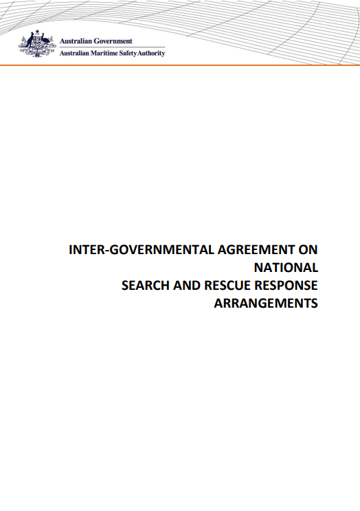

---
## Page 2

 
 
 
Appendices 
NATIONAL SEARCH AND RESCUE MANUAL 
Page 335 
2025 EDITION Version 1 – February 2025

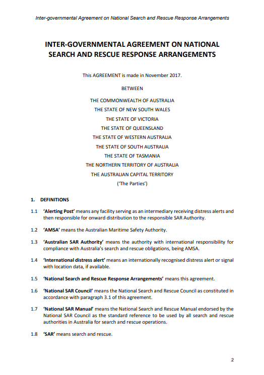

---
## Page 3

 
 
 
Appendices 
NATIONAL SEARCH AND RESCUE MANUAL 
2025 EDITION Version 1 – February 2025 
 Page 336

---
## Page 4

 
 
 
Appendices 
NATIONAL SEARCH AND RESCUE MANUAL 
Page 337 
2025 EDITION Version 1 – February 2025

---
## Page 5

 
 
 
Appendices 
NATIONAL SEARCH AND RESCUE MANUAL 
2025 EDITION Version 1 – February 2025 
 Page 338

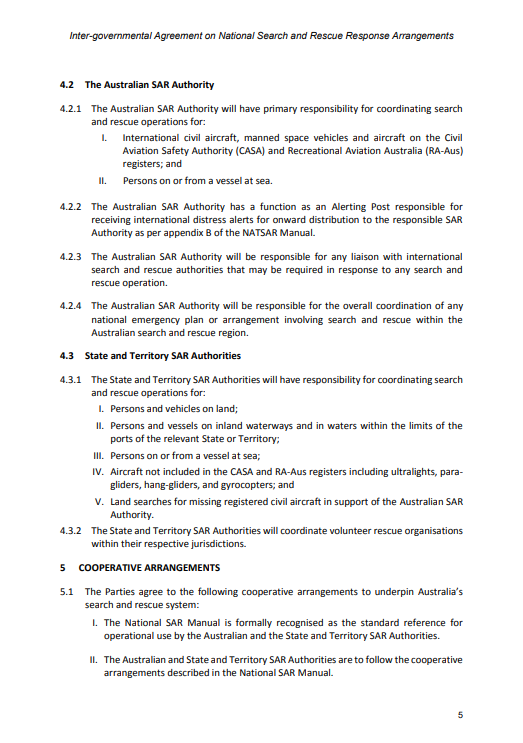

---
## Page 6

 
 
 
Appendices 
NATIONAL SEARCH AND RESCUE MANUAL 
Page 339 
2025 EDITION Version 1 – February 2025

---
## Page 7

 
 
 
Appendices 
NATIONAL SEARCH AND RESCUE MANUAL 
2025 EDITION Version 1 – February 2025 
 Page 340

---
## Page 8

 
 
 
Appendices 
NATIONAL SEARCH AND RESCUE MANUAL 
Page 341 
2025 EDITION Version 1 – February 2025

---
## Page 9

 
 
 
Appendices 
NATIONAL SEARCH AND RESCUE MANUAL 
2025 EDITION Version 1 – February 2025 
 Page 342

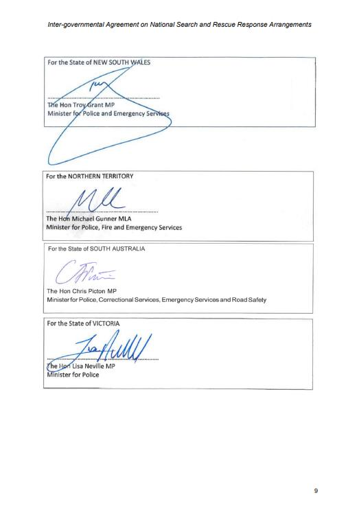

---
## Page 10

 
 
 
Appendices 
NATIONAL SEARCH AND RESCUE MANUAL 
Page 343 
2025 EDITION Version 1 – February 2025

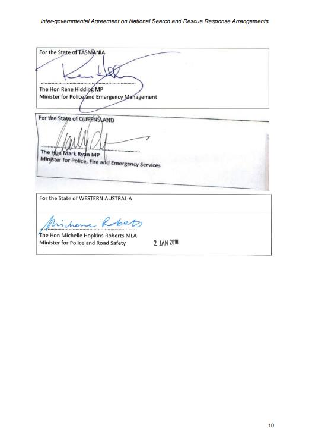

---
## Page 11

---
## Page 12

 
 
 
Appendices 
NATIONAL SEARCH AND RESCUE MANUAL 
Page 345 
2025 EDITION Version 1 – February 2025  
Appendix B – National SAR Responsibilities 
D I V I S I O N  O F  R E S P O N S I B I L I T Y F U N C T I O N  T O  B E  P E R F O R M E D  B Y ,  O R  O N  B E H A L F  O F ,  T H E  O V E R A L L  C O O R D I N A T I N G  A U T H O R I T Y 
For land, sea and air SAR, 
in respect of: 
Responsible 
Authority1 
Provision and 
coordination of air 
SAR Assets. 
Provision and 
coordination of 
land SAR Assets. 
Provision and 
coordination of 
maritime SAR 
Assets. 
Communication 
(other than 
air/surface) 
Air/ground 
communication for 
land search and 
rescue. 
Aircraft/ship 
communication were 
direct 
communications not 
available. 
International civil aircraft, 
manned space vehicles and 
aircraft on the Civil Aviation 
Safety Authority (CASA) and 
Recreational Aviation 
Australia (RA-Aus) Registers 
JRCC Australia 
JRCC Australia 
Police 
JRCC Australia Police 
JRCC Australia 
Police 
Airservices Australia 
Police 
Airservices Australia 
Persons on or from a Vessel 
at Sea 2 
 
JRCC Australia 
Police3 
 
JRCC Australia 
Police 
Police 
JRCC Australia Police JRCC Australia Police Airservices Australia 
Police 
Airservices Australia 
Police 
 
1 The first SAR Authority to become aware of a SAR incident is obliged to respond until overall coordination can be transferred to the ‘Best Placed’ SAR Authority in accordance with the provisions of the Inter-
Governmental Agreement on National Search and Rescue Arrangements 2017 and the principles set out in the National SAR Manual 
2 Other than those for which the ADF is responsible 
3 JRCC Australia involvement when requested to arrange for the provision of aircraft or accept coordination of air search in accordance with the principles set out in the National SAR Manual

---
## Page 13

 
 
 
Appendices 
NATIONAL SEARCH AND RESCUE MANUAL 
2025 EDITION Version 1 – February 2025 
 Page 346 
D I V I S I O N  O F  R E S P O N S I B I L I T Y F U N C T I O N  T O  B E  P E R F O R M E D  B Y ,  O R  O N  B E H A L F  O F ,  T H E  O V E R A L L  C O O R D I N A T I N G  A U T H O R I T Y 
For land, sea and air SAR, 
in respect of: 
Responsible 
Authority1 
Provision and 
coordination of air 
SAR Assets. 
Provision and 
coordination of 
land SAR Assets. 
Provision and 
coordination of 
maritime SAR 
Assets. 
Communication 
(other than 
air/surface) 
Air/ground 
communication for 
land search and 
rescue. 
Aircraft/ship 
communication were 
direct 
communications not 
available. 
Persons and vehicles on 
land4; and 
Persons and vessels on 
inland waterways and in 
waters within the limits of 
the ports of the relevant 
State or Territory 
 
Police 
Police 
JRCC Australia 
Police 
Police 
Police 
Police  
Airservices Australia 
Police 
Airservices Australia 
Aircraft not included in the 
CASA and RA-Aus registers 
including ultralights, 
paragliders, hang-gliders, 
and gyrocopters 
(unregistered aircraft). 
Police 
Police 
JRCC Australia 
Police 
Police 
JRCC Australia 
Police 
Airservices Australia 
Police 
Airservices Australia 
Police 
Airservices Australia 
Australian Defence Force 
(ADF) and Foreign Military 
Personnel, Aircraft, Ships 
and Submarines 
ADF5 
ADF 
ADF 
ADF 
ADF 
ADF 
ADF 
 
4 JRCC Australia involvement when requested to arrange for the provision of aircraft or accept coordination of air search in accordance with the principles set out in the National SAR Manual 
5 ADF involvement in search and rescue is arranged through HQJOC (Headquarters Joint Operations Command) in accordance with the principles set out in the National SAR Manual

---
## Page 14

 
 
 
Appendices 
NATIONAL SEARCH AND RESCUE MANUAL 
Page 347 
2025 EDITION Version 1 – February 2025  
D I V I S I O N  O F  R E S P O N S I B I L I T Y F U N C T I O N  T O  B E  P E R F O R M E D  B Y ,  O R  O N  B E H A L F  O F ,  T H E  O V E R A L L  C O O R D I N A T I N G  A U T H O R I T Y 
For land, sea and air SAR, 
in respect of: 
Responsible 
Authority1 
Provision and 
coordination of air 
SAR Assets. 
Provision and 
coordination of 
land SAR Assets. 
Provision and 
coordination of 
maritime SAR 
Assets. 
Communication 
(other than 
air/surface) 
Air/ground 
communication for 
land search and 
rescue. 
Aircraft/ship 
communication were 
direct 
communications not 
available. 
Unidentified Distress Beacon 
Alerts 
JRCC Australia 
JRCC Australia 
Police 
JRCC Australia 
Police 
JRCC Australia 
JRCC Australia 
Airservices Australia 
JRCC Australia 
Airservices Australia 
In respect to persons on oil 
and gas facilitates at sea 
associated with the 
exploration, production, 
storage and offloading of 
product. 
 
JRCC Australia 
Police*6 
JRCC Australia 
Police 
Police 
JRCC Australia 
Police 
JRCC Australia 
Police 
Airservices Australia 
Police 
Airservices Australia 
Police 
 
NB: This responsibility matrix relates only to search and rescue responsibilities and does not replace the responsibilities of other organisations as they relate to 
safety, security and environmental issues on Oil and Gas facilities. 
*Responsibility for the rescue of persons from oil and gas facilities at sea will be determined in accordance with the ‘Best Placed’ provisions. 
Will require that National Offshore Petroleum Safety and Environmental Management Authority (NOPSEMA) is informed of this change.

---
## Page 15

---
## Page 16

 
 
 
Appendices 
NATIONAL SEARCH AND RESCUE MANUAL 
2025 EDITION Version 1 – February 2025 
Page 349 
Appendix C – National Operational Procedure for Transfer of Coordination 
Overview

---
## Page 17

 
 
 
 
Appendices 
 
NATIONAL SEARCH AND RESCUE MANUAL 
Page 350 
2025 EDITION Version 1 – February 2025 
Guidelines for Procedure to transfer coordination 
1.0 
 
The term ‘position known’ means that the position accuracy is nominally within 5 kilometres, and for 
GPS encoded positions are normally within 150 meters.  An appropriately trained response team 
should be able to localise the final beacon position on scene in line with respective procedures. 
1.3 
Transfer of coordination and information between JRCC Australia and State/Territory will occur with 
the agreed SAR point of contact in each jurisdiction, which already exists (attachment 1). 
Provision of transfer of coordination and incident information will occur both in writing and verbally: 
Written exchange – Written information will include, position information, beacon registration 
information if known, and any other relevant intelligence obtained.  
Verbal exchange – The recognised time of transfer of coordination will be when verbal agreement 
occurs.  
Example of this information is provided in Appendix D of the NATSAR Manual. The information 
exchange will occur almost simultaneously, normally with the written information provided first, 
followed by a telephone call. Other means of transferring information to the coordinating authority 
will be considered upon request. 
1.4 
A response will be planned by the respective jurisdiction in line with their procedures. 
1.4a 
 
When developing the SAR Response Plan, the coordinating SAR authority may determine that 
aviation assistance is required from JRCC Australia due to circumstances specific to that incident e.g. 
the location is in a particularly remote area. 
1.4b 
 
JRCC Australia can provide three types of aviation assistance: 
a) 
Identification of suitable aviation SAR assets  
b) 
Identification and briefing provided for suitable aviation SAR assets 
c) 
Identification, briefing and tasking of suitable aviation SAR assets.  
If assistance a) or b) is requested, then JRCC Australia will provide the relevant information to the 
coordinating authority to assist in further developing the SAR Response Plan. 
If assistance c) is requested, then JRCC Australia will task the asset but will still remain in a supporting 
role to the coordinating SAR Authority.  The intention is for the coordination SAR Authority to have 
direct communications with the aircraft responding to the incident where possible.  This is the best 
practice to ensure the SMC and the ground parties responding have real time and accurate 
information without delay.  It is understood that there may be some communications limitations 
especially outside of state contracted assets, but the intention is to transition to this operational 
practice.  If this capability does not exist, JRCC Australia will provide a relay of relevant information as 
required. 
1.6 
The SMC of the coordinating SAR authority has responsibility to monitor the progress of the SAR 
Response Plan and will be provided with updates of ongoing information if obtained by JRCC 
Australia.  
1.7 
As international SPOC, JRCC Australia is required to provide incident reports to COSPAS-SARSAT as 
per our international agreement, including reason for activation and number of lives saved etc.  Upon 
incident conclusion, the coordinating SAR authority will forward this information to JRCC Australia. 
2.2 
 
If registration details are not available JRCC Australia will continue with inquiries to obtain additional 
information.  Unless it is determined that it is an aviation incident, coordination will be transferred to 
the appropriate State/Territory SAR Authority. 
3.2 
When the position is unknown, JRCC Australia will retain coordination and take appropriate action to 
confirm the position.  In accordance with the NATSAR Manual Volume 1, Chapter 1.2.10, JRCC 
Australia and the respective State/Territory SAR authority will have a discussion regarding the best 
placed SAR authority to take coordination, based on the incident circumstances.

---
## Page 18

 
 
 
Appendices 
NATIONAL SEARCH AND RESCUE MANUAL 
2025 EDITION Version 1 – February 2025 
Page 351 
State / Territory SAR Authority Points of Contact 
State 
Contact  
NSW 
Sydney Police COM Centre Rescue Coordinator (RCO) 
QLD 
Police SARMC for the district, backup Brisbane Police COM Centre Duty Sergeant 
NT 
Police COM Centre Darwin 
WA 
Police COM Centre Perth Duty Inspector, then as agreed for local Police contacts 
SA 
Police STAR Group Shift Manager, if no contact Police COM Centre 
VIC 
Police RCC 
TAS 
Police Radio Dispatch Services (RDS) Centre, Tasmania Police COM Centre Hobart 
ACT 
ACT Policing Operations Centre 
Australian 
External 
Territories 
Australian Federal Police Nation Operations State Service Centre (NOSSC) 
Transfer of Coordination Information Exchange Requirements 
In accordance with Section 1.2.30 and 1.2.35 of the manual, transfer of coordination is deemed to have 
taken place at the time verbal agreement is reached.  The transfer of coordination is to be recorded 
appropriately within each Authority’s incident management system. 
The transfer of coordination can involve overall coordination or specific sub-components of the search 
activity e.g. Land\Air\Sea search coordination.  Transfer discussions will only be undertaken between 
appropriately authorised person(s) of respective SAR Authority’s.  
Noting that each SAR Authority has fit for purpose record keeping systems the following is to be used as a 
guide for information that shall be transferred electronically to another SAR agency as part of the transfer 
of coordination process. 
Item 
Comment 
Timestamp 
System generated Date\Time stamp 
Reference telephone call for 
time of verbal transfer 
Reference telephone call between SAR Authorities in which verbal 
transfer of coordination was agreed 
Incident Identifier and short 
description 
Authority Incident\CAD reference number, short title of incident and 
plain language description 
Coordination Transfer 
Details of coordination element to be transferred, possibilities 
include6: 
- Overall Coordination 
- Land Search 
- Sea Search 
- Air Search 
Current Situation  
Assessment of the current situation by the coordinating SAR authority 
Intelligence and Actions 
undertaken 
A summary of known information and actions completed 
 
6 Delete those that are not applicable

---
## Page 19

 
 
 
 
Appendices 
 
NATIONAL SEARCH AND RESCUE MANUAL 
Page 352 
2025 EDITION Version 1 – February 2025 
Incident location 
Incident location details, at a minimum Latitude and Longitude 
(decimal degrees) are to be provided 
Additional positional formats can be provided, e.g.  Grid Reference, 
embedded GPS position 
Additional incident support 
requirements 
Additional incident support requirements as agreed between SAR 
authorities, examples could include forward command post support, 
next of kin liaison, radio broadcasts etc. 
Supplementary Information 
Information pertaining to the target e.g. beacon registration details, 
target operator details and contacts, trip details 
Example: Transfer of Coordination information 
192359 UTC Jun 2015 
FM JRCC AUSTRALIA 
TO [State\Territory SPOC] 
INFO [As required] 
INCIDENT 2015/1234 - TRANSFER OF SEARCH AND RESCUE [OVERALL COORDINATION\AIR SEARCH\LAND 
SEARCH\SEA SEARCH] – PLB\SEND DEVICE LOCATED XXX 
Ref A. Telecon JRCC Australia \ [State\Territory SPOC] 192350 UTC JUN 2015 
Ref B. NATSARMAN xx.x 
1. COORDINATION TRANSFER 
IN ACCORDANCE WITH REF A, JRCC AUSTRALIA HEREBY FORMALLY REQUEST THE TRANSFER OF 
[OVERALL\AIR SEARCH\LAND SEARCH\SEA SEARCH, IN ACCORDANCE WITH PARAGRAPH 1.2.31 OF THE 
NATIONAL SEARCH AND RESCUE MANUAL, FOR THE SEARCH AND RESCUE ACTION FOR RESPONSE TO THE 
ACTIVATION OF A [DEVICE] ACTIVATED AT [DDHHMM UTC MMM YYYY]. 
2. CURRENT SITUATION: 
JRCC AUSTRALIA RECEIVED PLB DETECTION AT 19 2230UTC. THE JRCC HAS CONFIRMED THERE IS A PARTY 
OF FOUR PERSONS CANYONING IN X AREA AND THAT THEY REPORTED THEY WOULD ONLY ACTIVATE THE 
BEACON IN CASE OF A SERIOUS INJURY OR ACCIDENT. THE PARTY DEPARTED THIS MORNING, NO OTHER 
INFORMATION REGARDS SAFETY EQUIPMENT IS KNOWN. AIRCRAFT TRANSITING THE AREA HAVE BEEN 
REQUESTED TO REPORT ANY HEARING REPORTS IN THE AREA.  
3. INTELLIGENCE AND ACTIONS UNDERTAKEN: 
JRCC AUSTRALIA HAS CONTACTED THE REGISTERED BEACON OWNER EMERGENCY CONTACTS. THEY 
ADVISE THAT THE BEACON HAS BEEN LOANED TO X AND Y, THEY ARE CURRENTLY CANYONING IN THE X 
AREA WITH FOUR OTHER PERSONS.  THE FOLLOWING CONTACT\COMMUNICATION DEVICES ARE IN 
POSSESSION OF THE REGISTERED OWNERS.  
4. INCIDENT LOCATION: 
A. 
LATITUDE\LONGITUDE:  
39-14.5S 142-54.76E 
B. 
*GRID REFERENCE:  
54H 665062 5654661 UTM 
C. 
*EMBEDDED GPS POSITION:  
39-14.5S 142-54.7E 
* AS APPLICABLE

---
## Page 20

 
 
 
Appendices 
NATIONAL SEARCH AND RESCUE MANUAL 
2025 EDITION Version 1 – February 2025 
Page 353 
5. ADDITIONAL INCIDENT SUPPORT REQUIREMENTS 
IN ACCORDANCE WITH REQUEST OF [STATE\TERRITORY SPOC] JRCC AUSTRALIA HAS TASKED [RESCUE 431 
CHALLENGER 604 TIER 1 AIRCRAFT] ETA ON SCENE IS ADVISED AS 200112 UTCJUN 2015. 
6. SUPPLEMENTARY INFORMATION, BEACON REGISTRATION INFORMATION 
 
REGARDS, 
JRCC AUSTRALIA

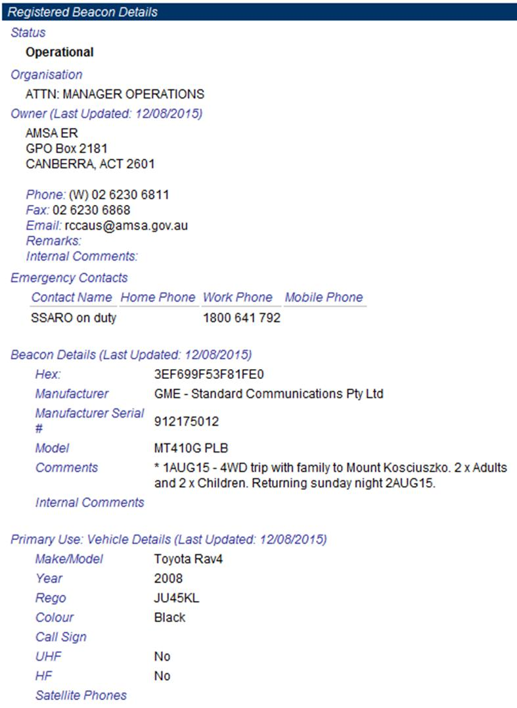

---
## Page 21

 
 
 
 
Appendices 
 
NATIONAL SEARCH AND RESCUE MANUAL 
Page 354 
2025 EDITION Version 1 – February 2025 
Appendix D 
Overview 
• 
Appendix D-1 Distress Emergency Signals 
• 
Appendix D-2 Maritime SAR Recognition Codes 
• 
Appendix D-3 Plotting Symbols 
• 
Appendix D-4 Sighting and Hearing Techniques 
• 
Appendix D-5 Tables and Graphs 
• 
Appendix D-6 Probable Positions of Error 
• 
Appendix D-7 Worksheets 
• 
Appendix D-8 Aircraft Accident Site Precautions 
• 
Appendix D-9 Civil Aircraft Search and Rescue Assets (SRAs) 
• 
Appendix D-10 Coastal Datum Search and Rescue Planning

---
## Page 22

 
 
 
Appendices 
NATIONAL SEARCH AND RESCUE MANUAL 
2025 EDITION Version 1 – February 2025 
Page 355 
Appendix D-1 Distress Emergency Signals 
Overview 
Many signals have been devised over the years to signal a condition of distress or other emergency status. 
Those listed in this Appendix are those which are most common, have been accepted by international 
agreement or national custom, or which may be significant for occasional use by SAR assets. 
Because of the large number of possible signals of various types that may be used to indicate an 
emergency condition or may be used for emergency communication, this list is not all-inclusive. 
International Distress Signals 
a) 
A gun or other explosive signal fired at intervals of about one minute; 
b) 
A continuous sounding of any fog-signalling apparatus; 
c) 
Rockets or shells, throwing red stars fired one at a time at short intervals.  
d) 
A signal made by any signalling method consisting of the group …---… (SOS) in the Morse Code; 
e) 
A signal sent by radiotelephony consisting of the spoken word ’Mayday’ 
f) 
The International Code Signal of distress indicated by the code group NC; (See the International Code 
of Signals for other code groups with emergency significance.) 
g) 
A signal consisting of a square flag having above or below it a ball or anything resembling a ball; 
h) 
Flames on a vessel (as from a burning tar barrel, etc.); 
i) 
A rocket parachute flare or a hand flare showing a red light; 
j) 
A smoke signal giving off a volume of orange-coloured smoke; 
k) 
An orange-coloured sheet with a black square and circle or a black “V” or other appropriate symbol; 
l) 
Slowly and repeatedly raising and lowering arms outstretched to each side; 
m) The radiotelephone alarm signal consisting of two tones transmitted alternatively over periods of 
from 30 seconds to 1 minute; 
n) 
Signals transmitted by Emergency Position Indicating Radio Beacons, EPIRB’s or Personal Locator 
Beacons (PLBs) , Emergency Locator Transmitters (ELT’s) ; 
o) 
Approved signals transmitted by radio communication systems; 
p) 
A dye marker; and  
q) 
Transponder Squawk Codes 7700 Emergency, 7600 Communications failure, 7500 Unlawful 
interference. 
Search and Rescue Signals – Australian Area 
Signals with Surface Craft 
When it is necessary for an aircraft to direct a surface craft to the place where an aircraft or surface craft 
is in distress, the aircraft shall do so by transmitting precise instructions by any means at its disposal.  If 
such precise instructions cannot be transmitted or when necessary for any other reason, the instructions 
shall be given by using the procedure prescribed herein. 
The following procedures performed in sequence by an aircraft shall mean that the aircraft is directing a 
surface craft towards an aircraft or a surface craft in distress: 
a) 
Circling the surface craft at least once; 
b) 
Crossing the projected course of the surface craft, close ahead at a low altitude, opening and closing 
the throttle or changing the propeller pitch; and 
c) 
Heading in the direction in which the surface craft is to be directed. 
The following procedure performed by an aircraft shall mean that the assistance of the surface craft to 
which the signal is directed is no longer required:

---
## Page 23

 
 
 
 
Appendices 
 
NATIONAL SEARCH AND RESCUE MANUAL 
Page 356 
2025 EDITION Version 1 – February 2025 
a) 
Crossing the wake of the surface craft close astern at a low altitude, opening and closing the throttle 
or changing the propeller pitch. 
b) 
Repetition of such procedures shall have the same meaning. Current maritime signalling procedures 
include: 
i) 
For acknowledging receipt of signals: 
ii) 
The hoisting of the Code Pennant (vertical red and white stripes) close up (meaning 
understood); 
iii) 
The flashing of a succession of T’s by signal lamp in Morse code; and  
iv) 
The changing of heading. 
c) 
For indicating inability to comply: 
i) 
The hoisting of the international flag N (a blue and white checked square); and 
ii) 
The flashing of a succession of Ns in Morse code. 
Civil Air-Ground Code 
Australian Civil Authorities use the following air-ground codes: 
Signal 
Meaning 
Aircraft orbits ground party at low level 
changing engine noise 
I require your attention 
Aircraft flies overhead of ground party at low 
level and sets off in a particular direction. 
Follow aircraft in same direction 
Aircraft rocks wings and orbits. 
Investigate object/position underneath aircraft orbit 
Aircraft drops smoke on a particular location 
Investigate object/position adjacent to smoke 
Aircraft drops message canister. 
Retrieve and read instructions contained in the 
canister 
Table D-1:1 Ground Air Visual Signal Code

---
## Page 24

 
 
 
Appendices 
NATIONAL SEARCH AND RESCUE MANUAL 
2025 EDITION Version 1 – February 2025 
Page 357 
International SAR Signals 
The following visual signals are internationally recognised. They are authorised for use in the Australian 
SRR. 
Number 
Message 
Code Symbol 
1 
Require Assistance 
V 
2 
Require Medical Assistance 
X 
3 
Proceeding in this Direction 
 
4 
Yes, or Affirmative 
Y 
5 
No, or Negative 
N 
Table D-1:2 Ground-Air Visual Signal Code for Use by Survivors  
Note: If in doubt use International Signal – SOS 
 
Number 
Message 
Code Symbol 
1 
Require Fodder 
FF 
2 
Require Evacuation 
III 
3 
Power Failure 
VI 
Table D-1:3 Ground-Air Visual Signal Code for Use in Civil Emergencies 
Notes: 
1. 
Aldis Lamp Signals 
a) 
Red flashes indicate not understood 
b) 
Green flashes indicate message understood 
2. 
Air-Ground Signals 
The following signals by aircraft mean that the signals have been understood: 
a) 
During hours of daylight – rocking the aircraft’s wings 
b) 
During hours of darkness – by flashing the aircraft’s landing or navigation lights ON and OFF 
twice. Lack of the above signals indicates that the message has not been understood. 
3. 
Tables D-1:1, D-1:2 and D-1:3 conform to ICAO and NATO standards

---
## Page 25

 
 
 
 
Appendices 
 
NATIONAL SEARCH AND RESCUE MANUAL 
Page 358 
2025 EDITION Version 1 – February 2025 
Appendix D-2 Maritime SAR Recognition Code (MAREC) 
Overview 
The purpose of this Code is to facilitate the communication of essential descriptive information regarding 
merchant ships and small craft within and between SAR maritime organisations. 
The MAREC Code is in two parts:  
• 
Part 1 – Merchant Vessels; and  
• 
Part 2 – Small Craft. 
All messages should be preceded with the prefix MAREC followed by a local serial number, assigned by 
the RCC. 
The message should contain all the lettered identification groups as separate paragraphs. If the 
information is not known, the symbol UNK should be inserted or alternatively the symbol NA, where the 
lettered group is not applicable. 
Fishing vessels have not been included due to the multiplicity of types and configurations. Use should be 
made of the Merchant Vessels description code to report the description of fishing vessels. 
Part 1 – Merchant Vessels 
Merchant Vessels MAREC Messages 
The Message is composed of the following identification groups and will be transmitted in the following 
sequence: 
Group 
Description 
A 
Type of vessel - name - call sign 
B 
Superstructure - location - colour 
C 
Hull profile - colour 
D 
Sequence of uprights 
E 
Length 
F 
Condition of loading 
G 
Other characteristics. 
Table D-2:1 MAREC – Local Serial Number 
A. Type of Vessel – Name – Callsign 
Merchant ships are classified as follows: 
VOICE 
TLX/RTG 
Passenger ships 
PAX 
Ferry 
FERRY 
Tankers 
TANK 
Bulk carriers 
BULK 
General cargo ships 
GEN 
Coaster 
COAST 
Fishing vessels 
FISH 
Container ships 
CONT 
Specialised ships 
SPEC 
Table D-2:2 Mership Classifications

---
## Page 26

 
 
 
Appendices 
NATIONAL SEARCH AND RESCUE MANUAL 
2025 EDITION Version 1 – February 2025 
Page 359 
The name and callsign is added to the above classification. 
For specialised vessels, the specific type of vessel should be given, as appropriate, e.g. gas carrier, tug, 
icebreaker, etc. 
Example: 
Voice:  ALFA, SPECIALISED SHIP GAS CARRIER, FLYING DRAGON, CHARLIE GOLF HOTEL INDIA. 
TLX/RTG:  A/SPEC/GAS CARRIER/FLYING DRAGON/CGHI 
B. Superstructure – Location and Colour 
Superstructures are referred to as being located forward, midship or aft or a combination of these 
positions, and may be described as long or short. Colour is given in plain language. 
 
Figure D-2: 1 Superstructure Locations/Colour 
Note:  A superstructure that has a very distinct gap, as in the fourth illustration above should be reported 
as “location” split. 
Example (as in the first illustration above) 
Voice: BRAVO, SUPERSTRUCTURE MIDSHIP AND AFT, WHITE  
TLX/RTG: B/MIDSHIPS AND AFT/WHITE 
C. Hull – Profile and Colour 
The hull profile is divided into three sections numbered 1, 2 and 3 from stem to stern as follows: 
 
Figure D-2:2 Hull Division

---
## Page 27

 
 
 
 
Appendices 
 
NATIONAL SEARCH AND RESCUE MANUAL 
Page 360 
2025 EDITION Version 1 – February 2025 
If any section of the main weather deck of a vessel (except for superstructure) is raised, this is reported by 
its respective number as shown below.  Should there be a break between deck raises, an oblique line 
(voice - ’SLANT’) will be inserted in between the relevant section numbers.  Should there be no break as 
referred to above, the numbers will be written consecutively. 
 
Figure D-2:3 Full Profiles 
Note of Caution: 
Do not confuse raises in the decline with bulwarks which extend the height of the hull profile about 1 m 
and are used to protect deck cargo and personnel from washing over the side. They look like fences 
around exposed weather decks and can be usually recognised by the presence of small holes for deck 
drainage (scuppers) and the lack of handrails (see Figure D-2:12 below). 
 
Figure D-2:4 Bulwark 
The colour of the hull is given in plain language. 
Example: 
Voice: CHARLIE, PROFILE ONE TWO SLANT THREE, BLACK  
TLX/RTG: C/12/3/BLACK.

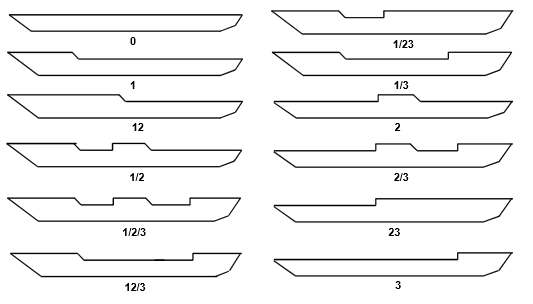

---
## Page 28

 
 
 
Appendices 
NATIONAL SEARCH AND RESCUE MANUAL 
2025 EDITION Version 1 – February 2025 
Page 361 
D. Uprights 
Uprights include everything, other than the profile and the superstructures that are prominent and can 
clearly be seen at a distance. The uprights are reported from stem to stern according to the list below: 
 
Figure D-2:5 Uprights 
Uprights located close to a superstructure such that they cannot be clearly seen from a distance should 
not be included.

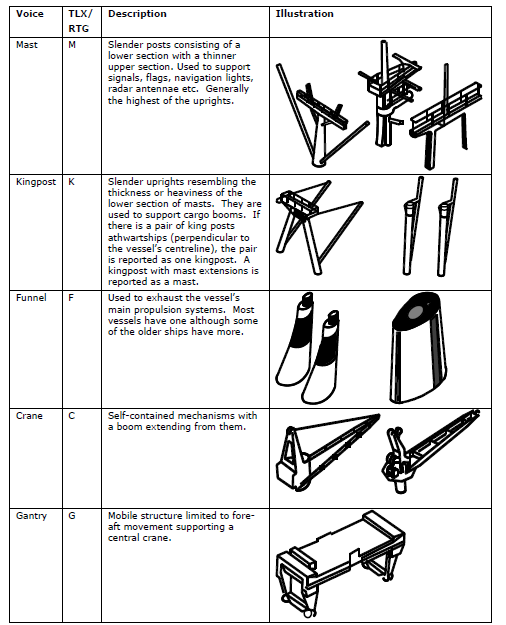

---
## Page 29

 
 
 
 
Appendices 
 
NATIONAL SEARCH AND RESCUE MANUAL 
Page 362 
2025 EDITION Version 1 – February 2025 
 
Figure D-2:6 Example of Uprights 
Example:  
Voice:  DELTA, MAST, KINGPOST, MAST, KINGPOST, FUNNEL 
TLX/RTG: D/M K M F 
E. Length 
Length is the length overall (LOA) given in metres. 
Note: Length can be estimated by observing the vessel’s lifeboats, normally 10 metres long, in proportion 
to the ship’s length. 
Example: 
Voice: ECHO, TWO ZERO METRES  
TLX/RTG: E/LOA 20 
F. Conditions of Loading 
The condition of loading is indicated as follows: 
 
Figure D-2:7 Conditions of Loading

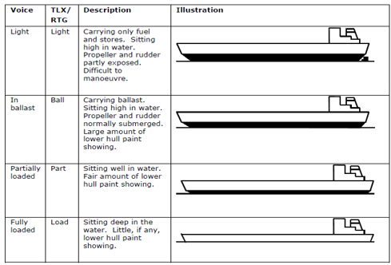

---
## Page 30

 
 
 
Appendices 
NATIONAL SEARCH AND RESCUE MANUAL 
2025 EDITION Version 1 – February 2025 
Page 363 
Example 
Voice: FOXTROT, PARTIALLY LOADED  
TLX/RTG: F/PART 
G. Other characteristics 
Other prominent characteristics should be given, e.g. stack insignia, conspicuous deck cargo, or other 
distinguishing marks or colour variations, e.g. name in big letters on ship’s side or company insignia 
painted on side of hull.  In the message, such specific characteristics should be given in full. 
Example: 
Voice: GOLF, RAILROAD CARS ON DECK 
TLX/RTG: G/RAILROAD CARS ON DECK 
Complete example Merchant Ship 
The following illustrates a typical merchant vessel and how it would be described in a message according 
to this system. 
Voice: 
TLX/RTG: 
MAREC 5/03 RCC AUSTRALIA 
ALFA, GENERAL CARGO SHIP, ARAFURA, VICTOR 
ROMEO ROMEO YANKEE 
BRAVO, SUPERSTRUCTURE AFT, WHITE  
CHARLIE, PROFILE ONE, SLANT THREE, BLACK  
DELTA, MAST, MAST, MAST, FUNNEL, KINGPOST  
ECHO, TWO FOUR ZERO METRES 
FOXTROT, PART 
GOLF, NOT APPLICABLE 
MAREC 5/76 RCC AUSTRALIA  
A/GEN/ARAFURA/VRRY  
 
B/AFT/WHITE 
C/1/3/BLACK  
D/M M M F K  
E/LOA 240 
F/PART  
G/NA. 
 
 
Figure D-2:8 Typical Merchant Ship

---
## Page 31

 
 
 
 
Appendices 
 
NATIONAL SEARCH AND RESCUE MANUAL 
Page 364 
2025 EDITION Version 1 – February 2025 
Part 2 – Small Craft 
Small Craft MAREC Message 
The message is composed of the following identification groups and will be transmitted in the following 
sequence: 
A 
Type of craft/ number of hulls – name – callsign or ship station identity – use 
B 
Make - distinctive markings 
C 
Motor installation or rigging 
D 
Construction - material – colour 
E 
Stern – stern 
F 
Type of bottom 
G 
Length. 
H 
Other characteristics 
I 
Number of persons on board. 
Table D-2:3 MAREC - Local Serial Number 
A. Type, configuration and superstructure of craft/number of hulls, name, callsign and use 
Type is based on primary means of propulsion.  
Propulsion 
Type 
Voice 
TLX/RTG 
Motor 
Motor Boat 
Motor 
MOT 
Sail 
Sailing Boat 
Sailing 
SAIL 
Oars 
Rowing Boat 
Rowing 
ROW 
Paddles 
Canoe 
Canoe 
CAN 
Motor and sail (in equal proportion) 
Motor/Sailer 
Motorsail 
MOTSAIL 
Various 
Inflatable 
Inflatable 
INFLAT 
Table D-2:4 Type of Small Craft 
Configuration is based on decked-in watertight areas. 
Voice 
TLX/RTG 
Description 
Open 
O 
Free of decks that enclose a watertight area 
Part Open 
PO 
Partly decked to create watertight areas 
Closed 
CL 
Fully decked so that, with all hatches closed and bungs in, 
the entire hull volume is watertight 
Superstructure 
TLX/RTG 
Description 
Full Cabin 
FC 
Cabin superstructure from bow to stern 
Part Cabin 
PC 
Any cabin superstructure not from bow to stern 
Full Raised Deck 
RD 
Entire deck level is raised to provide accommodation in the 
hull. Identified by the presence of windows in the hull 
without any superstructure 
Part Raised Deck 
PD 
Where only part deck level is raised as above 
Table D-2:5 Configuration of Small Craft

---
## Page 32

 
 
 
Appendices 
NATIONAL SEARCH AND RESCUE MANUAL 
2025 EDITION Version 1 – February 2025 
Page 365 
When reporting the above both voice and TLX/RTG items should be incorporated in one group as below: 
An open, part cabin motor boat should be reported as:  
• 
Voice: MOTOR OPEN PART CABIN 
• 
TLX/RTG: MOTOPC 
A closed, part cabin sailing boat should be reported as:  
• 
Voice: SAIL CLOSED PART CABIN 
• 
TLX/RTG: SAILCLPC 
Where the number of hulls is more than one, adding the words or group as follows should indicate this: 
• 
2 hulls - Catamaran – CAT 
• 
3 hulls -Trimaran - TRI 
The craft’s name, call sign and use should be added to words or groups above. Under use, indicate the 
purpose for which the craft is being used, e.g. fishing, pilot boat, offshore racer, etc. 
Example: 
Voice: ALFA, MOTOR PART OPEN PART CABIN CATAMARAN, LUCKY LADY, NAVIS ONE THREE, 
PLEASURE 
TLX/RTG: A/MOTPOPC/CAT/LUCKY LADY/NAVIS 13/PLEASURE 
B. Make and Distinctive Markings 
The make and distinctive markings should be given in plain language. 
Example:  
Voice: BRAVO, MAKE STORTRISS, SAIL MARKINGS TWO OVERLAPPING TRIANGLES WITH POINTS UP 
AND NUMBER SIERRA ONE THREE EIGHT  
TLX/RTG: B/STORTRISS/SAILMARKINGS TWO OVERLAPPING TRIANGLES POINTS UP/ S138 
C. Motor Installation or Sail Rigging 
The motor installation is given according to the figures shown below:

---
## Page 33

 
 
 
 
Appendices 
 
NATIONAL SEARCH AND RESCUE MANUAL 
Page 366 
2025 EDITION Version 1 – February 2025 
 
Figure D-2:9 Motor Installation  
Example 
Voice: CHARLIE, OUTBOARD MOTOR, DOUBLE 
TLX/RTG: C/OUTB 2 
Rigging (sailing boats) - Type of rigging is described on sailing boats and motor sailers according to the 
figures below. (The number of masts is denoted by the appropriate number):

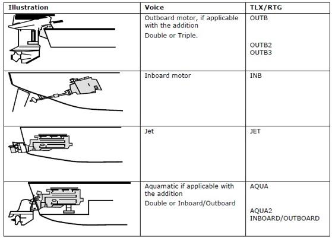

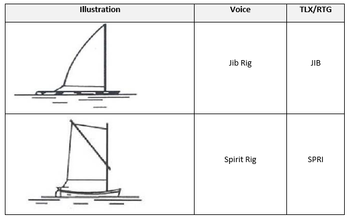

---
## Page 34

 
 
 
Appendices 
NATIONAL SEARCH AND RESCUE MANUAL 
2025 EDITION Version 1 – February 2025 
Page 367

---
## Page 35

 
 
 
 
Appendices 
 
NATIONAL SEARCH AND RESCUE MANUAL 
Page 368 
2025 EDITION Version 1 – February 2025 
 
Figure D-2:10 Sailing Rigging 
These boats have the capability to carry a bowsprit, that is a spar extending from the bow to which 
headsails are attached.  These are reported on: 
Voice: Bowsprit or  
TLX/RTG: BS. 
 
The difference between a ketch and a yawl is: 
a) The ketch’s aft mast is stepped forward of the rudder post; and  
b) The yawl’s mast is stepped behind the rudder post. 
Most sailing boats carry sails known as “extras” to improve the boat’s performance in specific conditions 
and include spinnakers, spinnaker staysails, jib staysails, main staysails and mizzen staysails.  If these sails 
are in use, identification of the yacht’s rig becomes more difficult.  These should be reported in section H. 
Name 
Voice 
TLX/RTG 
Spinnaker 
Spinnaker 
SPIN 
Spinnaker Staysail 
Spinnaker Staysail 
SPINSS 
Jib Staysail 
Jib Staysail 
JIBSS 
Main Staysail 
Main Staysail 
MAINSS 
Mizzen Staysail 
Mizzen Staysail 
MIZZENSS 
Table D-2:6 Sail Types

---
## Page 36

 
 
 
Appendices 
NATIONAL SEARCH AND RESCUE MANUAL 
2025 EDITION Version 1 – February 2025 
Page 369 
D. Construction/Material/Colour 
Construction 
Two different types of construction exist, viz. clinker-built and carvel built or smooth sided. 
 
Figure D-2:11 Construction 
Material 
The materials commonly used to construct small craft are wood, metal, glass reinforced plastic (fibreglass) 
(GRP), rubber (inflatables) or ferro- cement. Construction material and colour should be given in voice 
reports and given the abbreviations WOD, MTL, GRP, INFLAT or FERC in TLX/RTG reports. 
Example: 
Voice: DELTA, CLINKER, GLASS FIBRE, WHITE  
TLX/RTG: D/CLINKER/GRP/WHITE. 
 
E. Stem/Stern 
Stem and stern designs are described according to the figures below: 
 
Figure D-2:12 Stem Designs

---
## Page 37

 
 
 
 
Appendices 
 
NATIONAL SEARCH AND RESCUE MANUAL 
Page 370 
2025 EDITION Version 1 – February 2025 
Example: 
Voice: ECHO, FALLING STEM, CANOE STERN  
TLX/RTG: E/FALL/CAN 
 
F. Type of Bottom 
Bottom types are described according to the figures below: 
 
Figure D-2:13 Bottom Designs

---
## Page 38

 
 
 
Appendices 
NATIONAL SEARCH AND RESCUE MANUAL 
2025 EDITION Version 1 – February 2025 
Page 371 
Example: 
Voice: FOXTROT, RIBBED BOTTOM  
TLX/RTG: F/RIB 
G. Length 
Length is the length overall (LOA) given in metres. 
Example: 
Voice: GOLF, TWO ZERO METRES 
TLX/RTG: G/LOA/20. 
H. Other Characteristics 
Other characteristics should be included to describe certain details that might facilitate identification, e.g. 
flying bridge, windscreens, dodger, spinnaker sail colouring, pulpit, pushpit, steering vane etc. 
Example: 
Voice: HOTEL, RED SPINNAKER  
TLX/RTG: H/RED SPINNAKER. 
I. Number of Persons on Board (POB) 
Example: 
Voice: INDIA, THREE  
TLX/RTG: I/3. 
Complete Example: Motor Boat 
1..1 
Voice 
1..2 
TLX/RTG 
MAREC 7/03, RCC AUSTRALIA 
ALFA, MOTORBOAT PART CABIN, GALANT, VICTOR 
KILO ONE EIGHT ZERO, PLEASURE 
BRAVO, MAKE SOLO TWO FIVE  
CHARLIE, INBOARD MOTOR 
DELTA, CLINKER, GLASS FIBRE, WHITE  
ECHO, FALLING STEM, SQUARE STERN  
FOXTROT, V-BOTTOM 
GOLF, SEVEN AND A HALF METRES  
HOTEL, PULPIT FORWARD, WINDSCREEN ONE AFT 
EDGE OF CABIN WITH A RED DODGER 
INDIA, TWO 
MAREC 7/76 RCC AUSTRALIA  
A/MOTPC/GALANT/VK180/PLEASURE  
B/SOLO/25 
C/INB  
D/CLINKER/GRP/WHITE 
E/FALL/SQUARE 
F/VBOT  
G/LOA 7.5 
H/PULPIT FORWARD, WINDSCREEN ON AFT EDGE 
OF CABIN WITH RED DODGER 
I/2

---
## Page 39

 
 
 
 
Appendices 
 
NATIONAL SEARCH AND RESCUE MANUAL 
Page 372 
2025 EDITION Version 1 – February 2025 
 
Figure D-2:14 Motor Boat 
 
Complete Example: Sailing Boat 
Voice 
TLX/RTG 
MAREC 8/03, RCC AUSTRALIA 
ALFA, SAILING PART CABIN, FAMILY OF MAN, 
VICTOR KILO SEVEN FOUR EIGHT TWO, OFF SHORE 
RACING 
BRAVO, MAKE PETERSON FOUR ZERO, SAIL 
MARKINGS SIERRA ONE ONE  
CHARLIE, MASTHEAD SLOOP RIG  
DELTA, CARVEL, WOOD, BLACK WITH WHITE CABIN 
ECHO, FALLING STEM, NEGATIVE TRANSOM STERN 
FOXTROT, KEEL  
GOLF, EIGHT METRES  
HOTEL, PULPIT FORWARD  
INDIA, TWO 
MAREC 8/03, RCC AUSTRALIA 
A/SAILPC/ FAMILY OF MAN/NAVIS 12/PLEASURE 
B/PETERSON 40/S 11 
C/SLOOP 
D/CARVEL/WOOD/BLACK WITH WHITE CABIN  
E/FALL/NTRANS 
F/KEEL 
G/LOA 8 
H/PULPIT FORWARD  
I/2 
 
 
Figure D-2:15 Sailing Boat

---
## Page 40

 
 
 
Appendices 
NATIONAL SEARCH AND RESCUE MANUAL 
2025 EDITION Version 1 – February 2025 
Page 373 
Appendix D-3 Plotting Symbols 
 
Symbol 
Description 
 
Heading and TAS 
 
Track and ground speed 
 
Wind velocity 
 
Position line 
 
Transferred position line 
 
Average position line 
(TIME)  
 
Air position 
(TIME)  
 
Dead reckoning position 
 
                (TIME) 
Most probable position (MPP) 
(TIME)  
 
Fix (position line) 
(TIME)  
 
Fix (Other than position line – RADAR, GPS etc.) 
(TIME)  
 
Visual fix (pinpoint) 
 
Ship position  
 
Sighting and Hearing Reports  
red - probable 
black - all other sighting and hearing reports 
 
Aircraft position

---
## Page 41

 
 
 
 
Appendices 
 
NATIONAL SEARCH AND RESCUE MANUAL 
Page 374 
2025 EDITION Version 1 – February 2025 
Appendix D-4 Sighting and Hearing (SHR) Techniques 
Listening Techniques 
It is important when questioning an individual either in person or over the phone to actively listen to the 
information being provided. Practice the following listening techniques when questioning an individual 
during a SAR incident. 
a) 
Put the individual at ease; 
b) 
Remove distractions: don't doodle, tap or shuffle paper; 
c) 
Empathise with the individual: attempt to see the other person's point of view; 
d) 
Be patient: allow plenty of time and don't interrupt; 
e) 
Ask questions: this encourages the individual and shows that you're listening; and 
f) 
Stop talking: you can't listen if you're talking. 
Open Questions 
Open questions are a good way to question an individual. Open questions avoid influencing or guiding the 
individual in their answer. This ensures the integrity of the answers given. 
For example: What was the colour of the aircraft you saw?  
Open questions usually begin with: 
a) 
How; 
b) 
Where; 
c) 
When; 
d) 
What; 
e) 
Who; or 
f) 
Why. 
Closed Questions 
Closed questions follow on from an open question, helping to refine the information already given. They 
usually require a yes or no answer and are good for gaining information quickly. 
For example: Are you saying the colour of the aircraft was white?  
The closed question usually begins with: 
a) 
Do; 
b) 
Is; 
c) 
Are; 
d) 
Can; or 
e) 
Have.

---
## Page 42

 
 
 
Appendices 
NATIONAL SEARCH AND RESCUE MANUAL 
2025 EDITION Version 1 – February 2025 
Page 375 
Leading Questions 
The problem with leading questions is that they can elicit unreliable information. The individual being 
questioned may tell you what they think you want to hear. 
For example: 
Do not ask: 'You say you saw an aircraft. Was it white with a red tail?'  
Ask: 'You say you saw an aircraft. What colour was it?' 
Instructions for Completing Sighting and Hearing Reports 
The objective of the Sighting or Hearing Report is to obtain the maximum information available from an 
observer at the initial contact. 
The following points assist persons untrained in SAR to correctly complete the Sighting and Hearing 
Report: 
a) 
When taking a call, introduce yourself with your organisation such as 'Australian Search and Rescue'. 
b) 
Establish follow-up by first obtaining a call back number and the person's availability. 
c) 
Print CLEARLY on the Sighting or Hearing Report. 
d) 
Number each report by referral to the Sighting and Hearing Log. 
e) 
If you find that a component of the report is important, put the caller on hold and obtain the 
attention of the Intelligence Officer. Use your initiative.  
f) 
Time. Be cautious: use local time only. This is very critical: try to narrow down an exact time. Record 
how the time was assessed. If the operation is in an area near a State or Territory border, be mindful 
of time changes. Also be aware of Daylight-Saving Time. 
g) 
target location. Attempt to obtain as much detail as possible. If necessary, ask pointed questions. 
Height may be 'low', 'well above the hills', 'just above the trees'. 
h) 
Remarks. Be on the lookout for key words. Words like 'slow' can help to assess a report. 
i) 
Target description. For aircraft searches, the broadcast is normally a little vague and you must be 
likewise. For example, do not ask if the aircraft was a high-wing aircraft, as the caller may tend to 
agree with you. 
j) 
Weather. Obtain accurate reports of cloud, rain, and fog. Most people will report wind speed as 
'light' or 'strong'. Direction may be only known as 'north'. 
k) 
Other witnesses. Obtain full details and interview these separately. This may help to verify parts of 
another report. 
l) 
Reliability. Annotate only if this is obvious, for example, whether the person reporting was a police 
officer or an intoxicated person. 
m) Final check. Check the entire form before hanging up. Ensure the form is SIGNED, DATED and your 
NAME IS PRINTED.

---
## Page 43

 
 
 
 
Appendices 
 
NATIONAL SEARCH AND RESCUE MANUAL 
Page 376 
2025 EDITION Version 1 – February 2025 
Sighting and/or Hearing Report for Missing Aircraft

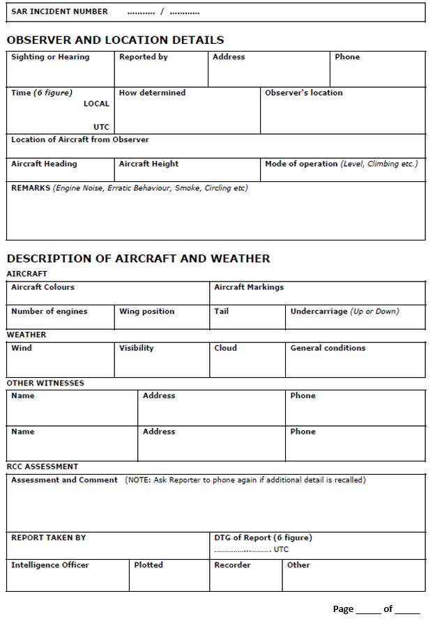

---
## Page 44

 
 
 
Appendices 
NATIONAL SEARCH AND RESCUE MANUAL 
2025 EDITION Version 1 – February 2025 
Page 377 
Sighting and Hearing Report – Generic

---
## Page 45

 
 
 
 
Appendices 
 
NATIONAL SEARCH AND RESCUE MANUAL 
Page 378 
2025 EDITION Version 1 – February 2025 
Sighting and/or Hearing Log

---
## Page 46

 
 
 
Appendices 
NATIONAL SEARCH AND RESCUE MANUAL 
2025 EDITION Version 1 – February 2025 
Page 379 
Appendix D-5 Tables and Graphs 
Overview 
Local Wind Current 
Figure D-5:1 Local Wind Current Graph 
Leeway Tables (kt) 
Table D-5:1 Leeway Speed and Direction Values for Drift Objects 
Table D-5:2 Sub-Table for Maritime Life Rafts with Deep Ballast Systems and Canopies 
Sweep Width Tables for Visual Search Over Water 
Table D-5:3 Uncorrected Visual Sweep Width for Vessels and Small Boats 
Table D-5:4 Weather Correction Factors for All Types of Search Facilities 
Table D-5:5 Uncorrected Visual Sweep Widths for Merchant Ships [Km (NM)] 
Table D-5:6 (1) Uncorrected Sweep Widths for Fixed-Wing Aircraft (NM) at 500 feet and 1000 feet 
Table D-5:6 (2) Uncorrected Sweep Widths for Fixed-Wing Aircraft (NM) 1500 feet and 2000 feet 
Table D-5:7 (1) Uncorrected Sweep Widths for Helicopters (NM) – Maritime 500 feet and 1000 feet  
Table D-5:7 (2) Uncorrected Sweep Widths for Helicopters (NM) – Maritime 1500 feet and 2000 feet  
Table D-5:8 Speed (velocity) Correction Factors for Helicopter and Fixed-Wing Aircraft Search Facilities 
Sweep Width Tables for Visual Search Over Land: 
Table D-5:9 Uncorrected Sweep Widths for Visual Land Search [Km (NM)]  
Table D-5:10 Correction Factors – Vegetation and High Terrain  
Probability of Detection 
Figure D-5:13 Probability of Detection Graph

---
## Page 47

 
 
 
 
Appendices 
 
NATIONAL SEARCH AND RESCUE MANUAL 
Page 380 
2025 EDITION Version 1 – February 2025 
Local Wind Current 
 
Figure D-5:1 Local Wind Current Graph

---
## Page 48

 
 
 
Appendices 
NATIONAL SEARCH AND RESCUE MANUAL 
2025 EDITION Version 1 – February 2025 
Page 381 
Leeway Tables (kt) 
Leeway Target Class 
Leeway Speed 
Divergence 
Category 
Subcategories 
Primary Leeway 
Descriptors 
Secondary Leeway 
Descriptors 
Multiplier 
Modifier 
(kt) 
Angle 
(deg) 
 
 
0.011 
0.07 
30 
 
Vertical 
 
0.005 
0.07 
18 
PIW 
Sitting 
 
0.012 
0.00 
18 
 
Horizontal 
Survival Suit 
0.014 
0.10 
30 
 
 
Scuba Suit 
0.007 
0.08 
30 
 
 
Deceased 
0.015 
0.08 
30 
Survival Craft 
Maritime  
Life  
Rafts 
No 
Ballast 
Systems 
 
0.042 
0.03 
28 
no canopy, no drogue 
0.057 
0.21 
24 
no canopy, w/ drogue 
0.044 
-0.20 
28 
canopy, no drogue 
0.037 
0.11 
24 
canopy, w/ drogue  
0.030 
0.00 
28 
Shallow  
Ballast  
Systems and  
Canopy 
 
0.029 
0.00 
22 
no drogue 
0.032 
-0.02 
22 
with drogue 
0.025 
0.01 
22 
Capsized 
0.017 
-0.10 
8 
Deep Ballast  
Systems & Canopies 
(See Table I-2 
for Levels 4-6) 
0.030 
0.02 
13 
Other Maritime 
Survival Craft 
life capsule 
0.038 
-0.08 
22 
USCG Sea Rescue Kit 
0.025 
-0.04 
7 
Aviation 
Life Rafts 
no ballast, w/canopy 
Evac/ Slide 
4-6 person, w/o drogue 
0.037 
0.11 
24 
46-person 
0.028 
-0.01 
15 
Person- 
Powered Craft 
Sea Kayak 
W/ Person on aft deck 
0.011 
0.24 
15 
Surfboard 
w/ person 
0.020 
0.00 
15 
Windsurfer 
w/ person and mast & sail in water 
0.023 
0.10 
12 
Sailing 
Vessels 
Mono-hull 
Full Keel  
Deep Draft 
0.030 
0.00 
48 
 
Fin Keel  
Shoal Draft 
0.040 
0.00 
48 
Power Vessels 
Skiffs 
Flat Bottom 
Boston whaler 
0.034 
0.04 
22 
V-hull 
Std. Configuration. 
0.030 
0.08 
15 
Swamped 
0.017 
0.00 
15 
Sport Boats 
Cuddy Cabin 
Modified V-hull 
0.069 
-0.08 
19 
Sport Fisher 
Centre Console 
Open cockpit 
0.060 
-0.09 
22 
Power Vessels 
Commercial  
Fishing 
Vessels 
 
0.037 
0.02 
48 
Sampans 
0.040 
0.00 
48 
Side-stern Trawler 
0.042 
0.00 
48 
Longliners 
0.037 
0.00 
48 
Junk 
0.027 
0.10 
48 
Gill-netter 
w/rear reel 
0.040 
0.01 
33 
Coastal Freighter 
0.028 
0.00 
48 
Boating 
Debris 
F/V debris 
0.020 
0.00 
10 
Bait/wharf box 
holds a cubic 
meter of ice 
 
0.013 
0.27 
31 
lightly loaded  
0.026 
0.18 
15 
fully loaded  
0.016 
0.16 
33 
Table D-5:1 Leeway Speed and Direction Values for Drift Objects (kt)

---
## Page 49

 
 
 
 
Appendices 
 
NATIONAL SEARCH AND RESCUE MANUAL 
Page 382 
2025 EDITION Version 1 – February 2025 
 
Leeway Target Class 
Leeway Speed 
Divergence 
Secondary 
Leeway 
Descriptors 
Capacity 
Modifier 
Drogue Modifier 
Loading Modifier 
Multiplier 
Modifier 
(Kts) 
Angle 
(Deg) 
Maritime  
Life Rafts  
with 
Deep 
Ballast 
Systems 
and 
Canopies 
4-6  
person  
capacity 
 
0.029 
0.04 
15 
without drogue 
 
0.038 
-0.04 
15 
light loading  
0.038 
-0.04 
15 
heavy loading  
0.036 
-0.03 
15 
with drogue 
 
0.018 
0.03 
12 
light loading 
0.016 
0.05 
24 
heavy loading 
0.021 
0.00 
20 
15-25  
person  
capacity 
 
0.036 
-0.09 
10 
without drogue 
light loading 
0.039 
-0.06 
9 
with drogue 
heavy loading 
0.031 
-0.07 
9 
Capsized  
0.009 
0.00 
12 
Swamped  
0.010 
-0.04 
8 
Table D-5:2 Sub-Table for Maritime Life Rafts with Deep Ballast Systems and Canopies (kt) 
Notes: 
1.  
These tables are adapted from Allen and Plourde 1999 Review of Leeway: Field Experiments and 
Implementation. USCG Research and Development Centre Report No CG-D-08-99. 
2.  
Prior to the publication of the data the USCG Research and Development Centre made the decision 
that the only data published would be data that was based on actual results derived from 
documented research and observation during controlled field experiments. However, it has been 
recognised that some anomalies exist in the data pertaining to maritime life rafts with no ballast 
systems. There had been significant time between the initial research done by Hufford and Broida in 
1974 and later research by Nash and Willcox in 1991. Also, it is probable that the make of life raft 
used for the experiments may no longer be in use. 
3.  
SMCs should evaluate the calculated results obtained from using the tables with actual known 
conditions and adjust leeway values as appropriate. 
Taxonomy Class Definitions/Descriptions 
The following section provides information about each of the leeway drift objects in Table D-5:1. For each 
description, the target characteristics are summarised, and pictures are provided where available. These 
target descriptions are in no way meant to be all-inclusive.  They are intended to assist a search planner in 
target identification. Proper identification will make the application of more specific leeway values 
possible.  Some categories in Table D-5:1 do not require further explanation and therefore 
descriptions/pictures are not included. The SAR planner should also be reminded that any classification 
system will have overlap between some categories.  In these cases, a decision must be made about the 
most probable situation. 
a) 
Person-in-Water (PIW) 
b) 
Persons in water including persons without any floatation, and those with a throwable cushion, with 
a PFD, in an anti-exposure suit and in survival/immersion suits

---
## Page 50

 
 
 
Appendices 
NATIONAL SEARCH AND RESCUE MANUAL 
2025 EDITION Version 1 – February 2025 
Page 383 
i) 
Vertical 
Generally, requires a conscious and active PIW to maintain this position. A PIW wearing a 
sport/work vest, anti-exposure suit, or float coat or having no flotation must actively maintain a 
vertical position in the water or become victims in the horizontal position 
ii) 
Sitting 
The classic foetal position with legs drawn up and arms huddled across the PFD. This is the 
preferred position a conscious or unconscious person assumes, especially in cold water, when 
wearing offshore lifejackets, horse-collar lifejackets, or inflatable vests. A conscious PIW 
hanging onto a throwable device will also assume the sitting position until he become 
unconscious at which time he become a victim. 
iii) 
Horizontal 
Three separate configurations place the PIW in a horizontal position. A conscious or 
unconscious PIW wearing a survival suit will float flat on his back. A PIW in scuba gear, with an 
inflated buoyancy vest, will float in a semi-reclined position. The classic floating position of a 
victim is floating face down in the water. 
c) 
Maritime Survival Craft 
This section includes life rafts, lifeboats, and life capsules as illustrated at Figure D-5:2.  It does not 
include dinghies or inflatable boats that may be carried for the same purpose. 
i) 
Maritime Life Rafts 
If there is any question about what type of life raft a vessel may carry, a phone call to life raft 
repair and repackaging facilities close to the homeport of the distressed vessel may provide 
ballast, canopy, size, and drogue information. 
ii) 
Shallow Ballast 
Consists of a series of fabric pockets generally four (4) inches in diameter and less than six 
inches in depth. 
iii) 
Deep Ballast 
Consist of large fabric bags, from three (3)–seven (7) on the raft, that are at least 1’ x 2’ x 2’. 
d) 
Other Maritime Survival Craft 
i) 
Life Capsule 
Fully enclosed crafts commonly used on large merchant and military vessels. 
e) 
Aviation Life Rafts 
 Fall basically into two groups, life rafts and slide rafts. Aviation life rafts are similar to marine life 
rafts but are usually made from lighter materials. 
i) 
Evacuation/Slide 
Slide rafts are specifically designed devices intended to ease evacuation from an aircraft. They 
mount to doorframes or near wing emergency exits and are cut loose from the airframe once 
fully loaded. 
f) 
Person-Powered Craft 
 This description includes all forms of rowed or paddled boats including rowboats, inflatable boats 
without motors, canoes, kayaks, stand up paddle boards, surfboards and windsurfers.  
 For examples, see Figure D-5:3.

---
## Page 51

 
 
 
 
Appendices 
 
NATIONAL SEARCH AND RESCUE MANUAL 
Page 384 
2025 EDITION Version 1 – February 2025 
g) 
Mono-hull Sailing Vessel 
 It is assumed that all targets in this category are adrift; therefore, sails are down or missing and the 
crew is unable to manoeuvre the vessel at all. A class of small to medium sized sailing vessels 
generally less than 20 ft and never more than 30 ft in length, they are typically designed for a single 
purpose such as racing or day sailing. 
i) 
Full Keel 
Small to medium sized sailboats whose keel runs the full length or nearly the full length of the 
hull.  While the forward portion of the keel is modified or eliminated on some full keel 
sailboats, the keel on all full keel sailboats extends aft to the rudder. This is an old hull design 
and is not commonly used in new hull construction due to the relatively slow sailing speeds of 
this hull design. 
ii) 
Fin Keel 
Small to medium sized sailboats with permanent keel skegs that do not extend aft to the 
rudder. 
h) 
Skiffs 
Open boats less than 20 ft long that use an outboard motor as the primary source of propulsion.  
Some have characteristics identical to rowed boats with the exception that an outboard motor has 
been attached to the stern.  This group includes, but is not limited to, tenders for larger vessels, bass 
boats, hunting boats, Jon boats, and a large category of utility boats. Skiffs are usually found on lakes 
and rivers but are also common in the calm waters of many bays and rivers that provide access to 
the open ocean. 
i) 
Personal Water Craft 
Include a number of different designs for one or more persons. Generally, there are stand up models 
and ride on models. Some craft marketed as PWC closely resemble small sport boats. Most PWC’s 
have water jet propulsion.  No leeway drift experiments have yet been performed on PWC’s and 
they do not appear within Table D-5-1. Leeway category choice should be based on number of 
passengers / loading, size of PWC (draft, length, freeboard) of PWC. These factors may be 
comparable (not exactly) to several other leeway targets. 
j) 
Sport Boats 
Includes pleasure craft from 15 to 28 feet long with beamwidths from roughly 6 to 9 feet. 
They include metal, fibreglass, and wood vessels with a V, modified-V, or deep-V hull form.  Sport 
boats can be outfitted with inboard, outboard, or I/O propulsion. This category includes side console 
(closed bow and bow riders) and cuddy cabin boats. (Figure D-5:8) 
k) 
Sport Fisher 
Include pleasure and commercial craft from 17 to approximately 100 feet long with beam widths up 
to 24 ft. The majority are between 30 and 50 ft long, with beam widths between 10 and 15 ft. This 
class includes both semi-displacement and planning hull forms that can be outfitted with inboard, 
outboard, or I/O propulsion.  This category includes boats with simple centre console or walk-round 
cabin. Convertibles are sport fishers with a walk around cabin and flying bridge. Convertibles 
designed for offshore fishing may also have a spotting tower. Many convertibles provide extended 
cruising capabilities similar to sport cruisers, but their after-deck design provides a larger open area 
to work fishing gear.  Some of these vessels can also be found in the cruiser or motor yacht 
categories. (Figure D-5:9) 
l) 
Multi-hulled vessels 
Multi-hulled vessels: these vessels differ from monohulls in that they have either two similar sized 
parallel hulls or a larger centre hull with two smaller ones on either beam. These vessels range in 
size from small hobby vessels of 4-5m in length to ferries and tourist vessels. All but the smallest 
have living quarters in the hulls and possible on the deck that joins them. They can be sail or motor

---
## Page 52

 
 
 
Appendices 
NATIONAL SEARCH AND RESCUE MANUAL 
2025 EDITION Version 1 – February 2025 
Page 385 
driven, or a combination of both. There is no current separate category in the leeway tables for 
vessels of this style. (Figure D-5:10) 
m) Commercial Fishing Vessels 
Include vessels from 45 to 100 feet long designed for fishing or shell fishing in coastal and ocean 
waters.  They include side and stern trawling rigs, long liners, bottom dragging rigs, and purse 
seiners. Pole fishers are simply modified use of a sport fisher or sport cruiser and should be treated 
as such. Commercial fishers can be working alone, as paired vessels, or can be the mother ship to a 
group of smaller fishing skiffs.  These vessels have different design features based on their purpose, 
but all have some form of deckhouse and an open area from which nets can lines are worked.  A 
deck winch and boom system are commonly used to handle nets or lines. (Figure D-5:11) 
n) 
Coastal Freighter 
Include a wide range of commercial shipping platforms up to 100 feet in length. These vessels 
transfer cargo from one port to another, and shipping agents can provide estimated voyage 
schedules.  Coastal freighters include vessels with a deckhouse on the forecastle, a midships 
deckhouse (common to cargo vessels), and an aft deckhouse (common to tankers and container 
ships).  Leeway of these vessels will of course not only vary with respect to deckhouse location; it 
will also be greatly affected by loading, amount, and type of cargo. (Figure D-5:12) 
o) 
Boating Debris 
Includes any debris that can be expected from a boat that is sinking and/or breaking up.  It may 
include paper or plastic containers, bedding or clothing, and a variety of fragmented boat sections. 
i) 
Fishing Debris 
Debris typical to a fishing vessel such as lifejacket, life ring, fishing float balls, a fishing box lid, 
or wooden boards 
ii) 
Bait/Wharf Box 
Commercially available 1.1 X 1.5 metre plastic box used by commercial fisherman for holding 
ice and/or fish. Although not it’s intended use, it could also serve as a floatation/life raft by 
persons in distress. 
• 
Lightly loaded.  Approximately 200 lbs / 90.7 kg. (simulation of one person) 
• 
Fully loaded. Approximately 800 lbs / 362.8 kg. (simulation of four persons)

---
## Page 53

 
 
 
 
Appendices 
 
NATIONAL SEARCH AND RESCUE MANUAL 
Page 386 
2025 EDITION Version 1 – February 2025 
 
Figure D-5:2 Maritime Survival Craft 
 
 
 
 
 
Figure D-5:3 Person-Powered Craft 
 
Figure D-5:4 Full Keel One Design Sailboat 
Sail Board 
Sea Kayak 
Surf Board 
Row Boat 
Canoe

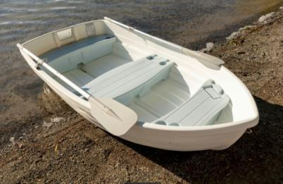

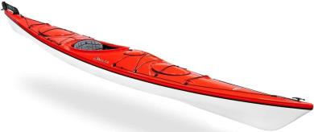

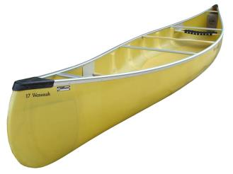

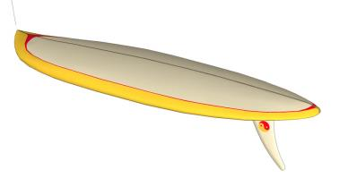

---
## Page 54

 
 
 
Appendices 
NATIONAL SEARCH AND RESCUE MANUAL 
2025 EDITION Version 1 – February 2025 
Page 387 
 
Figure D-5:5 16 Dagger Keel One-Design Sailboat 
 
Figure D-5:6 Skiffs 
 
Figure D:5-7 Personal Water Craft 
 
Figure D-5:8 Sports Boats

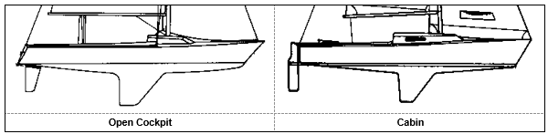

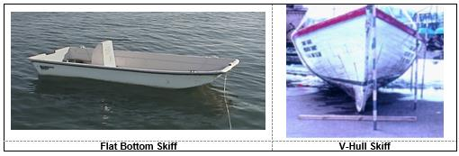

---
## Page 55

 
 
 
 
Appendices 
 
NATIONAL SEARCH AND RESCUE MANUAL 
Page 388 
2025 EDITION Version 1 – February 2025 
 
Figure D-5:9 Sport Fishers 
 
 
 
 
 
Figure D-5:10 Multi-hulled vessels

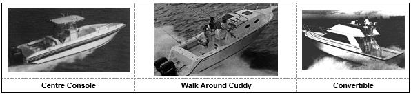

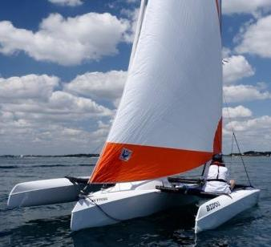

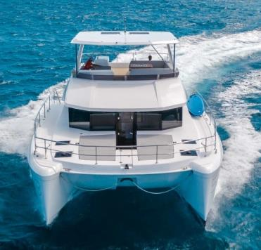

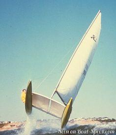

---
## Page 56

 
 
 
Appendices 
NATIONAL SEARCH AND RESCUE MANUAL 
2025 EDITION Version 1 – February 2025 
Page 389 
 
Figure D-5:11 Commercial Fishers 
 
Figure D-5:12 Coastal Freighters

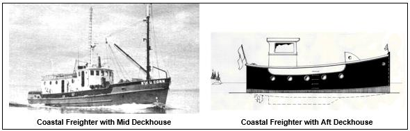

---
## Page 57

 
 
 
 
Appendices 
 
NATIONAL SEARCH AND RESCUE MANUAL 
Page 390 
2025 EDITION Version 1 – February 2025 
Probability of Detection 
 
Figure D-5:13 Probability of Detection

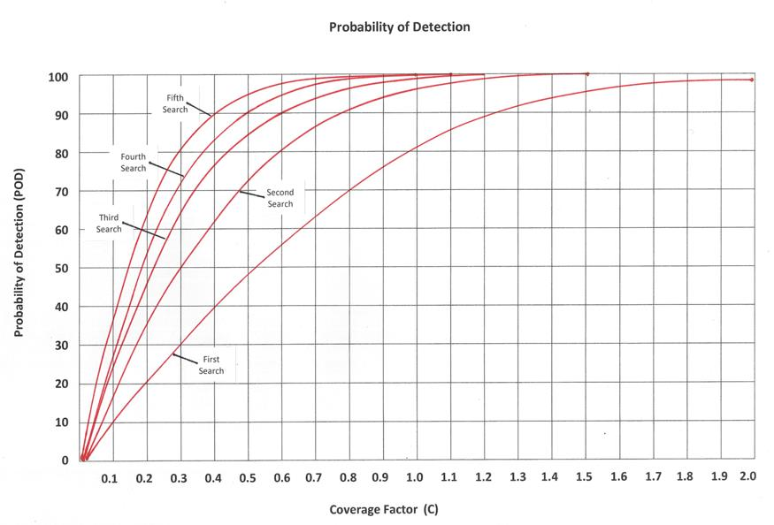

---
## Page 58

 
 
 
Appendices 
NATIONAL SEARCH AND RESCUE MANUAL 
2025 EDITION Version 1 – February 2025 
Page 391 
Sweep Widths and Correction Factors 
Sweep Width Tables for Visual Search over Water 
SEARCH OBJECT 
Height of eye 8’ 
Visibility in kilometres/NM 
Height of eye 14’ 
Visibility in kilometres/NM 
2/ 
1.1 
5/ 
2.7 
10/ 
5.4 
15/ 
8.1 
20/ 
10.8 
>25/ 
13.5 
2/ 
1.1 
5/ 
2.7 
10/ 
5.4 
15/ 
8.1 
20/ 
10.8 
>25/ 
13.5 
Person in water 
0.2 
0.2 
0.3 
0.3 
0.3 
0.3 
0.3 
0.4 
0.5 
0.6 
0.6 
0.6 
Raft 1 Person 
0.7 
1.2 
1.8 
2.1 
2.4 
2.5 
1.0 
1.6 
2.5 
2.9 
3.2 
3.3 
Raft 4 Person 
0.8 
1.5 
2.3 
2.9 
3.2 
3.4 
1.1 
2.0 
3.1 
3.8 
4.2 
4.4 
Raft 6 Person 
0.9 
1.7 
2.7 
3.4 
3.8 
4.1 
1.2 
2.2 
3.5 
4.4 
5.0 
5.3 
Raft 8 Person 
0.9 
1.7 
2.8 
3.5 
4.0 
4.2 
1.2 
2.3 
3.6 
4.5 
5.1 
5.4 
Raft 10 person 
0.9 
1.8 
2.9 
3.7 
4.2 
4.6 
1.2 
2.3 
3.7 
4.7 
5.4 
5.8 
Raft 15 Person 
1.0 
2.0 
3.2 
4.0 
4.5 
4.9 
1.2 
2.5 
4.0 
5.1 
5.7 
6.2 
Raft 20 Person 
1.0 
2.1 
3.5 
4.4 
5.1 
5.6 
1.3 
2.6 
4.3 
5.7 
6.4 
6.9 
Raft 25 Person 
1.0 
2.2 
3.7 
4.7 
5.5 
6.0 
1.3 
2.7 
4.3 
5.8 
6.7 
7.5 
Power Boat <5 m (15 ft) 
0.5 
0.7 
1.0 
1.2 
1.3 
1.4 
0.5 
1.0 
1.5 
1.8 
1.9 
2.0 
Power Boat 5-8 m (15-25 ft) 
0.8 
1.4 
2.3 
2.9 
3.4 
3.8 
1.0 
1.9 
3.0 
3.9 
4.5 
5.0 
Power Boat 8-12 m (25-40 ft) 
0.8 
1.8 
3.1 
4.1 
4.9 
5.6 
1.2 
2.3 
4.0 
5.3 
6.4 
7.3 
Power Boat 12-20 m (40-65 ft) 
0.9 
2.2 
4.2 
5.9 
7.4 
8.7 
1.2 
3.0 
5.4 
7.6 
9.6 
11.3 
Power Boat 20-27 m (65-90 ft) 
0.9 
2.3 
4.6 
6.8 
8.8 
10.6 
1.2 
3.0 
6.0 
8.7 
11.3 
13.6 
Sail Boat 5 m (15 ft) 
0.8 
1.4 
2.2 
2.7 
3.1 
3.4 
1.0 
1.8 
2.8 
3.5 
4.1 
4.5 
Sail Boat 6 m (20 ft) 
0.8 
1.6 
2.6 
3.3 
3.9 
4.4 
1.1 
2.0 
3.3 
4.3 
5.0 
5.6 
Sail Boat 8 m (25 ft) 
0.9 
1.8 
2.9 
3.9 
4.6 
5.1 
1.1 
2.2 
3.8 
5.0 
5.9 
6.7 
Sail Boat 9 m (30 ft) 
0.9 
2.0 
3.4 
4.6 
5.5 
6.3 
1.2 
2.5 
4.4 
5.9 
7.1 
8.1 
Sail Boat 12 m (40 ft) 
0.9 
2.2 
4.1 
5.7 
7.0 
8.1 
1.3 
2.8 
5.2 
7.2 
9.0 
10.5 
Sail Boat 15 m (50 ft) 
0.9 
2.2 
4.3 
6.1 
7.7 
9.1 
1.2 
2.9 
5.2 
7.9 
9.9 
11.7 
Sail Boat 20-23 m (65-75 ft) 
0.9 
2.3 
4.5 
6.5 
8.3 
9.9 
1.2 
3.0 
5.8 
8.4 
10.8 
12.9 
Sail Boat 23-27 m (75-90 ft) 
0.9 
2.4 
4.7 
6.8 
8.9 
10.7 
1.2 
3.1 
6.1 
8.9 
11.5 
13.8 
Table D-5:3 Uncorrected Visual Sweep Width for Vessels and Small Boats (NM) 
Note: A sailboat is only a sailboat if the sails are up. If the sails are down, the craft should be classed as a 
powerboat.

---
## Page 59

 
 
 
 
Appendices 
 
NATIONAL SEARCH AND RESCUE MANUAL 
Page 392 
2025 EDITION Version 1 – February 2025 
Weather Correction Factors for all Types of Search Facilities 
 
Search Object 
Weather: Winds Km/h (kt) or seas m (ft) 
Person in water, raft 
or boat <10 m (33 ft) 
Other search 
objects 
Winds <28 Km/h (<15 kts) or seas 0-1 m (0-3 ft) 
1.0 
1.0 
Winds 28-46 Km/h (15-25 kts) or seas 1-1.5 m (3-5 ft) 
0.5 
0.8 
Winds >46 Km/h (>25 kts) or seas >1.5 m (>5 ft) 
0.25 
0.5 
Table D-5:4 Weather Correction Factors for all Types of Search Facilities 
Note: This table differs from IAMSAR for other search objects in winds greater than 15 kts. This is based 
on previous values used and observations of the reported effects of high winds on sweep width values in 
actual SAR incidents. 
Uncorrected Visual Sweep Widths for Merchant Ships (NM) 
Height of eye correlates to 
bridge of a merchant ship 
Meteorological visibility [Km] 
Search Object 
5 Km 
10 Km 
20 Km 
30 Km 
40 Km 
Person in water 
0.4 
0.5 
0.6 
0.7 
0.7 
4-person life raft 
2.3 
3.2 
4.2 
4.9 
5.5 
6-person life raft 
2.5 
3.6 
5.0 
6.2 
6.9 
15-person life raft 
2.6 
4.0 
5.1 
6.4 
7.3 
25-person life raft 
2.7 
4.2 
5.2 
6.5 
7.5 
Boat <5 m (17 ft) 
1.1 
1.4 
1.9 
2.1 
2.3 
Boat <7 m (23 ft) 
2.0 
2.9 
4.3 
5.2 
5.8 
Boat <12 m (40 ft) 
2.8 
4.5 
7.6 
9.4 
11.6 
Boat <24 m (79 ft) 
3.2 
5.6 
10.7 
14.7 
18.1 
Table D-5:5 Uncorrected Visual Sweep Widths for Merchant Ships (NM)

---
## Page 60

 
 
 
Appendices 
NATIONAL SEARCH AND RESCUE MANUAL 
2025 EDITION Version 1 – February 2025 
Page 393 
 
 
 
 
 
 
 
 
 
 
 
This page has intentionally been left blank

---
## Page 61

 
 
 
 
Appendices 
 
NATIONAL SEARCH AND RESCUE MANUAL 
Page 394 
2025 EDITION Version 1 – February 2025 
Uncorrected Sweep Widths for Fixed-Wing Aircraft (NM) at 500 ft and 1000 ft 
Search Object 
Altitude 500 (ft) 
Altitude 1000 (ft) 
Visibility Km/NM 
Visibility Km/NM 
2/ 
1.1 
5/ 
2.7 
10/ 
5.4 
20/ 
10.8 
30/ 
16.2 
>40/ 
21.6 
2/ 
1.1 
5/ 
2.7 
10/ 
5.4 
20/ 
10.8 
30/ 
16.2 
>40/ 
21.6 
Person in water 
0.0 
0.1 
0.1 
0.1 
0.1 
0.1 
0.0 
0.1 
0.1 
0.1 
0.1 
0.1 
Raft 1 person 
0.3 
0.7 
0.9 
1.2 
1.4 
1.4 
0.3 
0.7 
0.9 
1.2 
1.4 
1.4 
Raft 4 Person 
0.4 
1.0 
1.3 
1.8 
2.0 
2.2 
0.3 
1.0 
1.3 
1.8 
2.1 
2.3 
Raft 6 Person 
0.4 
1.1 
1.5 
2.2 
2.5 
2.8 
0.4 
1.1 
1.6 
2.2 
2.6 
2.8 
Raft 8 Person 
0.4 
1.2 
1.6 
2.3 
2.7 
2.9 
0.4 
1.2 
1.7 
2.4 
2.8 
3.0 
Raft 10 Person 
0.4 
1.2 
1.7 
2.5 
2.9 
3.2 
0.4 
1.3 
1.8 
2.6 
3.0 
3.3 
Raft 15 Person 
0.5 
1.3 
1.9 
2.7 
3.3 
3.6 
0.4 
1.4 
2.0 
2.8 
3.4 
3.7 
Raft 20 Person 
0.5 
1.5 
2.1 
3.2 
3.8 
4.2 
0.4 
1.5 
2.2 
3.2 
3.9 
4.3 
Raft 25 Person 
0.5 
1.6 
2.3 
3.4 
4.1 
4.6 
0.4 
1.6 
2.3 
3.5 
4.2 
4.7 
Power Boat <5 m (15 ft) 
0.4 
0.9 
1.2 
1.5 
1.7 
1.8 
0.4 
1.0 
1.3 
1.7 
1.8 
2.0 
Power Boat 5-8 m (15-25 ft) 
0.5 
1.7 
2.4 
3.6 
4.3 
4.8 
0.5 
1.7 
2.5 
3.7 
4.4 
5.0 
Power Boat 8-12 m (25-40 ft) 
0.6 
2.1 
3.3 
5.3 
6.7 
7.7 
0.5 
2.2 
3.4 
5.4 
6.8 
7.8 
Power Boat 12-20 m (40-65 ft) 
0.6 
2.7 
4.5 
8.1 
10.9 
13.1 
0.6 
2.7 
4.5 
8.2 
10.9 
13.1 
Power Boat 20-27 m (65-90 ft) 
0.6 
2.8 
5.0 
9.8 
13.5 
16.7 
0.6 
2.8 
5.1 
9.8 
13.6 
16.7 
Sail Boat 5 m (15 ft) 
0.5 
1.6 
2.2 
3.2 
3.9 
4.3 
0.5 
1.6 
2.3 
3.3 
4.0 
4.4 
Sail Boat 8 m (25 ft) 
0.6 
2.0 
3.1 
4.9 
6.1 
7.0 
0.5 
2.1 
3.2 
5.0 
6.2 
7.1 
Sail Boat 12 m (40 ft) 
0.6 
2.6 
4.3 
7.6 
10.0 
11.9 
0.6 
2.6 
4.3 
7.6 
10.9 
12.0 
Sail Boat 15 m (50 ft) 
0.8 
2.7 
4.6 
8.4 
11.3 
13.7 
0.6 
2.7 
4.6 
8.5 
11.4 
13.7 
Sail Boat 20-23 m (65-75 ft) 
0.6 
2.8 
4.9 
9.3 
12.7 
15.5 
0.6 
2.8 
4.9 
9.3 
12.8 
15.6 
Sail Boat 23-27 m (75-90 ft) 
0.6 
2.8 
5.1 
9.9 
13.7 
17.0 
0.6 
2.8 
5.1 
9.9 
13.6 
17.0 
Ship 27-46 m (90-150 ft) 
0.6 
2.9 
5.4 
11.1 
15.9 
20.1 
0.6 
2.9 
5.4 
11.1 
15.9 
20.1 
Ship 46-91 m (150-300 ft) 
0.6 
3.0 
5.7 
12.5 
18.9 
24.7 
0.6 
3.0 
5.7 
12.5 
18.9 
24.7 
Ship >91 m (>300 ft) 
0.7 
3.0 
5.8 
13.2 
20.6 
27.9 
0.6 
3.0 
5.8 
13.2 
20.6 
27.9 
Table D-5:6 (1) Uncorrected Sweep Widths for Fixed-Wing Aircraft (NM) at 500 ft and 1000 ft 
Notes:  
1. 
For search altitudes of 500 feet only, the sweep width values for a person in water may be multiplied 
by four (4), if it is known that the person is wearing a flotation device. 
2. 
A sailboat is only a sailboat if the sails are up. If the sails are down, the craft should be classed as a 
powerboat.

---
## Page 62

 
 
 
Appendices 
NATIONAL SEARCH AND RESCUE MANUAL 
2025 EDITION Version 1 – February 2025 
Page 395 
Weather Correction Factors for all Types of Search Facilities 
 
Search Object 
Weather: Winds Km/h (kt) or seas m (ft) 
Person in water, raft 
or boat <10 m (33 ft) 
Other search 
objects 
Winds <28 Km/h (<15 kts) or seas 0-1 m (0-3 ft) 
1.0 
1.0 
Winds 28-46 Km/h (15-25 kts) or seas 1-1.5 m (3-5 ft) 
0.5 
0.8 
Winds >46 Km/h (>25 kts) or seas >1.5 m (>5 ft) 
0.25 
0.5 
Table D-5:4 Weather Correction Factors for all Types of Search Facilities 
 
Note: This table differs from IAMSAR for other search objects in winds greater than 15 kts. This is based 
on previous values used and observations of the reported effects of high winds on sweep width values in 
actual SAR incidents.

---
## Page 63

 
 
 
 
Appendices 
 
NATIONAL SEARCH AND RESCUE MANUAL 
Page 396 
2025 EDITION Version 1 – February 2025 
Uncorrected Sweep Widths for Fixed-Wing Aircraft (NM) at 1500 ft and 2000 ft 
Search Object 
[Metres (ft)] 
Altitude 1500 (ft) 
Altitude 2000 (ft) 
Visibility [Km] 
Visibility [Km] 
2 
5 
10 
20 
30 
>40 
2 
5 
10 
20 
30 
>40 
Person in Water 
0.0 
0.0 
0.0 
0.0 
0.0 
0.1 
0.0 
0.0 
0.0 
0.0 
0.0 
0.0 
  
 
 
 
 
 
 
 
 
 
 
 
 
Raft 1 person 
0.2 
0.7 
0.9 
1.3 
1.4 
1.4 
0.1 
0.6 
0.9 
1.2 
1.4 
1.4 
Raft 4 person 
0.3 
1.0 
1.3 
1.9 
2.1 
2.3 
0.2 
0.9 
1.3 
1.9 
2.2 
2.3 
Raft 6 person 
0.3 
1.1 
1.6 
2.3 
2.6 
2.9 
0.2 
1.1 
1.6 
2.3 
2.7 
2.9 
Raft 8 person 
0.3 
1.2 
1.7 
2.4 
2.8 
3.1 
0.2 
1.2 
1.7 
2.5 
2.9 
3.2 
Raft 10 person 
0.3 
1.3 
1.8 
2.6 
3.1 
3.4 
0.2 
1.2 
1.8 
2.7 
3.1 
3.5 
Raft 15 person 
0.3 
1.4 
2.0 
2.9 
3.4 
3.8 
0.2 
1.4 
2.0 
3.0 
3.5 
3.9 
Raft 20 person 
0.4 
1.5 
2.2 
3.3 
4.0 
4.4 
0.4 
1.5 
2.2 
3.4 
4.0 
4.5 
Raft 25 person 
0.4 
1.6 
2.4 
3.6 
4.3 
4.8 
0.3 
1.6 
2.4 
3.6 
4.4 
4.9 
 
 
 
 
 
 
 
 
 
 
 
 
 
Power Boat <5 (15 ft) 
0.3 
1.0 
1.3 
1.7 
2.0 
2.1 
0.2 
1.0 
1.3 
1.8 
2.0 
2.2 
Power Boat 6 (20 ft) 
0.4 
1.7 
2.5 
3.7 
4.5 
5.1 
0.3 
1.7 
2.5 
3.8 
4.6 
5.1 
Power Boat 10 (33 ft) 
0.5 
2.2 
3.4 
5.5 
6.8 
7.9 
0.3 
2.2 
3.4 
5.5 
6.9 
8.0 
Power Boat 16 (53 ft) 
0.5 
2.6 
4.5 
8.2 
11.0 13.2 
0.4 
2.6 
4.5 
8.3 
11.0 13.3 
Power Boat 24 (78 ft) 
0.5 
2.8 
5.1 
9.8 
13.6 16.7 
0.4 
2.8 
5.0 
9.8 
13.6 16.8 
  
 
 
 
 
 
 
 
 
 
 
 
 
Sail Boat 5 (15 ft) 
0.4 
1.6 
2.3 
3.4 
4.1 
4.5 
0.3 
1.6 
2.3 
3.5 
4.1 
4.5 
Sail Boat 8 (26 ft) 
0.5 
2.1 
3.2 
5.1 
6.3 
7.2 
0.3 
2.1 
3.3 
5.2 
6.4 
7.3 
Sail Boat 12 (39 ft) 
0.5 
2.6 
4.3 
7.6 
10.1 12.0 
0.4 
2.5 
4.3 
7.7 
10.1 12.1 
Sail Boat 15 (49 ft) 
0.5 
2.7 
4.6 
8.5 
11.4 13.8 
0.4 
2.7 
4.6 
8.6 
11.5 13.9 
Sail Boat 21 (69 ft) 
0.5 
2.8 
4.9 
9.4 
12.8 15.7 
0.4 
2.7 
4.9 
9.4 
12.9 15.7 
Sail Boat 25 (83 ft) 
0.5 
2.8 
5.1 
10.0 13.8 17.1 
0.4 
2.8 
5.1 
10.0 13.9 17.1 
  
 
 
 
 
 
 
 
 
 
 
 
 
Ship 27-46 (90-150 ft) 
0.5 
2.9 
5.4 
11.1 16.0 20.1 
0.4 
2.9 
5.4 
11.1 16.0 20.1 
Ship 46-91 (150-300 ft) 
0.5 
3.0 
5.7 
12.5 18.9 24.7 
0.4 
3.0 
5.7 
12.5 18.9 24.7 
Ship > 91 (>300 ft) 
0.6 
3.0 
5.8 
13.2 20.7 27.9 
0.5 
3.0 
5.8 
13.2 20.6 27.9 
Table D-5:6 (2) Uncorrected Sweep Widths for Fixed-Wing Aircraft (NM) at 1500 ft and 2000 ft 
Note:  
 
1. 
For search altitudes of 500 feet only, the sweep width values for a person in water may be multiplied 
by 4, if it is known that the person is wearing a flotation device. 
2. 
A sailboat is only a sailboat if the sails are up. If the sails are down, the craft should be classed as a 
powerboat.

---
## Page 64

 
 
 
Appendices 
NATIONAL SEARCH AND RESCUE MANUAL 
2025 EDITION Version 1 – February 2025 
Page 397 
Weather Correction Factors for all Types of Search Facilities 
 
Search Object 
Weather: Winds Km/h (kt) or seas m (ft) 
Person in water, raft 
or boat <10 m (33 ft) 
Other search 
objects 
Winds <28 Km/h (<15 kts) or seas 0-1 m (0-3 ft) 
1.0 
1.0 
Winds 28-46 Km/h (15-25 kts) or seas 1-1.5 m (3-5 ft) 
0.5 
0.8 
Winds >46 Km/h (>25 kts) or seas >1.5 m (>5 ft) 
0.25 
0.5 
Table D-5:4 Weather Correction Factors for all Types of Search Facilities 
Note: This table differs from IAMSAR for other search objects in winds greater than 15 kts.  This is based 
on previous values used and observations of the reported effects of high winds on sweep width values in 
actual SAR incidents.

---
## Page 65

 
 
 
 
Appendices 
 
NATIONAL SEARCH AND RESCUE MANUAL 
Page 398 
2025 EDITION Version 1 – February 2025 
Uncorrected Sweep Widths for Helicopters (NM) – Maritime 500 ft and 1000 ft 
Search Object 
[Metres (ft)] 
Altitude 500 (ft) 
Altitude 1000 (ft) 
Visibility [Km] 
Visibility [Km] 
2 
5 
10 
20 
30 
>40 
2 
5 
10 
20 
30 
>40 
Person in Water 
0.0 
0.1 
0.1 
0.1 
0.1 
0.1 
0.0 
0.1 
0.1 
0.1 
0.1 
0.1 
  
 
 
 
 
 
 
 
 
 
 
 
 
Raft 1 person 
0.4 
0.9 
1.2 
1.6 
1.8 
1.8 
0.4 
0.9 
1.2 
1.6 
1.8 
1.8 
Raft 4 person 
0.5 
1.2 
1.6 
2.2 
2.6 
2.8 
0.5 
1.2 
1.7 
2.3 
2.6 
2.9 
Raft 6 person 
0.5 
1.4 
1.9 
2.7 
3.2 
3.5 
0.5 
1.4 
2.0 
2.8 
3.2 
3.5 
Raft 8 person 
0.6 
1.5 
2.0 
2.8 
3.3 
3.7 
0.5 
1.5 
2.1 
2.9 
3.4 
3.8 
Raft 10 person 
0.6 
1.6 
2.2 
3.1 
3.6 
4.0 
0.5 
1.6 
2.2 
3.2 
3.7 
4.1 
Raft 15 person 
0.6 
1.7 
2.3 
3.3 
4.0 
4.4 
0.6 
1.7 
2.4 
3.5 
4.1 
4.5 
Raft 20 person 
0.6 
1.8 
2.6 
3.8 
4.6 
5.1 
0.6 
1.8 
2.7 
3.9 
4.7 
5.2 
Raft 25 person 
0.6 
1.9 
2.7 
4.1 
5.0 
5.6 
0.6 
1.9 
2.8 
4.2 
5.1 
5.7 
  
 
 
 
 
 
 
 
 
 
 
 
 
Power Boat <5 (15 ft) 
0.5 
1.2 
1.5 
1.9 
2.2 
2.3 
0.5 
1.2 
1.6 
2.1 
2.3 
2.5 
Power Boat 6 (20 ft) 
0.7 
2.0 
2.9 
4.3 
5.2 
5.8 
0.7 
2.1 
3.0 
4.4 
5.3 
5.9 
Power Boat 10 (33 ft) 
0.8 
2.5 
3.9 
6.2 
7.8 
9.0 
0.7 
2.6 
3.9 
6.3 
7.9 
9.1 
Power Boat 16 (53 ft) 
0.8 
3.1 
5.1 
9.2 
12.3 
14.7 
0.7 
3.1 
5.2 
9.2 
12.3 
14.8 
Power Boat 24 (78 ft) 
0.8 
3.3 
5.7 
10.8 15.0 
18.4 
0.8 
3.3 
5.7 
10.9 15.0 
18.5 
  
 
 
 
 
 
 
 
 
 
 
 
 
Sail Boat 5 (15 ft) 
0.7 
1.9 
2.7 
3.9 
4.7 
5.2 
0.6 
1.9 
2.8 
4.0 
4.8 
5.4 
Sail Boat 8 (26 ft) 
0.8 
2.4 
3.7 
5.7 
7.1 
8.2 
0.7 
2.5 
3.7 
5.8 
7.3 
8.3 
Sail Boat 12 (39 ft) 
0.8 
3.0 
4.9 
8.3 
11.3 
13.5 
0.7 
3.0 
4.9 
8.6 
11.4 
13.5 
Sail Boat 15 (49 ft) 
0.8 
3.1 
5.2 
9.5 
12.7 
15.3 
0.7 
3.1 
5.3 
9.5 
12.8 
15.4 
Sail Boat 21 (69 ft) 
0.8 
3.2 
5.5 
10.4 14.1 
17.3 
0.8 
3.2 
5.6 
10.4 14.2 
17.3 
Sail Boat 25 (83 ft) 
0.8 
3.3 
5.7 
11.0 15.2 
18.7 
0.8 
3.3 
5.7 
11.0 15.3 
18.8 
  
 
 
 
 
 
 
 
 
 
 
 
 
Ship 27-46 (90-150 ft) 
0.8 
3.4 
6.0 
12.2 17.4 
21.9 
0.8 
3.4 
6.0 
12.2 17.4 
21.9 
Ship 46-91 (150-300 ft) 
0.8 
3.4 
6.3 
13.6 20.4 
26.6 
0.8 
3.4 
6.3 
13.6 20.4 
26.6 
Ship > 91 (>300 ft) 
0.8 
3.5 
6.4 
14.3 22.1 
29.8 
0.8 
3.5 
6.4 
14.3 22.2 
29.8 
Table D-5:7 (1) Uncorrected Sweep Widths for Helicopters (NM) – Maritime 500 ft and 1000 ft 
Notes:  
1. 
For search altitudes of 500 feet only, the sweep width values for a person in water may be multiplied 
by four (4), if it is known that the person is wearing a flotation device. 
2. 
A sailboat is only a sailboat if the sails are up. If the sails are down, the craft should be classed as a 
powerboat.

---
## Page 66

 
 
 
Appendices 
NATIONAL SEARCH AND RESCUE MANUAL 
2025 EDITION Version 1 – February 2025 
Page 399 
Weather correction factors for all types of search facilities 
 
Search Object 
Weather: winds Km/h (kt) or seas m (ft) 
Person in water, raft 
or boat < 10 m (33 ft) 
Other search 
objects 
Winds <28 Km/h (<15 kt) or seas 0-1 m (0-3 ft) 
1.0 
1.0 
Winds 28-46 Km/h (15-25 kt) or seas 1-1.5 m (3-5 ft) 
0.5 
0.8 
Winds >46 Km/h (> 25 kt) or seas > 1.5 m (> 5 ft) 
0.25 
0.5 
Table D-5:4 Weather Correction Factors for all Types of Search Facilities 
Note: This table differs from IAMSAR for other search objects in winds greater than 15 kts.  This is based 
on previous values used and observations of the reported effects of high winds on sweep width values in 
actual SAR incidents.

---
## Page 67

 
 
 
 
Appendices 
 
NATIONAL SEARCH AND RESCUE MANUAL 
Page 400 
2025 EDITION Version 1 – February 2025 
Uncorrected Sweep Widths for Helicopters (NM) - Maritime 1500 ft and 2000 ft 
Search Object 
[Metres (ft)] 
Altitude 1500 (ft) 
Altitude 2000 (ft) 
Visibility [Km] 
Visibility [Km] 
2 
5 
10 
20 
30 
>40 
2 
5 
10 
20 
30 
>40 
Person in Water 
0.0 
0.0 
0.0 
0.1 
0.1 
0.1 
0.0 
0.0 
0.0 
0.0 
0.0 
0.1 
  
 
 
 
 
 
 
 
 
 
 
 
 
Raft 1 person 
0.3 
0.9 
1.2 
1.6 
1.8 
1.8 
0.2 
0.8 
1.2 
1.6 
1.8 
1.8 
Raft 4 person 
0.4 
1.2 
1.7 
2.3 
2.7 
2.9 
0.3 
1.2 
1.7 
2.3 
2.7 
3.0 
Raft 6 person 
0.4 
1.4 
2.0 
2.8 
3.3 
3.6 
0.3 
1.4 
2.0 
2.8 
3.3 
3.6 
Raft 8 person 
0.4 
1.5 
2.1 
3.0 
3.5 
3.9 
0.3 
1.5 
2.1 
3.0 
3.6 
3.9 
Raft 10 person 
0.4 
1.6 
2.2 
3.2 
3.8 
4.2 
0.3 
1.6 
2.3 
3.3 
3.9 
4.2 
Raft 15 person 
0.5 
1.7 
2.4 
3.5 
4.2 
4.6 
0.3 
1.7 
2.5 
3.6 
4.3 
4.7 
Raft 20 person 
0.5 
1.9 
2.7 
4.0 
4.8 
5.3 
0.4 
1.8 
2.7 
4.0 
4.9 
5.4 
Raft 25 person 
0.5 
2.0 
2.9 
4.3 
5.2 
5.6 
0.4 
1.9 
2.9 
4.3 
5.3 
5.9 
  
 
 
 
 
 
 
 
 
 
 
 
 
Power Boat <5 (15 ft) 
0.4 
1.3 
1.7 
2.2 
2.5 
2.6 
0.3 
1.3 
1.7 
2.3 
2.6 
2.7 
Power Boat 6 (20 ft) 
0.6 
2.1 
3.0 
4.5 
5.4 
6.1 
0.4 
2.1 
3.0 
4.5 
5.5 
6.1 
Power Boat 10 (33 ft) 
0.6 
2.6 
4.0 
6.3 
7.9 
9.2 
0.5 
2.6 
4.0 
6.4 
8.0 
9.3 
Power Boat 16 (53 ft) 
0.7 
3.1 
5.2 
9.3 
12.4 
14.8 
0.5 
3.0 
5.2 
9.3 
12.4 14.9 
Power Boat 24 (78 ft) 
0.7 
3.2 
5.7 
10.9 15.1 
18.5 
0.5 
3.2 
5.7 
10.9 15.1 18.5 
  
 
 
 
 
 
 
 
 
 
 
 
 
Sail Boat 5 (15 ft) 
0.6 
2.0 
2.8 
4.1 
4.9 
5.5 
0.4 
1.9 
2.8 
4.2 
5.0 
5.6 
Sail Boat 8 (26 ft) 
0.6 
2.5 
3.8 
5.9 
7.4 
8.4 
0.5 
2.5 
3.8 
6.0 
7.5 
8.6 
Sail Boat 12 (39 ft) 
0.6 
3.0 
4.9 
8.7 
11.4 
13.6 
0.5 
3.0 
4.9 
8.7 
11.4 13.6 
Sail Boat 15 (49 ft) 
0.7 
3.1 
5.3 
9.6 
12.8 
15.5 
0.5 
3.1 
5.3 
9.6 
12.9 15.5 
Sail Boat 21 (69 ft) 
0.7 
3.2 
5.6 
10.4 14.3 
17.4 
0.5 
3.2 
5.6 
10.5 14.3 17.4 
Sail Boat 25 (83 ft) 
0.7 
3.3 
5.7 
11.1 15.3 
18.8 
0.5 
3.2 
5.7 
11.1 15.4 18.9 
  
 
 
 
 
 
 
 
 
 
 
 
 
Ship 27-46 (90-150 ft) 
0.7 
3.3 
6.0 
12.2 17.5 
22.0 
0.5 
3.3 
6.0 
12.2 17.5 22.0 
Ship 46-91 (150-300 ft) 
0.7 
3.4 
6.3 
13.6 20.4 
26.6 
0.5 
3.4 
6.3 
13.6 20.4 26.6 
Ship > 91 (>300 ft) 
0.7 
3.4 
6.4 
14.3 22.2 
29.8 
0.6 
3.4 
6.4 
14.3 22.2 29.8 
Table D-5:7 (2) Uncorrected Sweep Widths for Helicopters (NM) - Maritime 1500 ft and 2000 ft 
Notes:  
1. 
For search altitudes of 500 feet only, the sweep width values for a person in water may be multiplied 
by four (4), if it is known that the person is wearing a flotation device. 
2. 
A sailboat is only a sailboat if the sails are up. If the sails are down, the craft should be classed as a 
powerboat.

---
## Page 68

 
 
 
Appendices 
NATIONAL SEARCH AND RESCUE MANUAL 
2025 EDITION Version 1 – February 2025 
Page 401 
Weather correction factors for all types of search facilities 
 
Search Object 
Weather: winds Km/h (kt) or seas m (ft) 
Person in water, raft 
or boat < 10 m (33 ft) 
Other search 
objects 
Winds <28 Km/h (<15 kt) or seas 0-1 m (0-3 ft) 
1.0 
1.0 
Winds 28-46 Km/h (15-25 kt) or seas 1-1.5 m (3-5 ft) 
0.5 
0.8 
Winds >46 Km/h (> 25 kt) or seas > 1.5 m (> 5 ft) 
0.25 
0.5 
Table D-5:4 Weather Correction Factors for all Types of Search Facilities 
Note: This table differs from IAMSAR for other search objects in winds greater than 15 kts.  This is based 
on previous values used and observations of the reported effects of high winds on sweep width values in 
actual SAR incidents. 
 
Fixed-wing Aircraft Search Facilities 
 
Fixed Wing Speed (kt) 
Helicopter speed (kt) 
Search Object 
< or = 150 
180 
210 
< or = 60 
90 
120 
140 
Person in Water 
1.2 
1.0 
0.9 
1.5 
1.0 
0.8 
0.7 
Raft 1-4 Person 
1.1 
1.0 
0.9 
1.3 
1.0 
0.9 
0.8 
Raft 6-25 Person 
1.1 
1.0 
0.9 
1.2 
1.0 
0.9 
0.8 
Power Boat - < 8 m (< 25 ft) 
1.1 
1.0 
0.9 
1.2 
1.0 
0.9 
0.8 
Power Boat – 10 m (33 ft) 
1.1 
1.0 
0.9 
1.1 
1.0 
0.9 
0.9 
Power Boat – 16 m (53 ft) 
1.1 
1.0 
1.0 
1.1 
1.0 
0.9 
0.9 
Power Boat – 24 m (78 ft) 
1.1 
1.0 
1.0 
1.1 
1.0 
1.0 
0.9 
Sail Boat - < 8 m (< 25 ft) 
1.1 
1.0 
0.9 
1.2 
1.0 
0.9 
0.9 
Sail Boat – 12 m (39 ft) 
1.1 
1.0 
1.0 
1.1 
1.0 
0.9 
0.9 
Sail Boat – 25 m (83 ft) 
1.1 
1.0 
1.0 
1.1 
1.0 
1.0 
0.9 
Ship – > 27 m (> 90 ft) 
1.0 
1.0 
1.0 
1.1 
1.0 
1.0 
0.9 
Table D-5:8 Speed (velocity) Correction Factors for Helicopter and Fixed-wing Aircraft Search Facilities

---
## Page 69

 
 
 
 
Appendices 
 
NATIONAL SEARCH AND RESCUE MANUAL 
Page 402 
2025 EDITION Version 1 – February 2025 
Sweep Width Tables for Visual Search Over Land 
 
 
Visibility [Km] 
Search object 
Height (ft) 
5 Km 
10 Km 
20 Km 
30 Km 
40 Km 
Person 
500 
0.4 
0.4 
0.5 
0.5 
0.5 
 
1000 
0.4 
0.4 
0.5 
0.5 
0.5 
 
1500 
- 
- 
- 
- 
- 
 
2000 
- 
- 
- 
- 
- 
Vehicle 
500 
0.9 
1.3 
1.3 
1.3 
1.3 
 
1000 
1.0 
1.4 
1.4 
1.5 
1.5 
 
1500 
1.0 
1.4 
1.7 
1.7 
1.7 
 
2000 
1.0 
1.5 
2.0 
2.0 
2.0 
Aircraft less than 5700 kg 
500 
1.0 
1.4 
1.4 
1.4 
1.4 
 
1000 
1.0 
1.5 
1.5 
1.6 
1.6 
 
1500 
1.0 
1.5 
1.8 
1.8 
1.8 
 
2000 
1.0 
1.6 
2.0 
2.0 
2.0 
Aircraft over 5700 kg 
500 
1.2 
2.0 
2.2 
2.2 
2.2 
 
1000 
1.8 
2.7 
3.0 
3.0 
3.0 
 
1500 
2.0 
2.8 
3.2 
3.2 
3.2 
 
2000 
2.2 
2.9 
3.5 
3.5 
3.5 
Table D-5:9 Uncorrected Sweep Widths for Visual Land Search (NM) 
 
Correction Factors – Vegetation and High Terrain 
Search object 
Less than 15% 
vegetation, open 
areas or 
scattered timber 
15-60% 
vegetation or 
hilly; medium 
forest or scrub 
60-85% vegetation 
or mountainous; 
dense forest or 
scrub 
Over 85% 
vegetation; rain 
forest 
Person 
0.8 
0.5 
0.3 
0.1 
Vehicle 
1.0 
0.7 
0.4 
0.1 
Aircraft < 5700 kg 
1.0 
0.7 
0.4 
0.1 
Aircraft > 5700 kg 
1.0 
0.8 
0.4 
0.1 
Table D-5:10 Correction Factors – Vegetation and High Terrain

---
## Page 70

 
 
 
Appendices 
NATIONAL SEARCH AND RESCUE MANUAL 
2025 EDITION Version 1 – February 2025 
Page 403 
Appendix D-6 Probable Errors of Position 
Probable Navigation Error of the Target (x) 
1. 
Initial Position Error (X) of the target and Search Craft Position Error (Y) are the estimated errors of 
position based on navigational accuracy of the target and of the search assets. 
 If the information on the means of navigation to be used by the target or by a search facility is 
available, the navigational fix errors listed in Table D-6:1 may be used for positions reported as 
navigational fixes. 
Means of Navigation 
Fix error (NM) 
GPS 
0.1 NM 
RADAR 
1 NM 
Visual fix (3 lines) * 
1 NM 
Celestial fix (3 lines) * 
2 NM 
Marine Radio Beacon 
4 NM (3 beacon fix) 
INS 
0.5 NM per flight hour without update 
VOR 
+ or - 3 DEG arc and 3% of distance or 0.5 NM radius, whichever is greater 
TACAN 
+ or - 3 DEG arc and 3% of distance or 0.5 NM radius, whichever is greater 
Table D-6:1 Navigational Fixed Errors 
 * Should be evaluated upward according to circumstances 
Note: Variation from IAMSAR for Tables D-6:2 & D-6:3, the National SAR Manual uses the values 
previously used by JRCC Australia because experience has shown it is more practicable to base fix 
errors on the navigation equipment carried in a craft. 
2. 
The above values for Fix errors in Table D-6:1 are appropriate for the actual position of a target 
and/or search assets. An SMC should be aware that if the values in Table D-6:1, particularly that for 
GPS, are used to calculate a Total Probable Error of Position (E) for a Stage 3 search, particularly for a 
search over land or any search for an aircraft, the search area produced, because of its dimensions, 
may not be practical to use. 
3. 
When designing a search area an SMC can always use his discretion, however, to obtain a practical 
search area it is recommended that the fix errors in Tables D-6:2 & D-6:3 be utilised. 
4. 
When the means of navigation used by the target or by a search asset is unknown or the SMC wishes 
to produce a practical search area for a Stage 3 search, the following Fix errors may be applied: 
Type of Craft 
Fix Error 
Ships, military submarines 
5 NM radius 
Aircraft navigated by a self-contained navigation system 
5 NM radius 
Aircraft (other) 
10 NM radius 
Small craft, Submersibles 
15 NM radius 
Table D-6:2 Type of Craft

---
## Page 71

 
 
 
 
Appendices 
 
NATIONAL SEARCH AND RESCUE MANUAL 
Page 404 
2025 EDITION Version 1 – February 2025 
 
5. 
When the initially reported position of the target is based on dead reckoning (DR) or the search asset 
must use DR navigation, an additional error is assumed for the distance travelled since the last fix. 
The position error is the sum of the fix error plus the DR error (DRe) as shown in Table D-6:3. 
Type of craft 
DR error (DRe) 
Ship, Submarine (Military) 
The error of the last positive fix plus 5% of the distance from that fix 
Aircraft 
The error of the last positive fix plus 10% of the distance from that fix 
Small craft, Submersibles 
The error of the last positive fix plus 15% of the distance from that fix 
Table D-6:3 Dead Reckoning (DR) Errors 
6. 
The figures and factors shown in Tables D-6:1 to D-6:3 are minimum values and may be increased at 
the SMC’s discretion should information be received indicating that the navigational accuracy of 
either the distressed or the search craft differs significantly from the accepted standard. 
7. 
As an example, the ’x’ factor for a missing aircraft with two or more engines not using a self-
contained navigation system which reported at position ’A’, but failed to report at position ’B’ 200 
NM distant, would be: 
 
for ’A’ 10 NM, and, 
for ’B’, 10 + 20 = 30 NM. 
8. 
Should a pressurised aircraft suffer a major loss of cabin pressure when flying above the oxygen 
height the pilot will put the aircraft into a steep diving turn to bring the aircraft down to 10,000 ft as 
quickly as possible. The possibility of this manoeuvre being made and the consequent diversion from 
track should be considered when constructing a probability area. 
Probable Navigation error of the Search Craft (y) 
9. 
All search craft are expected to obtain frequent, and near continuous navigational fixes while 
conducting their search; therefore, only fix error is considered for search craft. Should it be 
necessary to navigate a search craft by DR in a search area, the RCC should be notified so that both 
fix, and DR error can be taken into account in determining the ’y’ factor. 
 
The figures selected in respect of a search craft will depend on the method of navigation to be used 
by the search craft. The figures in Tables D-6:1 to D-6:3 shall be taken as minimum values and may 
be increased at the discretion of the SMC.

---
## Page 72

 
 
 
Appendices 
NATIONAL SEARCH AND RESCUE MANUAL 
2025 EDITION Version 1 – February 2025 
Page 405 
Appendix D-7 Maritime and Aviation Worksheets 
Overview 
The following pages provide worksheets to assist in calculating various SAR related problems: 
• 
Worksheet 1: Maritime Planning 
• 
Worksheet 2: Maritime Area (searching by aircraft)  
• 
Worksheet 3: Land Search Calculations 
• 
Worksheet 4: Search Radius 
• 
Worksheet 5: Sector Search 
• 
Worksheet 6: Aircraft Allocation 
• 
Worksheet 7: Maritime Allocation 
• 
Worksheet 8: Maritime Area (searching by vessel)

---
## Page 73

 
 
 
 
Appendices 
 
NATIONAL SEARCH AND RESCUE MANUAL 
Page 406 
2025 EDITION Version 1 – February 2025 
Worksheet 1 – Maritime Planning 
Worksheet 1: Maritime Planning 
INCIDENT 
Search target (description): 
 
LKP (Lat / Long): 
 
@Time (UTC): 
 
Hours of drift (a): 
 
SEA CURRENT 
Sea / tidal current / knots: 
°(T)           knots 
Sea Current vector / distance: 
°(T)           knots       x              (a) hrs =                    NM             
SURFACE WIND and WIND CURRENT 
Surface winds / knots 
°(T)           knots 
Wind Current Divergence = Reciprocal Surface 
Wind - 30° for LKP greater than 10° South Latitude 
Reciprocal of Surface Winds / Knots (b) 
°(T)           knots 
-30°T =  
°(T)           knots 
Wind current vector: (use reciprocal bearing and 
divergence (Figure D-5:25): 
(a) 
hours x              knots                           °(T)            NM 
TARGET LEEWAY 
Leeway Angles (divergence) 
(Table D-5:1 or D-5:2): 
Reciprocal Surface Wind (b)                °(T) 
±                                °(T) 
Leeway vector: (LW) 
L W (L) -                  °(T) 
L W (R) +                           °(T) 
Leeway speed: (knots) = (Multiplier x Wind 
Speed) ± Modifier (Table D-5:1 or D-5:2) 
[          Multiplier x           Wind Speed =            ] ±          Modifier =  
Leeway distance: 
Leeway speed                   x (a)                 hrs =                     NM 
DRIFT ERROR 
Distance (L): 
NM 
Distance (R): 
NM 
de(L):(12.5 to 33% of Distance L) 
NM 
de (R): (12.5 to 33% of Distance R) 
NM 
Distance Left / Right = 
                            
NM 
De = [de (L) + de (R) + Distance L/R]  
                               2 
De =  
FIX ERRORS 
Target errors (x): (Table D-6:1, D-6:2 & D-6:3) 
                                                      NM 
Search craft error (y): (Table D-6:1, D-6:2 & D-6:3) 
                                                      NM 
TOTAL ERROR (E) 
Total probable error (E): E = √ (De²+x²+y²) 
E =  
SEARCH AREA 
Safety Factor (circle) (fs) 
            1.1          1.6        2.0        2.3          2.5 
Search radius (E x fs) 
                                         NM 
Rounded up to whole figure: 
                                         NM 
Search area:  
                                         NM²

---
## Page 74

 
 
 
Appendices 
NATIONAL SEARCH AND RESCUE MANUAL 
2025 EDITION Version 1 – February 2025 
Page 407 
Worksheet 2 – Maritime Search by Aircraft 
Worksheet 2: Maritime Search by Aircraft 
INCIDENT REFERENCE: 
COMPLIED BY: 
DATE:  
Search Platform………………………….    Search Platform TAS…………     Search Object……………………… 
MET Visibility….................Km                   Wind………/………..                     Fatigue Factor:     YES   or   NO 
Search Height (AGL) 
500 ft 
1000 ft 
1500 ft 
2000 ft 
Uncorrected Sweep Width (WU) 
-Tables D-5:3, D-5:5, D-5:6(1), D-5:6(2), D-5:7(1), D-5:7(2) 
NM 
NM 
NM 
NM 
Maritime: Weather Correction Factor (Fw)   
-Table D-5:4 
 
 
 
 
Speed Correction Factor (Fs) 
a) 
Aircraft searching over water use Fs from Table D-5:8 
b) 
Searches by vessels enter 1.0 
 
 
 
 
Fatigue Correction Factor (Ff) if crew will be suffering significant 
fatigue enter 0.9 otherwise enter 1.0 
 
 
 
 
Sweep Width Factor W = (Wu x Fw x Fs x Ff) 
 
 
 
 
Practical Track Spacing S (NM) 
 
 
 
 
Coverage Factor C = W/S 
 
 
 
 
Probability of Detection (POD) 
 
 
 
 
Search Area A (SQ NM) 
 
 
 
 
Search Hours (T) Required at 120 KTSS (V)  T = A/VS 
 
 
 
 
Total Search Hours Available at 120 KTC (……………………..)  -  (from Worksheet 6) 
A. 
Whole Area Calculated at a Search Height of …………………FT          (A = TVS     C = W/S     S = W/C)    
A               SQ. NM 
S                      NM 
C  
P                         % 
FOR        SEARCH 
B. 
Modified Area at Calculated Track Spacing in Available Hours 
A               SQ. NM 
S                      NM 
C  
P                         % 
FOR        SEARCH 
C. 
Whole Area at Modified Track Spacing in Available Hours 
A               SQ. NM 
S                      NM 
C  
P                         % 
FOR        SEARCH 
D. 
Compromise Area and Modified Practical Track Spacing in Available Hours 
(i) A            SQ. NM 
S                      NM 
C  
P                         % 
FOR        SEARCH 
(ii) A           SQ. NM 
S                      NM 
C  
P                         % 
FOR        SEARCH 
(iii) A          SQ. NM 
S                      NM 
C  
P                         % 
FOR        SEARCH 
(iv) A          SQ. NM 
        S                      NM 
C  
P                         % 
FOR        SEARCH 
Mark selected variables with *

---
## Page 75

 
 
 
 
Appendices 
 
NATIONAL SEARCH AND RESCUE MANUAL 
Page 408 
2025 EDITION Version 1 – February 2025 
Worksheet 3 – Land Search by Aircraft 
Worksheet 3: Land Search by Aircraft 
INCIDENT REFERENCE: 
COMPLIED BY: 
DATE:  
Search Object………………………….       Vegetation:        Less than 15%              15-60%              60-85%              +85%    
MET Visibility………………..Km                Fatigue Factor:     YES   or   NO 
Search Height (AGL) 
500 ft 
1000 ft 
1500 ft 
2000 ft 
Uncorrected Sweep Width (WU) - Table D-5:9 
NM 
NM 
NM 
NM 
Searches over land: use Terrain/Vegetation Correction Factor (Fv) - 
Table D-5:10 
 
 
 
 
Fatigue Correction Factor (Ff) if crew will be suffering significant 
fatigue enter 0.9 otherwise enter 1.0 
 
 
 
 
Sweep Width Factor W = (Wu x Fv x Ff) 
 
 
 
 
Practical Track Spacing S (NM) 
 
 
 
 
Coverage Factor C = W/S 
 
 
 
 
Probability of Detection (POD) 
 
 
 
 
Search Area A (SQ NM) 
 
 
 
 
Search Hours (T) Required at 120 KTSS (V)  T = A/VS 
 
 
 
 
Total Search Hours Available at 120 KTC (……………………..)  -  (from Worksheet 6) 
E. 
Whole Area Calculated at a Search Height of …………………FT        (A = TVS     C = W/S     S = W/C)    
A               SQ. NM 
S                      NM 
C  
P                         % 
FOR        SEARCH 
F. 
Modified Area at Calculated Track Spacing in Available Hours 
A               SQ. NM 
S                      NM 
C  
P                         % 
FOR        SEARCH 
G. 
Whole Area at Modified Track Spacing in Available Hours 
A               SQ. NM 
S                      NM 
C  
P                         % 
FOR        SEARCH 
H. 
Compromise Area and Modified Practical Track Spacing in Available Hours 
(i) A            SQ. NM 
S                      NM 
C  
P                         % 
FOR        SEARCH 
(ii) A           SQ. NM 
S                      NM 
C  
P                         % 
FOR        SEARCH 
(iii) A          SQ. NM 
S                      NM 
C  
P                         % 
FOR        SEARCH 
(iv) A          SQ. NM 
S                      NM 
C  
P                         % 
FOR        SEARCH 
Mark selected variables with *

---
## Page 76

 
 
 
Appendices 
NATIONAL SEARCH AND RESCUE MANUAL 
2025 EDITION Version 1 – February 2025 
Page 409 
Worksheet 4 – Search Radius

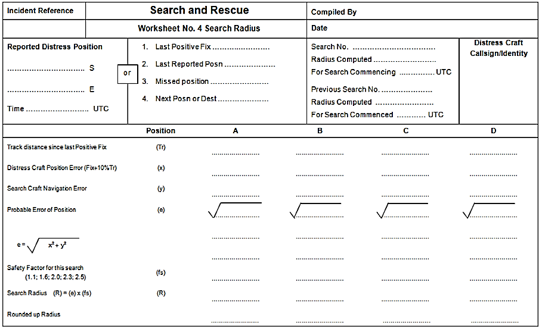

---
## Page 77

 
 
 
 
Appendices 
 
NATIONAL SEARCH AND RESCUE MANUAL 
Page 410 
2025 EDITION Version 1 – February 2025 
Worksheet 5 – Sector Search 
INCIDENT REFERENCE 
SEARCH AND RESCUE 
WORKSHEET NO. 5 SECTOR SEARCH 
COMPILED BY __________________ 
DATE: 
 
SECTOR SEARCH CALCULATIONS: SPLASH POINT or DATUM __________________ S / __________________ E 
 
RADIUS _________ NM 
C = W/MTS 
TRACK MILES AVAILABLE FROM  
WORKSHEET No 6     
                                     _____________ NM 
SEARCH 
HEIGHT (ft) 
W 
MTS 
C 
TRACK DISTANCE 
(D) 
ANGULAR 
DISPLACEMENT 
(AD) 
INITIAL 
TRACK (IT) 
SUBSEQUENT TRACK 
ADJUSTMENT 
+/- (90 + AD/2) 
POD 
500 
 
 
 
 
 
 
 
 
1000 
 
 
 
 
 
 
 
 
1500 
 
 
 
 
 
 
 
 
2000 
 
 
 
 
 
 
 
 
 
RADIUS _________ NM 
C = W/MTS 
TRACK MILES AVAILABLE FROM  
WORKSHEET No 6     
                                     _____________ NM 
SEARCH 
HEIGHT (ft) 
W 
MTS 
C 
TRACK DISTANCE 
(D) 
ANGULAR 
DISPLACEMENT 
(AD) 
INITIAL 
TRACK (IT) 
SUBSEQUENT TRACK 
ADJUSTMENT 
+/- (90 + AD/2) 
POD 
500 
 
 
 
 
 
 
 
 
1000 
 
 
 
 
 
 
 
 
1500 
 
 
 
 
 
 
 
 
2000 
 
 
 
 
 
 
 
 
 
RADIUS _________ NM 
C = W/MTS 
TRACK MILES AVAILABLE FROM  
WORKSHEET No 6     
                                     _____________ NM 
SEARCH 
HEIGHT (ft) 
W 
MTS 
C 
TRACK DISTANCE 
(D) 
ANGULAR 
DISPLACEMENT 
(AD) 
INITIAL 
TRACK (IT) 
SUBSEQUENT TRACK 
ADJUSTMENT 
+/- (90 + AD/2) 
POD 
500 
 
 
 
 
 
 
 
 
1000 
 
 
 
 
 
 
 
 
1500 
 
 
 
 
 
 
 
 
2000

---
## Page 78

 
 
 
Appendices 
NATIONAL SEARCH AND RESCUE MANUAL 
2025 EDITION Version 1 – February 2025 
Page 411 
Worksheet 6 – Aircraft Allocation

---
## Page 79

 
 
 
 
Appendices 
 
NATIONAL SEARCH AND RESCUE MANUAL 
Page 412 
2025 EDITION Version 1 – February 2025 
Worksheet 7 – Asset Allocation

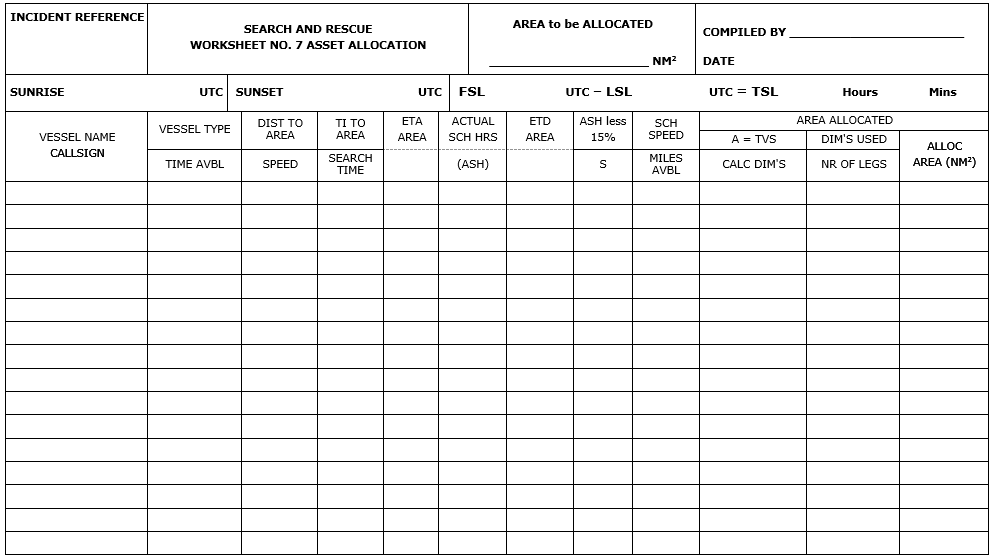

---
## Page 80

 
 
 
Appendices 
NATIONAL SEARCH AND RESCUE MANUAL 
2025 EDITION Version 1 – February 2025 
Page 413 
Worksheet 8 – Maritime Search by Vessel 
INCIDENT REFERENCE 
SEARCH AND RESCUE 
WORKSHEET NO. 8  
MARITIME SEARCH BY VESSEL 
COMPILED BY _______________ 
DATE 
Search Platform …………………….……………………..                  Search Object .......................................... 
MET Visibility ................. Km              Wind ........... /.......... kt                Fatigue Factor:   Yes or No   
Search Height (AGL) 
Eye height 
8 ft 
Eye height 
14 ft 
MERSHIP 
Uncorrected Sweep Width (Wu) -Tables D-5:3 & D-5:5  
                   NM 
                   NM 
                   NM 
Maritime: Weather Correction Factor (Fw) – Table D-5:4 
 
 
 
Fatigue Correction Factor (Ff) if crew will be suffering significant 
fatigue enter 0.9, otherwise enter 1.0 
 
 
 
Sweep Width Factor W = (Wu x Fw x Ff) 
 
 
 
Practical Track Spacing S (NM) 
 
 
 
Coverage Factor C = W/S 
 
 
 
Probability of Detection (POD) 
 
 
 
Search Area A (SQ NM) 
 
 
 
Search Hours (T) Required    T = A/VS 
 
 
 
   Total Search Hours Available (...........................)  -  (from Worksheet No. 7) 
 
     A.     Whole Area Calculated at a Search Height of ............. ft    (A = TVS     C = W/S     S = W/C) 
 
A                   SQ. NM 
S               NM 
C 
P                 % 
FOR                SEARCH 
 
B.     Modified Area at Calculated Track Spacing in Available Hours 
 
A                   SQ. NM 
S               NM 
C 
P                 % 
FOR                SEARCH 
 
C.     Whole Area at Modified Track Spacing in Available Hours 
 
A                   SQ. NM 
S               NM 
C 
P                 % 
FOR                SEARCH 
 
D.      Compromise Area and Modified Practical Track Spacing in Available Hours 
 
(i) A               SQ. NM 
S               NM 
C 
P                 % 
FOR                SEARCH 
 
(ii) A              SQ. NM 
S               NM 
C 
P                 % 
FOR                SEARCH 
 
(iii) A             SQ. NM 
S               NM 
C 
P                 % 
FOR                SEARCH 
 
(iv) A             SQ. NM 
S               NM 
C 
P                 % 
FOR                SEARCH 
Mark selected variables with *

---
## Page 81

 
 
 
 
Appendices 
 
NATIONAL SEARCH AND RESCUE MANUAL 
Page 414 
2025 EDITION Version 1 – February 2025 
Appendix D-8 Aircraft Accident Site Precautions 
Safety Precautions and Procedures at Aircraft Accidents 
1. 
Always remember that ADF aircraft may be carrying ammunition, bombs, rockets, etc. Ejector seats 
are powered by explosives. Contact ADF authorities as soon as possible. 
2. 
The following precautions should be observed at all aircraft accident sites: 
a) 
Attendance at crash sites should be limited to essential personnel; 
b) 
Personnel should wear Personnel Protective Equipment (PPE) - see paragraph 2; 
c) 
All work at the crash site should be conducted upwind of the wreckage wherever possible; 
d) 
The location of helicopter landing zones in close proximity to crash sites should be avoided to 
prevent the possible spread of contamination; 
e) 
Eating, drinking, and smoking in or around the crash site should be prohibited; 
f) 
Aircraft technical personnel familiar with the aircraft type should be utilised in the location, 
identification, and salvage of hazardous materials and remnants; 
g) 
Environmental health personnel should also be notified when suspected dangerous substances 
are present at the accident site; 
h) 
SAR personnel who were working at the accident site should shower as soon as possible after 
leaving the area; 
i) 
If time permits, advice to civilians in fallout areas that are not otherwise threatened should be: 
i) 
Remain indoors; 
ii) 
Shut external doors and windows; 
iii) 
Turn off forced air intakes; and 
iv) 
Await further notification.  
3. 
Cordon off the area. 
4. 
Personnel working within 10 m of any ADF crash site should wear the following protective 
equipment: 
a) 
Respiratory protection; wear National Institute of Occupational Safety and Health approved 
full-face or half-mask respirators with cartridges for organic vapours (for protection from jet 
fuel) and for dust, mist, and fumes (for airborne particulate fibres and other dust). All personnel 
must be fit, tested, and trained in the use of respirators. The use of full-face respirators will 
eliminate the need for goggles or safety glasses; 
b) 
Eye protection such as goggles or safety glasses with side shields shall be worn when a half-face 
respirator is used; and 
c) 
Skin protection: 
i) 
Coverall - Tyvek, coated with 1.25 mm polyethylene with hood. The coveralls should have 
a zipper front, elastic sleeves, legs, and drawstring hood; 
ii) 
Gloves - Puncture resistant leather gloves shall be worn. The environmental engineers will 
determine any additional requirements; 
iii) 
Boots - Steel toed shoes or boots should be worn; and 
iv) 
All equipment should be thoroughly washed before removal.

---
## Page 82

 
 
 
Appendices 
NATIONAL SEARCH AND RESCUE MANUAL 
2025 EDITION Version 1 – February 2025 
Page 415 
Appendix D-9 Civil Aircraft Search and Rescue Assets (SRAs) 
AMSA Aircraft Tier SRA Capability Definitions 
CAPABILITY 
DESCRIPTION 
TIER 1 
Dedicated fixed wing aircraft and crews, capable of electronic and visual 
search, deployment of emergency supplies, command and control, and 
homing to distress beacons. 
Rotary Wing Rescue (RWR) 
Rescue capable and winch-equipped helicopters and crew for rescue, 
homing to distress beacons, visual search, and limited supply dropping. 
Rotary Wing Search (RWS) 
Helicopters and crew for homing to distress beacons and visual search. 
Fixed Wing Search (FWS) 
Fixed wing aircraft and crew for homing to distress beacons, visual search 
and communications relay. 
Table D-9:1 AMSA Aircraft SRA Tier Definitions 
Tier 1 SRAs 
AMSA contracts four dedicated Bombardier Challenger 604 jet aircraft for SAR at bases in Perth, Cairns 
and Melbourne with the fourth aircraft an operational spare. These aircraft have been modified to have a 
large visual observation window on each side and are fitted with a range of communications (UHF, VHF, 
HF and satellite telephones) and sensor systems (search RADAR, high definition EO/IR turret, NVDs, DF, 
AIS, ADS-B, video anomaly detection). These Challenger 604’s are able to drop a range of life-support 
equipment on land and sea, by day and night including life rafts, SAR datum marker buoys and de-
watering pumps. Communications equipment (radios and satellite phones) can also be dropped which, 
using the multi-mode communications relay capability of the aircraft, enable communications to be 
established between the surface and JRCC Australia or another command/control or response facility. 
The aircraft are available to other government agencies, such as the police, fire and emergency services, 
on a whole-of-government basis, for assistance with response to emergency operations. 
 
Photo: AMSA Challenger 604

---
## Page 83

 
 
 
 
Appendices 
 
NATIONAL SEARCH AND RESCUE MANUAL 
Page 416 
2025 EDITION Version 1 – February 2025 
Opportunity Based SAR Services 
In addition to the dedicated Challenger 604 services contracted to Cobham SAR Services Pty Ltd, AMSA 
has existing arrangements with a number of Federal, State and Territory governments and agencies and 
other fixed wing and helicopter operators to provide AMSA with SAR services on an opportunity basis, 
that is, they are not dedicated AMSA services. These fall into the three categories in Table D – 9.1 above. 
The aircraft available to AMSA include a range of aircraft operated or used by Federal, State and Territory 
governments, such as Australian Border Force, State/Territory Ambulance and Police Services and 
Australian Defence Force aircraft. AMSA also has arrangements with commercial operators for the use of 
a large selection of aircraft located around Australia. 
The tasks capable of being conducted by these aircraft will vary based on individual capability, but aircraft 
will be capable of providing one or possibly more of the following: 
• 
Visual searches - (both fixed wing and rotary wing) conducted either over land or water. Visual 
searches will be conducted either over land or water. Visual searches will be conducted during 
daylight hours and will not usually be conducted at altitudes below 500ft for fixed wing, but often 
lower for rotary wing. Observers, trained in aerial visual searching techniques, may be nominated 
by AMSA for carriage on the aircraft during search operations. 
• 
Rescue - generally effected by rescue winch either over land or water. Winching operations will 
typically be conducted only during day visual meteorological conditions (VMC) unless operators are 
equipped, trained and authorised to conduct winching operations at night. 
• 
Electronic searches - will be conducted by aircraft with electronic sensors, including search RADAR, 
NVDs or EO/IR. These aircraft may be used over land or water. Electronic searching can be 
conducted by day and/or night in VMC and/or instrument meteorological conditions (IMC). 
• 
Deployment of emergency supplies - by rescue helicopters. This will be conducted only during day 
VMC, unless the operator is approved to deploy supplies at night. 
• 
Homing to distress beacons - (both fixed wing and rotary wing) is conducted by aircraft equipped 
with an electronic homer (direction finder), or using aural homing techniques, either over land or 
water. Homing to beacons can be conducted either by day or night in both VMC and IMC. 
• 
Communications relay - is conducted by fixed wing aircraft when communications with other 
search assets are poor or where there is a need to relieve congestion on ATS frequencies.  Aircraft 
are required to be able to maintain communication with SAR or other assets or a ground station. 
Current Aircraft and Police Fixed-Wing Operators 
Fixed Wing Search (FWS) aircraft operators provide air search capability (visual search and DF) supportive 
and supplementary to the Tier 1 Challenger fleet. Each operator is supplied with safety and role 
equipment. Training, including emergency procedures drills, is provided by AMSA. AMSA Fixed Wing 
Search operators are located at various locations as shown in Figure D-9:3. AMSA also provides police 
fixed-wing operators with safety and role equipment for selected aircraft. 
Air Search Observer Programme 
AMSA maintains a partnership with State/Territory Emergency Service organisations to provide the SAR 
system with a large and dispersed pool of trained and readily mobilised air search observers. State and 
Territory Emergency Service volunteers undertake several days of initial training and regular refresher 
training, addressing safety on and around aircraft, emergency procedures (including pool drills with life 
rafts and lifejackets) and air search operations. 
Air Search Equipment 
AMSA maintains stocks of air search equipment (aircraft safety and role equipment) at strategic sites 
which can be transported to locations where search operations are being conducted.

---
## Page 84

 
 
 
Appendices 
NATIONAL SEARCH AND RESCUE MANUAL 
2025 EDITION Version 1 – February 2025 
Page 417 
Locations of Tier 1, 2 Assets 
The following charts show the distribution of assets as at August 2018. 
 
Figure D-9:1 Base Locations of AMSA Dedicated Tier 1 Aircraft SRAs 
 
 
Figure D-9:2 Base Locations of Rotary Wing Search and Rotary Wing Rescue SRAs

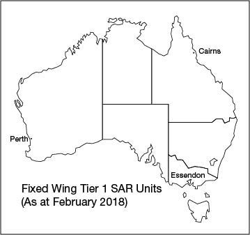

---
## Page 85

 
 
 
 
Appendices 
 
NATIONAL SEARCH AND RESCUE MANUAL 
Page 418 
2025 EDITION Version 1 – February 2025 
 
 
Figure D-9:3 Base Locations of Fixed-Wing Search and Police Fixed-Wing Aircraft SRAs

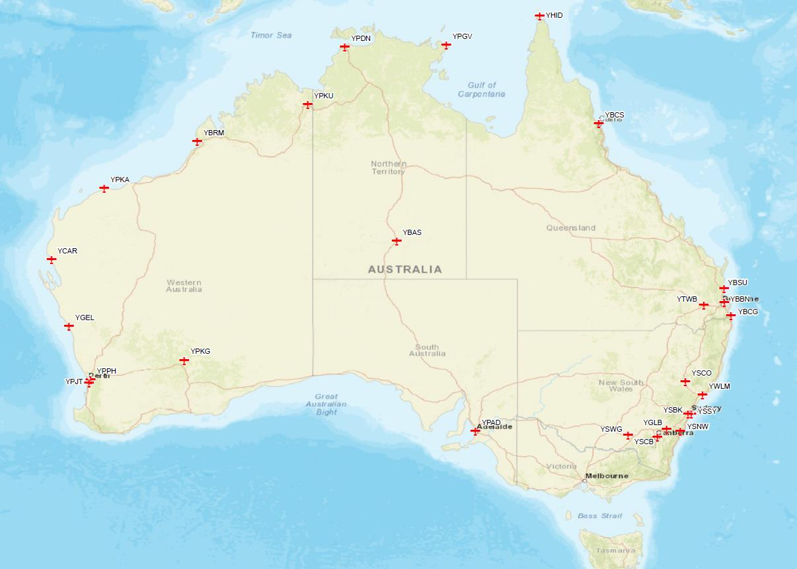

---
## Page 86

 
 
 
Appendices 
NATIONAL SEARCH AND RESCUE MANUAL 
2025 EDITION Version 1 – February 2025 
Page 419 
Appendix D-10 Coastal Datum Search and Rescue Planning 
A Step-By-Step Guide for SAR Trained Personnel 
Vessel Adrift 
This is the simplest of all the datum SAR planning models.  It is used when the last position of the vessel is 
known to within a high degree of accuracy.   
Datum should be calculated for a time when the search assets are likely to be on scene. There is no point 
in calculating datum for a specific time, if there will be no resources in place to commence a search at this 
time. 
Remember: 
• 
All chart work is plotted in true on the chart. 
• 
Wind is always referred to as blowing from (a Southerly wind is blowing South to North). 
• 
Current is referred to as setting towards (a Westerly current is travelling East to West). 
To commence the planning process, the planner needs some critical information, which is outlined below: 
a) 
Target type(s) must be determined. 
b) 
Current, the sea current direction and velocity must be determined as accurately as possible.  With 
more accurate intelligence, as the operation progress, this part of the plan can be adjusted.  All plots 
are directly down current, and the current rate multiplied by the number of hours adrift is applied. 
c) 
Wind, the wind direction and velocity must be determined as accurately as possible for the time that 
the incident occurred as well as what is happening for when datum is calculated.  The target type is 
then used to calculate the leeway effect by referring to the Leeway Tables.  All plots are directly 
downwind with the leeway rate determined (as described) multiplied by the number of hours adrift 
is applied. 
d) 
Splash Point (SP), sometimes referred to as the Last Known Position (LKP) or Initial Position (IP).  This 
is the last known position of the target when it became the target of the operation.  In accordance 
with the definition of datum a time (clock time) and position (Latitude and Longitude) must be given. 
For the purpose of this user guide the following example, with critical information, is used: 
a) 
Target 
 Light Displacement Cabin Cruiser (Without Drogue). 
b) 
Current 
 2 knots South Easterly (towards the S.E.) 
c) 
Wind 
 10 knots North Easterly (from the N. E.) 
d) 
Splash Point 
 27° 45.2’ S 151° 27.1’ E at 0800 hrs. 
e) 
Calculate a Datum for 1000 hrs 
f) 
Current (WC) 
 135° at 2 kts per hour.  2 kts x 2 hrs = 4 NM for the water current leg 
g) 
Wind 
 045° at 10 kts.  Using the Leeway Formula: 
 [(0.07 x 10) + 0.04] x 2 hrs = 1.48 NM

---
## Page 87

 
 
 
 
Appendices 
 
NATIONAL SEARCH AND RESCUE MANUAL 
Page 420 
2025 EDITION Version 1 – February 2025 
Step-By-Step Guide 
1. 
Plot the Splash Point (SP) on the chart and notate as shown below in diagram 1.  Splash point can 
also be known as Last Known Position (LKP) or Initial Planning Point (IPP). 
 
Diagram 1 
2. 
Plot the Total Water Current (WC) leg first, as shown in diagram 2 below.  The reason for this is that 
if there is a possibility that the target is a person in the water, then the end of the WC leg becomes 
datum (D1).  As shown in diagram 3. 
 
 
Diagram 2 
Diagram 3 
 
Note: If there is doubt as to whether the target is a person in the water or a vessel, then D1 is 
plotted at the end of the WC leg, D2 would then be plotted at the intersection of the Leeway (LW) 
leg and Total Drift (TD) leg.  See diagram 9. Vessel Adrift 
3. 
Plot the Leeway leg (LW) second.  This leg commences at the end of the WC leg.  The length of the 
LW leg is calculated by using the Leeway tables.  See Diagram 4 below. 
 
Diagram 4 
SP  0800hrs
27o 45.2’S
151o 27.1’E
WC
SP  0800hrs
(4nm)
27o 45.2’S
151o 27.1’E
6nm
WC
SP  0800hrs
(4nm)
27o 45.2’S
151o 27.1’E
D1  1000hrs
WC
SP  0800hrs
(4nm)
D1
1000hrs
LW
(1.48nm)
27o 45.2’S
151o 27.1’E

---
## Page 88

 
 
 
Appendices 
NATIONAL SEARCH AND RESCUE MANUAL 
2025 EDITION Version 1 – February 2025 
Page 421 
 The target type must be interpolated with the classes of vessels given.  If it appears that the target 
could fall into more than one type, then calculate for both and plot both.  The datum points arrived 
at will not differ by a great deal.  Use both datum points to calculate the search area. 
 In this case using the formula for the target, which is a light displacement cabin cruiser without 
drogue: 
 
0.07U + 0.04. 
 
0.07 x the wind speed + 0.04 x hours and decimals of an hour the vessel had been adrift. 
4. 
Once both the WC and LW legs have been plotted, draw a line from SP to D1.  The name of the line is 
called the 'Total Drift' or 'Resultant', indicate the direction of travel with an arrowhead in the centre 
of the line.  Also note the direction of the TD line with a True bearing and measure the distance.  See 
Diagram 5 below. 
 
Diagram 5 
5. 
A 6 NM radius circle is drawn centred on datum (a 6 NM radius is used if the TD line is less than 8 NM 
in length), as indicated in Diagram 6 below. 
 
Diagram 6 
 
WC
SP  0800hrs
(4nm)
D1
1000hrs
LW
(1.48nm)
TD
27o 45.2’S
151o 27.1’E
TD 158o T / 5.5nm
6nm
WC
SP  0800hrs
(4nm)
TD
D1
1000hrs
LW
(1.48nm)
27o 45.2’S
151o 27.1’E

---
## Page 89

 
 
 
 
Appendices 
 
NATIONAL SEARCH AND RESCUE MANUAL 
Page 422 
2025 EDITION Version 1 – February 2025 
6. 
Once the circle is drawn, the area should be boxed, with the sides of the box touching the edges of 
the circle (tangential), and oriented in the direction of drift.  This errs on the side of safety by 
building in a greater safety margin.  It is also easier to plan search patterns and brief resources.  See 
Diagram 7 below. 
Diagram 7 
7. 
Diagram 8 below, shows what the datum SAR plan will look like on a chart. 
 
Diagram 8 
 
12nm
6nm
12nm
WC
SP  0800hrs
(4nm)
TD
1000hrs
LW
(1.48nm)
27o 45.2’S
151o 27.1’E
TD 158o T / 5.5nm
12nm
6nm
WC
SP  0800hrs
(4nm)
TD
D1
1000hrs
LW
(1.48nm)
12nm
27o 45.2’S
151o 27.1’E
TD 158o T / 5.5nm

---
## Page 90

 
 
 
Appendices 
NATIONAL SEARCH AND RESCUE MANUAL 
2025 EDITION Version 1 – February 2025 
Page 423 
8. 
If there was uncertainty as to whether the target was a person in the water or a vessel adrift then 
Datum 1 (D1) should be located at the end of the water leg and Datum 2 (D2) should be located at 
the end of the leeway leg.  Diagram 9 below shows the two circles one centred at (D1) and the other 
centred on (D2).  The two circles would then be boxed (rectangle) together, with the box oriented in 
the direction of drift. 
 
Diagram 9 
9. 
As stated, if the total drift (TD) line is less than 8 nautical miles, then the radius of the circle is 6 NM, 
see Diagram 10 below. 
 
Diagram 10 
 
6nm
WC
SP  0800hrs
(4nm)
TD
1000hrs D2
LW
(1.48nm)
27o 45.2’S
151o 27.1’E
TD 158o T / 5.5nm
D1 1000hrs
SP  0800hrs
D1
LW
6nm
TD
WC
27o 45.2’S
151o 27.1’E

---
## Page 91

 
 
 
 
Appendices 
 
NATIONAL SEARCH AND RESCUE MANUAL 
Page 424 
2025 EDITION Version 1 – February 2025 
10. If the total drift (TD) line is greater than 8 nautical miles, then the length of the total drift line is 
divided by 8.  This is known as individual drift error. 
 The result is ADDED to the 6 NM radius circle usually used, creating a larger circle. 
 In Diagram 11 below, the TD line is 12 NM long.  Therefore 12 ÷ 8 = 1.5 NM.  1.5 NM is then added to 
6 NM (the standard circle diameter) and the result is 7.5 NM for the radius of the circle. 
 
Diagram 11 
Position Uncertainty 
This model is a little bit more complex.  It is the search procedure used when the intelligence has placed 
the Splash Point at more than one location, at the same point in time.  It is important that Splash Points 
are calculated for the same specified time, it is just the positions that are different. 
Datum should be calculated for a time when the search assets are likely to be on scene. There is no point 
in calculating datum for a specific time, if there will be no resources in place to commence a search at this 
time. 
For the purpose of this user guide the following example, with critical information, is used: 
a) 
Target 
 Light Displacement Cabin Cruiser (Without Drogue). 
b) 
Current 
 1.5 knots 010°T 
c) 
Wind 
 10 knots Westerly (from the West) 270°T 
d) 
Splash Point 
 Two positions for the same specified time at 1000 hrs 
e) 
Calculate a Datum for 1330 hrs 
f) 
Current (WC) 
 030°T at 1.5 kts per hour.  1.5 kts x 3.5 hrs = 5.25 NM for the water current leg 
g) 
Wind (LW) 
 270°T at 10 kts.  Using the Formula: [(0.07 x 10) + 0.04] x 3.5 hrs = 2.59 NM 
 
WC
SP  0800hrs
7.5nm
TD
1000hrs D1
LW
27o 45.2’S
151o 27.1’E

---
## Page 92

 
 
 
Appendices 
NATIONAL SEARCH AND RESCUE MANUAL 
2025 EDITION Version 1 – February 2025 
Page 425 
Step-By-Step Guide 
1. 
Plot the splash points (SP) on the chart and notate as shown below in diagram 1.  Splash point can 
also be known as Last Known Position (LKP) or Initial Position (IP).  Two positions geographically 
separated at the same time.  This position can be caused by conflicting intelligence, confusion over a 
headland, island or bay. 
 
Diagram 12 
2. 
Plot the Water Current (WC) leg first as per convention (see Diagram 13).   
 
Diagram 13 
Note: If there is doubt as to whether the target is a person in the water or a vessel, then two 
separate plots will be done, one for the person and one for the vessel, with both plotted together 
resulting in a larger search area. 
 
3. 
Plot the Leeway leg (LW) second.  This leg commences at the end of the WC leg.  The length of the 
LW leg is calculated by using the Leeway Tables.  
SP A
1000 hrs
SP B
1000 hrs
27o 45.2’S
151o 27.1’E
27o 45.2’S
151o 27.8’E
WC
WC
5.25nm
5.25nm
SP A
1000 hrs
SP B
1000 hrs
27o 45.2’S
151o 27.1’E
27o 45.2’S
151o 27.8’E

---
## Page 93

 
 
 
 
Appendices 
 
NATIONAL SEARCH AND RESCUE MANUAL 
Page 426 
2025 EDITION Version 1 – February 2025 
 
Diagram 14 
4. 
Once both the WC and LW legs have been plotted, draw a line from SP to D1.  The name of the line is 
called the 'Total Drift' or 'Resultant', indicate the direction of travel with an arrowhead in the centre 
of the line.  Also note the direction of the TD line with a True bearing and measure the distance (see 
Diagram 15 below). 
 
Diagram 15 
5. 
A 6 NM radius circle is drawn centred on datum (a 6 NM radius circle is used if the TD line is less than 
8 NM in length, if greater than 8 NM apply the error mentioned in the Vessel Adrift example).  As 
indicated in Diagram 16 below.  A circle is drawn on both datums. 
WC
LW
WC
LW
2.59nm
2.59nm
SP A
1000 hrs
SP B
1000 hrs
27o 45.2’S
151o 27.1’E
27o 45.2’S
151o 27.8’E
WC
LW
TD
WC
LW
TD
TD  023o T / 7nm
 SP A
1000 hrs
 SP B
1000 hrs
27o 45.2’S
151o 27.1’E
27o 45.2’S
151o 27.8’E

---
## Page 94

 
 
 
Appendices 
NATIONAL SEARCH AND RESCUE MANUAL 
2025 EDITION Version 1 – February 2025 
Page 427 
 
Diagram 16 
6. 
Once the circles are drawn, the area should be boxed, with the sides of the box touching the edges 
of the circles (tangential), and oriented in the direction of drift.  This errs on the side of safety by 
building in a greater safety margin.  It is also easier to plan search patterns and brief resources.  See 
Diagram 17 below. 
 
Diagram 17 
7. 
If the circles are separated by extreme distance, greater than 12 NM apart, then each area should be 
treated separately.  In the prioritisation of search areas, the area between the two circles would be 
considered high in priority.  If practicable, and a suitable number of resources are available, the area 
between the circles should be incorporated into the initial search area.  See Diagram 18 below. 
WC
LW
TD
D1A
1330 hrs
6 nm
WC
LW
TD
D1B
1330 hrs
6 nm
TD  023o T / 7nm
 SP A
1000 hrs
 SP B
1000 hrs
27o 45.2’S
151o 27.1’E
27o 45.2’S
151o 27.8’E
WC
LW
TD
D1A
1330 hrs
6 nm
WC
LW
TD
D1B
1330 hrs
6 nm
TD  023o T / 7nm
 SP A
1000 hrs
 SP B
1000 hrs
27o 45.2’S
151o 27.1’E
27o 45.2’S
151o 27.8’E

---
## Page 95

 
 
 
 
Appendices 
 
NATIONAL SEARCH AND RESCUE MANUAL 
Page 428 
2025 EDITION Version 1 – February 2025 
 
Diagram 18 
Time Uncertainty 
This model again is a little bit more complex.  It is the search procedure used when the intelligence has 
placed the Splash Point at the one location, but at different points in time.  For example, the target was 
known to be at the splash point, however there is conflicting evidence as to the time. 
It is important that Splash Point is calculated for the both the minimum and maximum amount of time 
that the target could be missing, ascertained through the gathering of intelligence. 
For the purpose of this user guide the following example, with critical information, is used: 
a) 
Target 
 Light Displacement Cabin Cruiser (Without Drogue). 
b) 
Current 
 1.5 knots 100°T 
c) 
Wind 
 10 knots 018°T 
d) 
Splash Point 
 27° 45.2’ S 151° 27.1’ E.  The earliest the target may have got into trouble is 1000 hrs and the latest 
time the target may have got into trouble is 1200 hrs. 
e) 
Calculate a Datum for 1400 hrs 
f) 
Current (WC) 
100°T at 1.5 kts per hour. 
 Position A - 1.5 kts x 2 hrs = 3 NM for the TWC (1200 hrs to 1400 hrs = 2 hrs) 
 Position B - 1.5 kts x 4 hrs = 6 NM for the TWC (1000 hrs to 1400 hrs = 6 hrs) 
g) 
Wind (LW) 
 018°T at 10 kts.  Using the Formula: [(0.07 x 10) + 0.04] = 0.74 NM per hr 
 Position A - 0.74 NM x 2 hrs (time adrift) = 1.48 NM for the Leeway leg 
 Position B - 0.74 NM x 4 hrs (time adrift) = 2.96 NM for the Leeway leg 
If more than 12nm apart 
treat as seperate search
areas
WC
LW
TD
D1A
1330 hrs
6 nm
WC
LW
TD
D1B
1330 hrs
6 nm
 SP A
1000 hrs
 SP B
1000 hrs
27o 45.2’S
151o 27.1’E
27o 45.2’S
151o 27.8’E
TD  023o T / 7nm

---
## Page 96

 
 
 
Appendices 
NATIONAL SEARCH AND RESCUE MANUAL 
2025 EDITION Version 1 – February 2025 
Page 429 
Step-By-Step Guide 
1. 
Plot the Splash Point (SP) on the chart and notate as shown below in Diagram 19.  Splash point can 
also be known as Last Known Position (LKP) or Initial Position (IP). 
 
Diagram 19 
2. 
Plot the Water Current (WC) leg first.  The reason for this is that if there is a possibility that the target 
is a person in the water, then the end of the WC leg becomes datum (D1).  As shown in Diagram 20 
below. 
 
Diagram 20 
3. 
Plot the Leeway leg (LW) second.  In this case there are two leeway legs.  The first of the leeway legs 
calculated is the amount of leeway effect on the vessel between 1000 hrs and 1400 hrs (this is the 
longest period of time in the calculation) and commences at the end of the WC leg. 
 
Diagram 21 
4. 
Plot the second Leeway leg (LW).  In this case the second leeway leg calculated is the amount of 
leeway effect on the vessel between 1200 hrs and 1400 hrs (this is the shortest period of time in the 
calculation).  The leg commences at the corresponding point along the WC leg (which in this scenario 
is at the 2nd hour of water current effect along the WC line).   
 
Diagram 22 
5. 
Once both the WC and both LW legs have been plotted, draw a line from SP to through D1A to D1B.  
The name of the line is called the 'Total Drift' or 'Resultant'.  Indicate the direction of travel with an 
SP  1000hrs to 1200hrs
27o 45.2’S
151o 27.1’E
WC
SP  1000hrs to 1200hrs
27o 45.2’S
151o 27.1’E
A = 3nm, B = 6nm
LW
SP  1000hrs to 1200hrs
27o 45.2’S
151o 27.1’E
2.96nm
WC
LW
SP  1000hrs to 1200hrs
27o 45.2’S
151o 27.1’E
LW 1.48nm
2.96nm
WC

---
## Page 97

 
 
 
 
Appendices 
 
NATIONAL SEARCH AND RESCUE MANUAL 
Page 430 
2025 EDITION Version 1 – February 2025 
arrowhead in the centre of the line.  The TD line should touch the end of the shortest LW line.  If it 
does not touch, or the LW is too long or too short, re-check the calculations.  See Diagram 23 below. 
 
Diagram 23 
6. 
D1A is plotted at the end of the first LW leg and D1B is plotted at the end of the longest LW leg.  
Note the direction of the TD line with a True bearing and distance.   
7. 
The length of the TD line between SP and D1B is 9 NM in this particular scenario.  Therefore, the 
length of the TD line is divided by 8 and the result is added to the 6 NM radius circle, which is 
normally used.  In this case the radius of the circle centred on datum D1B is calculated as 9 ÷ 8 = 
1.125.  6 + 1.1 = 7.1 NM.  See Diagram 24 below. 
 
Diagram 24 
8. 
The length of the TD line between SP and D1A is less than 8 NM in length.  Therefore, a 6 NM radius 
circle is drawn centred on datum D1A. See Diagram 25 below. 
LW
TD
D1A TD 143o T / 5nm
D1B TD 143o T /9nm
SP  1000hrs to 1200hrs
27o 45.2’S
151o 27.1’E
D1A 1400hrs
D1B 1400hrs
LW
WC
7.1nm
LW
TD
SP  1000hrs to 1200hrs
27o 45.2’S
151o 27.1’E
D1A 1400hrs
D1B 1400hrs
LW
D1A TD 143o T / 5nm
D1B TD 143o T /9nm
WC

---
## Page 98

 
 
 
Appendices 
NATIONAL SEARCH AND RESCUE MANUAL 
2025 EDITION Version 1 – February 2025 
Page 431 
 
Diagram 25 
9. 
Once the circles are drawn, the area should be boxed, with the sides of the box touching the edges 
of the circles (tangential), and oriented in the direction of drift.  This errs on the side of safety by 
building in a greater safety margin.  See Diagram 26 below. 
 
Diagram 26 
10. Assuming that the length of the TD line is less than 8 NM in length for both SP to D1A and SP to D1B, 
then a 6 NM radius circle is drawn centred on both datums, as indicated in Diagram 27 below. 
7.1nm
6nm
LW
TD
SP  1000hrs to 1200hrs
27o 45.2’S
151o 27.1’E
D1A 1400hrs
D1B 1400hrs
LW
D1A TD 143o T / 5nm
D1B TD 143o T /9nm
WC
7.1nm
6nm
LW
TD
SP  1000hrs to 1200hrs
27o 45.2’S
151o 27.1’E
D1A 1400hrs
D1B 1400hrs
LW
D1A TD 143o T / 5nm
D1B TD 143o T /9nm
WC

---
## Page 99

 
 
 
 
Appendices 
 
NATIONAL SEARCH AND RESCUE MANUAL 
Page 432 
2025 EDITION Version 1 – February 2025 
 
Diagram 27 
Track Line Overdue 
This is the most complex of all the datum SAR planning models.  It is used when the track of the target is 
known 
Datum should be calculated for a time when the search assets are likely to be on scene.  There is no point 
in calculating datum if there are no resources in place to commence a search. 
In the Track Line Overdue model, the departure point and arrival points are SPs.  Along the target’s 
intended track, the Co-ordinator may need to incorporate arbitrary turn points (e.g. to go around 
headlands etc.), there is no limit on the number of arbitrary turn points that can be incorporated into this 
model.  See Diagram 28 below. 
 
Diagram 28 
For the purpose of this user guide the following example, with critical information, is used: 
a) 
Target 
 Light Displacement Cabin Cruiser (Without Drogue). 
b) 
Cruise Speed 
 The vessel’s approximate speed in this case is 8 knots. 
c) 
Current 
 192°T at 1 knot 
6nm
6nm
LW
TD
SP  1000hrs to 1200hrs
27o 45.2’S
151o 27.1’E
D1A 1400hrs
D1B 1400hrs
LW
Assuming the following TD lines:
D1A TD 140o T / 4nm
D1B TD 140o T / 7nm
WC
A.  0600hrs
C.  1000hrs
27o 43.2’S
147o 30’E
27o 43.8’S
147o 58’E

---
## Page 100

 
 
 
Appendices 
NATIONAL SEARCH AND RESCUE MANUAL 
2025 EDITION Version 1 – February 2025 
Page 433 
d) 
Wind 
 318°T at 10 knots 
e) 
Splash Point 
 Departure Point A - 27° 43.2’ S 147° 30’ E at 0600 hrs. 
 Arbitrary Turn Point B - 27° 43.5’ S 147° 00’ E at 0800 hrs. 
 Arrival Point C - 27° 43.8’ S 147° 58’ E at 1000 hrs. 
 In this case with a speed of 8 knots - Point A to B is 16 NM and Point B to C is 16 NM. 
d) 
Calculate a Datum for 1200 hrs 
Note: 
i. 
measure the route; 
ii. 
divide the distance by the vessel’s approximate speed; 
iii. 
this will give the approximate time at the arbitrary turn point(s); and 
iv. 
this will also assist in confirming the intended arrival time. 
 
Step-By-Step Guide 
1. 
Do the calculations for each point separately.  The points will need to be plotted.  The chart and the 
distance of not only the intended track needs to be measured, but also the distance between each 
point. 
 If the time of departure and anticipated time of arrival can be ascertained, then the approximate 
speed of the vessel can be calculated.  If not the cruising speed of the vessel will need to be 
estimated, taking into account the sea conditions, vessel type and power unit on board. 
 In this example the target departed Point A at 0600 hrs and was supposed to have arrived at Point C 
at 1000 hrs.  Because there is a headland between Points A and C the target will have needed to 
have adjusted course on its intended track.  Point B has been arbitrarily selected (it is a safe distance 
off the headland and one the target’s skipper is likely to have taken). 
 The distance A to B to C has been measured and the target’s cruise speed has been estimated.  
Based on the estimated cruise speed of the vessel, it would have reached Point B at 0800 hrs. 
a) 
Position A - point of departure at 0600 hrs (calculate to datum time of 1200 hrs) 
i) 
0600 hrs to 1200 hrs 
= 6 hrs 
ii) 
WC 1 kt x 6 hrs  
= 6 NM 
iii) 
LW 0.74 kt per hr x 6 hrs = 4.44 NM 
b) 
Position B - arbitrary turn point at 0800 hrs (calculate to datum time of 1200 hrs) 
i) 
0800 hrs to 1200 hrs 
= 4 hrs 
ii) 
WC 1 kt x 4 hrs  
= 4 NM 
iii) 
LW 0.74 kt per hr x 4 hrs = 2.96 NM 
c) 
Position C - arrival point at 1000 hrs (calculate to datum time of 1200 hrs) 
i) 
1000 hrs to 1200 hrs 
= 2 hrs 
ii) 
WC 1 kt x 2 hrs  
= 2 NM 
iii) 
LW 0.74 kt per hr x 2 hrs = 1.48 NM

---
## Page 101

 
 
 
 
Appendices 
 
NATIONAL SEARCH AND RESCUE MANUAL 
Page 434 
2025 EDITION Version 1 – February 2025 
Calculations for the example based on the following: 
a) 
WC 192°T at 1 knot per hour multiplied by the number of hours adrift. 
b) 
Wind 318°T at 10 knots.   
Using the Formula [(0.07 x 10 kt) + 0.04] = .74 NM per hour, multiplied by the number of hours 
adrift. 
2. 
Points A, B and C have been plotted on the chart and the intended track drawn in.  It is important to 
check to see whether there is an opportunity for the target to have anchored, sought shelter in ports 
or taken made any likely deviations from the intended course (e.g. to visit a scenic island or beach) 
etc.  See diagram 29 below. 
 
Diagram 29 
3. 
Once both the WC and both LW legs have been plotted for the first datum, draw a line from SP to 
D1A.  The name of the line is called the 'Total Drift' or 'Resultant'.  Indicate the direction of travel 
with an arrowhead in the centre of the line.  Note the bearing and distance of the TD line.  See 
Diagram 30 below. 
 
Diagram 30 
4. 
Once both the WC and both LW legs have been plotted for the second datum, draw a line from SP to 
D1B.  The name of the line is called the 'Total Drift' or 'Resultant'.  Indicate the direction of travel 
with an arrowhead in the centre of the line.  Note the bearing and distance of the TD line.  See 
Diagram 31 below. 
Intended Track
Intended Track
A.  0600hrs
B.  0800hrs
C.  1000hrs
27o 43.2’S
147o 30’E
27o 43.8’S
147o 58’E
27o 43.5’S
147o 47’E
A.  0600hrs
B.  0800hrs
C.  1000hrs
TD
LW
WC
1200hrs
D1A
27o 43.2’S
147o 30’E
27o 43.8’S
147o 58’E
27o 43.5’S
147o 47’E
D1A TD = 177o  T / 10.5nm

---
## Page 102

 
 
 
Appendices 
NATIONAL SEARCH AND RESCUE MANUAL 
2025 EDITION Version 1 – February 2025 
Page 435 
 
Diagram 31 
5. 
Once both the WC and both LW legs have been plotted for the third datum, draw a line from SP to 
D1C.  The name of the line is called the 'Total Drift' or 'Resultant'.  Indicate the direction of travel 
with an arrowhead in the centre of the line.  Note the bearing and distance of the TD line.  See 
Diagram 32 below. 
 
Diagram 32 
6. 
Once all three datums have been plotted, draw a line connecting all three datum points.  The name 
of the line is called the ‘Datum Line’.  See Diagram 33 below. 
A.  0600hrs
B.  0800hrs
C.  1000hrs
TD
TD
LW
LW
WC
WC
1200hrs
1200hrs
D1A
D1B
27o 43.2’S
147o 30’E
27o 43.8’S
147o 58’E
27o 43.5’S
147o 47’E
D1A TD = 177o  T / 10.5nm
D1B TD = 177o  T / 7nm
A.  0600hrs
B.  0800hrs
C.  1000hrs
TD
TD
TD
LW
LW
LW
WC
WC
WC
1200hrs
1200hrs
1200hrs
D1A
D1B
D1C
27o 43.2’S
147o 30’E
27o 43.8’S
147o 58’E
27o 43.5’S
147o 47’E
D1A TD = 177o  T / 10.5nm
D1B TD = 177o  T / 7nm
D1C TD = 177o  T /3.5nm

---
## Page 103

 
 
 
 
Appendices 
 
NATIONAL SEARCH AND RESCUE MANUAL 
Page 436 
2025 EDITION Version 1 – February 2025 
 
Diagram 33 
7. 
A circle is drawn centred on datum (a 6 NM radius circle is used if the TD line is less than 8 NM in 
length).  In this case the TD line between SP A and D1A is 10.5 NM.  Therefore, the individual drift 
error must be applied, 10.5 ÷ 8 = 1.3125.  The radius of the circle drawn centred on D1A is 6 + 1.3 = 
7.3 NM.  As indicated in Diagram 34 below. 
 
Diagram 34 
8. 
The length of the TD line between SP B and D1B is 7 NM in length, therefore individual drift error 
does not apply.  A 6 NM radius circle is drawn centred on datum D1B. See Diagram 35 below. 
A.  0600hrs
B.  0800hrs
C.  1000hrs
TD
TD
TD
LW
LW
LW
WC
WC
WC
1200hrs
1200hrs
1200hrs
D1A
D1B
D1C
Datum 
Line
Datum 
Line
27o 43.2’S
147o 30’E
27o 43.8’S
147o 58’E
27o 43.5’S
147o 47’E
D1A TD = 177o  T / 10.5nm
D1B TD = 177o  T / 7nm
D1C TD = 177o  T /3.5nm
A.  0600hrs
B.  0800hrs
C.  1000hrs
TD
TD
TD
LW
LW
LW
WC
WC
WC
1200hrs
1200hrs
1200hrs
D1A
D1B
D1C
7.3nm
Datum 
Line
Datum 
Line
27o 43.2’S
147o 30’E
27o 43.8’S
147o 58’E
27o 43.5’S
147o 47’E
D1A TD = 177o  T / 10.5nm
D1B TD = 177o  T / 7nm
D1C TD = 177o  T /3.5nm

---
## Page 104

 
 
 
Appendices 
NATIONAL SEARCH AND RESCUE MANUAL 
2025 EDITION Version 1 – February 2025 
Page 437 
 
Diagram 35 
9. 
The length of the TD line between SP C and D1C is 3.5 NM in length, therefore individual drift error 
does not apply.  A 6 NM radius circle is drawn centred on datum D1C. See Diagram 36 below. 
 
Diagram 36 
10. Once the circles are drawn, the area should be boxed, with the sides of the box touching the edges 
of the circles (tangential), and oriented in the direction of drift.  This errs on the side of safety by 
building in a greater safety margin.  See Diagram 37 below. 
A.  0600hrs
B.  0800hrs
C.  1000hrs
TD
TD
TD
LW
LW
LW
WC
WC
WC
1200hrs
1200hrs
1200hrs
D1A
D1B
D1C
7.3nm
6nm
Datum 
Line
Datum 
Line
27o 43.2’S
147o 30’E
27o 43.8’S
147o 58’E
27o 43.5’S
147o 47’E
D1A TD = 177o  T / 10.5nm
D1B TD = 177o  T / 7nm
D1C TD = 177o  T /3.5nm
6nm
A.  0600hrs
B.  0800hrs
C.  1000hrs
TD
TD
TD
LW
LW
LW
WC
WC
WC
1200hrs
1200hrs
1200hrs
D1A
D1B
D1C
7.3nm
6nm
Datum 
Line
Datum 
Line
27o 43.2’S
147o 30’E
27o 43.8’S
147o 58’E
27o 43.5’S
147o 47’E
D1A TD = 177o  T / 10.5nm
D1B TD = 177o  T / 7nm
D1C TD = 177o  T /3.5nm

---
## Page 105

 
 
 
 
Appendices 
 
NATIONAL SEARCH AND RESCUE MANUAL 
Page 438 
2025 EDITION Version 1 – February 2025 
 
Diagram 37 
 
 
Diagram 38 
11. The shaded area in Diagram 38 on the next page, is the area of high probability.  It does not mean 
than you can discount areas outside of this initial search area. 
6nm
A.  0600hrs
B.  0800hrs
C.  1000hrs
TD
TD
TD
LW
LW
LW
WC
WC
WC
1200hrs
1200hrs
1200hrs
D1A
D1B
D1C
7.3nm
6nm
Datum 
Line
Datum 
Line
27o 43.2’S
147o 30’E
27o 43.8’S
147o 58’E
27o 43.5’S
147o 47’E
D1A TD = 177o  T / 10.5nm
D1B TD = 177o  T / 7nm
D1C TD = 177o  T /3.5nm
6nm
A.  0600hrs
B.  0800hrs
C.  1000hrs
TD
TD
TD
LW
LW
LW
WC
WC
WC
1200hrs
1200hrs
1200hrs
D1A
D1B
D1C
7.3nm
6nm
Datum 
Line
Datum 
Line
27o 43.2’S
147o 30’E
27o 43.8’S
147o 58’E
27o 43.5’S
147o 47’E
D1A TD = 177o  T / 10.5nm
D1B TD = 177o  T / 7nm
D1C TD = 177o  T /3.5nm

---
## Page 106

 
 
 
Appendices 
NATIONAL SEARCH AND RESCUE MANUAL 
2025 EDITION Version 1 – February 2025 
Page 439 
 
Diagram 39 
12. There may cases where the area to be searched may need to be ‘stretched’.  Diagram 39 below gives 
such an example where the search area has been stretched back to the mainland.  At one end of the 
search area the foreshores are covered, at the other end they are not, but are close enough that 
they should be searched. 
 
Diagram 40 
13. In some cases, it may be necessary to draw a 6 NM radius circle centred on each on each SP.  
Especially where there are confused currents, water flows, eddies around reefs, islands or there is 
intelligence that indicates that there is a possibility that the target may be taken out the back of the 
search area.  See Diagram 40 below. 
6nm
A.  0600hrs
B.  0800hrs
C.  1000hrs
TD
TD
TD
LW
LW
LW
WC
WC
WC
1200hrs
1200hrs
1200hrs
D1A
D1B
D1C
7.3nm
6nm
Datum 
Line
Datum 
Line
27o 43.2’S
147o 30’E
27o 43.8’S
147o 58’E
27o 43.5’S
147o 47’E
D1A TD = 177o  T / 10.5nm
D1B TD = 177o  T / 7nm
D1C TD = 177o  T /3.5nm
6nm
A.  0600hrs
B.  0800hrs
C.  1000hrs
TD
TD
TD
LW
LW
LW
WC
WC
WC
1200hrs
1200hrs
1200hrs
D1A
D1B
D1C
7.3nm
6nm
Datum 
Line
Datum 
Line
27o 43.2’S
147o 30’E
27o 43.8’S
147o 58’E
27o 43.5’S
147o 47’E
D1A TD = 177o  T / 10.5nm
D1B TD = 177o  T / 7nm
D1C TD = 177o  T /3.5nm

---
## Page 107

 
 
 
 
Appendices 
 
NATIONAL SEARCH AND RESCUE MANUAL 
Page 440 
2025 EDITION Version 1 – February 2025 
 
Diagram 41 
14. Assuming that the length of the TD line is less than 8 NM in length for SP A to D1A, SP B to D1B and 
SP C to D1C then a 6 NM radius circle is drawn centred on all datums, as indicated in Diagram 41 
below. 
 
Diagram 42 
 
 
 
6nm
A.  0600hrs
B.  0800hrs
C.  1000hrs
TD
TD
TD
Datum Line
1200hrs
1200hrs
1200hrs
D1A
D1B
D1C
7.3nm
6nm
27o 43.2’S
147o 30’E
27o 43.8’S
147o 58’E
27o 43.5’S
147o 47’E
Datum Line
6nm
6nm
A.  0600hrs
B.  0800hrs
C.  1000hrs
TD
TD
TD
LW
LW
LW
WC
WC
WC
1200hrs
1200hrs
1200hrs
D1A
D1B
D1C
6nm
Datum Line
Datum Line
Assuming all TDs were less than 8nm in length:
D1A TD = 177o  T / 7nm,  D1B TD = 177o  T /6nm,  D1C TD = 177o  T /3.5nm

---
## Page 108

 
 
 
Appendices 
NATIONAL SEARCH AND RESCUE MANUAL 
2025 EDITION Version 1 – February 2025 
Page 441 
Multiple Winds 
This model is used when the water current is consistent, yet the wind direction and velocity may have 
varied between the time the target got into trouble and the time datum is calculated for. 
Datum should be calculated for a time when the search assets are likely to be on scene.  There is no point 
in calculating datum for a specific time, if there will be no resources in place to commence a search at this 
time. 
For the purpose of this user guide the following example, with critical information, is used: 
a) 
Target 
 Light Displacement Cabin Cruiser (Without Drogue). 
b) 
Current (WC) 
 1 knot South Easterly (towards the S.E.) 
 135° T at 1 kt per hour.  1 kts x 3 hrs = 3 NM for the water current leg 
c) 
Wind 
 Varied (see diagram 1 below) 
d) 
Splash Point 
 27° 31.5’ S 147° 30’ E at 1300 hrs 
e) 
Calculate a Datum for 1600 hrs 
 The search will commence at this time 
f) 
Wind 
 To calculate the leeway applicable to the target: 0.07U + 0.04 = the rate (kts). 
g) 
Total hours adrift 
 3 hours 
 
Step-By-Step Guide 
1. 
The table in diagram 42 below has been designed to assist SAR trained personnel to calculate the 
various legs to plot in datum SAR planning.  The form is split into two components, Leeway (LW) and 
Water Current (WC). 
Leeway component of the form 
Wind Times - From - To 
Enter here the time the wind starts to the time it shifts.  Thereby 
showing a period of time for a wind blowing from a given direction.  
Can also be used where the wind is blowing at a relatively constant 
speed for a given period of time and then increases for another period 
of time to a higher relatively constant speed.  Two entries can be 
made. 
Wind Direction / Speed 
Show here the direction wind is blowing from and the speed in knots. 
Leeway direction + 180° 
Add 180° to the wind direction in the previous column.  This will give 
you the vector to plot.  Remember there can only be 360° in a circle 
(obvious, but mistakes can be made). 
Leeway rate per hr
 
 
By using the Leeway Tables. Calculate the leeway speed (kts) per hour 
and enter in this column.

---
## Page 109

 
 
 
 
Appendices 
 
NATIONAL SEARCH AND RESCUE MANUAL 
Page 442 
2025 EDITION Version 1 – February 2025 
Time interval 
Referring to “Wind Times -From - To” calculate the period of time the 
wind had been blowing in hours and decimals of an hour for this 
particular entry. 
Vector to plot 
 
Enter the direction calculated in column “Leeway direction + 180°”.  
Then multiply the “Leeway rate per hr” by the “Time interval”.  The 
result, is the amount of leeway effect caused by this period of wind 
for that specific period of time. 
 
Current 
Time - From - To 
Enter here the time the water current starts to affect the target to the 
time it shifts.  Thereby showing a period of time for a current setting 
towards a given direction.  Can also be used where the current is at a 
relatively constant speed for a given period of time and then increases 
for another period of time to a higher relatively constant speed or 
changes direction.  Two entries can be made. 
Direction/Speed 
Calculate the water current direction and speed (kts) per hour and 
enter in this column. 
Time interval 
 
Referring to “Time -From - To” calculate the period of time the current 
has been flowing in hours and decimals of an hour for this particular 
entry. 
Vector to plot 
 
Enter the direction calculated in column “Direction/Speed”.  Then 
multiply the speed of the current by the “Time interval”.  The result, is 
the amount of current effect caused by this period of current flow for 
that specific period of time. 
 
From To 
Wind Times 
Wind Direc 
/ Speed 
Leeway 
direction +180 
Leeway 
rate per hr 
Time 
interval 
Vector to 
plot 
1300 1330 
280 o / 18 
100 o 
1.3 
.5 
100 o / .65nm 
1330 1500 
250 o / 20 
070 o 
1.44 
1.44 
1.5 
070 o / 2.16nm 
1500 1600 
230 o / 20 
050 o 
1.0 
050 o / 1.44nm 
From To 
Direction/Speed 
Time Interval 
Vector to plot 
135 o / 1 
1300 
1600 
3 
135 o / 3nm 
Leeway  (Formula 0.07U+0.04) 
Current 
   Time 
 
Diagram 42 
2. 
Plot the Splash Point (SP) on the chart and notate as shown below in diagram 2.  Splash point can 
also be known as Last Known Position (LKP) or Initial Planning Position (IPP).  Plot the Water Current 
(WC) leg first.

---
## Page 110

 
 
 
Appendices 
NATIONAL SEARCH AND RESCUE MANUAL 
2025 EDITION Version 1 – February 2025 
Page 443 
 
Plot the Leeway legs (LW) second.  These legs commence at the end of the WC leg.  See Diagram 43 
below. 
 
Diagram 43 
3. 
Once the circle is drawn, the area should be boxed, with the sides of the box touching the edges of 
the circle (tangential), and oriented in the direction of drift.  This errs on the side of safety by 
building in a greater safety margin. 
Multiple Current and Winds 
This model is used when the water current and wind direction/velocity may have varied between the time 
the target got into trouble and the time datum is calculated for. 
For the purpose of this user guide the following example, with critical information, is used: 
a) 
Target 
 Light Displacement Cabin Cruiser (Without Drogue). 
b) 
Current (WC) 
 1 knot, South Easterly (towards the S.E.) 
 135° T at 1 kt per hour.  1 kt x 3 hrs = 3 NM for the water current leg 
c) 
Wind 
 Varied (see diagram 1 below) 
d) 
Splash Point 
 27° 31.5’ S 147° 30’ E at 1300 hrs 
e) 
Calculate a Datum for 1600 hrs 
 The search will commence at this time 
f) 
Wind 
 To calculate the leeway applicable to the target: [(0.07U) + 0.04] = kts. 
g) 
Total hours adrift 
 3 hours 
Step-By-Step Guide 
1. 
The table in diagram 44 below has been designed to assist SAR trained police officers to calculate the 
various legs to plot in datum SAR planning.  The form is split into two components, Leeway (LW) and 
Water Current (WC). 
TD
WC 3nm
LKP
1300hrs
D1
1600hrs
TD = 107o / 7nm
LW
100o / .65nm
070o / 2.16nm
050o / 1.44nm

---
## Page 111

 
 
 
 
Appendices 
 
NATIONAL SEARCH AND RESCUE MANUAL 
Page 444 
2025 EDITION Version 1 – February 2025 
Leeway component of the form 
Wind Times - From - To 
Enter here the time the wind starts to the time it shifts.  Thereby 
showing a period of time for a wind blowing from a given direction.  
Can also be used where the wind is blowing at a relatively constant 
speed for a given period of time and then increases for another period 
of time to a higher relatively constant speed.  Two entries can be 
made. 
Wind Direction / Speed 
Show here the direction wind is blowing from and the speed in knots. 
Leeway direction + 180° 
Add 180° to the wind direction in the previous column.  This will give 
you the vector to plot.  Remember there can only be 360° in a circle 
(obvious, but mistakes can be made). 
Leeway rate per hr
 
 
By using the Leeway Tables.  Calculate the leeway speed enter in this 
column. 
Time interval 
Referring to “Wind Times -From - To” calculate the period of time the 
wind had been blowing in hours and decimals of an hour for this 
particular entry. 
Vector to plot 
 
Enter the direction calculated in column “Leeway direction + 180°”.  
Then multiply the “Leeway rate per hr” by the “Time interval”.  The 
result, is the amount of leeway effect caused by this period of wind 
for that specific period of time. 
 
Current 
Time - From - To 
Enter here the time the water current starts to affect the target to the 
time it shifts.  Thereby showing a period of time for a current setting 
towards a given direction.  Can also be used where the current is at a 
relatively constant speed for a given period of time and then increases 
for another period of time to a higher relatively constant speed or 
changes direction.  Two entries can be made. 
 
Direction/Speed 
Calculate the water current direction and speed per hour and enter in 
this column. 
Time interval 
 
Referring to “Time -From - To” calculate the period of time the current 
has been flowing in hours and decimals of an hour for this particular 
entry. 
Vector to plot 
Enter the direction calculated in column “Direction/Speed”.  Then 
multiply the speed of the current by the “Time interval”.  The result, is 
the amount of current effect caused by this period of current flow for 
that specific period of time.

---
## Page 112

 
 
 
Appendices 
NATIONAL SEARCH AND RESCUE MANUAL 
2025 EDITION Version 1 – February 2025 
Page 445 
 
 
Diagram 44 
2. 
Plot the Splash Point (SP) on the chart and notate as shown below in diagram 2.  Splash point can 
also be known as Last Known Position (LKP) or Initial Position (IP).  Plot the Water Current (WC) legs 
first.  The reason for this is that if there is a possibility that the target is a person in the water, then 
the end of the WC legs becomes datum (D1). 
 Plot the Leeway legs (LW) second.  These legs commence at the end of the last WC leg.  See Diagram 
45 below. 
 
Diagram 45 
3. 
Once the circle is drawn, the area should be boxed, with the sides of the box touching the edges of 
the circle (tangential), and oriented in the direction of drift.  This errs on the side of safety by 
building in a greater safety margin. 
From
To
Wind Times
Wind Direc
/ Speed
Leeway
direction +180
Leeway
rate per hr
Time
interval
Vector to
plot
1300
1330
280o / 18
100o
1.3
.5
100o / .65nm
1330
1500
250o / 20
070o
1.44
1.44
1.5
070o / 2.16nm
1500
1600
230o / 20
050o
1.0
050o / 1.44nm
From
To
Direction/Speed
Time Interval
Vector to plot
135o / 1
1300
1400
1
135o / 1nm
1400
1600
150o / 1
2
150o / 2nm
Leeway (Formula 0.07U+0.04)
Current
     Time
TD
D1
1600hrs
TD = 107o T / 7nm
LKP 1300hrs
27o 31.5’ S 
147o  30 ’E
LW
100o / .65nm
070o / 2.16nm
050o / 1.44nm
WC
135o / 1nm
150o / 2nm

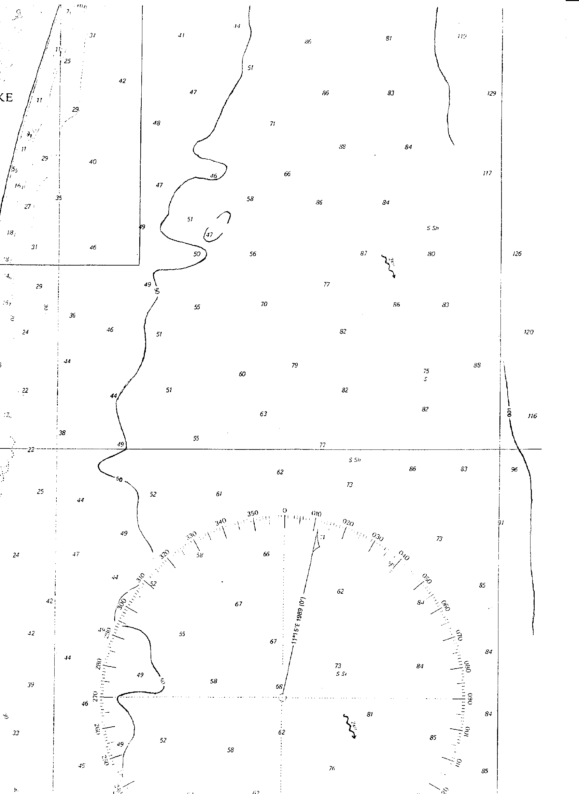

---
## Page 113

 
 
 
Appendices 
 
NATIONAL SEARCH AND RESCUE MANUAL 
Page 446 
2025 EDITION Version 1 – February 2025 
Appendix E 
Overview 
Appendix E includes the following: 
• 
Appendix E-1 Search Urgency Form 
• 
Appendix E-2 Missing Persons Questionnaire 
• 
Appendix E-3 Object Questionnaire 
• 
Appendix E-4 Land SAR Checklist 
• 
Appendix E-5 Lost Person Behaviour 
• 
Appendix E-6 Land Search Planning Tables 
• 
Appendix E-7 Additions to Naismith’s Rule 
• 
Appendix E-8 Probability of Detection (Land) 
• 
Appendix E-9 Mattson Consensus 
• 
Appendix E-10 Land SAR Organisation Chart 
• 
Appendix E-11 FSH Layout 
• 
Appendix E-12 Search Communication Network 
• 
Appendix E-13 Clue Recognition 
• 
Appendix E-14 SAR Tasking Sheet 
• 
Appendix E-15 Search for Skeletal Remains 
• 
Appendix E-16 Peer Review 
• 
Appendix E-17 Body Flotation Information

---
## Page 114

 
 
 
Appendices 
NATIONAL SEARCH AND RESCUE MANUAL 
2025 EDITION Version 1 – February 2025 
Page 447 
Appendix E-1 Search Urgency Assessment Form 
Search Urgency Assessment 
Name of Incident: 
No: 
Date Completed: 
Time completed: 
Initials: 
Incident date: 
 
Number of subjects 
1 person 
1 
 
2 people or 3 or more – separated 
2 
3 people or more – together 
3 
Age 
Very young 
1 
 
Other 
2-4 
Very Old 
1 
Medical Condition 
Known illness or requires medication 
1 
 
Suspected illness or injury 
1 
Healthy 
3 
Known frailty  
1 
Potential vision impairment 
1 
Intent 
Suicidal 
1 
 
No known intent 
3 
Absconder from facility 
4 
Cognitive Capacity 
Dementia / Alzheimer’s /Parkinson’s 
1 
 
Capacity of 16-year-old or less 
1 
Diagnosed mental illness, depression or anxiety 
2 
No known capacity issues 
3 
Experience profile 
Not experienced – not familiar with area 
1 
 
Not experienced – familiar with area 
2 
Experienced – not familiar with area 
3 
Experienced – familiar with area 
4 
Physical Condition 
Unfit 
1 
 
Fit 
2 
Very fit 
3 
Clothing profile 
Inadequate/insufficient 
1 
 
Adequate 
2 
Very good 
3 
Equipment Profile 
Inadequate for activity/environment 
1 
 
Questionable 
2 
Adequate 
3 
Very Well equipped 
4 
Weather profile 
Existing Hazardous weather 
1 
 
Hazardous forecast (8 hours or less) 
2 
Hazardous forecast (more than 8 hours) 
3 
No hazardous weather forecast 
4 
Terrain and Hazards profile 
Known hazards 
1 
 
Difficult terrain 
2 
Few hazards 
3 
Easy terrain, no known hazards 
4 
11-17 Emergency Response        18-27 Measured response         28-39 Evaluate & Investigate 
Note: If any individual category above is rated as ONE (1), regardless of its total – the search could require an emergency response 
Remember: the lower the number the more urgent the response!!!

---
## Page 115

 
 
 
Appendices 
 
NATIONAL SEARCH AND RESCUE MANUAL 
Page 448 
2025 EDITION Version 1 – February 2025 
Notes: The SUA should be completed by the SMC.  When completing the SUA form please look at the SAR 
incident in its entirety to get a better understanding of the urgency involved.   
An example of this may be a reported overdue skier in the alpine region of NSW.  Making the assessment 
based on the activity that was being undertaking may provide a higher score than the actual situation 
requires.  For the skiing activity the MP may be experienced and familiar with the area, scoring a 4.  If they 
are overdue and the likelihood of them spending the night above the snow line is a possibility a re-
assessment should be made.  While they may be experienced to ski the various runs, they may have little 
or no experience at overnighting, dropping the score down to a 1. 
If the MP was prepared for a day of skiing the popular ski runs with appropriate clothing, there is little 
likelihood that they took additional clothing for an overnight stay, again dropping the score from a 3 to a 
1.  Equipment is the same as clothing; a day skier is not likely to be carrying a tent and overnight 
provisions but may be perfectly equipped for a day ski. 
The weather and hazard profile are similar in context.  Weather and hazards in one area of the alpine 
region may be different in another area, and both can change during the course of a single day.  A 
pleasant day of skiing can change in an instant, be aware of this and review the SUA form as appropriate. 
It is appropriate for the SMC to ask the question of why the MP did not return from a scheduled activity, 
and from that make deductions on the potential possibilities and what the SAR response should be.

---
## Page 116

 
 
 
Appendices 
NATIONAL SEARCH AND RESCUE MANUAL 
2025 EDITION Version 1 – February 2025 
Page 449 
Appendix E-2 Missing Person Questionnaire 
Missing Person Questionnaire 
Incident: 
Date: 
Time: 
Surname: 
Given names: 
Address: 
Telephone: 
Mobile: 
DOB: 
Ethnicity: 
Sex: 
NOK: 
Telephone: 
Hgt: 
Wgt: 
Bld: 
Eyes: 
Cmp: 
Beard: 
Scars: 
Hair: 
Lgth: 
Hiker Exp: 
 
Climber Exp: 
Swim Exp: 
Snow Exp: 
 
Military Exp: 
Camping Exp: 
First Aid Trn: 
Map/Compass Trn: 
Knowledge of area: 
Smoke: 
Drink: 
Fears: 
Lost before: 
Action then: 
Shirt: 
 
Jumper: 
Trousers: 
Jacket: 
Raingear: 
Hat: 
Shoes: 
 
Sole pattern: 
Scarf: 
Glasses: 
Watch: 
Jewellery: 
Other Clothing: 
 
Clothes for dog scent: 
Pack: 
Colour: 
Tent: 
Colour: 
Slp Bag: 
Colour: 
Water Bottle: 
Colour: 
Torch: 
Colour: 
Slp mat: 
Colour: 
Knife: 
Matches: 
Compass: 
Firearm: 
Fishing gear: 
Camera: 
Ropes: 
Climb Equip: 
Kayak: 
Radio AM: 
Radio CB: 
PLB: 
Map: 
 
Food: 
Name: 
Scale: 
Number: 
Vehicle Reg No: 
Make/Model: 
Colour: 
Medical History: 
Physical Problems: 
Psych Problems: 
 
Medication: 
 
Amount carried: 
Consequences: 
Doctor: 
Address: 
Telephone: 
Family Problems: (Financial, family) 
 
Request for Aid (Welfare) 
Person to notify if found ALIVE: 
 
Address: 
Telephone: 
Person to notify if found DEAD: 
 
Address: 
Telephone: 
Remarks: 
 
 
Name: 
Rank: 
Station:

---
## Page 117

 
 
 
Appendices 
 
NATIONAL SEARCH AND RESCUE MANUAL 
Page 450 
2025 EDITION Version 1 – February 2025 
Appendix E-3 Object Questionnaire 
Object Questionnaire 
SAR Number: 
Date/Time: 
Description of Object: (If photo/drawing is available please attach) 
 
 
 
 
 
 
Make: 
Model: 
Reg/Serial No: 
 
Colour: 
Dimensions: 
Weight: 
 
Special Markings/Identifiers: 
 
 
 
 
Does this object pose any dangers to humans, animals or the environment?  If so, describe in detail: 
 
 
 
 
Who can be contacted to provide expert advice? 
Name: 
Organisation: 
Telephone Number: 
Fax No: 
 
 
What action is to be taken by searchers if object found? 
 
 
 
 
Information provided by: 
Name: 
Organisation: 
Telephone Number: 
Fax No: 
 
 
Remarks: 
 
 
Name: 
Rank: 
Section/Station:

---
## Page 118

 
 
 
Appendices 
NATIONAL SEARCH AND RESCUE MANUAL 
2025 EDITION Version 1 – February 2025 
Page 451 
Appendix E-4 Land SAR Checklist 
Land SAR Checklist 
Maintain chronological action log: (Who spoken to? Times, Dates) 
Missing person Questionnaire: 
 
Completed: 
Search Area: 
Terrain 
 
Hazards 
 
Communications 
 
Assessment of scenarios 
 
Availability of resources 
 
What’s been done to date 
 
Isolate/Contain area 
 
Local SAR Plan 
 
Weather (www.bom.com.au) 
At present 
 
Forecast 
 
Sunset/sunrise 
 
Potential hazardous weather 
 
Search Urgency 
Complete Search Urgency Form 
 
Determine appropriate response 
 
Update briefing to Insp/Sen Sgt/Duty Officer 
 
Update JRCC 
 
Advise Media Section 
 
Advise Coroner (If death) 
 
Advise SES and other resources 
 
 
Field Search Headquarters 
Set up Field Search Headquarters 
 
Suitable location 
 
Access 
 
Parking 
 
Transport 
 
Communications 
 
Facilities 
 
Equipment 
 
Missing Person Locations 
Confirm Initial Planning Point IPP 
 
Last Known Point LKP 
 
Point Last Seen PLS 
 
 
Lost Person behaviour LPB 
Establish distances 
 
Characteristics 
 
Likely search areas 
 
Medical considerations 
 
TFFS 
 
POM 
 
Mapping 
Suitable maps 
 
Mark IPP, LKP, PLS 
 
Areas searched 
 
Areas to be searched 
 
SITREPS: 
To local command 
 
SAR Command 
 
OIC 
 
Media 
 
NOK 
 
Other agencies 
 
Planning: 
Identify Operations Commander (Liaise with same) 
 
Identify SMC 
 
Search appreciation conducted 
 
Designate sub roles 
 
A/SMC 
 
Planning member 
 
Intelligence member 
 
Log keeper 
 
Communications member 
 
Logistics member 
 
Consider Criminal Investigation Branch if suspicious 
 
NOK Liaison officer 
 
Establish White Board 
 
Establish Communications Plan 
 
Updated weather information 
 
Mapping/tasking 
 
Identify search areas (Manageable in 4-6 hrs) 
 
Consider Mattson Consensus 
 
Allocate Operational periods for future taskings 
 
Rescue Plan 
 
Allocate resources to teams 
 
Brief Search Personnel 
 
Team leader Briefings 
SMEAC 
 
Emphasise clues

---
## Page 119

 
 
 
Appendices 
 
NATIONAL SEARCH AND RESCUE MANUAL 
Page 452 
2025 EDITION Version 1 – February 2025 
Land SAR Checklist 
Calling method 
 
Description/clothing 
 
Search method 
 
SITREP requirements 
 
Questions? Understood 
 
Rescue Plan 
 
Actions on 
 
 
Search patterns 
FAST Teams 
 
Static Teams (SES Light trailer) 
 
Roadblocks 
 
Patrols 
 
Track Traps 
 
Broad Sweeps 
 
Sound Sweeps 
 
Night Search 
 
Contact Search 
 
Line (Parallel) Search 
 
Records 
Action log 
 
Equipment issued log 
 
Radio log 
 
Search team records 
 
Personnel records- Attendances 
 
Intelligence Records 
 
Update Map/Chart/white boards 
 
Daily summary of personnel 
 
Debrief 
Thoroughness of search 
 
POD 
 
Mark searched areas on map 
 
Team leader to sign search record 
 
Clues 
 
Further areas to search 
 
Issues raised 
 
Download GPS information 
 
Manage welfare 
 
 
Future Issues 
Allocate time callout for more resources 
 
Search/rescue plans 
 
Evacuation plan 
 
Operational periods 
 
Changeover of staff/SMC 
 
Equipment/fuel 
 
Conclusion of SAR Operations - 
At the conclusion of a SAR operation due to a target being located or the operation is suspended when a target is 
not located, the designated SMC should consider the following points and determine the correct course of action. 
Confirm information is accurate and target has been located 
 
Alert all SRU – Stand down units 
 
Sign in all members and document any injuries 
 
All appropriate agencies notified 
 
Sitrep to local command 
 
Log assets / resources 
Equipment repair & return 
 
NOK Notified 
Insure they are updated regularly. 
Appoint a liaison member 
Ensure active participation in process were possible 
Prepare NOK for suspension decision at least one day prior   
 
Consider bringing in coroner or coroner’s assistant  
 
Involve Police Investigators early - If MP not located 
 
Consult Doctor – private and independent 
 
Media release 
Ensure you communicate correct message if SAR suspended. 
Seek advice from Police Media liaison unit 
Consider signs or pamphlets left in area – if target not located 
 
Debrief the MP – document / consider taping 
 
Review who has command – If SMC leaving area 
 
Hazards ID e.g. abandoned vessel – advised shipping 
 
Records collated and filed 


---
## Page 120

 
 
 
Appendices 
NATIONAL SEARCH AND RESCUE MANUAL 
2025 EDITION Version 1 – February 2025 
Page 453 
Land SAR Checklist 
If target not located – Document reasons for suspension 
Document by - police statement or Specific suspension of SAR documentation 
Signed off by district officer or higher 
 
Administration / Financial procedures completed 
 
Conduct & organize debriefs – Hot & Full  
 
Ensure Debriefs documented – Action items identified   
Improvements, what went well, further investigation, encourage feedback 
Designate actions items to specific members 
Full debrief with relevant team leaders within 2 weeks of conclusion 
 
Safety issues after search. Driving whilst tired / alcohol 
 
Consider critical incident stress management issues 
 
Letters of thanks to outside agencies 
Certificates for good work 
 
Conduct review – conclusion or suspension of SAR operation 
By SMC and independent member 
Examine search plan 
Review planning scenarios 
Confirm initial planning point 
Evaluated all intelligence 
Examine all calculations 
Consult other experts – Police/medical/JRCC 
Review TFFS with all available information 
Quality and effectiveness of search 
Consult doctor - personnel and independent 
Coverage of all areas searched 
POD high as desired 
Can you justify what has been done or not done? 
Never assume anything – information must be confirmed 
 
Consider – 
Future Case study NATSAR 
Review NATSAR Manual Volume 2 Chapter 6 Conclusion of SAR Operations 
Exercises in area 
Over flights by Helicopter  
 
CONCLUSION OR SUSPENSION - NOT TERMINATION 
 
Resources 
JRCC 
 
Local Police 
 
Command Truck 
 
Dog Squad 
 
Mounted Unit 
 
Radio Techs 
 
Field Catering 
 
Media Unit 
 
Psychologist 
 
Forensic Unit 
 
Scenes of Crime Unit 
 
JRCC 
 
DACC 
 
Ambulance 
 
SES 
 
Fire Service 
 
Cave/Mine rescue 
 
Salvation Army 
 
Surf Life saving 
 
Volunteer Marine Rescue 
 
Coast Guard 
 
Ski Patrol 
 
Customs 
 
BOM 
 
Harbour master

---
## Page 121

 
 
 
Appendices 
 
NATIONAL SEARCH AND RESCUE MANUAL 
Page 454 
2025 EDITION Version 1 – February 2025 
Appendix E-5 Lost Person Behaviour 
Overview 
Lost Person Behaviour (LPB) has been derived from many studies and statistics gathering from search and 
rescue groups in many countries of the world.  It has been found that certain categories of missing 
persons tend to have similar characteristics with respect to being lost.  These categories have been 
broken down into the following groups: 
a) 
Children 1-3 years of age, 
b) 
Children 4-6 years of age, 
c) 
Children 7-12 years of age, 
d) 
Youths 13-15 years of age, 
e) 
Despondent or Suicide, 
f) 
Psychological Illness, 
g) 
Developmental Problems, 
h) 
Alzheimer’s and Dementia, 
i) 
Hikers and Walkers, 
j) 
Climbers, 
k) 
Hunters, 
l) 
Prospectors, 
m) ADD, ADHD, Autism and Asperger’s,  
n)  
First Nation People. 
Lost Person Behaviour Definitions 
Children 1-3yrs: All children aged 1-3 years of age. 
Children 4-6yrs: Al children aged 4-6 years of age. 
Children 7-12yrs: All children aged 7-12 years of age. 
Youths 13-15yrs: All teens aged 13-15 years of age. 
Despondent: A person feeling or showing signs of profound hopelessness, dejection, discouragement 
and/or gloom. This includes depression and people who have expressed the intent to commit suicide.  Not 
all despondent persons are suicidal and similarly not all suicidal persons are despondent, but they have 
similar characteristics and are therefore combined for SAR purposes. 
Psychological Illness: This category covers persons suffering from a wide range of mental disorders that 
medically would not be used together.  They include persons suffering from schizophrenia, paranoia, 
psychotic disorders and bipolar disorders. These disorders can be naturally occurring or artificially induced 
such as by substance abuse. This category does not include dementia. 
Developmental Problems: Also called Mental Retardation or Intellectual disability is a combination of 
below average intellectual functioning, impairments in daily life (communication, self-care, social skills, 
work, safety, health) and was onset prior to the age of 18 years.  This category also applies to persons 
suffering brain injuries after 18 years that exhibit the same symptoms. 
Dementia:  Dementia is the loss of memory, reason, judgement and language to such extent that it 
interferes with daily living.  Dementia includes AIDS and Alcohol related dementia, Alzheimer’s Disease, 
Down Syndrome, Early or Younger Onset Dementia, Fronto Temporal Lobar Degeneration, Vascular

---
## Page 122

 
 
 
Appendices 
NATIONAL SEARCH AND RESCUE MANUAL 
2025 EDITION Version 1 – February 2025 
Page 455 
Dementia and Dementia with Lewy bodies. Dementia often results in severe disturbances in how a person 
perceives and interprets events, sights, and sounds around them. 
Hikers and Walkers: This category includes day walkers, members of bush walking clubs, hill/fell walkers, 
multi-day hikers, trekkers, orienteers and other persons who purposefully enter the bush for recreational 
walking purposes.  Mountaineers are included in the climbing category. 
Climbers: This category includes day climbers (single day outings, bouldering, rock and cliff climbers, 
traditional climbers and sport climbers) and mountaineers (those who attempt prominent peaks or alpine 
travel). 
Hunters: This category includes all forms of hunting (pigs, water buffalo, brumbies, game fowl, kangaroos, 
cattle) on land.  There is insufficient data for a further breakdown. 
Prospectors: This category includes professional and amateur prospectors, regardless of what they are 
searching for (Gold, opal, gemstones etc.).  It does not include geologists, surveyors or other professionals 
in the exploration industry. 
Children with ADD, ADHD, Autism and Asperger’s: This category includes all children who have been 
medically diagnosed with one or more of these conditions.  It also includes children that are suspected of 
having one or more of these disorders but have not yet been diagnosed. 
First Nation Persons: This includes all First Nation people who reside outside the major urban areas. 
These are the most common groups of missing persons likely to be the subject of a search in Australia. 
There have been numerous studies on missing person behaviour with the most recent being Robert 
Koester’s (ISRID) International Search and Rescue Incident database www.dbs-sar.com collating 
thousands of incidents, statistics and previous studies for an international database. This information is 
continually being analysed and updated with Koester currently dividing missing person statistics to eco 
regions around the world that will enable more defined distances of travel for particular areas such as 
Victoria, a temperate terrain, as opposed to Northern Territory a hot dry terrain.  The only specific 
Australian project on missing person behaviour was the SARBAYES project which was completed by 
Charles Twardy: http://sarbayes.org/natsar.pdf. The current Australian data base for the entry of LPB 
details is: http://goo.gl/OLZmW  
Overseas studies also look at other categories such as hunters, skiers and miscellaneous adults.  The three 
main LPB studies used for this manual have been taken from the UK, USA and Canada.  Although Australia 
has many links with the UK and the majority of our citizens have a British background, we are a more 
mobile and active society more closely resembling Canada in our lost person behaviour.  These tables 
have been prepared as a guide only and are a compilation of studies in the above countries.  They 
represent the statistical properties and characteristics of missing persons and what could be expected of 
them when they are lost, but ultimately these are only probabilities, not certainties. 
This information can be used as the basis of search planning when no other information is available.  
Obtaining a good profile of the target person will assist the SMC in determining whether that 
person/group fits into the known behavioural patterns of the various categories studied.  If so, then 
further planning can be carried out on the information contained within this section.  The SMC must 
always be aware that not everyone will adhere to these profiles.  As can be seen in the distances travelled, 
80% are within a relatively small area while the last 20% of persons in each category tend to travel much 
greater distances.   
The studies show what the majority will do, there will always be someone outside the box who will do the 
opposite of what is expected.

---
## Page 123

 
 
 
Appendices 
 
NATIONAL SEARCH AND RESCUE MANUAL 
Page 456 
2025 EDITION Version 1 – February 2025 
Children 1-3 years 
Children 1-3 years 
Characteristics: 1–3-year-olds 
a. Have no concept of being lost. 
b. Navigational skills are non-existent. 
c. Will appear to wander aimlessly, although studies suggest that there may be a plan only 
known to them. 
d. Will not often respond to commands or whistles. 
e. Will tend to find shelter, which increases their survivability. 
 
Tendencies: 
a. Will often seek out a place of shelter.  Thick bushes, tables, old vehicles or appliances, 
caves. 
b. Difficult to detect. 
c. Will rarely self-help or walk out. 
 
Strategies: 
a. Urgent response due to their vulnerability to the environment (Pools, ponds, dams, weirs, 
creeks, rivers and other waterways are a priority). 
b. Confinement is a low priority. 
c. Passive techniques are not often successful. 
d. Dogs may be helpful if used quickly, but do not delay searching to wait. 
e. Checks of places of highest probability to be made initially. 
f. Teams to run main tracks and trails.   
g. May require getting down onto hands and knees to identify other less obvious tracks. 
 
Where located statistically: 
a. Habitation 
27% 
b. Building/shelter 
26% 
c. Open ground 
23% 
d. Linear feature (Fence, hedge) 12% 
e. Water, water’s edge 
12% 
 
% of category 
25% 
50% 
75% 
80% 
95% 
Distance from 
LKP (Km) 
0.27 
0.6 
1.7 
2.0 
4.45

---
## Page 124

 
 
 
Appendices 
NATIONAL SEARCH AND RESCUE MANUAL 
2025 EDITION Version 1 – February 2025 
Page 457 
Children 4-6 years 
Children 4-6 years 
Characteristics: 4–6-year-olds 
f. Have an idea of being lost and will endeavour to return to home or to a familiar place. 
g. Will panic, which may cause them to become further lost. 
h. Explorations are usually one way. This is a result of not comprehending to need to make a 
return journey. 
i. 
Will tend to remain on tracks or what they perceive as tracks.  Not always visible to taller 
adults. 
j. 
Are considerably more mobile than smaller children. 
k. May have been following an adult or animal prior to getting lost. 
 
Tendencies: 
a. Will often seek out a place of shelter.  Thick bushes, tables, old vehicles or appliances, 
caves. 
b. Difficult to detect. 
c. Will rarely self-help or walk out. 
 
Strategies: 
a. Urgent response due to their vulnerability (Pools, ponds, dams, weirs, creeks, rivers and 
other waterways are a priority). 
b. Confinement is a low priority. 
c. Passive techniques are not often successful (Consider nicknames or favourite music). 
d. Dogs may be helpful if used quickly, but do not delay searching to wait. 
e. Checks of places of highest probability to be made initially. 
f. Teams to run main tracks and trails.   
g. May require getting down onto hands and knees to identify other less obvious tracks. 
 
Where located statistically: 
a. Habitation 
29% 
b. Building/shelter 
28% 
c. Road, linear feature (Fence, hedge) 
19% 
d. Bush, scrub 
10% 
e. Open ground 
7% 
f. Water, water’s edge 
7% 
 
% of category 
25% 
50% 
75% 
80% 
95% 
Distance from 
LKP (Km) 
0.34 
0.95 
1.89 
2.51 
5.47

---
## Page 125

 
 
 
Appendices 
 
NATIONAL SEARCH AND RESCUE MANUAL 
Page 458 
2025 EDITION Version 1 – February 2025 
Children 7-12 years 
Children 7-12 years 
Characteristics:  
a. Have developing navigational skills. 
b. Are developing mental pictures of their environments, which are often inaccurate and 
highly distorted. 
c. Often become lost while attempting a short cut. 
d. Often become lost while ‘role playing’ or adventuring. 
e. Often become upset upon being lost and will act irrationally. 
f. May attempt to track run which can take them further from their LKP. 
g. Will act more rationally if with a friend or sibling. 
h. Will often attempt to self-help, not always successfully. 
 
Tendencies: 
a. Will mostly stay on tracks or trails, or what they perceive to be tracks/trails. 
b. May seek out favourite places, hideouts etc, check with friends 
c. May seek out known landmarks, lookouts, high points, places they have been to in the 
past, lakes, ponds, areas where vegetation changes such as forest edges. 
 
Strategies: 
a. Urgent response as this category can walk considerable distances. 
b. Confinement is a high priority. 
c. Reflex search teams to highest probability areas. 
d. Use dogs if available but do not delay search to wait.  
d. Passive techniques are not often successful. (Nicknames and favourite music may work). 
 
Where located statistically: 
a. Habitation 
25% 
b. Building/shelter 
30% 
c. Road, Linear feature (Fence, hedge) 
20% 
d. Forest/woods 
12% 
e. Open ground 
8% 
f. Water, water’s edge 
5% 
 
 
 
% of category 
25% 
50% 
75% 
80% 
95% 
Distance from 
LKP (Km) 
0.58 
1.98 
4.6 
5.10 
10.2

---
## Page 126

 
 
 
Appendices 
NATIONAL SEARCH AND RESCUE MANUAL 
2025 EDITION Version 1 – February 2025 
Page 459 
Youth 13-15 
Youth 13-15 
Characteristics:  
a. Moderately developed navigational skills. 
b. Often become lost as part of a group engaged in exploring. 
c. Don’t often travel far. 
d. Often respond to attractant techniques. 
e. Often seek familiar locations by direction sampling. 
f. Will act more responsibly as part of a group. 
g. Will often attempt to self-help. 
h. May panic if alone 
 
Tendencies: 
a. Will mostly stay on tracks or trails. 
b. May seek out favourite places, hideouts etc, check with friends 
c. May seek out known landmarks, lookouts, high points, places they have been to in the 
past, lakes, ponds, areas where vegetation changes such as forest edges 
 
Strategies: 
a. Urgent response 
b. Confinement is a low priority unless MP is alone 
c. Reflex search teams to highest probability areas. 
d. Use dogs if available but do not delay search to wait. 
e. Passive techniques are not often successful. 
 
Where located statistically: 
a. Habitation 
25% 
b. Waterway/Stream 
17% 
c. Building/shelter 
26% 
d. Forest/ woods 
10% 
e. Road, Linear feature (Fence, hedge) 11% 
f. Forest edge or clearing 
11% 
 
% of category 
25% 
50% 
75% 
80% 
95% 
Distance from 
LKP (Km) 
1.37 
2.2 
4.1 
4.34 
14.43

---
## Page 127

 
 
 
Appendices 
 
NATIONAL SEARCH AND RESCUE MANUAL 
Page 460 
2025 EDITION Version 1 – February 2025 
Despondent/Suicidal 
Despondent/Suicidal 
Characteristics: 
a. Don’t often travel far, but intent to be alone. 
b. Often located a border of two types of terrain and/or vegetation boundary. 
c. May head for a scenic location or well-known beauty spot. 
d. Locations are often well known to MP, check with family/friends. 
e. Rarely located in dense underbrush or trees. 
f. Rarely respond to call and whistles and may hide. 
g. Very high fatality rate. 
h. Drugs and/or alcohol often involved. 
 
Tendencies: 
a. Go to high points or scenic locations. 
b. Well known or favourite places. 
c. Terrain interfaces 
d. Group 1- merely seeking to get out of sight. 
e. Group 2- will seek out a specific location, significant to their life.   
f. Some in this category may travel further and adopt concealment methods. 
 
Strategies: 
a. Investigation into background circumstances is important. 
b. Obtain a good subject profile from family, friends, GP (May be on depression meds) and 
social media. 
c. Urgent response. 
d. Thorough search of a small area. 
e. Confinement is a low priority. 
f. Passive techniques not successful. 
 
Where located statistically: 
a. Habitation (Building or structure) 
31% 
b. Water/water’s edge 
14% 
c. Forest/woods 
24% 
d. No trace 
13% 
e. Road/linear feature (Fence, hedge) 
7% 
f. Forest edge/clearing (Near road/track) 11% 
 
% of category 
25% 
50% 
75% 
80% 
95% 
Distance from 
LKP (Km) 
0.41 
1.05 
2.29 
2.43 
18.14

---
## Page 128

 
 
 
Appendices 
NATIONAL SEARCH AND RESCUE MANUAL 
2025 EDITION Version 1 – February 2025 
Page 461 
A small percentage of all persons who go missing do so with the intent of committing suicide.  The reasons 
for this are beyond the scope of this document but a wide and varied. The SMC should consider whether 
the MP is genuinely at risk of taking their own lives and what strategy should be used.  Studies have 
shown that there is a strong link between depression and suicide.  The two strongest indicators that a 
depressed person may contemplate suicide are: 
a) 
They have left a suicide note indicating their intentions of taking their own lives. 
b) 
They have recently talked about taking their own lives. 
The SMC needs to obtain a detailed profile of the target person.  There is often something in their 
background that is either the cause or trigger for them to contemplate suicide.  Problems to look for are: 
• 
Relationships 
• 
Finances 
• 
Sexual 
• 
Employment 
• 
Education 
• 
Medical 
• 
Mental health 
• 
Addictions 
If someone who is suffering depression has indicated an intention to take their own life, and has one or 
more of the above triggers present, there is a high probability that the person poses a high risk of taking 
their own life.  The risk is normally low pre-teens and increases during puberty and adolescence, reaching 
a peak in the mid-twenties and remaining relatively constant until old age. 
Religious conviction may be an indicator of suicide intent.  Strongly Christian believers are less likely to 
commit suicide.  Those with no religious believes have a high tendency towards suicide.  In some religions, 
such as Judaism, Islamic, Hindu, Shinto, suicide is a valid way to depart earth. 
If there is a suicide note, the contents may provide important information regarding where and how the 
person intends to suicide.  It may provide specific information about a favourite or known location.  It may 
also indicate that they will not be found which may point out that they will be in a secluded or difficult to 
reach location.  The presence of a note does not automatically mean that the target has committed 
suicide as some people sue these notes for shock tactics to get attention or they change their minds and 
not follow through. 
Gender is very important in determining whether suicide is a possibility.  Men are three times more likely 
to take their own lives than women (ABS 2012).  Men, 18-45, are the greatest at risk.  Within the men 
group Aboriginal and Islander males are at a higher risk than average.  Hanging is the most popular 
method (51%), with poisoning by drugs (15%) and poisoning by other methods such as car exhaust (16%) 
following.  Jumping from high buildings, drowning, and firearms etc account for the remainder.  Married 
men are less likely to commit suicide. 
Once a person has reached the decision to commit suicide, they generally want to carry it out as soon as 
possible for the least amount of effort.  Access to the means to do so should be investigated by the SMC 
as this may determine how and where it may take place. 
There are many recorded instances where an adult has gone missing with their children.  The killing of the 
children prior to suicide is not uncommon. 
With the increased mobility of today’s young people, it is often difficult to obtain sufficient details of a 
missing person because they have not established a close circle of friends.  Social media sites such as 
‘Facebook’, ‘YouTube’, and ‘Instagram’ may provide details about a missing person and any intentions 
that they may have.

---
## Page 129

 
 
 
Appendices 
 
NATIONAL SEARCH AND RESCUE MANUAL 
Page 462 
2025 EDITION Version 1 – February 2025 
Psychological Illness 
Psychological Illness 
Characteristics: 
a. May be evasive and run or hide. 
b. Often not respond to their name. 
c. Rarely travel purposely to a target. 
d. Medication or lack of it may be a problem. 
e. May be frightened of authority and of being found. 
f. Can be aggressive. 
g. Not actually lost in the normal sense. 
h. Difficult to predict behaviour. 
 
Tendencies: 
a. Do not often penetrate forest or thick undergrowth 
b. Will seek shelter and seclusion 
c. May walk out when ready 
 
Strategies: 
a. Check all buildings and places of shelter/seclusion. 
b. Check drains, streams and tracks. 
c. Obtain profile by talking to family, friends and medical experts. 
d. Dogs may be of use. 
e. Containment a priority. 
f. Re-search areas and tracks. 
g. On-going search of buildings as target may return to areas already searched. 
 
Where located statistically: 
a. 
Road/Linear feature       29% 
b. 
Habitation                      18% 
c. 
Building/shelter              22% 
d. 
Watercourse                    14% 
e. 
No trace                             6% 
f. 
Open ground                    11% 
 
% of category 
25% 
50% 
75% 
80% 
95% 
Distance from 
LKP (Km) 
0.56 
1.23 
3.58 
4.3 
11.73

---
## Page 130

 
 
 
Appendices 
NATIONAL SEARCH AND RESCUE MANUAL 
2025 EDITION Version 1 – February 2025 
Page 463 
Developmental Problems 
Developmental Problems 
Characteristics: 
a. Lack the concept of being lost. 
b. Cross between young children and Alzheimer’s. 
c. Generally good survivability. 
d. Do not often respond to names or other signals. 
e. May also have a physical impairment. 
f. Rarely travel to a specific target but will seek shelter. 
g. Will often penetrate thick forest and undergrowth. 
h. Will often run away and avoid searchers. 
 
Tendencies: 
a. Not route orientated. 
 
Strategies: 
a. High urgency. 
b. Obtain profile from family. 
c. Dogs may assist. 
d. Detailed ground search. 
e. Check streams and drains. 
f. Re-searching areas is important. 
g. Check buildings etc ongoing. 
 
Where located statistically:  
a. 
Building/shelter      
39% 
b. 
Road, linear feature  28% 
c. 
Forest/Wood    
22% 
d. 
No trace                     
3% 
e. 
Open ground             8% 
 
% of category 
25% 
50% 
75% 
80% 
95% 
Distance from 
LKP (Km) 
0.63 
1.85 
4.1 
5.02 
23.9

---
## Page 131

 
 
 
Appendices 
 
NATIONAL SEARCH AND RESCUE MANUAL 
Page 464 
2025 EDITION Version 1 – February 2025 
Alzheimer’s/Dementia 
Alzheimer’s/Dementia 
Characteristics: 
a. Poor short-term memory but may remember things that happened many years ago, such as address 
while a child. 
b. Impaired ability to rationalise surroundings. 
c. 
Often last seen in their home or a nursing home. 
d. May have a previous history of wandering. 
e. Other physical problems may exist (Limited mobility, poor sight or hearing). 
f. 
May be seeking a secluded location. 
g. 
Will not attract attention or respond to calls (Often no concept of being lost). 
h. Possible no concept of being lost. 
i. 
Will not often leave any clues apart from paradoxical undressing. 
j. 
Often succumbs to the environment (Hypothermia etc). 
k. 
18% fatality rate if not located within first 24-hrs. 
l. 
Two types, walkers (Younger/fitter) and non-walkers (Elderly/medical issues). 
Tendencies: 
a. Often located a short distance from a road or path. 
b. Will often attempt to travel to a place previously known to them (Even if this is an impossibility). 
c. 
Will be stopped by fences, hedges etc (Limited peripheral vision). 
d. Will tend to walk on the path of least resistance, downhill, and not often uphill. (Be aware: more 
physically capable, MP’s may walk uphill or in a direct line regardless of terrain).  
e. Can be found in drains or streams due to then being downhill. 
f. 
May remove items of clothing, particularly in cold weather. 
Strategies: 
a. High urgency, this category is very vulnerable to the environment. 
b. Early containment is essential. 
c. 
Use dogs or trackers but do not delay a search while waiting. 
d. Check all drains and low-lying areas. 
e. Check all fences, hedges and private yards in vicinity. 
f. 
Thorough search of the house, nursing home, and repeat every few hours. 
g. 
Search heavy bush. 
h. 
Search previous home locations. 
Where located statistically: 
a. Habitation/ structure 
35% 
b. Road (Rural and urban) 
36% 
c. Water/waterway 
10% 
d. Open ground (Fields etc) 
10% 
e. No trace 
5% 
f. Forest/Wood 
4% 
 
% of category 
25% 
50% 
75% 
80% 
95% 
Elderly/non-walker 
Distance from LKP 
(Km) 
0.19 
0.51 
1.4 
1.5 
3.9 
Younger/walker 
Distance from LKP 
(Km) 
0.49 
1.28 
2.65 
3.2 
14.0

---
## Page 132

 
 
 
Appendices 
NATIONAL SEARCH AND RESCUE MANUAL 
2025 EDITION Version 1 – February 2025 
Page 465 
Hikers/Walkers 
Hikers/Walkers 
Characteristics: 
a. Often track orientated but become disoriented if they miss their track junctions or it is 
overgrown and not easily found. 
b. Tend to travel further than other categories. 
c. At times poorly prepared or experienced for type of walk. 
d. Will often attempt to self-help by track running or seeking a high spot. 
e. May follow paths of least resistance, such as streams and forest boundaries. 
f. May panic and be irrational. 
g. May look for shelter in poor weather, at nightfall or if injured. 
h. May seek higher ground to attempt a reorientation or re-section. 
i. 
May seek higher ground to gain mobile telephone reception. 
j. 
Will often make their situation worst by direction testing. 
k. Approximately 2% have died doing an activity or trying to self-help (A small % of these are 
never located). 
 
Tendencies: 
a. Stay on tracks. 
b. Seek shelter. 
c. Seek high ground. 
 
Strategies: 
a. Containment 
b. FAST and Reconnaissance teams to high probability areas. 
c. Track searches. 
d. Obtain profile and route details. 
e. Being clue aware. 
f. Be aware of the potentially large distances the MP could have walked. 
 
Where statistically located: 
a. Road/track 
45% 
b. Water/watercourse/waterfall 
25% 
c. Building/shelter/hut 
4% 
d. Fence 
4% 
e. Forest edge 
3% 
f. Forest 
11% 
g. Open ground/farmland/agriculture 
1% 
h. Ground feature (Spot height, cliff etc) 7% 
 
% of category 
25% 
50% 
75% 
80% 
95% 
Distance from 
LKP (Km) 
1.1 
2.56 
4.71 
5.45 
15.15

---
## Page 133

 
 
 
Appendices 
 
NATIONAL SEARCH AND RESCUE MANUAL 
Page 466 
2025 EDITION Version 1 – February 2025 
Hunters 
Hunters 
Characteristics: 
a. Often game focused, which tends to contribute to their being lost. 
b. Will not often acknowledge that they are lost. 
c. Following targets often leads them to deadfall areas, boulder fields, underbrush or dense 
forest. 
d. Will go to great lengths to self-help. 
e. Will sometimes avoid searchers for fear of embarrassment. 
f. Often rely on GPS, radios and mobile phones. 
g. Usually mobile and responsive. 
h. Tend to travel at night and will follow linear features. 
i. 
Will take easy routes, ridge lines, cross country. 
j. 
Will make shelter and fire where possible. 
 
Tendencies: 
a. Will attempt to self-help. 
b. Seek shelter. 
c. Seek high ground. 
 
Strategies: 
a. Containment. 
b. FAST and Reconnaissance teams to high probability areas. 
c. Use of attraction techniques. 
d. Check historical finds. 
e. Air searches. 
f. Be aware of the potentially large distances the MP could have walked. 
 
Where statistically located: 
a. Road 
46% 
b. Forest 
10% 
c. Building/shelter 
5% 
d. Water/watercourse (with/without water) 
17% 
e. Ridge lines 
6% 
f. Open ground/grassland/unfenced areas 
6% 
g. Re-entrants 
10% 
 
% of category 
25% 
50% 
75% 
100% 
Distance from 
LKP (Km) 
0.96 
2.09 
4.82 
17.2

---
## Page 134

 
 
 
Appendices 
NATIONAL SEARCH AND RESCUE MANUAL 
2025 EDITION Version 1 – February 2025 
Page 467 
Climbers 
Climbers 
Characteristics: 
a. Will often travel considerable distances to reach climb site. 
b. Generally, well equipped but beginners may attempt difficult climbs without adequate 
equipment. 
c. Often overdue because of over estimation of climbing ability (39%). 
d. May be caught out in bad weather (24%). 
e. Being lost is not common (17%). 
f. Being stuck because of weather is common. 
g. Trauma is often experienced (Rocks falling on them or others). 
h. Will often be lost going to and from the climb site. 
i. 
Some climbers are stranded by nightfall (12%) and cannot go up or down. 
 
Tendencies: 
a. Will attempt to self-help. 
b. Seek shelter. 
c. Seek high ground. 
 
Strategies: 
a. Containment. 
b. FAST and Reconnaissance teams to high probability areas and tracks. 
c. Use of attraction techniques. 
d. Snow/Avalanche search if necessary. 
e. Thorough search of 25% zone. 
f. Climbing location is the immediate area. 
g. Check other climbs and routes in area. 
 
Where statistically located: 
a. Scree slope 
24% 
b. Water/watercourse/waterfall 25% 
c. Re-entrant/rocks 
30% 
d. Ridgelines 
10% 
e. Open ground 
6% 
f. Forest/forest edge 
9%  
g. Road/track 
2% 
 
% of category 
25% 
50% 
75% 
100% 
Day climber 
Distance from 
LKP (Km)  
0.0 
0.3 
0.8 
1.8 
Mountaineer 
Distance from 
LKP (Km) 
0.1 
1.0 
3.0 
10.5

---
## Page 135

 
 
 
Appendices 
 
NATIONAL SEARCH AND RESCUE MANUAL 
Page 468 
2025 EDITION Version 1 – February 2025 
Prospectors 
Prospectors 
Characteristics: 
a. Often do not tell family and/or friends of exact location. 
b. Often prospect alone, even if with a group. 
c. Often become distracted by detection equipment, ore formations on ground. 
d. Often well prepared for prospecting. 
e. Not often well prepared for extended survival, limited water/food carried. 
f. Not often equipped with GPS, compass, map. 
g. Often rely on memory or maps kept on their person. 
h. Not always fit. 
 
Tendencies: 
a. Are not track orientated. 
b. Tend to take limited notice of surroundings outside of immediate area of interest. 
c. Tend to prospect out and back from a central location. 
d. May travel larger distances following a possible ore seam, ground formation. 
e. May lose track of time. 
f. May attempt to self-help. 
g. May seek shade, water where possible. 
 
Strategies: 
a. Identification of central location, camp or LKP. 
b. Obtain information on where ore has been located previously in area. 
c. Check all abandoned/old/current mine shafts. 
d. Thorough search of a small area around identified central location. 
e. Confinement is a low priority. 
f. Passive techniques should be attempted. 
g. Aerial searching may provide clues and aid in self-help. 
 
Where located statistically: 
a. Open country (Tracks/desert/lightly wooded areas) 32% 
b. Closed country (Thick scrub/woodland) 
32% 
c. Watercourses (Wet or dry) 
18% 
d. No trace  
12% 
e. Mine shafts (Abandoned/used 
6% 
 
% of category 
25% 
50% 
75% 
95% 
Distance from 
LKP (Km) 
0.75 
1.7 
3.5 
6.5

---
## Page 136

 
 
 
Appendices 
NATIONAL SEARCH AND RESCUE MANUAL 
2025 EDITION Version 1 – February 2025 
Page 469 
ADD, ADHD, Asperger’s, Autism 
ADD, ADHD, Asperger’s, Autism 
Characteristics: 
a. Tend to travel alone. 
b. Not track or trail orientated. 
c. Have an affinity for water. 
d. Have difficulty concentrating. 
e. Have limited social skills. 
f. Often don’t recognise/understand they are lost. 
g. Limited survival skills but survivability is increased due to rapid response. 
h. Rarely respond to call and whistles and may hide. 
 
Tendencies: 
a. Appear to wander aimlessly but may have a destination or plan in mind.  
b. Will often head to water (Pools, creeks, canals, drains, golf course water hazards). 
c. Will possibly be avoiding searchers. 
d. Limited fear of the unknown. 
e. Often unresponsive to passive search techniques. 
f. May be attracted to vessels, vehicles, trains or aircraft. 
 
Strategies: 
a. Investigation of characteristics of MP is important (May think they are playing). 
b. Urgent response required. 
c. Check all water hazards. 
d. Establish barriers and/or confinement. 
e. In an urban environment a minute systematic search is required. 
f. Utilise media. 
g. Passive techniques not successful (Nick names, favourite music/toys may be useful). 
 
Where located statistically: 
a. Habitation (Buildings and yards) 
35% 
b. Water/watercourses  
35% 
c. Forest/woods/paddocks/fields 
20% 
d. Road/track/path 
8% 
 
% of category 
25% 
50% 
75% 
95% 
Distance from 
LKP (Km) 
0.25 
0.6 
1.2 
6.0

---
## Page 137

 
 
 
Appendices 
 
NATIONAL SEARCH AND RESCUE MANUAL 
Page 470 
2025 EDITION Version 1 – February 2025 
First Nation People 
First Nation People 
Characteristics: 
a. Often travel further than other LPB categories. 
b. Often have a good understanding of their locale. 
c. May head for a location known to them or of significance (Spiritual or totem). 
d. Locations may or not be known by other family and totem members. 
e. Generally, travel to an area with survival resources (Water). 
f. Rarely respond to call and whistles and may hide. 
g. May be involved in rites such as singing/boning. 
h. Drugs and/or alcohol can be involved. 
i. 
May not want to be found (Particularly by searchers). 
 
Tendencies: 
a. They do not wander aimlessly, there is often a purpose. 
b. Well known or spiritual places. 
c. Can travel significant distance compared to people of similar age/build. 
d. May be going to die. 
e. May be undertaking a ritual activity and will return upon completion. 
 
Strategies: 
a. Investigation into circumstances is important. 
b. Cultural understanding is vital, particularly of rituals, totem aspects and seasonal activities. 
c. Obtain a good subject profile from family, friends, and social media. 
d. Urgent response, but MP generally has survival skills in their own environment. 
e. Will require searching further than anticipated. 
f. Confinement is a low priority. 
g. Passive techniques not successful. 
 
Where statistically located: 
a. Open wilderness (Desert/plains) 
28% 
b. Water holes (Known/secret) 
24% 
c. Forest/vegetation 
18% 
d. Sacred locations 
18% 
e. No trace 
12% 
 
% of category 
25% 
50% 
75% 
80% 
95% 
Distance from 
LKP (Km) 
7.0 
12.0 
19.0 
23.0 
43.0

---
## Page 138

 
 
 
Appendices 
NATIONAL SEARCH AND RESCUE MANUAL 
2025 EDITION Version 1 – February 2025 
Page 471 
Appendix E-6 Land Search Planning Tables 
Land Search Planning Tables 
Searcher Speed 
1. 
Select speed of Searcher: 
Search member speed kph 
5 kph 
Consistent walking pace, undulating ground, light vegetation 
4 kph 
Steady walking pace partly restrained by vegetation and topography 
3 kph 
Walking pace restrained by vegetation and topography 
2 kph 
Slow walking pace considerably restrained by vegetation and topography 
1 kph 
Dead slow walk severely hampered by vegetation and topography 
Searcher Spacing 
2. 
Select search spacing (in kph): 
Searcher spacing 
50 m (0.05 Km) 
Open grassland or pasture 
40 m (0.04 Km) 
Open grassland interspersed with light shrubbery 
30 m (0.03 Km) 
Open country with low lying scrub and light undergrowth 
20 m (0.02 Km) 
Heavier scrub, medium undergrowth 
15 m (0.015 Km) 
Heavy scrub, undergrowth to shoulder height 
10 m (0.01 Km) 
Heavy shrub, dense undergrowth 
5 m (0.005 Km) 
Ground visual between searchers 
2.5 m (0.0025 Km) 
Dense undergrowth, ground visual 
ATNPS Calculations 
3. 
Then calculate Area (A), Time (T), Number of searchers (N), Search Pace (P) or Spacing (S)  
A = T x N x P x S 
T = A ÷ (N x P x S) 
N = A ÷ (T x P x S) 
P = A ÷ (T x N x S) 
S = A ÷ (T x N x P) 
 
 Example: What area could I search with 20 personnel, at 5 m spacing, walking at 2 kph in 3 hours? 
A = T x V x S = 3 hrs x 20 x 2 kph x 0.005 Km = 0.6 Km² 
T = A ÷ (N x P x S) = 0.6 Km² ÷ (20 x 2 kph x 0.005 Km) = 3 hrs 
N = A ÷ (T x P x S) = 0.6 Km² ÷ (3 hrs x 2 kph x 0.005 Km) = 20 searchers 
P = A ÷ (T x N x S) = 0.6 Km² ÷ (3 hrs x 20 x 0.005 Km) = 2 kph 
S = A ÷ (T x N x P) = 0.6 Km² ÷ (3 hrs x 20 x 2 kph) = 0.005 Km = 5 m 
S 
P 
N 
T 
A

---
## Page 139

 
 
 
Appendices 
 
NATIONAL SEARCH AND RESCUE MANUAL 
Page 472 
2025 EDITION Version 1 – February 2025 
Land Search Area Quick Reference 
Example: At 1 kph and 5m spacing = 0.005 Km²/searcher/hour 
Speed 
Area covered in Km² at track spacing of: 
Kph 
2.5 m 
5 m 
10 m 
15 m 
20 m 
30 m 
40 m 
50 m 
1 
0.0025 
0.005 
0.01 
0.015 
0.02 
0.03 
0.04 
0.05 
2 
0.005 
0.01 
0.02 
0.03 
0.04 
0.06 
0.08 
0.1 
3 
0.0075 
0.015 
0.03 
0.045 
0.06 
0.09 
0.12 
0.15 
4 
0.01 
0.02 
0.04 
0.06 
0.08 
0.12 
0.16 
0.2 
5 
0.0125 
0.025 
0.05 
0.075 
0.1 
0.15 
0.2 
0.25 
Land Air Search Planning Table 
Uncorrected Sweep width (Wu) for visual search OVER LAND.  ‘Wu’ is in kilometres for this table (Pilots 
will be able to convert back to NM if necessary). 
 
 
Human 
Vehicle 
Search Height (ft) 
0 
500 
1000 
1500 
2000 
0 
500 
1000 
1500 
2000 
Visibility 
2 Km 
- 
0.75 
0.75 
- 
- 
0.93 
1.11 
1.3 
1.11 
0.93 
5 Km 
- 
0.75 
0.75 
- 
- 
1.3 
1.66 
2.78 
3.15 
3.7 
10 Km 
- 
0.75 
0.75 
- 
- 
1.66 
2.40 
2.78 
3.15 
3.7 
15 Km 
- 
0.93 
0.75 
- 
- 
1.66 
2.40 
2.78 
3.15 
3.7 
20 Km 
0.75 
1.11 
0.93 
0.75 
0.75 
1.66 
2.40 
2.78 
3.15 
3.7 
25 Km 
0.75 
1.11 
0.93 
0.75 
0.75 
1.66 
2.40 
2.78 
3.15 
3.7 
30 Km 
0.75 
1.11 
0.93 
0.75 
0.75 
1.66 
2.40 
2.78 
3.15 
3.7 
35 Km 
0.75 
1.11 
0.93 
0.75 
0.75 
1.66 
2.40 
2.78 
3.15 
3.7 
40 Km 
0.75 
1.11 
0.93 
0.75 
0.75 
1.66 
2.40 
2.78 
3.15 
3.7 
55 Km 
0.75 
1.11 
0.93 
0.75 
0.75 
1.66 
2.40 
2.78 
3.15 
3.7 
75 Km 
0.75 
1.11 
0.93 
0.75 
0.75 
1.66 
2.40 
2.78 
3.15 
3.7 
90 Km 
0.75 
1.11 
0.93 
0.75 
0.75 
1.66 
2.40 
2.78 
3.15 
3.7 
Vegetation Correction Factor (Ve) 
Vegetation 
Human 
Vehicle 
Less than 15%  
(Open areas or scattered shrub)  
0.8 
1.0 
15% to 60%  
(Medium scrub or forest) 
0.5 
0.7 
60% to 85%  
(Dense scrub or forest) 
0.3 
0.4 
Over 85%       
(Rain Forest) 
0.1 
0.1

---
## Page 140

 
 
 
Appendices 
NATIONAL SEARCH AND RESCUE MANUAL 
2025 EDITION Version 1 – February 2025 
Page 473 
Cloud cover correction factor 
Shadows cast by scattered and broken clouds are a distracting influence on observers.  Compensate for 
this by rounding down the corrected sweep width when the sky is partially obscured. 
Example: Target is a missing person, Vis = 20 Km, Search height is 1000 ft, vegetation is 15-60% 
Corrected Sweep Width(W) = Wu x Ve 
W = 0.93 x 0.5 
W = 0.465 Km (Round down to 0.45 Km or 0.4 Km for partly obscured sky) 
 
Most Common Applications 
Land searching for: 
1. 
Missing person open terrain (Farming country, desert areas) = SEARCH HEIGHT 500 ft TRACK 
SPACING 500 m 
2. 
Missing vehicle in relatively open terrain = SEARCH HEIGHT 2000 ft TRACK SPACING 3 Km

---
## Page 141

 
 
 
Appendices 
 
NATIONAL SEARCH AND RESCUE MANUAL 
Page 474 
2025 EDITION Version 1 – February 2025 
Appendix E-7 Additions to Naismith’s Rule 
Naismith’s Land Speed / Time Calculations 
Land Speed/Time Calculations 
Terrain 
Speed 
Per minute equivalent 
Road 
5 kph 
100 m each 1.2 minutes 
Track 
4 kph 
100 m each 1.5 minutes 
Trail 
3 kph 
100 m each 2.0 minutes 
Off Track 
2 kph 
100 m each 3.0 minutes 
Scrub 
1 kph 
100 m each 6.0 minutes 
Ascending: Add 12 minutes per 100 m for overall time taken (Equivalent to 1 hr every 500 m ascent) 
Descending: Add 6 minutes per 100 m for overall time taken (Equivalent to 1 hr every 1000 m 
descent) 
Fatigue 
2 hours add 10 minutes 
3 hours add 25 minutes 
4 hours add 40 minutes 
5 hours add 60 minutes 
Tranters Corrections 
In the past three decades much work has been devoted to modifying Naismith’s rule to meet modern 
conditions.  One such system is to utilise Naismith's Rule to calculate a time then apply Tranter’s 
Corrections when working out a possible search area. 
The fitness level in the first column is the time it takes to climb 300 m over 800 m and can be determined 
through series of trials. 
The following corrections to Tranter’s Corrections should also be made for the following conditions: 
20 kg load being carried 
Drop one fitness level 
Conditions underfoot 
Drop one level or more according to conditions 
Conditions overhead 
Drop one level for journey at night or if wind is blowing against you 
 
 
Tranters Corrections 
Time taken to climb 300 m over 800 m 
Individual fitness 
in minutes 
Times taken in hours estimated using Naismith's Rule 
2 
3 
4 
5 
6 
7 
8 
9 
10 
12 
14 
16 
18 
20 
22 
24 
15 (very fit) 
1 
1.5 
2 2.25 3.5 4.5 5.5 6.8 7.8 10 
13 
14.5 
17 19.5 22 
24 
20 
1.25 2.25 3.25 4.5 5.5 6.5 7.75 8.8 10 
13 
15 
17.5 
20 
23 
 
 
25 
1.5 
3 4.25 5.5 
7 
8.5 10 
12 
13 
15 
18 
 
 
 
 
 
30 
2 
3.5 
5 6.75 8.5 10.5 12.5 15 
 
 
 
 
 
 
 
 
40 
2.75 4.25 5.75 7.5 9.5 11.5 
 
 
 
 
 
 
 
 
 
 
50 (unfit) 
3.25 4.75 6.5 8.5     
  
  
Too much to be attempted 
Limit Line

---
## Page 142

 
 
 
Appendices 
NATIONAL SEARCH AND RESCUE MANUAL 
2025 EDITION Version 1 – February 2025 
Page 475 
Appendix E-8 Land SAR Probability of Detection (Land) 
Caveat 
POD for land is a new concept within Australia.  It is more common in Canada, UK and New Zealand.  The 
theory behind this is based on the Marine POD.   
Area to be Search (AS)  
Area to be Search (AS) is the actual area, in square kilometres, to be searched by a particular team and 
where possible should be equal to or less than 1 Km² per search team task.   
Area swept (AW)  
Area swept is the mathematical area that was able to be searched (Swept) by the search team. The 
spacing of searchers is a function of detection capability. The more difficult the target is to detect, the 
closer the searchers should be. Decreasing the spacing increases the POD, but at the expense of reducing 
the area able to be searched in a given time. The optimum spacing is one which permits the maximum 
expectation of target detection in the available time or is consistent with the economic employment of 
search units. Whenever possible the Area Swept (AW) used should be equal to the Area of Search (AS). 
Coverage Factor (C) 
The coverage for a land search is a relationship between Area Swept (AW) and the Area to be Searched 
(AS). The relationship is termed Coverage Factor.   
Coverage Factor (C) =  
_Area Swept (W)__ 
 
 
 Area of Search (S) 
The relationship between Area Swept and the Area to be Searched determines the Probability of 
Detection (POD).  The area swept is the actual area that was covered by the searchers (Calculated using 
ATNPS or on area determined at team debrief), while the area to be searched is the area given to that 
team to search. Higher coverage factors indicate that a search has been thorough and offer a higher 
probability of target detection; however, the higher POD is not proportional to the extra search effort 
required.  
Where possible the SMC should be aiming for a coverage factor of 1, that is, the area given to the team is 
capable of being searched in the time frames available.  There will be many occasions when terrain, time 
limitations, largeness of the search area, or shortage of searchers will prevent this.  These situations will 
need an alternative approach that balances the factors of available search hours, size of area and C.

---
## Page 143

 
 
 
Appendices 
 
NATIONAL SEARCH AND RESCUE MANUAL 
Page 476 
2025 EDITION Version 1 – February 2025 
 
Figure E-8:1: Area Swept 
Probability of Detection (POD) 
Probability of detection (POD) is the statistical measure of search detection performance. It is a function 
of: 
a) 
Number of searchers 
b) 
Size of area to be searched 
c) 
Speed of searchers 
d) 
Spacing of searchers 
e) 
Fatigue 
f) 
Responsiveness or not of the target 
g) 
Detectability of target 
h) 
Daylight or darkness 
i) 
Vegetation and terrain 
j) 
Weather 
These factors ultimately equate to the ratio of the Area Swept and the Area to be Searched.  It is also 
conditional, meaning that search planners assume the search target is in the search area.  A definite POD 
exists for each scan made by an individual searcher. The probability that a discovery will be made in a 
single search scan is called the instantaneous POD. The instantaneous POD, repeated by successive scans 
as the searcher moves along the track, develops the probability pattern of a given search.  
The POD is not uniform over the swept area. In general, it is highest near the searcher and decreases with 
distance from the searcher.  Although POD is based upon each searcher the end calculation will pertain to 
the entire search team.  POD is a function of the coverage factor (C), which itself is derived from the 
relationship of Area Swept and the Area to be Searched.  Searching areas for second or more times will 
have the effect of increasing the cumulative POD.  The application of this concept results in a progressive 
increase in the POD of a target in the most likely sector of the search area by repeatedly searching the 
original area within progressively larger areas, a part of each overlaying the original.   
Utilising the land POD v Coverage Table below it can be seen that, when compared with marine SAR, there 
is only one search line which is to be used for all searches.  A Coverage Factor (C) of 1.0 will give a POD of 
 
 
 
 
S
h
Area Swept (W) 
Sweep Width = Spacing ≠ Search Horizon 
Area actually searched

---
## Page 144

 
 
 
Appendices 
NATIONAL SEARCH AND RESCUE MANUAL 
2025 EDITION Version 1 – February 2025 
Page 477 
approximately 63%, whereas a Coverage Factor (C) of 0.5 will give a POD of approximately 40%.  Some 
confusion may exist over this graph.  It is generally assumed that if the area swept and the area to be 
searched is the same, the Coverage Factor (C) will be 1 or 100%.  This is not the case as land search is in a 
three-dimensional environment and it is not possible for any search team to search every location within 
a land search area, hence the 63% POD (Searchers may be looking left instead of right, down instead of 
up).  This is because there are always going to be gaps where searchers search, refer to the Area Swept 
diagram on the previous page.  The yellow areas are those searched while the white areas in between are 
those that were missed.  In reality, a searcher has searched approximately 63% of the area assigned to 
them.  The following example will make this clearer:   
There are 2 hours to search an area of 1 Km².  There is a team of 10 personnel who will walk at 2 kph with 
a space of 20 metres between searchers. (20 m = 0.02 Km).  All measurements need to be in the same 
terms, either metres or kilometres. 
 
Area Swept 
 
Area Swept (A) = Time (T) x Number (N) x Pacing (P) x Spacing (S) 
 
i.e.  A = TNPS 
 
A = 2 hrs x 10 searchers x 2 kph x 0.02 Km 
 
A = 0.8 Km² 
 
Coverage: 
 
C = Area Swept ÷ Area of search 
 
C = 0.8 Km² ÷ 1.0 Km²  
 
C = 0.8 
This figure can now be used in a Land SAR POD Table as shown below.  Using the 0.8 on the bottom line 
we arrive at a coverage figure of 56%.  This is because land search is always a compromise between 
spacing and the ability to see objects on the ground.  It is almost impossible to achieve a 100% POD for 
any land SAR. 
A coverage factor of less than 0.5 may be unsatisfactory.

---
## Page 145

 
 
 
Appendices 
 
NATIONAL SEARCH AND RESCUE MANUAL 
Page 478 
2025 EDITION Version 1 – February 2025 
 
Figure E-8:2: Land SAR POD Table 
 
Technically it is not possible to search an area greater than that assigned so how do you get a Coverage 
Factor (C) greater than 1?  If you have a 2 Km² area to search and have the following: 2 hours, 10 
searchers walking at 2 kph and spacing of 50 m. 
Using the ATNPS formula this will give a Coverage Factor (C) of 1 
A = 2 hrs x 10 searchers x 2 kph x 0.05 Km spacing = 2 Km² 
C = 2 Km² ÷ 2 Km² = 1 = 63% 
 
If I increase the number of searchers by 5, but utilise them in the same area: 
A = 2 hrs x 15 searchers x 2 kph x 0.05 Km spacing = 3 Km² 
C = 3 Km² ÷ 2 Km² = 1.5 = 78% 
 
Although the formula gives a larger area searched, in reality we have searched the original area to a 
greater extent, with the five extra searchers.  We can increase either the time allowed to search an area, 
the number of searchers, search pacing or their distance apart to increase the C. (Twice the speed will 
double the area searched, or in our case, searching the same area twice, going up and back.  The same will 
apply if the spacing is increased.)   
The Land Cumulative POD Table (At end of this appendix) shows that two searches with an initial C of 0.5 
(39% POD) will combine to produce a total POD of 64%, which is equivalent to conducting one search with 
a C of 1.0.  It can also be seen that as more searches are conducted within that particular search area the 
POD slowly increases, as would be expected.   
Two searches in a particular area can be worked directly off the Land Cumulative POD table with the first 
search POD being entered on the left and the second across the top.  For a third search the cumulative 
POD for the first two searches is entered into the left side of the table and the new search POD across the 
top.   
 
 
56%

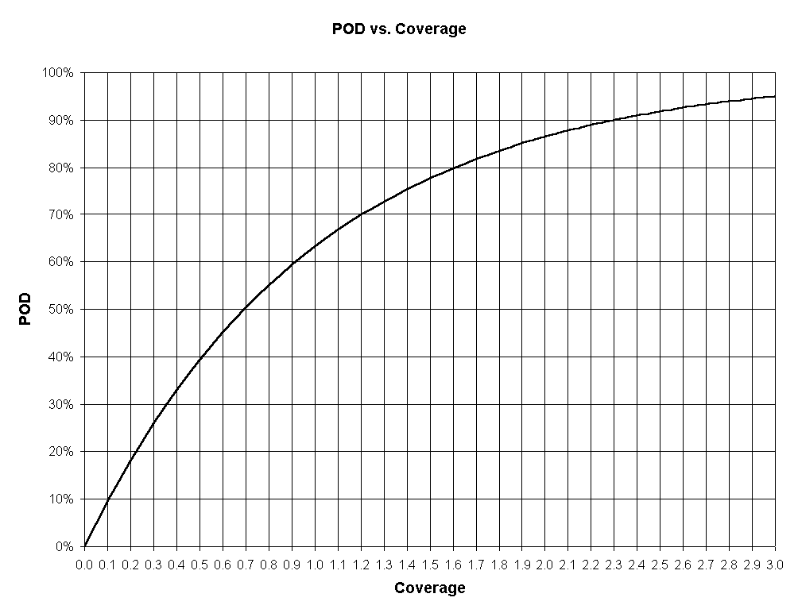

---
## Page 146

 
 
 
Appendices 
NATIONAL SEARCH AND RESCUE MANUAL 
2025 EDITION Version 1 – February 2025 
Page 479 
Example:  
Search 1 has a POD of 40%, search 2 has a POD of 50%.  A cumulative POD for these two searches is 
70%.  Search 3 has a POD of 40%.   
Using the 70% from the first two searches on the left of the table (Figure E-8:3) and the new POD of 
40% across the top a three-search cumulative POD is 82%.  This process is continued for each 
subsequent search.   
From the foregoing, it is apparent that for lengthy and repeated searches when searcher numbers are 
limited, a coverage factor of 0.5 offers a reasonable coverage of an expanded area resulting, over time, in 
a good POD.  Search of areas at a coverage factor less than 0.5 is not recommended.  Statistically, the 
target is more likely to be nearer the last known position than in the extremities of the search area.  
Application of the expanded search concept ensures that the greatest search effort is concentrated over 
the most probable position of the target where the POD is highest. Clearly, the expanding search 
procedure is best suited to situations where the approximate position or, at least, the planned route of 
the target is known.   
The projected value of the POD may be used by a SMC in determining the area of search. Use of POD may 
also be conveniently made in describing the results of a search, or part of a search, to interested persons 
not familiar with search planning techniques. Should the target not be located within the entire search 
area, the SMC must decide whether to continue searching it, recalculate the probability area using 
alternative data, or recommend the suspension of search effort. 
 
Cumulative POD Table 
POD this search 
Previous POD 
% 
5 
10 
15 
20 
25 
30 
35 
40 
45 
50 
55 
60 
65 
70 
75 
80 
85 
90 
95 
5 
10 
15 
19 
24 
29 
34 
38 
43 
48 
53 
57 
62 
67 
72 
76 
81 
86 
91 
95 
10 
15 
19 
24 
28 
33 
37 
42 
46 
51 
55 
60 
64 
69 
73 
78 
82 
87 
91 
96 
15 
19 
24 
28 
32 
36 
41 
45 
49 
53 
58 
62 
66 
70 
75 
79 
83 
87 
92 
96 
20 
24 
28 
32 
36 
40 
44 
48 
52 
56 
60 
64 
68 
72 
76 
80 
84 
88 
92 
96 
25 
29 
33 
36 
40 
44 
48 
51 
55 
59 
63 
66 
70 
74 
78 
81 
85 
89 
93 
96 
30 
34 
37 
41 
44 
48 
51 
55 
58 
62 
65 
69 
72 
76 
79 
83 
86 
90 
93 
97 
35 
38 
42 
45 
48 
51 
55 
58 
61 
64 
68 
71 
74 
77 
81 
84 
87 
90 
94 
97 
40 
43 
46 
49 
52 
55 
58 
61 
64 
67 
70 
73 
76 
79 
83 
85 
88 
91 
94 
97 
45 
48 
51 
53 
56 
59 
62 
64 
67 
70 
73 
75 
78 
81 
84 
86 
89 
92 
95 
97 
50 
53 
55 
58 
60 
63 
65 
68 
70 
73 
75 
78 
80 
83 
85 
88 
90 
93 
95 
98 
55 
57 
60 
62 
64 
66 
69 
71 
73 
75 
78 
80 
82 
84 
87 
89 
91 
93 
96 
98 
60 
62 
64 
66 
68 
70 
72 
74 
76 
78 
80 
82 
84 
86 
88 
90 
92 
94 
96 
98 
65 
67 
69 
70 
72 
74 
76 
77 
79 
81 
83 
84 
86 
88 
90 
91 
93 
95 
97 
98 
70 
72 
73 
75 
76 
78 
79 
81 
82 
84 
85 
87 
88 
90 
91 
93 
94 
96 
97 
99 
75 
76 
78 
79 
80 
81 
83 
84 
85 
86 
88 
89 
90 
91 
93 
94 
95 
96 
98 
99 
80 
81 
82 
83 
84 
85 
86 
87 
88 
89 
90 
91 
92 
93 
94 
95 
96 
97 
98 
99 
85 
86 
87 
87 
88 
89 
90 
90 
91 
92 
93 
93 
94 
95 
96 
96 
97 
98 
99 
99 
90 
91 
91 
92 
92 
93 
93 
94 
94 
95 
95 
96 
96 
97 
97 
98 
98 
99 
99 
99 
95 
96 
96 
96 
96 
96 
97 
97 
97 
97 
98 
98 
98 
98 
99 
99 
99 
99 
99 
99 
Figure E-8:3: Cumulative POD for Land Search

---
## Page 147

 
 
 
Appendices 
 
NATIONAL SEARCH AND RESCUE MANUAL 
Page 480 
2025 EDITION Version 1 – February 2025 
Appendix E-9 Mattson Consensus 
Overview 
The Mattson Consensus is used when two or more search areas have an equal chance of being the area of 
highest probability. The search areas are identified across the top of the form (Areas A, B, C etc.) as is the 
Rest of the World (ROW) as it may be the case that the MP is outside the identified search areas. The 
names of the senior or more expert members of the SAR Team are listed on the left side (Name 1, Name 2 
etc.), remembering that there should be at least five members. 
Each member then independently gives a weighting score to each search area and the ROW. Generally, 
the higher number weighting, the greater belief by the member that the target will be in that search area.  
There is no need for the weightings to add up to one hundred as this can cause skewing to ensure a fit. 
The columns and rows are totalled and recorded in the appropriate places. The Consensus Weight is the 
total in each column at (a) divided by the total at (c). The Consensus Weight (d) is then multiplied by 100 
to obtain the search area percentage (e). The search area with the highest percentage is considered, by 
consensus, to be the area of highest probability and would be searched first, followed by search area 2 
and so on. 
Mattson Consensus Worksheet 
Mattson Consensus Worksheet 
Search areas 
Area A 
Area B 
Area C 
Area D 
Area E 
ROW 
Subtotal Across 
(b) 
Name 1 
10 
12 
30 
10 
5 
2 
69 
Name 2 
15 
21 
50 
2 
2 
0 
90 
Name 3 
10 
20 
30 
10 
10 
10 
90 
Name 4 
5 
30 
40 
5 
10 
5 
95 
Name 5 
10 
20 
20 
10 
10 
10 
80 
Subtotal Down (a) 
50 
103 
170 
37 
37 
27 
= sum of  
(a)’s or (b)’s  
424 (c) 
Consensus Weight (d)    
=> (a) ÷ (c) = Weight 
(d) 
50/424   
= 0.12 
103/424   
= 0.24 
170/424   
= 0.40 
37/424   
= 0.087 
37/424   
= 0.087 
27/424   
= 0.06 
 
Percentage (e) 
=> (d) x 100 = (e) 
12% 
24% 
40% 
9% 
9% 
6% 
100% 
Figure E-8:4: Cumulative POD for Land Search

---
## Page 148

 
 
 
Appendices 
NATIONAL SEARCH AND RESCUE MANUAL 
2025 EDITION Version 1 – February 2025 
Page 481 
Appendix E-10 Land Search Organisation Chart Example 
 
 
Figure E-10:1: Land Search Organisation Chart

---
## Page 149

 
 
 
Appendices 
 
NATIONAL SEARCH AND RESCUE MANUAL 
Page 482 
2025 EDITION Version 1 – February 2025 
Appendix E-11 Field Search Headquarters Layout Example 
 
 
Figure E-11:1: Headquarters Layout

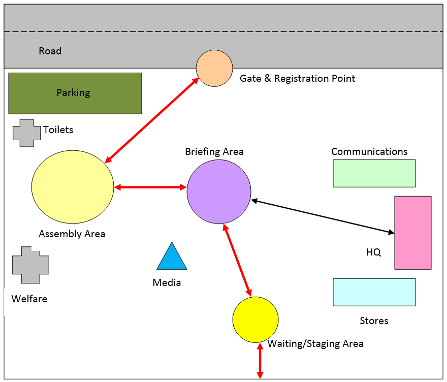

---
## Page 150

 
 
 
Appendices 
NATIONAL SEARCH AND RESCUE MANUAL 
2025 EDITION Version 1 – February 2025 
Page 483 
Appendix E-12 Search Communications Network Example 
 
 
Figure E-12:1 Search Communications Network

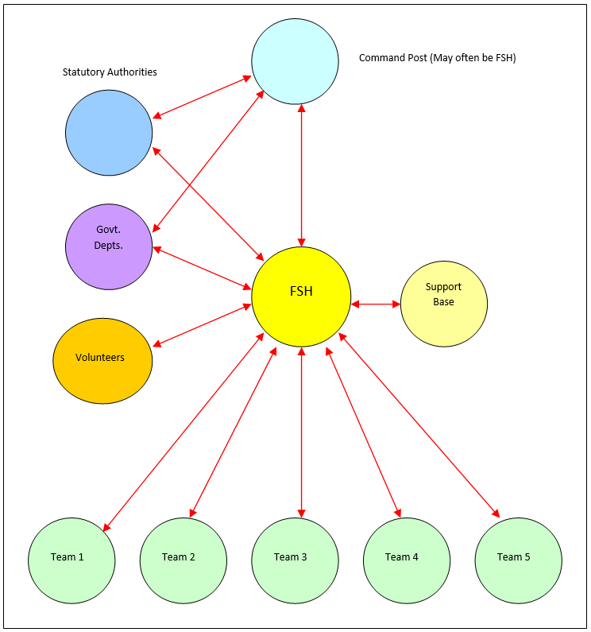

---
## Page 151

 
 
 
Appendices 
 
NATIONAL SEARCH AND RESCUE MANUAL 
Page 484 
2025 EDITION Version 1 – February 2025 
Appendix E-13 Clue Recognition 
 
A clue is a fact, an object, information or some type of evidence that helps to solve a mystery or problem.  
The purpose of seeking clues (gathering all the facts and information) is to assist in the reasoning of a 
problem and its ultimate solution.  In SAR this assists in the ongoing development and assessment of the 
SAR Plan. 
General Principles: 
The following principles apply: 
a) 
Clue seeking is an ongoing process that starts with the planning, continues throughout a mission 
until the debrief concludes. 
b) 
Clue seeking is a skill and must be practiced to develop a sense of what is the minimum information 
to work with. 
c) 
Avoid forming opinions and then gathering information to support that opinion. 
d) 
Don’t immediately form an opinion about the value of a clue. 
e) 
Gather information from everyone, as no one person can adequately gather all the facts. 
f) 
Assemble a complete profile of the missing target and the situation, and let it offer direction. 
Tracking Skills 
The ability for searchers to recognise signs that are not obvious clues within their search area can 
dramatically reduce the duration of the search.  These signs may be quite obvious to some searchers but 
may go unseen by others.  Developing skills in reading signs of activity within the landscape can greatly 
benefit the searcher and enhance their observation skills. 
Trail signs 
Once the size and shape of footprints is determined, another factor that can aid your search is terrain.  
Look at the ground.  If no footprints are apparent, look for freshly overturned stones (darker on top than 
the others, maybe even moist looking). 
Look for broken twigs and tree branches.  They will usually break forward as a person pushes through 
unless deliberately snapped back to lay a false trail.  Fresh breaks will show up as unweathered timber, 
differently coloured to the rest of the tree.  The underside of the leaves will be duller or more brightly 
coloured as well, depending on the species. 
Through thick bush a lighter area can often be apparent when scrub is pushed aside, much like long grass 
that is flattened in the direction of travel. 
When footprints are found, use the weather that has occurred since the person went missing to estimate 
the time since the print was left.  The amount of dryness of the print can determine an approximate time 
the person passed that way.  Other factors that should be considered are described below: 
a) 
If the weather was previously damp and windy, a predominantly dry print will indicate it has been in 
the open to the wind longer and has had time to dry out. 
b) 
If wetter weather had occurred but no real rain has fallen recently, the same print may have been 
there for a lesser period.  The heel will be the last area to dry.  If the heel depression is dry, the 
person travelled that area a longer time ago than if the print is partially damp. 
c) 
If heavy rain has fallen, most prints will appear to wash back into the soil and be little more than a 
depression.  Newer laid prints will be more defined. 
d) 
If it is currently drizzling/raining, fresh footprints may disturb the ground surface layer and produce a 
dry under surface. 
Scuff marks on the ground, which also kicks up rocks, scuff marks on rocks where someone has climbed, 
broken pieces of rotted wood are all indictors of someone, or something, having travelled that way. A lost

---
## Page 152

 
 
 
Appendices 
NATIONAL SEARCH AND RESCUE MANUAL 
2025 EDITION Version 1 – February 2025 
Page 485 
person may sit down and rest regularly, so look for heel and seat marks where they may have sat down.  
Think what you would do in their position and identify likely locations for rest. 
Flattened ground beneath trees or amongst the undergrowth can indicate a sleeping place, either of the 
missing person or fauna.  A check for animal cast may indicate occupation by animals.  A thorough search 
of the area might show footprints where a person has used an animal lair.  Personal items or human 
faeces may also be detected in these areas. 
Keep an eye out for signals that have been made by the missing person.  These include rock piles 
(sometimes a message may have been left within the layers of rocks), arrows or other marks left on the 
ground to indicate their direction of travel, flashes from mirrors, or items of clothing. 
When tracking, work as a pair if possible.  Work to either side of the track rather than directly on top of 
the person’s track.  With this method if you lose the trail, you can backtrack and pick it up again and 
resume.  If you have trampled all over it, you will have destroyed the clues. 
When finding signs treat them the same as when finding search clues.  Preserve them for analysis and 
report them. 
Like all other search aspects, tracking takes much practice to develop the skill.  The eye needs to be 
thoroughly trained, and then is used in conjunction with a knowledge of the bush. 
Sight 
a) 
Smoke from campfires (day) 
b) 
Light from campfires (night) 
c) 
Light from torches (night) 
d) 
Footprints 
e) 
Clothing 
f) 
Pieces of foam sleeping mat 
g) 
Trail register 
h) 
Disturbed foliage 
i) 
Witnesses 
j) 
‘Discardables’, such as lolly wrappers, drink or food cans, cigarette butts etc.

---
## Page 153

 
 
 
Appendices 
 
NATIONAL SEARCH AND RESCUE MANUAL 
Page 486 
2025 EDITION Version 1 – February 2025 
Appendix E-14 SAR Tasking Sheet Example 
Task sheet example 
 
Incident No.
Task No.
How Tasked
Date Task Issued
Time Task Issued
Call Sign
Search Location
Radio Ch
GPS Issued
Y/N
GPS No.
Radio No.
Role
DOB
Organisation
Phone
Team Leader
Search Category
Search Pattern
Time Out
Search Start
Search Finish
Time In
Signed - T/L
Date & Time
SARO/FSC COMMENTS - PFC USE
Signed - SARO/FSC
Date & Time
Finalised
Y/N
RESULTS
SAR TASKING SHEET
T/L - Understood & Signed
SEARCH BRIEF - Map attached Y/N
Name

---
## Page 154

 
 
 
Appendices 
NATIONAL SEARCH AND RESCUE MANUAL 
2025 EDITION Version 1 – February 2025 
Page 487 
Appendix E-15 Search for Skeletal Remains 
Overview 
The search for human remains from crime involves a number of techniques depending on the stage of 
decomposition of the target. Searches may be for the following target types: 
a) 
Grave sites, deep or shallow: Searchers are looking for disturbances in the landscape, vegetation 
changes, dips or hollows, ground discolouration and cracking.  It is near impossible to dig a grave and 
return the scene to its original condition. An aerial search may uncover potential sites of ground 
and/or vegetation disturbance. Historically, once a victim is buried, they are generally undisturbed 
until located by a search team, although there is evidence that shallow graves have been disturbed 
by wild and/or domestic animals. 
b) 
Disposal locations: Bodies may be quickly disposed of by criminals using what is readily available. 
(Covered with sticks and branches, leaf litter, rolled in carpet or other items, pushed into hollow 
items such as pipes and logs). There may be signs of darkened earth or dead vegetation caused by 
volatile fatty acids leeching from the body. 
c) 
Initial crime scene locations: The initial crime scene will provide forensic evidence and may be 
identified by signs of a struggle, broken branches, trampled grasses, ground disturbance, clothing, 
blood stains and/or other visible signs of a crime.  This may not necessarily be the location of the 
victim.  
d) 
Skeletal remains and bone dispersion: Searches conducted after lengthy periods of disappearance 
may be looking for skeletal remains. The search for skeletal remains is dependent on a number of 
factors: 
i) 
Length of time since initial incident:  Skeletisation periods can vary from 2-3 years for persons 
buried in deep graves, 6-12 months for those in shallow graves and much shorter periods for 
those left on the surface or loosely covered.  Cold weather will also slow the process of 
decomposition down, but warm, moist weather can have the opposite effect.  Wildlife 
distribution in the area, insects, dogs, pigs, cats, birds and other carnivores will contribute to 
decomposition. 
ii) 
Method of disposal: Burial inhibits decomposition due to a number of factors, including limited 
oxygen, limited exposure to flies and animals and generally cooler temperatures. 
iii) 
Animal predation in area: Animals will hasten the decomposition of flesh, leaving only the 
skeletal remains. Evidence shows that bone dispersion often results from animal activity.  There 
are some generalisations for bone dispersal: 
• 
During the initial stages of decomposition, the tendons and ligaments tend to hold a body 
together.  This limits animal activity to removing flesh and softer body parts. 
• 
The body disarticulates from the outside in, with the limbs being the first to separate, 
allowing them to be moved by predatory animals. The skull will also separate from the 
vertebra and the neck vertebra from each other. 
• 
The limbs may be taken as a whole by predators, to be further disarticulated at other 
locations. 
• 
The skull is one of the last items to be moved due to its size and the difficulty in grasping it 
with teeth. 
• 
Bone dispersal is generally in an oval shape, with the body core being at the higher 
elevation focus of the oval.  The limbs and other bones are mostly located in a downhill 
direction. 
• 
The oval shape is dependent on the terrain, with animals skirting rocky outcrops, thicker 
vegetation and waterways.  The bone dispersion will generally follow animal tracks. 
• 
As limbs disarticulate, the dispersal pattern will go from the larger bones, femur and 
humerus, to the medium bones of the tibia, fibula, radius and ulna, to the individual hand 
and foot bones.  The smaller bones are often difficult to recognise as bones, so it is

---
## Page 155

 
 
 
Appendices 
 
NATIONAL SEARCH AND RESCUE MANUAL 
Page 488 
2025 EDITION Version 1 – February 2025 
recommended that a forensic osteologist be available on scene to assist with 
identification. 
• 
The main section of the body will eventually collapse on itself with some of the smaller 
bones, such as ribs, being moved by animals. 
• 
The length of the dispersal oval can be between 10 and 135 m depending on the local 
animal population.  It is recommended that the latter be considered during the initial 
stages of the search. 
• 
Bones can be discoloured by the environment and are often not the bleached white colour 
expected by searchers.  They can take on the hues of the local environment due to the 
leeching effect of rain and the natural tannins found in plant life.  The search briefing 
should be very clear on this point (Bone details are contained at end of this appendix). 
• 
The age of the victim will also impact on what bones remain to be found.  The bones of 
children and teenagers will not have fully ossified or calcified leaving only misshapen 
slivers or portions of bone to be discovered. 
• 
Any objects suspected of being a bone should be examined in-situ, as the location of each 
bone can provide an indication of what position the victim was originally placed.  
 
Figure E-15:1: Bone scattering 
Two search methods are recommended for skeletal searching 
a) 
Single direction contact search.  All search members are lined up shoulder to shoulder and proceed 
at a set pace through the search area.  They should be armed with a hooked pole to move vegetation 
and other ground debris.  Each member is responsible for their own search path.  The usual rules on 
locating an object will apply.  When a bone is located the searchers will commence a ‘hands and 
knees’ search of the area at least 10m around the located bone.   
b) 
Search teams start at opposite ends of the search area, shoulder to shoulder and walk towards each 
other.  The teams pass and continue on to the end of the search area.  While this is more labour 
intensive it does allow the area to be search twice, from different directions at once, increasing to 
probability of detection to beyond what would be possible from two separate searches. 
The pre-search briefing must be comprehensive with respect to potential search objects, bone shape, 
colour and size, to ensure a thorough search is undertaken. Good investigative information is necessary to 
reduce the potential search area to a minimum as these types of searches are labour intensive, physically 
tiring and mentally straining.

---
## Page 156

 
 
 
Appendices 
NATIONAL SEARCH AND RESCUE MANUAL 
2025 EDITION Version 1 – February 2025 
Page 489 
Bone characteristics 
Exposure on ground surface causes a number of effects: 
a) 
Bone collagen protein content is degraded by UV light and water (rain) exposure 
b) 
Bone mineral content is degraded by water exposure 
c) 
Overall, the loss of collagen is greater than the loss of bone mineral. 
d) 
The key phenomenon with ground surface exposure is transpiration.   
• 
Bone acts as a wick, drawing moisture from the soil and evaporating that moisture from the 
uppermost surface of the bone. 
• 
The result is the deposition of minerals from the soil pore water inside the bone cavities and 
the formation of surface crusts of evaporate minerals on the uppermost surface of the bone. 
e) Bones can be heavily degraded in as little as 2-15 years. 
Surface exposed bones are typically white or light grey in colour, their surface is cracked or has a 
“woodgrain” appearance and is rough to the touch like sandpaper.  Surface exposed bones often get 
snagged on clothing due to their rough texture. 
 
Bone exposed on ground surface showing mineral crust formed on the uppermost surface of 
the bone due to transpiration

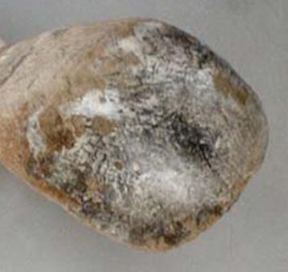

---
## Page 157

 
 
 
Appendices 
 
NATIONAL SEARCH AND RESCUE MANUAL 
Page 490 
2025 EDITION Version 1 – February 2025 
Bone exposed on ground surface showing brittle cracking due to loss of collagen 
 
A series of 6 pictures of animal bones exposed on ground surface demonstrating cracking of the bone

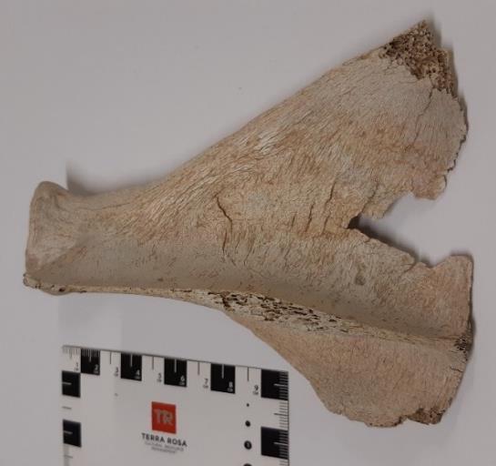

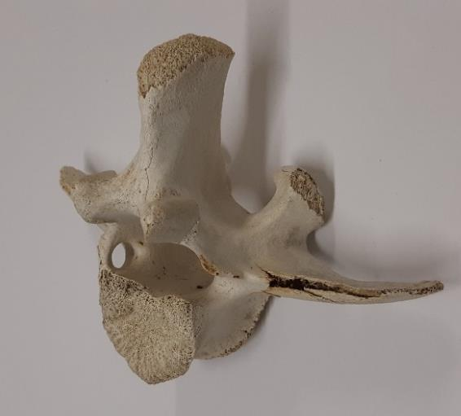

---
## Page 158

 
 
 
Appendices 
NATIONAL SEARCH AND RESCUE MANUAL 
2025 EDITION Version 1 – February 2025 
Page 491 
 
Cortex and “wood grain” appearance

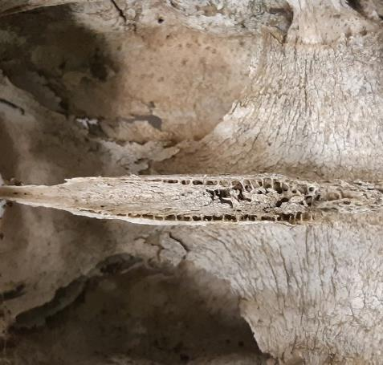

---
## Page 159

 
 
 
Appendices 
 
NATIONAL SEARCH AND RESCUE MANUAL 
Page 492 
2025 EDITION Version 1 – February 2025 
Plant growth on bones 
Plant root growth on bones causes shallow, etched depressions.

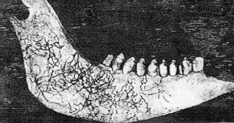

---
## Page 160

 
 
 
Appendices 
NATIONAL SEARCH AND RESCUE MANUAL 
2025 EDITION Version 1 – February 2025 
Page 493 
 
Plant roots may also obscure the shape of bones, making them difficult to detect.  Buried up to 20 yrs. 
 
Experiments had demonstrated that skeletonisation in Spain takes 3 yrs. Plant growth on bones would 
occur after skeletonisation. 
 
a) 
Plant growth consistent with person missing for 6 yrs. Rib case encased in shrub root growth 
consistent with >3 yrs growth. 
 
Botanical evidence used in a Spanish case to demonstrate time since death. 
b) 
Plant growth consistent with person missing for 6 yrs. Bryophyte growth on exposed tibia.  
Bryophytes only grow on bone when organic matter is absent (i.e. after skeletonisation).

---
## Page 161

 
 
 
Appendices 
 
NATIONAL SEARCH AND RESCUE MANUAL 
Page 494 
2025 EDITION Version 1 – February 2025 
Skeletonisation takes up to 3 yrs in Spain.  Bryophyte annual segments on its stems indicates 3 yrs of 
growth.

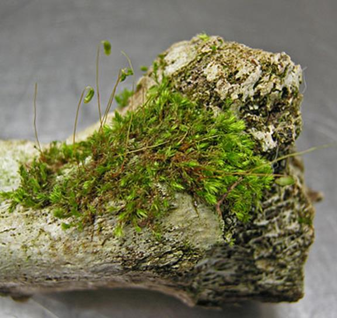

---
## Page 162

 
 
 
Appendices 
NATIONAL SEARCH AND RESCUE MANUAL 
2025 EDITION Version 1 – February 2025 
Page 495 
Fungal growth on bones 
Fungal attack indicates that the bone has been in an oxygenated environment.  Fungi are stunted or do 
not grow in low oxygen/sealed environments. 
 
 
Irregular white or dark grey patches of fungal growth on surface of human hip bone. 
Predator damage to bones 
Bone that has passed thought a carnivore’s digestive system.  The bone cortex can be eroded to reveal 
the spongy bone underneath.  There may be hair sticking to the bones from the rest of the carnivore’s 
meal.

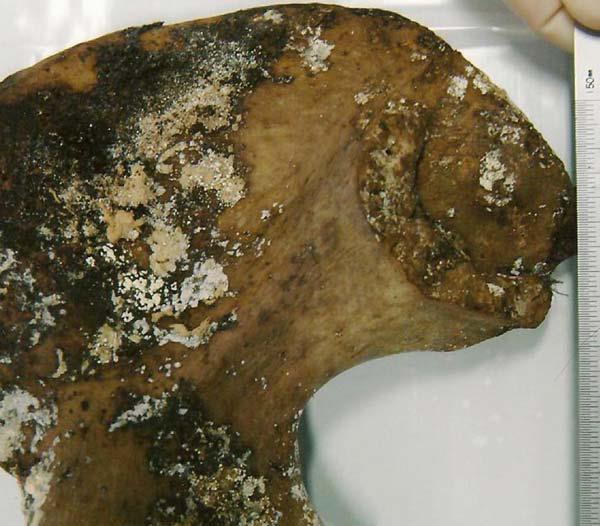

---
## Page 163

 
 
 
Appendices 
 
NATIONAL SEARCH AND RESCUE MANUAL 
Page 496 
2025 EDITION Version 1 – February 2025 
Appendix E-16 Peer Review Form Example 
Overview 
This is a Peer Review of a search and rescue operation under Volume 2 Chapter 6 of the National Search 
and Rescue Manual.  This process is aimed at identifying issues within the SAR system and providing 
recommendations to address any such findings. 
Peer review form 
Reviewer 
 
Date of review 
 
Missing person/s 
 
Incident location 
 
Date of incident 
 
SAR Coordinator/s 
 
Reference number 
 
 
Review Sections 
Outcomes (Suggested lines of enquiry) 
Situation 
a. A brief summary of the events leading to the incident. 
b. Summary of targets (description, age, experience, clothing, equipment carried, 
medical history, mental issues, disabilities. 
c. Summary of location, topography, vegetation, day light hours, weather, hazards 
d. Identification of SAR Coordinators and experience 
The National SAR 
Arrangements 
a. Does this incident fall into one of the categories identified in Appendix A-2? 
b. Which SAR authority was best placed to initiate a response? 
c. Which SAR authority was responsible for this incident? 
Assessment of the 
survivability of the 
incident 
a. Time elapsed since the incident;  
b. Environmental conditions;  
c. Age, experience and physical condition of (potential) survivors;  
d. Survival equipment available;  
e. Studies or information relating to survival in similar circumstances;  
f. Survivability of the incident 
g. Were survivors able to walk/drift away from incident site? 
h. Was there a possibility of third-party involvement 
Assessment of the Last 
Known Position (LKP) 
or Splash Point (SP) 
a. Calculations of LKP/SP utilising information available at the time. 
b. Correct application of current and leeway/ or Lost Person Behaviour 
c. Review the initial information available and any subsequent intelligence.   
Examination of the 
search plan 
a. Were proper assumptions were made on the information obtained 
b. Was a Search Urgency (SU) Form was completed 
c. Was the appropriate priority given to the urgency 
d. Were tasking sheets used, and signed upon return 
e. Were assigned areas were searched;  
f. Were resources activated and briefed in accordance with information  
g. Is a copy of the briefing/s available 
h. Was compensation made for search degradation caused by weather, 
navigation, mechanical or other difficulties 
Assessment of the 
Time Frame for 
a. Was an initial TFFS calculated and updated with medical advice 
b. Were POD calculations made

---
## Page 164

 
 
 
Appendices 
NATIONAL SEARCH AND RESCUE MANUAL 
2025 EDITION Version 1 – February 2025 
Page 497 
Survival (TFFS) and 
Probability of 
Detection (POD) 
c. Was the POD of a sufficiently high value to provide the best chance of location 
of the target/s 
d. Were there factors that impacted on the POD 
Assessment of the 
rescue plan 
a. Was best use was made of available resources;  
b. Were contingency plans sufficient to cater with unexpected developments; 
c. Was coordination with other agencies was effective in ensuring best treatment 
of survivors.  
d. The probability of detection was as high as desired 
Assessment of 
intelligence, 
information, clues and 
leads 
a. Were all available sources of information used? 
b. Was a review done of the information obtained 
c. Was the intelligence collated and evaluated? 
d. Was the intelligence disseminated as necessary? 
e. Was all intelligence utilised, and appropriate weight given to it? 
f. Were items of information missed or overlooked? 
g. Was a SAR Log kept and available 
h. Were tasking sheets used, returned and filed 
i. 
Were data entry systems completed 
j. 
Was a termination Form completed and available 
k. What other strategies were used to locate target (Banks, ATO, Centrelink, Tolls, 
Telephone etc.) 
Conclusion 
a. Search location 
b. Urgency 
c. Sufficient and experienced coordinators 
d. SMC advised 
e. Value of search 
f. TFFS and POD 
g. Search reasoning 
h. Identified deficiencies in SAR (staffing, training, experience, support, POD) 
Recommendations 
a. Incident issues 
b. System issues or amendments 
c. Policy issues 
d. Support issues 
 
Name: 
Title: 
Division/Branch/Unit/Police Station: 
Distribution: 
Original goes back to requesting Unit 
Copy direct to State SAR Coordinator/Manager for information 
Attachments 
List attachments if applicable

---
## Page 165

 
 
 
Appendices 
 
NATIONAL SEARCH AND RESCUE MANUAL 
Page 498 
2025 EDITION Version 1 – February 2025 
Appendix E-17 Body Flotation Information 
Overview 
While as accurate as possible the data contained below is based on historical incidents throughout 
Australia.  There has been no systematic study of human body flotation after immersion in water. 
Humans have large numbers of bacteria within the body cavities such as the gut and chest.  These 
bacteria don’t immediately die when a body does but continue to metabolise and produce gas.  It is this 
accumulation of body gasses that can raise a deceased body to the surface. 
The actions of the surface, waves, and movement, combined with bird and animal activities quickly causes 
the built-up gas to dissipate into the atmosphere.  Without this buoyancy a body will then sink back down, 
more than likely to never re-emerge. 
Issues that will affect floatation times 
a) 
For every 10 m of depth the pressure increases by one (1) atmosphere.  This means that for depths 
of 30-40 m or more the increased pressure and lower temperatures with generally retard any 
flotation of a body. 
b) 
Temperatures of below 5°C may not allow sufficient gas build-up for a body to float.  In these 
instances, it may take until the water warms for any floatation to occur. 
c) 
Food ingestion is a factor that should be considered.  A last meal high in carbohydrates will facilitate 
gas production, whereas a meal high in proteins will produce gas at a slower rate. 
d) 
Water temperature is an important factor for consideration.  The below graph represents likely 
floatation times based on water temperature.  This graph is based on reported floatation times for 
deceased bodies in inland waterways, rivers and dams.  There is considerable leeway involved and is 
only to be used as a guide. 
e) 
Some medications and all alcohol will assist in gas production. 
f) 
Body composition is an important factor; a large obese person has more opportunity to float than a 
lighter muscled person.  Fat or adipose is lighter than muscle mass. 
g) 
Children, although lighter, also have proportionally less gut.  This can have the effect of slowing their 
floatation, and contrary to this, their higher proportion of body fat can aid in floatation. 
h) 
Clothing will impact the ability to float.  It has been found that fishing waders and the like can inhibit 
floatation, whereas heavy clothing can require a significantly larger amount of gas generation for 
floatation.  Layered clothing has been found to aid floatation in the short term, possibly through the 
retention of air between the layers, while in the long term is becomes an extra weight to be 
overcome.  Light clothing and swimmers will generally have no effect. 
i) 
Any significant injuries to the body have been found to slow floatation.  Open wounds, particularly in 
the chest and abdomen area can allow body gasses to escape, limiting floatation.  The gasses 
produced by the body, hydrogen, hydrogen sulphide, carbon dioxide and methane, are all water 
soluble, meaning that they will dissolve if water is able to enter the body.  Dissolved gasses have no 
lifting power.  These gasses are also compressible, meaning that as depth increases their lifting 
power decreases. 
j) 
Because humans are not hydrodynamic in shape it takes very little in the way of snags to trap a body.  
The composition of the bottom in shallower areas can have an effect on floatation, things such as 
flood debris, rocks, car bodies etc.  Mud and silt can have a strong vacuum suction effect on a body. 
k) 
People who are already deceased when they enter the water may not immediately sink.  Without 
active respiration water entry into the lungs and gut may not immediately occur. 
l) 
Floatation of suicidal drowning victims can be problematic.  Most of these people are weighted 
down by either an object such as a large concrete brick or layered clothing.  Floatation does happen 
on occasion, but it is often more likely that they are located by a diver.

---
## Page 166

 
 
 
Appendices 
NATIONAL SEARCH AND RESCUE MANUAL 
2025 EDITION Version 1 – February 2025 
Page 499 
m) Almost all bodies will surface face down, the arms and legs hanging down will cause this.  Bodies 
thrown into the water during the early stages of rigor mortis may float face up, but this is rare. 
 
 
 
 
 
 
 
 
 
 
 
 
 
 
 
 
 
 
 
 
 
Figure E-16:1 Average flotation times in water (Australia) 
 
 
 
 
 0 
     5 
         10              15                 20 
    25 
       30 
Water Temperature in °C 
Days to Floatation 
 0 
    3 
           6                9                      12 
          15                18 
    21 
Average floatation times in water (Australia)

---
## Page 167

 
 
 
Appendices 
 
NATIONAL SEARCH AND RESCUE MANUAL 
Page 500 
2025 EDITION Version 1 – February 2025 
Appendix F - Aircraft Electronic Night Search Guidance  
Definitions 
Term 
Definition 
EO/IR, or Electro-
Optic/Infrared 
systems 
Electronic imaging systems which include both visible and infrared sensors 
that can be used day and night and in low light conditions with the ability 
to view objects at long distance.  
NVD, or night 
vision device 
Night vision enhancement equipment fitted to, or mounted in or on, an 
aircraft, vessel or vehicle, or worn by a person, that can:  
1.  detect and amplify light in both the visual and near infrared bands of 
the electromagnetic spectrum; or  
2.  provide an artificial image representing topographical displays. 
NVIS, or night 
vision imaging 
system 
A self-contained binocular night vision enhancement device, usually 
including goggles, that:  
1.  is helmet mounted or otherwise worn by a person; and  
2.  can detect and amplify light in both the visual and near infrared bands 
of the electromagnetic spectrum. 
NVIS is a term used to incorporate all aspects associated with night vision, 
including NVD. 
General Considerations 
1. 
This information provides general guidance for search planners when considering night searches by 
aircraft using Electro-Optic/Infrared (EO/IR) equipment and/or Night Vision Imaging Systems (NVIS). 
Note 1 - day searches using visual observation plus EO may be beneficial, but this guidance focuses 
on night search only.   
Note 2 – NVIS is used in this guidance as a collective term incorporating all aspects associated with 
night vision such as Night Vision Devices (NVDs) and Night Vision Goggles (NVGs).   
2. 
It is preferable, safer, and normally more effective to search in daylight. Of course, the timing of 
distress situations is not always optimal for a daylight search. Where suitably capable night search 
aircraft with aircrew trained and competent in safe night search operations are available, SMCs may 
consider a night search is necessary where the urgency of the situation may be critical to saving lives. 
3. 
Factors generally common to selection of aircraft and the ability for pilots to safely accept any search 
task apply such as regulatory requirements, risk factors, aircraft performance and capability, 
equipment fitted, aircrew training and experience, weather, nature of search area (topography, 
vegetation, distance offshore, availability of forced landing areas, obstacles, and powerlines, etc), fuel 
endurance available, transit times, available time on scene, fatigue, etc.  
4. 
Search planners and coordinators should have a good understanding of the capability and limitations 
of EO/IR and NVIS searching to be able to discuss and brief an effective search plan with the aircrew 
to establish reasonable expectations of possible outcomes and best use of the asset. Given the range 
of variables for these types of searches, search planners should be guided by the aircrew’s expertise 
and plan the search accordingly with safety of the operation the priority.  
Aircraft and equipment factors 
5. 
Aircraft type and the type of EO/IR and NVIS equipment available on board provide different search 
options. Aircrew training and experience play a central role in night search effectiveness. 
6. 
Ideally the use of a combination of EO/IR and NVIS is the most effective. NVIS can provide a wide 
viewing area with any sightings being able to be examined in more detail using IR which has a narrower

---
## Page 168

 
 
 
Appendices 
NATIONAL SEARCH AND RESCUE MANUAL 
2025 EDITION Version 1 – February 2025 
Page 501 
field of view and greater acuity. EO/IR cameras with the ability to zoom in on sightings provides 
advantages over EO/IR systems without this capability. Aircraft lighting, both internal and external, 
needs to be compatible with NVIS.  
7. 
It is possible that an object can be visible in the NVIS but not be visible in the EO/IR, or vice versa 
depending on the object’s characteristics. This may present challenges where search aircraft equipped 
with only one of these two types of electronic night search capability needs to transfer sighting details 
to another search aircraft with the other means of detection for investigation.  
8. 
Advanced systems integrated with navigation systems, moving map displays and recording capabilities 
provide additional benefits to assist operators to provide greater search integrity, efficiency, and 
effectiveness. For search aircraft suitably fitted, the ability for the RCC to send search patterns and 
search areas via data files (e.g., KML files) to be uploaded to aircraft mission management systems, 
GNSS units or aircrew portable electronic devices (if equipped) can provide efficiencies by reducing 
the need for complex conversations, relay of information and human error. Such aircraft if also fitted 
with a GNSS flight tracking system may also be able to provide the RCC with a debrief of the actual 
search tracks flown.  
9. 
Visual and IR lasers are visible using NVIS. SAR coordinators should note that some aircraft operators 
may have visual or IR laser capability which may be used for the purpose of guiding other aircraft and 
surface SAR units to a distress location. IR lasers can also be used by crew members on the same 
aircraft operating with different sensors to help each other acquire a sighting, for example, the crew 
member operating the EO/IR is having difficulty acquiring a sighting detected on NVIS by another crew 
member. Depending on the laser type there may be hazards associated with their use. SAR units who 
intend to use lasers should be appropriately authorised and trained in their use. Other assets involved 
in a search operation, both aircraft and surface units, should be informed when lasers are being used 
by search assets so they can take their own precautions with respect to laser safety and prevent 
confusion as to the reason for the laser.  
10. Aircraft fitted with an external public address or loudhailer system may assist with providing verbal 
directions to a person on the surface and may give comfort to a missing person not yet located that 
they are being looked for.  
11. Safety and capability can be enhanced for aircraft fitted with a terrain warning system, weather, or 
ground mapping radar and, for helicopters, auto-hover. 
12. Some Light Emitting Diode (LED) lighting systems, clearly visible to the naked eye, fall outside the 
combined visible and near-infrared spectrum of NVIS and therefore will not be visible to aircrew using 
NVIS. This may present a hazard where LED lighting is used for surface obstacles. Emergency or other 
equipment fitted with LED lighting used by survivors may also impact detectability using NVIS. 
13. Poor visibility due to contaminants in the air such as dust or smoke may compromise EO/IR and NVIS 
effectiveness. In maritime areas, strong winds can blow salt spray across camera lenses and windows 
obscuring the electronic image or view through windows, potentially leading to missed detection. Rain 
in the area can help clear this residue away.  
14. In maritime areas, detectability of unlit targets on the sea surface using NVIS will be degraded, 
particularly in calm conditions because of the low albedo (reflective properties) and contrast.  
Survivor factors 
15. Search success can be limited where people being searched for are not actively trying to be located or 
are not capable of actively aiding search crews, for example due to exposure or injury, or if they are 
hiding. 
16. Ideally persons in distress will have a light source which can be easily seen by NVIS equipped crews, 
such as a torch, light from a mobile phone or signal fire. Reflective material may also assist. It is also 
possible that laser pointers may be used by persons in distress. 
17. A person in the water without a light or reflective surface in broad scale searches where a specific 
splash point is not known is very difficult to locate at night. A known splash point with a short time 
frame between the splash point time and arrival of the search aircraft will increase the probability of 
locating the target.

---
## Page 169

 
 
 
Appendices 
 
NATIONAL SEARCH AND RESCUE MANUAL 
Page 502 
2025 EDITION Version 1 – February 2025 
18. To assist survivor awareness of the presence of the search aircraft and to elicit a survivor response 
signal, when the aircraft first arrives in the search area, if possible, the aircraft should be made as 
conspicuous as it can be by flying through the search area or orbiting at lowest safe altitude with as 
many external lights visible before commencing the search pattern. 
19. A person in distress may see or hear the search aircraft and respond by activating a light or flare. Crews 
should be alert that it is possible the person in distress may not have had the opportunity to activate 
their light signal by the time their aircraft passes and where possible adjust their search technique 
accordingly, for example, by flying both directions along the same search leg or, if capable and 
practicable, directing their detection equipment to search both forward and behind the aircraft.  
20. Survivor morale can be lifted when a search aircraft is sighted or heard during the night, even if the 
search aircraft does not find the survivor. 
Search planning factors 
21. The timeliness and accuracy of intelligence information for search area determination has a bearing 
on search effectiveness. 
22. Search coordinators should also consider that a NVIS capable aircraft may not necessarily be capable 
of conducting a NVIS search. This is because: 
a) 
NVIS may be used by pilots and aircrew solely for the purposes of safe air navigation and terrain 
avoidance functions in compliance with aviation regulations and may not have any capacity to 
conduct dedicated NVIS searching, whereas 
b) 
other aircrew not directly involved in air navigation and terrain avoidance functions may use NVIS 
solely for the purposes of searching and observation. 
23. Search planning should also take into account that search crews, when using EO/IR and NVIS 
equipment, will need periodic breaks to manage operator fatigue and provide an opportunity to view 
the search area with unaided electronic vision which may pick up lights that both EO/IR and NVIS 
cannot.     
24. It is important to note that aircraft EO/IR equipment can normally only search one side of a search leg 
at a time, or only a forward or rear splay area at any time. Using NVIS to detect possible search targets, 
then using the EO/IR to investigate those sightings is generally the most effective search technique 
especially for small targets. 
25. The target type will influence the type of night search to be conducted. Considerations include 
whether the primary target is to be a person, aircraft, vessel, or other object, its size, and its potential 
to provide a light source or light signal, and the amount of heat it may produce. The potential condition 
of the target should also be considered such as whether a survivor is likely to be capable of signalling 
or moving, a distressed aircraft has been damaged, or a vessel has capsized or is semi-submerged.  
26. Night searches may be more effective in areas with reduced numbers of people to avoid false sightings. 
Wildlife and livestock can be a distraction. 
27. Environmental conditions to consider include:  
a) 
Weather conditions - both for search effectiveness and compliance with flight operations 
regulations, such as NVIS minima, ability to maintain visual meteorological conditions (VMC), risk 
of inadvertently entering instrument meteorological conditions (IMC), availability of optimal 
search altitude due to amount of cloud cover, precipitation, visibility, the action of wind over 
terrain and impacts of turbulence, freezing level, surface and air temperature, humidity, fog or 
mist, thunderstorms and sea conditions. 
b) 
Ambient light - amount of moonlight and moon phase, position and elevation, effect of twilight 
and other ambient light sources. Nights with good ambient light enables more effective searching 
with NVIS.  
c) 
Thermal crossover - the natural phenomenon that normally occurs twice daily when 
temperature conditions result in a loss of contrast between two adjacent objects on IR imagery 
which may have an adverse effect on IR detection.

---
## Page 170

 
 
 
Appendices 
NATIONAL SEARCH AND RESCUE MANUAL 
2025 EDITION Version 1 – February 2025 
Page 503 
d) 
Bushfire activity - EO/IR detection capability will be affected by the heat from the fire(s). NVIS 
detection capability will be affected by the light from the fire(s) which can cause blooming 
(distortion or blotting out of the image) and smoke can reduce visibility. 
e) 
Thunderstorms – search aircraft should avoid thunderstorms by a safe distance to avoid the 
hazardous effects of severe turbulence, lightning, icing, etc. Distances from thunderstorms may 
be difficult to estimate visually when using NVIS and the fitment of airborne weather radar or 
other electronic detection devices to the aircraft will assist. The NVIS image may be adversely 
affected by lightning flashes.  
f) 
For searches over land - the topography including type of terrain, type and degree of vegetation, 
ground cover such as snow, and shadows from overhanging rocks and cliffs can impact search 
effectiveness. Different terrain can have positive and negative impacts on night searches. For 
EO/IR, a hot night may cause image wash out and a lack of obvious contrast between hot and 
cold and cause other structures and material to maintain heat for a longer period. Rocky terrain 
can be difficult to search by EO/IR where objects have the ability to retain heat during the day 
and provide ‘false positives’ during a night search. Time spent by ground crews checking these 
sightings can limit overall search effort.  
g) 
For searches over water - sea conditions will determine search effectiveness. Rough water, 
waves, choppy surfaces, and whitecaps can impede identification of people in the water. 
Whitecaps splashing over the head of a survivor limits detectability.  
28. Searching over water presents different challenges to searching over land. Helicopter operations may 
be limited by the ability of the crew to maintain continuous visual contact using NVIS with land or a 
shoreline, including any illumination levels and potential hover references. Large areas of open water 
such as oceans can be difficult to comprehensively search. Operations in close proximity to coastline, 
islands or other obstacles can limit ability to search at optimum search altitude due to minimum safe 
altitude requirements. 
29. A more finite and smaller search area would benefit from a low altitude and slow speed search 
however a vast expansive search area such as in an open rural environment might require a higher 
altitude and faster search speed to cover. Higher probability locations may need smaller and repeated 
sweep widths or multiple orbits depending on field of view and to vary the slant ranges to potentially 
reveal previously unseen detail. Lower altitudes and low search speeds are most suitable for searching 
for a person in the water. 
30. For best use of available aircraft search time, the best search progression will generally be in order of 
firstly covering the Last Known Position, then the intended route, likely routes or locations based on 
local knowledge and intelligence, before a broad area search. For overwater searches, search planners 
will need to allow for drift of the target. 
31. Search pattern and sweep width choice and suitability will be dependent on the various factors 
described in this guidance and should be guided by aircrew expertise. Search patterns using parallel 
legs may be best in some cases while flying orbits/circular patterns may be better. Adjustments may 
be required when the aircraft arrives in the search area due to the conditions encountered and 
aircrews should be provided with flexibility to adjust their search parameters where possible.   
32. Search altitude variations may be applicable depending on the type of search, search aircraft type, its 
electronic night search capability and aviation regulatory requirements. The lowest safe search 
altitude at night over land is terrain and weather dependant but generally 1,500 – 2,000 feet above 
ground level (AGL) would be reasonable. For helicopters with NVIS capability and regulatory approval, 
lower altitudes may be possible where conditions allow, and it is safe to do so. Higher search altitudes 
may be optimal such as the those generally flown by AMSA’s Challenger CL604 using a circle search 
technique which would normally be flown between 5,000 – 10,000 feet AGL and typically not above 
15,000 feet AGL. As different aircraft operators, both civil and military, may have different capabilities 
and regulatory authorisations, SAR coordinators should be guided by the operator/aircrew on a case-
by-case basis when planning search altitudes. 
33. Searching areas of thick vegetation such as forested areas can be difficult. Searching over forested 
areas can be more effective at a higher altitude to allow for a higher viewing angle through the tree 
canopy. Circling an area of thick vegetation to provide a view from different angles may also assist.

---
## Page 171

 
 
 
Appendices 
 
NATIONAL SEARCH AND RESCUE MANUAL 
Page 504 
2025 EDITION Version 1 – February 2025 
34. EO/IR and NVIS can fail to detect a person due to the limitations and variables outlined in this guidance, 
and depending on where and how they are situated, for example under thick vegetation, covered in 
mud, etc. Search planning decisions made regarding potentially discounting areas searched by EO/IR 
and NVIS need to be carefully considered and searching those areas again by different search methods 
are likely to be needed for better search integrity. 
35. Sector searches over a datum improve detectability through the cumulative effect of repeatedly 
covering the datum area. Circular patterns or orbits may also offer the same effect. 
36. Most night search operations are likely to occur outside controlled airspace and where more than one 
aircraft is to be used for searching in the same area, as for day searches, those aircraft should be 
planned to allow aircrew to maintain deconflicted operations, both laterally and vertically, not only 
for safety purposes but also to maximise available search time while minimising the need for pilots to 
organise self-separation with other aircraft. For helicopter NVD operations, Australian civil aviation 
rules (CAO 82.6, Appendix 3, 12 Close proximity flights) require those flights operating in close 
proximity to another aircraft to be a minimum of 250 metres horizontally and 500 feet vertically apart 
and to be arranged and discussed between the pilots in command of those aircraft before the close 
proximity flight begins. For operations within controlled airspace, Air Traffic Services (ATS) 
requirements will need to be factored into the planning in consultation with the responsible ATS unit. 
Surface unit support  
37. The success of night searches can be dependent on surface (land or marine) unit support to investigate 
sightings by search aircraft. The deployment of surface units in the search area in support of the 
aircraft night search may also assist the aircrew to establish suitable reference parameters for their 
sensor equipment for the search conditions. 
38. Where aircraft and surface resources are to search concurrently, identification of high probability 
areas suitable for air search while surface resources search more easily accessible areas can provide 
more efficient search area coverage.  
39. Where surface search personnel are likely to be present there should be a method for the aircraft 
search crew to easily identify them, for example, radio communications, identifying light signals, and 
IR strobes where aircraft NVIS are used. Surface units may be assisted by search aircraft to locate 
distress locations or identify a point of interest, for example by use of helicopter search lights to 
illuminate a search location or use of search aircraft laser systems  
NOTE – see precautions regarding aircraft laser systems in Aircraft and equipment factors section 
above.   
40. Helicopter night winching has limitations, especially overwater, where a suitable visual reference is 
required or an auto-hover capability. NVIS capability may assist to safely permit a night winching within 
regulatory requirements, however, using surface unit support to investigate sightings or perform a 
rescue presents a lower risk option.   
Circle Search technique - General guidance  
41. A circle search is based on the search aircraft having the capability to search using a combination of 
EO/IR and NVIS operating at a fixed distance around a datum. As the aircraft flies the circular search 
pattern, the aircraft’s NVIS and EO/IR are used as search sensors. Observers are afforded a broad but 
less detailed view of the search area utilising NVIS while EO/IR may provide both a wide field of view 
for target acquisition and a detailed, narrow field of view for target investigation. Due to the nature of 
this search technique and aircraft bank angle, observers and search equipment only search from the 
one side of the aircraft, i.e., towards the inside of the circle.    
42. The circle search flight profile depends on three key inputs: 
a) 
A datum to define the centre of the search area; 
b) 
A search radius, typically 3 NM for faster fixed-wing aircraft, to balance search area coverage 
against the aircraft’s NVIS and EO/IR capability, aircraft handling characteristics and search 
platform stability. The optimum radius will depend on the aircraft performance limitations; and

---
## Page 172

 
 
 
Appendices 
NATIONAL SEARCH AND RESCUE MANUAL 
2025 EDITION Version 1 – February 2025 
Page 505 
c) 
An altitude, normally between 5,000-10,000 ft AGL and typically not above 15,000 ft for aircraft 
capable of higher altitudes. 
43. Search planners need to be guided by the aircrew as to the optimum circle search radius, search 
altitude and speed. 
44. The search area should be relatively confined and made up of terrain considered suitable for a circle 
search.  
45. Before the search is initiated, the aircrew sensor operator breaks the search area into several smaller 
areas defined by human made or geographic boundaries such as roads, rivers, and property lines. 
Multiple orbits of the search area allow for each sub-area to be observed from multiple angles until 
the crew is confident the entire area has been searched as effectively as possible within the limits of 
the aircraft sensor capability and search conditions. For this reason, circle searches are ordinarily 
confined to land areas and are not normally appropriate for over water searches due to the lack of 
maritime surface features available. However, if multiple fixed points of reference are available 
overwater, like islands, reefs, and mud flats, then a circle search may be an option if the search area 
is geographically constrained to those areas. 
46. For broader areas, several circle searches may be combined adjacent to each other to complete that 
area in stages, for example a search along a track. This is dependent, of course, on aircraft endurance, 
crew duty time and on-scene search time available.   
47. The number of circle searches required will depend on the time taken to clear each individual search 
area and this will depend on the nature of the terrain, weather, light levels, and aircrew operator skill. 
48. The nature of terrain will determine the ideal search altitude. For example, heavily wooded or 
mountainous terrain are best searched at higher altitudes to improve the look down capability of the 
EO/IR, but the ideal search height will always be secondary to the Lowest Safe Altitude. 
49. Cloud and/or poor visibility may compromise a circle search; however, the EO/IR capability can be 
utilised to look through cloud breaks where they occur. 
50. When search planners are considering tasking suitably capable aircraft for a sector or expanding 
square search, the use of a circle search should also be considered.

---
## Page 173

 
 
 
Index 
NATIONAL SEARCH AND RESCUE MANUAL 
Page 506 
2025 EDITION Version 1 – February 2025 
Index
121.5 MHz .......................................................... 75 
156.8 MHz (Marine VHF Channel 16) ................ 75 
2182 kHz ............................................................ 74 
243 MHz ............................................................. 75 
4125, 6215, 8291, 12290 and 16420 kHz .......... 75 
Accepting Coordination for a Component of the 
SAR Event from another SAR Authority ......... 44 
Accuracy of Navigation by Land Search Teams
 ..................................................................... 277 
Actions by JRCC Australia ................................ 107 
Additional considerations for Search Dogs ..... 263 
Advising States of Foreign Persons in Distress 100 
Air Assets ......................................................... 242 
Air Observer Training ......................................... 68 
Air Wings/State and Community provided aerial 
assets Communications ................................. 86 
Air, Marine or Land Incident Information ......... 98 
Aircraft Accidents ............................................ 306 
Aircraft Capability ............................................ 248 
Aircraft Incidents ............................................. 123 
Airservices Australia .......................................... 38 
AIS-SART ............................................................ 80 
Alert Phase ....................................................... 101 
Alert Phase Procedures ................................... 103 
Alert Phase Transition ..................................... 104 
Alerting Post ...................................................... 41 
All Other Requests for Defence SAR Assistance 48 
Allocation Chart Presentation ......................... 253 
Allocation Variations to Suit Particular Aircraft
 ..................................................................... 252 
Allocator/Planner .............................................. 56 
Alpine Environment ......................................... 160 
Area Swept ...................................................... 276 
Arid Environment ............................................ 161 
Assessing Reports ............................................ 112 
Assistant SAR Mission Coordinator (A/SMC) 
Responsibilities and Duties ............................ 56 
Aural Location of Beacons ............................... 237 
Aural Search by Surface Craft .......................... 229 
Australian Communications and Media Authority 
(ACMA) .......................................................... 39 
Australian Defence Force Air Assets ................ 245 
Control of ADF Aircraft ................................. 245 
Australian Defence Force Responsibilities – 
Military SAR ................................................... 38 
Australian Maritime Safety Authority (AMSA) .. 36 
Australian Search and Rescue Region ............... 48 
Australian States and Land Search Area ............ 50 
Australian Transport Safety Bureau (ATSB) ...... 39 
Available Search Asset Factors ....................... 117 
Aviation and Marine Basic Search Planning ... 123 
Aviation and Marine Determination of Search 
Areas ........................................................... 127 
Aviation and Marine Planning ........................ 127 
Aviation and Marine Probability of Detection 
(POD) ........................................................... 218 
Aviation and Marine Search Planning Steps ... 118 
Aviation and Maritime Communications .......... 73 
Aviation and Maritime Search Operations ..... 209 
Aviation and Maritime Search Planning ......... 118 
Aviation Capability ............................................ 46 
Aviation SAR Incident ....................................... 93 
Aviation Search and Rescue Units (SRU) .......... 68 
Avoidance of Danger ...................................... 308 
Awareness and Initial Action ............................ 92 
Awareness and Initial Action Stages (Stage 1 and 
2) ................................................................... 95 
Awareness Introduction ................................... 92 
Barrier ............................................................. 285 
Beacon Detection ............................................. 79 
Beacon Search Procedures ............................. 236 
Beacon Transmission Characteristics ............. 235 
Beacon Types .................................................. 235 
Beacons ............................................................. 79 
Behaviour of Lost People ................................ 195 
Briefing Officer .................................................. 56 
Briefings .................................................... 46, 205 
Bureau of Meteorology (BOM) ......................... 39 
Calculated Search Area ................................... 271 
Calculating Leeway ......................................... 135 
Calculation of Circles of Probability ................ 130 
Calculation of Search Time Available .............. 249 
Calculation of Search Time Required .............. 248 
Case Studies .................................................... 317 
Casualties .......................................................... 62 
Civil Aviation Safety Authority (CASA) .............. 40 
Civil SAR Equipment ........................................ 311 
Cloud Cover..................................................... 215 
Cloud Cover and Sun Light .............................. 274 
Clue Recognition and Interpretation .............. 295 
Clue Time Sequence ....................................... 296 
Clues or Messages .......................................... 296 
Coastal Search (Islands and their Foreshores) 229 
Coastal Search Planning .................................. 141 
Command/Communications Caravans ............. 86 
Commercial and Private Organisations ............ 40

---
## Page 174

 
 
 
Index 
NATIONAL SEARCH AND RESCUE MANUAL 
2025 EDITION Version 1 – February 2025 
Page 507 
Common Land Search Patterns ....................... 283 
Communication Capabilities of State & Territory 
SAR Authorities .............................................. 86 
Communication Checks ................................... 106 
Communication Checks for Marine Craft ........ 106 
Communication Requirements .......................... 88 
Communication Search ................................... 103 
Communications ................................................ 88 
Communications Aircraft ................................... 86 
Communications Capabilities Australian Defence 
Force Ships and Aircraft ................................. 83 
Communications Checks for Aircraft ............... 107 
Communications Facilities ................................. 83 
Communications in Support of SAR Operations 82 
Communications Officer .................................... 88 
Communications Relay Aircraft ....................... 256 
Comparison of Search Time Required and Time 
Available for Search Aircraft ........................ 250 
Composition of Contact Search Teams ........... 271 
Conclusion General .......................................... 313 
Conclusion of a successful SAR operation ....... 313 
Conclusion of SAR Operations ......................... 313 
Conducting an Appreciation ............................ 150 
Conducting the Debrief ................................... 316 
Consideration of Possible Courses of Action by 
the Captain of the Distress Craft ................. 141 
Considerations for Air Assets .......................... 265 
Contact Search ................................................. 271 
Contact Search Considerations ........................ 271 
Contour Search by Aircraft .............................. 230 
Contour Search by foot.................................... 290 
Control of ADF Aircraft .................................... 245 
Controlling Factors .......................................... 124 
Cooperation with Foreign Rescue Coordination 
Centres........................................................... 42 
Coordination .................................................... 198 
Coordination Principles with Foreign RCCs ....... 42 
Coordination with the Police ........................... 112 
COSPAS-SARSAT 
Distress 
Beacon 
Detection 
System ........................................................... 77 
Courses Open .................................................. 152 
Coverage Factor (C) ......................................... 218 
Crashed Aircraft Communication Checks ........ 107 
Creeping Line Ahead ........................................ 289 
Creeping Line Patterns .................................... 224 
Currents ........................................................... 131 
Customs and Border Force Aircraft ................. 245 
Customs Vessels .............................................. 246 
Dangerous Animals .......................................... 169 
Datum Considerations ..................................... 120 
Datum Plot ....................................................... 136 
Day and Night Factors ..................................... 216 
Daylight Devices ................................................ 76 
Daylight Factor ................................................ 115 
Decision Points................................................ 177 
Deductive Strategy ......................................... 179 
Defence Requests for Civil Assistance .............. 48 
De-tuning Method .......................................... 238 
Distress Alerts ................................................... 95 
Distress and Emergency Signals ........................ 73 
Distress Beacons ............................................. 234 
Distress Phase ................................................. 101 
Distress Phase Procedures .............................. 105 
Distress Phase Transition ................................ 106 
Divergence ...................................................... 135 
Drift Compensation ........................................ 233 
Drift Considerations ........................................ 120 
Drift Error (De) ................................................ 137 
Drift Error for Waterborne Targets................. 130 
Dropmaster and Dispatchers ............................ 68 
Dropmasters, Dispatchers and Observers ........ 58 
Echelon Pattern .............................................. 292 
Effective Consultation and Coordination.......... 42 
Effective Search Time ..................................... 250 
Effects of Alcohol ............................................ 327 
Electronic Searches ......................................... 234 
ELT .... 78, 79, 93, 98, 105, 122, 222, 235, 236, 355 
Emergency Management Australia (EMA) ....... 39 
Emergency Phases .......................................... 100 
Emergency Signalling Devices ........................... 76 
EPIRB ...... 78, 81, 98, 105, 122, 222, 235, 309, 355 
Equipment for Marine Craft ........................... 247 
Estimating the Distress Incident Location ...... 119 
Evaluating the Situation .................................. 119 
Evaluation of Notification Reports ................... 96 
Evidentiary Searches ....................................... 207 
Examination of Recorded Communications - 
Aircraft and vessels ..................................... 112 
Execution Factors:........................................... 205 
Expanding Square ........................................... 291 
Expanding Square Search ............................... 225 
Explanatory terms ........................................... 262 
Factors Affecting the Search Response Plan .. 122 
Fast/Reconnaissance Search .......................... 269 
Fatigue Factor ................................................. 214 
Field craft .......................................................... 69 
Field Search Headquarters.............................. 200 
First Aid Training ............................................... 68 
First and last search light ................................ 115 
First Search Light/Last Search Light ................ 216 
Fishing Vessels .................................................. 85 
Flare Searches ................................................. 234 
Flight Path Analysis - Aircraft .......................... 113 
Forensic Searching .......................................... 166 
Formal Search ................................................. 172 
Forward Command Post ................................... 52

---
## Page 175

 
 
 
 
Index 
 
NATIONAL SEARCH AND RESCUE MANUAL 
Page 508 
2025 EDITION Version 1 – February 2025 
Forward Net ....................................................... 89 
Frequencies ....................................................... 89 
General .............................................................. 63 
General - Communication Checks ................... 106 
General considerations .................................... 148 
General Considerations for the SMC ............... 113 
General Guidelines for Searches ..................... 209 
General Search ................................................ 270 
General Search Method................................... 270 
General Time Factors ....................................... 114 
Geographical Coordinates ............................... 254 
Global Maritime Distress and Safety System 
(GMDSS) ......................................................... 75 
Global SAR System Organisation ....................... 35 
GMDSS Distress, Urgency, Safety and Calling 
Frequencies ................................................... 74 
Good Search Conditions .................................. 147 
Guidance in Support of Transferring Coordination 
of a Component of a SAR Operation ............. 45 
Headquarter Requirements ............................... 88 
Headquarters Joint Operations Command ........ 38 
Health Hazards ................................................ 306 
Health Hazards - Aircraft Accidents ................. 108 
Heat Exhaustion ............................................... 328 
Heat Stroke ...................................................... 329 
Hill Shading ...................................................... 238 
Hyperthermia Survivability .............................. 330 
Hyperthermia, Heat Stress and Dehydration .. 328 
Hypothermia .................................................... 321 
Hypothermia Survivability ............................... 326 
Immediate Response ....................................... 268 
Incident Command .......................................... 149 
Incident Debriefs ............................................. 315 
Information: SAR Incident Information ............. 96 
Initial Action: Procedures of the Emergency 
Phases .......................................................... 102 
Initial Actions ................................................... 199 
Initial Response ................................................. 41 
Initial Search Procedures ................................. 122 
Inmarsat Aero .................................................... 87 
Insufficient Search Time .................................. 252 
Intelligence gathering ...................................... 108 
Intelligence Gathering and Assessment .......... 106 
Intelligence Officer ............................................ 56 
International Distress Frequencies - Guarded by 
Royal Australian Naval Ships ......................... 84 
Interviewing Witnesses ................................... 112 
Introduction ..................................................... 248 
Investigation time ............................ 249, 250, 297 
Investigation Time ........................................... 250 
Irregularly Shaped Areas ................................. 233 
JRCC Responsibilities ......................................... 36 
Labelling the Datum ........................................ 140 
Land Assets ..................................................... 260 
Land Assets in Aircraft Search ........................ 258 
Land Environments ......................................... 157 
Land SAR Additional Aircraft ........................... 267 
Land SAR First and Last Search Light .............. 274 
Land SAR Incident ............................................. 94 
Land SAR Meteorological Visibility ................. 273 
Land SAR Night Searching ............................... 277 
Land SAR Probability of Detection .................. 275 
Land SAR Resources ........................................ 167 
Land SAR Target Type ..................................... 273 
Land SAR Training ............................................. 67 
Land Search Action Plan ................................. 267 
Land Search and Rescue Units (SRU) .............. 266 
Land Search Area Coverage ............................ 272 
Land Search Assets ......................................... 260 
Land Search Briefings ...................................... 297 
Land Search Communications .......................... 87 
Land Search Considerations for Air Assets ..... 265 
Land Search Facilities ...................................... 247 
Land Search Helicopters ................................. 267 
Land Search Operations .................................. 259 
Land Search Patterns ...................................... 281 
Land Search Planning .............................. 148, 170 
Land Search Private aircraft ............................ 267 
Land Search problems .................................... 201 
Land Search Seaplanes ................................... 267 
Land Search Speed .......................................... 274 
Land Search using Marine Assets ................... 265 
Landmarks ....................................................... 254 
Leeway ............................................................ 134 
Lesson for improvement ................................. 317 
Liaison Officer ................................................... 57 
Liaison Visits ...................................................... 72 
Liaison with Relatives ....................................... 62 
Limited Coast Radio Stations ............................ 85 
Line Abreast Helicopter Searches ................... 233 
Lines of Communications - NAVY ..................... 84 
Local Wind Current ......................................... 133 
Localised Emergency Assistance to Save Life ... 47 
Locating a Beacon Signal Source by Homing 
Devices ........................................................ 237 
Locating a Signal from the Ground ................. 238 
Logistical Information ..................................... 113 
Longshore Current .......................................... 133 
Map Reading and Navigation ........................... 69 
Marine and Aviation SAR Asset Selection and 
Characteristics ............................................ 242 
Marine and Aviation Search Area Coverage ... 211 
Marine and Aviation Search Asset Allocation . 248 
Marine and Aviation Search Considerations .. 233 
Marine Communications ................................. See 
Marine Radio Alarm Signal ............................... 73

---
## Page 176

 
 
 
Index 
NATIONAL SEARCH AND RESCUE MANUAL 
2025 EDITION Version 1 – February 2025 
Page 509 
Maritime Assets ............................................... 245 
Maritime Border Command .............................. 39 
Maritime Safety Information ............................. 63 
Maritime SAR Incident ....................................... 93 
Maritime Search Crews ................................... 257 
Marking Targets ............................................... 309 
Mass Casualty SAR Incidents ........................... 197 
Mattson Consensus ......................................... 303 
Maximum Radio Signal Range Calculations ..... 237 
Maximum Search Effort ................................... 125 
MEDEVAC ....................................... 37, 93, 94, 311 
Medical Assistance .......................................... 306 
Medical Assistance to Vessels at Sea ................ 37 
Medical Factors ............................................... 320 
MEOSAR ............................................................. 78 
Merchant Shipping and GMDSS ........................ 84 
Meteorological Visibility .................................. 213 
MIR Liaison Officer .......................................... 200 
Miscellaneous Factors ..................................... 216 
Missing person ................................................... 99 
Modification for the Allocation of Areas to Search 
Units Other than Aircraft ............................. 141 
Modification of Areas Incorporating De and 
Increased Safety Factors .............................. 141 
Modification of the Probability Area ............... 140 
Modification Resulting from a Shortage of Search 
Aircraft ......................................................... 140 
Modification 
Suggested 
by 
Intelligence 
Information .................................................. 140 
Mountain Considerations ................................ 164 
Mountain Environment ................................... 163 
Mountain Environment Search Strategies ...... 165 
Mountainous or Rugged Terrain Searches ...... 232 
National and Regional SAR System Organisation
 ....................................................................... 35 
National Training Framework ............................ 65 
Naval Vessels ................................................... 246 
Navigation of SAR Units ................................... 220 
Night Factor ..................................................... 115 
Night Time Multi-Unit Searches ...................... 233 
Night Vision Goggles ........................................ 241 
Night-time Devices ............................................ 76 
Notification by Airservices Australia ................. 95 
Notification of Next of Kin ................................. 62 
Objects/evidence ............................................... 99 
Observation Skills .............................................. 69 
Observation Skills-Day ....................................... 69 
On Scene Coordinator ....................................... 57 
Operations involving two or more SAR Authorities
 ....................................................................... 60 
Organisation ...................................................... 35 
Other Commonwealth Agencies/Authorities .... 39 
Other Emergency Assistance and Services 
available from JRCC Australia ....................... 63 
Other Methods of Communications ................. 91 
Other Types of Distress Alerting Devices .......... 80 
Over Sufficiency of Search Time ..................... 252 
Overall ............................................................... 41 
Overview .......................................... 40, 51, 57, 59 
Parachute Drift................................................ 123 
Parallel Sweep (Multiple Teams) .................... 288 
Parallel Sweep (Single Team) .......................... 287 
Parallel Track Pattern Multi-Unit .................... 223 
Parallel Track Pattern Single Unit ................... 223 
Parallel Track Search Pattern .......................... 222 
Passive Searching ............................................ 208 
Peer Reviews ................................................... 318 
Person in Water .............................................. 147 
Person Overboard Incident Information .......... 98 
Personal Locator Beacon ....... 78, 79, 93, 105, 122 
Personnel .......................................................... 58 
Phase Transition ............................................. 103 
Photographic Records ....................................... 72 
PLB ................. 78, 79, 93, 105, 122, 222, 235, 355 
Pleasure Craft ................................................... 85 
Plotting Drift ................................................... 136 
Point and Flank ............................................... 284 
Poor Search Conditions .................................. 147 
Position of the Sun .......................................... 215 
Position Uncertainty ....................................... 144 
Possibility Area................................................ 127 
Possible Location of a Distressed Target ........ 122 
Preparation - Land search briefings ................ 298 
Press Releases ................................................... 60 
Probable Errors of Position ............................. 130 
Procedures and Practices ................................. 91 
Provision for Entry of Foreign Aircraft during SAR 
Operations .................................................... 43 
Public Relations................................................. 59 
Public Relations Officers (PRO's)/Media Officers 
(MO) .............................................................. 60 
Purpose ............................................................. 78 
Purposeful Meandering .................................. 286 
Qualifications .................................................... 65 
RADAR/IFF/SSR ................................................. 77 
Radio and Distress Beacons .............................. 77 
Radio Operating Procedures ............................. 69 
Radios in general .............................................. 90 
Radiotelephony Distress/Emergency Frequencies
 ...................................................................... 74 
Rainforest........................................................ 157 
RCC/Field Search Headquarters (FSH) Staff ...... 53 
Rear Net ............................................................ 89 
Reasons for Transfer of Coordination............... 43 
Recomputed Datum ........................................ 145

---
## Page 177

 
 
 
 
Index 
 
NATIONAL SEARCH AND RESCUE MANUAL 
Page 510 
2025 EDITION Version 1 – February 2025 
Record Keeping ................................................ 206 
Recorder/Logger ................................................ 56 
Recording of Events ........................................... 94 
Recording of search areas ............................... 188 
Records and Reports ....................................... 315 
Reflex Search ................................................... 269 
Reopening a Suspended Search ...................... 315 
Requesting JRCC Australia Assistance ............... 46 
Requesting Public Assistance ............................ 61 
Requests for Assistance from Foreign RCCs ...... 43 
Requests for Defence Assistance (DACC) .......... 47 
Requirement for Training .................................. 65 
Requirements for SAR Training ......................... 65 
Rescue Assets .................................................. 310 
Rescue at Sea ................................................... 308 
Rescue General ................................................ 305 
Rescue on Land ................................................ 307 
Rescue Planner .................................................. 57 
Rescue Planning Operations ............................ 305 
Rescue Preparation ........................................... 59 
Responsibilities as Air Search Coordinator ........ 47 
Rip Current....................................................... 133 
Risks v Gain Factors ......................................... 117 
River Current ................................................... 132 
RTF Distress Signal ............................................. 74 
RTF Safety Signal ................................................ 74 
RTF Urgency Signal ............................................ 74 
Safety Frequencies ............................................ 75 
SAR Authority Best Placed to Coordinate .......... 41 
SAR Authority Responsibilities .......................... 51 
SAR Call Signs ..................................................... 82 
SAR Coordination ......................................... 40, 47 
SAR Crew Briefing ............................................ 253 
SAR Crew Debriefing ........................................ 259 
SAR Frequencies ................................................ 82 
SAR Management .............................................. 51 
SAR Mission Coordinator (SMC) ........................ 54 
SAR RADAR Transponder (SART) ....................... 81 
SAR Stages ......................................................... 94 
SAR System Organisation .................................. 35 
Satellites ............................................................ 78 
Sea Current ...................................................... 131 
Search Aircraft Height ..................................... 214 
Search Aircraft Operations .............................. 256 
Search Aircraft Speed ...................................... 214 
Search Aircrew Briefing ................................... 255 
Search and Rescue Crew Training ..................... 68 
Search and Rescue Exercises ............................. 67 
Search and Rescue Resources ........................... 57 
Search and Rescue Roles ................................... 54 
Search and Rescue Techniques ....................... 209 
Search and Rescue Visual Signals ...................... 84 
Search Area .............................................. 141, 296 
Search Area Based on Non-Moving Datum .... 138 
Search Area Delineation ................................. 202 
Search Area Description ................................. 254 
Search Based on Moving Datum ..................... 138 
Search Briefing ................................................ 254 
Search by Infrared (IR) Devices ....................... 241 
Search by RADAR ............................................ 239 
Search Dog Capabilities .................................. 261 
Search Dog teams in Australia ........................ 264 
Search Effort Expenditure Rate ...................... 125 
Search Pattern Abbreviations ......................... 255 
Search Pattern Conclusion .............................. 295 
Search Planning and Evaluation...................... 118 
Search Radius (R) ............................................ 130 
Search Response Stages ................................. 121 
Search Sequence ............................................. 125 
Search Strategies for Land SAR ....................... 268 
Search Team Leaders/ On-Scene Commanders 71 
Searchers .......................................................... 71 
Searchers or Clue Seekers .............................. 296 
Searching ........................................................ 201 
Searching in Hazardous Areas ........................ 278 
Sector Search .................................................. 227 
Sector Search Pattern for a Vessel ................. 228 
Seeking Medical Advice .................................. 333 
Ship Stations ..................................................... 85 
Sighting and Hearing Reports ......................... 111 
Signal Heard, Signal Fade Plotting Method .... 237 
Single File Search ............................................ 283 
Situational Awareness .................................... 149 
Specific factors of LPB that may affect search 
planning: ..................................................... 195 
SPOT Personal Satellite Messenger device (SPOT)
 ...................................................................... 80 
Square Search ................................................. 287 
SRR Coordinates................................................ 49 
Stage One Search: Immediate response ......... 209 
Stage Three Search: Mathematically Derived Area
 .................................................................... 211 
Stage Two Search: Nominated Area Either Side of 
Track ........................................................... 210 
State and Territory Governments ..................... 37 
State Emergency Services (SES) ...................... 260 
State/Territory Police Responsibilities ............. 37 
State/Territory SAR Authority Training ............ 66 
Statistical Strategy (Lost Person Behaviour) ... 174 
Subject Matter Expertise and Advice ............... 46 
Subject or Clue Generator .............................. 296 
Subjective/Decision Point Strategy ................ 176 
Sufficient Search Time for Search Aircraft ...... 251 
Supply Drop from Aircraft over Land .............. 312 
Supply Drop from Aircraft over Sea ................ 312 
Supply Drop from Helicopter over Sea ........... 312

---
## Page 178

 
 
 
Index 
NATIONAL SEARCH AND RESCUE MANUAL 
2025 EDITION Version 1 – February 2025 
Page 511 
Supply Dropping and Delivery of Survival 
Equipment ................................................... 311 
Surf Current ..................................................... 133 
Survival Environment Factors .......................... 320 
Survival Equipment Factors ............................. 117 
Survivor .............................................................. 80 
Survivor Stress Factors .................................... 320 
Suspension/termination of a search when the 
target is not found ....................................... 313 
Sweep Width (W): Factors affecting Sweep Width
 ..................................................................... 212 
Sweep Width Calculations (W) ........................ 217 
Swell/Wave Current ........................................ 133 
Tasking Search Dog teams ............................... 264 
Tasking sheets ................................................. 204 
Tasks of Contact Search Teams ....................... 271 
Team and Individual Skills ................................. 70 
Telephone Triangulation ................................. 170 
Telephone/Radio ............................................... 89 
Terrain Factors ................................. 116, 156, 332 
Theoretical Search Strategy (Naismith’s Rule) 172 
Thuraya Satellite Devices ................................... 81 
Tidal Streams ................................................... 131 
Time Frame for Survival (TFFS) ........................ 320 
Top Cover Aircraft............................................ 257 
Track Line ......................................................... 254 
Track Line Overdue Incident ............................ 144 
Track Line Search ............................................. 224 
Track Spacing ................................................... 147 
Track Spacing (S) .............................................. 217 
Track Sweep ..................................................... 284 
Training .............................................................. 65 
Training and Exercises ....................................... 65 
Transfer of Coordination ................................... 43 
Transfer of Coordination after Suspension of SAR 
Action ............................................................. 45 
Transferring Overall Coordination ..................... 44 
Type of Aviation and Marine Target ............... 213 
Type of Terrain/Conditions ............................. 273 
Type of Terrain/Conditions of the Sea ............ 213 
Types of Notification Reports ........................... 95 
Types of SAR Incidents ...................................... 92 
Uncertainty Phase ........................................... 100 
Uncertainty Phase Initial Action ..................... 102 
Uncorrected Sweep Widths for Fixed-Wing 
Aircraft (NM) at 500 ft and 1000 ft ............. 394 
Universal Grid Reference ................................ 254 
Unlawful Acts .................................................... 63 
Urban SAR (USAR) ........................................... 198 
Urban Search Patterns .................................... 293 
Urban searching .............................................. 165 
Urgency of Response ...................................... 114 
Use of Aircraft for Rescue ............................... 310 
Use of Helicopters for Rescue......................... 310 
Use of Merchant Shipping .............................. 246 
Use of Rescue Boats and Vessels .................... 309 
Use of Top Cover Aircraft with Rescue and 
MEDEVAC Helicopters ................................ 311 
Using all four Formal Search Strategies .......... 179 
Using Search Dog capability for SAR ............... 263 
Vehicle Search Patterns .................................. 292 
Visual Horizon: Ankle Rule .............................. 275 
Visual Search Patterns (Marine and Aviation) 221 
Volunteer Organisations ..............................40, 86 
Water Hypothermia ........................................ 321 
Water Immersion ............................................ 327 
Weather Analysis ............................................ 113 
Weather/Oceanographic Factors ................... 115 
Wet-Chill Survivability..................................... 326 
Who to Train ..................................................... 65 
Wind Chill ........................................................ 325 
Wind Hypothermia ......................................... 324 
Working under or within a MIR ...................... 199 
Z (Investigation Time) ......................249, 250, 297

